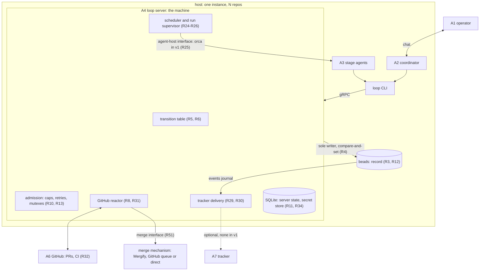
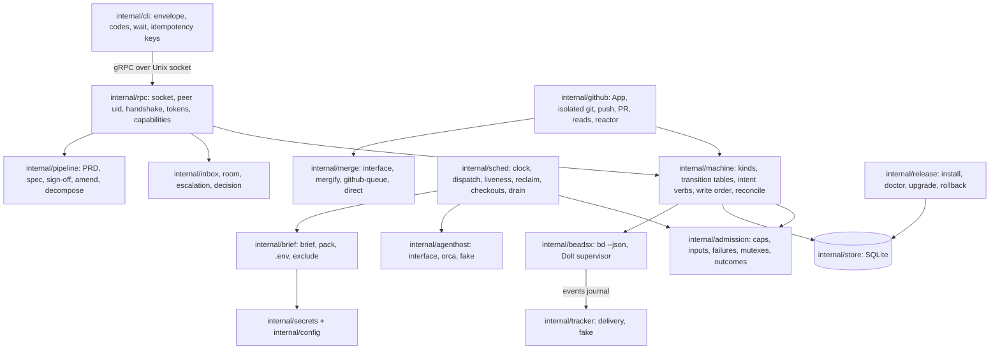
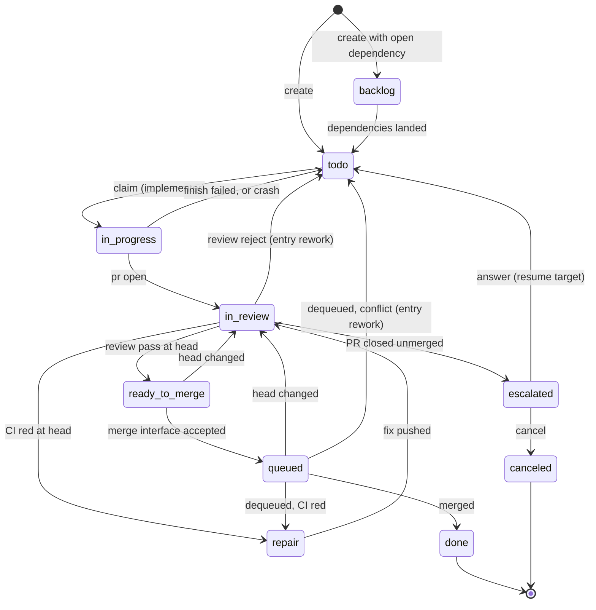
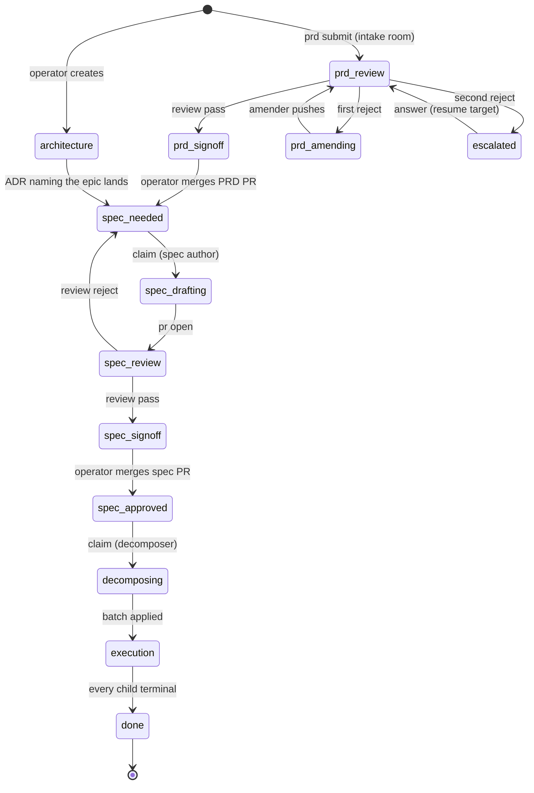
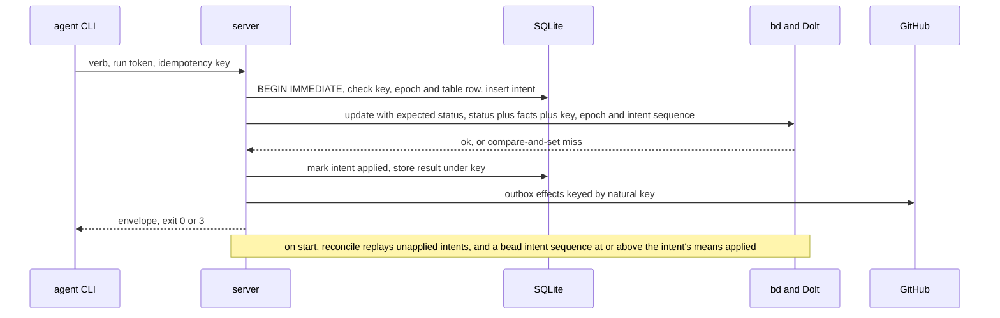
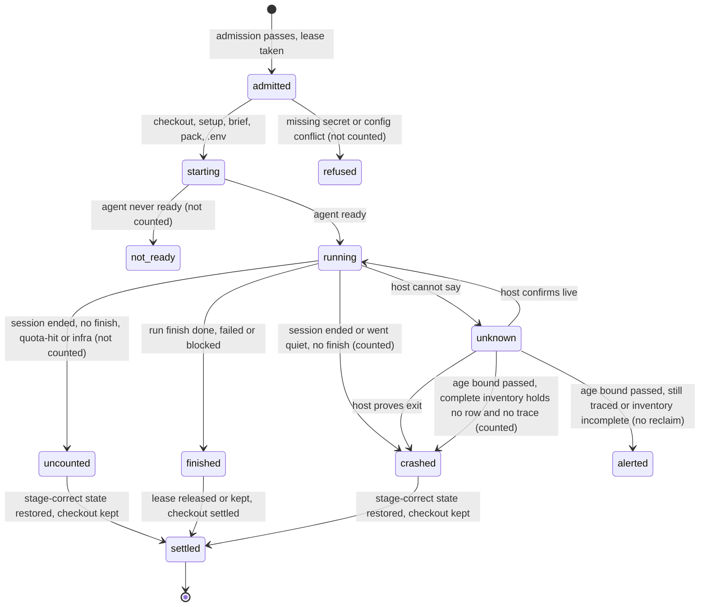
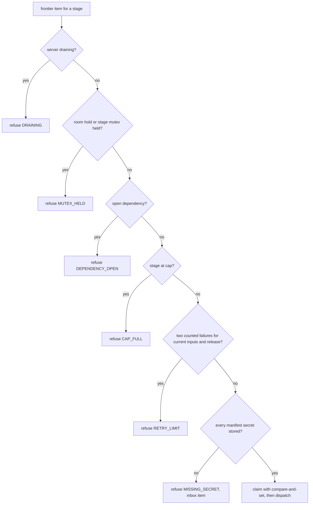

# Standalone SDLC Loop - Plan

## Goal Capsule

- **Objective:** One operator can run the agentic SDLC loop on any git repo, on any host, without Linear, orca timers, the devbox or Slothware credentials being built into the loop. The first proof is a new personal project that the loop drives end to end.
- **Means:** A standalone Go application in its own repository, shipped as one binary per platform. It holds a gRPC server and an agent-only CLI. Beads holds the record of work, and the server is the machine that decides moves, admits work, schedules runs and reacts to GitHub (KTD1, KTD2, KTD3).
- **Product authority:** Ian (owner). The TickerTown cutover, Travila, Xendit and every tracker adapter implementation are context, not active scope.
- **Execution profile:** Long, phased build in five phases (see Sequencing). Each phase ends with `make gates` green in the new repo. Phase 1 starts with the beads atomicity contract test (U3) because R12 rests on it.
- **Stop conditions:**
  - The beads atomicity contract test (U3) fails on the pinned version. R12 and the SQLite/beads split then need an owner decision.
  - The Dolt durability test (U3) shows that an update `bd` reported as done can be lost after a sql-server SIGKILL, and no pinned Dolt setting prevents it.
  - The orca restart measurement (U7) shows that a live run cannot be re-adopted. AE2 then holds for server outages only, and the operator decides whether that is enough.
  - An act would publish, spend money or create an outside identity: creating the GitHub repository, registering the GitHub App, installing Mergify on a repository, generating the release signing key, or publishing a release. The operator performs or approves each one.
- **Who finishes:** An implementing agent builds U1–U17 in a local clone of the new repository. The operator performs the acts in the stop conditions, runs the first `loop install` on the devbox, and confirms the end-to-end proof in U17.
- **Open blockers:** None.

---

## Product Contract

### Summary

Build the SDLC loop that drives TickerTown as its own Go application in a new repository. One server instance runs per host and manages any number of repos while keeping today's loop behaviour. The record of work moves into beads, and the rules of the machine move into the server, which also holds every platform credential and the secret store. The plan ports rules and outcomes from `scripts/sdlc` and reuses slothbot's patterns as design, without changing anything in TickerTown's current loop. v1 is proven by an acceptance suite drawn from today's tests, the state map and the escalation corpus, plus one live end-to-end run on a new personal project.

### Problem Frame

The loop works, but it can only run where it was born. It assumes Linear, orca timers, one devbox, one GitHub account and one repo. The operator works across three teams on three stacks. Slothware uses GitHub, Vercel, Linear and a self-hosted devbox. Travila uses GitHub, an in-house ERP and k8s. Xendit uses GitHub, Jira, k8s and BuddyCI, and its work must run only on the work MacBook. GitHub is the only constant.

The coupling goes deeper than the vendors. A work item's real state is spread over seven stores:
- Linear workflow state, labels, comment markers and assignee
- local lease files
- the GitHub PR
- git `main`, together with orca terminal liveness

Nine work-item kinds share one set of 22 Linear states. Ticket transitions have no table, so `queue move` accepts any edge (`scripts/sdlc/claim.ts`). `Done` has two writers, and only the Linear assignee keeps them apart (`docs/agents/merger.md`, `scripts/sdlc/merge-close.ts`). Some situations have no owner at all, such as a PR head that changes after a review pass. Lease identity is an orca terminal and its incarnation. About 15 commands, and most of the 18.8k lines of observability code, exist to watch or work around orca and Linear.

Secrets are spread across hand-placed files, chezmoi output and `.env` copies. `pnpm bootstrap` copies every `.env` file into every agent worktree, including a production database URL (`scripts/sdlc/bootstrap.ts`). A 1Password service-account token sits in every agent's environment. A 1Password session has blocked the unattended loop more than once.

A second slice of the same loop already exists but does not run. `apps/slothbot` is a standalone scheduler. Every one of the 22 stages in `.slothbot/settings.json` still has `"owner": "orca"`.

### Actors

- A1. Operator (Ian). Talks to the coordinator. Installs and upgrades the loop on each host.
- A2. Coordinator agent. One resident agent for each instance. It is the operator's main interface, opens breakout rooms at the operator's request, and uses the CLI.
- A3. Stage agents. These are the implementer, reviewers, fixer, authors and decomposer. They use only the CLI.
- A4. Loop server. The sole writer to beads. It holds the platform credentials and the secret store.
- A5. Host. Enforces isolation between deployments. It supplies the agent host (orca in v1), the harness logins and any cron.
- A6. GitHub. The truth for code, PRs and CI.
- A7. Tracker adapter. Optional for each project. v1 has none.
- A8. Room agent. The agent in a breakout room. It prepares and applies a decision with the operator, and uses the CLI.

### Key Decisions

- **One instance serves N repos on its host, and the host enforces isolation.** The server knows nothing about organisations. Governs R1, R2. (session-settled: user-directed — chosen over a control plane for each organisation: Xendit data must never touch the devbox, so a deployment is the isolation boundary)
- **Beads is the record, and the server is the machine.** Beads stores state and leases but enforces no edges, counts no retries and schedules nothing. Governs R3, R5, R24. (session-settled: user-directed — chosen over "beads replaces all state machinery": research found beads enforces no transitions and has no caps, retries or scheduler)
- **The server is the only writer to beads, through one pinned adapter.** Governs R4. (session-settled: user-approved — chosen over `bd` tracker sync and over agents calling `bd`: this guarantees the transition table and contains beads' frequent breaking releases)
- **Behaviour parity, not mechanism parity.** Rules and outcomes stay the same, and orca, Linear and the devbox become adapters. Bad smells are not ported, and minor ones are fixed during the port. Governs R13, R14, R15. (session-settled: user-directed — chosen over keeping the mechanism as is and over fixing every smell at once)
- **Sub-states become explicit.** Governs R6. (session-settled: user-approved — chosen over derived views: edges into and out of each sub-state can then be guarded)
- **Done at merge, with no deploy state.** Governs R9. (session-settled: user-directed — chosen over an optional or mandatory deploy state: deploy differs on Vercel and k8s and stays outside the loop)
- **Server state lives in SQLite, outside beads' Dolt database.** Governs R11, R12. (session-settled: user-approved — chosen over a separate database on beads' Dolt server and over tables inside beads' database: Dolt has no cross-database transaction, `bd dolt push` could carry secrets to the git remote, and Dolt's crash durability is disputed)
- **Nothing is lost on restart.** Governs R16, R17, R18. (session-settled: user-directed — the operator's requirement)
- **An agent's own retried write succeeds as a replay.** Governs R18. (session-settled: user-approved — chosen over refusing the retry with exit 3: an agent must not read its own success as a conflict)
- **A twice-failed ticket unlocks on new input, not on any merge.** An edit to the ticket, a change to its declared files or cited docs on the base, or a new loop release unlocks it. Governs R10. (session-settled: user-directed — chosen over unlocking on ticket edits alone and over resetting on any merge: a fix that lands in a declared file is new input, and an unrelated merge is not)
- **The CLI is agent-only, with a new noun-verb tree.** Governs R19, R20, R21, R22, R23. (session-settled: user-approved — chosen over keeping today's names and over aliases: the skill packs need a vocabulary pass anyway)
- **The coordinator and its breakout rooms are the only human interfaces, with one inbox per instance.** Governs R27. (session-settled: user-directed — chosen over a read-only board, a tracker as the human interface, and a merged inbox across instances)
- **Tracker projection is optional, through one interface with one implementation per tracker.** Governs R28, R29, R30. (session-settled: user-directed — chosen over beads' native hooks, which drop events, over exec plugins, and over a generic exec adapter)
- **Merges go through a merge interface, and each project picks its mechanism: Mergify, GitHub's merge queue or a direct merge.** Governs R51. (session-settled: user-directed — Mergify stays the batched mechanism because serial merging wasted CI time and Mergify's batches are proven in TickerTown; not every repository uses Mergify, so v1 ships all three, and the direct merge serves a repository with no queue)
- **Agents get no platform credentials.** Governs R31, R33. (session-settled: user-approved — chosen over an iron-proxy injector and over Infisical: neither isolates while agents share the server's OS user)
- **The server is the central secret store, filled by a one-time import.** Governs R34. (session-settled: user-directed — chosen over reading 1Password at run time: 1Password sessions blocked the loop before)
- **v1 writes every project secret into each run's `.env`.** Governs R34. (session-settled: user-directed — chosen over per-stage scoping for now: tighten once the mechanism works)
- **A missing manifest secret refuses the run.** Governs R53. (session-settled: user-approved — chosen over starting the run without it: a run that fails late on a missing key spends its failure budget for no reason)
- **Project config is committed in the repo.** Governs R35. (session-settled: user-approved — chosen over host-held config and over host overrides: it is reviewed like code and holds no secret values)
- **The skill pack ships with the release, and the server injects it into each run.** Governs R36. (session-settled: user-approved — chosen over a copy committed in each repo and over harness plugins: one version for each install ends copy drift)
- **One self-contained binary for each platform.** Governs R40. (session-settled: user-approved — chosen over a global npm install and over a build from a checkout: hosts need no Node, and a merge is not a deploy)
- **Upgrades run only on command.** Governs R41. (session-settled: user-directed — chosen over coordinator-driven and automatic upgrades. A host may run the command from its own cron)
- **Work enters through the coordinator.** Governs R44. (session-settled: user-approved — chosen over an intake source declared in project config and over both: the coordinator is already the only human interface)
- **Intake is an interactive brainstorm session that produces the PRD.** Governs R44, R45, R47. (session-settled: user-directed — chosen over the coordinator creating an epic from a short description for an unattended PRD author) ADR 0001 amends it. The brainstorm holds for work that the triage rubric scores at level 4 or 5, or the Choice outside. At level 1 to 3 the coordinator creates the epic with `loop epic create --request`, and the unattended `prd-author` stage writes its PRD from the operator's quoted request.
- **A session's PRD still passes review and the operator's sign-off.** Governs R46. (session-settled: user-directed — chosen over sign-off only and over approval at session end: review catches gaps the session missed)
- **A rejected PRD goes to the amender once, then to an intake room.** Governs R52. (session-settled: user-directed — chosen over reopening the intake room on every rejection: most review findings need no person)
- **Breakout rooms are a core primitive, and intake runs in one.** Governs R44, R49, R50. (session-settled: user-directed — chosen over holding the intake session in the coordinator's chat: a room leaves the main thread undisturbed)
- **Work is PRD-first, and only the operator can waive it.** Governs R44, R48. (session-settled: user-directed — chosen over PRD-first with a standing bug exception and over PRD-first with no exceptions: small work stays cheap only when the operator asks)
- **v1 targets a new personal project with no tracker.** Governs R43. (session-settled: user-directed — chosen over a TickerTown cutover first and over Xendit or Travila first)

### Requirements

**Topology and scope**

- R1. One loop instance runs per host and manages N projects, where a project is one git repo. No work item spans repos.
- R2. The server has no concept of an organisation. The host is responsible for isolating secrets, code and data between deployments.

**Record and machine**

- R3. Beads is the record for every work item: its kind, state, holds, the state that comment markers carry today, its claim lease and its timed resume.
- R4. Only the server writes to beads, through one adapter pinned to an exact beads version. Agents never call `bd`.
- R5. The server owns an explicit transition table for every work-item kind. Every write is an intent verb that the table validates, and it is applied with a compare-and-set on the current status. No verb sets a raw state.
- R6. Today's implicit sub-states are explicit states or typed attributes in the table: repair (red build in review), rework, resume, the escalated-model role and waiting sign-off.
- R7. Each work item has one owner: its claim lease. A projected tracker assignee is display only.
- R8. Each situation that the current loop leaves without an owner gets an owning transition: a head change after a review pass, a merge-queue failure while ready to merge, and a closed PR.
- R9. `Done` has exactly one writer, the transition that an observed merge triggers. A ticket is `Done` at merge.
- R10. Retry identity is the task inputs plus the loop release version. Task inputs are the ticket's own text and the content of its declared files and cited documents on the base branch. A twice-failed ticket is admitted again only when the ticket is edited, when a declared file or cited document changes on the base, or when a new loop release is installed.
- R11. Server-owned state lives in an embedded SQLite database in WAL mode that only the server writes. This covers retry counts, stage mutexes, schedule state, the live-run registry, adapter checkpoints, GitHub reactor cursors and the secret store. None of it lives in beads' Dolt database. The live-run registry is a durable cache that the start-up reconcile (R17) rebuilds, and the agent host stays the truth for whether a run is alive.
- R12. A fact that must change with a status changes in the same write as the status, or not at all. Examples are the reviewed head sha and the resume target.

**Behaviour parity**

- R13. Rules and outcomes match the current loop:
  - the stage set
  - the default caps: implementer 8, reviewers 10, code-reviewer 8 and intake 8 epics. Each is a host-config value (KTD30)
  - the failure limit of 2
  - escalation scoring: levels 1 to 3 go back to the loop, and levels 4 and 5 go to a person
  - merge eligibility: green CI and a review pass at the current head
- R14. The loop does not port any smell that the triage marks "must fix" or "gone by design". It fixes the minor smells during the port. Sources lists the triage.
- R15. The acceptance suite is a selection of scenarios from today's `scripts/sdlc` tests and from the transition rows of the current state map. The parity it proves is behaviour, not orca or Linear mechanics.

**Durability**

- R16. No server state lives only in memory. A crash, a host reboot or an upgrade restart loses no acknowledged state.
- R17. On start, the server reconciles before it acts. It checks live runs against the agent host, and its own records against beads, before it reclaims any lease.
- R18. An agent's write is either committed or refused, never in doubt. The CLI waits through a server restart and does not fail the run. A retry of the agent's own write that already landed returns success, marked as a replay.

**CLI**

- R19. The CLI serves agents only. It uses a noun-verb resource tree and prints JSON by default. All its verbs share one exit-code table: 0 done or work found, 1 nothing to do, 2 could not decide, 3 refused by the table or the compare-and-set, 4 keep waiting. Each code maps to one gRPC status.
- R20. One work query for each stage replaces today's separate readers for each stage.
- R21. The CLI prints its own schema: verbs, flags, exit codes and the transition table.
- R22. The loop does not carry over any command that exists only to work around orca, Linear or devbox limits. Examples are `dispatch`, `reclaim`, `stage-claims`, `sweep-window`, `detach`, `run-model`, `refresh`, `bootstrap`, `linear:archive`, `alert-check` and `supervisor-wake`.
- R23. The CLI refuses to talk to a server of a different version.

**Scheduling and runs**

- R24. The server is the only scheduler. Stages with no agent run as native server jobs.
- R25. The server starts agent runs through an agent-host interface, and the v1 implementation drives orca. The harness and model for each stage are configuration.
- R26. The server heartbeats and reclaims beads leases. On a reclaim it restores the right state for the stage rather than beads' default of `open`.

**Human interface**

- R27. The coordinator and the breakout rooms (R49) are the only human interfaces. The coordinator reads its instance's inbox through the CLI, brings questions to the operator in its chat, and records the answers. The loop has no other human-facing surface and no view across instances.

**Trackers**

- R28. Tracker projection is optional for each project. A project with no tracker runs on beads alone.
- R29. A tracker adapter is one interface with one implementation for each tracker. The interface has two operations: apply a batch of loop events, and reconcile from current state. Implementations are idempotent. v1 ships the interface and no implementation.
- R30. The server owns delivery from the beads events journal: a checkpoint, retries and ordering for each adapter. An adapter that stays down longer than the journal's retention recovers through reconcile.

**GitHub**

- R31. Agents perform every GitHub action through the CLI. The server pushes branches, opens PRs and writes comments and labels with its own GitHub App credentials.
- R32. GitHub is the truth for PRs and CI results. The loop reads them and stores no copy of its own.
- R51. The server lands eligible PRs through a merge interface. Each project's config names its merge mechanism, and v1 ships three: Mergify, GitHub's merge queue and a direct merge. The server marks a PR eligible only at its reviewed head with green CI, whatever the mechanism. The Mergify credential is a platform credential (R33), and onboarding a Mergify project installs the project's Mergify configuration.
- R54. Removed on 2026-10-21 by the operator. A PR that changes config, the manifest or CI gets no extra merge gate. The ID stays so later IDs keep their meaning.

**Loop faults**

- R55. A run, a room or the coordinator reports a fault in the loop itself with `loop fault report --file <path>`. The server stores the report and answers with a fault id, `F-<n>`, that never changes. Any later run reads the fault's status by that id with `loop fault show`. The coordinator triages each fault and resolves it as `fixed` with the release that fixes it, as a `duplicate` of another fault, or as `not-a-fault` with a reason. A fault is about the loop, not the project, so it is never a work item and never enters beads. (session-settled: user-directed — client runs cannot repair the loop as the coordinator can, so they need a way to report a fault and to learn when it is resolved)

**Secrets and config**

- R33. Platform credentials, such as the GitHub App key and tracker tokens, never leave the server.
- R34. The server is the central secret store and keeps its secrets encrypted. An import fills it from each project's secret manifest, using 1Password in v1. On a host with no source, the operator sets secrets by hand. Nothing reads 1Password at run time. At run start, the server writes every secret in the project's manifest into the run's `.env`.
  - Conflict to keep visible: the 2026-10-05 owner ruling in `docs/rules/shell.md` ("Keep each secret where its scope is") refused a host-wide file because one app's key must not reach every agent. R34 is scoped to one project, so it does not break that ruling, but it repeats the same exposure inside a project. The manifest therefore marks production secrets apart from the others, so per-stage scoping can land later without a format change.
- R35. Configuration has two scopes:
  - host config lives with the instance: projects, store identity and key, agent host, harness logins, platform credentials, and a throughput entry (cap and schedule) for every stage (KTD30)
  - project config is committed in each repo: the secret manifest, enabled stages, the model for each stage, the tracker adapter, the merge mechanism, gates and policy hooks, and schedule overrides

  The manifest holds secret names and source references only, never values.
- R53. A run whose project manifest names a secret with no stored value does not start. The server puts one inbox item naming the missing secret, and the refusal never counts toward the failure limit.

**Skill pack**

- R36. The loop's skill pack ships inside each release. At run start the server injects the pinned pack into the run's checkout for that run's harness, and names the runbook in the prompt.
- R37. Project policy stays in each repo. The loop pack names roles and loop states, never owner names, tracker states or host paths.
- R38. Three runbooks mix loop steps with project steps: overwatch, code-reviewer and implementer. Each one splits into a loop part and a project part.
- R39. A gate checks every command reference in the pack against the CLI schema from R21.

**Distribution**

- R40. Each release is one self-contained binary for each OS and architecture, holding the server, the CLI and the pack. `loop install` registers the service, with systemd on Linux and launchd on macOS. The host needs no Node or pnpm. The pinned `bd` and `dolt` binaries are provisioned beside it, and the server supervises them.
- R41. Upgrades run only through `loop upgrade <version>` on each host, by hand or from the host's own cron. An upgrade stops admitting runs, waits for in-flight runs or a timeout, swaps the binary and restarts. `loop rollback` restores the previous binary. The loop has no self-updater.
- R42. The server runs outside every project checkout. A merge to a project's `main` never changes the running loop.

**v1 target**

- R43. v1 is done when a new personal project with no tracker runs the loop from work entry to merge. That means implement, review and merge, plus the document and decompose stages for epics. Escalations reach the operator through the coordinator, and the R15 suite passes.

**Work entry**

- R44. Work starts with a PRD. Work that the triage rubric scores at level 4 or 5, or the Choice outside, enters through an intake room. The operator and an agent write the PRD together in a brainstorm session inside an intake room (R50), and the session's output is the PRD. On this path no unattended stage drafts the PRD. Work at level 1 to 3 enters by a second path (ADR 0001). The coordinator creates a PRD epic with `loop epic create --request`, and the unattended `prd-author` stage drafts its PRD from the operator's quoted request.
- R45. A PRD states requirements from the end user's view as user stories, and each story carries a stable label (US-01, US-02 …). Specs and tickets cite the story labels they implement.
- R46. A session's PRD enters the loop as an epic with its PRD in review. The doc-reviewer stage reviews it, and the operator signs it off by merging its PR. Only then does the spec stage start. A spec passes the same review and the same sign-off by merge.
- R52. When the doc-reviewer rejects a PRD for the first time, the amender stage revises it once from the review findings, unattended. A second rejection puts the epic in the operator's inbox for an intake room.
- R47. The brainstorm session skill ships in the loop's own skill pack (R36), not as a dependency on a vendored plugin.
- R48. The coordinator creates a ticket that skips the PRD only when the operator explicitly asks for one, for small work such as a bug or a chore. The coordinator never waives the PRD on its own.

**Breakout rooms**

- R49. A breakout room is a core loop primitive. It is a separate interactive agent session with its own checkout, where the operator talks to an agent and the coordinator's thread stays undisturbed. Only the operator, or the coordinator at the operator's request, opens a room, and no timer opens one. A room prepares a decision and applies it, and it never makes the decision.
- R50. Three kinds of room exist:
  - intake: a brainstorm session that produces a PRD (R44)
  - escalation or decision: a person answers what waits on them
  - review: a person reads a PR with an agent on its head branch

  The server starts each room through the agent-host interface (R25).



### Key Flows

- F1. A ticket from claim to merge
  - **Trigger:** The server admits a ticket for a stage, takes its lease, and then starts the run with the ticket named in the run's brief. The per-stage work query (R20) serves the coordinator and stages that take more work in one run.
  - **Actors:** A3, A4, A6
  - **Steps:** The agent works in its checkout, and the server pushes the branch and opens the PR. A reviewer passes at a head, and the server records the head sha with the state change. If the head changes, the server returns the ticket to review. The server hands an eligible PR to the merge interface and marks the ticket `Done` when it observes the merge.
  - **Outcome:** One writer for each move, and every move checked against the table.
  - **Covered by:** R5, R7, R8, R9, R12, R13, R31, R51
- F2. An escalation reaches the operator
  - **Trigger:** A stage scores a blocker at level 4 or 5.
  - **Actors:** A3, A2, A1
  - **Steps:** The item moves to the human-owned state with its resume target. The coordinator sees it in the inbox and asks the operator in chat. The coordinator records the answer through the CLI, and the server resumes the item to its target.
  - **Covered by:** R13, R27
- F3. An upgrade
  - **Trigger:** The operator, or a host cron job, runs `loop upgrade <version>`.
  - **Actors:** A1, A5, A4
  - **Steps:** The server stops admitting runs and waits for in-flight runs or a timeout. It swaps the binary and restarts, then reconciles and resumes. The new pack applies from the next run.
  - **Covered by:** R16, R17, R36, R41
- F4. A PRD from intake to tickets
  - **Trigger:** The operator asks the coordinator to start new work.
  - **Actors:** A1, A2, A8, A3, A4
  - **Steps:** The coordinator scores the request against the triage rubric. At level 4 or 5, or the Choice outside, it opens an intake room. The operator and the room agent write the PRD, and the room submits it. At level 1 to 3, it runs `loop epic create --request`, and a `prd-author` run writes the PRD and submits it. The doc-reviewer reviews the PRD from either path. A first rejection goes to the amender, and a second goes to the operator's inbox. The operator merges the PRD PR, and the spec follows the same review and sign-off. The decomposer turns the approved spec into tickets that cite story labels.
  - **Covered by:** R44, R45, R46, R47, R49, R50, R52

### Acceptance Examples

- AE1. **Covers R8, R12.** Given a ticket passed review at sha A and is ready to merge, when a new commit B lands on the PR, then the ticket returns to review, and no merge can start at B without a new pass.
- AE2. **Covers R17, R26.** Given a live run whose agent kept working through a server outage longer than the lease TTL, when the server starts, then it re-adopts the run and renews the lease before it reclaims anything, and the run is not reclaimed.
- AE3. **Covers R5, R19.** Given a ticket in review, when an agent asks for a move that the table does not allow, then the CLI exits 3 and the state does not change.
- AE4. **Covers R18.** Given the server is restarting, when an agent runs a write, then the CLI waits and retries. When the agent's own write already landed, the retry exits 0 and reports a replay. When another actor's write won, the retry exits 3 and the state shows the other actor's move.
- AE5. **Covers R10.** Given a ticket failed twice at one stage with unchanged inputs, when an unrelated project PR merges to `main`, then a third attempt is still refused. When the ticket is edited, when a merge changes one of its declared files, or when a new loop release is installed, an attempt is admitted.
- AE6. **Covers R41.** Given two runs in flight, when `loop upgrade` runs, then the upgrade admits no new run, swaps only after both finish or the timeout passes, and loses no lease.
- AE7. **Covers R52.** Given a PRD in review, when the doc-reviewer rejects it, then the amender revises it once. When the doc-reviewer rejects the revised PRD, the epic waits in the operator's inbox for an intake room, and no unattended stage revises it again.
- AE9. **Covers R55.** Given an implementer run hits a fault in the loop, when it writes a report to `/tmp/fault.md` and runs `loop fault report --file /tmp/fault.md`, then it gets `F-1`, and the coordinator's inbox holds one fault entry. A later run's `loop fault show F-1` returns `open`. After the coordinator runs `loop fault resolve F-1 --fixed-in v1.4.0`, `loop fault show F-1` returns `fixed`, `fixed_in: v1.4.0` and the release this host runs.
- AE8. **Covers R53.** Given a project manifest names `STRIPE_KEY` and the store holds no value for it, when a stage would start a run on that project, then no run starts, one inbox item names `STRIPE_KEY`, and the failure count does not change.

### Scope Boundaries

**Deferred for later**

- Tracker adapter implementations (Linear, Jira, the Travila ERP), the TickerTown cutover, and onboarding Travila or Xendit projects.
- Intake from a configured source, such as TickerTown's locked sources.
- Per-stage secret scoping. In v1 every run gets the whole manifest.
- Running the server as a separate OS user from the agents.
- Deploy tracking, an MCP interface, work that spans repos, and projects scoped to a path inside a monorepo.

**Outside this product's identity**

- A human-facing UI, a board, or an inbox merged across instances.
- Any concept of an organisation inside the server.
- A self-updater.

**Deferred to Follow-Up Work**

- Two live leaks in TickerTown's current loop stay out of this plan: `OP_SERVICE_ACCOUNT_TOKEN` in every agent's environment, and `pnpm bootstrap` copying the production database URL into every worktree. Each needs its own change in this repo.
- Project-specific stages that are TickerTown policy, not loop behaviour: nightly QA, `heavy`, alerts from `apps/batch`, design issues, and the Willis routing in `skills/sdlc-decisions/SKILL.md`.

### Dependencies / Assumptions

- The v1 host is the devbox, CI is GitHub Actions, and agents start through orca with Claude Code or Codex. The operator has not corrected this assumption.
- Known gap in v1: the server and agents share one OS user, so "agents get no platform credentials" (R33) is a convention, not a guarantee. An agent could read the server's store and its key file, and could still push with the host's SSH key. The gap closes with the separate-user setup that Scope Boundaries defers.
- Beads leases arrived in v1.3.0 on 2026-09-15 and have open defects. Beads ships breaking releases about once a week. R4 pins the version.
- Beads runs on one Dolt sql-server for each instance, pinned to Dolt 2.2.0, with one beads database for each project (KTD3).
- The personal project's repository can install the GitHub App, and Mergify when the project uses Mergify. Mergify's plan for that repository may cost money, so the operator chooses it.
- GitHub offers its merge queue only on some repositories, such as those an organisation owns. A personal repository with no Mergify plan uses the direct merge.
- Later, for Xendit: BuddyCI posts its results to GitHub as commit checks. If it does not, CI needs its own adapter.

### Outstanding Questions

**Deferred to Implementation**

- Whether orca can re-adopt a live run after orca itself restarts. U7 measures it first, and AE2 is claimed for agent-host outages only if the measurement supports it.
- Whether a Go darwin/arm64 binary cross-built on Linux carries a working ad-hoc signature. U16 checks one build on a Mac.
- How the Jev key reaches the triage panel in the fixer run: a project manifest secret or a host credential that the server writes into fixer runs only. U12 decides while it ports `decide`.

### Planning Amendments

The planning pass changed these Product Contract entries. Each change follows a decision settled in the planning session or a research finding, and the IDs stayed stable.

- R10 and AE5 now state the unlock rule. The original text said "a merge in a project repo never resets the two-failure limit", and today's code already resets it when a declared file changes (`scripts/sdlc/admission-input.ts:32`).
- R11 names the live-run registry as a durable cache, which resolves the tension with ADR 0025's refusal of a run ledger.
- R12 is phrased as an outcome, not as a `bd` flag, per `docs/rules/requirements.md`. U3's contract test is its check.
- R18 and AE4 add the replay rule.
- R34 carries the conflict call-out. R40 names the `bd` and `dolt` binaries.
- R46 adds spec sign-off, for parity with today's `Spec Sign-off`.
- R51, R52 and R53 are new. AE7, AE8 and F4 are new.
- R51 and its Key Decision changed on 2026-10-21 at the operator's direction: not every repository uses Mergify, so each project names its merge mechanism, and v1 ships Mergify, GitHub's merge queue and a direct merge. R35 follows that change.
- On 2026-10-22 the operator chose a one-command install and fully automatic releases (KTD26): each green push to `main` is signed in CI with the `LOOP_RELEASE_KEY` Actions secret and published. This is personal software, so no offline key. `loop install` also sets linger and the harness settings, and creates the App through GitHub's manifest flow.
- On 2026-10-21 the operator asked that `loop restore` run with no manual step. It drains, stops, swaps and restarts like an upgrade, and it keeps the current secret table (KTD26).
- R55, KTD31, AE9 and U18 are new on 2026-10-21 at the operator's direction: client runs report loop faults through the CLI and read their status by a fault id.
- On 2026-10-21 the operator chose three more changes. The App gets the `workflows` permission (KTD15). Inbox agent text sits in `<!--sdlc:agent-->` tags (KTD21). Every stage has a throughput entry in host config (KTD30).
- R54 came from the planning security review. The operator removed it on 2026-10-21 as over-engineering. A PR that changes config, the manifest or CI follows the normal review and merge path.
- F1's trigger moved to claim at dispatch (KTD7). The Outstanding Questions that were deferred to planning are resolved in the Planning Contract.

### Sources / Research

- Current loop: `scripts/sdlc/states.ts` (frontier states), `scripts/sdlc/admission-policy.ts` (`FAILURE_LIMIT = 2`), `scripts/sdlc/admission-input.ts` (the input hash), `scripts/sdlc/claim.ts` (no transition table), `scripts/sdlc/merge-close.ts` and `docs/agents/merger.md` (two `Done` writers), `scripts/sdlc/review.ts` (dead round-cap escalation), `scripts/sdlc/bootstrap.ts` (copies `.env` files), `scripts/sdlc/credentials-dir.ts` (the one credential resolver), `scripts/sdlc/runbook-check.ts` and `scripts/sdlc/runbook-dispatchers.ts` (the runbook-to-CLI contract), `scripts/sdlc/agent-launch.ts` (the prompt names the runbook by path).
- Existing scheduler: `apps/slothbot`, `.slothbot/settings.json`, `docs/adr/0025-slothbots-server-is-a-clock-and-a-chooser-and-orca-holds-each-run.md`, `docs/plans/2026-10-12-slothbot-cutover-plan.md`.
- Smell triage behind R14. Must fix: no ticket transition table, four ownership sources, two `Done` writers, transitions with no owner, retry identity bound to the machinery. Gone by design: labels and comment markers acting as state, the intake mutex held in a Linear issue, Linear state types carrying load, unassigned items lost in Drafting, two cron sources, a dormant second scheduler, script timers abusing the precheck. Minor: the dead round-cap escalation and doc drift in the fixer, overwatch and timers docs.
- Beads: https://beads.gascity.com/ and https://github.com/gastownhall/beads (statuses, claim leases, gates, the events journal, tracker sync, release notes for v1.3.0). The Go module path is `github.com/steveyegge/beads`.
- Dolt: https://github.com/dolthub/dolt and the beads Dolt notes at https://beads.gascity.com/architecture/dolt.md (no cross-database transactions, the single-writer embedded mode, the 2.2.0 pin). Crash-durability report: https://github.com/gastownhall/beads/issues/4443.
- Secrets candidates evaluated and set aside for v1: https://github.com/paradigmxyz/iron-proxy and https://github.com/Infisical/infisical.
- Learnings that shaped the Planning Contract: `docs/solutions/2026-10-18-orca-sweep-kills-live-runs.md`, `docs/solutions/2026-10-16-codex-unattended-startup.md`, `docs/solutions/2026-10-16-supervisor-wake-prompt-gate.md`, `docs/solutions/2026-10-16-failure-source-attribution.md`, `docs/solutions/escalation-triage-corpus.md`, `docs/solutions/correction-ledger.md` (rows `no-hand-step-after-a-merge`, `blocked-on-you-is-a-person-act`, `a-page-must-be-earned`), `docs/commands/dispatch.md`, `docs/commands/land.md`, `docs/commands/reclaim.md`, `docs/plans/evidence/slothbot-orca-dispatch-a1.md`.

---

## Planning Contract

Unit file paths are relative to the root of the new repository, called `loop` here. A citation marked "(alpha)" is relative to this TickerTown repository and points at the behaviour a unit ports.

### Key Technical Decisions

**Stack and repository**

- KTD1. **Go 1.26, one static binary with cgo off.** grpc-go 1.84 serves over a Unix socket. modernc.org/sqlite bundles SQLite 3.53.x, so the version is the same on Linux and macOS. `go:embed` carries the pack, the proto descriptor set and the service templates. Targets are linux/amd64, linux/arm64 and darwin/arm64. Never strip a darwin binary. (session-settled: user-directed — chosen over TypeScript on Bun and over a Node single-executable build: Go has no verified blocker, while Bun on macOS uses Apple's unpinned SQLite and has an open Unix-socket server bug, and Deno enters maintenance-only from 2026-10-09)
- KTD2. **A new standalone repository.** The loop does not live under `apps/` in this monorepo, so R42 holds by construction and the pnpm toolchain does not apply. (session-settled: user-approved — chosen over a directory in this monorepo: a loop inside a project it drives is what broke slothbot's deployment)
- KTD3. **Beads through the pinned `bd --json` CLI, on one supervised Dolt sql-server for each instance.** The Go library is marked experimental, needs cgo for embedded Dolt and shows no status compare-and-set. Each project gets its own beads database, and every beads workspace lives under the instance state directory, never in the repo. No Dolt remote is configured, so `bd dolt push` has nowhere to go. The server never uses beads' `deferred` status, `defer_until` or `bd reclaim`, because each writes `open` over a custom status. `project add` refuses a workspace that enables any automatic transition. Exit code 13 from `bd` maps to a typed compare-and-set miss.
- KTD4. **Slothbot is reused as design, not as code or deployment.** The parts ported to Go are the cron clock (`apps/slothbot/src/scheduling/clock.ts:62`), project registration by id, the serial queue with the single-instance bind (`server.ts`), the atomic-write discipline, the quota-gated chooser (`src/wake/choose.ts:87`) and the service-install `--check` pattern (`src/service/install.ts`). The orca supervisor, wake, cutover and quota-read code is not ported, and its unit file breaks R42.

**State and durability**

- KTD5. **SQLite settings.** WAL, `synchronous=FULL`, `foreign_keys=ON`, `busy_timeout=5000` and `journal_size_limit` are set at open. One writer connection serves every write in `BEGIN IMMEDIATE`, and a reader pool serves reads. Migrations are forward-only numbered SQL, each in one transaction, tracked in `user_version`. Each migration also records a minimum reader schema. An older binary opens a database whose minimum reader schema it meets, so rolling back after an additive migration restores nothing. The server refuses to start on a database whose minimum reader schema is above its own. `VACUUM INTO` takes the snapshot that KTD26 places.
- KTD6. **One write order across SQLite, beads and GitHub, with a fencing epoch.** The server holds a per-item lock across all three steps, so an item has at most one unapplied intent. A second intent waits, and a retried key whose intent is still in flight joins it. The order is:
  1. One SQLite transaction checks the idempotency key, the lease epoch and the table row. It records the intent, its outbox rows and any reactor cursor advance together.
  2. One `bd update` with an expected status writes the status and its facts, plus the idempotency key, the epoch and the item's intent sequence in metadata. The intent sequence only increases. The epoch is checked again here, and a stale epoch makes the intent `LEASE_NOT_HELD`.
  3. SQLite marks the intent applied, stores the result under the key and makes its outbox rows runnable.

  Rules around the order:
  - **Outbox effects.** GitHub effects run as outbox steps, each idempotent by a natural key: PR by head branch, status by sha and context, comment by marker id.
  - **Deciding "applied".** An intent is applied when the bead's intent sequence is at or above the intent's own sequence. The per-item lock and reconcile-before-serve make current metadata enough, because a later write only raises the sequence. A lookup of the key in the item's beads events journal is a second signal, and it only raises divergence alerts.
  - **An unclear `bd` result** (a timeout, or a dropped connection) leaves the intent unapplied. The server re-reads the bead's intent sequence before it answers, and it never answers exit 3 from a timeout.
  - **Replay on start.** Reconcile replays unapplied intents in intent order. It finishes before the socket, the reactor or the scheduler starts.
  - **Re-verification.** On start, and after every Dolt restart the supervisor makes, reconcile checks each intent applied since the last verified mark against the bead's intent sequence. A missing write is applied again through the status check, or raises a divergence alert.
  - **Epochs on start.** Each lease epoch is raised to the larger of the SQLite and bead values. An alert follows when the bead's epoch was ahead.
  - **Divergence.** A bead that changed outside the server raises a divergence alert and is never overwritten.
  - **Failures.** A failure is a record keyed by run id, never a counter, so a replay cannot count it twice. It is also written into the bead as a fact (R12), so a lost SQLite row can be rebuilt.
- KTD7. **Claim at dispatch, and agents never heartbeat.** The server takes the lease before it starts a run and names the item in `.loop/brief.json`, so no run starts on an empty queue or races another run. Liveness comes from the agent host plus every CLI call the run makes. `loop run finish` is the completion signal. A session that ends without it is classed by KTD8. The lease epoch increases only on a grant, a reclaim or an observed merge. A renewal or a re-adoption keeps the epoch, so a re-adopted run's next write succeeds.
- KTD8. **Run outcome classes decide the failure budget.** `done` and `failed` are reported by the run. A session ends when its harness process exits, or when the agent host reports it ended: the harness transcript shows its last turn ended, and the checkout then stays quiet for the quiet period (30 minutes, ported from `scripts/sdlc/finished-agents.ts`, alpha). An interactive harness waits at its prompt after its turn, so the quiet-period signal is the usual end. The agent host then closes that session and keeps its checkout. Every stage run holds a claim from dispatch (KTD7), so a claimed run that reached `running` and ended with no finish is `crashed`, whether or not it made a CLI call, and it counts once. These never count: `not-ready` (the agent never became ready), `quota-hit` (the run hit a usage limit, which also pauses that harness until its reset), and `infra` (defined below). Each non-counting class raises an inbox alert only when it repeats. The server writes a liveness tick to SQLite every 15 seconds, so a SIGKILL or a power loss still leaves an outage record: the span from the last tick to the next start. A run is `infra` when a recorded outage began after its last CLI call that the server observed, and the run made no CLI call after that outage ended. A run whose end time is unknown is never counted.
- KTD9. **The live-run registry is a cache, and liveness has an age bound.** The agent host stays the truth. An absent run counts as absent only on a complete inventory. A run budget bounds one live run. Host config sets it, and project config may override it for each stage. A live run past its budget raises a coordinator-owned alert and is never stopped automatically. A run whose liveness reads `unknown` keeps its lease for two run budgets. Past that bound, a complete inventory of any epoch that lists no row with the run's exact identity and no row that carries its incarnation or its PTY settles the run as `crashed` (KTD8): it counts once, its lease returns to the stage-correct state, and its checkout stays. A run still traced under another handle, or one that only an incomplete inventory read, keeps its lease and raises a coordinator-owned alert (operator decision, 2026-10-24, F-21). (Resolves R11 against ADR 0025.)
- KTD10. **Agents live outside the server's cgroup.** systemd's default `KillMode=control-group` would kill every child on a restart. Runs live in the agent host's processes, so an upgrade restart never kills one. The unit uses `Restart=on-failure` and `Type=notify`, and the server logs to the journal.

**Contract and identity**

- KTD11. **One envelope and a closed refusal-code set.** Every verb prints `ok`, `exit`, `verb`, `request_id`, `server_version` and `data`. A refusal adds `code`, `rule`, `item`, `current_status`, `expected_status`, `allowed_next` and `hint`, and `allowed_next` names verbs, not states. An empty result is `data: []` with exit 1. A usage fault is code `USAGE` with `retryable: false`. The schema lists every code. Runbooks branch on the code, never on the message.
- KTD12. **Run tokens and a capability matrix.** The server writes a token into each run's, room's and coordinator's checkout, and the CLI sends it with every call. A stage run moves only the item it holds, along its stage's edges. A room applies only to its one item. Only the coordinator answers the inbox, opens rooms and creates PRD-less tickets. Access is denied by default, and a call with no token gets the meta verbs only. Host verbs (`install`, `upgrade`, `rollback`, `restore`, `drain`, `project add`, `secret set`, `secret import`) need a host-admin credential that never enters a checkout. `loop install` writes that credential to a 0600 file in the instance directory, and the CLI reads it only from that file, never from the environment. The socket checks the peer uid and reads the peer pid. A host verb whose caller's working directory or parent process sits inside a registered checkout or agent session is refused, and so is a run token used outside its own checkout. The one exception is the coordinator's token inside the coordinator's own checkout: the operator decided on factorio-obc, 2026-10-23, that "the server should not refuse the coordinator of loop itself", so the coordinator calls `upgrade`, `rollback`, `doctor`, `project list` and `project show` there. Each such refusal raises an audit alert. Each token is bound to its run id and lease epoch, and settlement revokes it. Every transition records its actor. In v1 these checks make a bypass visible but cannot stop it, because agents share the OS user.
- KTD13. **Idempotent writes and a bounded wait.** The CLI derives each write's key from these parts:
  - run id, verb and canonical arguments
  - expected status, and the item's applied-transition sequence
  - a hash of the content being written: the local HEAD sha for `branch push`, the body for a note or a reply

  The CLI reads the expected status and the sequence from the server, and it appends the derived key, with its verb, canonical arguments and content hash, to `.loop/pending.jsonl` in the checkout before it sends the write. It clears that entry on a definitive answer, exit 0 or exit 3. A repeat of the same verb, arguments and content hash while its entry is pending reuses the pending key, so a fresh CLI process that repeats a command after a lost answer reuses the key even after the first write moved the status. A second real command, such as a second push in one repair run, finds no pending entry and gets a new key. A matching replay returns the stored result with `replayed: true`. The same key with different arguments is a `USAGE` refusal. The coordinator adds a request id that it keeps, because its session outlives any run. Keys stay until their run settles, plus the CLI wait budget, and a settled run's token is refused. Argument canonicalisation is frozen for every verb present in two consecutive schemas. While the server restarts, the CLI waits for readiness with backoff for up to 100 seconds, below Claude Code's default 120-second tool timeout, then exits 4 with `retry_after`. The pack's turn skill tells an agent to run the same command again on exit 4, and the pending key makes that safe. A restart longer than one wait therefore costs the agent repeated calls, not a failed run. A version handshake on the first call refuses a skewed CLI with `VERSION_MISMATCH`, except that a run started under the previous release may call any verb present in both schemas.

**GitHub, merge and secrets**

- KTD14. **The server never runs an authenticated git command inside a checkout.** The agent controls the checkout's `.git/config` and hooks, so a local credential helper, hook, `pushurl` or `insteadOf` would otherwise capture or redirect the App token. The server keeps one bare mirror for each project in the instance directory. Every server git call runs with `GIT_CONFIG_GLOBAL=/dev/null`, `GIT_CONFIG_NOSYSTEM=1` and hooks off.
  - **Push.** `loop branch push` fetches the item's sha from the checkout into the mirror with no token. It then scans and pushes from the mirror over HTTPS with an App installation token, an explicit URL and refspec, `--no-follow-tags` and `--no-recurse-submodules`. It pushes only the item's assigned branch, never the base, with `--force-with-lease=<ref>:<full-sha>` against the last head the server recorded.
  - **Scan.** The scan covers the tree and message of every new commit, not the net diff, so a secret added and then removed is still found. It refuses an injected path or a stored secret value (`SECRET_IN_DIFF`). A change to `.gitmodules`, a gitlink, or a filter or LFS line in `.gitattributes` is refused with `UNSAFE_PATH`, and the operator makes that change by hand. R54's sign-off gate is gone, so a refusal is the simple guard here.
  - **Sync.** `loop branch sync` fetches the base into the mirror with the token, and the checkout fetches from the mirror path with none. Agents therefore need no read credential. A push first records a push intent in SQLite with the branch, the old sha and the new sha. A remote head that equals a pending push's new sha is the server's own, and reconcile finishes that intent. A retried push whose remote already holds the intended sha is a replay. Any other head the server did not push is foreign: the ticket returns to review and an audit alert follows. Ported from `scripts/sdlc/machinery-publish-flow.ts:105-125` (alpha).
- KTD15. **Eligibility is a commit status, because the App cannot approve its own PR.** A review pass writes `reviewed_head` into the bead with the state change, and then the server posts the `loop/eligible` status on that sha. Branch protection requires CI plus that status, with no approval count. This instantiates the merge Key Decision (Governs R51): the merge interface hands an eligible PR to the project's mechanism (KTD29). Branch protection requires `loop/eligible` from the loop App as its expected source. The App's permissions and tokens are kept to the minimum:
  - **Granted:** contents, pull requests, statuses and workflows read and write, checks and actions read, and metadata. The operator adds `workflows`, so an agent's PR may change CI. Actions write is added only if CI rerun needs it.
  - **Never granted:** `administration`, `secrets` and `members`.
  - **Tokens:** every installation token is minted for the one project repository with the smallest permission subset, and it stays in memory.
  - **The App private key** lives in the encrypted store, not in plaintext host config.
  - **`loop doctor`** fails on an installation set to all repositories or on any extra permission.
- KTD29. **Three merge mechanisms behind one interface.** Project config names the mechanism: `mergify`, `github-queue` or `direct`. The interface has three operations: hand off an eligible PR, withdraw it, and read its outcome as merged, dequeued with a reason, or closed. Each mechanism hands off only a PR whose `loop/eligible` status is at its current head, and each outcome reaches the same ticket transitions. One contract suite runs against all three.
- KTD30. **Every stage has a throughput entry in host config.** Each entry holds `cap`, the most the stage holds at once, and `schedule`, the stage's cron. The cap counts live runs for a run stage. For intake, it counts epics in counted document states. Native server jobs have an entry too. R13's numbers are the shipped defaults, and no cap lives in code. Config load refuses a stage with no entry and names that stage. A changed entry takes effect on the next config load, with no restart. Project config may override `schedule` only (R35). (session-settled: user-directed — every subloop and routine needs throughput config, because hard-coded caps were painful in the current loop)
- KTD31. **Faults live in SQLite, for the instance.** The CLI reads the report file, which may be at any path, and sends its text. The server caps a report at 64 KiB and refuses one that holds a stored secret with `SECRET_IN_OUTPUT`. A report is idempotent like every write (KTD13). The server records the reporting principal, project, item, stage and loop release with it. A fault moves `open` → `acknowledged` → `fixed` (with `fixed_in`), `duplicate` (with `of`) or `not-a-fault` (with `reason`). `loop fault show` returns the status, the resolution and the release this host runs, so a run can see that a fix exists and is not yet installed. Each new fault adds an inbox entry with `awaits: coordinator` and rings `notify`. The report text sits in `<!--sdlc:agent-->` tags (KTD21). Each run's brief lists the open and recently fixed faults filed from its project and stage, by id, so a later run learns the status without asking. A run that a fault stops finishes with `run finish --outcome blocked --fault <id>`, and `blocked` never counts toward the failure limit (KTD8).
  - **`mergify`** labels the PR, as `.mergify.yml` (alpha) does with `sdlc-eligible` today. The project template queues on the label plus the status, with merge commits and batches.
  - **`github-queue`** adds the PR to GitHub's merge queue with the App token. GitHub checks required statuses on the merge-group commit, not on the PR head. The server therefore posts `loop/eligible` on a merge-group commit only when every PR in that group is eligible at its queued head. The merge-group branch name is the place to read a group's PRs, and GitHub may change its format. `project add` refuses this mechanism when the default branch has no merge-queue rule.
  - **`direct`** merges one PR at a time for each project through GitHub's merge API, with a merge commit. It passes the reviewed head sha, so GitHub refuses the merge when the head moved, and the reactor returns the ticket to review. A PR that GitHub refuses because its branch is behind the base or conflicts goes to `todo` with `entry: rework`. On a busy base this costs another review and another CI run for each merge, and that cost is accepted for a repository with no queue.
- KTD27. **One redactor guards every outbound channel.** `SECRET_IN_DIFF` covers pushed content only, while agents hold `.env` and read outside text from PR threads and CI logs. The `SECRET_IN_OUTPUT` refusal therefore applies to every GitHub write, every beads write, every inbox and alert entry, every log line and every error envelope. It matches each stored value, the live App token and every live run token, in plain, base64, hex, URL-escaped and JSON-escaped forms. The CLI marks thread, comment and log text with its author class (App, operator or other), and the brief tells the agent to treat that text as data. A value that an agent splits or otherwise changes stays undetectable, and that residual risk is recorded.
- KTD28. **`secret import` shows new references and refuses an undeclared vault.** `secret import` prints the source references added since the last import, and it refuses a reference outside a vault that host config declares. This closes the path where an agent-merged manifest entry pulls an unrelated 1Password item into every run.
- KTD16. **The reactor polls, and a merge wins from any state.** The devbox has no public webhook, so the reactor polls with cursors in SQLite. On start it reconciles the PR of every non-terminal ticket and epic, whether the PR is open or closed. A merge into the base moves any non-terminal ticket to `done`. When that write misses on status, the reactor reads again and retries until the item is `done` or terminal, and it never drops a merge. That one write also bumps the lease epoch, so the old run's next write gets `LEASE_NOT_HELD`, and it moots open inbox entries. A merge into another branch finishes nothing. CI cancelled by a newer push is superseded, not red. "Base branch was modified" retries with fresh eligibility. One rate-limit cooldown is shared by every GitHub caller.
- KTD17. **Envelope encryption behind a `KeyProvider` interface.** Each secret has its own data key under AES-256-GCM. The additional data binds project, secret name and key version, so a ciphertext cannot be swapped between rows. The key-encryption key is a host key file at mode 0400 in a 0700 directory, outside the database and outside every snapshot. Each wrapped key carries a `key_id`, so rotation and a later move to a separate OS user change no format. Every platform credential lives in this store: the App private key, the Mergify token and any tracker token. Host config names each one and holds no value. `loop secret import` calls `op` once, at the operator's hand. `.env` is written at mode 0600 and listed in `.git/info/exclude`. It is removed at every settlement, including a crashed run whose checkout is kept, and when a room goes idle or `interrupted`. A room's `.env` is written again when the room reopens. `loop doctor` lists every `.env` with no live run, and `--fix` removes it. With one OS user, this protects a leaked database or snapshot, not the store from an agent. Harness transcripts and orca scrollback live outside the checkout, and they may still hold any value a run printed.

**Runs, pack and documents**

- KTD18. **The brief replaces the workarounds.** The server writes `.loop/brief.json` and a rendered `.md` at run start. They hold the run id, stage, role, harness and model, the pack version and runbook path, the base branch, the item with its story labels and documents, attempt n of 2 with prior failure notes, handoff notes, `allowed_next`, and secret names present and missing (never values). The prompt names only the brief and the runbook. This retires `bootstrap`, the `SDLC_BASE` export, `env:check` and `implementer-brief`. Project config may name a `setup` command that the server runs in the checkout before the agent starts.
- KTD19. **Pack injection uses a reserved namespace.** Loop skills are named `loop-*`, and loop files live under `.loop/`. Every injected path goes into `.git/info/exclude`. A collision with a tracked path refuses the run with `CONFIG_CONFLICT`, which does not count. The pack is injected again at every run start, and its content hash goes into the run record and the brief. Claude Code reads `.claude/skills`, and Codex reads `.agents/skills`.
- KTD20. **Project config is read from the default branch only.** An agent can edit config on its branch, so the server reads it from `origin/<default>` only. It keeps the last known good config and raises an alert on an invalid file.
- KTD21. **The inbox is a derived view.** Its entries come from beads states (escalated, sign-off waiting, fired decisions) and from alerts in SQLite. Each entry carries `awaits: person | coordinator` and a link, so a coordinator act never reads as a wait on the operator. The server supervises one coordinator session through the agent host and restarts it on a crash. `notify` is a best-effort doorbell, and the inbox stays pull-durable. Text that an agent wrote sits between `<!--sdlc:agent run=<run-id>-->` and `<!--/sdlc:agent-->` in every inbox entry. The server escapes any `<!--sdlc:` or `<!--/sdlc:` inside that text, so agent text cannot end the block or forge a loop tag. (session-settled: user-directed)
- KTD22. **Escalation triage runs inside the fixer stage run.** The panel of two judges plus Jev convergence runs where the harness logins already are, so the server holds no harness login. The fixer submits the panel result with `loop escalation route`. (session-settled: user-approved — chosen over a native server job: that job would make the server hold harness logins and the Jev key)
- KTD23. **Rooms have their own lifecycle and a hold.** A room moves from `opening` to `live`, then to `applied` or `abandoned`, then to `closed`. A session crash moves it to `interrupted`, and a reopen uses the same checkout. A room takes a hold that blocks new admission on its item, and it waits for a running lease to finish rather than revoke it. A room has no lease TTL. Only the coordinator token closes a room. `room apply` refuses a decision file that cites no operator statement. A review room's push is a foreign head change (KTD14).
- KTD24. **Decomposition is one all-or-nothing batch.** `loop epic decompose --file` creates every ticket and dependency in one call, idempotent by epic and child key. The server refuses a ticket that cites no story label present in the merged PRD. The epic closes only from `execution`, with every child terminal.
- KTD25. **Tracker delivery is at-least-once with a checkpoint for each adapter.** The checkpoint advances only after an apply succeeds. An adapter shares one rate-limit cooldown across its calls and never caches an unknown result as success. An adapter whose checkpoint falls past the journal's retention runs reconcile. `project add` turns the journal on.

**Distribution**

- KTD26. **Signed releases and an atomic swap.** A release holds the three binaries, a checksum file and a minisign signature. The signed trusted comment binds the version, OS, architecture and sha256. The binary embeds a list of public key ids, so a release can introduce the next key. It also embeds the hashes of the pinned `bd` and `dolt`. The signing key stays offline, off the devbox, and out of CI. An operator tag starts the release workflow, which builds the binaries and the checksum file into a draft release. The operator signs the checksum file offline with `make release-sign` and uploads the signature, and that act publishes the release. `loop upgrade <v>` runs these steps:
  1. Fetch the release. Verify its checksum, its signature, and the version and platform in the trusted comment. Refuse a release below the highest version ever installed, because a downgrade happens only through `loop rollback` to a local `versions/` directory.
  2. Check the version rules: the minimum from-version and the minimum reader schema (KTD5).
  3. Drain: admit no new run, then wait for in-flight runs or the timeout.
  4. Stop the old process from taking writes, then take a snapshot of the database.
  5. Install the release into `versions/<v>/` and repoint the `current` symlink.
  6. Restart the service. The new process reconciles, and a waiting CLI completes.

  `loop upgrade` never prompts, so a host cron job can run it. `loop rollback` repoints the symlink and restores nothing, so writes made after the upgrade survive. It refuses with exit 3 to roll back past a release marked `no-rollback`, which every beads-pin bump and every non-additive migration sets. `loop restore [<snapshot>]` restores the database with no manual step. It defaults to the newest snapshot. It drains when the server is up, and it skips the drain when the server cannot start. It stops the service, then copies the current secret table into the snapshot's copy, so a rotated secret never returns to its old value and the current key file still decrypts every secret. When the current database cannot be read, it keeps the snapshot's secret table and says so in its JSON, so the operator knows to check rotated secrets. It keeps the replaced database as `loop.db.before-restore`, swaps the files atomically and starts the service. The start-up reconcile raises the epochs (KTD6), so no epoch is reused. It reports only by exit code and JSON. It needs the host-admin credential file and never contacts a server it cannot reach. (session-settled: user-directed — the operator wants restore automated, not documented as manual steps) (session-settled: user-approved — chosen over a checksum alone: a compromised publishing account can rewrite both the binary and its checksum)

### High-Level Technical Design

These sketches show direction for review. They are not implementation specifications.

**Package topology**



**Ticket states**



Edges the diagram leaves out for space:
- `escalate` at level 4 or 5 moves any non-terminal state to `escalated`, with the resume target in the same write.
- An observed merge into the base moves any non-terminal state to `done` (KTD16).
- `todo` carries a typed attribute `entry: new | rework | resume`.
- Two review rejects set `model_tier: escalated`, which routes the next implementer run to the stronger model.
- A dequeue that is neither a conflict nor red CI re-queues once per head, then escalates.

**Epic and document states**



A document PR merged while still in review counts as sign-off and revokes the review lease, as today's `outran` row does (`scripts/sdlc/document-states.ts:141-145`, alpha). A closed document PR moves the epic to `escalated` and never cancels it. The decision kind ports `scripts/sdlc/decision-states.ts:95` `DECISION_MOVES` (alpha) unchanged.

**Write order**



**Run lifecycle**



**Admission**



Admission reads its snapshot outside the write lock, revalidates inside it, and keeps every outside read out of the lock (lesson from `docs/plans/2026-10-16-admission-lock-window-plan.md`, alpha).

**CLI surface**

| Noun | Verbs | Callers |
|---|---|---|
| `work` | `peek`, `show`, `list`, `edit`, `note`, `block`, `unblock`, `cancel`, `create` | run (own item), coordinator (`create`, PRD-less on request) |
| `run` | `finish`, `show`, `list`, `events` | run (`finish`), coordinator |
| `review` | `submit`, `threads`, `rounds` | reviewer runs |
| `branch` | `push`, `sync` | runs, review rooms |
| `pr` | `open`, `show`, `files`, `diff`, `threads`, `reply`, `checks`, `logs`, `rerun` | runs, rooms |
| `merge` | `status` | coordinator |
| `escalation` | `raise`, `judge`, `route` | runs (`raise`), fixer (`judge`, `route`) |
| `decision` | `file`, `fire`, `defer`, `settle`, `moot` | runs, coordinator |
| `fault` | `report`, `show`, `list`, `ack`, `resolve` | runs, rooms, coordinator (`report`, `show`, `list`), coordinator (`ack`, `resolve`) |
| `inbox` | `list`, `answer`, `defer`, `prepare`, `wait` | coordinator |
| `room` | `open`, `apply`, `close`, `list` | coordinator (`open`, `close`), room (`apply`) |
| `prd` / `epic` | `prd submit`, `epic decompose` | intake room, decomposer |
| `stage` | `pause`, `resume` | coordinator |
| `secret` | `check`, `set`, `import` | runs (`check`), host only (`set`, `import`) |
| `project` | `add`, `list`, `show`, `remove` | host only |
| host | `install`, `upgrade`, `rollback`, `restore`, `drain`, `serve`, `doctor` | host only |
| meta | `schema`, `status`, `version` | anyone |

### Output Structure

```text
loop/
  cmd/loop/                 one binary: serve, CLI verbs, host verbs
  proto/loop/v1/            service definitions; buf.yaml, buf.gen.yaml
  gen/                      generated gRPC code
  internal/
    cli/  rpc/  store/  beadsx/  machine/  admission/
    sched/  agenthost/ (orca/, fake/)  brief/  secrets/  config/
    github/  merge/ (mergify/, ghqueue/, direct/, fake/)  inbox/  room/  escalation/  decision/
    pipeline/  tracker/ (fake/)  pack/  release/
  pack/                     embedded skill pack: runbooks/, skills/loop-*/
  deploy/                   loop.service.tmpl, loop.plist.tmpl, mergify.yml.tmpl
  acceptance/               parity suite, scenarios, escalation corpus
  tools/prose/              vendored ste-lint.py and unslop-lint.py
  docs/                     operating.md, evidence/
  Makefile  go.mod  .github/workflows/ci.yml  .github/workflows/release.yml
```

### Sequencing

- Phase 1, foundations: U1, U2, U3, U9, U4. U3's atomicity test runs first, because a failure is a stop condition. U9 comes before U4, because U4 routes its envelopes and logs through U9's redactor.
- Phase 2, the machine: U5, U6.
- Phase 3, runs and GitHub: U7, U8, U10, U11. U7's orca restart measurement runs first.
- Phase 4, the human surface and documents: U12, U13, U14, U18.
- Phase 5, pack, distribution and proof: U15, U16, U17. U15 may start once U1's schema exists.

### Risks & Dependencies

| Risk | Mitigation |
|---|---|
| Beads ships breaking releases about weekly, and leases have open defects | One adapter, one exact pin, a version check at start. The server never relies on beads' lease expiry or reclaim (KTD3). The contract suite runs on every pin bump. |
| The beads atomicity property behind R12 is unverified | U3 tests it first, and a failure is a stop condition. |
| Orca's restart behaviour is unmeasured, and its sweep has killed live runs | U7 measures first. Completion comes only from `run finish`, never from orca run status (KTD7, KTD9). |
| Same OS user: agents can read the store, the key file and the host SSH key | Recorded as a known gap. Tokens, isolated git and audit records make bypass visible, not impossible. |
| Mergify cost and installation on a personal repository | The operator chooses the plan (stop condition). A project with no Mergify plan uses `github-queue` or `direct` (KTD29). |
| The direct merge is serial and re-reviews a branch that fell behind the base | Accepted for a repository with no queue (KTD29). A project with frequent merges uses `mergify` or `github-queue`. |
| GitHub's merge queue checks statuses on the merge-group commit, so a status on the PR head alone never lets a group merge | The server posts `loop/eligible` on a merge-group commit whose every PR is eligible (KTD29). U11's fixture test covers it, and the live check on an organisation repository is recorded in `docs/evidence/`. |
| A nightly cron upgrade re-admits every twice-failed ticket, because R10 keys on the release | Accepted by the R10 decision. `docs/operating.md` states it beside the cron recipe. |
| Rollback after a beads pin bump or a migration | A minimum reader schema (KTD5), `no-rollback` marking, and a rollback that restores nothing (KTD26). `loop restore` restores a snapshot with no manual step (KTD26). |
| Dolt loses a write it acknowledged (beads issue 4443) | U3's durability test runs in Phase 1, and its failure is a stop condition. Reconcile re-verifies applied intents after every Dolt restart (KTD6). |
| A prompt-injected agent's PR changes config, the manifest or CI workflows, and merges with no person involved | Accepted risk: R54 was removed. Import refuses an undeclared vault (KTD28). |
| An agent sends a secret out through a PR body, a comment, a note or a log | One redactor on every outbound channel (KTD27). A value that is split or changed stays undetectable, and that risk is accepted. |
| A secret survives in a harness transcript or orca scrollback | `.env` removal cannot erase it. `docs/operating.md` names those directories. |

### System-Wide Impact

- **This repository:** unchanged, apart from this plan. TickerTown keeps running on `scripts/sdlc`, orca timers and Linear.
- **Host:** a new user service, one Dolt sql-server, and pinned `bd` and `dolt` binaries under the instance directory. Its state lives under `~/.local/state/loop` by default.
- **Security:** platform credentials move from env files into one encrypted store, with the same-user gap recorded. Agents lose `gh` and push credentials by design, so every GitHub act the runbooks use needs a CLI verb (U10). Secrets can still persist outside the loop's reach, in harness transcripts and orca scrollback.
- **Agent parity:** any act that is missing from the CLI becomes an act no agent can take, so U15's gate and U17's brief-sufficiency scenario check the whole surface.

---

## Implementation Units

| U-ID | Title | Key files | Depends on |
|---|---|---|---|
| U1 | Repository, proto contract and schema | `proto/loop/v1/`, `internal/cli/`, `cmd/loop/` | none |
| U2 | SQLite store | `internal/store/` | U1 |
| U3 | Beads adapter and Dolt supervision | `internal/beadsx/` | U1 |
| U4 | Server process, socket and identity | `internal/rpc/`, `internal/cli/client.go` | U1, U2, U9 |
| U5 | Transition tables, intent verbs and write order | `internal/machine/` | U2, U3, U4, U9 |
| U6 | Admission | `internal/admission/` | U5 |
| U7 | Agent-host interface and orca implementation | `internal/agenthost/` | U1 |
| U8 | Scheduler and run lifecycle | `internal/sched/`, `internal/brief/` | U5, U6, U7, U9 |
| U9 | Config and secret store | `internal/config/`, `internal/secrets/` | U2 |
| U10 | GitHub actor and reactor | `internal/github/` | U5, U9 |
| U11 | Merge interface and its three mechanisms | `internal/merge/`, `deploy/mergify.yml.tmpl` | U10 |
| U12 | Inbox, coordinator, escalations, decisions and rooms | `internal/inbox/`, `internal/room/`, `internal/escalation/`, `internal/decision/` | U5, U8 |
| U13 | Document pipeline and work entry | `internal/pipeline/` | U10, U12 |
| U14 | Tracker interface and delivery | `internal/tracker/` | U2, U3 |
| U15 | Skill pack port and pack gate | `pack/`, `internal/pack/`, `tools/prose/` | U1 |
| U16 | Build, signing, install, upgrade and rollback | `internal/release/`, `deploy/` | U3, U4, U8 |
| U17 | Parity suite and v1 proof | `acceptance/`, `docs/evidence/` | all |
| U18 | Loop fault reports | `internal/fault/` | U4, U8, U12 |

### U1. Repository, proto contract and schema

- **Goal:** A new repository holds the Go module, the gRPC contract, the CLI envelope and one exit-code and refusal-code table. `loop schema` prints all of them.
- **Requirements:** R19, R21, R23; KTD1, KTD2, KTD11.
- **Dependencies:** None.
- **Files:** `go.mod`, `cmd/loop/main.go`, `proto/loop/v1/*.proto`, `buf.yaml`, `buf.gen.yaml`, `internal/cli/envelope.go`, `internal/cli/codes.go`, `internal/cli/schema.go`, `Makefile`, `.github/workflows/ci.yml`, with tests beside each file.
- **Approach:** Define the proto services first, one for each noun in the CLI surface table. One package owns the exit codes, the refusal codes and their gRPC status mapping. The schema combines the embedded descriptor set with registries that later units fill: transition tables, the capability matrix and refusal codes. `loop <noun> <verb> --help` prints that verb's slice of the schema. Text output exists only behind `--text`.
- **Patterns:** `scripts/sdlc/lib.ts:189` `runCli` (alpha): refuse unknown flags first, and flush output before exit.
- **Test scenarios:**
  - A verb that finds work prints one envelope with `ok: true`, exit 0 and its `data`.
  - An empty result prints `data: []` with exit 1, never a missing key.
  - An unknown flag exits 2 with code `USAGE` and `retryable: false`.
  - A table test maps every refusal code to exactly one exit code and one gRPC status, and fails when a code is added without a mapping.
  - `loop schema --json` lists every verb, flag, exit code and refusal code. The `--help` output of one verb equals its slice of the schema.
  - CI fails when the generated code differs from a fresh `buf generate`.
- **Verification:** `make gates` passes on the first commit, and `loop schema --json` parses.

### U2. SQLite store

- **Goal:** The server's durable state lives in one SQLite database with migrations, an idempotency table, an intent outbox and snapshots.
- **Requirements:** R11, R16; KTD5, KTD6, KTD13.
- **Dependencies:** U1.
- **Files:** `internal/store/open.go`, `internal/store/migrate.go`, `internal/store/migrations/0001_init.sql`, `internal/store/tx.go`, `internal/store/idempotency.go`, `internal/store/intents.go`, `internal/store/snapshot.go`, with tests.
- **Approach:** The first migration creates the tables that later units fill: intents, idempotency, leases with epochs, runs, failures, stage mutexes, schedule, checkouts, rooms, alerts, GitHub cursors, merge tracking, adapter checkpoints and secrets. Only the writer connection writes, and every write uses `BEGIN IMMEDIATE`.
- **Test scenarios:**
  - Opening an empty database runs every migration and sets `user_version`. The open verifies WAL, `synchronous=FULL` and `foreign_keys=ON`.
  - A database whose minimum reader schema is above the binary's schema makes the server refuse to start, and the message names both versions. A database with a higher `user_version` whose minimum reader schema the binary meets opens.
  - A child process killed with SIGKILL inside a write transaction leaves a database that reopens with every earlier commit present and the killed transaction absent.
  - The same idempotency key with the same body returns the stored result. The same key with a different body is refused.
  - `VACUUM INTO` while the writer is active produces a snapshot that opens and holds every committed row.
- **Verification:** `go test -race ./internal/store/...` passes.

### U3. Beads adapter and Dolt supervision

- **Goal:** The server reads and writes beads only through one adapter around the pinned `bd --json`, on a supervised Dolt sql-server.
- **Requirements:** R3, R4, R12, R26; KTD3.
- **Dependencies:** U1.
- **Execution note:** Write and run the atomicity contract test against the pinned `bd` and Dolt 2.2.0 before any other code in this unit. If one conditional update does not set the status and its metadata together, stop and report it, because R12 and the SQLite/beads split depend on it.
- **Files:** `internal/beadsx/bd.go`, `internal/beadsx/errors.go`, `internal/beadsx/dolt.go`, `internal/beadsx/workspace.go`, `internal/beadsx/events.go`, `internal/beadsx/guard.go`, `internal/beadsx/fake/fake.go`, `internal/beadsx/contract_test.go` (build tag `beads`).
- **Approach:** Calls run through `exec.CommandContext` with `BEADS_DIR` set to the workspace and Dolt auto-start off. The adapter parses `schema_version` and maps exit 13 to a typed compare-and-set miss. A supervisor starts, health-checks and restarts `dolt sql-server` with its log. The fake implements the same interface for every other unit's tests, and the contract suite runs against both the fake and the real binaries. `project add` creates the project's beads database through `workspace.go`.
- **Test scenarios:**
  - On the real pinned binaries, one conditional update sets a custom status and two metadata keys, and a read shows all three. One of the keys is the intent sequence that KTD6 uses to decide "applied".
  - Two concurrent conditional updates from the same expected status: one wins, and the other gets the typed miss. The loser's metadata is absent.
  - A missed update leaves both status and metadata unchanged.
  - The events journal records one update once, with increasing ids.
  - Custom statuses and custom types from the transition tables are accepted.
  - The guard refuses a workspace that enables `defer_until` resumes or automatic lease reclaim.
  - The sql-server is killed: the supervisor restarts it, and a call during the gap returns a retryable error, not a miss.
  - A `bd` binary of another version is refused at start.
  - The sql-server is SIGKILLed right after `bd update` reports success. After restart, the update is present. A failure here is a stop condition.
  - Whether `bd update` can also require a metadata value, such as the epoch, is recorded. If it can, the adapter uses it at KTD6 step 2, and the per-item lock becomes a second guard.
  - Whether the events journal can be read for one item by idempotency key is recorded. KTD6 uses that lookup only as a second signal for divergence alerts.
- **Verification:** `go test -tags beads ./internal/beadsx/...` passes on the devbox with the pinned binaries.

### U4. Server process, socket and identity

- **Goal:** One server process per instance serves the CLI over a private Unix socket, with a version handshake, run tokens, capability checks, idempotent replay and a bounded client wait.
- **Requirements:** R16, R18, R23; KTD10, KTD12, KTD13, KTD27.
- **Dependencies:** U1, U2, U9.
- **Files:** `internal/rpc/server.go`, `internal/rpc/socket.go`, `internal/rpc/peer.go`, `internal/rpc/handshake.go`, `internal/rpc/tokens.go`, `internal/rpc/capabilities.go`, `internal/rpc/admincred.go`, `internal/cli/client.go`, `internal/cli/wait.go`, `internal/cli/idemkey.go`, `internal/cli/pending.go`, `cmd/loop/serve.go`, with tests.
- **Approach:** The socket sits in a 0700 directory with mode 0600, set before bind. A stale socket is removed only after a connect probe finds no live server. SIGTERM persists state, then calls `GracefulStop` with a deadline. The service reports readiness to systemd after the start-up reconcile. Every error envelope and log line passes through U9's redactor.
- **Patterns:** `apps/slothbot/src/scheduling/rpc.ts:17-22` (alpha) for the socket path length limit and the private directory. `apps/slothbot/src/scheduling/server.ts:178` (alpha) for the single-instance bind.
- **Test scenarios:**
  - A second server on the same state directory refuses to bind.
  - After a SIGKILL, the next start removes the stale socket and serves.
  - A connection from another uid is refused.
  - A CLI of another version exits 3 with `VERSION_MISMATCH`.
  - A run started under the previous release calls a verb present in both schemas and succeeds.
  - Run A's token moves an item that run B holds: exit 3 with `CAPABILITY_DENIED`.
  - A run token calls `upgrade` or `secret set`: exit 3 with `CAPABILITY_DENIED`.
  - The server is down for 30 seconds: the CLI waits and the write lands.
  - The server is down past the wait budget: the CLI exits 4 with `retry_after` within 110 seconds.
  - A CLI killed after it sends a write leaves its pending entry. A re-run of the same command sends the same key, even after the item's status moved. A different command sends a new key, and an exit 0 or exit 3 clears the entry.
  - The CLIs of releases N and N+1 compute the same key for the same command.
  - A host-admin credential set in the environment is ignored, and a host verb with no credential file is refused.
  - An error envelope or a log line that would hold a stored secret holds none.
  - A tokenless `upgrade` from inside a checkout is refused and raises an audit alert.
  - A token used after its run settled is refused.
  - A run token used from another run's checkout is refused and raises an audit alert.
  - The socket accepts no call until start-up reconcile has finished.
- **Verification:** `go test -race ./internal/rpc/... ./internal/cli/...` passes.

### U5. Transition tables, intent verbs and write order

- **Goal:** Every work-item kind has an explicit table, every write is an intent verb that the table checks, and every write follows the KTD6 order with reconcile.
- **Requirements:** R5, R6, R7, R8, R9, R12, R14, R17, R18; KTD6, KTD13, KTD16, KTD27.
- **Dependencies:** U2, U3, U4, U9.
- **Files:** `internal/machine/kinds.go`, `internal/machine/ticket.go`, `internal/machine/epic.go`, `internal/machine/decision.go`, `internal/machine/bug.go`, `internal/machine/verbs.go`, `internal/machine/apply.go`, `internal/machine/reconcile.go`, `internal/machine/history.go`, with tests including `killpoint_test.go`.
- **Approach:** Each kind is one table of rows: verb, from-set, to-state, guard, and the facts the write carries. The tables follow the ticket and epic diagrams above. The bug kind carries a raw report to a shaped ticket, a duplicate or an escalation, behind the optional reproducer stage. Tables register into the schema (U1). Apply runs the three steps of KTD6. Reconcile runs on start before the scheduler, and its tests drive the steps through the fake adapter.
- **Patterns:** `scripts/sdlc/decision-states.ts:95` `DECISION_MOVES` and `heldFor()` :162 for verb rows that refuse and name the verb that would work. `scripts/sdlc/document-states.ts:138` `PIPELINE`. `scripts/sdlc/handoff.ts:55` `RESUME_TARGETS`. The state classes in `scripts/sdlc/states.ts`. All in alpha.
- **Test scenarios:**
  - A table test allows every diagram edge and refuses every other pair of state and verb with `TRANSITION_NOT_ALLOWED`, and the refusal names `allowed_next` (AE3).
  - `escalate` stores the resume target in the same write, and `answer` resumes to exactly that target.
  - A second review reject sets `model_tier: escalated`.
  - A head change after a pass returns the ticket to `in_review` and clears `reviewed_head` in the same write (AE1).
  - A merge observed while an implementer holds `repair` moves the ticket to `done` and bumps the epoch. The old run's next write gets `LEASE_NOT_HELD`.
  - A merge into a branch other than the base changes nothing.
  - A kill after the intent commit, a kill after the beads write, and a kill after the applied mark each end, after reconcile, with exactly one applied transition and one history row.
  - A bead whose status changed outside the server raises a divergence alert, and reconcile does not overwrite it.
  - Status goes from A to B and back to A under a new epoch while a stale intent waits. The stale intent is refused with `LEASE_NOT_HELD`.
  - I1 applies in beads, the server crashes before marking it, and then I2 on the same item applies. Reconcile reports I1 as applied, not refused.
  - A `bd` timeout after the commit makes the server re-read the bead's intent sequence and answer exit 0, never exit 3.
  - The CLI is killed after the server commits, and the same command re-runs: exit 0 with `replayed: true` (AE4).
  - The CLI is killed during a server restart, and the write lands through reconcile replay. The re-run returns `replayed: true` (AE4).
  - Another actor's write wins first: exit 3 with `STATUS_CHANGED` (AE4).
  - A beads write whose facts hold a stored secret is refused with `SECRET_IN_OUTPUT`.
  - On start, a bead epoch ahead of SQLite raises the SQLite epoch and an alert.
  - A re-adopted run keeps its epoch, and its next write succeeds.
  - An epic in `execution` with one open child refuses `done`.
  - Parity cases from `scripts/sdlc/claim.test.ts`, `done-guard.test.ts`, `handoff.test.ts`, `document-states.test.ts`, `decision-states.test.ts` and `epic-states.test.ts` (alpha) pass in their new form.
- **Verification:** `go test -race ./internal/machine/...` passes, and `go test -tags beads` passes the kill-point tests on real beads.

### U6. Admission

- **Goal:** Admission decides which item a stage may take, with today's caps, retry identity, mutexes and dependency rules, and with failure records that only counted outcomes create.
- **Requirements:** R7, R10, R13, R20; KTD8, KTD30.
- **Dependencies:** U5.
- **Files:** `internal/admission/policy.go`, `internal/admission/caps.go`, `internal/admission/inputs.go`, `internal/admission/failures.go`, `internal/admission/mutex.go`, `internal/admission/deps.go`, `internal/admission/outcomes.go`, with tests.
- **Approach:** Failures are counted for each ticket and stage. The input hash covers exactly what R10 names: the ticket's title and body, the content of the declared paths and cited documents on the base, and the loop release version. A change of harness, model or PR head admits no attempt. It no longer covers the machinery tree. The work query for each stage (`loop work peek --stage`) uses the same policy without claiming.
- **Patterns:** `scripts/sdlc/admission-policy.ts`, `admission-input.ts:32`, `admission.ts:58` `reconcile` and `:101` `takeClaim`, and the cap files `implementer-cap.ts`, `review-cap.ts`, `intake-cap.ts`. All in alpha.
- **Test scenarios:**
  - With 8 implementer runs live, a ninth is refused with `CAP_FULL`. The same holds for 10 reviewers, 8 code-reviewers and 8 epics in counted document states.
  - Caps come from host config only. A host config that sets the implementer cap to 2 refuses a third run with `CAP_FULL`, and the change applies on the next config load with no restart.
  - A host config with no throughput entry for an enabled stage or a native job fails to load and names the stage. The last good config stays in force.
  - Two counted failures with the same inputs make the third attempt fail with `RETRY_LIMIT`.
  - An unrelated merge to the base leaves the refusal in place (AE5).
  - A merge that changes a declared file admits an attempt (AE5).
  - An edit to the ticket admits an attempt (AE5).
  - A new release version admits an attempt (AE5).
  - Runs classed `not-ready`, `quota-hit` and `infra` leave the failure count unchanged.
  - A crashed run counts once, even when reconcile replays its settlement.
  - A claimed run that ends with no CLI call and no finish is `crashed`, and it counts once.
  - A change of model or harness for the stage leaves a `RETRY_LIMIT` refusal in place (AE5).
  - The server is SIGKILLed for 10 minutes while a run's CLI times out with exit 4 and the agent ends its session. The failure count does not change.
  - The server is down while a run makes no CLI call, and the session ends after the server returns, with no CLI call after the outage. The run is `infra`, and the failure count does not change. A run that makes a CLI call after the outage and then crashes counts.
  - Repair work uses implementer capacity.
  - An item with an open dependency is refused with `DEPENDENCY_OPEN`.
  - The intake mutex has one holder at a time.
  - Admission makes no outside read while it holds the write lock.
  - Parity cases from `scripts/sdlc/admission.test.ts`, `admission-recovery.test.ts` and `admission-input.test.ts` (alpha) pass.
- **Verification:** `go test -race ./internal/admission/...` passes.

### U7. Agent-host interface and orca implementation

- **Goal:** The server starts, watches and stops runs, rooms and the coordinator through one interface, with orca as the v1 implementation.
- **Requirements:** R25, R26, R50; KTD9, KTD10.
- **Dependencies:** U1.
- **Execution note:** Measure first. Start a run through orca, restart orca, and record whether the run's identity, liveness and settlement can be read again afterwards. Write the result to `docs/evidence/orca-restart.md` before building re-adoption on it.
- **Files:** `internal/agenthost/host.go`, `internal/agenthost/contract.go`, `internal/agenthost/fake/fake.go`, `internal/agenthost/orca/client.go`, `internal/agenthost/orca/checkout.go`, `internal/agenthost/orca/start.go`, `internal/agenthost/orca/inventory.go`, `internal/agenthost/orca/settle.go`, `internal/agenthost/orca/ended.go`, `internal/agenthost/orca/notify.go`, `internal/agenthost/orca/receipt.go`, `internal/agenthost/orca/quota.go`, `docs/evidence/orca-restart.md`.
- **Approach:** The interface has these operations: create checkout, start from a prompt file, complete inventory, report a session as ended (KTD8), settle, stop only on proven exit, close and keep the checkout, remove checkout, notify a session, report the model receipt, and an optional quota read. A run identity is host, terminal and incarnation, and it becomes the beads lease owner. Harness flags map for each harness: Claude Code takes `--effort`, and Codex takes `-c model_reasoning_effort=`. The prompt reaches the agent only through a file.
- **Patterns:** `scripts/sdlc/agent-start.ts:168` `startAgent` and `:199` `awaitAgent`. `scripts/sdlc/admission-native.ts:16`, `:35` and `:59`. `scripts/sdlc/orca.ts:78`. `scripts/sdlc/breakout-world.ts:93`. `scripts/sdlc/finished-agents.ts` and `scripts/sdlc/agent-finished.ts` for the transcript rule and the quiet period. ADR 0025 A1.1 (a supervisor must run under `exec`). All in alpha.
- **Test scenarios:**
  - One contract suite runs against the fake and, behind build tag `orca`, against real orca on the devbox.
  - An incomplete inventory never reports a run as absent.
  - A stale handle settles as `unknown`, never as exited.
  - An agent that never appears within the readiness window yields `not-ready`.
  - A session whose transcript shows its last turn ended, and whose checkout stays quiet for the quiet period, reads as ended. A session with a tool call still running does not. Closing an ended session keeps its checkout.
  - Orca drops the model argument: the receipt reads `unverified`, and an escalated-model role does not start.
  - The prompt text never appears in any process argument.
  - `notify` delivers to an idle coordinator session, and a refused injection returns an error, not success.
- **Verification:** `go test ./internal/agenthost/...` passes, `go test -tags orca ./internal/agenthost/orca/...` passes on the devbox, and the restart evidence is recorded.

### U8. Scheduler and run lifecycle

- **Goal:** The server is the only scheduler. It claims, starts, watches, finishes, reclaims and cleans up every run, and it drains on command.
- **Requirements:** R16, R17, R22, R24, R26, R36, R42; KTD7, KTD8, KTD9, KTD17, KTD18, KTD19, KTD30.
- **Dependencies:** U5, U6, U7, U9.
- **Files:** `internal/sched/clock.go`, `internal/sched/scheduler.go`, `internal/sched/dispatch.go`, `internal/sched/finish.go`, `internal/sched/liveness.go`, `internal/sched/reclaim.go`, `internal/sched/checkouts.go`, `internal/sched/drain.go`, `internal/sched/quota.go`, `internal/sched/coordinator.go`, `internal/brief/brief.go`, `internal/brief/pack.go`, `internal/brief/env.go`, `internal/brief/exclude.go`, with tests.
- **Approach:** One loop handles cron ticks for each project and stage, plus native server jobs: the merge hand-off, the dependency advance and decision timers. Dispatch runs admission, the claim, checkout creation, the project `setup` command, then the brief, pack and `.env` writes, then start. Checkout records (run, checkout, lease) decide deletion, and only clean, fully pushed checkouts are deleted. The coordinator session starts with the service.
- **Patterns:** `apps/slothbot/src/scheduling/clock.ts:62` `nextDue`, `server.ts:148` `serialQueue` and `:200` `ticker`, and `src/wake/choose.ts:87`. All in alpha.
- **Test scenarios:**
  - The cron clock matches slothbot's `nextDue` cases, including day-of-month OR day-of-week. A missed deadline is caught up once.
  - Each stage and native job ticks on its throughput entry's `schedule`, and a project's `schedule` override replaces it for that project only.
  - Dispatch claims before start. A start failure releases the claim and restores the frontier state.
  - The brief holds the item, attempt n of 2 and `allowed_next`, and it names secrets but never holds a value.
  - After injection, `git status --porcelain` is clean, and `git add -A` stages no injected path.
  - A tracked file at an injected path refuses the run with `CONFIG_CONFLICT`, and the failure count is unchanged.
  - `run finish --outcome done` releases the lease and settles the checkout.
  - A session that ends with no finish settles as `crashed`, also when it made no CLI call. It restores the stage-correct state, not `open`, keeps the checkout without its `.env`, and raises an inbox alert.
  - An agent idle at its prompt with no `run finish` settles as `crashed` after the quiet period. Its session closes, its checkout stays, and its cap slot frees.
  - A live run past its run budget raises a coordinator-owned alert and keeps running.
  - The liveness tick is written every 15 seconds. After a SIGKILL, the next start records the outage span.
  - A 30-minute command inside one run is not reclaimed, and no second run starts on that item.
  - The server is down longer than the lease TTL while a run stays live: on start the run is re-adopted and its lease renewed, not reclaimed (AE2).
  - `unknown` liveness past the age bound settles the run as `crashed` when a complete inventory holds no trace of it. A traced run raises a coordinator-owned alert and keeps its lease.
  - During a drain no run is admitted. The drain ends when runs finish or the timeout passes, and no lease is lost (AE6).
  - Checkout cleanup skips a checkout with unpushed commits, and one unreadable checkout does not stop the others.
  - A run that hits a usage limit pauses that harness until the reset, and the chooser picks the next profile.
  - The coordinator session restarts after a crash.
- **Verification:** `go test -race ./internal/sched/... ./internal/brief/...` passes.

### U9. Config and secret store

- **Goal:** Host config and project config load from their scopes, and the encrypted secret store fills from the manifest and writes each run's `.env`.
- **Requirements:** R1, R2, R33, R34, R35, R53; KTD15, KTD17, KTD20, KTD27, KTD28.
- **Dependencies:** U2.
- **Files:** `internal/config/host.go`, `internal/config/project.go`, `internal/config/projects.go`, `internal/config/manifest.go`, `internal/config/lkg.go`, `internal/secrets/store.go`, `internal/secrets/crypto.go`, `internal/secrets/keyprovider.go`, `internal/secrets/import_op.go`, `internal/secrets/check.go`, `internal/secrets/redact.go`, with tests.
- **Approach:** `loop project add`, `list`, `show` and `remove` register projects by id in host config. A project is one git repository, and no record holds an organisation. U3 adds the project's beads database to `project add`, U10 adds its bare mirror and the branch-rules check, and U11 adds the merge mechanism's check. `project remove` refuses while the project has a live run. The redactor (KTD27) lives here, because it matches the stored values, and U4, U5, U10 and U12 call it. The project config file sits at `.loop/config.yaml` on the default branch, and the manifest sits at `.loop/secrets.yaml`. The config names the enabled stages, the model for each stage, the tracker adapter, gates, policy hooks, the `setup` command and schedule overrides. Each manifest entry holds a name, a source reference and an optional `production: true`. Parsers refuse unknown fields.
- **Patterns:** `apps/slothbot/src/config/settings.ts` and `config/fields.ts` `object()` (alpha) for strict parsing.
- **Test scenarios:**
  - A config edited only on a branch has no effect.
  - An invalid config on the default branch keeps the last known good config and raises an alert.
  - A manifest entry with a value field is refused.
  - Encryption round-trips. A ciphertext moved to another row fails to decrypt. A wrapped key with an unknown `key_id` is refused.
  - Import through a fake `op` binary stores the values, and no value appears in argv, logs or errors.
  - `loop secret check NAME` reports present or missing and never prints a value.
  - `loop secret set` refuses a run token.
  - `secret import` lists the source references added since the last import, and it refuses a reference outside the vaults that host config declares.
  - The App private key, the Mergify token and every tracker token are read from the encrypted store, and plaintext host config holds no credential value.
  - Two projects on one instance keep separate config, secrets and checkouts. A second `project add` of the same repository is refused.
  - The redactor finds a stored value, the live App token and a live run token in plain, base64, hex, URL-escaped and JSON-escaped forms.
  - A missing manifest secret refuses the run with `MISSING_SECRET`, adds one inbox item and leaves the failure count unchanged (AE8).
  - `.env` is written at mode 0600 and removed at settlement.
- **Verification:** `go test -race ./internal/config/... ./internal/secrets/...` passes.

### U10. GitHub actor and reactor

- **Goal:** The server performs every GitHub act with its App identity and reacts to PR and CI changes, so agents need no GitHub or push credential.
- **Requirements:** R8, R9, R31, R32, R33; KTD6, KTD14, KTD15, KTD16, KTD27.
- **Dependencies:** U5, U9.
- **Files:** `internal/github/app.go`, `internal/github/token.go`, `internal/github/git.go`, `internal/github/push.go`, `internal/github/pr.go`, `internal/github/reads.go`, `internal/github/review.go`, `internal/github/status.go`, `internal/github/reactor.go`, `internal/github/ratelimit.go`, `internal/github/rules.go`, with tests.
- **Approach:** The owner and repository come from project registration, never from a constant. `project add` creates the project's bare mirror. `project add` and `loop doctor` check the default branch's rules: CI and `loop/eligible` are required, and direct pushes are blocked. GitHub's rules-for-a-branch endpoint is the place to look, and the App's metadata read is enough to read it. GitHub may change that endpoint's shape, so the check asserts the rules, not a response layout. A missing rule fails the check with one checklist line. Reads cover PR show, files, diff, review threads, replies, checks, failed-job log excerpts and CI reruns. `review submit` records the verdict, the inline comments and the head change under one compare-and-set, then posts the status.
- **Patterns:** `scripts/sdlc/gh-app.ts:65`, `:102` and `:157`, `scripts/sdlc/machinery-publish-flow.ts:105-125`, `scripts/sdlc/pr-open.ts:165` and `scripts/sdlc/github-retry.ts`. All in alpha.
- **Test scenarios:**
  - With an `insteadOf` rewrite to SSH in a fixture `HOME`, a push still goes over HTTPS with the App token.
  - A local `credential.helper` in the checkout never receives the token. A pre-push hook in the checkout never runs. A local `pushurl` is ignored.
  - A push of the base branch is refused.
  - A push is refused when the remote holds commits that HEAD lacks.
  - A commit that adds a stored secret value is refused with `SECRET_IN_DIFF`, even when a later commit removes it. A change that touches an injected path is refused.
  - A tag push or a submodule push is refused. A change to `.gitmodules`, a gitlink, or a filter or LFS line in `.gitattributes` is refused with `UNSAFE_PATH`.
  - The server crashes after a push and before recording it. On restart there is no foreign-head alert, and the retried push returns `replayed: true`.
  - The server crashes after reading a merge and before recording the `done` intent. After restart the ticket reaches `done`.
  - The server crashes after a review pass is applied and before `loop/eligible` is posted. After restart the status is posted.
  - A PR body, a reply, a review comment, a commit message or a label that holds a stored secret in any encoded form is refused with `SECRET_IN_OUTPUT`.
  - An installation token is scoped to the one project repository, and `doctor` fails on an all-repositories installation or an extra permission.
  - `pr open` twice on one head branch opens one PR.
  - Two `branch push` calls in one repair run with different local HEADs both land, and neither is a replay.
  - `project add` on a repository whose default branch does not require `loop/eligible`, or allows direct pushes, fails and names the missing rule.
  - A review pass posts `loop/eligible` on the reviewed sha only.
  - A head the server did not push returns the ticket to review and raises an audit alert.
  - The reactor sees a new head on a ticket in `ready_to_merge` and moves it to `in_review` (AE1).
  - A PR closed without merge moves the ticket to `escalated` with an inbox entry, and the PR is never reopened automatically.
  - CI cancelled by a newer push is read as superseded, not red.
  - A rate-limit response starts one shared cooldown, and an unknown result is never cached as success.
  - After a restart the reactor resumes from its cursor and reconciles every open PR.
  - Parity cases from `scripts/sdlc/land-queue.test.ts` and `premerge-gate.test.ts` (alpha) pass.
- **Verification:** `go test -race ./internal/github/...` passes against a recorded HTTP fixture and a local bare git remote.

### U11. Merge interface and its three mechanisms

- **Goal:** Eligible PRs land through a merge interface with three mechanisms that a project picks in its config: Mergify, GitHub's merge queue and a direct merge. Every merge outcome has an owning transition, whatever the mechanism.
- **Requirements:** R8, R9, R13, R35, R51; KTD15, KTD16, KTD28, KTD29.
- **Dependencies:** U10.
- **Files:** `internal/merge/merge.go`, `internal/merge/contract_test.go`, `internal/merge/fake/fake.go`, `internal/merge/mergify/mergify.go`, `internal/merge/mergify/outcome.go`, `internal/merge/ghqueue/ghqueue.go`, `internal/merge/ghqueue/group.go`, `internal/merge/direct/direct.go`, `deploy/mergify.yml.tmpl`, `docs/evidence/github-queue.md`, with tests.
- **Approach:**
  - The merge hand-off is a native server job. It hands a `ready_to_merge` ticket whose status is set at its head to the project's mechanism, and it records the hand-off. Outcomes come from the reactor and the mechanism: merged, dequeued with a reason, or closed. Each mechanism maps its own reasons onto these outcomes, so the ticket transitions stay the same.
  - `project add` checks the mechanism's needs, and an unknown mechanism name is a config error (KTD20).
  - **`mergify`:** `project add` checks for the project's Mergify config and opens a template PR through the App when it is missing. The template carries a `commands_restrictions.queue` exception for the loop App's bot sender, limited to the base branch, the queue label and `loop/eligible`, because the App holds installation permissions and no collaborator role. A re-queue removes `dequeued`, then posts the queue command as the App, because a fresh label alone was dequeued again from Mergify's memory of the failed attempt.
  - **`github-queue`:** `project add` requires a merge-queue rule on the default branch. The reactor reads each merge group, and the server posts `loop/eligible` on the group commit only when every PR in the group is eligible at its queued head (KTD29).
  - **`direct`:** a per-project mutex allows one merge in flight. The merge call carries the reviewed head sha and the merge-commit method.
- **Patterns:** `.mergify.yml:13-80`, `scripts/sdlc/land-queue.ts:42-60`, `:91-120` and `:136-155`, and `scripts/sdlc/mergify-client.ts:32-88`. All in alpha.
- **Test scenarios:**
  - One contract suite runs against the fake and all three mechanisms:
    - An eligible ticket is handed off and moves to `queued`.
    - A push after the hand-off withdraws the PR and returns the ticket to review.
    - A conflict moves the ticket to `todo` with `entry: rework`.
    - Red CI moves the ticket to `repair`.
    - An observed merge writes `done` exactly once, even when the reactor and the merge job both see it.
    - A document PR is never handed off.
  - `mergify`: another dequeue re-queues once per head, then escalates. The re-queue removes `dequeued` and posts the queue command as the App.
  - `mergify`: the rendered template lets the loop App's queue command through only for the base branch, the queue label and `loop/eligible`.
  - `mergify`: `project add` on a repository with no Mergify config opens one template PR.
  - `github-queue`: a merge group whose PRs are all eligible at their queued heads gets `loop/eligible` on its group commit. A group that holds one ineligible PR never gets it.
  - `github-queue`: `project add` on a default branch with no merge-queue rule is refused, and the message names the missing rule.
  - `direct`: an eligible PR merges at its reviewed head with a merge commit. A head that moved makes the merge fail, and the ticket returns to review.
  - `direct`: a branch behind the base moves the ticket to `todo` with `entry: rework`.
  - `direct`: two eligible tickets on one project merge one at a time.
  - A project config that names an unknown mechanism keeps the last known good config and raises an alert.
- **Verification:**
  - `go test -race ./internal/merge/...` passes against recorded HTTP fixtures.
  - A live `github-queue` merge on an organisation repository that the operator names is recorded in `docs/evidence/github-queue.md`. The operator enables the merge queue on that repository.

### U12. Inbox, coordinator, escalations, decisions and rooms

- **Goal:** The coordinator reads one typed inbox, answers it and opens rooms. Escalations route by level, and rooms prepare and apply decisions without making them.
- **Requirements:** R13, R27, R49, R50; KTD17, KTD21, KTD22, KTD23, KTD27.
- **Dependencies:** U5, U8.
- **Files:** `internal/inbox/inbox.go`, `internal/inbox/entries.go`, `internal/inbox/answer.go`, `internal/inbox/notify.go`, `internal/escalation/raise.go`, `internal/escalation/judge.go`, `internal/escalation/route.go`, `internal/decision/decision.go`, `internal/room/room.go`, `internal/room/holds.go`, `internal/room/apply.go`, with tests.
- **Approach:** Inbox entry kinds are escalation, decision, question, sign-off waiting, room open or idle, and alert. `inbox wait --since` long-polls inside the CLI wait budget of 100 seconds, and the coordinator calls it again on exit 4. A timed `defer` lives in SQLite schedule state, never in beads' `deferred` status. Room kinds map to prompts that name the intake, decision or review runbook. The fixer's panel ports `decide` as `loop escalation judge`. That verb runs inside the fixer's own process, where the harness logins are (KTD22). It calls the two judge harnesses and Jev, and it writes the panel file that `escalation route` submits. The Jev key path is settled here.
- **Patterns:** `scripts/sdlc/triage-route.ts:58-127`, `scripts/sdlc/review.ts:152-199`, `scripts/sdlc/decide.ts`, `scripts/sdlc/breakout-*.ts`, `scripts/sdlc/agent-launch.ts:95-140` and `skills/sdlc-triage/SKILL.md`. All in alpha.
- **Test scenarios:**
  - `loop escalation judge` with fake judge harnesses and a fake Jev writes a panel file that `escalation route` accepts.
  - An escalation at level 2 is refused back to the loop with a triaged note, and the item does not move.
  - An escalation at level 4 moves the item to `escalated` and adds an inbox entry with `awaits: person` and a link (F2).
  - An answer resumes the item to its stored target. An answer that edits the task inputs re-admits a twice-failed item.
  - `inbox defer --until` resumes the item at that time, also across a server restart.
  - With the fake host, a level-4 escalation reaches the coordinator through `notify` within one minute.
  - A run token that opens a room is refused.
  - `room apply` with no operator statement in its decision file is refused.
  - An idle room never closes itself and shows in the inbox.
  - A room's hold blocks new admission on its item, and a running lease finishes first.
  - A room session crash moves the room to `interrupted`, and a reopen uses the same checkout.
  - Only the coordinator token closes a room.
  - A room that goes idle or `interrupted` loses its `.env`, and a reopen writes it again.
  - A note, an escalation file, a decision file or an inbox answer that holds a stored secret is refused with `SECRET_IN_OUTPUT`, and no log line or error envelope holds one.
  - An inbox entry that carries a run's note or escalation text wraps that text in `<!--sdlc:agent run=...-->` tags. Agent text that holds `<!--/sdlc:agent-->` or `<!--sdlc:` comes out escaped and cannot end the block early.
  - The decision verbs keep the cases from `scripts/sdlc/decision-states.test.ts` (alpha).
- **Verification:** `go test -race ./internal/inbox/... ./internal/room/... ./internal/escalation/... ./internal/decision/...` passes.

### U13. Document pipeline and work entry

- **Goal:** Work enters as a PRD from an intake room, passes review and the operator's sign-off by merge, becomes a spec, and decomposes into tickets that cite story labels.
- **Requirements:** R44, R45, R46, R48, R52; KTD24.
- **Dependencies:** U10, U12.
- **Files:** `internal/pipeline/prd.go`, `internal/pipeline/spec.go`, `internal/pipeline/signoff.go`, `internal/pipeline/amend.go`, `internal/pipeline/decompose.go`, `internal/pipeline/adhoc.go`, with tests.
- **Approach:** `prd submit` pushes the PRD branch through the server, opens its PR and creates the epic in `prd_review`, all in one call. Sign-off is the reactor seeing the operator's merge of the document PR. A review reject counts rejections in bead metadata, which picks the amender edge or the escalation edge.
- **Patterns:** `scripts/sdlc/document-states.ts`, `scripts/sdlc/amend-states.ts:100-120`, `docs/agents/decomposer.md` and `docs/agents/amender.md`. All in alpha.
- **Test scenarios:**
  - `prd submit` from an intake room creates one epic in `prd_review` with its PR.
  - A doc-review pass moves the epic to `prd_signoff`. The operator's merge moves it to `spec_needed`.
  - A PRD PR merged during review counts as sign-off and revokes the review lease.
  - A closed PRD PR moves the epic to `escalated`, never to `canceled`.
  - The first reject starts one amender run. The second reject adds an inbox entry for an intake room, and no amender run starts (AE7).
  - The spec follows the same review and sign-off.
  - The merge interface never hands a document PR to a merge mechanism.
  - A decompose batch replayed after a crash creates no duplicate ticket.
  - A ticket that cites no story label in the merged PRD is refused, and the whole batch is refused.
  - A PRD-less ticket from a run token is refused with `PRD_REQUIRED`. From the coordinator with an operator request cited, it is created.
  - A spec author run on an epic with no merged PRD or ADR is refused.
- **Verification:** `go test -race ./internal/pipeline/...` passes.

### U14. Tracker interface and delivery

- **Goal:** A tracker adapter interface and the server's delivery from the beads journal exist and are proven by a fake adapter, with no real tracker in v1.
- **Requirements:** R28, R29, R30; KTD25.
- **Dependencies:** U2, U3.
- **Files:** `internal/tracker/tracker.go`, `internal/tracker/delivery.go`, `internal/tracker/checkpoint.go`, `internal/tracker/fake/fake.go`, with tests.
- **Approach:** The interface has two operations: apply a batch of events, and reconcile from current state. Delivery reads the journal in order for each item and advances one checkpoint for each adapter.
- **Test scenarios:**
  - The checkpoint advances only after an apply succeeds.
  - A crash between apply and checkpoint replays the batch, and the fake applies it once.
  - An adapter down past the journal's retention recovers through reconcile.
  - Events for one item arrive in journal order.
  - A project with no adapter runs with no delivery.
  - A rate-limited adapter backs off with one shared cooldown.
- **Verification:** `go test -race ./internal/tracker/...` passes.

### U18. Loop fault reports

- **Goal:** A run that hits a fault in the loop reports it through the CLI, gets a fault id that never changes, and any later run reads whether the fault is resolved.
- **Requirements:** R55; KTD8, KTD13, KTD21, KTD27, KTD31.
- **Dependencies:** U4, U8, U12.
- **Files:** `internal/fault/fault.go`, `internal/fault/report.go`, `internal/fault/resolve.go`, `internal/store/migrations/` (a `faults` table), the `fault` verbs in `internal/cli/surface.go`, the fault list in `internal/brief/brief.go`, with tests.
- **Approach:** Faults are server rows, not beads items. The inbox reads open faults as entries of kind `fault`. `run finish` gains an optional `--fault <id>` that the run's record keeps. U15's pack tells each runbook when to report a fault: the CLI or the server behaves against its own contract, a refusal names no verb that works, or a verb the runbook needs does not exist. It also tells the run to write the report to `/tmp`, to name the command, its envelope and what it expected, and to finish `blocked` when the fault stops it.
- **Test scenarios:**
  - `loop fault report --file` from a run returns `F-1`, and the coordinator's inbox holds one entry with `awaits: coordinator` and the text in `<!--sdlc:agent-->` tags (AE9).
  - A retried report with the same key returns the same id with `replayed: true`. A second, different report gets a new id.
  - A report over 64 KiB is refused with `USAGE`. A report that holds a stored secret is refused with `SECRET_IN_OUTPUT`, and no log line holds the value.
  - A later run's `loop fault show F-1` returns `open`. After `fault resolve F-1 --fixed-in v1.4.0` it returns `fixed`, `fixed_in` and the installed release (AE9).
  - `fault resolve --duplicate-of F-1` and `--not-a-fault --reason` store their resolution, and `fault show` returns it.
  - A run token calling `fault ack` or `fault resolve` is refused with `CAPABILITY_DENIED`.
  - A run on a project and stage with an open fault gets that fault's id and status in its brief.
  - `run finish --outcome blocked --fault F-1` keeps the fault id on the run, and the failure count does not change.
  - A fault report survives a server restart, and its id never changes.
- **Verification:** `go test -race ./internal/fault/...` passes.

### U15. Skill pack port and pack gate

- **Goal:** The loop's skill pack ships in the binary in the new CLI's vocabulary, the three mixed runbooks are split, and a gate proves every command reference exists.
- **Requirements:** R36, R37, R38, R39, R47; KTD19.
- **Dependencies:** U1, for the schema. The gate's final run needs every noun registered.
- **Files:** `pack/runbooks/*.md`, `pack/skills/loop-*/SKILL.md`, `pack/manifest.json`, `internal/pack/embed.go`, `internal/pack/layout.go`, `internal/pack/gate.go`, `tools/prose/ste-lint.py`, `tools/prose/unslop-lint.py`, `docs/project-policy-template/`, with tests.
- **Approach:**
  - Port the runbooks from `docs/agents/` (alpha): implementer, code-reviewer, doc-reviewer (PRD and spec), amender, spec-author, decomposer, fixer and reproducer. The coordinator runbook comes from `overwatch.md`. Add room runbooks for intake, decision and review.
  - Port the skills from `skills/` (alpha): `sdlc-turn`, `sdlc-review`, `sdlc-triage` with its rubric, `sdlc-split`, `sdlc-glossary`, `reflect` and `encode-lessons`. Write `loop-brainstorm` for the intake room.
  - Split overwatch, code-reviewer and implementer. The project part becomes a policy file in the project repo, which the loop runbook names by role.
  - Unattended runbooks carry no branch that asks a person. Each runbook names every skill it needs by path.
  - Vendor the STE and unslop linters from `scripts/prose/` (alpha).
- **Patterns:** `scripts/sdlc/runbook-check.ts` and `scripts/sdlc/runbook-parse.ts` (alpha) for reading command references from code spans and fenced blocks. The new gate checks them against `loop schema --json`, not against source text.
- **Test scenarios:**
  - The gate passes on the shipped pack.
  - The ported turn skill tells an agent to run the same command again on exit 4 (KTD13).
  - A runbook that names an unknown verb, flag or refusal code fails the gate.
  - An owner name, a Linear state name or an absolute host path in the pack fails the vocabulary check.
  - The prose linters pass on every runbook and skill.
  - Injection for Claude Code writes `.claude/skills/loop-*`, and injection for Codex writes `.agents/skills/loop-*`, each with the runbook directory.
- **Verification:** `make pack-check` passes, and it runs inside `make gates`.

### U16. Build, signing, install, upgrade and rollback

- **Goal:** Each release is a signed binary for each platform. `loop install` sets up the service, Dolt and the pinned binaries, and upgrades and rollbacks run unattended by command.
- **Requirements:** R40, R41, R42; KTD5, KTD10, KTD17, KTD26.
- **Dependencies:** U3, U4, U8.
- **Files:** `internal/release/install.go`, `internal/release/doctor.go`, `internal/release/provision.go`, `internal/release/upgrade.go`, `internal/release/rollback.go`, `internal/release/verify.go`, `deploy/loop.service.tmpl`, `deploy/loop.plist.tmpl`, `.github/workflows/release.yml`, `Makefile` release targets including `release-sign`, `docs/operating.md`, with tests.
- **Approach:** The instance directory holds `versions/<v>/`, the `current` symlink, `bin/bd`, `bin/dolt`, the state database, the key file, the host-admin credential file and the beads workspaces. `loop doctor` checks these: the App is installed with the required permissions, the default branch's rules hold (U10), harness update prompts and trust dialogs are off, the agent host knows each repository, and project config exists on the default branch. `docs/operating.md` documents the cron upgrade path as a first-class path, beside the R10 re-admission effect. It also gives the operator's onboarding step for the default-branch ruleset: require CI and `loop/eligible` from the loop App, block direct pushes, and list the operator as a bypass actor, so the operator's sign-off merges of documents stay possible (R46). It states how to choose a merge mechanism (KTD29). A `github-queue` project also needs a merge-queue rule, and CI that runs on merge groups. The release workflow builds a draft release only, and `make release-sign` signs the checksum file on the operator's machine (KTD26).
- **Patterns:** `apps/slothbot/src/service/install.ts` (alpha) for template install with a `--check` drift mode.
- **Test scenarios:**
  - `loop install` writes a unit with `Restart=on-failure` and `Type=notify` that runs from the instance directory, not from a checkout. `--check` reports drift.
  - `loop install` writes the host-admin credential file at mode 0600, and no service template or environment file holds the credential.
  - The release workflow holds no signing key and produces an unsigned draft. `make release-sign` produces a signature that `loop upgrade` accepts.
  - Provisioning fetches the pinned `bd` and `dolt` and refuses a checksum mismatch.
  - An upgrade with a bad signature is refused before any state changes.
  - A validly signed older release served as a newer version is refused, because the trusted comment's version differs. A release below the highest installed version is refused.
  - Provisioning refuses a `bd` or `dolt` whose hash differs from the one embedded in the binary.
  - `loop upgrade` never prompts and reports only by exit code and JSON.
  - An upgrade drains, then takes a snapshot, then swaps the symlink and restarts, and a waiting CLI completes (AE6).
  - A run still alive after the drain timeout keeps running, and its calls to verbs present in both schemas succeed.
  - `loop rollback` after an additive migration repoints the binary. Every write made during the drain and after the swap is still present.
  - A rollback past a `no-rollback` release exits 3.
  - `loop restore` with the server up drains, stops, swaps and restarts with no manual step. The restored database keeps the current secret table, so a secret rotated after the snapshot keeps its new value and still decrypts. No epoch is reused, and the replaced database is kept.
  - `loop restore` while the server cannot start skips the drain and still restores, and it never waits on the socket.
  - `loop restore` over an unreadable current database keeps the snapshot's secret table and reports that in its JSON.
  - A darwin/arm64 build runs on a Mac. This check is manual, and its result is recorded in `docs/evidence/`.
- **Verification:** `go test ./internal/release/...` passes, and `make release-dry` builds and verifies all three targets.

### U17. Parity suite and v1 proof

- **Goal:** One acceptance suite proves behaviour parity in a lane that cannot be skipped, and one live run on the personal project proves R43.
- **Requirements:** R13, R15, R43; AE1–AE8.
- **Dependencies:** U1–U16.
- **Files:** `acceptance/world.go`, `acceptance/scenarios/*.go`, `acceptance/corpus/escalations.json`, `.github/workflows/ci.yml` (required `acceptance` job), `docs/evidence/v1-e2e.md`.
- **Approach:** Scenarios run the real server with real pinned beads and fakes for the agent host, GitHub and each merge mechanism. The catalogue draws on the parity tests named in U5, U6, U10 and U11, on every row of the ticket and epic tables, on AE1–AE8, and on the 20 labelled findings in `docs/solutions/escalation-triage-corpus.md` (alpha). Each finding must route to the level the corpus records. The CI job has no path filter and is a required check.
- **Test scenarios:**
  - Each acceptance example AE1–AE8 runs as written.
  - A scripted agent that reads only the brief and `loop schema` completes F1 on a fixture repository with no `gh` or push credential.
  - Every escalation in the corpus routes as labelled.
  - A merge while leased, an escalation and a review room on the same item each settle without a second `done` writer.
  - Each stage kind starts once through the fake agent host, and its runbook's command references resolve.
- **Verification:**
  - `go test -tags acceptance ./acceptance/...` passes in CI as a required check.
  - The live run on the personal project is recorded in `docs/evidence/v1-e2e.md`. It covers intake room, PRD, review, sign-off, spec, decompose, implement, review, a merge through the project's mechanism and `done`, with one escalation that reaches the operator through the coordinator.

---

## Verification Contract

| Gate | Command | Applies to |
|---|---|---|
| Unit tests | `go test ./...` | every unit |
| Race detector | `go test -race ./...` | U2, U4–U14 |
| Lint and vet | `golangci-lint run` and `go vet ./...` | every unit |
| Proto | `buf lint` and a clean diff after `buf generate` | U1 and every proto change |
| Beads contract | `go test -tags beads ./internal/beadsx/... ./internal/machine/...` with the pinned `bd` and Dolt 2.2.0 | U3, U5, every beads pin bump |
| Orca contract | `go test -tags orca ./internal/agenthost/orca/...` on a host that runs orca | U7 |
| Pack gate | `make pack-check`: the schema gate, the vocabulary check and both prose linters | U15, every pack or verb change |
| Acceptance | `go test -tags acceptance ./acceptance/...` as a required CI job with no path filter | U17, then every change |
| Release | `make release-dry` builds, checksums and verifies the three targets | U16 |
| All gates | `make gates` runs every row above that needs no outside host | definition of done |

Behavioural proof of the skill pack is the U17 brief-sufficiency scenario plus the live end-to-end run. A green pack gate alone does not prove that an agent can follow the pack.

---

## Definition of Done

**Global**

- Every requirement R1–R55 traces to at least one unit whose tests pass, or to an explicit deferral in Scope Boundaries.
- `make gates` passes in CI on the new repository's default branch, with the acceptance job required.
- `docs/evidence/orca-restart.md`, the darwin smoke check, `docs/evidence/github-queue.md` and `docs/evidence/v1-e2e.md` are recorded. AE2 holds for server outages. It is claimed for orca restarts only if the orca evidence supports it. If the evidence shows that a live run cannot be re-adopted after an orca restart, the operator decides whether that is enough, as the Goal Capsule stop condition states.
- `docs/operating.md` covers install, project add, the default-branch ruleset, secret import, upgrade by hand and by cron, signing a release, rollback, `loop restore`, and the known same-user gap.
- No code from abandoned approaches remains in the diff. Experimental branches, unused adapters and dead flags are removed.
- Nothing in this TickerTown repository changes, apart from this plan.
- Every act in the Goal Capsule stop conditions was performed or approved by the operator.

**Per unit**

- The unit's test scenarios exist and pass.
- Its Verification line holds.
- Its verbs, refusal codes and table rows appear in `loop schema`.
- Any runbook text it affects passes the pack gate.
