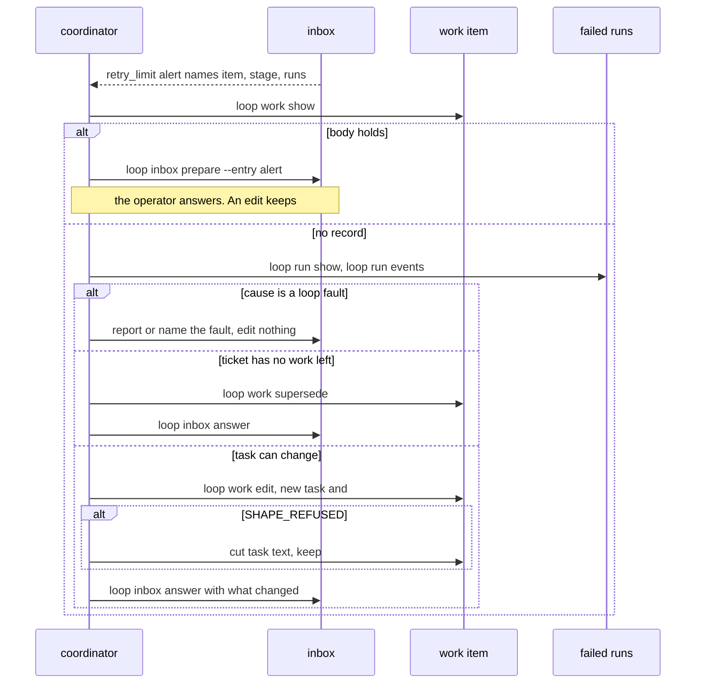

# Twice-failed item recovery: technical spec

## Source

- **Epic:** factorio-1okx
- **Source:** `docs/adr/0011-coordinator-recovers-twice-failed-item.md`, the one ADR whose
  `**Ticket:**` line names factorio-1okx. It is on the base branch at `175ef96`. It amends decision
  5 of `docs/adr/0006-run-integrity.md`, and by the rule of `loop-sdlc-documents` the later ADR
  wins the conflict.
- **Stories covered:** none. This is an architecture epic, and no story asks for it.

ADR 0011 numbers its decisions and does not number its other lines, so this spec labels them. The
contracts below cite these labels.

| Label | ADR 0011 text |
| --- | --- |
| D1 | Decision 1: the coordinator recovers the item with `loop work edit` in its own text, or closes a ticket with no work with `loop work supersede` |
| D2 | Decision 2: one recovery for each item, ever, recorded where a later note cannot overwrite it. A second `retry_limit` goes to the operator. The spec names the record |
| D3 | Decision 3: no fixer recovery |
| AC-1 | `grep -rn 'work recover' pack internal` prints nothing |
| AC-2 | `grep -rln 'recoveries' internal/store/migrations` prints nothing |
| AC-3 | `grep -n 'factorio-1okx' docs/adr/0011-coordinator-recovers-twice-failed-item.md` prints the Ticket line |
| AC-4 | `loop gates --docs` passes |
| AC-5 | `grep -n "operator's text" pack/runbooks/coordinator.md` prints nothing |
| AC-6 | `grep -n 'retry_limit' pack/runbooks/coordinator.md` prints a step that names one recovery and a second limit that goes to the operator |
| AC-7 | `make pack-check` passes |
| K-1 | A later reader must not reset the failure count of an item, or give an item a second recovery without the operator |
| K-2 | A later reader must not bring a first `retry_limit` to the operator when an edit can recover it |
| K-3 | A later reader must not add a `loop work recover` verb or a `recoveries` table without an ADR that amends ADR 0011 |

AC-1 to AC-3 already hold on the base. This run ran them at `175ef96`: AC-1 and AC-2 printed
nothing (exit 1), and AC-3 printed line 5, the Ticket line. CI proves AC-4 and AC-7 on each pull
request, because `.github/workflows/ci.yml` runs `loop gates`. D3 and K-3 decide to build nothing,
so no work entry claims them (Decisions). AC-5 and AC-6 are this epic's work.

## Scope check

**Components:**

1. **The coordinator runbook**: the `retry_limit` step of section 3 in
   `pack/runbooks/coordinator.md`, and the pack test that reads it.

The one work entry changes this component alone. ADR 0011 names no change to
`internal/admission`, `internal/sched`, `internal/server`, `internal/machine`,
`internal/escalation`, `internal/store/migrations` or `pack/runbooks/fixer.md`, and this spec makes
none.

**Not in this spec:** the stage start guard of ADR 0006 (D1, D2 of that ADR), which belongs to epic
factorio-jiv. A server bound on recovery edits, which ADR 0011 postpones (Out of scope).

## Decisions

### Answers a person already gave

- **This epic is the split half of factorio-jiv.** The operator chose the split on 2026-10-27
  (question/6: "Split (Recommended)"). factorio-jiv keeps the stage start guard, and this epic
  takes the twice-failed item recovery.
- **The coordinator recovers, once, and the server bounds nothing.** The operator chose this on
  2026-10-27: "Coordinator, once (Rec.)" (ADR 0011, Decision). The fixer recovery of ADR 0006
  decision 5, and its `make acceptance` criterion, no longer apply.

### The record of a recovery

- **The record is a `## Recovery` section of the item's body, and the recovery edit writes it.**
  We chose the body over four other places. The last note fails, because `notePut` overwrites it
  (`internal/machine/rows.go:23`). The title fails, because the split skill's title edit replaces
  it, and a title shows on each pull request and inbox line. The answer or the finding of the alert
  fails, because `loop inbox list` shows open entries only and `loop schema` holds no verb that
  reads a closed entry. The coordinator's memory fails, because it dies with the session, and the
  coordinator runbook keeps no rule there. A `loop work note` does not touch the body, and
  `loop work show` prints it. One edit writes the new task and the record together, so no second
  write can fail between the two.
- **The record names the date, the alert entry, the stage and what changed, in one line.** We
  chose one line over a copy of the old task. The failed runs keep the old task, and the 400-word
  limit of a ticket body counts every section (`internal/shape/body.go`, `bodyWords`).

### The bound of one recovery

- **Any later `retry_limit` on a recovered item goes to the operator, at any stage.** We chose one
  recovery for each item over one for each stage, because D2 says "one recovery for each item,
  ever". One for each stage would give an epic one unattended recovery at each stage it passes.
- **Each later body edit of a recovered item keeps the `## Recovery` section.** This includes an
  edit with the operator's text. We rejected an edit that drops it, because a third limit would
  then read as a first one and get a second unattended recovery (K-1).
- **A shape refusal cuts the task text, never the record.** A ticket edit that exceeds the shape
  gets `SHAPE_REFUSED`. We rejected a record outside the body for such an item, because then two
  places hold the record and the coordinator must read both.
- **A second limit goes to the operator as a prepared question on the alert.** The coordinator
  runs `loop inbox prepare --entry <alert>` by section 5 of its runbook, and leaves the alert open.
  We rejected an answer of the alert with a report line, because the answer closes the entry, and
  `loop inbox list --awaits person` is the one list of what waits on the operator.

### When no recovery is spent

- **A loop fault spends no recovery.** When the failed runs show a fault in the loop, the
  coordinator files or names the loop fault and edits nothing. A new release admits a new attempt
  (`internal/admission/policy.go`, `retryLimit` hint). We rejected an edit in that case, because
  new inputs rerun into the same fault and spend the item's one recovery on a cause that the task
  text did not hold.
- **A supersede is no recovery.** When a merged change or a ruling leaves a ticket with no work,
  the coordinator closes it with `loop work supersede` and writes no record. The supersede closes
  the ticket, so no later limit can reach it.

### Proof

- **A pack test proves the runbook step.** We chose a Go test in `internal/pack` that reads the
  embedded coordinator runbook, the idiom of `internal/pack/rerun_base_test.go`. We rejected the
  grep lines of AC-5 and AC-6 alone, because a command is the weak proof and runs only once. We
  rejected `make acceptance`, the proof of ADR 0006, because this epic changes no server code, and
  an acceptance test would prove the server and not the coordinator's prose.
- **D3 and K-3 get no work entry and no guard test.** Each one decides that the loop does not
  build something, and AC-1 and AC-2 already hold. A guard test would pass before any change, so
  it proves nothing by the proof rule.

## Assumptions

- `loop work show <item>` prints the body that the last `loop work edit` wrote. Measured:
  `internal/machine/machine.go:287` fills the shown body from `TaskText`, which reads the `body`
  fact before the bead's description, and appends an answer that amends the task. This is wrong if
  `work show` prints the creation body after an edit.
- No run's runbook edits an item's body. Measured: `grep -rn 'work edit' pack` prints the
  coordinator runbook and one title-only edit in `pack/skills/loop-sdlc-split/SKILL.md`. This is
  wrong if a runbook gains a `--body` edit with no rule to keep the section.
- No stage writes a `## Recovery` heading into a new body. This is wrong if a ticket or a bug body
  holds that heading before any recovery edit.
- The coordinator can find a better task from the item, its body and the failed runs that the
  alert names (ADR 0011, "Assumed"). This is wrong if most recovered items reach a second
  `retry_limit`.

## Approach

The work changes one bullet of section 3 of `pack/runbooks/coordinator.md`, the one that starts
"An item stopped after two failed attempts." The new bullet tells the coordinator, in this order:

1. **Read the record first.** Run `loop work show <item>`. When the body holds a `## Recovery`
   section, the item had its one recovery. Prepare a question on the alert by section 5. Edit the
   item only with the operator's answer, and keep the section in that edit. Stop here.
2. **Find the cause.** Read each failed run that the alert names, with `loop run show` and
   `loop run events`.
3. **A loop fault spends nothing.** When the cause is a fault in the loop, report it, or name the
   open fault, by section 3. Edit nothing.
4. **A ticket with no work closes.** When a merged change or a ruling leaves the ticket with no
   work, run `loop work supersede` by its own bullet.
5. **Otherwise recover once.** Run `loop work edit <item>` with the coordinator's own title and
   body. The new body ends with the `## Recovery` section (Interfaces). On `SHAPE_REFUSED`, cut the
   task text, never the section, and send it again. Then answer the alert with what changed.

The bullet keeps two sentences of today's text: a push to the pull request also admits a new
attempt at the code-reviewer stage, and the coordinator never looks for a way to reset the count.
It drops "with the operator's text" (AC-5).

The pack test `internal/pack/recovery_test.go` reads `runbooks/coordinator.md` with the package's
`read` helper. It finds the bullet that names `retry_limit`, joins its lines, and asserts each
contract below on that text.

The change reaches a host with its next release, because the server writes the runbook from the
embedded pack at each start.

## Domain model

None. This epic adds no type and changes no type. The record is text in an item's body, and only
the coordinator reads it.

## Interfaces

The record is the one shape that crosses a boundary: the coordinator writes it in one session, and
a later session of the coordinator reads it. It is the last section of the body that the recovery
edit writes:

```markdown
## Recovery

Recovered once by the coordinator on 2026-10-28, after alert/7 retry_limit at stage implementer.
Changed: the task now names the test file that both runs could not find.
```

- The heading is exactly `## Recovery`. The coordinator detects a recovered item by that heading
  alone.
- The line names the date, the alert entry, the stage and one sentence of what changed.
- The coordinator copies the section unchanged into each later body edit of the item.

No verb, flag or refusal code changes. The step uses `loop work show`, `loop work edit`,
`loop work supersede`, `loop inbox prepare`, `loop inbox answer` and `loop fault report`, which
`loop schema` already lists for the coordinator.

## Data

None. No table, no migration and no new fact. The record lives in the existing `body` fact that
`loop work edit` writes. Existing items hold no `## Recovery` section, so each one starts with its
one recovery unspent.

## Flows

### The coordinator answers a `retry_limit` alert



## Work

1. **The coordinator recovers a twice-failed item once.** Rewrite the `retry_limit` bullet of
   section 3 of the coordinator runbook by Approach, and add the pack test that reads it.
   - Files: `pack/runbooks/coordinator.md`, `internal/pack/recovery_test.go`.
   - Needs: nothing.
   - Proves: C1, C2, C3, C4, C5, C6.
   - Done when: `go test ./internal/pack/...` passes with the new test, the same test fails on the
     base runbook, `grep -n "operator's text" pack/runbooks/coordinator.md` prints nothing, and
     `make pack-check` passes.

One entry holds every contract, so no boundary between two entries exists.

## Out of scope

- A server bound on recovery edits. ADR 0011 postpones it. It belongs to no epic until a loop
  fault or an operator report shows a coordinator that edited one item twice.
- A fixer recovery (D3). ADR 0011 rejects it. It belongs to no epic until the rate of
  `retry_limit` alerts loads the coordinator.
- The `make acceptance` proof of ADR 0006 decision 5. ADR 0011 replaces that decision, so it
  belongs to no epic.
- The stage start guard of ADR 0006 (its D1 and D2). It belongs to epic factorio-jiv.
- A count of `retry_limit` alerts. ADR 0011 leaves it to the coordinator, with `loop inbox list`.
  It belongs to no epic.

## Contracts

Each contract is a promise about the `retry_limit` bullet of `pack/runbooks/coordinator.md`. The
test reads that bullet as one joined text.

**C1. Behaviour: a first limit gets the coordinator's own edit.** Proves D1, AC-5, K-2. The bullet
tells the coordinator to run `loop work edit` with its own text, and to answer the alert with what
changed. The runbook holds no "operator's text".
*`internal/pack/recovery_test.go` asserts both strings in the bullet, and the absence in the whole
runbook.*

**C2. Behaviour: the recovery edit writes the record.** Proves D2. The bullet names the
`## Recovery` section, says that the recovery edit writes it, and names the date, the alert entry,
the stage and what changed as its content.
*The test asserts the heading and each of the four parts in the bullet.*

**C3. Refusal: a second limit gets no unattended edit.** Proves D2, AC-6, K-1. The bullet tells the
coordinator to read the body with `loop work show` before any edit. When the body holds
`## Recovery`, it sends the item to the operator with `loop inbox prepare`, and edits the item only
with the operator's answer. The bullet keeps "Never look for a way to reset the count".
*The test asserts `loop work show`, `loop inbox prepare` and the reset sentence in the bullet, and
that `loop work show` comes before the first `loop work edit`.*

**C4. Invariant: the record survives each later edit.** Proves D2, K-1. The bullet says that each
later body edit of a recovered item keeps the `## Recovery` section, an edit with the operator's
text included. It says that a `SHAPE_REFUSED` edit cuts the task text and keeps the section.
*The test asserts the keep rule and `SHAPE_REFUSED` in the bullet.*

**C5. Behaviour: a loop fault spends no recovery.** Proves D1, K-2. The bullet says that when the
failed runs show a loop fault, the coordinator reports or names the fault and makes no edit.
*The test asserts that the bullet names a loop fault and `loop fault report`, and a no-edit rule.*

**C6. Behaviour: a ticket with no work closes, and spends no recovery.** Proves D1. The bullet
names `loop work supersede` for a ticket that a merged change or a ruling left with no work.
*The test asserts `loop work supersede` in the bullet.*

## Observable behaviour

None, because this epic draws no screen. Its visible results are inbox entries and item text: the
coordinator's answer of a `retry_limit` alert, a prepared question on a second limit, and the
`## Recovery` section that `loop work show` prints.

## Open questions

None. ADR 0011 left one choice to this spec, the place of the record, and Decisions makes it. The
operator answered the split and the choice of the coordinator on 2026-10-27.
