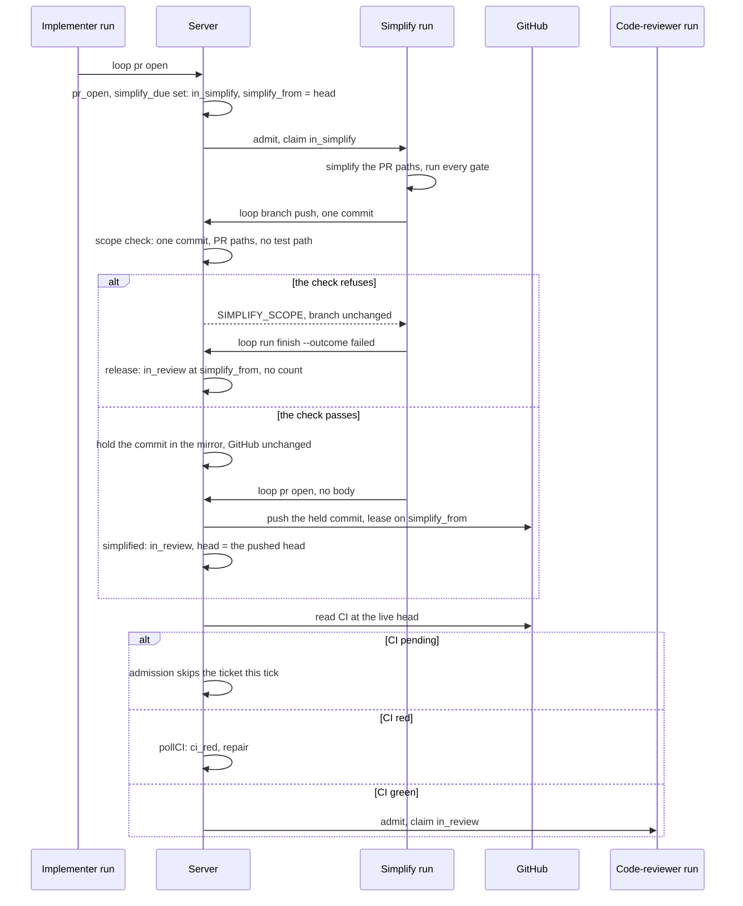
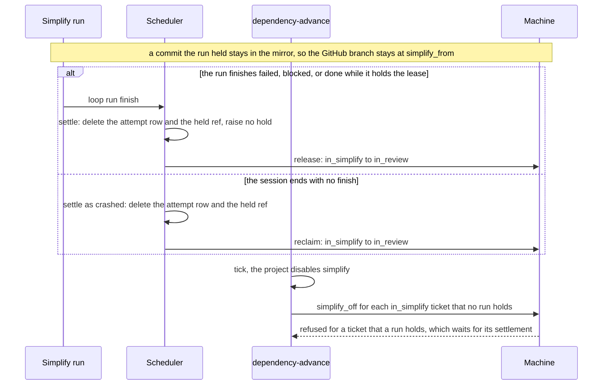
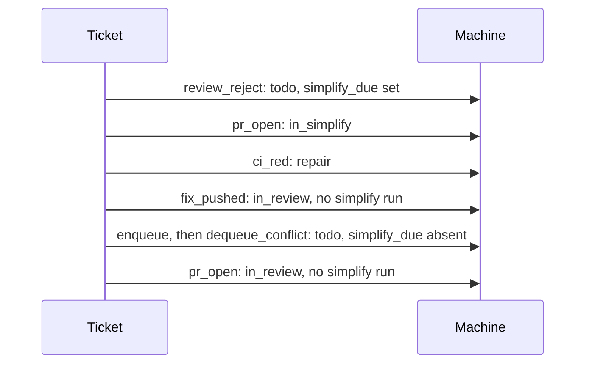

# Simplify each ticket's code in its own run before code review: technical spec

## Source

- **Epic:** factorio-1r94
- **Source:** `docs/prd/simplify-stage.md`, merged at `4fc167e`. No ADR names this epic on its
  `**Ticket:**` line. ADR 0002 and ADR 0007 bound it: this epic ports no file of tickertown, and
  the new runbook ships in the pack as every other `loop-*` runbook does.
- **Stories covered:** US-01, US-02, US-03, US-04.

The operator approved the PRD at head `75daa33` and answered four of its six open questions then.
The planner answers the other two from the repository. Decisions records all six, each with its
source.

## Scope check

**Components:**

1. **The loop server.** The stage name and its defaults in `internal/config`, the ticket table in
   `internal/machine`, the hand-off in `internal/github/verbs.go`, the push check in
   `internal/github/push.go` and `internal/github/scan.go`, the refusal code in `internal/cli`,
   the outcome rule and the review wait in `internal/admission`, and the pass of a disabled stage
   in `internal/sched/deps.go`.
2. **The pack.** The runbook `pack/runbooks/simplify.md`, its entry in `pack/manifest.json`, and
   the glossary. Why not its own epic: a runbook that no stage starts does nothing, and
   `TestEveryStageHasARunbook` in `internal/pack/pack_test.go` holds the manifest's runbooks equal
   to `config.RunStages()`. So the stage name and its runbook land in one change.

Entry 1 adds the stage name and the runbook together, and no ticket reaches the stage yet. Entries
2 to 4 change the server. The stage is on by default only from entry 4, after entry 3 holds a
simplify commit to its bounds. Entry 5 changes the glossary.

**Not in this spec:** the QA stage (factorio-nhb5). The selection of conditional kernel skills
(factorio-791i), which gives a simplify run on a ticket the ticket rule by the item's kind. The
retro's signals (factorio-1xq0).

## Decisions

The first three entries record the operator's answers at sign-off on 2026-11-01, as the brief of
this run quotes them. The first answer settles the PRD's first two open questions. The next two
entries answer the two questions the operator left to the planner.

- **A review reject starts a second simplify round, and a repair does not.** The operator chose
  "After reject, not repair (Recommended)". A review reject brings new code, so the next head goes
  through a simplify run before the next code review. A red-build repair returns straight to
  review. A merge of the base alone never starts a simplify run. The rejected answers were a
  simplify run after every new head, and a simplify run on the first head only.
- **A failed simplify run passes the ticket through.** The operator chose "Pass through
  (Recommended)". A simplify run that fails, crashes, or finds no simpler head where the gates
  pass counts as no commit. The ticket reaches code review at the implementer's head. The run
  never blocks the ticket and never counts toward a failure limit. The rejected answer counted the
  run as a failed attempt of the ticket. A run that pushes its commit and then fails also counts
  as no commit, because the server holds that commit until the hand-off (see below).
- **Every project gets the stage, and a project can turn it off.** The operator chose "On by
  default (Recommended)". A project with no `stages.simplify` entry runs the stage. A project
  turns it off with `stages.simplify.enabled: false`. The rejected answer made the stage opt-in, as
  every other stage is today.
- **The run changes only paths that the pull request already changes.** This answers the PRD's
  fifth open question. A path counts when `git diff --name-only` from the merge base to the
  implementer's head lists it. We rejected the ticket's "May change" list, because the code-reviewer
  then judges a file that the implementer never touched, and the ticket's contracts name no promise
  for it. We rejected the import and export exception of ce-simplify-code Step 3, because a check
  on paths cannot tell an import line from any other line. All three sources already bound the run
  to the scope its caller gives: ce-simplify-code Step 3 "edit only that scope", no-comments step 4
  "Neither authorizes widening the fence", and comment-sicko "Every flag names code inside the
  scope". The server enforces the rule at the push (C12).
- **A project rule wins over `no-comments` and `comment-sicko`.** This answers the PRD's sixth open
  question. A project rule is a line of the project's policy files or of its agent instruction
  files that asks to keep a comment. The run keeps that comment. The loop already decides the case:
  item 4 of the reading list in `pack/runbooks/implementer.md` says "Where it and this runbook
  differ on a project rule, follow the policy". And item 6 of `pack/runbooks/code-reviewer.md`
  § 5 checks for "A rule of the project policy that the change breaks". So a deleted comment
  that a project rule keeps costs one review round. We rejected the sources' own keep-lists as
  the only rule, because comment-sicko says "That list is my only leash" and no project wrote that
  list.
- **A new ticket state, `in_simplify`, holds the ticket between the implementer and the
  code-reviewer.** We chose a state over a fact on `in_review` that the code-reviewer's claim must
  read. With a state, the transition table refuses the code-reviewer's claim, because no claim row
  of the code-reviewer starts from `in_simplify`. A fact needs a guard in the claim row and a
  second check in admission, and the two must agree.
- **A fact, `simplify_due`, decides which hand-off of the implementer enters the state.** The
  implementer's `pr_open` row leaves `in_progress` for a new ticket, a reworked ticket and a ticket
  with a conflict. Only the first two bring new code. We chose a fact that `create` and
  `review_reject` set, and that `pr_open` clears when it enters `in_simplify`. We rejected a run
  on every `pr_open` that finds nothing in a merge of the base, because the operator said a merge
  of the base alone never starts a simplify run. We rejected a new entry kind, because `entry` is
  already `rework` both after a reject and after `dequeue_conflict`.
- **The run hands off with `loop pr open`, and the server picks the verb `simplified`.** We chose
  the verb every authoring run already ends with. `loop-sdlc-turn` § 5 states it, and `openVerbs`
  in `internal/github/verbs.go` maps a status to its row. We rejected a new CLI verb, because the
  run would then learn a second way to end. The hand-off records the server's own newest push to
  the branch as `head`, as the amending path in `prOpen` already does, because GitHub moves a pull
  request's head some time after a push.
- **The server holds a simplify commit in the mirror until the hand-off.** `loop branch push`
  from a simplify run scans the commit and runs the scope check. It then stores the commit at
  `refs/loop/held/<run id>` in the mirror, and pushes nothing to GitHub. The run's `loop pr open`
  pushes the held commit with a lease on `simplify_from`, then applies `simplified`. So a run that
  pushes and then fails, crashes, or meets a refusal at `loop pr open` leaves the GitHub branch at
  `simplify_from`. The ticket reaches code review at the implementer's head, as the operator's
  second answer says. We rejected a review at the simplify head in that case, because it departs
  from that answer. We rejected a revert commit by the server, because it puts a second commit on
  the branch, which A6 names as the observation that makes it false. We rejected a reset of the
  branch to `simplify_from`, because the loop never forces a push (`loop-sdlc-turn` § 4), and a
  protected branch refuses one.
- **One case still reaches review at the simplify head, and it keeps the operator's answer.** The
  hand-off's push lands on GitHub, the server stops before it applies `simplified`, and the run
  ends before its repeat of `loop pr open` replays. The reclaim then moves the ticket to
  `in_review` with the simplify commit on the branch. That commit passed the scope check and the
  run's gates, and the CI wait below holds the review until CI is green. We judge this no
  departure from the operator's answer, because the run reached its hand-off and only the server's
  own write was in doubt. We rejected a server write that undoes the push, for the reasons of the
  entry above.
- **Every other end of a simplify run passes the ticket to `in_review`.** The release and reclaim
  rows of `in_simplify` land on `in_review`. A failed, blocked or stalled finish, a crash, and a
  person's `loop work release` all reach those rows. The GitHub branch stays at `simplify_from`,
  because the commit of the run stays held, and settlement deletes the held ref. We rejected a
  separate verb for a failed run, because the scheduler already applies `release` or `reclaim` at
  every settlement.
- **A simplify run never counts as a failure and never raises a hold.** Settlement deletes the
  pending attempt row of a simplify run, whatever its class. We chose this over the counted classes
  of KTD8, because the next simplify round on the same ticket after a reject can carry the same
  inputs. Two counted failures would then stop the stage on that ticket, and the ticket would wait
  in `in_simplify` with no run to move it.
- **A simplify run cannot escalate.** The `escalate` row of the ticket table leaves out
  `in_simplify`, so `loop escalation raise` from a simplify run refuses with
  `TRANSITION_NOT_ALLOWED`. We chose this over an escalation that holds the ticket, because the
  operator said a failed simplify run never blocks the ticket. The runbook says to finish `failed`
  instead.
- **The `dependency-advance` job passes each waiting ticket on when a project turns the stage
  off.** Every implementer hand-off enters `in_simplify` when `simplify_due` is set. In a project
  that disables the stage, the next tick of the job applies `simplify_off`, and the ticket reaches
  `in_review` within five minutes. We rejected a project setting that `pr_open` reads. The server
  needs the same sweep anyway, because a project can turn the stage off while a ticket waits.
- **The code-reviewer waits for green CI at a head that the simplify run made.** A7 says a
  simplify head where a project gate fails never reaches code review. Only CI runs every gate at a
  head that the server can read. So admission skips a ticket in `in_review` whose live head differs
  from `simplify_from` until CI at that head is green. A red head goes to repair by the reactor's
  `pollCI`, as today. We rejected a hand-off that waits in `in_simplify` for CI, because the
  release rows of a crashed run would then need a state that no run holds. The wait leaves the
  implementer's own heads as they are today.
- **The server refuses a simplify push that breaks the run's bounds.** `loop branch push` from a
  simplify run refuses with `SIMPLIFY_SCOPE` when the push adds more than one commit over
  `simplify_from`, adds a merge commit, changes a path outside the pull request's paths, or
  changes a test path. We chose a server check over the runbook alone, because A6 names a second
  commit on the branch as the observation that makes it false, and only the server sees every
  push.
- **A test path is a fixed rule of the server, and a simplify commit may not change one.** A path
  is a test path when one of these holds:
  - its base name matches `*_test.*`, `*.test.*`, `*.spec.*`, `test_*.py` or `conftest.py`.
  - one of its directory names is `test`, `tests`, `__tests__`, `testdata`, `spec` or `e2e`.
  - its base name matches `vitest.config.*`, `jest.config.*`, `playwright.config.*`,
    `pytest.ini` or `tox.ini`.
  - it starts with `.loop/` or `.github/workflows/`, which hold the gate and CI commands.

  A simplify commit that adds, changes, deletes or renames such a path refuses with rule
  `test_path`. So each test that ran at `simplify_from` is still there, unchanged, at the simplify
  head, and C13 proves it passes there. This is A8. We rejected a check of the test set at both
  heads, because the loop holds no stack-neutral way to list tests. `.loop/config.yaml` names gate
  commands only, and `loop review proof` takes its test paths from the reviewer by flag. We
  rejected a project key for the list, because no project asked for one, and a key is one more
  setting that only the coordinator changes.
- **A later round simplifies only what changed since the last reviewed head.** After a reject, the
  run reads the diff from the last reviewed head that `loop review rounds` names to the new head.
  We rejected the whole pull request diff, because the code-reviewer judges the named findings and
  the new diff only. A change to code that a round already reviewed would reach the review with no
  finding that asks for it.
- **One runbook, and no subagent.** We chose one runbook file that holds the rules of all three
  sources. We rejected the reviewer personas of ce-simplify-code and the comment-sicko agent as
  pack files. The sources start subagents to get a fresh context, and the simplify run already
  starts with one. `loop-sdlc-turn` § 8 counts each subagent as one more model run.
- **The run changes no test file, and runs every gate before it pushes.** The server enforces the
  first half with the test-path rule (C17). We rejected the
  test-value reviewer of ce-simplify-code, which prunes tests. Each test of a ticket proves a
  contract, the pull request body records its red and green runs, and the code-reviewer proves it
  red at the merge base. ce-simplify-code already keeps "the proof tests" of the current work. We
  rejected `loop gates --fast`, which the implementer runs, because A8 asks that each test that
  passes at the implementer's head passes at the simplify head, and only the `test` gate runs them.
- **The runbook reads the implementer's and the code-reviewer's policies, and the project holds no
  simplify policy.** We rejected `.loop/policy/simplify.md`, because each project would write one
  more file, and the two policies already name the commands and the standards a change must keep.
  The manifest entry names `code-reviewer` as its policy role, so the pack gate checks that the
  runbook names that path.
- **The stage runs at effort `high`, with cap 8.** We chose `high` over `medium`, because the run
  edits code that ships, and `DefaultEfforts` in `internal/sched/quota.go` gives every code author
  `high`. The cap matches the implementer's 8, because each implementer hand-off makes one simplify
  run.

No entry passes the test of `pack/skills/loop-sdlc-documents/SKILL.md` § 6. Each one binds this
epic's stage only, so each fails part 1. The four operator answers also fail part 4: each decides
what the product does, and the PRD holds them.

## Assumptions

- Each ticket's pull request changes at least one path that a simplify run can simplify. This is
  wrong when a ticket changes only documents or generated files. The runbook then finds nothing
  and hands off with no commit, as C6 proves, so a wrong assumption costs one short run.
- GitHub reports CI at a pushed head within the reviewer's usual wait. This is wrong when a
  project's CI never starts at a simplify head. The reactor then raises its `ci_not_started`
  alert, as it does for an implementer head, and the ticket waits in `in_review`.
- The local clones that this spec read hold the upstream text of the three sources. This spec read
  `skills/ce-simplify-code/SKILL.md` in a clone of `EveryInc/compound-engineering-plugin` at the
  head of its main branch on 2026-10-31. It read `pstack/skills/no-comments/SKILL.md` and
  `pstack/agents/comment-sicko.md` in a clone of `cursor/plugins` at the head of its main branch on
  2026-10-29. This is wrong when GitHub's text differs from those clones. The implementer records
  the commit it forks from, and C1 checks only that a commit is there.
- Each project keeps its tests and its test commands at paths that the test-path rule names. This
  is wrong when a project keeps a test at another path, such as `src/a.check.ts`, or turns a test
  off in a build file such as `Makefile` or `package.json`. The rule then misses that change, and
  the code-reviewer's check of the project policy is the only guard left for A8. A miss of this
  kind shows as a test that the pull request body lists and that CI at the simplify head no
  longer runs.
- A ticket that is in flight when entry 2 merges carries no `simplify_due` fact. This is wrong
  when a migration writes the fact. Such a ticket reaches code review with no simplify run until
  its next reject. This spec accepts that loss.

## Approach

**The ticket's path.** The implementer's `loop pr open` applies `pr_open`. When `simplify_due`
is set, the row lands on `in_simplify`, records the head as `simplify_from`, and clears
`simplify_due`. When it is not set, the row lands on `in_review` as today. The simplify stage
claims from `in_simplify`. The run's own `loop pr open` pushes the commit the server holds for the
run, if any, then applies `simplified`, which lands on `in_review` with that head. The
code-reviewer claims from `in_review` as today.

**The two server passes around the run.** The scheduler settles every simplify run without a count
and without a hold, and its `release` or `reclaim` moves a ticket that is still in `in_simplify` to
`in_review`. The `dependency-advance` job applies `simplify_off` to each `in_simplify` ticket that
no run holds, in a project whose config disables the stage.

**The server's hold and checks on the run's output.** `branchPush` passes the principal's stage
into `PushRequest`. For the simplify stage, `Push` runs `scopeCheck` after `Scan`, which refuses
with `SIMPLIFY_SCOPE`. A commit that passes goes to `refs/loop/held/<run id>` in the mirror, and
not to GitHub. The run's `loop pr open` pushes the held commit with a lease on `simplify_from`,
deletes the ref, and applies `simplified`. Settlement of a simplify run deletes the ref it left.
Admission for the code-reviewer reads CI at the live head when `simplify_from` is set and differs
from it, and skips the ticket until that CI is green.

**The runbook.** `pack/runbooks/simplify.md` reaches a run as `loop-simplify`. It is a fork of
ce-simplify-code, no-comments and comment-sicko, fitted to the loop. Its steps:

1. Read the turn skill and the glossary. Read the item, `loop pr show`, `loop pr files` and
   `loop pr diff`. Read `.loop/policy/implementer.md` and `.loop/policy/code-reviewer.md` from the
   base, and the project's agent instruction files.
2. Bring the pull request head into the checkout. Record it. This is `simplify_from`.
3. Set the scope. Round 1 takes the paths the pull request changes. A later round takes the hunks
   changed since the last reviewed head.
4. Read the scope with four lenses from the sources: reuse, quality, efficiency and comments. Keep
   every output, error, side effect and order. Keep every safety check. Leave every test file
   unchanged, because each test proves a contract and the code-reviewer proves it red at the merge
   base. The server refuses a change to a test path. Delete a comment by comment-sicko's rules,
   except when a project rule keeps it.
5. Run `loop gates`, every gate. When a gate fails, revert the change that broke it and run the
   gates again. When the implementer's head itself fails a gate, push nothing.
6. When the tree differs from `simplify_from`, write one commit by `loop-commit`, and run
   `loop branch push`. Its answer says that the server holds the commit. Run `loop pr open` with
   no title and no body. The server pushes the commit then, and the body keeps the implementer's
   red and green runs. Finish `done`.
7. When anything stops the run, finish `failed`. The server passes the ticket on.

The runbook's header comment records each source's upstream URL and commit, and what changed on
purpose, as `pack/skills/loop-unslop/SKILL.md` does.

## Domain model

```
internal/machine, the ticket table (changed)

TicketState         + in_simplify, category active, between in_progress and in_review
  invariant: a ticket in in_simplify holds an open pull request, so prOpenStates lists it.
  invariant: no claim row of the code-reviewer starts from in_simplify.
  invariant: the only rows that leave in_simplify land on in_review, escalated (pr_closed),
             or done (merged).

simplify_due        fact, "true" or absent
  invariant: create and review_reject set it. pr_open clears it when it enters in_simplify.
             No other row writes it.

simplify_from       fact, the full sha of the implementer's head that the latest simplify round
                    started from
  invariant: pr_open sets it when it enters in_simplify. review_reject, fix_pushed,
             head_changed, dequeue_conflict and dequeue_red clear it.

internal/github, the mirror (changed)

held commit         refs/loop/held/<run id>, the one simplify commit of a run that passed Scan
                    and scopeCheck
  invariant: only the hand-off of the run that made it pushes it to GitHub.
  invariant: the hand-off and the settlement of that run delete it.
  invariant: while a ticket is in in_simplify, no simplify commit reaches GitHub before the
             hand-off of its run.

internal/config (changed)

simplify            a run stage that claims an item, KindItemStage
  invariant: StageEnabled("simplify") is true unless the project config sets
             stages.simplify.enabled: false.
```

## Interfaces

```go
// internal/config
const StageSimplify = "simplify" // in runStages after StageImplementer, and in optional
// defaultOn lists the stages a project runs when its config does not list them.
var defaultOn = []string{StageSimplify}
func (c *ProjectConfig) StageEnabled(stage string) bool // a listed stage: enabled unless enabled: false; an unlisted stage: in defaultOn
// DefaultThroughput()[StageSimplify] = Throughput{Cap: 8, Schedule: "1,6,11,16,21,26,31,36,41,46,51,56 * * * *"}
// Settings: stages.simplify.enabled reads SourceDefault when the config does not list the stage.

// internal/sched
// DefaultEfforts[config.StageSimplify] = "high"

// internal/machine
const (
	InSimplify       = "in_simplify"
	StageSimplify    = config.StageSimplify
	FactSimplifyDue  = "simplify_due"
	FactSimplifyFrom = "simplify_from"
	VerbSimplified   = "simplified"
	VerbSimplifyOff  = "simplify_off"
)

// internal/github
type PushRequest struct {
	// ... the fields of today
	Stage string // the principal's stage; "simplify" adds the scope check and the hold
}
type PushResult struct {
	// ... the fields of today
	Held bool `json:"held"` // the server holds the commit in the mirror until the run's hand-off
}
// heldRef is the mirror ref of a simplify run's commit: refs/loop/held/<run id>.
func heldRef(run string) string
// openVerbs[machine.KindTicket][machine.InSimplify] = machine.VerbSimplified
// scopeCheck refuses with a *ScanError of code cli.CodeSimplifyScope and one of the rules
// "two_commits", "merge_commit", "path_outside_pr" or "test_path". The hint names the commit or
// the path.
func (m *Mirror) scopeCheck(ctx context.Context, from, base, head string) error
// isTestPath is the test-path rule of Decisions.
func isTestPath(path string) bool
// pushHeld pushes the run's held commit with a lease on from, records the push intent, and
// deletes the ref. It answers "" when the run holds no commit. prOpen calls it before
// it applies simplified.
func (s *Service) pushHeld(ctx context.Context, project, branch, run, from string) (string, error)
// DropHeld deletes the held ref of a run. Settlement of a simplify run calls it.
func (s *Service) DropHeld(ctx context.Context, project, run string) error

// internal/cli
const CodeSimplifyScope = "SIMPLIFY_SCOPE" // ExitRefused, codes.FailedPrecondition, not retryable

// internal/admission
type CIState int // CIGreen, CIPending, CIRed
// Config gains the reader that the server wires to github.Service.Checks.
CI func(ctx context.Context, project, head string) (CIState, error)
```

The rows that change in `ticketTable()`. A row that this list does not name stays as it is.

```
create         open -> todo | backlog         + sets simplify_due
pr_open        in_progress -> in_simplify      when simplify_due; sets head, simplify_from; clears simplify_due
pr_open        in_progress -> in_review        otherwise, as today
claim          in_simplify -> @same            stage simplify, lease take, bumps epoch
simplified     in_simplify -> in_review        command "pr open", lease drop; sets head to the hand-off's push, or simplify_from
simplify_off   in_simplify -> in_review        server only; refused while a run holds the lease
release        in_simplify -> in_review        lease drop
reclaim        in_simplify -> in_review        lease drop, bumps epoch
review_reject  in_review -> todo              + sets simplify_due, clears simplify_from
fix_pushed, head_changed, dequeue_conflict, dequeue_red
                                              + clear simplify_from
escalate       every live state except escalated and in_simplify
pr_closed      prOpenStates, which gains in_simplify
merged, note, edit
               live, which gains in_simplify
```

`pack/manifest.json` gains one runbook entry:

```json
"simplify": {
  "attended": false,
  "skills": ["loop-sdlc-turn", "loop-sdlc-glossary", "loop-commit", "loop-least-code", "loop-reader-load", "loop-test-behavior-not-implementation"],
  "policy": "code-reviewer"
}
```

## Data

No SQL table changes. The ticket table gains one state and two facts.

- **Beads statuses.** `in_simplify` joins the custom statuses that `beadsx` configures from the
  tables at each start. The configure step is idempotent, so the first start of the new release
  adds it.
- **Facts.** `simplify_due` and `simplify_from` live on the ticket bead as every other fact does.
- **Failures.** Settlement deletes the pending attempt row of a simplify run, so the `failures`
  table holds no row with stage `simplify`.
- **Held commits.** A held commit lives at `refs/loop/held/<run id>` in the project's mirror, and
  in no table. A lost ref costs the run its commit, and the ticket passes through as C18 states.
  The hand-off's push writes a row to `push_intents` as every push does.

**Existing records:** no ticket is in `in_simplify` before entry 2 merges. A ticket that exists then
carries no `simplify_due`, so its next `pr_open` lands on `in_review`. Its first simplify run comes
after its next reject. No migration runs.

## Flows

A new ticket, with a simplify commit:



A failed or crashed simplify run, and a disabled stage:



Which hand-off enters the stage:



## Work

1. **Register the stage name with its runbook.** Add `config.StageSimplify` to `runStages`, to
   `optional`, to `DefaultThroughput` and to `DefaultEfforts`. Leave `StageEnabled` as it is, so
   no project runs the stage, and add no claim row. Write `pack/runbooks/simplify.md` by the
   Approach, with the fork record of the three sources. Add the manifest entry.
   - Files: `internal/config/throughput.go`, `internal/sched/quota.go`,
     `pack/runbooks/simplify.md`, `pack/manifest.json`, `internal/pack/*_test.go`,
     `internal/config/*_test.go`
   - Needs: nothing
   - Proves: C1, C2
   - Done when: `make pack-check` passes, `TestEveryStageHasARunbook` passes with the new stage,
     and the fork-record test fails on a copy of the runbook that drops one commit.
2. **Tickets pass through the simplify state.** Add `in_simplify`, the two facts and the rows of
   Interfaces to the ticket table. Map `in_simplify` to `simplified` in `openVerbs`, with
   `simplify_from` as the head when the run pushed nothing. Delete a simplify run's pending attempt
   row at settlement, and raise no hold for it. Add the `simplify_off` pass to
   `advanceDependencies`. Leave `StageEnabled` as it is. Until entry 4, a project that does not
   list the stage passes each ticket on through the `simplify_off` pass.
   - Files: `internal/machine/ticket.go`, `internal/machine/kinds.go`, `internal/machine/rows.go`,
     `internal/machine/testdata/**`, `internal/github/verbs.go`, `internal/admission/outcomes.go`,
     `internal/sched/finish.go`, `internal/sched/deps.go`, and the tests of each package
   - Needs: 1
   - Proves: C3, C4, C5, C7, C8, C10, C11
   - Done when: a ticket fixture moves from `in_progress` through `in_simplify` to `in_review`
     with one simplify run, and a failed run leaves it in `in_review` with no row in `failures`.
3. **The server holds a simplify commit to its bounds until the hand-off.** Pass the principal's
   stage into `PushRequest`. Add `scopeCheck` after `Scan` for the simplify stage, with the four
   rules, `isTestPath` and the refusal code. Store a commit that passes at `heldRef`, and answer
   `held: true`. Make `prOpen` call `pushHeld` before it applies `simplified`. Make settlement of
   a simplify run call `DropHeld`.
   - Files: `internal/github/push.go`, `internal/github/scan.go`, `internal/github/errors.go`,
     `internal/github/verbs.go`, `internal/cli/codes.go`, `internal/sched/finish.go`, and the tests
     of each package
   - Needs: 2, for `simplify_from` and the `simplified` row
   - Proves: C6, C12, C17, C18
   - Done when: a push of two commits from a simplify run refuses with `SIMPLIFY_SCOPE`, and the
     same push from an implementer run passes. A commit that adds `t.Skip` to a `_test.go` file
     refuses with rule `test_path`. A run that pushes one commit and then crashes leaves the
     GitHub branch at `simplify_from`.
4. **The stage is on by default, and the code-reviewer waits for green CI at a simplify head.**
   Make `StageEnabled` read `defaultOn`, and report the source of `stages.simplify.enabled`. Add
   the `CI` reader to admission's config, and wire it to `github.Service.Checks`. Skip a
   code-reviewer candidate whose live head differs from a set `simplify_from` until CI there is
   green.
   - Files: `internal/config/project.go`, `internal/config/settings.go`,
     `internal/admission/policy.go`, `internal/server/*.go` for the wiring,
     `acceptance/scenarios/simplify_test.go`, and the tests of `internal/config` and
     `internal/admission`
   - Needs: 2 and 3, so no project runs the stage by default before the hold and the push checks
   - Proves: C9, C13, C14
   - Done when: admission skips a ticket at a simplify head with pending CI, and admits it once CI
     is green. The acceptance scenario runs one ticket through all three runs with one review, and
     a second ticket through a simplify run that holds a commit and crashes.
5. **Name the stage in the glossary.** Add the `simplify` row to the stage table, `in_simplify` to
   the ticket states, and the simplify run to the build phase. Extend `glossaryFaults` to check
   both.
   - Files: `pack/skills/loop-sdlc-glossary/SKILL.md`, `internal/pack/glossary_test.go`
   - Needs: 2
   - Proves: C15, C16
   - Done when: `TestC21GlossaryHoldsTheNewWords` fails on a glossary with no `simplify` row, and
     passes on the new glossary.

Every entry lists `pack/runbooks/code-reviewer.md` under "Must not change", for C16.

## Out of scope

- The QA stage, and the QA step of the flow. It belongs to factorio-nhb5.
- Any change to the code-reviewer's runbook or its review rules. Never in this epic, by the epic
  body and A12. Entry 4 changes when admission starts a code-reviewer run, and no rule of the run.
- A change to the implementer's runbook. Never: its `loop pr open` is unchanged, and the server
  picks the next state.
- A simplify run on a document, a PRD, a spec or an ADR. Never, by the PRD's Out of scope.
- A simplify run after a red-build repair or a merge of the base. Never, by the operator's answer.
- A port of tickertown's simplify files. Never, by ADR 0002.
- Which kernel skills a simplify run holds. It belongs to factorio-791i, whose ticket rule reads
  the item's kind and needs no change for a new stage.
- A retro signal for a simplify run. It belongs to factorio-1xq0.
- A project policy file for the simplify role. Never, by Decisions.

## Contracts

**C1. Invariant: the runbook records each source's fork.** Proves A11. The header comment of
`pack/runbooks/simplify.md` names, for each of ce-simplify-code, no-comments and comment-sicko, an
upstream URL under `github.com/EveryInc/compound-engineering-plugin` or `github.com/cursor/plugins`
and a commit of 40 lowercase hexadecimal characters. A runbook that drops one source or one commit
fails.
*A test in `internal/pack` reads the runbook from the pack source and checks the three pairs, with a
second case that drops one commit and expects the failure.*

**C2. Behaviour: the release pack ships the runbook, and the stage starts no run yet.** Proves the
PRD requirement that `loop-simplify` ships in the release pack, and A3 in part. The pack holds
`runbooks/simplify.md`, its injected path is `.claude/skills/loop-simplify/SKILL.md`, and the
manifest names it. With entry 1 alone, a project config that does not list `simplify` gets no
firing of the stage from the scheduler's plan.
*`TestEveryStageHasARunbook`, a test of `pack.Injected("simplify")`, and a plan test over a
project config with no `simplify` entry.*

**C3. Behaviour: a new ticket enters `in_simplify` and the code-reviewer cannot take it there.**
Proves A1. A ticket created with no blocker, claimed by the implementer, then `pr_open`, lands on
`in_simplify` with `simplify_from` equal to the head and no `simplify_due`. A code-reviewer claim
on it refuses with `TRANSITION_NOT_ALLOWED`. A simplify claim takes the lease.
*A machine table test, and the golden tables in `internal/machine/testdata`.*

**C4. Behaviour: a bug's shaped ticket enters `in_simplify`.** Proves A2. A ticket that the
reproducer's shape creates carries `simplify_due`, and its first `pr_open` lands on
`in_simplify`.
*A machine test that shapes a bug, then drives its ticket through claim and `pr_open`.*

**C5. Behaviour: only a reject starts a second simplify round.** Proves A1 and A10, by the
operator's first answer. After `review_reject`, the next `pr_open` lands on `in_simplify`. From
`repair`, `fix_pushed` lands on `in_review`. From `ready_to_merge`, `head_changed` lands on
`in_review`. After `dequeue_conflict`, the next `pr_open` lands on `in_review`.
*One example test for each of the four paths.*

**C6. Behaviour: the hand-off pushes the held commit and records its head.** Proves A5 and A9. A
simplify run that holds one commit, then runs `loop pr open`, pushes that commit to GitHub with a
lease on `simplify_from`. It moves the ticket to `in_review` with `head` equal to that push, also
when GitHub still reports the older head. The held ref is gone. A run that holds nothing moves the
ticket to `in_review` with `head` equal to `simplify_from`, pushes nothing, and leaves the pull
request body unchanged. A hand-off whose lease fails, because the branch moved on GitHub, refuses
with `REMOTE_AHEAD` and applies no row.
*A test of `prOpen` over a fake GitHub that lags one push, one with no held commit, and one whose
branch moved.*

**C7. Behaviour: every other end passes the ticket through, with no count and no hold.** Proves
A5, by the operator's second answer. For a simplify run that pushed nothing and finishes `failed`,
finishes `blocked`, finishes `done` while it holds the lease, or ends with no finish, the ticket
lands on `in_review` at `simplify_from`. The `failures` table holds no row for the run, and no hold
alert names it. After a reject with unchanged inputs, admission admits a second simplify run. C18
holds the same ends for a run that pushed a commit.
*A scheduler test for each of the four ends, then a second round on the same ticket.*

**C8. Refusal: a simplify run cannot escalate its ticket.** Proves A5, by the operator's second
answer. `loop escalation raise` from a simplify run on a ticket in `in_simplify` refuses with
`TRANSITION_NOT_ALLOWED`, and the ticket stays in `in_simplify` with its lease.
*A machine test that applies `escalate` from `in_simplify`.*

**C9. Behaviour: the stage is on by default and a project turns it off.** Proves A1, by the
operator's third answer. `StageEnabled("simplify")` is true for a config with no `simplify` entry,
true for `simplify: {}`, and false for `simplify: {enabled: false}`. `loop settings show` reports
`stages.simplify.enabled` as `true` from `default` in the first case. No other stage changes:
`StageEnabled` stays false for an unlisted `reproducer`.
*A table test in `internal/config`, and a settings test.*

**C10. Behaviour: a disabled stage passes each waiting ticket on.** Proves A1 and A5. In a project
whose config sets `stages.simplify.enabled: false`, one tick of `dependency-advance` moves each
`in_simplify` ticket that no run holds to `in_review`. A ticket that a run holds stays in
`in_simplify`. In a project that enables the stage, the tick moves nothing.
*A scheduler test with three tickets: free and disabled, held and disabled, free and enabled.*

**C11. Behaviour: a simplify run starts clean, and its brief names the stage and the runbook.**
Proves A3 and A4. The brief of an admitted simplify run names stage `simplify` and runbook
`.claude/skills/loop-simplify/SKILL.md`. Its start opens a new session in a new checkout, and the
brief holds no line of the implementer run's session output.
*A dispatch test over the fake agent host, after an implementer run on the same ticket.*

**C12. Refusal: the server holds a simplify push to one commit on the pull request's paths.**
Proves A6, and the planner's answer to the fifth open question. From a simplify run, each of these
pushes refuses with `SIMPLIFY_SCOPE`, names the rule, and leaves the branch unchanged: two commits
over `simplify_from`, one merge commit, and one commit that changes a path that the diff from the
merge base to `simplify_from` does not list. One commit on those paths that changes no test path
passes, and the server holds it. The same three pushes from an implementer run pass this check.
*Example tests over a fixture mirror, one for each case.*

**C13. Behaviour: the code-reviewer waits for green CI at a simplify head.** Proves A7, and A8
together with C17. A ticket in `in_review` whose live head differs from a set `simplify_from` waits
outside the code-reviewer while CI there is pending or red. Admission admits it once CI is green.
A ticket whose live head equals `simplify_from`, or whose `simplify_from` is unset, enters as
today, with no CI wait.
*An admission test over a fake CI reader with each state.*

**C14. Equivalence: one ticket meets one code review at the head the simplify stage left.** Proves
A1, A5, A9 and A10. In the acceptance world, with scripted runs, one ticket goes through the
implementer, a simplify run that pushes one commit, and a code-reviewer that passes. The history
holds one `simplified` move, one code-reviewer claim, and one review at the simplify head. A
second ticket goes through a simplify run that pushes one commit and then ends with no finish. Its
pull request holds no simplify commit, the code-reviewer claims it with no CI wait, and its one
review is at `simplify_from`.
*`acceptance/scenarios/simplify_test.go`, one scenario for each ticket.*

**C15. Behaviour: the glossary names the stage and its state.** Proves the boundary with
factorio-vlle in the PRD. The glossary's stage table defines `simplify` once, with `in_simplify`
as the state it takes. Its ticket states list `in_simplify`. Its build phase names the simplify
run between the implementer and the code-reviewer.
*`glossaryFaults` gains the three checks, and `TestC21GlossaryFaultsCatchAWrongGlossary` gains a
case with no `simplify` row.*

**C16. Boundary: the code-reviewer's runbook is the same before and after this epic.** Proves A12.
`git diff 4fc167e <the last merge of this epic> -- pack/runbooks/code-reviewer.md` prints nothing.
*The command, run when entry 5 lands. Each entry lists the file under "Must not change".*

**C17. Refusal: the server refuses a simplify commit that changes a test path.** Proves A8
together with C13. From a simplify run, a commit on the pull request's paths refuses with
`SIMPLIFY_SCOPE` and rule `test_path`, names the path, and holds nothing, when it deletes a test
file, deletes a test function from a test file, adds a skip to a test file, renames a test file,
or changes `.loop/config.yaml`. `isTestPath` is true for one example of each pattern of the rule,
and false for `internal/x/x.go`, `src/a.ts` and `docs/plans/x-spec.md`. The same commits from an
implementer run pass this check.
*A table test of `isTestPath`, and example tests over a fixture mirror, one for each commit.*

**C18. Behaviour: a held commit never reaches GitHub without the hand-off.** Proves A5, by the
operator's second answer, for a run that pushed a commit. A simplify run runs `loop branch push`
with one commit, and the answer says `held: true`. The run then finishes `failed`, finishes
`done` with no `loop pr open`, meets a refusal at `loop pr open`, or ends with no finish. In each
case the GitHub branch head stays `simplify_from`, the ticket lands on `in_review` with `head`
equal to `simplify_from`, and the held ref is gone after settlement. The code-reviewer then enters
with no CI wait, by the last case of C13. One case reaches review at the simplify head: a kill
point after the hand-off's push lands on GitHub and before `simplified`, with a run that ends with
no finish. There the branch holds the simplify commit, and C13 holds the review until CI is green.
*A scheduler test over a fake GitHub that records every push, one case for each end, and one with
the kill point.*

## Observable behaviour

None, because this epic draws no screen. A person reads the new state in `loop work list` and
`loop work show`, the new refusal in a run's envelope, and the setting in `loop settings show`.
C3, C9 and C12 assert each one.

## Open questions

None. The operator answered four of the PRD's open questions at sign-off. The repository answers
the other two, and Decisions records each answer with its source. A run that pushes a commit and
then fails needs no question either: the held commit keeps the operator's second answer for it,
and Decisions states the one server-crash case and why it keeps that answer.
