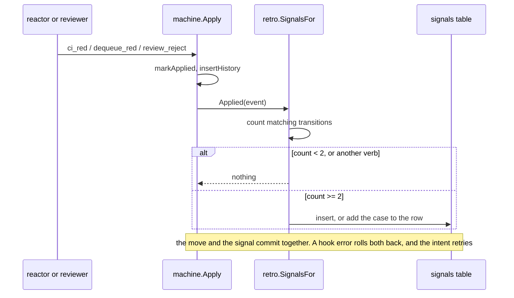
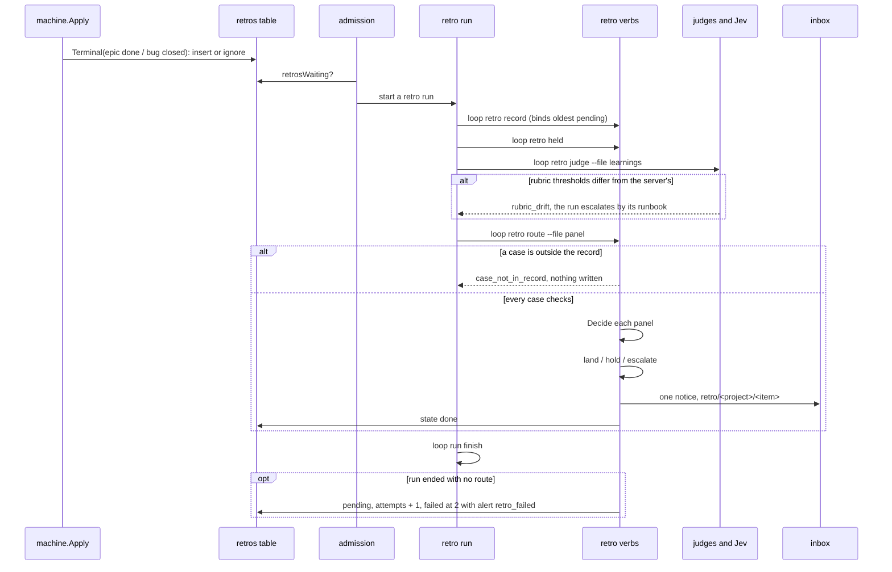
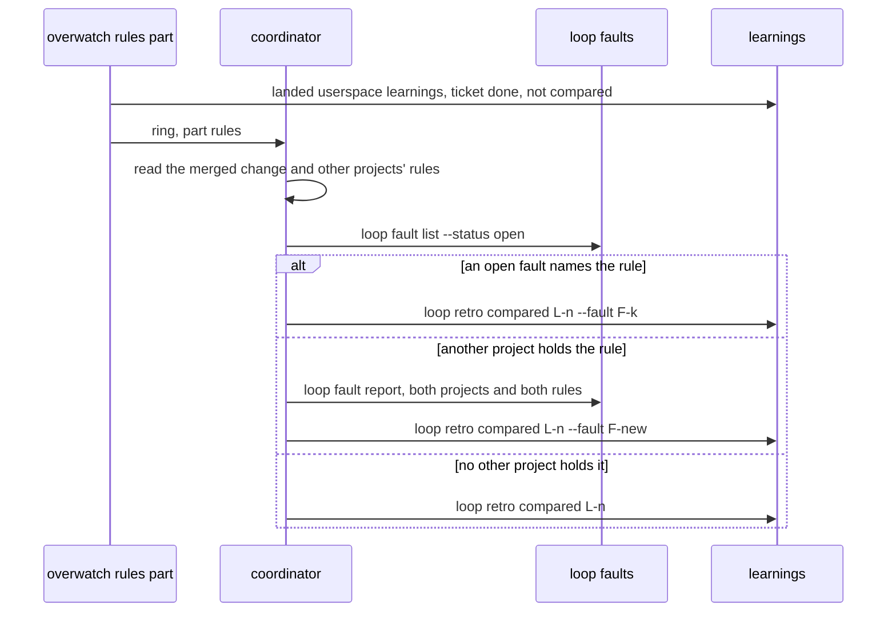

# Retro: learn from each finished epic and bug: technical spec

## Source

- **Epic:** factorio-1xq0
- **Source:** `docs/prd/retro.md`, merged on the base branch at `883b2c1`. The doc-reviewer passed
  it at head `6ed0cef`.
- **Stories covered:** US-01, US-02, US-03, US-04, US-05, US-06.

The PRD names the requirements in a list with no labels. This spec cites its acceptance criteria
A1 to A24 (A15 is a gap the PRD keeps on purpose). Where a contract proves a requirement that no
criterion holds, the contract quotes the requirement.

## Scope check

**Components:**

1. **The retro stage.** A new server package, `internal/retro`, with its store tables, its verbs,
   the signal and trigger hooks in `internal/machine`, a new run stage `retro`, its runbook
   `pack/runbooks/retro.md`, and its rubric skill `pack/skills/loop-retro-rubric/SKILL.md`.
2. **The cross-project comparison.** One overwatch part, `rules`, one coordinator verb, and the
   coordinator runbook sections that act on the part and on a retro's escalation. Why not its own
   epic: the part reads only the learnings that component 1 lands, and the operator kept it in this
   epic, "keep it in this epic. it naturally fits together and should be done atomically" (US-06).

Work entries 1 to 7 build component 1. Entry 8 builds component 2 on the learning records that
entries 4 and 5 write. Each entry changes one component.

**Not in this spec:** the kernel and userspace split and the place of a userspace skill
(factorio-yzrt). The event names `epic.done` and `bug.closed`, and which bug states count as
closed (factorio-vlle). The triage rubric and its two thresholds (`pack/skills/loop-sdlc-triage`).
Corrections in a session (`loop-reflect`).

## Decisions

### Answers a person already gave

The operator answered every question of intake room room-2e507194 on 2026-10-31, with "i accept
all recommendations." The PRD records each answer in a story. This spec takes them as given:

- One retro on each epic that reaches done and each bug that closes, and none for an item that
  finished before this ships (US-01).
- A signal is recorded when it happens and judged at done. No retro starts on a signal (US-02).
- Two judges and Jev answer three questions. Levels `edit` and `extend` land unattended. `add` and
  `restructure` reach the operator (US-03).
- A userspace learning lands as a pull request with no sign-off. A kernel learning lands as a loop
  fault. A `project ticket` learning lands as a bug report. One inbox notice for each retro (US-04).
- Every other learning escalates to the operator (US-05).
- The coordinator compares projects on a timer, and the comparison stays in this epic (US-06).
- The epic waits on factorio-yzrt and factorio-vlle (PRD, Boundaries with other epics).

### The trigger

- **The machine's `Terminal` hook queues the retro, in the transaction that lands the item in its
  terminal state.** We chose the hook over a claim row from `done`, because `Table.check` refuses a
  row that starts from a terminal state (`internal/machine/kinds.go:250`), and an epic in `done`
  takes no move. We rejected a timed scan of done items, because a scan must remember what it read,
  and a scan that starts from an empty memory reads every old item, which the operator rejected
  (US-01). We rejected the `outbox` table, because nothing reads it today (`apply.go:216-220`).
  The hook runs inside `markApplied`, so the retro row and the move commit together or not at all.
- **A retro row is unique on (project, item), and the insert ignores a second row.** We chose the
  key over a check in code, because `completeEpic`, `CompleteEpics` and the start-up reconcile all
  apply `complete` (`apply.go:62`, `epic.go:246`, `reconcile.go:134`), and only one of them can
  win the move. The key makes a replay harmless.
- **The `Terminal` hook takes the item's kind and target status.** Today it takes the project and
  the item only (`machine.go:60`). We chose a wider signature over a bead read inside the hook,
  because the hook runs in a SQLite transaction and the bead lives in Dolt. `markApplied` already
  holds `f.Kind` and `in.TargetStatus`. `escalation.CloseFor` keeps its behaviour.
- **"Before this epic ships" means before the host first runs a release that holds work entry 2.**
  Only the running server writes a `retros` row, in the `Terminal` hook, and the migration of
  entry 2 creates the table empty. An epic that was in `execution` when that release started, and
  reaches `done` after, gets a retro. We rejected the merge of entry 2 as the cut, because merged
  code writes nothing until a release carries it, so no record holds the moment of the merge. We
  rejected the epic's own `done` as the cut, because entries 3 to 8 land after entry 2. An item
  that finishes between them would need code that drops a retro the trigger already queued, and
  the loop would lose its record. That retro waits `pending` until entry 7 lets admission start
  the stage.
- **Which bug states count as closed is one function, `machine.BugClosed`.** factorio-vlle owns the
  set. Entry 2 waits on it. We rejected a guess from today's terminal states (`shaped`,
  `duplicate`, `canceled`, `bug.go:101-103`), because a `canceled` bug that nobody reproduced may
  hold no record worth a retro, and that is vlle's call.

### Signals

- **The server writes each signal, at the move that makes it.** We chose the server over the
  coordinator or the overwatch sweep, because the sweep never writes (ADR 0009), and a coordinator
  that misses a wake misses the signal. The server sees each move in the transaction that applies
  it, so no signal depends on a model turn.
- **A signal is a row in a new `signals` table, not a `loop work note`.** We rejected the note,
  because `notePut` overwrites the last note (`internal/machine/rows.go:24`), and the last note is
  the next run's handoff (`sched/dispatch.go:370`). A signal note would replace the coordinator's
  handoff. We rejected a bead fact, because a fact holds one value and an item can carry several
  signals. `loop work show` prints each signal row of the item under `signals`, so the signal is
  "on the item" as US-02 asks. `workShow` reads them through a reader that the server sets, as it
  sets the wait reader (`machine/verbs.go:793-810`, `server/server.go:384`).
- **A new `Applied` hook in `markApplied` finds the red build and the second reject.** It runs after
  `insertHistory`, so a count over `transitions` includes the move that the hook sees. Red builds
  are the ticket verbs `ci_red` and `dequeue_red`. A reject is `review_reject` from `prd_review` or
  from `spec_review`. We chose a count over `transitions` over a new counter fact, because the spec
  reject has no counter today (`epic.go:366`) and the history already holds every move.
- **The failed-attempts signal comes from `Scheduler.alertHeld`, next to the `retry_limit` alert.**
  That function already holds the failed runs and the limit (`sched/finish.go:110-123`). We
  rejected a second count of the `failures` table, because two counts can disagree.
- **"Two failed attempts" means two counted failures at the same inputs, as the brief counts
  them.** `alertHeld` fires only then (`sched/finish.go:111`). So two failed runs with a changed
  input between them write no signal. We rejected a count of every failed run of the item at the
  stage, because the loop treats changed inputs as a new attempt, and a failure after a person
  changed the task is no repeat of the first. A later retro still reads both runs in the record.
- **One signal row for each (item, signal, scope), and each later case joins it.** The scope is
  the stage for failed attempts, `prd` or `spec` for a reject, and empty for a red build. A third
  red build adds its case to the row of the second. So a retro reads one signal with all its cases.

### The retro run

- **The retro is an agent run stage with no claim row, like the fixer.** We chose a run stage over
  a server job that calls a model, because the judges already run as CLI subprocesses in a run's
  process (`internal/escalation/judge.go:74-124`), and a retro must read the record and write
  learnings, which is model work. We chose a run stage over a host `AgentJob`, because a run stage
  has a cap, a pause, project config and failure accounting, and an agent job has none of them.
  Admission starts a retro run only while the project holds a `pending` retro, as it starts the
  fixer only while a panel waits (`admission/policy.go:562-571`).
- **The first `loop retro record` of a run binds the oldest pending retro of its project to the
  run.** We chose a bind in that verb over a brief field, because the brief of an item-less stage
  names no item today, and a bind at first read keeps the brief unchanged. A later call by the same
  run returns the same retro. A run never holds two retros.
- **A run that ends with no route returns its retro to `pending` and counts one attempt. Two
  attempts mark it `failed` and raise one alert, `retro_failed`.** We chose a count on the retro row
  over the `failures` table, because that table keys on an item the run claimed, and a retro run
  claims none. The limit is `admission.FailureLimit`, so the loop keeps one number for "two
  attempts".
- **`loop retro record` builds the whole record on the server, and the run reads nothing else.**
  We chose one verb over a read grant of `loop work show` and `loop review rounds` on items the run
  does not hold, because a run reads only its own item (`rpc/server.go:47-57`), and a grant for a
  done item opens every verb that reads it. One verb also gives each part of the record one case
  reference, which `loop retro route` checks (A6).

### Judging and the route

- **The retro has its own rubric skill, `loop-retro-rubric`, with the PRD's three questions.** We
  rejected an edit of `loop-sdlc-triage`, because the PRD says this epic changes neither the triage
  rubric nor its thresholds. `loop retro judge` sends the whole rubric file to each judge, as
  `loop escalation judge` does with the triage rubric.
- **`loop retro judge` runs in the run's process, and reuses the two judge commands and Jev of
  `loop escalation judge`.** We chose reuse over a second judge set, because the triage panel
  already pays for two models with different vendors, and Jev's key is the same secret
  (`TYPESAFE_API_KEY`). `.loop/secrets.yaml` adds `retro` to that secret's stages.
- **`loop retro judge` reads both thresholds from the triage rubric, and refuses to run when they
  differ from the server's.** The PRD gates a landing on "the triage rubric's thresholds". We chose
  the same `rubric_drift` refusal that `loop escalation judge` makes (`judge.go:402-404`), so one
  table stays the one source.
- **The server decides the route again, with its own thresholds, when the run sends the panel.**
  We chose a server decision over a route the run states, because a run could state `land` for a
  learning the rule escalates. The escalation route makes the same choice (`raise.go:226`).
- **A learning that either judge answers `one` is held, before every escalation rule.** The PRD
  says an escalation reaches the operator for a learning that "passes no route rule above, and is
  not held for a second case" (`docs/prd/retro.md:188`). So a held learning never escalates, even
  when the judges name different targets. We rejected escalation first, because it would send a
  single case to the operator, and the Goal says a single case "waits for a second case".
- **No carve-out skips the thresholds.** The triage route sends a finding to the loop when both
  judges give one answer, with no threshold (`loop-sdlc-triage`, "One carve-out"). We rejected that
  carve-out here, because the PRD lands a learning only when "Jev's convergence and confidence are
  each at or above the triage rubric's thresholds", and A12 sends a learning that Jev did not score
  to the operator.
- **A `pack PR` answer outside the loop's own project escalates.** The loop's own project is the
  registered project whose repository is `release.ReleaseRepo`, the rule `overwatch/bugs.go:19`
  already uses. The judge prompt names the rule, and the server checks it again. We rejected a
  rewrite of the answer to `loop fault`, because a judge that broke the rule may have misread the
  learning too.
- **A held learning is on its item through `loop work show`, which lists it under
  `held_learnings`.** A7 says a held learning "is a note on the item". The item is the retro's
  item. `loop work show <item>` lists each `held` learning whose `retro_item` is that item, with
  its cases, through the same reader as the signals. We rejected a `loop work note`, because `note`
  is a row of the item's table, and `Table.check` refuses a row from a terminal state
  (`internal/machine/kinds.go:250`). A done epic or a closed bug takes no note. A held learning
  that a later learning extends moves to `counted`, and leaves the list.
- **The status of a learning decides its route, and no column stores the route.** `held` and
  `counted` are the hold route, `landed` is the land route, and `escalated` and `answered` are the
  escalate route. `LearningStatus.Route()` derives it. We rejected a `route` column next to
  `status`, because the two columns must agree, and a row with `route = land` and `status = held`
  would be representable.

### Landing

- **A `project policy`, `userspace skill` or `pack PR` learning lands as a ticket in `todo`, and
  the implementer opens its pull request.** US-04 says "The code-reviewer reviews it, and the merge
  mechanism merges it". Only a ticket's pull request reaches the code-reviewer. We rejected a pull
  request that the retro run pushes, because a run with no item has no item branch, and no stage
  reviews a branch that no ticket holds. We rejected a server pull request through
  `ProposeFile` (`github/merge_api.go:338`), because that path merges after CI with no review, and
  because the retro run would have to write the final file text, which is implementer work.
- **The server creates that ticket with no PRD, and the ticket cites the learning in place of the
  operator's request.** Today only the coordinator creates PRD-less work, on the operator's words
  (`pipeline/adhoc.go:20-30`). US-04 is the operator's standing word for this case: a learning
  that passes the rubric lands "with no step of mine". The ticket carries the fact `retro_learning`
  and the create key `retro/<learning id>`, so a repeated route finds the same ticket.
- **A `project ticket` learning lands as a bug in `reported`, which the server creates.** The
  operator accepted the recommendation "filing it as a bug report, so the reproducer shapes it like
  any other" (US-04). The bug carries `retro_learning` in place of `request`.
- **A `loop fault` learning lands through `fault.Service.Report`, with the principal `host`.** A
  server job already files that way (`server/orcalane/job.go:144`). We rejected a new reporter
  kind, because the `reporter_kind` check of migration 0007 would need a table rebuild for no
  reader that tells the two apart. The fault text names the learning id and each case.
- **An escalated learning is an inbox entry of a new kind, `learning`, that awaits a person.** We
  rejected the `escalations` table, because an escalation moves its item to `escalated`, and a
  done epic or a closed bug takes no move. `escalation.CloseFor` would also close it at once,
  because the item is terminal. `loop inbox answer` on the entry records the operator's answer, and
  the coordinator applies it with the verbs it already has (`loop work create`,
  `loop fault report`).
- **One notice for each retro, keyed `retro` and `<project>/<item>`.** `inbox.PutNotice` is
  idempotent on that key (`inbox/inbox.go:196-204`). We rejected a key on the run id, because a
  second run can route a retro after the first run ended with no route, and A16 asks for one
  notice for each retro. (project, item) is also the key of the `retros` row, so the notice and the
  retro share one identity. The notice lists each learning that landed,
  with its target and the id of the ticket, bug or fault. It lists each held learning, and the
  entry id of each escalated one. A retro with no learning still puts a notice that says so.

### The comparison

- **The overwatch sweep is the timer.** We chose a new part, `rules`, over a new timed job, because
  the sweep already runs every ten minutes, rings the coordinator only when a part holds work, and
  goes quiet when an open record names the finding key (`overwatch/records.go:27-60`). The part
  lists each landed userspace learning whose ticket is `done` and that no comparison has read yet.
- **The coordinator compares, and records each comparison with `loop retro compared`.** Whether two
  rules in two projects are one rule is judgement, so the server cannot decide it. "Since the last
  comparison" is the learning's `compared_at`, which the verb sets.
- **The coordinator checks open loop faults before it files.** A24 is a rule of the coordinator
  runbook, and `loop retro compared --fault F-<n>` links the learning to the fault that already
  names the rule. We rejected a server match of fault text, because two faults can name one rule in
  different words.

### Proof

- **The route rule is one pure function, and a table test proves it.** `retro.Decide` takes a panel
  and the route context, and returns a route. A9 to A14 are rows of one table.
- **The runbook rules of the coordinator and the retro run are proven by pack tests,** in the idiom
  of `internal/pack/recovery_test.go`. A command is the weak proof, so each rule that only an agent
  follows gets a test that reads the embedded runbook.

## Assumptions

- `insertHistory` writes the transition row before the `Applied` hook reads `transitions` in the
  same transaction (`apply.go:338-342`). This is wrong if the second red build counts as the first.
- `ci_red` applies once each time a ticket enters `repair`, and not on each poll while it stays red.
  The row starts from `in_review` and states before `repair` (`ticket.go:182`). This is wrong if
  one red run leaves two `ci_red` rows in `transitions`.
- The closed bug states are the operator's answer of 2026-10-31: "a shaped bug counts as closed
  when its shaped ticket reaches done, a canceled bug counts at once, and a duplicate never counts."
  A shaped bug takes no move when its ticket reaches done, so the ticket's own terminal write queues
  the retro of its bug. This is wrong if a ticket that work shape made reaches `done` with no `bug`
  fact, because then the `Terminal` hook cannot name the bug.
- An implementer can find a userspace skill from the ticket text. factorio-yzrt merged its PRD and
  ADR 0013 after this spec's first round. A committed userspace skill is a directory under the
  harness's skill root, `.claude/skills/<name>` or `.agents/skills/<name>`
  (`docs/adr/0013-userspace-skill-pins.md` § Decision 1). So the ticket that entry 5 writes names
  both roots and the skill name, and the implementer edits the one that git tracks. A pinned
  userspace skill is no place the project writes: the server refuses a push under a pin's
  directory, and the implementer escalates that refusal by its runbook. This is wrong if a
  learning about a pinned skill lands as a ticket that no run can finish and no escalation names.
- The GitHub App reads the comments of a merged or closed pull request. This is wrong if
  `loop retro record` returns no comments for a ticket whose pull request merged with a review
  thread.
- The reproducer shapes a bug whose body states a learning, with no `request` fact. This is wrong
  if `reproducer.md` or the reproducer's verbs read `request` and refuse without it.
- One epic's record fits in one envelope. An epic with 30 tickets and their review rounds is about
  200 KiB of JSON. This is wrong if `loop retro record` exceeds the RPC frame limit, and then the
  verb needs `--out <file>`.
- A project with no `TYPESAFE_API_KEY` for the `retro` stage gets no Jev reading. Every learning it
  judges then escalates by A12, and nothing lands. This is wrong if `loop retro judge` fails the
  whole run without a key, as a missing judge binary does.

## Approach

### The package

`internal/retro` holds the domain types, the store reads and writes, the route rule, the landing,
and the server verbs. `internal/machine` gains two hook fields and `BugClosed`. `internal/sched`
calls the signal write from `alertHeld`, and releases a retro when a retro run finishes.
`internal/server/server.go` wires the hooks: `Terminal` calls `escalation.CloseFor`, then
`retro.Enqueue`. `Applied` calls `retro.SignalsFor`.

### Signals

`retro.SignalsFor(tx, ev)` reads one applied move. For a ticket's `ci_red` or `dequeue_red` it
counts both verbs for the item in `transitions`. At a count of 2 or more it writes the
`red_build` signal, with one case for each counted transition. For an epic's `review_reject` from
`prd_review` or `spec_review` it counts the rejects from that state. At 2 or more it writes
`second_reject` with scope `prd` or `spec`, and one case for each reject. Every other move writes
nothing. `alertHeld` writes `attempts` with scope = the stage, and one case for each failed run, at
the point where it raises `retry_limit`.

A signal write touches only the `signals` table. It changes no item, no fact, no note and no file.

### The trigger and the queue

`retro.Enqueue(tx, ev)` inserts one `retros` row when `ev.Kind` is an epic and `ev.Status` is
`done`, or `ev.Kind` is a bug and `machine.BugClosed(ev.Status, "")`. A shaped bug closes when its
ticket reaches done, so the shaped ticket's done write queues the retro of its bug: when `ev.Kind`
is a ticket, `ev.Bug` is set and `machine.BugClosed(machine.Shaped, ev.Status)`, the row names
`ev.Bug` with kind `bug`. It ignores every other event and any second insert. The row starts
`pending`.

Admission treats `retro` like the fixer: the stage has work only while
`retrosWaiting(q, project)` finds a `pending` row. The default throughput entry is cap 1 with the
fixer's schedule, and `retro` joins `optional`, so a host config from an older release loads.

### The run

The run follows `pack/runbooks/retro.md`:

1. `loop retro record` binds and prints the record. Each element carries a case reference.
2. `loop retro held` lists the project's held learnings, with their cases.
3. The run writes its learnings to a file. Each learning states what a stage, skill or policy must
   do differently, and names its cases by reference. A learning that repeats a held one names it in
   `extends` and includes its cases.
4. `loop retro judge --file <learnings> --out <panel>` asks two judges the three questions about
   each learning, then asks Jev about each pair.
5. `loop retro route --file <panel>` sends the panels. The server checks each case, decides each
   route, lands, holds or escalates, puts the notice, and marks the retro `done`.
6. `loop run finish --outcome done`.

A run that finds no learning sends an empty panel file, and the retro still gets its notice.

### The route

`retro.Decide(p Panel, c RouteContext) Route` applies these rules in order. The first rule that
holds decides.

| Order | Rule | Route |
| --- | --- | --- |
| 1 | Fewer than two distinct judges answered | escalate, `judges` |
| 2 | Either judge answered evidence `one` | hold |
| 3 | No reading, or `escalation.unusable` names a fault in it | escalate, `no_reading` |
| 4 | The judges named different targets | escalate, `targets` |
| 5 | The target is `pack PR` and the retro is outside the loop's own project | escalate, `pack_outside` |
| 6 | Q3 applies to the target, and either judge answered `add` or `restructure` | escalate, `size` |
| 7 | Agreement under the convergence threshold, or confidence under the confidence threshold | escalate, `threshold` |
| 8 | None of the above | land, at the target |

Agreement is the reading's probability on `align` and `identical`, the sum that the triage route
already computes. Q3 applies to `pack PR`, `project policy` and `userspace skill`. For `loop fault`
and `project ticket` the judges answer `n/a`, and rule 6 reads nothing.

### Landing and the notice

`retro.Land` acts on each `land` route:

| Target | What the server creates |
| --- | --- |
| `project policy`, `userspace skill`, `pack PR` | A PRD-less ticket in `todo` in the retro's project. Body: the learning, the target, the cases, both change-size answers |
| `project ticket` | A bug in `reported` in the retro's project. Body: the learning and the cases |
| `loop fault` | A loop fault whose text names the learning id, the project and each case |

Each create uses the machine with the actor `machine.Server("retro")` and the create key
`retro/<learning id>`. The learning records the created id in `landed_ref`. A held learning that a
new learning extends moves to `counted`, and its cases join the new learning.

`loop work show <item>` lists, under `held_learnings`, each learning in `held` whose `retro_item`
is the item, with its statement and cases. It lists the item's signals under `signals`. One
reader, `retro.OnItem`, answers both, and the server sets it on the machine.

The route verb puts the notice last, after every learning has its route. A repeat of the verb with
the same file returns the stored result (the RPC idempotency key), and a different file on a `done`
retro is refused.

### The comparison

The `rules` part lists each learning in status `landed`, target `project policy` or
`userspace skill`, a `landed_ref` ticket in `done`, and no `compared_at`. Its finding key is
`overwatch:rules:<project>:<learning id>`. The coordinator runbook adds a row to the part table and
a section that says:

1. Read the merged change of the learning's ticket.
2. Read the project policy files and userspace skills of each other registered project, at its
   default branch.
3. Run `loop fault list --status open`. When an open fault already names the rule, run
   `loop retro compared <id> --fault F-<n>`, and file nothing.
4. When another project holds the same rule, file one fault with `loop fault report`. It names both
   projects, both rules and both learning ids' finding keys. Then run
   `loop retro compared <id> --fault F-<n>` for each learning it names.
5. When no other project holds it, run `loop retro compared <id>`.

The same section tells the coordinator how to apply an answer to a `learning` entry: with the
operator's words, through `loop work create --request`, `loop fault report`, or nothing.

## Domain model

```
internal/retro (new)

RetroState          pending | running | done | failed
  a state machine. pending -> running at the first `retro record` of a run.
  running -> done at a route. running -> pending when the run ends with no route
  and attempts < admission.FailureLimit. running -> failed at the limit.
  invariant: done and failed are terminal. One row per (project, item), ever.

Retro               Project, Item, Kind (epic | bug), State, RunID, Attempts
  invariant: Kind is epic or bug. No ticket and no decision has a retro.

SignalKind          red_build | attempts | second_reject
  a closed set. Scope: empty for red_build, the stage for attempts,
  "prd" or "spec" for second_reject.

Signal              Project, Item, Kind, Scope, Cases []CaseRef
  invariant: at least two cases. A signal with one case is never written.

CaseRef             a reference into one record, such as "run:r-1a2b",
                    "round:factorio-x1y:2", "transition:418", "escalation:7",
                    "fault:F-3", "comment:factorio-x1y:991", "signal:12",
                    "learning:L-4"
  invariant: Parse refuses an unknown prefix. Two equal strings name one case.

Target              loop_fault | pack_pr | project_policy | userspace_skill | project_ticket
  a lookup table with two columns: SizeApplies (true for pack_pr,
  project_policy, userspace_skill) and LoopProjectOnly (true for pack_pr).

Evidence            one | two_or_more
Change              edit | extend | add | restructure | n/a
  ordered. Lands() is true for edit and extend only.

Answer              Judge, Target, Evidence, Change, Reason
  invariant: Change is n/a exactly when the Target's SizeApplies is false.
  ParseAnswer refuses any other pair.

Learning            ID (L-<n>), Statement, Cases []CaseRef, Extends (a held ID or empty)
  invariant: at least one case. Every case is in the retro's record or in the
  cases of the learning it extends. The route verb refuses any other.

Panel               Learning, Answers []Answer, Reading *escalation.Reading

Route               a tagged union:
                    Land{Target} | Hold | Escalate{Reason}
  Reason is one of judges, no_reading, targets, pack_outside, size, threshold.

LearningStatus      held | landed | escalated | answered | counted
  held -> counted when a later learning extends it. escalated -> answered at
  the operator's answer. landed is terminal.
  Route() derives the route from the status: held and counted are Hold,
  landed is Land, escalated and answered are Escalate. No field stores the
  route, so a status and a route never disagree. The Land target and the
  Escalate reason are the row's target and reason.
  invariant: reason is set exactly when the status is escalated or answered.
  landed_ref is set only when the status is landed.
```

The learning keeps one status and derives its route, so the store holds no pair of fields that
must agree. `target` and `reason` are not such a pair: `target` holds the judges' shared answer
on every route, and `reason` exists only on the escalate route.

## Interfaces

```go
package machine

// TerminalEvent is a write that landed its item in a terminal state.
type TerminalEvent struct {
	Project, Item string
	Kind          Kind
	Status        string
	// Bug is the bug a shaped ticket came from, or empty. The hook runs in
	// a SQLite transaction and cannot read the bead, so the intent carries
	// it.
	Bug string
}

// AppliedEvent is every applied write, after its transitions row.
type AppliedEvent struct {
	Project, Item string
	Kind          Kind
	Verb          string
	From, To      string
	Transition    int64 // the transitions row id
}

type Config struct {
	// ...
	Terminal func(tx *store.Tx, ev TerminalEvent) error // was (tx, project, item)
	Applied  func(tx *store.Tx, ev AppliedEvent) error  // new; nil runs nothing
}

// BugClosed reports whether a bug in status has closed. ticket is the
// status of the ticket the bug was shaped into, or empty. A canceled bug
// closes at once, and a shaped bug closes when its ticket reaches done. A
// duplicate never closes.
func BugClosed(status, ticket string) bool

// RetroOnItem is the part of work show that the retro writes.
type RetroOnItem struct {
	Signals        []json.RawMessage `json:"signals,omitempty"`
	HeldLearnings  []json.RawMessage `json:"held_learnings,omitempty"`
}

// SetRetroReader sets the reader of work show's signals and held learnings.
// The server sets it before the socket binds, as it sets the wait reader.
func (m *Machine) SetRetroReader(f func(ctx context.Context, project, item string) (RetroOnItem, error))
```

```go
package retro

func Enqueue(tx *store.Tx, ev machine.TerminalEvent) error
func SignalsFor(tx *store.Tx, ev machine.AppliedEvent) error
func RecordAttempts(ctx context.Context, st *store.Store, project, item, stage string, runs []string) error

// OnItem reads what the retro keeps on one item: its signals and the held
// learnings whose retro_item it is. work show prints both.
func OnItem(ctx context.Context, st *store.Store, project, item string) (machine.RetroOnItem, error)

// Bind returns the retro that run holds, or binds the oldest pending one of
// project. ok is false when the project holds none.
func Bind(ctx context.Context, st *store.Store, project, runID string) (r Retro, ok bool, err error)

// Release ends a run's hold with no route: back to pending, or failed at
// the limit. It returns true when it marked the retro failed.
func Release(ctx context.Context, st *store.Store, runID string) (failed bool, err error)

type Record struct {
	Retro    Retro       `json:"retro"`
	Item     ItemRecord  `json:"item"`
	Children []ItemRecord `json:"children,omitempty"` // an epic's tickets
}

type ItemRecord struct {
	ID, Kind, Title, Status string
	Rounds      []Case // review rounds and their findings
	Runs        []Case // every run on the item, with its outcome class and note
	Escalations []Case // with each route and triaged note
	Faults      []Case // loop faults whose item is this one
	Comments    []Case // comments people left on the item's pull requests
	Notes       []Case // every note, from transitions
	Signals     []Case
}

type Case struct {
	Ref  CaseRef `json:"ref"`
	At   time.Time `json:"at"`
	Text string  `json:"text"`
}

func BuildRecord(ctx context.Context, w World, r Retro) (Record, error)

type RouteContext struct {
	LoopProject bool
	Thresholds  escalation.Thresholds
}

func Decide(p Panel, c RouteContext) Route

// RouteAll checks every case, decides, lands, holds or escalates each panel,
// puts the one notice and marks the retro done, in that order.
func RouteAll(ctx context.Context, w World, runID string, panels []Panel) (Result, *cli.Refusal)
```

New verbs. `make proto` regenerates `gen/`.

| Verb | Callers | Answer | Refusals |
| --- | --- | --- | --- |
| `loop retro record` | `retro` | the `Record` of the bound retro | `NOTHING` when the project holds no pending retro |
| `loop retro held` | `retro` | the project's held learnings with their cases | none |
| `loop retro judge --file <learnings> [--out <panel>]` | `retro`, client-side | the panel file path | `rubric_drift`, `USAGE` on a learning with no case |
| `loop retro route --file <panel>` | `retro` | each learning's id, route and created id, and the notice id | `case_not_in_record`, `extends_not_held`, `retro_done`, `retro_not_bound` |
| `loop retro compared <learning> [--fault F-<n>]` | `coordinator` | the learning and its `compared_at` | `not_landed`, `fault_unknown` |

The learnings file and the panel file are JSON:

```json
{"learnings": [{"statement": "...", "cases": ["run:r-1a2b", "round:factorio-x1y:2"], "extends": "L-4"}]}
```

```json
{"panels": [{"learning": {"statement": "...", "cases": ["..."], "extends": ""},
  "answers": [{"judge": "fable-5", "target": "project_policy", "evidence": "two_or_more",
               "change": "edit", "reason": "..."}],
  "reading": {"probabilities": {"0": 0.01, "1": 0.04, "2": 0.35, "3": 0.6}, "score": 2.5, "confidence": 0.9}}]}
```

The new inbox kind:

```go
package inbox

const KindLearning = "learning" // a retro learning that the route sent to a person
```

## Data

Three migrations add one table each, in the order of the work entries: `0015_signals.sql` adds
`signals` (entry 1), `0016_retros.sql` adds `retros` (entry 2), and `0017_learnings.sql` adds
`learnings` (entry 4). Main already holds `0014_room_checkout_name.sql`. Each one only adds a table, so a reader of the schema before it still reads
and writes every table it knows. A ticket that lands out of this order takes the next free number.

```
retros (new)
  project      text, required
  item         text, required
  kind         text, required, 'epic' or 'bug'
  state        text, required, 'pending' | 'running' | 'done' | 'failed'
  run_id       text, empty when no run holds it
  attempts     integer, required, default 0
  created_at   integer, required
  finished_at  integer
  primary key (project, item)

signals (new)
  id           integer, primary
  project      text, required
  item         text, required
  kind         text, required, 'red_build' | 'attempts' | 'second_reject'
  scope        text, required, default ''
  cases        text, required, a JSON array of case references, at least two
  at           integer, required
  unique (project, item, kind, scope)

learnings (new)
  id           integer, primary; shown as L-<id>
  project      text, required
  retro_item   text, required, the item of the retro that wrote it
  statement    text, required
  cases        text, required, a JSON array of case references
  extends      integer, a learnings.id, or null
  panel        text, required, the panel JSON with both answers and the reading
  reason       text, the escalate reason, or empty; check: set exactly when
               status is 'escalated' or 'answered'
  target       text, empty unless both judges named one
  status       text, required, 'held' | 'landed' | 'escalated' | 'answered' | 'counted'
  landed_ref   text, the ticket, bug or fault id, or empty
  answer       text, the operator's answer to an escalated learning
  compared_at  integer
  compared_fault text
  created_at   integer, required
```

**Existing records:** none. All three tables start empty. No code reads an old item to fill them,
which is A20.

`.loop/secrets.yaml` of the loop's own project adds `retro` to the stages of `TYPESAFE_API_KEY`.

## Flows

### A signal



### The trigger and one retro



### The comparison



## Work

1. **Signals.** Add the `signals` table, the `Applied` hook, `retro.SignalsFor`,
   `retro.RecordAttempts` and its call in `alertHeld`, and the `signals` list in `loop work show`.
   - Files: `internal/store/migrations/0015_signals.sql`, `internal/retro/signal*.go`,
     `internal/machine/machine.go`, `internal/machine/apply.go`, `internal/sched/finish.go`,
     `internal/server/server.go`, `internal/machine/verbs.go` (the `work show` answer and
     `SetRetroReader`), `internal/retro/onitem.go`.
   - Needs: nothing.
   - Proves: C5, C6, C7, C8.
   - Done when: a ticket that enters `repair` twice shows one `red_build` signal with two cases in
     `loop work show`, and its status and facts match a run of the same moves with the hook off.
2. **The retro trigger.** Add the `retros` table, the wider `Terminal` signature, `machine.BugClosed`
   and `retro.Enqueue`, and wire `Terminal` to call `CloseFor` and then `Enqueue`.
   - Files: `internal/store/migrations/0016_retros.sql`, `internal/retro/queue.go`,
     `internal/machine/machine.go`, `internal/machine/apply.go`, `internal/machine/bug.go`,
     `internal/escalation` (the `CloseFor` signature), `internal/server/server.go`.
   - Needs: factorio-vlle's closed bug states.
   - Proves: C1, C2, C3, C4.
   - Done when: an epic that reaches `done` through `completeEpic` and again through the start-up
     reconcile holds one `pending` retro row, and a done epic from before the migration holds none.
3. **The record.** Add `retro.Bind`, `retro.BuildRecord` and the verb `loop retro record`, with the
   `retro` caller label.
   - Files: `internal/retro/record.go`, `internal/retro/verbs.go`, `internal/cli/surface.go`,
     `internal/cli/capabilities.go`, `proto/`, `gen/`.
   - Needs: entry 1, entry 2.
   - Proves: C9, C24.
   - Done when: the record of a fixture epic with two tickets holds each round, run, escalation,
     fault, comment, note and signal of all three items, each with a case reference, and two
     concurrent binds of one pending retro bind it to one run.
4. **The route.** Add the `learnings` table, the domain types, `retro.Decide`, the verbs
   `loop retro held` and `loop retro route` with the hold and escalate routes and the notice, the
   inbox kind `learning`, the `held_learnings` list of `loop work show`, and a `land` route that
   only records status `landed` with no `landed_ref`.
   - Files: `internal/store/migrations/0017_learnings.sql`, `internal/retro/domain.go`,
     `internal/retro/route.go`, `internal/retro/verbs.go`, `internal/inbox/inbox.go`,
     `internal/inbox/entries.go`, `internal/inbox/answer.go`, `internal/retro/onitem.go` (the held
     learnings), `internal/cli/surface.go`, `proto/`, `gen/`.
   - Needs: entry 3.
   - Proves: C10, C11, C12, C13, C14, C15, C16, C18, C19, C20, C27, C29.
   - Done when: the table test of `Decide` passes every row of the route table, a route of a
     fixture panel puts one notice and one `learning` entry per escalated learning, and
     `loop work show` of the retro's item lists its held learning.
5. **Landing.** Add `retro.Land`: the PRD-less ticket, the bug and the loop fault, each with the
   create key `retro/<learning id>`, and `landed_ref`.
   - Files: `internal/retro/land.go`, `internal/pipeline/adhoc.go` (a server create path for the
     ticket and the bug).
   - Needs: entry 4, factorio-yzrt for the ticket text of a `userspace skill` learning.
   - Proves: C17, C21, C22.
   - Done when: a fixture panel that both judges answer `project policy`, `two or more`, `edit`,
     with a reading above both thresholds, leaves one `todo` ticket and no entry that awaits a
     person, and a second route of the same file leaves the same ticket.
6. **The judges.** Add `pack/skills/loop-retro-rubric/SKILL.md` with the PRD's three questions and
   the kernel test of Q1, and the client-side verb `loop retro judge`.
   - Files: `pack/skills/loop-retro-rubric/SKILL.md`, `internal/retro/judge.go`,
     `cmd/loop/main.go`, `internal/cli/surface.go`, `pack/manifest.json`.
   - Needs: entry 4 (the panel type).
   - Proves: C23.
   - Done when: `loop retro judge` with fake judges and a fake Jev writes a panel file that
     `loop retro route` accepts, and it refuses `rubric_drift` against a triage rubric with a
     changed threshold.
7. **The retro stage.** Add the stage `retro`: the throughput constant, `runStages`,
   `DefaultThroughput`, `optional`, `DefaultEfforts`, the admission gate `retrosWaiting`, the
   release in the finish path, the alert `retro_failed`, the runbook, the manifest entry, the
   glossary row, the `stages:` example of `loop-init`, and the `TYPESAFE_API_KEY` stage.
   - Files: `internal/config/throughput.go`, `internal/machine/kinds.go`,
     `internal/admission/policy.go`, `internal/admission/holds.go`, `internal/sched/quota.go`,
     `internal/sched/finish.go`, `pack/runbooks/retro.md`, `pack/manifest.json`,
     `pack/skills/loop-sdlc-glossary/SKILL.md`, `pack/skills/loop-init/SKILL.md`,
     `.loop/secrets.yaml`, `internal/pack/retro_test.go`.
   - Needs: entries 3 to 6.
   - Proves: C28, C30.
   - Done when: admission starts one retro run for a project with a pending retro and none for a
     project without one, and two runs that end with no route leave the retro `failed` with one
     alert.
8. **The comparison.** Add the overwatch part `rules`, the verb `loop retro compared`, the part
   table row and the comparison and answer section of the coordinator runbook.
   - Files: `internal/overwatch/rules.go`, `internal/overwatch/overwatch.go`,
     `internal/retro/verbs.go`, `internal/cli/surface.go`, `proto/`, `gen/`,
     `pack/runbooks/coordinator.md`, `internal/pack/compare_test.go`.
   - Needs: entry 5.
   - Proves: C25, C26.
   - Done when: a sweep over a landed userspace learning whose ticket is `done` reads code 1 with
     the key `overwatch:rules:<project>:L-<n>`, and code 0 after `loop retro compared`.

Entries 4 and 5 meet at the `land` route: entry 4 records it, and entry 5 acts on it. C17 proves
that boundary. Entries 4 and 6 meet at the panel file, and C23 proves that the file one writes the
other reads.

## Out of scope

- Corrections that a person makes in a session, and the correction ledger. They belong to
  `loop-reflect`.
- A host ledger of lessons across projects. It belongs to no epic, by the operator's "option 1
  sounds very over-engineered" (US-06).
- A retro that a signal starts before done. It belongs to no epic, by the operator's "option 1,
  clear." (US-02).
- Bugs that a person files against an epic after it reaches done. They belong to a later trigger,
  and no epic holds it yet (PRD, Out of scope).
- A retro of an item that finished before the host ran a release that holds entry 2. It belongs
  to no epic (US-01).
- Where a userspace skill lives, and which skills are kernel. It belongs to factorio-yzrt.
- The names `retro`, `epic.done`, `bug.closed`, and the closed bug states. They belong to
  factorio-vlle.
- A change to the triage rubric, its thresholds or `loop escalation judge`. It belongs to the
  triage rubric.
- Signals other than the three the PRD names, such as a ticket's second code-review reject. It
  belongs to no epic. A later retro learning can propose one.
- A ticket created by a retro does not belong to an epic, so its merge starts no retro. Only its
  bug, when it lands as one, does.

## Contracts

**C1. Behaviour: an epic that reaches done gets one retro.** Proves A1. After `complete` moves an
epic to `done`, `retros` holds one `pending` row for it. A second application of `complete` by
`CompleteEpics` or the start-up reconcile leaves one row.
*`internal/retro/queue_test.go` drives a fixture epic through each of the three callers, and
asserts one row.*

**C2. Behaviour: a bug that closes gets one retro.** Proves A2. For each status and ticket status
where `machine.BugClosed(status, ticket)` is true, the move that closes the bug leaves one `pending`
row: the cancel of a bug, or the done of its shaped ticket. A repeat of the intent leaves one row.
*An example test for each closed status.*

**C3. Invariant: no retro for an item that has not reached done or closed.** Proves A3. Over any
sequence of legal moves of epics, tickets and bugs, each `retros` row names an epic in `done` or a
bug whose status and ticket status `BugClosed(status, ticket)` accepts, and no item has two rows.
A ticket in `done` has none.
*A property test over 500 generated move sequences on the fake beads.*

**C4. Behaviour: no retro for an item that finished before the trigger.** Proves A20. A store
migrated through the `retros` migration of entry 2 that already holds done epics and closed bugs holds no `retros` row after the
migration, after a server start, and after a reconcile.
*A test that seeds done items, runs the migration and the start-up reconcile, and asserts an empty
table.*

**C5. Behaviour: a second red build writes a signal before the epic is done.** Proves A4. A ticket
whose second `ci_red` or `dequeue_red` applies holds one `red_build` signal with both transitions
as cases, while its epic is in `execution`. A first red build writes none. A third adds a third
case to the same row.
*An example test at one, two and three red builds, with `ci_red` and `dequeue_red` mixed.*

**C6. Behaviour: a second failed attempt writes a signal.** Proves A22. When `alertHeld` raises
`retry_limit` for an item at a stage, the item holds one `attempts` signal with that stage as scope
and each failed run as a case. One failed attempt writes none.
*`internal/sched` test that finishes two runs `failed` at the same inputs.*

**C7. Behaviour: a second document reject writes a signal.** Proves A23. The second
`review_reject` from `prd_review` writes `second_reject` with scope `prd`. The second
`review_reject` from `spec_review` writes it with scope `spec`. One PRD reject and one spec reject
write none.
*An example test for each document, and one for the mixed pair.*

**C8. Equivalence: a signal changes nothing else.** Proves A5. The same move sequence, applied with
the `Applied` hook on and with it nil, leaves each item with the same status, facts and last note,
and the same `transitions` rows. Only `signals` differs. No file in the project checkout changes.
*A property test over generated sequences that compares both stores.*

**C9. Behaviour: the record holds the item's whole history.** Proves A6. For a fixture epic with
two tickets, `loop retro record` holds, for each of the three items, every review round and its
findings, every run and its outcome class, every escalation and its route, every loop fault whose
item it is, every comment on its pull requests, every note, and every signal. Each element carries
a case reference that `CaseRef.Parse` accepts.
*A hand-built fixture whose expected record a test compares in full.*

**C10. Refusal: a case outside the record is refused.** Proves A6. `loop retro route` refuses with
`case_not_in_record` a panel whose learning names a case that is neither in the bound retro's
record nor in the cases of the held learning it extends. The refusal names the case. It writes no
learning, no notice and no item, and the retro stays `running`.
*An example test with one good and one foreign case in one file.*

**C11. Behaviour: a single case is held.** Proves A7. A panel in which either judge answers `one`
routes `hold`, whatever its targets, sizes and reading. The learning is stored `held`, lands
nothing, and `loop retro held` lists it with its cases. `loop work show` of the retro's item
lists it under `held_learnings` with its statement and cases, and stops listing it once a later
learning extends it.
*Rows of the `Decide` table test, and a route test that asserts no ticket, bug or fault and
reads `loop work show` of the retro's item before and after an extending route.*

**C12. Behaviour: a later case counts both.** Proves A8. A learning that extends held learning L-n
is stored with L-n's cases and its own. L-n moves to `counted`. `extends` that names a learning
not `held` is refused with `extends_not_held`.
*A route test over two retros of two fixture items.*

**C13. Behaviour: different targets reach the operator.** Proves A9. Two `two or more` answers
with different targets route `escalate`, reason `targets`, for every pair of distinct targets.
*Rows of the `Decide` table test, one for each ordered pair.*

**C14. Behaviour: a large change reaches the operator.** Proves A10. When Q3 applies and either
judge answers `add` or `restructure`, the route is `escalate`, reason `size`, and nothing lands.
*Rows for each size pair on each of the three targets Q3 applies to.*

**C15. Boundary: a reading under either threshold reaches the operator.** Proves A11. With
thresholds 0.85 and 0.85, agreement 0.85 and confidence 0.85 land. Agreement 0.849 or confidence
0.849 escalates with reason `threshold`. The route reads the server's thresholds, never the
panel's.
*Example tests at the edge values.*

**C16. Behaviour: an unscored learning reaches the operator.** Proves A12. A panel with no reading,
or a reading that `escalation.unusable` faults, routes `escalate`, reason `no_reading`, when both
judges answer `two or more`.
*Rows for a nil reading, a three-level reading and a reading whose probabilities sum to 0.9.*

**C17. Behaviour: a passed project policy learning opens work, and asks nothing.** Proves A13.
Both judges answer `project_policy`, `two_or_more`, `edit`, and the reading clears both thresholds.
The route leaves one ticket in `todo` in the retro's project with the fact `retro_learning` and the
create key `retro/L-<n>`, and no inbox entry that awaits a person other than the notice. A repeat
of the route leaves one ticket.
*A route test on the fake beads, which counts tickets and person entries.*

**C18. Refusal: no pack PR outside the loop's own project.** Proves A14. In a retro whose project
repository is not `release.ReleaseRepo`, a `pack PR` landing routes `escalate`, reason
`pack_outside`, and no ticket is created in any project. The judge prompt of such a retro states
that `pack PR` is not an answer there.
*A `Decide` row, a route test that counts tickets in both fixture projects, and a test of the
prompt text.*

**C19. Invariant: one notice per retro, and it asks nothing.** Proves A16. Each retro that reaches
`done` holds exactly one `notices` row with source `retro` and ref `<project>/<item>`, also after a
repeated route and with zero learnings. The notice is of kind `notice`. Its body holds no question
mark, and lists each landed learning with target and id, and each held learning.
*A route test with zero, one held and one landed learning, run twice.*

**C20. Behaviour: an escalation holds both judges and Jev.** Proves A17. Each `learning` inbox
entry's body holds the learning, its cases, each judge's target, evidence, change and reason, and
the reading's agreement and confidence, or the words "no reading".
*A route test that parses the entry body.*

**C21. Behaviour: a project ticket learning lands as a bug report.** Proves A21. A landed
`project_ticket` learning leaves one bug in `reported` in the retro's project with the fact
`retro_learning`, and the reproducer stage can claim it.
*A route test, then an admission check that the reproducer takes the bug.*

**C22. Behaviour: a loop fault learning names each case.** Proves the requirement "A `loop fault`
learning lands as a loop fault that names each case". The landed fault's text holds the learning
id and every case reference of the learning. A repeat of the route files no second fault.
*A route test against the fault service.*

**C23. Behaviour and refusal: the judges answer alone, and the panel crosses intact.** Proves A9 to
A12, by the panel they rest on. Each judge's prompt holds the rubric, the learning and its cases,
and no other judge's name or answer. `loop retro judge` refuses with `rubric_drift` when the triage
rubric's thresholds differ from `escalation.DefaultThresholds`. A panel file that the verb writes
parses in `loop retro route` with every answer and the reading unchanged.
*Tests with fake judges that record their prompts, a changed rubric fixture, and a round trip of
the file.*

**C24. Invariant: one retro for each run, and one run for each retro.** Proves A1. Two runs that
call `retro.Bind` on one project with one pending retro bind it to one run, and the other gets
`ok = false`. A second `Bind` by the holding run returns the same retro. A run never holds two
retros.
*A store test with two concurrent binds, and one with a repeated bind.*

**C25. Behaviour: the rules part lists each uncompared landed rule.** Proves A18 and A19, by the
work it hands the coordinator. The part reads one finding for each learning in status `landed`,
target `project_policy` or `userspace_skill`, a `landed_ref` ticket in `done`, and no
`compared_at`. It reads no finding for a `pack_pr` learning, for a ticket not yet `done`, or after
`loop retro compared`. An open fault that holds the finding key also quiets it.
*`internal/overwatch/rules_test.go` over a fake World.*

**C26. Behaviour: the coordinator files one fault for a shared rule, and none otherwise.** Proves
A18, A19 and A24. The coordinator runbook section for the `rules` part tells the coordinator to run
`loop fault list --status open` before any report, to link an open fault that names the rule with
`loop retro compared --fault`, to file one fault that names both projects and both rules when
another project holds the rule, and to run `loop retro compared` with no fault when none does.
*`internal/pack/compare_test.go` reads the embedded runbook and asserts each instruction and that
the fault list comes before the report.*

**C27. Behaviour: Q3 does not apply to a loop fault or a project ticket.** Proves the requirement
"Q3 does not apply to `loop fault` or `project ticket`". `ParseAnswer` refuses a size other than
`n/a` for those targets, and refuses `n/a` for the other three. A `loop_fault` or
`project_ticket` panel that passes every other rule lands.
*Rows of the `Decide` table and a `ParseAnswer` test.*

**C28. Behaviour: the retro runbook ends every retro with a route.** Proves A16 and A6, by the run
that sends them. `pack/runbooks/retro.md` runs `loop retro record`, `loop retro held`,
`loop retro judge` and `loop retro route` in that order, sends an empty panel file when it finds no
learning, names each case by its reference, and never runs `loop pr open`, `loop work create` or
`loop fault report`.
*`internal/pack/retro_test.go` reads the embedded runbook.*

**C29. Refusal: one route for each retro.** Proves A1 and A16. A second `loop retro route` with a
different file on a `done` retro is refused with `retro_done`. A route by a run that holds no
retro is refused with `retro_not_bound`. Neither refusal writes a learning, a notice or an item.
*Route tests on a done retro and on a run with no bind, which count learnings and notices.*

**C30. Behaviour: a run that ends with no route releases its retro.** Proves A1. A retro run that
finishes with the retro still `running` returns it to `pending` with one attempt. The second such
run marks it `failed` and raises one `retro_failed` alert. A run that routed its retro changes
nothing at finish.
*A finish-path test with two runs that end with no route, and one that routed.*

## Observable behaviour

None, because this epic draws no screen. Its visible results are inbox entries and records: the
retro notice, a `learning` entry for each escalated learning, the `signals` list of
`loop work show`, a ticket or a bug that a retro created, and the `rules` part of
`loop overwatch sweep`.

## Open questions

None. The operator answered the three questions of the intake room on 2026-10-31. The two choices
the PRD leaves to its owners, the closed bug states and the place of a userspace skill, belong to
factorio-vlle and factorio-yzrt, and entries 2 and 5 wait on them.
