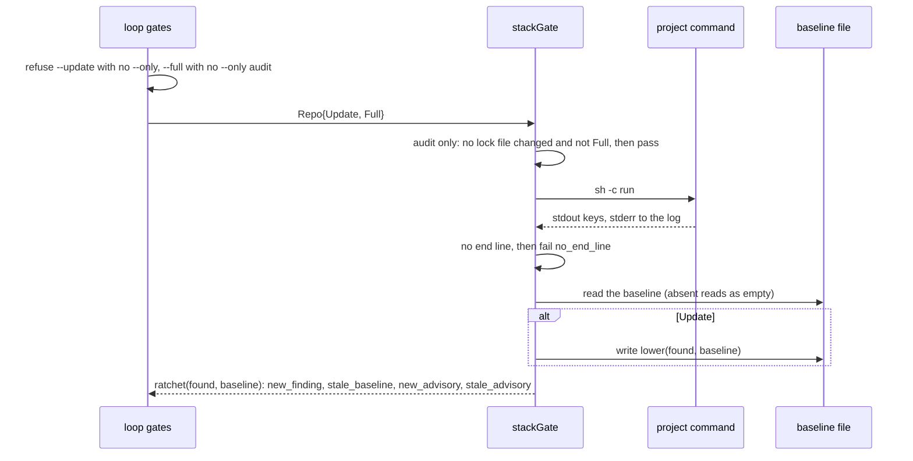

# Code-quality ratchets and audits: technical spec

## Source

- **Epic:** factorio-2u6
- **Source:** `docs/adr/0003-quality-ratchets-and-audits.md`. Its `**Ticket:**` line names this
  epic.
- **Stories covered:** none. This is an architecture epic.

The ADR's acceptance criteria carry no labels, so this spec numbers the ones the epic owns. Each
contract below cites one of them, or the ADR paragraph it proves.

| Label | ADR acceptance criterion |
| --- | --- |
| A1 | `go test ./internal/gates/...` proves that a gate with a `baseline` fails on a count above the baseline and on a count below it |
| A2 | A test proves that `--update` lowers a count and never raises one |
| A3 | A test proves that an audit baseline entry with an empty reason fails the gate |
| A4 | `grep -c 'loop gates --only audit --full' .github/workflows/audit.yml` prints `1` |
| A6 | A test proves that a runbook naming a `make` target that no `Makefile` holds fails the `runbooks` gate |

The ADR's own document checks (the gates, the Ticket line, the number, nine verdict rows, no
`worktree.size` in `internal/gates`, no `lessons` noun) passed when the ADR merged. This spec owns
none of them. Verdicts G6, G8 and G9 port nothing, so no work entry below builds them. A5, the
base audit's criterion, belongs to factorio-fgza. So this spec has no A5.

Round 1 read the loop at the base `7a6bdad`. Round 2 merged the base `58a9d93`. Between the two,
`internal/config/project.go` gained `ProjectConfig.Signoff`, and `pack/skills/loop-init/SKILL.md`
gained the `signoff.readers` lines. Neither change breaks a claim of this spec.

## Scope check

**Components:**

1. **The ratchet gates.** `internal/gates` (the shared ratchet, the stack gates, the `runbooks`
   gate), the `baseline` key of `internal/config`, the flags of `loop gates`, the scheduled audit
   workflow, and the pack lines that tell an agent how to use them.

Work entries 1 to 6 build it. Each one changes `internal/gates`, the config key or the verb that
drives them, and the pack lines that name them.

**Not in this spec:** the base audit of ADR 0003 § Decision, G5, with its merge record. The
operator split it into the architecture epic factorio-fgza (Q1). Also not in this spec: the
overwatch `audit` part, which reads the newest scheduled audit run, and the config key
`health.audit_workflow` that names the workflow. Both belong to factorio-a7r, work entry 9 of
`docs/plans/factorio-a7r-overwatch-sweep-spec.md`.

## Decisions

ADR 0003 decided each verdict. Each line below is a choice the ADR left to this spec, or a choice
that the code forces.

- **A ratcheted gate tells a silent tool from a clean one by an end line, and never by the exit
  code.** The command must print the line `loop:end` as the last non-blank line of its stdout. A
  stdout with no end line fails the gate with `no_end_line`, whatever the exit code. We rejected a
  rule that the command exits 0, because oxlint exits 1 and govulncheck exits 3 when they find
  something. Such a command would need `|| true`, and that hides a crash too. We rejected a rule
  that empty stdout fails, because a clean project prints no key. The ADR asks that the ratchet
  never read silence as zero ("What this makes hard"). This rule meets it with no parser for any
  tool.
- **Every ratcheted `jq` line takes one form: `jq -rn '[inputs] | select(length > 0) | (.[] | <keys>), "loop:end"'`.**
  The form reads the tool's stdout as a stream of JSON documents. It serves a tool that prints
  one document, such as oxlint, golangci-lint, ruff or `pnpm audit --json`, as a stream of one.
  It serves a tool that prints a stream, such as `govulncheck -json`, as it is. So no project
  chooses a form by tool. With jq-1.7 on the loop host, the form prints nothing on empty input,
  nothing on input that does not parse, and one end line after the keys of a two-document stream.
  We rejected the per-document form `jq -r '(<keys>), "loop:end"'`, because it prints one end line
  for each document, so a stream fails with a key after the end line. We rejected `jq -rs` and
  `jq -rn '[inputs] | ...'` with no `select(length > 0)`, because each prints the end line on
  empty input, so a crashed tool reads as clean. The key filter never holds `?` or `// empty` on
  the path to the findings. A tool whose output changed shape then makes `jq` fail before the end
  line, and the gate fails. With `?`, a renamed field would read as zero findings. C4 and C30 run
  the form itself, not only a stand-in command.
- **A gate's stdout carries keys only, and its stderr still streams to the log.** We chose this
  over parsing mixed output, because a key line and a progress line cannot be told apart. A gate
  with no `baseline` keeps today's behaviour: its stdout and stderr both stream, and only the exit
  code counts.
- **A lint baseline uses the shape of `.loop/suppressions.json`: `{"allowed": {"<key>": <count>}}`.**
  We chose one shape for the suppressions and every lint baseline over a new shape, because one
  reader, one writer and one `ratchet` then serve both.
- **The audit baseline has its own shape: `{"accepted": {"<id>": {"reason": "...", "date": "YYYY-MM-DD"}}}`.
  The audit gate counts each advisory id once.** We chose a set of ids over counts, because an
  audit tool prints one advisory once for each path to the package. That count changes with the
  dependency graph, not with the risk. We rejected a reason on every lint key, because 65 lint
  findings in 36 keys would need 36 reasons, and tickertown's lint baseline holds none. The
  `audit` gate reads this shape. Every other ratcheted gate reads the lint shape.
- **The severity floor stays in the command.** The ADR postponed it to this spec. A project that
  wants a floor selects by severity in its own `jq` line, such as `select(.severity != "low")`. We
  rejected a `floor` config key, because the command already decides which findings it prints,
  and each audit tool names its severities differently.
- **`--update` with no baseline file writes the found set for a lint gate or for `standards`, and
  writes nothing for `audit`.** An accepted advisory needs a reason that a person writes. A
  written entry with an empty reason would fail the gate at once. We rejected a placeholder
  reason, because a placeholder passes the gate and states nothing.
- **`--update` on a gate with a count above its baseline still lowers every other key, keeps the
  old count of that key, and fails.** We chose a partial write over writing nothing, because an
  agent that fixed ten keys and broke one keeps the ten. The raised key stays a finding, so the run
  still fails.
- **`--full` needs `--only audit`.** We chose one gate over `--full` on the whole list, because a
  scheduled run of every gate repeats CI on a commit that CI already passed.
- **A config `baseline` is refused on `format`, `typecheck`, `test`, `build` and every policy
  hook. Two gates may not name one path, and no gate may name `.loop/suppressions.json`.** The
  ADR named the four stack gates. `Command` also types `policy_hooks`, so the same field there
  needs the same refusal. Two writers of one file would lower each other's keys.
- **The `runbooks` gate reads one Makefile and one `package.json`, both at the repository root.**
  A call with `make -C`, `make -f`, `pnpm -C`, `pnpm --filter`, `pnpm -r` or `--dir` names another
  file, so the gate does not check it. We rejected a search for the nearest Makefile, because a
  runbook gives no working directory for its commands.
- **The `runbooks` gate reads a `make` or package command only at command position.** That is the
  start of a fenced line or code span, after an optional `$ `, or after `&&`, `||`, `;`, `|` or
  `(`. We chose this over every occurrence of the word, because `.loop/policy/coordinator.md:23`
  quotes the operator inside a code span: "`... by yourself. make sure this is part ...`". Read
  as a command, that line names a target `sure`.
- **The `runbooks` gate expands a Makefile variable in a target name when the Makefile assigns it
  once, with `=`, `:=` or `::=`, to plain words.** `$(PLATFORMS)` in this repository's `Makefile`
  expands to its three platforms. A target with a `%` matches by the stem rule. A target that still
  holds a `$` after expansion, or an `include` line, makes the Makefile open: a call that matches
  no target then gives no finding. We chose an open Makefile over a false finding, because a false
  finding blocks every run whose runbook names the target.
- **A bare `pnpm <x>` or `yarn <x>` is a script call only when `<x>` is no built-in command of that
  tool.** The gate holds a fixed list of each tool's built-ins, such as `install`, `add`, `exec`
  and `dlx`. `npm` and `bun` call a script only through `run`. We rejected a check of `npm <x>`,
  because `npm test` and `npm start` are built-ins that also run scripts.

## Assumptions

- Each lint or audit tool that a project ratchets prints JSON that `jq` reads. This holds for
  oxlint, golangci-lint, ruff, govulncheck and `pnpm audit`. This is wrong if a project names a
  tool with no machine output.
- With `-n`, `[inputs] | select(length > 0)` makes `jq` print nothing when its input is empty or
  does not parse. jq-1.7 on the loop host does. Without `select(length > 0)`, `-n` and `-s` both
  run the filter once on empty input, and print the end line. This is wrong if a `jq` release
  prints the end line for the form on empty input. C4 and C30 run the form on the `jq` of CI, so
  that release fails a test.
- A ratcheted tool prints at least one JSON document on a clean run. oxlint, golangci-lint, ruff
  (`[]`), govulncheck and `pnpm audit --json` do. This is wrong if a clean run of a project's tool
  fails with `no_end_line`. That failure is loud, and it never reads as clean.
- The CI runner holds `jq` on its `PATH`, as the Ubuntu runner images do. This is wrong if C4 or
  C30 fails with `jq` not found. The tests fail then, and never skip.

## Approach

**The shared ratchet.** `ratchet` and the suppressions reader move from
`internal/gates/standards.go` into `internal/gates/baseline.go`. The file holds the type of a
count baseline, its reader, its writer, `ratchet` and `lower`. `ratchet` takes the rule name for a
count above the baseline, so the standards gate keeps `new_suppression` and a stack gate reports
`new_finding`. Both report `stale_baseline` for a count below. The writer prints sorted keys,
two-space indent and a final newline, so two writes of one set give the same bytes.

**The config key.** `Command` gains `Baseline`. Validation refuses it on the four stack gates, on
every policy hook, on a path that is not a clean repository path, on a path that two gates share,
and on `.loop/suppressions.json`.

**A ratcheted stack gate.** When the gate's command has a `baseline`, `stackGate` captures stdout
and streams stderr to `r.Out`. It reads keys from stdout (`parseKeys`): one key for each non-blank
line before the end line. A key is the trimmed line, at most 512 bytes, with no control character.
It then reads the baseline file and calls `ratchet`. A missing baseline file reads as an empty
baseline, and the finding names `loop gates --only <gate> --update` as the way to adopt.

**The audit gate.** The lock-file scope runs first, as today, unless `r.Full` is set. With a
`baseline`, the gate dedupes the keys, reads the accepted set, checks each entry's reason and
date, and calls `ratchet` with a count of one for each id. The rules are `new_advisory` and
`stale_advisory`, so a reader tells an advisory from a lint key.

**`--update`.** `Repo` gains `Update` and `Full`. With `Update`, a ratcheted gate computes the
found counts, writes `lower(found, baseline)`, and then ratchets against what it wrote. The only
findings left are counts above the baseline and keys outside it. The standards gate does the same
for `.loop/suppressions.json`. The audit gate deletes stale accepted ids and keeps each other
entry as it is. `cmd/loop/gates.go` refuses the flag combinations of C13 before any gate runs.

**The scheduled audit.** `.github/workflows/audit.yml` runs on a daily schedule and on
`workflow_dispatch`. It builds `loop` with the local action and runs
`loop gates --only audit --full`. The overwatch part of factorio-a7r reads its newest run.

**The `runbooks` gate.** A new file, `internal/gates/runbooks_project.go`, reads the root
`Makefile` and the root `package.json` once for each gate run. It walks each code line with
`forEachCode`, after `shellOnly`, and finds each command at command position. It checks the name
of the target or script only, never a flag or an argument after it. A name that holds `<`, `>`,
`$`, `{` or `}` is a placeholder and is not checked.

## Domain model

```
internal/gates (changed)

Counts              map from a finding key to its count
  invariant: every count is at least 1. A key with a count of 0 is absent, and the writer drops it.

Advisory            one accepted advisory: Reason, Date
  invariant: a valid entry has a non-blank Reason and a Date that is a calendar day, YYYY-MM-DD.
             The gate reports each invalid entry. It never drops one.

The end line        the literal "loop:end"
  invariant: a ratcheted gate reads keys only from a stdout whose last non-blank line it is.
```

## Interfaces

```go
// internal/config/project.go
type Command struct {
	Name     string `yaml:"name"`
	Run      string `yaml:"run"`
	Baseline string `yaml:"baseline,omitempty"` // repository path of the gate's ratchet file; gates only
}

// internal/gates/gates.go
type Repo struct {
	// ... existing fields ...
	Update bool // lower each baseline to what the gate found (--update)
	Full   bool // skip the lock-file scope of the audit gate (--full)
}

// internal/gates/baseline.go
const EndLine = "loop:end"

type Counts map[string]int

// parseKeys reads the keys of a ratcheted command's stdout. ok is false when
// the end line is not the last non-blank line.
func parseKeys(stdout string) (keys []string, ok bool, bad []Finding)

func readCounts(root, rel string) (c Counts, exists bool, err error)
func writeCounts(root, rel string, c Counts) error

// ratchet holds found to baseline in both directions. over names the rule of a
// count above the baseline; a count below is stale_baseline.
func ratchet(found, baseline Counts, file, over, noun string) []Finding

// lower returns baseline with each count cut to the found count and each key
// that found lacks deleted. It never raises a count and never adds a key.
func lower(found, baseline Counts) Counts

type Advisory struct {
	Reason string `json:"reason"`
	Date   string `json:"date"`
}

func readAccepted(root, rel string) (a map[string]Advisory, exists bool, err error)
func writeAccepted(root, rel string, a map[string]Advisory) error

// internal/cli/surface.go, the gates verb gains two flags
Flag{Name: "update", Type: FlagBool, Description: "lower the baseline of the one gate --only names to what it found; never raise a count"}
Flag{Name: "full", Type: FlagBool, Description: "with --only audit, audit every dependency, not only a changed lock file"}

// cmd/loop/gates.go refusals, all CodeUsage
"update_needs_only"  // --update with no --only
"no_baseline"        // --update on a gate that is not standards and has no baseline
"full_needs_audit"   // --full with any selection but --only audit
```

## Data

```
.loop/config.yaml (changed)
  gates[n]
    + baseline    a repository path, optional. Refused on format, typecheck, test, build and on
                  every policy hook.

<lint baseline>.json (new, a path the config names)
  {"allowed": {"<key>": <count>}}     count is an integer of at least 1

<audit baseline>.json (new, a path the config names)
  {"accepted": {"<advisory id>": {"reason": "<text>", "date": "YYYY-MM-DD"}}}
```

**Existing records:** no project names a `baseline` today, and this repository holds no
`.loop/suppressions.json`.

## Flows

A ratcheted gate run, with and without `--update`:



## Work

1. **The shared ratchet and the `baseline` key.** Move `ratchet` and the suppressions reader into
   `internal/gates/baseline.go`, and add `Counts`, `readCounts`, `writeCounts`, `lower` and
   `parseKeys`. Add `Command.Baseline` and its validation.
   - Files: `internal/gates/baseline.go`, `internal/gates/baseline_test.go`,
     `internal/gates/standards.go`, `internal/config/project.go`, `internal/config/*_test.go`
   - Needs: nothing
   - Proves: C1, C2
   - Done when: the standards tests pass unchanged, and config load refuses each case of C1.
2. **The ratcheted stack gate.** A gate with a `baseline` captures stdout, reads keys after the end
   line check, and ratchets against its baseline. A gate with none behaves as today.
   - Files: `internal/gates/stack.go`, `internal/gates/stack_test.go`
   - Needs: 1
   - Proves: C3, C4, C5
   - Done when: a fixture command that prints keys fails above and below its baseline, a
     command that prints nothing fails with `no_end_line`, and the `jq` form of the Decisions
     fails on empty input and reads a two-document stream.
3. **The audit baseline.** The `audit` gate with a `baseline` reads the accepted set, checks each
   reason and date, and ratchets advisory ids. The lock-file scope stays in front of it.
   - Files: `internal/gates/stack.go`, `internal/gates/baseline.go`, `internal/gates/stack_test.go`
   - Needs: 2
   - Proves: C6, C7, C8
   - Done when: an entry with an empty reason fails the gate, and a change with no lock file
     passes with no command run.
4. **`--update`.** Add the flag to the surface and `Repo`, the refusals to `cmd/loop/gates.go`,
   and the write to the standards, stack and audit gates. Regenerate `gen/` with `make proto`. In
   the same entry, state in `pack/runbooks/implementer.md` and `pack/runbooks/code-reviewer.md`
   that a new baseline file or a raised count needs a reason in the pull request body. The
   code-reviewer rejects a pull request that has neither.
   - Files: `internal/cli/surface.go`, `gen/**`, `cmd/loop/gates.go`, `cmd/loop/gates_test.go`,
     `internal/gates/gates.go`, `internal/gates/standards.go`, `internal/gates/stack.go`,
     `internal/gates/*_test.go`, `pack/runbooks/implementer.md`, `pack/runbooks/code-reviewer.md`
   - Needs: 3
   - Proves: C9, C10, C11, C12, C13, C28
   - Done when: `loop gates --only lint --update` lowers a fixture baseline and keeps a raised
     key's old count, and `make pack-check` passes.
5. **`--full` and the scheduled audit.** Add the flag, the scope bypass and its refusal. Add
   `.github/workflows/audit.yml` to this repository. Teach `pack/skills/loop-init/SKILL.md` to
   scaffold the workflow beside `ci.yml`, to run one `--update` for a project that adopts the
   loop with lint debt, and to write each ratcheted `jq` line in the one form of the Decisions.
   - Files: `internal/cli/surface.go`, `gen/**`, `cmd/loop/gates.go`, `internal/gates/gates.go`,
     `internal/gates/stack.go`, `internal/gates/*_test.go`, `.github/workflows/audit.yml`,
     `pack/skills/loop-init/SKILL.md`, `internal/pack/loopinit_jq_test.go`
   - Needs: 4, because both change the flags of one verb and `gen/`
   - Proves: C14, C15, C29, C30
   - Done when: `loop gates --only audit --full` runs the audit command in a checkout with no
     changed lock file, and the workflow test and the `jq` line test pass.
6. **Project commands in the `runbooks` gate.** Check each `make` target and each package script
   that a runbook names at command position.
   - Files: `internal/gates/runbooks_project.go`, `internal/gates/runbooks.go`,
     `internal/gates/runbooks_test.go`, `internal/gates/testdata/**`
   - Needs: nothing
   - Proves: C16, C17, C18
   - Done when: a fixture runbook naming `make nosuch` fails, and `loop gates --only runbooks`
     passes on this repository.

## Out of scope

- The overwatch `audit` part, and `health.audit_workflow` in this repository's
  `.loop/config.yaml`. They belong to factorio-a7r, work entry 9. Config load refuses an unknown
  key, so this epic cannot name the workflow there first.
- A parser for any lint or audit tool. ADR 0003 forbids it. Each project writes its own `jq` line.
- `worktree-size`, `env:check`, the excuse lists, `READINGS` and a ledger writer. ADR 0003 ports
  none of them (G6 to G9). A port needs a new ADR.
- A check of a flag or an argument of a project command. ADR 0003 § Decision, G7.
- The base audit (ADR 0003 § Decision, G5): the merge record, the reactor step that walks the
  base, and its alerts. It belongs to the architecture epic factorio-fgza, by the operator's
  answer to Q1.
- Branch protection for this repository. GitHub refuses it on the current plan. That is the
  operator's choice of plan, and the base audit of factorio-fgza is the detective answer the ADR
  chose.
- A lint baseline for this repository. Its `lint` command passes at zero findings today, so it
  names no `baseline`.

## Contracts

C19 to C27 and C31 moved to factorio-fgza with the base audit. The other numbers did not change.

**C1. Refusal: config load refuses a misplaced or shared baseline.** Proves ADR 0003 §
Consequences, "Project config". Config load fails, and names the field, for a `baseline` on
`format`, `typecheck`, `test` or `build`, on any policy hook, on a path that is absolute, holds
`..` or is not clean, on a path that two gates name, and on `.loop/suppressions.json`. A
`baseline` on `lint`, `audit` or an extra gate loads.
*An example test for each case.*

**C2. Equivalence: the standards gate's findings do not change.** Proves ADR 0003 §
Consequences, "The ratchet". For every fixture in `internal/gates/standards_test.go`, the gate
returns the same rules and messages after the move as before it.
*The existing standards tests pass with no edit.*

**C3. Behaviour: a ratcheted gate holds each key to its baseline in both directions.** Proves A1.
With baseline `{"a.ts::r": 2}`, a command that prints `a.ts::r` three times fails with
`new_finding`, once fails with `stale_baseline`, and twice passes. A key outside the baseline
fails with `new_finding`. The command's exit code changes none of these results.
*Example tests with a fixture command that prints keys and the end line, run with exit 0 and
exit 1.*

**C4. Refusal: a silent command never reads as clean.** Proves ADR 0003 § Consequences, "What
this makes hard". A ratcheted gate fails with `no_end_line` when stdout is empty, when it holds
keys and no end line, or when a key follows the end line. This holds with exit 0 and with any other
exit code. A command that prints only the end line passes on an empty baseline. The `jq` form of
the Decisions, run by the gate, fails with `no_end_line` on empty input and on a truncated
document. It reads `x` and `y` from the two-document stream `{"a":["x"]}` `{"a":["y"]}`, and
passes on a baseline that holds both.
*Example tests: `true`, `printf 'a::r\n'`, `printf 'loop:end\na::r\n'`, `printf 'loop:end\n'`,
and the `jq` form piped from `printf ''`, from a truncated document and from the two-document
stream. The `jq` cases run the `jq` on the test's `PATH`, and fail when it is absent.*

**C5. Behaviour: a gate with no baseline keeps the exit-code rule.** Proves ADR 0003 § Decision,
G1. A gate with no `baseline` passes on exit 0 whatever it prints, fails with `command_failed`
on any other exit, and streams its stdout to the log.
*Example tests with `echo a::r` and `false`.*

**C6. Behaviour: the audit gate ratchets each advisory id once.** Proves ADR 0003 § Decision, G3.
A command that prints `GHSA-1` three times reads as one id. An id outside the accepted set fails
with `new_advisory`. An accepted id that the command no longer prints fails with
`stale_advisory`. Equal sets pass.
*Example tests.*

**C7. Refusal: an accepted advisory needs a reason and a date.** Proves A3. An entry whose reason
is empty or only white space fails with `no_reason`. An entry whose date is not a calendar day in
the form `YYYY-MM-DD`, such as `2026-13-01` or `24 Oct`, fails with `bad_date`. Both findings
name the id.
*An example test for each value.*

**C8. Boundary: a change with no lock file runs no audit, with or without a baseline.** Proves
ADR 0003 § Consequences, "A later reader must not". With a `baseline` and no changed lock file,
the audit gate passes, and its command does not run.
*An example test whose command writes a marker file. The test asserts that the file is absent.*

**C9. Behaviour: `--update` lowers and never raises.** Proves A2. With baseline
`{"a::r": 3, "b::r": 1, "c::r": 1}` and found `a::r` twice and `c::r` twice, `--update` writes
`{"a::r": 2, "c::r": 1}` and fails with `new_finding` on `c::r`. A found key outside the baseline
is not written, and fails. No sequence of runs raises a count or adds a key to an existing file.
*An example test, and a property test over generated found and baseline sets that asserts each
written count is at most both the old count and the found count.*

**C10. Boundary: `--update` adopts once, and repeats to the same bytes.** Proves ADR 0003 §
Decision, G2. With no baseline file, `--update` on a lint gate writes the found counts, with sorted
keys, and the gate passes. A second `--update` writes the same bytes. With zero keys found, it
writes `{"allowed": {}}`.
*An example test that compares the file bytes after each run.*

**C11. Behaviour: `--only standards --update` lowers the suppressions by the same rule.** Proves
ADR 0003 § Decision, G2. It lowers `.loop/suppressions.json` as C9 and C10 state, and the
`new_suppression` rule stays.
*An example test.*

**C12. Behaviour: `--only audit --update` only deletes.** Proves ADR 0003 § Decision, G3. It
deletes each accepted id that the command no longer prints, and keeps the reason and date of
every other entry byte for byte. A new id is not written, and fails with `new_advisory`. With no
baseline file, it writes no file and prints that each accepted id needs a reason written by hand.
*Example tests.*

**C13. Refusal: the verb refuses a flag that cannot apply.** Proves ADR 0003 § Consequences, "The
verb". Each refusal exits 2 with code `USAGE` and the rule named here. `loop gates --update` with
no `--only` refuses with `update_needs_only`.
`loop gates --only test --update` refuses with `no_baseline`. `loop gates --full` and
`loop gates --only lint --full` refuse with `full_needs_audit`. No gate runs, and no file is
written.
*Example tests on the verb handler.*

**C14. Behaviour: `--full` audits with no changed lock file.** Proves ADR 0003 § Decision, G4.
`loop gates --only audit --full` runs the audit command in a checkout whose change touches no lock
file. With a baseline, it ratchets as C6 and C7 state.
*An example test whose command writes a marker file.*

**C15. Behaviour: the scheduled workflow audits the base and nothing else.** Proves A4.
`.github/workflows/audit.yml` holds a `schedule` trigger and a `workflow_dispatch` trigger, and no
`pull_request` or `push` trigger. One step runs `loop gates --only audit --full`.
*A Go test that parses the workflow file. The A4 `grep` is the command proof.*

**C16. Behaviour: a runbook's `make` target must exist.** Proves A6. A fenced line or code span
`make nosuch` fails with `make_target`, and the finding names the file and line. `make build`
(a rule), `make proto-check` (a `.PHONY` name), `make linux/amd64` (from `$(PLATFORMS)`) and a
name that a `%` rule matches pass. `make test GO=go1.26` passes, because no argument is checked. A
runbook that names `make` in a repository with no root `Makefile` fails with `make_target`.
*Example tests on fixture Makefiles in `internal/gates/testdata`.*

**C17. Behaviour: a runbook's package script must exist.** Proves ADR 0003 § Decision, G7.
`pnpm run nosuch`, `npm run nosuch`, `yarn run nosuch`, `bun run nosuch`, `pnpm nosuch` and
`yarn nosuch` fail with `package_script` when the root `package.json` names no such script.
`pnpm install`, `pnpm exec x`, `npm test`, `pnpm --filter web build`, `pnpm -C apps/web build`,
`pnpm -r build` and `pnpm run build --prod` give no finding. A script call in a repository with no
root `package.json` fails with `package_script`.
*Example tests.*

**C18. Boundary: the runbooks gate reports no command that is not one.** Proves ADR 0003 §
Decision, G7. A `make` or `pnpm` word that is not at command position gives no finding, as in the
span "`... by yourself. make sure this is part ...`". A Makefile with an `include` line, or with
a target that keeps a `$` after expansion, is open: a call that matches no target gives no
finding. `loop gates --only runbooks` passes on this repository at the head of work entry 6.
*Example tests, and the gate run on this repository in CI.*

**C28. Behaviour: the pack names the reason rule for a raised baseline.** Proves ADR 0003 §
Consequences, "The pack". `pack/runbooks/implementer.md` states that a new baseline file or a
raised count needs a reason in the pull request body. `pack/runbooks/code-reviewer.md` rejects a
pull request that adds or raises a baseline with no reason. Every `loop gates` command the two
runbooks name passes the pack gate's schema check.
*`make pack-check`, and `grep -c 'baseline' pack/runbooks/code-reviewer.md` prints at least `1`.
This is a command proof, because a runbook line has no test.*

**C29. Behaviour: `loop-init` scaffolds the audit workflow.** Proves ADR 0003 § Consequences,
"The pack". `pack/skills/loop-init/SKILL.md` tells the agent to write
`.github/workflows/audit.yml` with `loop gates --only audit --full`, and to run
`loop gates --only lint --update` once for a project that adopts the loop with lint debt.
*`make pack-check`, and `grep -c 'loop gates --only audit --full' pack/skills/loop-init/SKILL.md`
prints at least `1`. A command proof.*

**C30. Invariant: every `jq` line that `loop-init` teaches reads silence as a failure.** Proves
ADR 0003 § Consequences, "What this makes hard", and "The pack". `pack/skills/loop-init/SKILL.md`
holds at least one `jq` line that prints `loop:end`. Each such line has the form of the
Decisions: `jq -rn '[inputs] | select(length > 0) | (.[] | <keys>), "loop:end"'`, with only the
key filter its own. With its key filter replaced by `.a[]`, each line prints nothing on empty
input, and prints `x`, `y` and one `loop:end`, in that order, on the stream `{"a":["x"]}`
`{"a":["y"]}`. No key filter holds `?` or `// empty`.
*A Go test, `internal/pack/loopinit_jq_test.go`, that extracts each `jq` command holding
`loop:end` from the skill, matches it against the form, and runs it as stated with the `jq` on its
`PATH`. It fails when the skill holds no such line, and when `jq` is absent.*

## Observable behaviour

None, because this epic draws no screen. Its outputs are gate findings in a log, two files under
the project's control and one CI workflow.

## Open questions

- **Q1. Split the base audit into its own epic?** **Answered (operator,
  2026-10-27):** Split.
  This spec holds the ratchet gates, work entries 1 to 6. The base audit, with its former work
  entries 7 and 8 and contracts C19 to C27 and C31, belongs to the architecture epic factorio-fgza
  (Base audit, ADR 0003 § Decision, G5).
