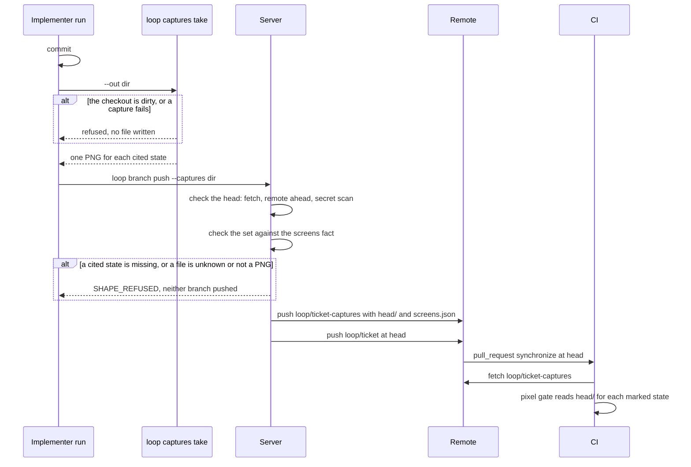
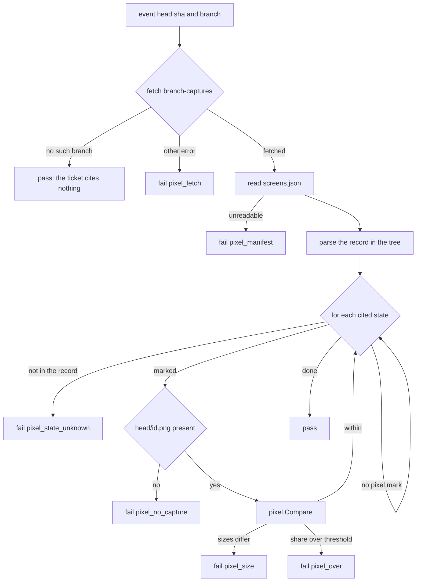
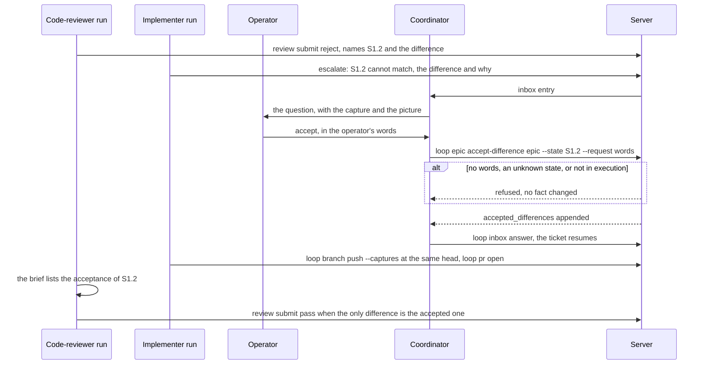

# Check shipped screens against the signed design record: technical spec

## Source

- **Epic:** factorio-4lso
- **Source:** `docs/prd/shipped-screen-check.md`, merged at `95d49fd` (#249) on 2026-10-31. No ADR
  names factorio-4lso on its `**Ticket:**` line, so the PRD is the only source.
- **Stories covered:** US-01, US-02, US-03, US-04.

The PRD's criteria are A1 to A25. Each contract below names the criterion it proves.

This spec reads the design record that the sibling epic factorio-a4yq defines. Its spec is in
review in pull request #251 (`docs/plans/factorio-a4yq-design-stage-spec.md`), read on
2026-10-31. The operator holds it in sign-off until factorio-791i lands. Each name below that
comes from it says so, and Assumptions holds the dependency.

## Scope check

**Components:**

1. **The capture path in the server and the pack.** The `**Screens:**` line of a ticket and its
   check at decompose, the capture branch and its push, the local capture verb, the acceptance of a
   difference, the brief's `screens` object, and the runbook text of the spec-author, the
   doc-reviewer, the decomposer, the implementer, the code-reviewer, the coordinator and the review
   room.
2. **The pixel gate**, `internal/gates/pixel.go`, and the comparison of two pictures in
   `internal/pixel`. Why not its own epic: the gate reads only what component 1 writes, the
   manifest and the captures on the capture branch. With no capture branch the gate has no input,
   and with no gate the operator's pixel mark has no reader.

The pack text is the agents' half of component 1, and it is no third component. Each work entry
changes the runbooks that describe the code it changes.

Work entries 1 to 6 and 8 change component 1. Entries 7 and 9 change component 2. Entry 9 also
holds the implementer's rerun step for a red pixel gate on an accepted state, because that step
describes the gate's read that entry 9 adds. Each entry proves its own contracts.

**Not in this spec:** the design stage, the record's format, its parser, the pixel mark, the
default threshold and its range, the `design` block and its capture command. factorio-a4yq owns
each of them. The `ui` block, which factorio-791i owns. A QA stage, which factorio-nhb5 owns.

## Decisions

### Answers a person already gave

- **Each choice in the PRD's stories is the operator's.** The operator chose each part in intake
  rooms room-0fefd19b and room-36e9bc8c, and signed the PRD off by its merge at `95d49fd`. US-01
  holds the citation and the `Screens: none` line, US-02 the capture branch that never merges and
  never goes away, US-03 the structural review and the acceptance on the epic, and US-04 the pixel
  gate in CI with a default of 0.5% and a range of 0% to 5%. This spec builds each one as written.
- **The PRD merged with two open questions and no answer under either.** The epic holds no `note`
  fact, and no comment on pull request #249 answers them. A PRD sign-off reads no open questions,
  because the spec author settles them (`pack/runbooks/coordinator.md` section 5). The first
  question gives the colour tolerance to the spec, and the next section settles it. The second asks
  the operator to choose between two bounds, so this spec carries it to Open questions.

### Open questions of the PRD that the sources settle

- **A pixel differs when one of its four 8-bit channels differs by more than 25.** The PRD leaves
  the value to the spec (`docs/prd/shipped-screen-check.md` lines 282 to 284). We chose a limit per
  channel of R, G, B and A over a perceptual distance such as YIQ, because a reviewer reads the rule
  in one line, a fixture proves it at 25 and 26, and it needs no dependency. 25 is about 10% of the
  channel, the level of the common default of pixel comparison tools. A smaller limit counts the
  colour noise of two renderers. The 0.5% threshold, and not the tolerance, absorbs the full swing
  of an antialiased glyph edge.

### The citation

- **A ticket cites its states on one `**Screens:**` line in its `## Source` section.** The line
  reads `**Screens:** S1.1, S2.3` or `**Screens:** none. <reason>`. The server parses it at
  decompose and copies the ids into the ticket's `screens` fact. We chose a line in the body over a
  `screens` field in the batch JSON, because the implementer and the code-reviewer read the body,
  and a field beside it could disagree with what they read. The PRD calls it a line.
- **A ticket is of a `UI: yes` story when its story labels meet the epic's `ui_stories` fact.**
  factorio-a4yq writes that fact at the PRD merge. We chose the fact over a read of the PRD at
  decompose, because the fact holds the labels of the PRD that the operator signed.
- **The checks run only on an epic that holds `design_merged`.** An epic whose operator skipped the
  design stage has no screen list. Its tickets need no `**Screens:**` line, and a citation in one
  names a state that no list holds, so decompose refuses it. We rejected a check on every epic
  with `ui_stories`, because a skipped epic could then never decompose.
- **A spec entry holds a `- Screens:` line in each work entry of an epic that holds
  `design_merged`.** We chose every entry over the entries of a `UI: yes` story only, because a
  spec entry names no story label, and a rule that needs one would make the reviewer guess. An entry
  that serves only `UI: no` stories writes `- Screens: none.` and names the stories.
- **The doc-reviewer checks the spec's lines, and no gate does.** We rejected a rule in the `spec`
  gate, because A21 needs a reader that judges a reason, and the PRD gives both checks to the
  doc-reviewer. A missed line still stops one stage later, at decompose, before any code exists.
- **This epic replaces the design-reference lines of the spec-author and decomposer runbooks.**
  `spec-author.md` line 60, `decomposer.md` lines 66 and 134, and line 273 of
  `loop-sdlc-documents/spec.md`, which ask for design references, now name the `Screens:` line. The
  doc-reviewer's round 2 note asked the spec to name this change or drop it. C6 and C8 name it.

### The capture branch

- **The server builds each capture commit, and the implementer never pushes to the capture
  branch.** `loop branch push --captures <dir>` makes a parentless commit of the PNG files in the
  checkout's object store, and the server fetches it as it fetches a head. The server checks it,
  then writes `<head>/<state id>.png` and `screens.json` onto the tip of `loop/<ticket>-captures`
  in its mirror, and pushes with a lease. We chose a commit that the server builds over a capture
  branch that the run pushes, because only the server pushes (`loop-sdlc-turn` section 4). The
  server then guarantees the layout that the gate reads.
- **The capture branch reaches the remote before the head it captures.** One `loop branch push`
  runs every check of the head first, then pushes the capture branch, then the head. CI starts on
  the head, so its pixel gate always finds the captures of that head. We rejected a second verb
  that pushes captures after the head, because CI would race it and fail on a capture that arrives
  a minute late. This answers the round 1 note that the spec must order the captures and the gate.
- **A push of a ticket that cites states refuses a head with no complete set of captures.** The
  set must hold one PNG for each cited state, and nothing else. We chose a refusal at the push over
  trust in the implementer's runbook, because a stale set is a reject (US-02), and the push is the
  cheapest place to stop one. The code-reviewer's reject of a missing capture stays, because a head
  can reach the branch outside the loop, such as GitHub's update-branch button.
- **`screens.json` at the root of the capture branch names what the ticket cites.** CI has no
  server, so the gate reads the ticket's cited states, its epic and its record path from that file.
  The server writes it at each capture push from the ticket's `screens` fact. We chose a file on
  the capture branch over a file on the ticket's branch, because US-02 keeps every capture artefact
  out of the product's history.
- **A second capture push at one head replaces that head's captures.** A run can capture again
  after a fix to the capture command, with no new commit. The path stays `<head>/<state id>.png`.
  We rejected a refusal, because a run with a broken first capture could then never push that head
  again. We rejected a kept second set beside the first, because the gate and the reviewer read one
  capture of each state at each head.
- **The loop deletes no capture branch.** No code path of the loop deletes a ref, and this spec
  adds none. The capture branch never heads a pull request, so GitHub's delete of a merged head
  never reaches it.

### The capture

- **`loop captures take --out <dir>` runs the project's capture command once for each cited
  state.** It reads the ticket's cited states from the `screens` fact in the item facts of
  `.loop/brief.json` (`item.facts.screens`), the record at `docs/design/<epic>/record.md` in the
  checkout, and the `design.capture` command from the
  checkout's `.loop/config.yaml`. It passes each state's target in `LOOP_DESIGN_TARGET` and the
  output path in `LOOP_DESIGN_OUT`, as factorio-a4yq's `loop design capture` does. We chose the same
  command and the same variables over a second command for the product, because factorio-a4yq
  chose a capture command that starts what it needs, so that this epic captures with no room and
  no running prototype. We chose a verb over the implementer running the command by hand, because
  the verb checks that the checkout is clean, so each capture is of the head. We chose the item
  facts over the brief's `screens` object, because every run and every room that holds the ticket
  gets the item facts in its brief (`internal/room/room.go` line 567), and work entry 3 then needs
  no brief change of entry 6.
- **A review room captures and pushes as the implementer does.** A review room holds the ticket
  and pushes its head with `loop branch push` (`review-room.md` section 2). Before each push on a
  ticket whose item facts hold `screens`, the room runs `loop captures take` and pushes with
  `--captures`. We rejected a push that takes no captures from a room, because the pixel gate would
  find no capture at the room's head and fail with `pixel_no_capture`. A copy of the last head's
  captures under the new head would be a stale capture, which US-02 rejects. A `loop-reflect`
  change in such a room is a push of the same ticket, so the same step covers it.

### The review

- **The brief carries the screens.** The brief of an implementer or code-reviewer run on a ticket
  that cites states holds a `screens` object: the record path, each cited state with its picture,
  target and pixel mark, and the epic's acceptances of those states. We chose the brief over a read
  of the epic, because a run may read only the item it holds (`CAPABILITY_DENIED`, rule
  `item_not_held`).
- **The code-reviewer reads each capture with `git show`.** `loop branch sync` gains a `captures`
  part with a fetch command, as factorio-a4yq adds a `prototype` part. The reviewer opens the
  capture of the reviewed head beside the record's picture of the state, as a PNG. We rejected a
  copy of each capture into the reviewer's checkout by the server, because a file there lands in
  any diff the run makes, and the fetch reuses the shape of the sync part that factorio-a4yq adds.
- **A failed pixel gate is a reject through the red build.** The gate runs inside `loop gates`, so
  its failure fails the project's gates check. The server already refuses a pass with
  `CI_NOT_GREEN` while a check is red, and moves a red build to `repair`. The code-reviewer's
  runbook adds a reject that names each state and its share when it reads the failed gate first. We
  rejected a separate pixel check on GitHub, because the PRD makes the diff a loop gate.

### The acceptance

- **One verb records an acceptance: `loop epic accept-difference`.** Only the coordinator runs it,
  with the operator's words, on an epic in `execution`. It appends one entry to the epic's
  `accepted_differences` fact. We chose a fact on the epic over a file in the design directory,
  because A14 keeps the record unchanged, and a file on the base would need a pull request, which
  the operator rejected in US-03. We chose a verb with a refusal over `loop work note`, because a
  note checks neither the words nor the state.
- **The verb refuses a state that the merged record does not hold.** The server reads the record
  at the base through the epic's `design_path` fact, and parses it with factorio-a4yq's parser.
- **An acceptance reaches the pixel gate through `screens.json`, at the next capture push.** CI
  has no server. The server writes the epic's acceptances of the cited states into the file at each
  capture push. After an acceptance, the implementer pushes the captures of the same head again,
  then runs `loop pr rerun`. We rejected a rerun that the acceptance verb starts on GitHub, because
  the verb would then write to every open pull request of the epic, and only the ticket's own run
  knows that its red build is the accepted difference. Work entry 8 writes the share into the
  manifest, and work entry 9 reads it in the gate. Both wait for the answer to Open questions 1.
- **Under answer B of Open questions 1, the share is a flag of the verb that work entry 8 adds.**
  Entry 8 adds `--share`, the `share` of an acceptance, and the refusals `share_unmarked` and
  `bad_share`. Entry 5 records words and a state only, so it waits for no answer. We chose this
  split over `--share` in entry 5, because answer A removes the flag, and entry 5 would then ship a
  flag that a later entry deletes.
- **A share holds at most two decimals.** `bad_share` refuses a share with a third decimal, and a
  share that is not a percent from 0% to 100% with its `%` sign. We chose two decimals over any
  precision, because the operator accepts a share that a `pixel_over` message printed, and that
  message prints two decimals. The manifest then holds the share as an integer of hundredths.
- **The manifest writes the largest share of a state's acceptances.** Two acceptances of one state
  with shares of 0.80% and 1.20% write 120. We chose the largest over the latest, because the fact
  is never rewritten and no acceptance is withdrawn. A later, smaller share would fail the head that
  an earlier acceptance passed. An acceptance with no share adds no share.
- **The bound of a state is the larger of its threshold and its accepted share.** A share below the
  threshold leaves the bound at the threshold. We rejected a refusal of such a share, because the
  operator's words still describe the difference for the structural review.

### The pixel gate

- **The gate reads the pull request's head from the GitHub event.** In a `pull_request` run,
  `HEAD` is GitHub's merge commit, and no capture names it. The gate reads
  `pull_request.head.sha` and `pull_request.head.ref` from the file at `GITHUB_EVENT_PATH`.
  Outside CI it reads `HEAD` and the current branch. We rejected a new input in each project's
  workflow, because every project runs the gates through `action.yml` with no inputs per gate.
- **The gate passes and reads nothing in a CI run whose event holds no `pull_request`.** CI also
  runs on a push to the base (`.github/workflows/ci.yml` lines 3 to 6). A GitHub merge queue, in a
  project whose workflow names one, runs on a `merge_group` event. There `GITHUB_EVENT_PATH` is
  set, `actions/checkout` leaves a detached `HEAD`, and no capture names the commit. Outside CI, a
  detached `HEAD` has no branch, and the gate also passes and reads nothing. We chose a pass over a
  read of `HEAD` and the current branch, because the branch is empty there, and the fetch of
  `-captures` would fail the base's build with `pixel_fetch`. The pull request's own run already
  read the captures of its head.
- **The gate fetches the capture branch itself.** It runs
  `git fetch origin +refs/heads/<branch>-captures:refs/remotes/origin/<branch>-captures`. A remote
  that holds no such branch means that the ticket cites nothing, and the gate passes. Any other
  fetch error fails the gate with the branch in the message. We chose a fetch over a reliance on
  the checkout's refs, because a checkout with a shallow fetch would hold no capture branch, and the
  gate would pass a ticket it never read.
- **The gate compares exactly, at the precision the mark holds.** factorio-a4yq's record accepts a
  percent from 0% to 5% with no bound on its decimals, and its `Pixel.Percent` is a float, so
  `pixel 0.125%` passes its gate. The pixel gate turns the mark back into its decimal with
  `strconv.FormatFloat(p, 'f', -1, 64)`, reads that decimal as a `big.Rat`, and fails a state when
  `differing / total > bound / 100`. The bound is the threshold, or under work entry 9 the larger
  of the threshold and the accepted share. We chose an exact rational over hundredths of a percent,
  because a mark of `0.125%` would then need a rounding rule that moves the edge of A15 and A16. We
  rejected a refusal of a mark with a third decimal, because the a4yq gate passed that record on
  the base, and every citing ticket would then fail until a new design pull request. We rejected a
  float comparison, because A16 turns on exactly 0.5%, and a float of 0.005 is not exact.
- **Two pictures of different sizes fail the state.** The finding names both sizes. We rejected a
  crop or a scale, because each one hides a change of layout, which is what a pixel mark guards.
- **The gate is `Slow`, so `--fast` leaves it out.** Before the push, the captures are not on the
  remote, so a run of the gate there reads nothing true. CI runs every gate. We rejected a fast gate
  that reads the local `--out` directory, because the gate would then need a second input path, and
  CI, which decides the pass, never holds that directory.

## Assumptions

- factorio-a4yq's spec merges with the shapes that pull request #251 holds on 2026-10-31: the record at
  `docs/design/<epic>/record.md`, `design.Parse` and its `State` with `ID`, `Picture`, `Target` and
  `Pixel`, `DefaultPixelPercent`, the facts `ui_stories`, `design_path` and `design_merged`, and the
  `design.capture` command with `LOOP_DESIGN_TARGET` and `LOOP_DESIGN_OUT`. This is wrong if its
  review changes a name or a shape. Each work entry then follows the merged spec.
- The capture command renders one state of the product at the ticket's checkout as it renders one
  state of the prototype in its worktree. factorio-a4yq decided that the command starts what it
  needs. This is wrong if a project's command reads only the prototype worktree. Then
  `loop captures take` fails with `capture_failed`, which names the state.
- factorio-a4yq's parser reads the number of a pixel mark with `strconv.ParseFloat`, and its
  record bounds the mark from 0% to 5% with no bound on its decimals (#251, lines 182 to 188 and 354
  to 357). The shortest decimal form of that float is then the number as written, for any mark of
  15 significant digits or fewer. This is wrong if the merged parser rounds the number or keeps it
  in another type. The gate then reads the exact form that the merged `Pixel` holds.
- A project's CI runs `loop gates` on `pull_request` events, with `GITHUB_EVENT_PATH` set and the
  token that `actions/checkout` keeps by default. Other events read no capture, by Decisions. This
  is wrong if a project sets `persist-credentials: false`. Then the gate's fetch fails, and its
  message names the branch.
- The code-reviewer's harness reads a PNG file. factorio-a4yq assumes the same for the
  doc-reviewer. This is wrong if a review run cannot open an image.
- Each capture is under GitHub's limit of 100 MB for one file. This is wrong if a capture command
  writes a larger PNG. Then the capture push gets `GITHUB_REFUSED`.
- `loop work block <ticket> --by <ticket>` accepts a blocker from another epic. This is wrong if
  the server refuses it. Answer B of Open questions 2 then cannot run.

## Approach

**The citation is a line, and decompose checks it.** `shape.Screens` reads the `## Source` section
of a ticket body and returns the cited ids, a `none` reason, or a fault. `pipeline.decompose`
gains one check after the ticket shape and before any write. For an epic that holds
`design_merged`, it reads the record at the base through `design_path`, and checks each ticket.
A ticket whose stories meet `ui_stories` must hold the line. A `none` line must hold a reason. Each
cited id must be a state of the record. The check refuses the whole batch with `SHAPE_REFUSED` and
rule `ticket_screens`, and the hint names each fault by ticket key and state. A ticket that passes
gets the fact `screens` at its create.

**The capture is local, and the push carries it.** `loop captures take --out <dir>` writes one PNG
for each cited state. `loop branch push --captures <dir>` makes a parentless commit whose tree holds
those files, stores it at `refs/loop/captures/<head>` in the checkout, and sends its sha. The
server fetches it, checks that the tree holds exactly one PNG for each id of the ticket's `screens`
fact, and builds the next commit of `loop/<ticket>-captures`. Its tree is the tip's tree with
`<head>/` replaced and `screens.json` rewritten. The server records a push intent for it, as for a
head, and pushes it before the head.

**The acceptance is a fact.** `loop epic accept-difference` is a row of the epic table from
`execution` to the same state. It appends to `accepted_differences`, and changes nothing else.

**The brief carries what the runs read.** The server builds `brief.Screens` for a ticket that holds
`screens`. It reads the record at the base and the epic's acceptances.

**The pixel gate reads the capture branch.** `gates.Pixel` resolves the ticket branch and the head,
fetches the capture branch, and reads `screens.json`. It parses the record in the tree, and for each
cited state with a pixel mark it reads `<head>/<id>.png` and the record's picture, and calls
`pixel.Compare` and `pixel.Over`. A state with no mark is never read. An event with no
`pull_request` reads nothing.

**The runbooks.** The spec-author writes the `- Screens:` line in each entry. The doc-reviewer
checks each one. The decomposer copies it into the ticket's `## Source`. The implementer and the
review room capture and push at each head. The code-reviewer reads the captures and compares
structure. The coordinator records an acceptance with the operator's words.

## Domain model

```
internal/shape (changed)

Screens             the **Screens:** line of one ticket body
  States            the cited state ids, in line order, each S<n>.<m>
  None              the reason of a none line
  invariant: a parsed Screens holds states or a reason, never both and never neither. A line
             with neither, a none with no reason, an id of another shape, or a second line is a
             fault, not a Screens.

internal/captures (new)

Branch              loop/<ticket>-captures, the one capture branch of a ticket
Manifest            screens.json, at the root of the capture branch
  Ticket            the ticket id
  Epic              the ticket's epic
  Record            docs/design/<epic>/record.md
  States            the ticket's cited ids, from its screens fact
  Accepted          state id to the largest accepted share of that state, in hundredths of a
                    percent (written by work entry 8, read by work entry 9)
  invariant: States is never empty. A ticket that cites no state has no capture branch.

internal/machine (changed)

Acceptance          one entry of an epic's accepted_differences fact
  State             a state id of the epic's merged record at the time of the write
  Words             the operator's words, exactly as given
  At                the time of the write
  Share             absent, or the accepted pixel share, at most two decimals (work entry 8)
  invariant: Words is never empty. State names a state of the record at design_path. Share is
             set only for a state with a pixel mark.

internal/pixel (new)

Result              the comparison of two pictures
  Differing         the count of pixels that differ past the channel tolerance
  Total             the pixel count of the record's picture
  SizeMismatch      true when the two pictures differ in width or height
  invariant: Differing <= Total. When SizeMismatch is true, Differing is Total.
```

## Interfaces

```
# Local. Runs the project's capture command once for each state that the ticket cites.
loop captures take --out <dir>

# The implementer pushes the head and the captures of that head in one call.
loop branch push --captures <dir>

# The coordinator, with the operator's words, on an epic in execution.
loop epic accept-difference <epic> --state <S<n>.<m>> --request "<the operator's words>"

# Work entry 8, under answer B of Open questions 1, adds the share.
loop epic accept-difference <epic> --state <S<n>.<m>> --request "<the operator's words>" [--share <percent>]
```

`loop captures take` refusals, each with exit 3 and code `SHAPE_REFUSED`: `no_screens` when the
brief's ticket cites no state, `no_design_config` when the checkout's config holds no `design`
block, `record_invalid`, `state_not_in_record`, `checkout_dirty` when the checkout holds an
uncommitted change, and `capture_failed` when the command exits non-zero or writes no PNG. The hint
of `capture_failed` and `state_not_in_record` names the state. A refusal writes no file to `--out`.

`loop branch push --captures` refusals: `USAGE` with rule `captures_ticket_only` for an item that
is not a ticket. `SHAPE_REFUSED` with rule `captures_not_cited` for a ticket that holds no
`screens` fact, `captures_missing` for a push of a citing ticket with no `--captures` or with a
cited state that the set lacks, `capture_unknown` for a file that names no cited state, and
`capture_not_png` for a file whose bytes are not a PNG. Each hint names each state or file. Each
refusal pushes neither branch.

`loop epic accept-difference` refusals: `CAPABILITY_DENIED` for any caller but the coordinator.
`USAGE` with rule `no_operator_request` for an empty `--request`. `TRANSITION_NOT_ALLOWED` from any
state but `execution`. `SHAPE_REFUSED` with rule `no_design_record` for an epic with no
`design_merged`, and `state_unknown` for a state that the record at the base lacks. Work entry 8
adds `share_unmarked` for a `--share` on a state with no pixel mark, and `bad_share` for a share
that is not a percent from 0% to 100% with its `%` sign, or that holds a third decimal. Each
refusal changes no fact.

`loop branch sync` gains a `captures` part for a ticket that holds `screens`: the branch, its tip
sha and a fetch command.

```go
// internal/shape/screens.go (new)
type Screens struct {
	States []string
	None   string
}
type ScreensFault struct {
	Rule string // screens_missing, screens_no_reason, screens_bad_id, screens_twice
	Msg  string
}
func ScreensOf(body string) (Screens, bool, []ScreensFault) // bool: the line is present

// internal/captures (new)
func Branch(ticket string) string // "loop/" + ticket + "-captures"
const ManifestFile = "screens.json"
type Manifest struct {
	Ticket   string         `json:"ticket"`
	Epic     string         `json:"epic"`
	Record   string         `json:"record"`
	States   []string       `json:"states"`
	// Accepted maps a state id to hundredths of a percent. Work entry 8 writes it, entry 9 reads it.
	Accepted map[string]int `json:"accepted,omitempty"`
}

// internal/machine (changed)
const (
	VerbAcceptDifference    = "accept_difference"
	FactScreens             = "screens"              // a ticket's cited ids, comma-separated
	FactAcceptedDifferences = "accepted_differences" // a JSON array of Acceptance
)

// internal/github/push.go (changed)
type PushRequest struct {
	// ... the fields of today
	Captures string // the sha of the parentless capture commit in the checkout, or ""
}
type PushResult struct {
	// ... the fields of today
	Captures *CapturePush `json:"captures,omitempty"`
}
type CapturePush struct {
	Branch string   `json:"branch"`
	Tip    string   `json:"tip"`
	States []string `json:"states"`
}

// internal/brief/brief.go (changed)
// Brief gains: Screens *Screens `json:"screens,omitempty"`, for an implementer or
// code-reviewer run on a ticket that holds the screens fact.
type Screens struct {
	Record   string        `json:"record"`
	Branch   string        `json:"branch"`
	States   []ScreenState `json:"states"`
	Accepted []Acceptance  `json:"accepted,omitempty"`
}
type ScreenState struct {
	ID      string `json:"id"`
	Picture string `json:"picture"` // the record's picture, a repository path
	Target  string `json:"target"`
	Pixel   string `json:"pixel,omitempty"` // "0.5%" for a mark, empty for none
}
type Acceptance struct {
	State string `json:"state"`
	Words string `json:"words"`
	At    string `json:"at"`
	Share string `json:"share,omitempty"` // work entry 8
}

// internal/pixel (new)
const ChannelTolerance = 25 // a channel that differs by more than this counts the pixel
func Compare(record, capture image.Image) Result
func Over(r Result, bound *big.Rat) bool // bound in percent; Differing/Total > bound/100

// internal/gates/pixel.go (new)
func Pixel(ctx context.Context, r *Repo) ([]Finding, error) // Name "pixel", Slow true
```

The pixel gate's rules: `pixel_over`, `pixel_size`, `pixel_no_capture`, `pixel_state_unknown`,
`pixel_manifest` and `pixel_fetch`. A `pixel_over` message names the state, the measured share with
two decimals rounded up, and the bound in its shortest decimal form, such as `0.125%`. Rounding up
keeps a failing share from printing as the bound.

The `**Screens:**` line of a ticket, as `decomposer.md` shows it:

```
## Source

Spec entry 4 of factorio-x, epic factorio-x.

**Screens:** S1.1, S1.3
```

The `- Screens:` line of a spec work entry, as `loop-sdlc-documents/spec.md` shows it:

```
1. **<Title>.** <what changes>
   - Files: <paths or globs>
   - Needs: <an earlier entry, or nothing>
   - Proves: <the contracts, by number>
   - Screens: <the state ids it builds>, or none. <why the entry draws no screen>
   - Done when: <an outcome that someone can observe>
```

## Data

```
ticket bead metadata (changed)
  + loop.screens                text, optional. Comma-separated state ids. Set at create from the
                                body's **Screens:** line. Absent for a none line or no line.

epic bead metadata (changed)
  + loop.accepted_differences   text, optional. A JSON array of
                                {state, words, at, share?}. Appended by accept_difference.
                                Never rewritten.

loop/<ticket>-captures (new branch, one for each ticket that cites a state)
  screens.json                  the Manifest, rewritten at each capture push
  <head sha>/<state id>.png     one file for each cited state, at each head the loop pushed

brief.json (changed)
  + screens                     object, optional. The Screens of the brief.
```

**Existing records:** no ticket holds `screens`, no epic holds `accepted_differences`, and no
capture branch exists before this epic. No epic holds `design_merged` until factorio-a4yq lands,
so no decompose runs the new check before then.

## Flows

A ticket head and its captures:



The pixel gate:



The acceptance of a difference:



## Work

1. **The `**Screens:**` line and its check at decompose.** Add `shape.ScreensOf`. Add the check to
   `pipeline.decompose` for an epic that holds `design_merged`, with rule `ticket_screens`. Write
   the `screens` fact at create.
   - Files: `internal/shape/screens.go` (new), `internal/shape/screens_test.go` (new),
     `internal/pipeline/decompose.go`, `internal/pipeline/decomposescreens_test.go` (new),
     `internal/machine/kinds.go`
   - Needs: factorio-a4yq work entry 1 for `design.Parse`, entry 4 for `ui_stories`, and entry 8
     for `design_path` and `design_merged` (Open questions 2)
   - Proves: C1, C2, C3, C4, C5
   - Done when: decompose refuses a fixture batch with a UI ticket and no line, naming the ticket's key, and
     the same batch with a line creates tickets that hold `screens`.
2. **The `Screens:` line in the document runbooks.** Add the `- Screens:` line to the work entry of
   `loop-sdlc-documents/spec.md`, and replace its design-reference line. Replace line 60 of
   `spec-author.md`. Add the check of each line and each reason to section 3 of
   `doc-reviewer.md`. Replace the design references in lines 66 and 134 of `decomposer.md` with the
   `**Screens:**` line and the `ticket_screens` refusal.
   - Files: `pack/skills/loop-sdlc-documents/spec.md`, `pack/runbooks/spec-author.md`,
     `pack/runbooks/doc-reviewer.md`, `pack/runbooks/decomposer.md`,
     `internal/pack/screens_test.go` (new)
   - Needs: entry 1, because the decomposer text names its rule
   - Proves: C6, C7, C8
   - Done when: the pack test reads each line, and `loop gates --docs` passes on this repository.
3. **`loop captures take`.** Add the local verb. It reads the brief's ticket and the record, checks
   the checkout, and runs `design.capture` once for each cited state.
   - Files: `cmd/loop/captures.go` (new), `cmd/loop/captures_test.go` (new),
     `cmd/loop/testdata/captures/**` (new), `internal/cli/surface.go`
   - Needs: entry 1 for the `screens` fact, factorio-a4yq entry 1 for the parser and entry 2 for
     `DesignConfig` (Open questions 2)
   - Proves: C9
   - Done when: in a fixture whose capture command copies one fixed PNG, `--out` holds that PNG's
     bytes for each cited state.
4. **The capture branch and its push.** Add `internal/captures`. Add `--captures` to
   `loop branch push`, the parentless commit on the client, and the server's check, build and push
   of the capture branch before the head. Add the `captures` part of `loop branch sync`.
   - Files: `internal/captures/**` (new), `internal/github/push.go`, `internal/github/git.go`,
     `internal/github/verbs.go`, `internal/cli/surface.go`, `internal/cli/run.go`, and their tests
   - Needs: entry 1 for the `screens` fact
   - Proves: C10, C11, C12, C13, C14
   - Done when: a fixture push of a citing ticket puts `<head>/<id>.png` and `screens.json` on
     `loop/<ticket>-captures` before the head reaches `loop/<ticket>`.
5. **The acceptance of a difference.** Add the `accept_difference` row, the
   `accepted_differences` fact, the `loop epic accept-difference` verb with `--state` and
   `--request`, and its refusals. Add the step to `coordinator.md` that runs it with the operator's
   words. The share is entry 8.
   - Files: `internal/machine/epic.go`, `internal/machine/kinds.go`, `internal/server/` (the verb
     handler), `internal/cli/surface.go`, `pack/runbooks/coordinator.md`,
     `internal/pack/screens_test.go`, and their tests
   - Needs: factorio-a4yq entry 1 for the parser and entry 8 for `design_path` (Open questions 2)
   - Proves: C15, C16, C17
   - Done when: the coordinator's acceptance with words appends one entry, and each refusal of C16
     leaves the epic's facts as they were.
6. **The brief's screens and the run and room runbooks.** Add `brief.Screens` for implementer and
   code-reviewer runs. Add the capture and the push to section 4 of `implementer.md` and to
   section 2 of `review-room.md`. Add the read of the captures, the structural comparison, the
   missing-capture reject, the acceptances and the pixel gate reject to `code-reviewer.md`.
   - Files: `internal/brief/brief.go`, `internal/server/` (the brief builder), `pack/runbooks/implementer.md`,
     `pack/runbooks/review-room.md`, `pack/runbooks/code-reviewer.md`,
     `internal/pack/screens_test.go`, `internal/github/pushroom_test.go` (new), and their tests
   - Needs: entry 3 for the verb the implementer and the room run, entry 4 for the push and the
     sync part, and entry 5 for the fact the brief reads
   - Proves: C18, C19, C20, C28
   - Done when: the brief of a citing ticket names each cited state and each acceptance, and the
     pack test reads each runbook step.
7. **The pixel comparison and the `pixel` gate.** Add `internal/pixel` with `Compare`. Add the
   gate, and register it as `Slow`. The gate reads the event head, fetches the capture branch and
   reads the manifest.
   - Files: `internal/pixel/**` (new), `internal/gates/pixel.go` (new),
     `internal/gates/pixel_test.go` (new), `internal/gates/gates.go`
   - Needs: entry 4 for `captures.Manifest` and `captures.Branch`, factorio-a4yq entry 1 for the
     parser and the pixel mark
   - Proves: C21, C22, C23, C24, C25, C26
   - Done when: a test repository with a capture branch fails at 101 differing pixels of 20000
     and passes at 100, a `push` event fixture passes with no fetch, and this repository passes
     `loop gates` unchanged.
8. **The share of an acceptance, and its write into the manifest.** Add `--share` to
   `loop epic accept-difference`, the `share` of an acceptance, and the refusals `share_unmarked`
   and `bad_share`. Add `Accepted` to the manifest that the push writes, with the largest share of
   each state.
   - Files: `internal/machine/epic.go`, `internal/server/` (the verb handler),
     `internal/cli/surface.go`, `internal/captures/manifest.go`, `internal/github/push.go`, and
     their tests
   - Needs: entry 4 for the manifest and the push, entry 5 for the verb, and the answer to Open
     questions 1
   - Proves: C27
   - Done when: after the shares of 1.20% and 0.80% on one state, the next capture push writes
     `"accepted": {"S1.1": 120}`, and each refusal of C27 leaves the epic's facts as they were.
9. **The accepted share in the pixel gate.** Add the gate's read of `Accepted` from the manifest,
   and the bound of a state as the larger of its threshold and its accepted share. Add the push of
   the same head and `loop pr rerun` to `implementer.md` for a red pixel gate on an accepted state.
   - Files: `internal/gates/pixel.go`, `internal/gates/pixel_test.go`,
     `pack/runbooks/implementer.md`, `internal/pack/screens_test.go`
   - Needs: entry 7 for the gate, entry 8 for the `Accepted` field of `captures.Manifest`, and the
     answer to Open questions 1
   - Proves: C29
   - Done when: a state marked `pixel 0.5%` with an accepted share of 120 passes at 240 differing
     pixels of 20000 and fails at 241, and the pack test reads the rerun step.

## Out of scope

- The record's format, its parser, the pixel mark, the default threshold, the range and the
  `design` block. They belong to factorio-a4yq.
- The `ui` block of `.loop/config.yaml`. It belongs to factorio-791i.
- A QA stage, visual QA and fuzzy user acceptance tests. They belong to factorio-nhb5.
- A change to the design record when the operator accepts a difference. It belongs to a new design
  pull request through the flow of factorio-a4yq, which the operator opens by hand.
- A pixel comparison of a state with no pixel mark. Never, by US-04.
- A capture in the product's repository or on the ticket's branch. Never, by US-02.
- A rerun of CI that the acceptance verb starts on GitHub. Never, by Decisions. The ticket's run
  reruns its own head.
- A `spec` gate rule for the `- Screens:` line. Never, by Decisions. The doc-reviewer checks it.

## Contracts

**C1. Refusal: a UI ticket with no `**Screens:**` line refuses the batch.** Proves A1. In an epic
that holds `design_merged` and `ui_stories` of `US-01`, a batch with a ticket of `US-01` whose
`## Source` holds no `**Screens:**` line gets `SHAPE_REFUSED` with rule
`ticket_screens`. The hint names the ticket's key. No ticket exists after the refusal.
*An example test with a fake record at the base, asserting the code, the rule, the key and an
empty ticket list.*

**C2. Behaviour: a none line with a reason passes, and a ticket of a `UI: no` story needs no
line.** Proves A2. In the epic of C1, a ticket of `US-01` with `**Screens:** none. It adds the API
route only.` passes, and its `screens` fact is absent. A ticket of `US-02`, which `ui_stories`
lacks, passes with no line. An epic with no `design_merged` passes tickets with no line.
*Example tests for each ticket and each epic.*

**C3. Refusal: a none line with no reason refuses the batch.** Proves A3. `**Screens:** none` and
`**Screens:** none.` each give rule `ticket_screens`, and the hint names the key and "no reason".
*Example tests for both lines.*

**C4. Refusal: a cited state that the record lacks refuses the batch.** Proves A4. A ticket that
cites `S9.9` in an epic whose record holds `S1.1` and `S1.2` gives rule `ticket_screens`, and the
hint names the key and `S9.9`. A citation in an epic with no `design_merged` gives the same rule,
because no record holds the state. An id of another shape, such as `S1`, and a second
`**Screens:**` line each give the rule.
*Example tests for each case, asserting the state in the hint.*

**C5. Behaviour: a passing ticket holds its cited ids.** Proves A5 at the boundary of entries 1
and 4. A ticket created with `**Screens:** S1.2, S1.1` holds `screens` = `S1.2,S1.1`, in line
order. The push of entry 4 reads that fact and nothing else.
*An example test through decompose, and a push test that sets only the fact.*

**C6. Behaviour: the spec writer asks for the `- Screens:` line.** Proves A20 at the source.
`loop-sdlc-documents/spec.md` shows the `- Screens:` line in its work entry, for an epic that holds
`design_merged`. `spec-author.md` tells the author to write the line in each work entry of such an
epic. Neither file holds the sentence that asks for design references "when the project keeps
them".
*A pack test reads both files, and searches both for the old sentence.*

**C7. Behaviour: the doc-reviewer checks each line and each reason.** Proves A20 and A21. Section 3
of `doc-reviewer.md` tells the reviewer to reject a spec of an epic that holds `design_merged` when
a work entry holds no `- Screens:` line, naming the entry. It tells the reviewer to reject when a
`none` reason does not show that the entry draws no screen, naming the entry.
*A pack test reads the section for both checks.*

**C8. Behaviour: the decomposer copies the line into the ticket.** Proves A1 and A2 at the source.
`decomposer.md` tells the decomposer to copy each entry's `- Screens:` line into the ticket's
`## Source` as a `**Screens:**` line, and names the `ticket_screens` refusal. It holds no stop for a
screen with no design reference.
*A pack test reads the runbook, and searches it for the old stop.*

**C9. Behaviour: `loop captures take` writes one capture for each cited state at a clean head.**
Proves A5. In a fixture whose capture command copies one fixed PNG to `LOOP_DESIGN_OUT`, the verb
writes `<out>/<id>.png` for each id of the `screens` fact in the item facts of `.loop/brief.json`,
with that PNG's bytes, and passes each
state's target in `LOOP_DESIGN_TARGET`. It refuses with `checkout_dirty` when the checkout holds an
uncommitted change, with `state_not_in_record` for a cited id the record lacks, and with
`capture_failed` naming the state when the command exits non-zero or writes a file that is not a
PNG. After each refusal, `--out` holds no file.
*Example tests in a temporary git repository with a fixture capture script.*

**C10. Behaviour: a push with captures puts each capture at the head's path.** Proves A5. After
`loop branch push --captures` of a ticket that cites `S1.1` and `S1.2`, the remote
`loop/<ticket>-captures` holds `<head>/S1.1.png` and `<head>/S1.2.png` with the bytes of the
pushed files, and `screens.json` with the ticket, the epic, the record path and both ids. A second
push at a new head adds that head's directory and keeps the first. A second push at the same head
replaces that head's files.
*A push test against a fixture remote, reading each blob back.*

**C11. Refusal: a push with an incomplete or wrong set pushes nothing.** Proves A5 and A8. For a
ticket that cites `S1.1` and `S1.2`, a push with no `--captures`, or with `S1.1.png` alone, gives
`captures_missing` naming `S1.2`. A set with `S3.1.png` gives `capture_unknown`. A file of text
bytes named `S1.1.png` gives `capture_not_png`. After each refusal, neither the ticket branch nor the
capture branch moved on the remote. A push with `--captures` for a ticket that holds no `screens`
gives `captures_not_cited`.
*An example test for each case, reading both remote refs before and after.*

**C12. Invariant: the remote holds a head's captures before it holds the head.** Proves A5 and the
CI order of US-04. For any push of a citing ticket, the capture branch push completes before the
ticket branch push starts. A crash between the two leaves the captures on the remote and the head
off it, and the same push run again pushes the head.
*A push test with a kill point between the two pushes, and a fake remote that records the order of
ref updates.*

**C13. Invariant: no capture reaches the base or the ticket's branch.** Proves A6. After a citing
ticket's push and its merge in a fixture, no tree of `loop/<ticket>` or of the base holds a blob of
the capture set. `BranchOf` never returns a capture branch, and `loop pr open` never opens a pull
request whose head is a capture branch.
*A push and merge test that searches each tree for the capture blobs, and a `pr open` test against
a fake GitHub that records each head.*

**C14. Invariant: the loop never deletes a capture branch.** Proves A7. Through a ticket's merge and
its epic's `done`, the fake GitHub records no ref delete of `loop/<ticket>-captures`. No package
under `internal/` deletes a ref whose name ends in `-captures`.
*A reactor test across the ticket's and the epic's life, and a source test for a ref delete.*

**C15. Behaviour: an acceptance records the operator's words against the state.** Proves A22 and
A11 at the source. `loop epic accept-difference <epic> --state S1.2 --request "<words>"` from the
coordinator, on an epic in `execution` whose record holds `S1.2`, appends one entry to
`accepted_differences` with state `S1.2` and the words exactly. A second acceptance of `S1.2`
appends a second entry and keeps the first. The epic stays in `execution`.
*A machine test and a verb test with a fake record at the base.*

**C16. Refusal: an acceptance with no words or of an unknown state changes nothing.** Proves A13
and A23. The verb refuses with `USAGE` rule `no_operator_request` for an empty `--request`, with
`SHAPE_REFUSED` rule `state_unknown` for `S9.9`, with `no_design_record` on an epic with no
`design_merged`, with `CAPABILITY_DENIED` for a run or a room caller, and with
`TRANSITION_NOT_ALLOWED` from
`spec_signoff`. After each refusal, the epic's status and facts are as before.
*An example test for each case, asserting the code, the rule and the unchanged epic.*

**C17. Invariant: an acceptance changes no file.** Proves A14. Through an acceptance, the fake
GitHub records no push, no commit and no file write, and the mirror's refs are as before. The
record at the base is byte for byte the same.
*A verb test that reads the fake GitHub's write log and the mirror's refs.*

**C18. Behaviour: the brief names each cited state and each acceptance of it.** Proves A11 and A12
at the source. The brief of an implementer or a code-reviewer run on a ticket with `screens` =
`S1.1,S1.2` holds `screens` with the record path, the capture branch, both states with the picture,
target and mark of the record at the base, and each acceptance of `S1.1` or `S1.2` on the epic. An
acceptance of `S2.1` is absent. A second ticket of the same epic that cites `S1.2` gets the same
acceptance. A ticket with no `screens` gets no `screens` object.
*Example tests of the brief builder with a fake record and a fake epic.*

**C19. Behaviour: the implementer captures and pushes at each head.** Proves A5. Section 4 of
`implementer.md` tells a run on a ticket whose brief holds `screens` to commit, run
`loop captures take --out` into a directory from `mktemp -d`, and push with
`loop branch push --captures` at each head it pushes, in every kind of work. It names the
`captures_missing` refusal.
*A pack test reads the section and the order of the commit, the capture and the push.*

**C20. Behaviour: the code-reviewer compares structure and rejects an unaccepted difference.**
Proves A8, A9, A10, A11, A12 and A19. `code-reviewer.md` tells the reviewer of a ticket whose
brief holds `screens` to fetch the capture branch with the `captures` part of `loop branch sync`,
and read `<reviewed head>/<id>.png` for each cited state beside the record's picture. It rejects a
cited state with no capture at that head, naming the state. It compares the elements, the copy, the
flow and the states that exist, and no pixels. It rejects a difference that no acceptance of the
state in the brief describes, naming the state and the difference. It passes a difference that an
acceptance describes. It rejects a head whose pixel gate failed, naming each state and its share.
*A pack test reads each instruction. The server's `CI_NOT_GREEN` refusal of a pass at a red head
already backs the last one.*

**C21. Behaviour: a marked state over its threshold fails the gate.** Proves A15. A ticket that
cites `S1.1` with `pixel 1%`, whose capture differs from the record's picture in 2.5% of its
pixels, gives one finding with rule `pixel_over`. The message names `S1.1`, `2.50%` and `1%`.
*An example test that builds both PNGs and the capture branch in a temporary repository.*

**C22. Boundary: the default threshold passes 0.5% and fails above it.** Proves A16. A state marked
`pixel` with no number, with 200 by 100 pictures, passes at 100 differing pixels and fails at 101,
whose message names `0.51%`. A state marked `pixel 0%` fails at one differing pixel. A state
marked `pixel 5%` passes at 1000 differing pixels and fails at 1001. A state marked `pixel 0.125%`,
with 200 by 40 pictures, passes at 10 differing pixels and fails at 11, and its message names
`0.125%`.
*Example tests at each edge, and a `pixel.Over` table test at each.*

**C23. Boundary: a channel difference of 25 does not count, and 26 does.** Proves A15 and A16, and
settles the PRD's first open question. Two pictures that differ in every pixel by 25 in the red
channel give `Differing` = 0. The same pictures at 26 give `Differing` = `Total`. The same holds for
the green, blue and alpha channels.
*A table test of `pixel.Compare` for each channel at 25 and 26.*

**C24. Refusal: a marked state with no capture at the head fails the gate.** Proves A24. A capture
branch whose manifest cites the marked state `S1.1`, and which holds `S1.1.png` under an older head
only, gives rule `pixel_no_capture`, and the message names `S1.1` and the head.
*An example test in a temporary repository with two head directories.*

**C25. Behaviour: the gate reads marked states only.** Proves A18 and A25. A ticket that cites the
marked `S1.1` and the unmarked `S1.2`, whose `S1.2` capture is bytes that no decoder reads, gets no
finding for `S1.2`, and a finding for `S1.1` only when `S1.1` is over its threshold. A ticket whose
capture branch cites no marked state gets no finding. A branch with no capture branch on the remote
gets no finding. Two pictures of different sizes give rule `pixel_size`, which names both sizes.
*Example tests for each repository.*

**C26. Behaviour: the gate reads the pull request's head, not the merge commit.** Proves A15 in CI.
With `GITHUB_EVENT_PATH` naming an event whose `pull_request.head.sha` is the capture's head and
whose `HEAD` is a merge commit, the gate reads `<head.sha>/`. With no event file, it reads `HEAD`
and the current branch. With an event file of a `push` event or a `merge_group` event, which holds
no `pull_request`, it gives no finding and runs no fetch. With no event file and a detached `HEAD`,
it gives no finding and runs no fetch. A fetch that fails for a reason other than a missing branch
gives rule `pixel_fetch`, which names the branch.
*Example tests with an event fixture and a merge commit, with a `push` event fixture and a detached
`HEAD` against a remote that records each fetch, and with a remote that refuses the fetch.*

**C27. Behaviour: an accepted share reaches the manifest as the largest share of its state.**
Proves A17 in the server, under the proposed answer to Open questions 1. After an acceptance of the
marked `S1.1` with `--share 1.20%`, the next capture push writes `"accepted": {"S1.1": 120}` into
`screens.json`. A second acceptance of `S1.1` with `--share 0.80%` leaves the manifest at 120. An
acceptance with no share writes no entry for its state. The verb records an acceptance with
`--share 0.40%` of a state marked `pixel 1%`, and the manifest holds 40 for it. The verb refuses
with `SHAPE_REFUSED` rule `share_unmarked` for `--share` on a state with no pixel mark, and rule
`bad_share` for `1.205%`, `1.2`, `-1%` and `101%`. After each refusal, the epic's facts are as
before.
*A verb test for each refusal, and a push test that reads the manifest after each acceptance.*

**C28. Behaviour: a review room captures and pushes a citing ticket.** Proves A5 for a push from a
room. Section 2 of `review-room.md` tells a room whose ticket's item facts hold `screens` to commit,
run `loop captures take --out` into a directory from `mktemp -d`, and push with
`loop branch push --captures`, before each push. In a room checkout whose `.loop/brief.json` holds
role `room` and `item.facts.screens` = `S1.1`, `loop captures take` writes `<out>/S1.1.png`. A push
from a room caller that holds the ticket, with that set, moves the capture branch, then the ticket
branch. The same push with no `--captures` gets `captures_missing` naming `S1.1`, and neither
branch moves.
*A pack test reads the section and the order of the commit, the capture and the push. A captures
test with a room brief fixture. A push test with a room caller against a fixture remote.*

**C29. Behaviour: an accepted share raises the bound of its state in the gate.** Proves A17 in CI,
under the proposed answer to Open questions 1. With `S1.1` marked `pixel 0.5%` and a manifest that
holds `"accepted": {"S1.1": 120}`, the gate passes `S1.1` at 240 differing pixels of 20000 and fails
it at 241, with a `pixel_over` message that names the accepted share. With `S1.1` marked `pixel 1%`
and an accepted share of 40, the bound stays at 1%: the gate passes at 200 and fails at 201. With
no `accepted` entry for a state, the bound is its threshold. `implementer.md` tells a run whose red
build is a `pixel_over` on an accepted state to push the captures of the same head again and run
`loop pr rerun`.
*Gate example tests with a fixture manifest at each edge, and a pack test.*

## Observable behaviour

This epic draws no product screen. A person watches these flows of the loop:

- The operator opens `loop/<ticket>-captures` on GitHub and reads the capture of each cited state at
  each head the loop pushed.
- The code-reviewer's reject on a ticket names a state and the difference from its picture.
- A red CI run's pixel gate names a state, its measured share and its threshold.
- The coordinator brings a difference to the operator, and records the operator's acceptance.
  `loop work show <epic>` prints the words in `accepted_differences`.

## Open questions

- How far does an acceptance clear the pixel gate for a marked state? This is the PRD's second
  open question (`docs/prd/shipped-screen-check.md` lines 285 to 291), and no person answered it at
  the PRD sign-off. The pixel gate cannot tell the accepted difference from a new one. Answer A:
  an acceptance turns the gate off for that state, on each later ticket of the epic. Answer B: the
  acceptance records the measured share, and the gate passes the state up to that share. The
  proposed answer is B. A later change that differs more than the accepted share still fails, and
  the structural review reads each change below it. Under A, entry 8 adds no `--share`, no
  `share_unmarked` and no `bad_share`, and C29 asserts that the gate never compares an accepted
  state. Entry 5 holds no part of the share, so it does not wait. This blocks work entries 8 and 9,
  and C27 and C29.
- How do this epic's tickets wait for factorio-a4yq's tickets? Work entries 1, 3, 5 and 7 need
  factorio-a4yq entries 1, 2, 4 and 8. The loop records no edge between two epics, and the
  decomposer blocks a ticket only on a ticket of its own batch. factorio-a4yq has no tickets yet:
  the operator chose on 2026-10-31 to hold its spec in sign-off until factorio-791i lands (pull
  request #251, its Open questions). Answer A: the operator holds this spec in sign-off until those
  four factorio-a4yq entries merge. Answer B: this spec merges, and after this epic decomposes, the
  coordinator runs `loop work block <ticket> --by <a4yq ticket>` at the operator's word for each
  ticket of entries 1, 3, 5 and 7. B can run only after factorio-a4yq decomposes. The proposed
  answer is A. It is the operator's choice for the sibling, and it lets a review of this spec read
  the merged a4yq spec and catch a changed name before any ticket cites it. This blocks work
  entries 1, 3, 5 and 7.
