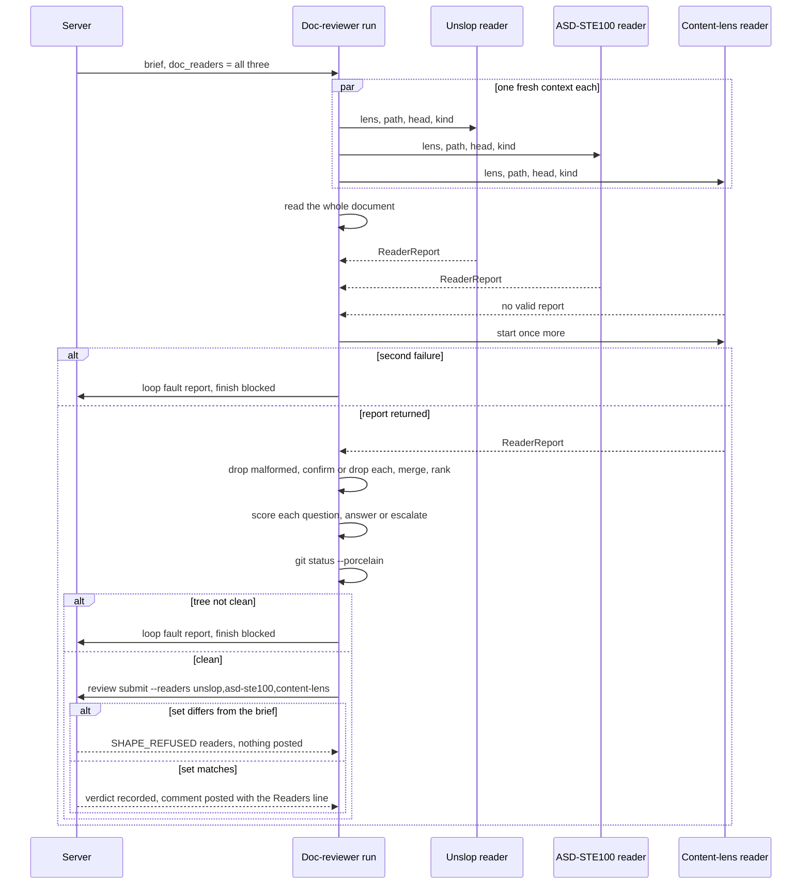
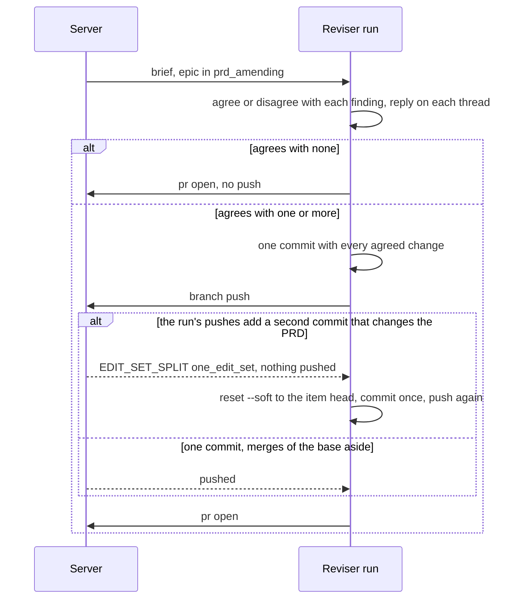
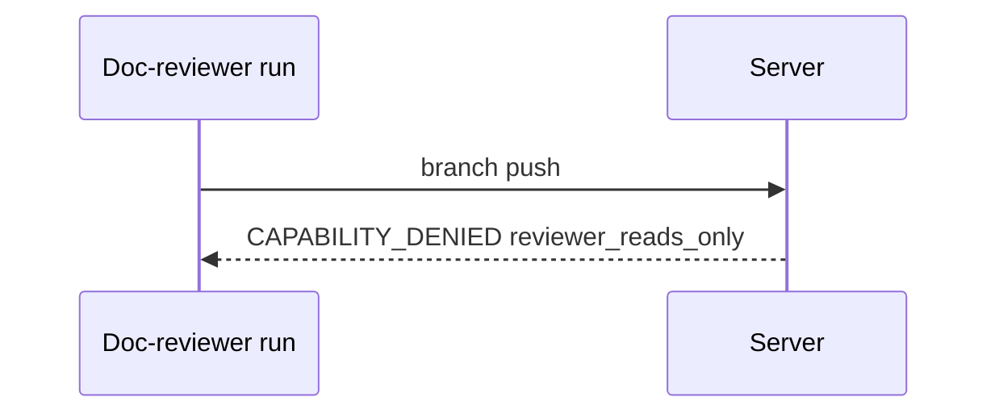

# Review a PRD, spec or ADR with three clean-context readers and one judge: technical spec

## Source

- **Epic:** factorio-4mb8
- **Source:** `docs/prd/doc-review-with-clean-readers.md`, signed off by the operator at head
  `6c813d4` and merged at `fd46ac8` on 2026-11-01. No ADR names factorio-4mb8 on its
  `**Ticket:**` line, so the PRD is the only source.
- **Stories covered:** US-01, US-02, US-03, US-04, US-05, US-06.

The PRD's criteria are A1 to A15. Each contract below names the criterion it proves. Four
contracts prove an answer that the operator gave at the PRD sign-off, and no criterion holds that
answer. Those contracts name the answer under Decisions.

Round 2 answers the four findings of the round 1 spec reject on pull request #318. Finding 1:
the readers run on Claude Code only, and C23 proves it. Finding 2: C24 binds each lens to its
skill. Finding 3: C25 holds the merge and the rank. Finding 4: C26 holds a reader's open
question. C21 no longer claims A15, and the stage-field note under Interfaces now names the
refusal of C5.

## Scope check

**Components:**

1. **The doc review in the pack.** The doc-reviewer runbook, a new meta skill
   `loop-doc-readers`, a new reader agent `loop-doc-reader`, a new skill `loop-content-lens`, the
   rule changes in `loop-sdlc-review`, the reviser runbook, the pin of `asd-ste100` in
   `pack/third-party.json`, and the pack gate in `internal/pack/gate.go` that checks them.
2. **The server's record of the readers.** The setting that turns the readers off, the brief
   field that tells a run which readers to start, the `--readers` flag of `loop review submit`,
   two push refusals, a push from a doc-reviewer run and a reviser push that splits its edit set,
   and the profile rule that keeps a doc-reviewer run with readers on Claude Code. Why not its own
   epic: the pack cannot know that a project turned the readers off unless the brief says so. And without a record on the verdict, A1, A2, A3 and A12 have no
   observation that can fail them. Nothing else reads this record.

The runbook text that describes server behaviour belongs to that behaviour's component. So work
entry 5 changes the reviser runbook and the push scan together, as the factorio-ku99 spec did.

**Not in this spec:** the ADR test and the ADR stage, which factorio-ku99 owns. Every rename,
which the vocabulary epic factorio-vlle owns. Readers on a design record, which the design stage
epic owns. Readers on a ticket's code, which no epic holds.

## Decisions

### Answers the operator gave at the PRD sign-off

Each answer below quotes the epic body, section "Operator answers at PRD sign-off
(2026-11-01)".

- **All three parts that rest on the epic body stay.** "Approve with all three (Recommended)".
  The content-lens reader, the re-pin of `loop-asd-ste100` to 255631a and the one-commit reviser
  rule are all in this spec. This settles the PRD's "For the operator at sign-off" points of the
  round 2 review.
- **The reviewer may reject on a confirmed prose finding that no linter flags.** "Yes, may reject
  (Recommended)". `loop-sdlc-review` § 6 gains one exception for a doc review. This answers the
  PRD's first open question, and it unblocks A9 and A12.
- **The content-lens reader takes two lenses always, and the rest by signal.** "2 always, rest by
  signal (Recommended)". Coherence and feasibility always run. Product, design, security, scope
  and adversarial each run when the document shows the signal that ce-doc-review's
  `references/persona-selection.md` names. This answers the PRD's fourth open question, and it
  unblocks A11.
- **The readers are on by default.** "On by default (Recommended)". Every project gets the
  readers, and a project turns them off with one setting. This answers the PRD's fifth open
  question, and it unblocks A1, A2 and A3.

### Open questions of the PRD that this spec settles

The brief leaves two questions to the planner. Each answer below follows from the sources.

- **A spec reject returns to the planner, and an ADR reject returns to `architecture`, as today.**
  We chose to keep both routes over a new route to the reviser, because the planner already
  answers each finding of a spec reject in its next round (`pack/runbooks/planner.md` § 1 step 2).
  The ADR review is advisory, and the operator decides the merge
  (`pack/runbooks/doc-reviewer.md` § 4). A route to the reviser adds rows to the epic transition
  table in `internal/machine/epic.go`. It also gives one spec two authors in one round. The PRD
  scopes the one-commit rule to "the first PRD reject" (Requirements, and US-05). A2 and A3
  assert only that the readers start, and the route does not change that. The requirement "Only
  the reviser edits the document" reads by its own next sentence: "The reviewer and the readers edit
  nothing". A13 states the same thing. The author of a later spec round still edits its spec.
- **The reviser keeps its right to disagree.** We chose to keep the agree-or-disagree rule of
  `pack/runbooks/reviser.md` § 2 over a reviser that applies every finding, because a confirmed
  finding can still be false. The reviser is the one check on it before the operator reads the
  PRD. "One edit set in one commit" therefore means this: every change the reviser agrees with
  lands in one commit. A reviser that disagrees with every finding makes no commit, and A12 reads
  that case as true, because no second commit exists. The round 2 review of the PRD named this
  case as the PRD's third open question.

### Choices inside this epic

- **One reader agent, three prompts.** We chose one agent file, `pack/agents/loop-doc-reader.md`,
  that a prompt points at one lens. We rejected three agent files, because the three would hold
  one copy each of the start rules, the output shape and the tool list, and those copies would
  drift.
- **The readers run on Claude Code only.** While `doc_readers` is in force, a doc-reviewer run
  takes the Claude Code profile and no fallback harness, as an escalated run takes no fallback
  today (`internal/sched/quota.go`, `escalatedProfiles`). When the Claude Code window is spent or
  paused, the run waits for it. The config refuses `doc_readers: true` beside a doc-reviewer
  harness other than `claude`. We rejected readers on Codex, because no mechanism there can fail a
  test today. A Codex checkout receives no agent directory (`internal/brief/pack.go`,
  `AgentRoot`), so a Codex subagent has no tool list. It holds a shell and the run's token, and
  nothing stops it from running `loop review submit` or `loop escalation raise` (A7). We also
  rejected a Codex doc-reviewer run that reviews alone while the readers are on, because A1 to A3
  make a review with fewer readers false. So every doc review with readers on runs where C7's tool
  list holds, and A1 to A3 stay true by C2 and C23. A project that turns the readers off keeps
  today's Codex fallback.
- **A doc-reviewer harness that a project names turns the readers off, unless the project also
  sets `doc_readers: true`.** The readers are in force when `doc_readers` is true, or when it is
  unset and neither `stages.doc-reviewer.harness` nor `stages.doc-reviewer.escalated.harness`
  names a harness other than `claude`. We rejected a parse failure for an unset `doc_readers`
  beside a Codex harness, because entry 7 would then break a project config that was valid the day
  before, and the server would stop reading that project. The project chose its harness in its
  config, and the brief and `loop settings show` name that choice as the reason the readers are
  off. An explicit `doc_readers: true` beside a Codex harness asks for both, and the parse refuses
  it.
- **The reader's instructions live in the skill, and the agent file points to them.** The text
  is `pack/skills/loop-doc-readers/reader.md`. We rejected text in the agent file alone, because
  the pack gate checks a `../loop-<name>/SKILL.md` path only in a skill file. It reads such a path
  relative to the directory that receives the file (`internal/pack/gate.go`, `packPaths`), and an
  agent file lands in `.claude/agents/`, apart from the skills. In `reader.md` each lens path is a
  sibling, so the gate proves that each path resolves (C22, C24).
- **The reader holds Read, Grep and Glob only.** We chose a tool list over a rule in the prompt,
  because a reader with no Write, Edit or Bash cannot write a file or run a `loop` verb (A6, A7).
  We rejected Bash for the ASD-STE100 reader's own scripts. The `prose` gate already runs the
  forked STE linter, and the reader applies the rules by reading them.
- **One content-lens reader runs every selected lens in one context.** We rejected one subagent
  for each persona, as ce-doc-review dispatches them, because the epic body names three readers.
  Each extra subagent is one more model run.
- **The design red flags apply to a spec and an ADR, and not to a PRD.** We rejected a check on
  every document, because each red flag names a module design. A PRD names no implementation,
  and the doc-reviewer rejects a PRD that does (`pack/runbooks/doc-reviewer.md` § 2 item 6).
- **The ce-doc-review whole-doc persona stays out of the fork.** We chose to leave it out over
  forking it, because it is a sweep by a second model. The reviewer is the whole-document reader
  in this loop, and US-04 says so.
- **A reader reads the whole document in every round.** We rejected readers that read only the
  diff of a later round, because a sentence of the diff can break a rule that only its section
  shows. The reviewer drops each finding outside the diff, by `loop-sdlc-review` § 4.
- **The verdict names the readers that returned, and the server checks the names.** We chose
  `loop review submit --readers` over a runbook rule alone, because no gate reads a runbook rule.
  A1 needs an observation that can fail. The server compares the names with the brief of the run.
- **The setting is `stages.doc-reviewer.doc_readers`.** We chose a stage setting over a top-level
  key, such as `ui`, because only the coordinator changes a setting, and the push scan refuses a
  run's change to it (`SETTINGS_CHANGE`). With a top-level key, a reviser run could turn off the
  review of its own document. We rejected the name `readers`, because `signoff.readers` already
  names GitHub logins in `internal/config/project.go`.
- **The default turns on in the last work entry.** We chose to land the setting with the default
  off and turn it on last, over on from the first entry. With the default on, the server check of
  entry 3 refuses every doc review until entry 4 teaches the runbook to pass `--readers`.
- **The server refuses a push from a doc-reviewer run.** We chose a server refusal over the
  runbook's "Never edit the document" alone. A reader shares the run's token, so the one refusal
  covers the reviewer and each reader (A13).
- **The one-commit rule is a push check over all of a reviser run's pushes.** We chose to count
  the commits that change the document across every push intent of the run, from
  `push_intents.run_id`. We rejected a count inside one push, because a second push in the same
  run would then split the edit set with no refusal. A merge of the base is no such commit (A12).
- **The one-commit rule binds every reviser run.** We chose every reviser run over the first PRD
  reject only, because the server then reads no fact about the event that started the run. A
  person's comment gets its answer in one commit too, and that diff reads as one change. The PRD
  asks for the first PRD reject. This choice covers it and asks nothing more of a reviser that
  agrees with each finding of a comment.
- **A reader that fails twice stops the review.** We chose a loop fault and `blocked` over a
  verdict with two readers, because A1 makes a review with fewer readers false. A reader failure
  is a fault of the loop or the harness, not of the document.

The test of `pack/skills/loop-sdlc-documents/SKILL.md` § 6 finds no entry here that needs an ADR.
The two route answers and the right to disagree keep today's rules, so they make no costly change
(part 3 fails). Each choice inside this epic binds this epic's own build, and no other epic
builds on it (part 1 fails). The setting, the `--readers` flag and the harness rule of the
doc-reviewer are public interfaces, so part 3 holds for them. But only this epic reads them, so
part 1 fails. The one-commit rule binds every
later reviser run. The rule itself is the PRD requirement, a "what", and only the check that
enforces it is new here (part 4 fails).

## Assumptions

- Claude Code starts an agent of type `loop-doc-reader` with a fresh context that holds only its
  prompt. This is wrong if the reader's first turn can read the reviewer's earlier messages.
- A doc review that waits for the Claude Code window delays its epic by less than one quota
  window, and no other stage waits with it. This is wrong if the plan shows a doc-reviewer run
  that waits on the Claude Code window for longer than one window, or if an epic in
  `prd_review` or `spec_review` stalls behind the wait. The operator then turns the readers off,
  or a later epic gives Codex a reader mechanism.
- Upstream commit 255631a36dea63b427b6a454c1e59a53cdc0b14a of `danyuchn/asd-ste100-skill`, from
  2026-10-31, keeps a `SKILL.md` at the repository root. It is 12 commits ahead of the pinned
  cd62d29, and it changes 5 files. This is wrong if `loop install` places no `loop-asd-ste100`
  directory, or the tree hash refuses the fetch.
- The content-lens fork takes `skills/ce-doc-review/references/personas/` and
  `persona-selection.md` from `EveryInc/compound-engineering-plugin` at
  8f7eea958c8f1318147db6c93320cae3930ad09a, the last commit to touch `skills/ce-doc-review` on
  2026-10-30. That repository is MIT-licensed. This is wrong if a later commit lands before entry
  2 does. The fork then records the commit it read.
- The fork takes `pstack/skills/architect/references/design-red-flags.md` from `cursor/plugins` at
  a58628271271837ef5f386adca29c0812683a19a, the last commit to touch it on 2026-10-03. GitHub
  reports no license file for that repository. `loop-unslop` already forks pstack from the same
  repository. This is wrong if a person who owns the license question rejects that precedent.
- Three readers add about three model runs to a doc review, and the doc-reviewer runs at medium
  effort (`internal/sched/quota.go`). The operator accepted the cost by turning the readers on by
  default. This is wrong if a doc-reviewer run passes its `run_budget` with readers on.
- More confirmed findings make a first PRD reject more likely, and a second reject still escalates
  to the operator. This is wrong if the share of PRDs that reach a second reject rises after
  entry 7. The retro of this epic reads that share.

## Approach

**The doc-reviewer starts the readers first.** After `loop review rounds` and before its own
read, the run reads the `doc_readers` line of its brief. When the line names readers, the run
follows `loop-doc-readers`. It starts the three readers at once, each with a prompt that holds
four facts and nothing else: the document's path at the head, its kind (`prd`, `spec` or `adr`),
the lens name, and the path of `reader.md`. It starts each one as agent type `loop-doc-reader`.
No prompt holds the reviewer's notes, an earlier round, or another reader's output.

**Each lens names one skill.** `reader.md` binds lens `unslop` to `../loop-unslop/SKILL.md`, lens
`asd-ste100` to `../loop-asd-ste100/SKILL.md`, and lens `content-lens` to
`../loop-content-lens/SKILL.md`. A reader reads the document by the skill of its lens and by no
other skill.

**The run is always on Claude Code.** While the readers are on, the scheduler gives a
doc-reviewer run the Claude Code profile only, so the run never starts on Codex. When the Claude
Code window is spent, the plan shows the doc-reviewer run as waiting, with the reason.

**The reviewer reads the whole document while the readers run.** It reads as today, by the
doc-reviewer runbook § 2, § 3 or § 4. The readers' findings come after the reviewer's own read.
The reviewer reads all of the document whatever they return.

**A reader returns one JSON object.** It names the reader, a list of findings and a list of
questions. Each finding holds a place, a rule and a proposed edit. A question holds a place and
the question. A reader decides nothing, by `loop-sdlc-turn` § 8, so it returns each question
and never answers it in a finding. The reviewer drops a finding that lacks a place, a rule or an
edit, and counts each drop in its comment.

**The reviewer scores each question.** It scores each reader's question by
`loop-sdlc-triage`. A question that the document or the repository answers, it answers itself.
When the answer shows a fault, it judges that fault as a finding. A question at level 4 or 5 it
escalates by the doc-reviewer runbook § 6. No question reaches the verdict unscored, and no
reader raises one.

**The reviewer judges each finding.** It opens the line and the rule that the finding names. It
confirms the finding, or it drops it with a reason. Two findings on one place become one finding,
which names each reader that returned it. The reviewer ranks the confirmed findings by
`loop-sdlc-review` § 3, the worst first. In a later round it keeps the findings
inside the diff since the last reviewed head, and names the rest as outside this round. A
confirmed prose finding may reject the document alone, by the new exception in
`loop-sdlc-review` § 6. Each confirmed finding enters the one comment, with a permalink, the rule
and the proposed edit, so the reviser can act on the comment alone. A reader's finding enters no
verdict until the reviewer confirms it (A9).

**The reviewer checks the tree, then submits.** It runs `git status --porcelain`. A dirty tree
means a reader wrote a file, so the run submits nothing, reports a loop fault and finishes
`blocked`. On a clean tree it submits with `--readers` set to each reader that returned. The
server compares that set with the brief, records it on the round, and adds a `Readers:` line to
the posted comment.

**The reviewer starts a failed reader once more.** A reader that returns no valid object twice stops
the review. The run reports a loop fault and finishes `blocked`.

**The reviser lands one edit set.** It answers each finding by `reviser.md` § 2, as today. It
then commits every change it agreed with in one commit, and pushes once. The push scan counts the
commits of the run that change the document. A merge of the base does not count. A second such
commit gets the refusal `EDIT_SET_SPLIT`. Before any push, the run can squash with
`git reset --soft` to the item head. After a push, the run replies on each thread whose change did
not land, and finishes `done`.

**The setting turns the readers off.** `stages.doc-reviewer.doc_readers: false` in a project's
`.loop/config.yaml` empties the brief's `doc_readers`. The run then reviews alone, as today, and
submits with no `--readers`. A doc-reviewer harness other than `claude` that the project names,
with `doc_readers` unset, turns the readers off the same way. Only the coordinator changes either
value, with `loop settings set`.

**The content lens.** `loop-content-lens/SKILL.md` holds one section for each lens. The two
lenses that always run come first, then the five by signal, each with the signal that turns it on.
A last section holds the eight design red flags for a spec and an ADR. A comment at the top
records each upstream, its commit and the fork date, in the shape of `loop-unslop/SKILL.md`. Each
lens is rewritten in the loop's words. A lens finds faults in what the document says. It does not
redesign, by `loop-sdlc-review` § 6.

**Two rule changes in `loop-sdlc-review`.** § 9 changes from "Never start a subagent that
reviews" to two rules: a subagent may find, and only the reviewer judges and submits the verdict.
§ 6 keeps "Never reject on style that no linter flagged", and adds one exception: in a doc review,
a reader's prose finding that the reviewer confirmed may reject alone. The code-reviewer keeps the
rule with no exception.

## Domain model

```
pack, the reader contract (new, JSON that a reader returns)

Reader              one of: unslop, asd-ste100, content-lens
  invariant: no other value. The order above is the start order and the record order.

ReaderReport        { reader: Reader, findings: [Finding], questions: [Question] }
  invariant: one report for each reader that a review started.

Finding             { where, rule, edit, why }
  where: "<repository path>:L<n>" or "<repository path>:L<n>-L<m>"
  rule:  "<skill name> <rule id>", such as "loop-unslop 3" or "loop-content-lens coherence"
  edit:  the proposed replacement text, or the word delete
  why:   one sentence
  invariant: where, rule and edit are each present and not empty. The reviewer drops a
             finding that breaks this.

Question            { where, question }
  invariant: a reader that cannot decide returns a Question, never a Finding.

server (changed)

DocReaders          the ordered set of Reader that one doc-reviewer run must start
  invariant: either all three readers or empty. Empty means the project turned the readers off.
             No other subset exists, so a run can never start two readers by design.
  source: stages.doc-reviewer.doc_readers at the claim. True when set true, or when unset and
          no doc-reviewer harness other than claude is named. Empty otherwise.
```

The round record gains `readers`, a `DocReaders` value. A round recorded before this epic reads
as empty.

## Interfaces

```
# The setting (internal/config/project.go, StageConfig)
stages:
  doc-reviewer:
    doc_readers: false      # bool, optional. Unset means true once entry 7 lands, unless the
                            # doc-reviewer's harness or escalated.harness names another harness.

loop settings set stages.doc-reviewer.doc_readers false --reason "<why>"
loop settings show          # lists stages.doc-reviewer.doc_readers with its value and source

# The config parse refuses doc_readers under any stage other than doc-reviewer, with an error
# that names the field (C5). `StageConfig` is one struct for every stage, so the check is a rule
# of validate, not a missing field.
# The parse refuses doc_readers: true beside a stages.doc-reviewer.harness or
# stages.doc-reviewer.escalated.harness other than claude, and loop settings set refuses each
# change that would make that pair (C23). An unset doc_readers beside such a harness means off.
```

```
# The profiles of a doc-reviewer run (internal/sched/quota.go)
doc_readers in force:  [claude]            # no fallback harness, as escalatedProfiles
doc_readers false:     [claude, codex, ...] # each other harness with a login, as today
```

```
# The brief (internal/brief/brief.go)
"doc_readers": ["unslop", "asd-ste100", "content-lens"]   # brief.json, doc-reviewer runs only
- Readers: unslop, asd-ste100, content-lens                # brief.md
- Readers: off (stages.doc-reviewer.doc_readers is false)  # brief.md, when the set is empty
- Readers: off (stages.doc-reviewer.harness is codex)       # brief.md, off by the harness rule
```

```
# The verdict (internal/cli/surface.go, internal/machine/verbs.go)
loop review submit <item> --verdict pass|reject --head <sha> --body "<comment>" \
  --readers unslop,asd-ste100,content-lens

# SHAPE_REFUSED, rule readers: the set differs from the run's brief, or names an unknown reader.
#   The hint names the set that the brief holds. Nothing is posted or recorded.
# SHAPE_REFUSED, rule readers_scope: --readers on an item that the doc-reviewer does not review.
# On success the posted comment ends with "Readers: unslop, asd-ste100, content-lens."
# loop review rounds <item>: each round gains "readers": [...].
```

```
# The pushes (internal/github/push.go, internal/github/scan.go, internal/cli/codes.go)
CAPABILITY_DENIED, rule reviewer_reads_only   # any loop branch push from a doc-reviewer run
EDIT_SET_SPLIT,    rule one_edit_set          # exit 3, a reviser run's second commit that
                                              # changes its document, over all its pushes
```

```
# The reader start (pack/skills/loop-doc-readers/SKILL.md)
An agent of type loop-doc-reader, with this prompt

  Lens: <unslop | asd-ste100 | content-lens>
  Document: <path> at <head sha>, kind <prd | spec | adr>
  Follow <skill root>/loop-doc-readers/reader.md, and return one ReaderReport.

# pack/agents/loop-doc-reader.md front matter
tools: Read, Grep, Glob

# The lens table (pack/skills/loop-doc-readers/reader.md)
unslop        ../loop-unslop/SKILL.md
asd-ste100    ../loop-asd-ste100/SKILL.md
content-lens  ../loop-content-lens/SKILL.md
```

```
# The output shape
pack/skills/loop-doc-readers/report.schema.json   # JSON Schema of ReaderReport, as above
```

## Data

None. The round record gains `readers`, a list in the item's review history, and a round
recorded before this epic reads as an empty list. The one-commit check reads `push_intents`, which
already holds `run_id`, `old_sha` and `new_sha` (`internal/store/migrations/0001_init.sql`). No
table and no column changes.

## Flows







## Work

1. **Re-pin `asd-ste100`.** Set the pin's commit to
   255631a36dea63b427b6a454c1e59a53cdc0b14a, and its `sha256` to the tree hash of the upstream
   tree at that commit.
   - Files: `pack/third-party.json`, `internal/pack/thirdparty_test.go`
   - Needs: nothing
   - Proves: C12
   - Done when: `make pack-check` passes, and `loop install` on a fresh host places
     `loop-asd-ste100` with no hash refusal.
2. **The content-lens skill.** Write `loop-content-lens/SKILL.md`: the fork header, the seven
   lenses with their signals, and the design red flags for a spec and an ADR. Mark it
   `disable-model-invocation: true` with the pack's `agents/openai.yaml`. Add it to the manifest's
   skills and to the doc-reviewer runbook's skills. The pack gate needs each skill of a runbook
   named by its path, so add one sentence to the doc-reviewer runbook § 1: the path holds the
   content-lens reader's lenses, and the reviewer does not apply them itself.
   - Files: `pack/skills/loop-content-lens/**`, `pack/manifest.json`,
     `pack/runbooks/doc-reviewer.md`, `internal/pack/doc_readers_test.go` (new)
   - Needs: nothing
   - Proves: C13
   - Done when: the pack test finds each upstream and commit, each lens, and the PRD exclusion of
     the red flags.
3. **The readers in the server, default off.** Add `doc_readers` to the doc-reviewer stage
   config with the default false. Fill the brief's `doc_readers` and its Readers line. Add
   `--readers` to `review submit`, its two refusals, the record on the round, and the comment
   line. Refuse a `branch push` from a doc-reviewer run. Give a doc-reviewer run the Claude Code
   profile only while the readers are in force. Refuse `doc_readers: true` beside a doc-reviewer
   harness other than `claude`, in the config parse and in `loop settings set`.
   - Files: `internal/config/project.go`, `internal/config/settings.go`, `internal/brief/brief.go`,
     `internal/sched/dispatch.go`, `internal/sched/quota.go`, `internal/sched/plan.go`,
     `internal/cli/surface.go`, `internal/machine/verbs.go`, `internal/machine/rows.go`,
     `internal/github/push.go`, and their tests
   - Needs: nothing
   - Proves: C2, C3, C4, C5, C6, C16, C23
   - Done when: a doc review with `doc_readers: true` and no `--readers` gets a refusal, a review
     with the setting unset still passes with no `--readers`, and a doc-reviewer run with
     `doc_readers: true` never takes the Codex profile.
4. **The subloop in the pack.** Write `loop-doc-readers/SKILL.md`, `reader.md` and
   `report.schema.json`, and the agent `loop-doc-reader.md`. Add the readers step and the
   `--readers` flag to the doc-reviewer runbook, § 1 to § 5. Change `loop-sdlc-review` § 6 and
   § 9. Add both to the manifest, and the agent to the doc-reviewer's agents. `reader.md` names
   `../loop-asd-ste100/SKILL.md`, a pinned skill that the pack source does not hold. So the pack
   gate resolves a path to `loop-<name>` for each pin of `pack/third-party.json`.
   - Files: `pack/skills/loop-doc-readers/**`, `pack/agents/loop-doc-reader.md`,
     `pack/runbooks/doc-reviewer.md`, `pack/skills/loop-sdlc-review/SKILL.md`,
     `pack/manifest.json`, `internal/pack/gate.go`, `internal/pack/gate_test.go`,
     `internal/pack/doc_readers_test.go`
   - Needs: entry 2, for the skill the content-lens prompt names. Entry 3, for the flag the
     runbook passes.
   - Proves: C7, C8, C9, C10, C11, C19, C20, C22, C24, C25, C26
   - Done when: `make pack-check` passes, and the pack test reads each rule of C7 to C11, C19,
     C20 and C24 to C26.
5. **One edit set for the reviser.** Add the `one_edit_set` count to the push scan of a reviser
   run, and the `EDIT_SET_SPLIT` code. Write the one-commit rule and its recovery into the reviser
   runbook § 4, and the code into `loop-sdlc-turn` § 2.
   - Files: `internal/github/push.go`, `internal/github/scan.go`, `internal/cli/codes.go`,
     `pack/runbooks/reviser.md`, `pack/skills/loop-sdlc-turn/SKILL.md`, and their tests
   - Needs: nothing
   - Proves: C15, C17, C18
   - Done when: a reviser run's second commit to the PRD gets a refusal, also across two pushes, and
     a merge of the base passes.
6. **The glossary.** Define "reader" as a subagent of the doc-reviewer that finds and never
   judges. Add the reader step to the doc review phases.
   - Files: `pack/skills/loop-sdlc-glossary/SKILL.md`, `internal/pack/doc_readers_test.go`
   - Needs: entry 4
   - Proves: C21
   - Done when: the pack test finds the definition, and `make pack-check` passes.
7. **On by default, and the real-agent proof.** Change the default of `doc_readers` to true. Add
   the real-orca scenario of C14 to the lane plan.
   - Files: `internal/config/settings.go`, `internal/config/*_test.go`,
     `acceptance/scenarios/doc_readers_orca_test.go` (new), `acceptance/scenarios/testdata/**`,
     the lane plan in `agenthosttest`
   - Needs: entries 3 and 4
   - Proves: C1, C14
   - Done when: a project with no `doc_readers` key gets three readers in its doc-reviewer brief,
     and the lane scenario records a pass with the Readers line.

## Out of scope

- The ADR test and the ADR stage. They belong to factorio-ku99, by the epic body.
- Each rename, such as amender to reviser. It belongs to the vocabulary epic, factorio-vlle.
- Readers on a design record. It belongs to the design stage epic, `docs/prd/design-stage.md`.
- Readers on a ticket's code. The code-reviewer reads code alone. It belongs to no epic, and the
  simplify stage epic, factorio-1r94, owns the cleanup of code.
- A change to a rule inside `loop-unslop` or `loop-asd-ste100`. It belongs to no epic, never, by
  the PRD.
- A route from a spec reject or an ADR reject to the reviser. It belongs to no epic, by the
  decision above. A later epic that wants it starts from a PRD.
- Readers on a Codex doc-reviewer run. It belongs to no epic. A later epic that gives a Codex
  subagent a limit that a test can fail starts from a PRD, by the decision above.
- A per-project choice of which reader runs. It belongs to no epic. The setting is all or none,
  by the domain model.

## Contracts

**C1. Behaviour: three readers by default.** Proves A1, A2, A3. A doc-reviewer run on an epic in
`prd_review`, `spec_review` or `adr_review` of a project with no `doc_readers` key, and no
doc-reviewer harness other than `claude`, gets a brief
whose `doc_readers` is `["unslop", "asd-ste100", "content-lens"]`, and a Readers line that names
all three. Every other stage's brief holds no `doc_readers` field.
*A brief test for each of the three states and for the implementer stage.*

**C2. Refusal: the server refuses a verdict that lacks a reader.** Proves A1, A2, A3. With the brief set
to all three readers, `review submit` with no `--readers`, with two of the three, or with an
unknown name, fails with `SHAPE_REFUSED` and rule `readers`. The server posts nothing and
records no round, and the epic keeps its state. The hint names the three readers.
*Machine tests for the four cases, each asserting the code, the rule, the round count and the
state.*

**C3. Behaviour: the round records the readers.** Proves A1, A8. An accepted submit with
`--readers unslop,asd-ste100,content-lens` records the set on its round. `loop review rounds`
shows it. The posted comment ends with `Readers: unslop, asd-ste100, content-lens.` The verdict
still records at the head it names, and a moved head still gets `STATUS_CHANGED` with rule
`head_changed`.
*A machine test reads the round and the posted body. The existing head test stays green.*

**C4. Boundary: the readers off.** Proves the operator's "On by default" answer. With
`stages.doc-reviewer.doc_readers: false`, the brief's `doc_readers` is empty and its line reads
`Readers: off`. The server records a submit with no `--readers`. A submit with `--readers` set to any
value fails with `SHAPE_REFUSED` and rule `readers`.
*A brief test and two machine tests.*

**C5. Refusal: the setting lives on the doc-reviewer only.** Proves the operator's "On by
default" answer. `stages.implementer.doc_readers: false` fails the config parse with an error
that names the field. The server refuses `loop settings set stages.implementer.doc_readers false`.
`loop settings show` lists `stages.doc-reviewer.doc_readers` with its value and source. A
stage run's push that changes the value gets `SETTINGS_CHANGE`.
*Config tests and a settings test, and a scan test with a fixture commit.*

**C6. Refusal: `--readers` on a ticket.** Proves the Out of scope line on a ticket's code, at the boundary of C2. A code-reviewer `review submit` with
`--readers` fails with `SHAPE_REFUSED` and rule `readers_scope`. A code-reviewer submit with no
`--readers` behaves as today.
*A machine test for each case.*

**C7. Invariant: a reader cannot write.** Proves A6, A7, with C23, which keeps every reader on
Claude Code. The front matter of
`pack/agents/loop-doc-reader.md` names the tools Read, Grep and Glob, and no other tool. The agent
text names no `loop` verb that the schema marks as a write.
*A pack test parses the front matter. The pack gate's existing check of write verbs in an agent
file covers the second half.*

**C8. Behaviour: each reader starts clean.** Proves A4. `loop-doc-readers/SKILL.md` states the
four facts of a reader's prompt, and states that the prompt holds no reviewer note, no earlier
round and no other reader's output. It names agent type `loop-doc-reader` as the one way to start
a reader, and names no other subagent. It names the three readers. The doc-reviewer
runbook starts the readers before its own read in each of § 2, § 3 and § 4.
*A pack test reads each rule. C14 observes it with a real agent.*

**C9. Refusal: a finding with no place, rule or edit is no finding.** Proves A5.
`report.schema.json` requires `where`, `rule` and `edit` on each finding, each a string of length
one or more. Each example report in `reader.md` validates against the schema. An example with one
field removed fails it. `loop-doc-readers/SKILL.md` tells the reviewer to drop and count a finding
that fails it.
*A pack test validates the examples and three mutated copies, one for each field.*

**C10. Behaviour: subagents find, and only the reviewer judges.** Proves A14, A15.
`loop-sdlc-review/SKILL.md` § 9 no longer holds "Never start a subagent that reviews". It holds a
rule that a subagent may find, and a rule that only the reviewer judges each finding and submits
the verdict. It still holds "The verdict needs one reader who read all of it", now said of the
reviewer.
*A pack test asserts the old sentence is gone and each new rule is there.*

**C11. Behaviour: a confirmed prose finding may reject a document.** Proves the operator's "Yes,
may reject" answer, and supports A12. `loop-sdlc-review/SKILL.md` § 6 still holds "Never reject
on style that no linter flagged", and adds an exception for a reader's prose finding in a doc
review, once the reviewer confirms it. The exception names the doc review, so the code-reviewer
keeps the rule.
*A pack test reads § 6.*

**C12. Behaviour: the pin names 255631a.** Proves A10. The `asd-ste100` entry of
`pack/third-party.json` holds commit 255631a36dea63b427b6a454c1e59a53cdc0b14a. Its `sha256` is
the tree hash of that commit's tree, and `loop install` refuses a tree that differs.
*A unit test asserts the commit string. The release fetch, `SkillFetcher.Fetch`, already refuses a
hash that differs. A fresh `loop install` is the command proof.*

**C13. Behaviour: the content lens names its sources.** Proves A11 and the operator's "2 always,
rest by signal" answer. The fork comment of `loop-content-lens/SKILL.md` names
`EveryInc/compound-engineering-plugin` with its commit, and `cursor/plugins`
`pstack/skills/architect/references/design-red-flags.md` with its commit, each as 40 hex
characters. The skill names coherence and feasibility as lenses that always run, and product,
design, security, scope and adversarial each with a signal. It applies the red flags to a spec and
an ADR, and states that a PRD gets none.
*A pack test asserts each repository, a 40-character commit next to each, the seven lens names,
and the PRD exclusion.*

**C14. Behaviour: a false finding alone rejects nothing.** Proves A9, and observes A1 and A4 with a
real agent. In the real-orca lane, a fixture epic in `prd_review` holds a PRD with no fault. The
scenario's pack replaces `agents/loop-doc-reader.md` with a stub. For each lens, the stub returns
one finding that cites a rule the line does not break. The doc-reviewer run records a pass, its
round names all three readers, and its comment carries the Readers line. A reject makes this
false.
*An acceptance scenario with the tags `acceptance orca`. It declares one session in the lane plan,
so the plan stays under its cap of 20.*

**C15. Refusal: a reviser run splits no edit set.** Proves A12. A push from a reviser run fails
with `EDIT_SET_SPLIT` and rule `one_edit_set` when the run's pushes, taken together, add a second
commit that changes the document the epic's state names. A merge commit whose second parent is the
base does not count. One commit passes. Two commits in one push fail, and so does one commit in
each of two pushes. A commit that changes no document file does not count. The refusal pushes
nothing.
*Scan tests over a fixture mirror for each case, and a push test with two push intents of one
run.*

**C16. Refusal: the doc-reviewer pushes nothing.** Proves A13. `loop branch push` from a
doc-reviewer run fails with `CAPABILITY_DENIED` and rule `reviewer_reads_only`, and the server records no
push intent. A reader shares the run's token, so the same refusal covers it.
*A push test with a doc-reviewer run's token.*

**C17. Behaviour: the routes of a reject stay.** Proves the decision on spec and ADR rejects, and
bounds A2 and A3. A first PRD reject still lands on `prd_amending`, and a second reject on
`escalated`. A spec reject still lands on `spec_needed`. An ADR reject still lands on
`architecture`.
*The golden transition table test, `internal/machine/tables_golden_test.go`, stays unchanged.*

**C18. Behaviour: the reviser keeps its right to disagree.** Proves A12 and the decision on the
right to disagree. `reviser.md` § 2 still offers agree and disagree. § 4 states that every agreed
change lands in one commit, and that a run that agrees with no finding commits nothing. It names
`EDIT_SET_SPLIT` and its recovery. `loop-sdlc-turn` § 2 lists the code.
*A pack test reads both sections. The pack gate checks that the code exists in the schema.*

**C19. Behaviour: a later round drops a finding outside the diff.** Proves the PRD requirement
that cites `loop-sdlc-review` § 4. `loop-doc-readers/SKILL.md` tells the reviewer, in a later
round, to keep only the findings that fall in the diff since the last reviewed head, and to name
the rest as outside this round.
*A pack test reads the rule.*

**C20. Boundary: the manifest and the runbook agree.** Proves A1 at the seam of work entries 2,
3 and 4. The doc-reviewer manifest entry lists `loop-doc-readers`, `loop-content-lens` and
`loop-unslop` under skills, and `loop-doc-reader` under agents. The doc-reviewer runbook names
each of them by path, and names `--readers` with the three names in the start order of C1. A
reader failure and a dirty tree each send the run to `loop fault report` and `blocked`.
*`make pack-check`, and a pack test that compares the runbook's reader names with the server's
list.*

**C21. Behaviour: the glossary defines a reader.** Proves no criterion alone. It keeps the
glossary in step with C10, which proves A14 and A15, so a runbook that reads the word "reader"
reads the rule of C10. `loop-sdlc-glossary/SKILL.md`
defines "reader" as a subagent of the doc-reviewer that finds and never judges, and names the
readers in each doc review phase.
*A pack test reads the definition.*

**C22. Boundary: the pack gate resolves a pinned skill's path.** Proves A1 and A10 at the seam of
entries 1 and 4. The pack gate accepts `../loop-asd-ste100/SKILL.md` in a pack file, because
`pack/third-party.json` pins `asd-ste100`. It still refuses `../loop-nothing/SKILL.md`, a path to
no pack skill and no pin, with a finding that names the path.
*Gate tests for the two paths, over a fixture pack source.*

**C23. Invariant: a doc review with readers runs on Claude Code only.** Proves A6 and A7 for
every run that the decision "The readers run on Claude Code only" admits, and keeps A1, A2 and A3
true when the Claude Code window is spent. With the readers in force and a host that lists a
Codex login, `profiles` for the doc-reviewer returns the Claude Code profile and no other. With
the Claude Code harness paused or over `QuotaLimit`, the chooser starts no doc-reviewer run, and
the plan names the reason. With `doc_readers: false`, the Codex profile follows as today. A
config with `doc_readers: true` and `stages.doc-reviewer.harness: codex`, or
`stages.doc-reviewer.escalated.harness: codex`, fails the parse with an error that names both
fields. `loop settings set` refuses each change that would make that pair, and changes nothing.
With `doc_readers` unset and `stages.doc-reviewer.harness: codex`, the brief's `doc_readers` is
empty, and its line and `loop settings show` name the harness as the reason. Each doc-reviewer
brief whose `doc_readers` names readers names harness `claude`.
*Quota tests for the profile list in each case, a dispatch test with the Claude Code harness
paused and a Codex login present, config tests for the two refused pairs and the unset case, and
a settings test.*

**C24. Behaviour: each lens follows its own skill.** Proves the two PRD requirements that the
unslop reader reads by `loop-unslop` and the ASD-STE100 reader by `loop-asd-ste100`, and the
requirement that the content-lens reader reads by its pack skill. `reader.md` binds lens `unslop`
to `../loop-unslop/SKILL.md`, lens `asd-ste100` to `../loop-asd-ste100/SKILL.md`, and lens
`content-lens` to `../loop-content-lens/SKILL.md`, one path for each lens. It tells a reader to
read the document by the skill of its lens only. A lens with no path, or a path bound to two
lenses, makes this false.
*A pack test parses the lens table of `reader.md` and asserts the three pairs. The pack gate
proves that each path resolves, by C22.*

**C25. Behaviour: the reviewer merges and ranks.** Proves the PRD requirement that the reviewer
merges the readers' findings and ranks them. `loop-doc-readers/SKILL.md` tells the reviewer to
make one finding of two findings on one place, naming each reader that returned it. It tells the
reviewer to rank the confirmed findings by `loop-sdlc-review` § 3, the worst first, in the one
comment. C3 covers the one verdict at the head.
*A pack test reads both rules and the citation of `loop-sdlc-review` § 3.*

**C26. Behaviour: a reader returns each question, and the reviewer scores it.** Proves the PRD
requirement that a reader decides no question and returns each one to the reviewer, and A7 for a
question. `report.schema.json` requires `questions`, a list whose items each require `where` and
`question`, each a string of length one or more. A report with no `questions` field fails it. An
empty list passes. `reader.md` tells a reader to return each question it cannot decide in
`questions`, and never to answer one in a finding. `loop-doc-readers/SKILL.md` tells the reviewer
to score each question by `loop-sdlc-triage`, to answer it from the document or the repository
when it can, and to escalate it at level 4 or 5 by the doc-reviewer runbook § 6 when it cannot.
*A pack test validates an example report with a question, and two mutated copies, one with no
`questions` field and one with a question that lacks `where`. It reads the two rules.*

## Observable behaviour

None, because this epic draws no screen. A person sees the readers on the pull request, in the
`Readers:` line of each review comment, which C3 proves.

## Open questions

None. The operator answered four open questions of the PRD at its sign-off, and this spec settles
the last two from the sources, under Decisions.
