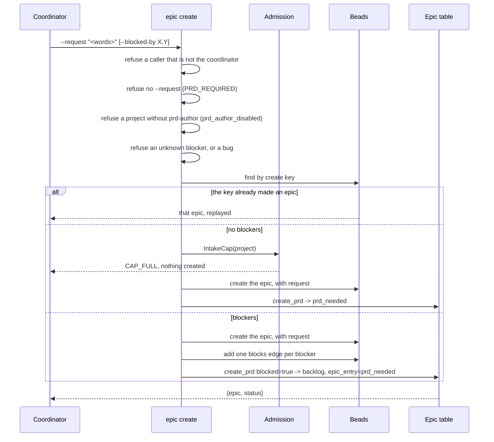
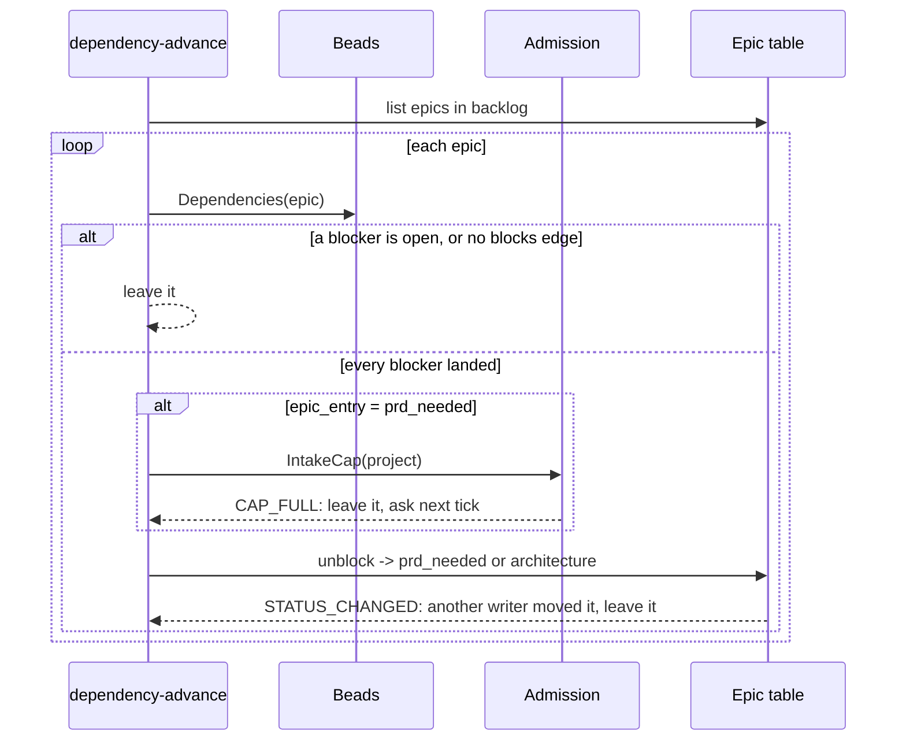

# Unattended intake and PRD authoring: technical spec

## Source

- **Epic:** factorio-4n0
- **Source:** `docs/adr/0001-unattended-prd-author.md`. Its `**Ticket:**` line names this epic.
- **Stories covered:** none. This is an architecture epic.

ADR 0001 gives seven acceptance criteria to this epic, with no labels. This spec numbers them.
Each contract below cites one of them, or the ADR decision it proves.

| Label | ADR acceptance criterion |
| --- | --- |
| A1 | `loop prd submit --help` lists `run` among its callers |
| A2 | `loop epic create --help` lists the flags `request` and `blocked-by` |
| A3 | `test -f pack/runbooks/prd-author.md` succeeds, and `pack/manifest.json` names it |
| A4 | `epic create --request` with no blockers creates an epic in `prd_needed`, and a blocker creates it in `backlog` |
| A5 | `dependency-advance` moves an epic from `backlog` once each blocker landed, and leaves it while one is open |
| A6 | `prd submit` from a `prd-author` run moves the epic it holds to `prd_review`, and creates no second epic |
| A7 | The server refuses `epic create --request` with `CAP_FULL` while the intake cap is full |

"D<n>" below names decision n of the ADR's Decision section. The ADR's own five document checks
passed when it merged. One of them, the `grep` for `intake-author`, must stay true, so C15 holds it.

Round 1 read the loop at `7acc56a`. Round 2 read it at `70c9681`, after #76 added the spec-author
and the reproducer to the stage mutex and #86 moved the split skill's rule on who creates an epic
to its section 10. The brief's handoff note names loop fault F-10, a wrong `adr` fact from ADR
0007. F-10 is fixed in v0.0.32. The epic's `adr` fact now names ADR 0001, and that ADR's Ticket
line names this epic. So the note no longer applies, and this spec has one source.

## Scope check

**Components:**

1. **The PRD epic's lifecycle on the server.** The epic table (`internal/machine`), `epic create`
   and `prd submit` (`internal/pipeline`), the intake cap (`internal/admission`), the
   `dependency-advance` job (`internal/sched`), the stage list and throughput
   (`internal/config`), and the CLI surface (`internal/cli`).
2. **The instructions that drive it.** The new runbook `pack/runbooks/prd-author.md`, the
   coordinator's section 8, the doc-reviewer's PRD check, the shared skills, the coordinator
   policy and the plan. Why not its own epic: the pack gate checks each command and flag that a
   runbook names against `loop schema`. So the runbooks cannot name `epic create --request` before
   the flag lands. And `TestEveryStageHasARunbook` (`internal/pack/pack_test.go:99`) fails while a
   run stage has no runbook, so the stage and its runbook land in one diff.

Entries 1 to 3 build the entry states, `epic create` and the unblock, with no new stage. Entry 4
adds the stage and its runbook together, because two tests hold them equal (Decisions). Entry 5
lets the run submit its PRD, and turns the stage on in this project. Entry 6 moves the
coordinator's route onto the new path once every verb it names exists.

**Not in this spec:** the room-open rubric gate, which factorio-4q5 landed and D9 keeps. Intake
from a configured source, which the plan defers and D4 rejects. The doc-reviewer's and the
amender's rows after `prd_review`, which do not change.

## Decisions

The ADR decided the stage, the states, the verbs and the cap. Each line below is a choice that the
ADR left to this spec, or one where the code shows that the ADR's stated mechanism differs.

- **A settled decision and a moot one both release an epic's block.** We chose "landed" to mean
  `done` or `canceled` for a decision blocker over `done` alone, because a moot or dropped decision
  means the question no longer applies. Under `done` alone, an epic blocked by a moot decision
  waits in `backlog` until a person runs `work unblock`, and nothing tells anyone. This is the
  question ADR 0001 postponed. `blockersLanded` (`internal/sched/deps.go:118`) already reads a
  `canceled` item with no open pull request as landed, and a decision has no branch, so the rule
  needs no new branch in the job.
- **A blocker is a ticket, an epic or a decision. `epic create` refuses a bug.** We chose this over
  admitting every kind, because a bug ends in `shaped` or `duplicate`, and neither state says that
  a fix landed. `blockersLanded` would read a shaped bug as open forever. We rejected epics and
  decisions only, as tickertown has, because a PRD-less ticket the operator asked for can be the
  thing a new epic waits on.
- **The epic records where `unblock` sends it in a new fact, `epic_entry`.** We chose a fact over
  reading the `request` fact, because `epic create --architecture` may carry a request too, so its
  presence cannot tell the two entries apart. We chose a new fact name over the ticket fact
  `entry`, because `entry` means new, rework or resume on a ticket, and one name with two
  meanings in one table misleads the next reader.
- **`dependency-advance` holds a ready PRD epic in `backlog` while the intake cap is full.** We
  chose this over an unblock that ignores the cap, because the cap is the bound on PRD epics in
  flight (D6). An unblock past it fills the cap that `epic create` checks, and no write refuses it.
  An epic whose entry is `architecture` holds no slot, so the cap never holds it. A person's
  `work unblock` is not held: the coordinator runs it on the operator's word.
- **`backlog` holds no intake slot.** We chose this over counting it, because a blocked epic waits
  on other work and no agent moves it. That is the rule of `intakeCounted`
  (`internal/admission/caps.go:15`): an epic that waits holds none. So `epic create --blocked-by`
  does not ask the cap. The cap is asked when the epic leaves `backlog`, by the previous decision.
- **`epic create --request` refuses a project that does not enable `prd-author`, with `USAGE` and
  rule `prd_author_disabled`.** We chose a refusal over a create that waits, because the scheduler
  starts only the stages that a project's `.loop/config.yaml` lists
  (`internal/sched/scheduler.go:443`). An epic in `prd_needed` there waits with no run and no
  alert. The refusal names the line to add. We rejected a check at the unblock, because the
  operator learns at create time, while the coordinator is in the conversation.
- **The `prd submit` callers become `intake room` and `run`, and `prdSubmit` refuses a run of any
  stage but `prd-author`.** We chose the existing `run` label over a new `prd-author` label,
  because A1 asks that the help lists `run`, and the matrix checks the principal's kind, never its
  stage (`internal/cli/capabilities.go:22`). The `decomposer` label works the same way:
  `epicDecompose` checks the stage itself.
- **A run's `prd submit` records `prd_path` in the `prd_submit` row.** We chose the row over the
  create, because a run's epic exists before its PRD does. An intake room still records it at
  create (`internal/pipeline/prd.go:90`), and its row stays as it is.
- **No proto change.** We chose to edit `internal/cli/surface.go` only, over the ADR's "regenerates
  `gen/` with `make proto`". Every verb takes `VerbRequest`
  (`proto/loop/v1/services.proto:107`), so a flag never reaches the proto. **This corrects one
  bullet of ADR 0001's Consequences**, "The verbs". Entry 6 amends that bullet.
- **The PRD author escalates at level 4 when the request yields no story it can quote.** We chose
  an escalation over a PRD whose stories all sit under Open questions, because the doc-reviewer
  rejects such a PRD, the amender has no more source than the author, and the second reject sends
  it to an intake room after two runs and two reviews. The escalation's answer, given with
  `loop inbox answer --amend`, lands in the `amendment` fact, and the next run quotes it as it
  quotes the request. This is the case ADR 0001 left to the spec: "a `request` too short to quote
  as a story". We rejected a minimum length, because no count of words says that a request names
  what a user can do.
- **The doc-reviewer checks that each story quotes the request. `prd submit` does not.** We chose
  the reviewer over a server match, because a quote crosses a line wrap and changes its quote
  marks, so a byte match refuses a correct PRD, and each false refusal costs an attempt. The
  reviewer already reads each requirement against its source (`pack/runbooks/doc-reviewer.md`
  section 2).
- **`prd-author` holds the stage mutex, as the spec-author does.** We chose the mutex over "no
  mutex, the lease only", because two runs of one author stage would each claim an epic and break
  the stage's cadence. The lease stops two runs on the same epic only. The base holds this rule for
  the spec-author and the reproducer (`internal/admission/mutex.go:14`, #76, parity 8.6), and its
  tickertown source names `prd-author` among the stages that keep one run
  (`scripts/sdlc/stage-claims.ts:11`, alpha): "Two runs of one author stage could each claim one
  epic. Leases already stop two runs on the same epic, and this guard keeps the cadence the worker
  guard gave." `mutexStages` gains `prd-author`, so one `prd-author` run works in each project at a
  time, whatever cap host config holds.
- **The `prd-author` throughput default is cap 2, schedule `5,35 * * * *`, effort `high`.** We
  chose the spec-author's cap and effort over the intake cap of 8, because both are mutex author
  stages that write one document from a source. The mutex holds each project to one run, so the
  cap bounds the `prd-author` runs across the host's projects, as the spec-author's cap does
  (`liveRuns`, `internal/admission/caps.go:26`, counts the whole instance). The effort table runs
  each author at `high` (`internal/sched/quota.go:30`). The minutes fall 21 minutes before the
  doc-reviewer's `26,56` (`internal/config/throughput.go:96`), so a PRD that a run submits within
  21 minutes is reviewed in the same half hour.
- **On `CAP_FULL`, the coordinator parks the request on a pending decision, and creates the epic
  blocked by it.** The coordinator files one pending decision for the project, "The intake cap of
  `<project>` is full", or reuses the pending one. It runs `epic create --request` again with the
  same words and `--blocked-by <decision>`. The first call created nothing, so this is a new write.
  The epic lands in `backlog`, which holds no slot, with the operator's words in its `request`
  fact. The coordinator tells the operator which epics hold the cap. At each wake, by section 6 of
  its runbook, it runs `loop decision moot <decision>` once the count drops below the cap or the
  operator raises the cap. `dependency-advance` then moves each waiting epic as the cap admits it,
  by the decision on the cap at unblock above. We rejected "tell the operator, and create the epic
  again at a later wake", as section 7 does for an intake room. The request would then live only
  in the coordinator's chat, and the coordinator runbook says "No rule lives in a wake prompt or
  in your memory". A session that ends loses the request. We rejected an `epic create` that parks
  the epic itself on a full cap, because ADR 0001's criterion A7 asks for the `CAP_FULL` refusal.
  We rejected a blocker on a decision mooted at once, because the record would then say that a
  question stopped when none had. The pending decision says why the epic waits, and its trigger
  names the event that the coordinator watches.

## Assumptions

- A project config that names a stage which the running server does not know still loads. This is
  wrong if anything calls `ProjectConfig.CheckStages` (`internal/config/project.go:179`) on load.
  Today nothing outside a test calls it, so entry 5's line in `.loop/config.yaml` is harmless on a
  host that runs an older release.
- The brief of a `prd-author` run carries the epic's `request` and `amendment` facts. This is
  wrong if `.loop/brief.json` leaves out facts. Today it prints every fact under `item.facts`.
- `beadsx.Client.Dependencies` returns a blocks edge from an epic as it does from a ticket. This is
  wrong if beads refuses an edge whose source is of type `epic`. Entry 2's test creates one.
- One PRD epic for each request is enough for the work that the rubric scores at level 1 to 3.
  This is wrong if a PRD author escalates a split on most epics. The split skill sends that case to
  an intake room.
- The coordinator is the only caller that creates a PRD epic. This is wrong if any surface entry
  but `epic create`, which admits only the coordinator, and `prd submit` from an intake room
  creates one.

## Approach

**The epic gains three states and one way in.** `backlog` holds an epic that waits on a blocker.
`prd_needed` holds a PRD epic that waits for its author. `prd_drafting` holds it while a
`prd-author` run writes. The new row `create_prd` takes a fresh epic to `prd_needed`, or to
`backlog` when the caller sent blockers. `create_architecture` gains the same blocked branch. Both
create rows record `epic_entry`, and the two `unblock` rows read it to land on `prd_needed` or
`architecture`. These rows copy the shape of the ticket's create and unblock rows
(`internal/machine/ticket.go:145`): the pipeline adds every blocks edge first, then applies the
create with `blocked=true`.

**`epic create` becomes the coordinator's one verb for a new epic.** With `--architecture`, it
works as it does today, plus `--blocked-by`. With no `--architecture`, it needs `--request`, and it
creates a PRD epic. For an epic with no blockers, it asks the intake cap before it creates
anything. A replay of a create that landed finds the epic by its create key before it asks the
cap, so a cap that filled after the first call does not refuse its replay.

**`dependency-advance` reads epics beside tickets.** It lists the project's epics in `backlog` and
judges each with the same `blockersLanded` function. For a ready epic whose `epic_entry` is
`prd_needed`, it asks `Admission.IntakeCap` first, and leaves the epic when the cap refuses. The
next tick asks again.

**`prd-author` is a run stage like the spec-author.** The scheduler finds its queue from its claim
row, `prd_needed` to `prd_drafting`. The run reads the brief, writes the PRD from the loop-brainstorm
template, commits it, and runs `loop prd submit`. `prdSubmit` gets a second branch for a run
principal. It checks the stage, the held epic, its state and the lease epoch, then reads the PRD
at the head, pushes to `loop/<epic>`, opens the pull request, asks the sign-off readers, and
applies `prd_submit` from `prd_drafting`. That row drops the lease and records `prd_path` and
`doc_pr`. From `prd_review` on, a run's PRD and a room's PRD follow the same rows.

**The coordinator routes by the rubric.** Section 8 sends level 1 to 3 product work to
`loop epic create --request`, and keeps the intake room for level 4 and 5, or the Choice
`outside`. A PRD-less ticket stays for a bug, and for work the operator asks to do with no PRD.
`room open`'s `ROUTED_TO_LOOP` hint names the new verb, so a coordinator that opens a room for
level 1 to 3 work is told the step that works. When `epic create --request` refuses with
`CAP_FULL`, the coordinator files or reuses the project's pending cap decision, and creates the
epic blocked by it (Decisions). The request then waits in the record, and never in the chat.

**The PRD author keeps one run in each project.** `mutexStages` gains `prd-author`, so admission
refuses a second `prd-author` run in a project with `MUTEX_HELD` while the first holds the stage,
as it does for the spec-author.

## Domain model

The epic state machine (`internal/machine/epic.go`) changes. No other domain type changes.

```
epic states (added)
  backlog        frozen   a blocks edge to an item that has not landed
  prd_needed     active   a PRD epic that no run holds; the prd-author queue
  prd_drafting   wip      a prd-author run holds it and writes the PRD

fact (new)
  epic_entry     prd_needed | architecture
    set by: the blocked branch of create_prd and create_architecture
    read by: unblock, to choose its row

invariants
  - An epic in backlog has at least one blocks edge, added before it left the initial state.
    An epic in backlog with no edge is a doubt, and dependency-advance holds it, as it holds
    such a ticket. A person decides with `work unblock`.
  - An epic in backlog holds epic_entry. unblock with no epic_entry matches no row, so it is
    refused, and the epic never lands on a guessed state.
  - An epic in prd_needed or prd_drafting holds a nonempty request fact. epic create refuses a
    PRD epic with no --request, and no other row reaches those states.
  - An epic in prd_drafting has an owner whose stage is prd-author.
  - prd_path is set on every epic in prd_review, whichever path submitted it.
```

New rows, in the table's own terms:

| Verb | From | To | When | Command |
| --- | --- | --- | --- | --- |
| `create_prd` | initial | `prd_needed` | `no_open_dependency` | |
| `create_prd` | initial | `backlog` | `open_dependency` | |
| `create_architecture` | initial | `backlog` | `open_dependency` | |
| `unblock` | `backlog` | `prd_needed` | `prd_entry` | `work unblock` |
| `unblock` | `backlog` | `architecture` | `architecture_entry` | `work unblock` |
| `claim` | `prd_needed` | `prd_drafting` | stage `prd-author` | |
| `prd_submit` | `prd_drafting` | `prd_review` | | `prd submit` |
| `release`, `reclaim` | `prd_drafting` | `prd_needed` | | |

The existing `create_architecture` row gains the selector `no_open_dependency`. `epicResume` gains
`backlog` to `backlog`, `prd_needed` to `prd_needed`, and `prd_drafting` to `prd_needed`. The
`live` list and `epicStateOrder` gain the three states, first in flow order, so `escalate`, `note`
and `edit` reach them.

## Interfaces

```go
// internal/machine
const (
	Backlog     = "backlog"      // already declared for tickets; the epic table reuses it
	PRDNeeded   = "prd_needed"
	PRDDrafting = "prd_drafting"

	VerbCreatePRD = "create_prd"

	FactEpicEntry = "epic_entry" // prd_needed or architecture: where unblock sends a blocked epic
)

// internal/config
const StagePRDAuthor = "prd-author"
// runStages gains StagePRDAuthor after StageAmender. optional gains "prd-author".
// DefaultThroughput()["prd-author"] = Throughput{Cap: 2, Schedule: "5,35 * * * *"}

// internal/pipeline
type Config struct {
	// ... existing fields
	// IntakeCap refuses a new PRD epic with CAP_FULL while the project's
	// epics in counted states fill the intake cap. Admission.IntakeCap is
	// one. Required.
	IntakeCap func(ctx context.Context, project string) *cli.Refusal
	// StageEnabled says whether the project's config lists a stage.
	// Required.
	StageEnabled func(ctx context.Context, project, stage string) (bool, error)
}

// EpicResult, unchanged in shape: {epic, status}. status is prd_needed,
// architecture or backlog.

// internal/sched: Config.Admission already exists; dependency-advance
// calls Admission.IntakeCap(ctx, project).

// internal/admission
var mutexStages = []string{config.StageIntake, config.StageSpecAuthor, config.StageReproducer, config.StagePRDAuthor}
```

```
loop epic create                       callers: coordinator
  --architecture        bool    the epic follows an ADR; with none, the epic is a PRD epic
  --request             string  the operator's own words; required with no --architecture
  --blocked-by          string  item ids, comma-separated: tickets, epics or decisions of the project
  --title               string  required
  --body                string
  --project             string

loop prd submit                        callers: intake room, run
  --path, --title, --body              unchanged
  From a run: the run is a prd-author run that holds its epic in prd_drafting.
  Answer: PRDResult, unchanged in shape. epic is the held epic.
```

Refusals that the new paths add. Each one changes no state:

| Verb | Code | Rule | When |
| --- | --- | --- | --- |
| `epic create` | `PRD_REQUIRED` | `no_operator_request` | no `--architecture` and no `--request` |
| `epic create` | `USAGE` | `prd_author_disabled` | a PRD epic, and the project's config does not list `prd-author` |
| `epic create` | `NOT_FOUND` | `no_blocker` | a `--blocked-by` id is not an item of the project |
| `epic create` | `USAGE` | `blocker_kind` | a `--blocked-by` id is a bug |
| `epic create` | `CAP_FULL` | `cap_full` | a PRD epic with no blockers, and the intake cap is full |
| `prd submit` | `CAPABILITY_DENIED` | `prd_author_only` | a run whose stage is not `prd-author` |
| `prd submit` | `TRANSITION_NOT_ALLOWED` | `not_drafting` | the held epic is not in `prd_drafting` |
| `prd submit` | `LEASE_NOT_HELD` | `stale_epoch` | the run's epoch is not the epic's |

`room open`'s `ROUTED_TO_LOOP` hint (`internal/room/room.go:327`) names
`loop epic create --request` for new product work, beside `loop work create` for a bug or a chore.

## Data

```
epic bead facts (changed)
  + epic_entry    string, prd_needed | architecture; set only on a blocked create
  + request       string, the operator's words; set by epic create --request (the fact exists for tickets)
  prd_path        now also set by the prd_submit row from prd_drafting

beads edges (changed)
  + blocks edges whose source is an epic, to a ticket, an epic or a decision

host config (changed)
  + throughput.prd-author    optional; a missing entry reads as DefaultThroughput()["prd-author"]

.loop/config.yaml of this project (changed)
  + stages.prd-author: {}
```

> **Existing records:** no epic is in a new state before entry 1, and no epic holds `epic_entry`.
> Existing epics keep their states and facts. A host config that an older release wrote holds no
> `throughput.prd-author`, and it loads, because the key is optional. An older release reads a host
> config with no such key, so `loop rollback` still starts.

## Flows

**The coordinator creates a PRD epic.**



**`dependency-advance` releases a blocked epic.**



**A `prd-author` run writes and submits the PRD.**

```mermaid
sequenceDiagram
    participant S as Scheduler
    participant R as prd-author run
    participant P as prd submit
    participant G as GitHub
    participant M as Epic table
    S->>M: claim prd_needed -> prd_drafting
    S->>R: start, brief holds request and amendment
    R->>R: read request, body, amendment, repository files
    alt no story can quote a source
        R->>M: escalation raise --score 4 -> escalated, resume prd_needed
        R-->>S: run finish blocked
    else
        R->>R: write docs/prd/<slug>.md, commit
        R->>P: --path --title --body
        P->>P: refuse another stage, another state, a stale epoch
        P->>P: read the PRD at HEAD; refuse no story label, before any push
        P->>G: push loop/<epic>, open the PR, ask the sign-off readers
        P->>M: prd_submit -> prd_review, prd_path, doc_pr, lease dropped
        P-->>R: PRDResult
        R-->>S: run finish done
    end
    Note over M: the doc-reviewer claims prd_review, as for a room's PRD
```

## Work

1. **Epic entry states.** Add `backlog` and `prd_needed` to the epic table, the `create_prd` rows,
   the blocked `create_architecture` row, the two `unblock` rows, `epic_entry`, and the resume
   targets. Add `prd_needed` to `intakeCounted`.
   - Files: `internal/machine/epic.go`, `internal/machine/kinds.go`, `internal/machine/rows.go`,
     `internal/machine/*_test.go`, `internal/admission/caps.go`, `internal/admission/*_test.go`
   - Needs: nothing
   - Proves: C1, C2, C7 (the `prd_needed` half)
   - Done when: a machine test applies `create_prd` with and without `blocked=true` and reads
     `prd_needed` and `backlog`, and applies `unblock` to each entry.
2. **`epic create --request` and `--blocked-by`.** Extend `epicCreate`, the surface flags and
   their descriptions, and the pipeline's `IntakeCap` and `StageEnabled` hooks, wired in
   `internal/server`. Change `room open`'s routed hint.
   - Files: `internal/pipeline/adhoc.go`, `internal/pipeline/pipeline.go`, `internal/cli/surface.go`,
     `internal/server/*.go` (the pipeline wiring), `internal/room/room.go`, their tests
   - Needs: 1
   `--blocked-by` works on both branches: with `--architecture` and with `--request`, the pipeline
   adds every blocks edge before it applies the create row.
   - Proves: C4, C5, C6, C12 (the `epic create` half), C16 (the hint)
   - Done when: `loop epic create --help` lists `request` and `blocked-by`, a pipeline test
     reads each refusal of C4 with no item created, and C5's kill-point test passes for both
     branches.
3. **`dependency-advance` unblocks epics.** List the project's epics in `backlog` beside its
   tickets, judge them with `blockersLanded`, ask the intake cap for a PRD entry, and apply
   `unblock`.
   - Files: `internal/sched/deps.go`, `internal/sched/*_test.go`
   - Needs: 1
   - Proves: C8, C9
   - Done when: a scheduler test moves an epic whose blockers are a done epic and a moot decision,
     and leaves one whose decision blocker is pending.
4. **The `prd-author` stage and its runbook.** Add `prd_drafting`, the claim row, the
   `release` and `reclaim` pairs and its resume target. Add `prd-author` to the run stages, the
   optional throughput keys, `DefaultThroughput` and `DefaultEfforts`. Add `prd_drafting` to
   `intakeCounted`. Add `prd-author` to `mutexStages`, and name it in that variable's comment
   with the cadence reason. Write `pack/runbooks/prd-author.md`, and name it in `pack/manifest.json` with
   the skills `loop-sdlc-turn`, `loop-sdlc-glossary`, `loop-sdlc-triage`, `loop-sdlc-split`,
   `loop-sdlc-documents` and `loop-brainstorm`, unattended. This entry changes the server and the
   pack in one diff, because `TestEveryClaimStageHasAThroughputEntry`
   (`internal/admission/admission_test.go:653`) needs the stage in `RunStages` once the claim row
   exists, and `TestEveryStageHasARunbook` (`internal/pack/pack_test.go:99`) needs a runbook once
   the stage is there. The runbook holds, in order:
   1. Read the brief, then the epic's `request` fact, body and `amendment` fact.
   2. Run `loop pr show`. When the epic already has a PRD pull request, bring its head in and
      continue it. Never open a second PRD.
   3. Write `docs/prd/<slug>.md` from `../loop-brainstorm/prd.md`. Each story quotes the operator's
      words from the `request` fact or the `amendment` fact. These two facts are the only source
      a story quotes. Each requirement cites a story, the epic body or a repository file. A
      requirement with no source goes under Open questions.
   4. When no story can quote a source, run `loop escalation raise --score 4` with a body that
      names what the request leaves open, and finish `blocked`.
   5. When the work reaches more than one subsystem, name the seam under Open questions, by the
      split skill. Never split.
   6. Run `loop gates --docs`, commit, run `loop prd submit`, and finish `done`.
   - Files: `internal/machine/epic.go`, `internal/config/throughput.go`, `internal/sched/quota.go`,
     `internal/admission/caps.go`, `internal/admission/mutex.go`, `pack/runbooks/prd-author.md`,
     `pack/manifest.json`, `internal/pack/prd_author_test.go`, their tests
   - Needs: 1
   - Proves: C3, C7 (the `prd_drafting` half), C13, C14, C15, C17, C18
   - Done when: `go test ./internal/pack/... ./internal/admission/... ./internal/config/...`
     passes, and a scheduler test starts a `prd-author` run on an epic in `prd_needed`.
5. **`prd submit` from a run.** Add the `prd_submit` row from `prd_drafting`, the run branch of
   `prdSubmit`, and the `run` caller. Enable the stage in this project's `.loop/config.yaml`.
   - Files: `internal/machine/epic.go`, `internal/pipeline/prd.go`, `internal/cli/surface.go`,
     `.loop/config.yaml`, their tests
   - Needs: 4
   - Proves: C10, C11, C12 (the `prd submit` half)
   - Done when: `loop prd submit --help` lists `run`, and a pipeline test submits from a
     `prd-author` run and reads the epic in `prd_review` with one epic in the project.
6. **The coordinator's route and the shared instructions.** Coordinator section 8 routes level 1
   to 3 product work to `loop epic create --request`, names `--blocked-by`, and names
   `prd_author_disabled` with its fix. It names the step on `CAP_FULL`, by Decisions: file or
   reuse the project's pending cap decision with `loop decision file`, run the same
   `loop epic create --request` again with `--blocked-by <decision>`, and tell the operator which
   epics hold the cap. Section 6 names `loop decision moot` for that decision once the count drops
   below the cap or the operator raises it. `.loop/policy/coordinator.md` changes its product route
   row to match. The glossary adds the stage `prd-author`, the epic states `backlog`, `prd_needed`
   and `prd_drafting`, and "a PRD author or an intake room" in the PRD entry. The split skill's
   section 3 adds "The PRD author never splits", and its section 10 rule reads "Only an intake
   room creates one, with `loop prd submit`, or the coordinator, with `loop epic create`". The
   doc-reviewer's section 2 checks that each story of a PRD on an epic with a `request` fact
   quotes that fact or the `amendment` fact. The loop-init config template lists
   `prd-author: {}`. The plan's Key Decision on intake, R44 and F4 gain the level 4 and 5 scope
   and the second entry path. ADR 0001's Consequences bullet "The verbs" drops the `make proto`
   sentence.
   - Files: `pack/runbooks/coordinator.md`, `pack/runbooks/doc-reviewer.md`,
     `pack/skills/loop-sdlc-glossary/SKILL.md`, `pack/skills/loop-sdlc-split/SKILL.md`,
     `pack/skills/loop-init/SKILL.md`, `.loop/policy/coordinator.md`,
     `docs/plans/2026-10-21-1328-feat-standalone-sdlc-loop-plan.md`,
     `docs/adr/0001-unattended-prd-author.md`, `internal/pack/prd_author_test.go`
   - Needs: 2, 4, 5
   - Proves: C16, C19
   - Done when: `make pack-check` and `loop gates --docs` pass, and the C16 and C19 tests pass.

## Out of scope

- A port of tickertown's `intake-author`, `pnpm intake next`, `pnpm intake coverage`, the order
  rule and the epic marker. ADR 0001 D4 rejects them, and a later port needs a new ADR.
- The fire of a blocker decision when an epic blocks on it. ADR 0001 D8 rejects it. The
  coordinator's section 6 fires a decision whose trigger happened.
- A server check that each story quotes the request. The doc-reviewer holds it, by Decisions.
- The intake room's runbook and `loop-brainstorm`. They serve level 4 and 5 work as they do today.
  This epic only reads the PRD template.
- The `intake` throughput entry and its unused schedule. It stays the epic cap (D6). Nobody removes
  the dead schedule while a host config that an older release wrote holds the key, because its
  removal would break that config.
- Turning `prd-author` on in another project. Each project's own `.loop/config.yaml` does it. The
  `prd_author_disabled` refusal tells the coordinator which line to add.

## Contracts

**C1. Behaviour: an epic enters by its blockers.** Proves A4. `create_prd` with no blockers lands
on `prd_needed`. With `blocked=true`, it lands on `backlog` and records `epic_entry=prd_needed`.
`create_architecture` with no blockers lands on `architecture`, as today, and with `blocked=true`
on `backlog` with `epic_entry=architecture`. No create row lands an epic on `prd_drafting`.
*A machine table test for each of the four creates, which reads the state and the fact.*

**C2. Behaviour: unblock lands on the recorded entry.** Proves A5, D7. `unblock` on a `backlog`
epic lands on `prd_needed` when `epic_entry` is `prd_needed`, and on `architecture` when it is
`architecture`. With no `epic_entry` it is refused with `TRANSITION_NOT_ALLOWED`, and the epic
stays in `backlog`. `work unblock` from the coordinator performs it.
*A machine test for each value of the fact and for its absence.*

**C3. Behaviour: only a `prd-author` run claims a PRD epic.** Proves D1. A claim of an epic in
`prd_needed` by a `prd-author` run lands on `prd_drafting` and takes the lease. A claim by any other
stage is refused. `release` and `reclaim` return `prd_drafting` to `prd_needed`. `escalate` from
`prd_drafting` stores the resume target `prd_needed`, and `answer` lands there.
*Machine tests per row. A claim test for each other run stage.*

**C4. Refusal: `epic create` refuses before any write.** Proves D2, and the ADR's rule that no
caller but the coordinator creates a PRD epic. Each refusal in the Interfaces table for
`epic create` returns its code and rule, and the project holds no new item after it. A run and a
room are refused with `CAPABILITY_DENIED`.
*A pipeline example test for each refusal, which counts the project's items before and after.*

**C5. Behaviour: `epic create --blocked-by` records the edges on both branches, and fires
nothing.** Proves A2, A4, D7, D8. `epic create --request` gives the new epic the `request` fact
verbatim, the title and the body. With `--blocked-by`, on either branch, the epic holds one blocks
edge to each named item, and each edge exists before the epic leaves the initial state.
`epic create --request --blocked-by X` lands on `backlog` with `epic_entry=prd_needed`.
`epic create --architecture --blocked-by X` lands on `backlog` with `epic_entry=architecture`. A
replay with the same idempotency key returns the same epic, with no second edge. After
`epic create --blocked-by <a pending decision>`, that decision is still `pending`.
*A pipeline test for each branch that reads the bead's facts, its state and `Dependencies`. A
kill-point test for each branch that stops after the edges and before the create row, then
replays. A pipeline test that reads the decision's state after the create.*

**C6. Refusal: the intake cap refuses a new PRD epic.** Proves A7, D6. While the project's epics
in counted states equal the cap, `epic create --request` with no blockers returns `CAP_FULL` and
creates nothing. With `--blocked-by`, it creates the epic in `backlog`. A replay of a create that
landed before the cap filled returns that epic, not `CAP_FULL`. `epic create --architecture` never
asks the cap.
*A pipeline test at a cap of 1 with one epic in `prd_review`, for each of the four cases.*

**C7. Boundary: the intake count.** Proves D6. `countIntakeEpics` counts `prd_needed`,
`prd_drafting`, `prd_review`, `prd_amending`, `spec_needed`, `spec_drafting` and `spec_review`, and
no other state. `backlog`, `architecture`, `prd_signoff` and `escalated` count 0.
*An example test over one epic in each epic state, which asserts the total.*

**C8. Behaviour: `dependency-advance` releases an epic only when every blocker landed.** Proves A5.
An epic in `backlog` moves when each blocker is a `done` ticket, a `canceled` ticket with no open
pull request, a `done` epic, or a decision in `done` or `canceled`. It stays while any blocker is
open: a ticket in any other state, an epic not `done`, or a decision in `pending` or `needs_human`.
An epic in `backlog` with no blocks edge stays. Ticket unblocking behaves as before.
*A scheduler test for each kind of blocker in each landed and open state, and the existing ticket
tests unchanged.*

**C9. Behaviour: the cap holds a ready PRD epic in `backlog`.** Proves D6. When every blocker
landed and the intake cap is full, a PRD-entry epic stays in `backlog`, and the tick reports no
error. The first tick after the count drops below the cap moves it to `prd_needed`. An
architecture-entry epic moves whatever the count.
*A scheduler test that fills the cap, ticks, frees a slot, and ticks again.*

**C10. Behaviour: a run submits the PRD of the epic it holds.** Proves A6, D5. From a `prd-author`
run that holds an epic in `prd_drafting`, `prd submit` pushes HEAD to `loop/<epic>`, opens one
pull request, and moves that epic to `prd_review` with `prd_path`, `doc_pr` and no owner. The
project holds the same number of epics before and after. A replay returns the same answer with
`replayed: true`. A first `review_reject` of that PRD then lands on `prd_amending`, as for a room's
PRD.
*A pipeline test with the fake GitHub that counts epics, reads the facts, replays, and applies a
reject.*

**C11. Refusal: `prd submit` refuses a run that may not submit.** Proves A6, D5. A run of any other
stage gets `CAPABILITY_DENIED` with `prd_author_only`. A `prd-author` run whose epic is not in
`prd_drafting` gets `TRANSITION_NOT_ALLOWED`. A run whose epoch is stale gets `LEASE_NOT_HELD`. A
PRD with no story label gets `USAGE` with `no_story_labels`. In each case nothing is pushed, no
pull request opens, and the epic keeps its state. An intake room's submit answers as before.
*A pipeline example test per refusal, which asserts the fake GitHub saw no push, and the existing
room tests unchanged.*

**C12. Behaviour: the surface names the new callers and flags.** Proves A1, A2. `loop schema` lists
`run` among the callers of `prd submit`, and the flags `request` and `blocked-by` on
`epic create`. The capability matrix admits a run on `prd submit`, and only the coordinator on
`epic create`.
*A surface test over `Surface()` and `DeriveMatrix`.*

**C13. Behaviour: an older host config still loads.** Proves D6. A host config with no
`throughput.prd-author` entry loads, and `ThroughputFor("prd-author")` returns cap 2 and schedule
`5,35 * * * *`. A host config with the entry reads its values. `prd-author` is in `RunStages`, and
the scheduler still skips `intake`.
*A config test with each file, and the existing `ThroughputKeys` tests.*

**C14. Behaviour: the scheduler starts a PRD author only where the project enables it.** Proves D1.
A tick on a project whose config lists `prd-author` starts one run on an epic in `prd_needed`, with
that epic in the brief. A project whose config does not list it starts none.
*A scheduler test with two projects.*

**C15. Behaviour: the runbook exists and ports no intake author.** Proves A3, D4. `pack/manifest.json`
names `prd-author`, unattended, with the six skills of entry 4. `pack/runbooks/prd-author.md`
holds `name: loop-prd-author`, and the pack gate passes on it.
`grep -rln --exclude='*_test.go' -e 'intake-author' -e 'sdlc-intake' -e 'intake coverage' pack internal cmd`
prints nothing.
*`TestEveryStageHasARunbook`, the pack gate, and the grep as a test in `internal/pack`.*

**C16. Behaviour: the coordinator's route names the new path, and parks a request the cap
refuses.** Proves D2, D6, D9. Section 8 of `pack/runbooks/coordinator.md` names
`loop epic create --request`, `--blocked-by`, `prd_author_disabled` and `CAP_FULL`. On
`CAP_FULL`, it names `loop decision file` and `--blocked-by <decision>`, and section 6 names
`loop decision moot` for the cap decision. `.loop/policy/coordinator.md`'s product route row names
`epic create --request` at level 1 to 3. `room open`'s `ROUTED_TO_LOOP` hint names
`loop epic create --request`. `room open --kind intake` at level 1 to 3 is still refused with
`ROUTED_TO_LOOP`. The parked route works on the server by C6, C8 and C9: a blocked create asks no
cap, a moot decision is landed, and the unblock waits for a slot.
*A test in `internal/pack/prd_author_test.go` that reads each named section with the `section`
helper of `internal/pack/split_test.go`, so a wrapped line still matches, and asserts each string.
A room test that reads the hint.*

**C17. Behaviour: one `prd-author` run works in a project at a time.** Proves D1. With the host
cap of `prd-author` at 5 and two epics in `prd_needed`, a first admit succeeds. A second
`prd-author` admit in the same project, on the other epic, is refused with `MUTEX_HELD`, and the
peek offers nothing. Settling the first run frees the stage, and the second admit then succeeds.
*A case for `prd-author` in `TestSpecAuthorAndReproducerRunOneAtATime`
(`internal/admission/admission_test.go:101`), or a test of the same shape.*

**C18. Behaviour: the PRD author's runbook holds ADR 0001's source rule.** Proves D3. In
`pack/runbooks/prd-author.md`:
- The step that writes the PRD names the `request` fact and the `amendment` fact as the only
  sources a story quotes. It sends a requirement with no source to Open questions.
- The step for a request that yields no story names `loop escalation raise --score 4`.
- The runbook names "Never split".

A runbook that drops any of these fails the test.
*A test in `internal/pack/prd_author_test.go` that reads the runbook and asserts each string, with
white space joined, as C16's test does.*

**C19. Behaviour: the shared instructions name the PRD author and its check.** Proves D2, D3.
- Section 2 of `pack/runbooks/doc-reviewer.md` names the check that each story quotes the
  `request` fact or the `amendment` fact.
- `pack/skills/loop-sdlc-glossary/SKILL.md` names `prd-author`, `prd_needed`, `prd_drafting` and
  `backlog` in its epic states line.
- Section 3 of `pack/skills/loop-sdlc-split/SKILL.md` names "The PRD author never splits", and its
  section 10 names `` `loop epic create` `` as the coordinator's create, and no longer
  `` `loop epic create --architecture` `` alone.
- `pack/skills/loop-init/SKILL.md` lists `prd-author: {}` under `stages:`.
- `docs/plans/2026-10-21-1328-feat-standalone-sdlc-loop-plan.md`'s R44 line names `prd-author`.
- `grep -c 'make proto' docs/adr/0001-unattended-prd-author.md` prints `0`.

*A test in `internal/pack/prd_author_test.go` that asserts each string. The test reads the plan and
the ADR from the repository root.*

## Observable behaviour

None, because this epic draws no screen. The operator sees its effect in the inbox: a PRD
sign-off entry for an epic that no room wrote.

## Open questions

None.
