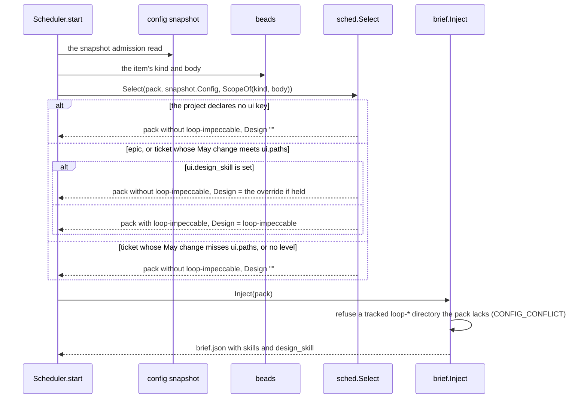
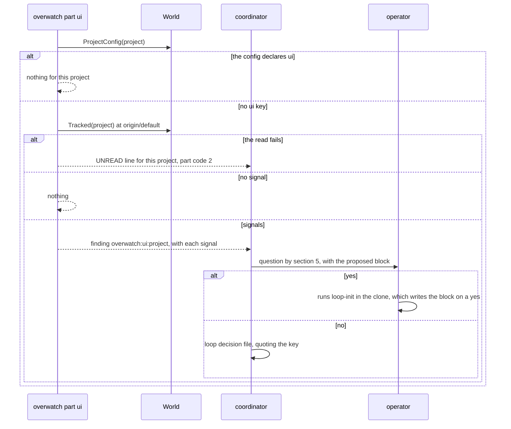
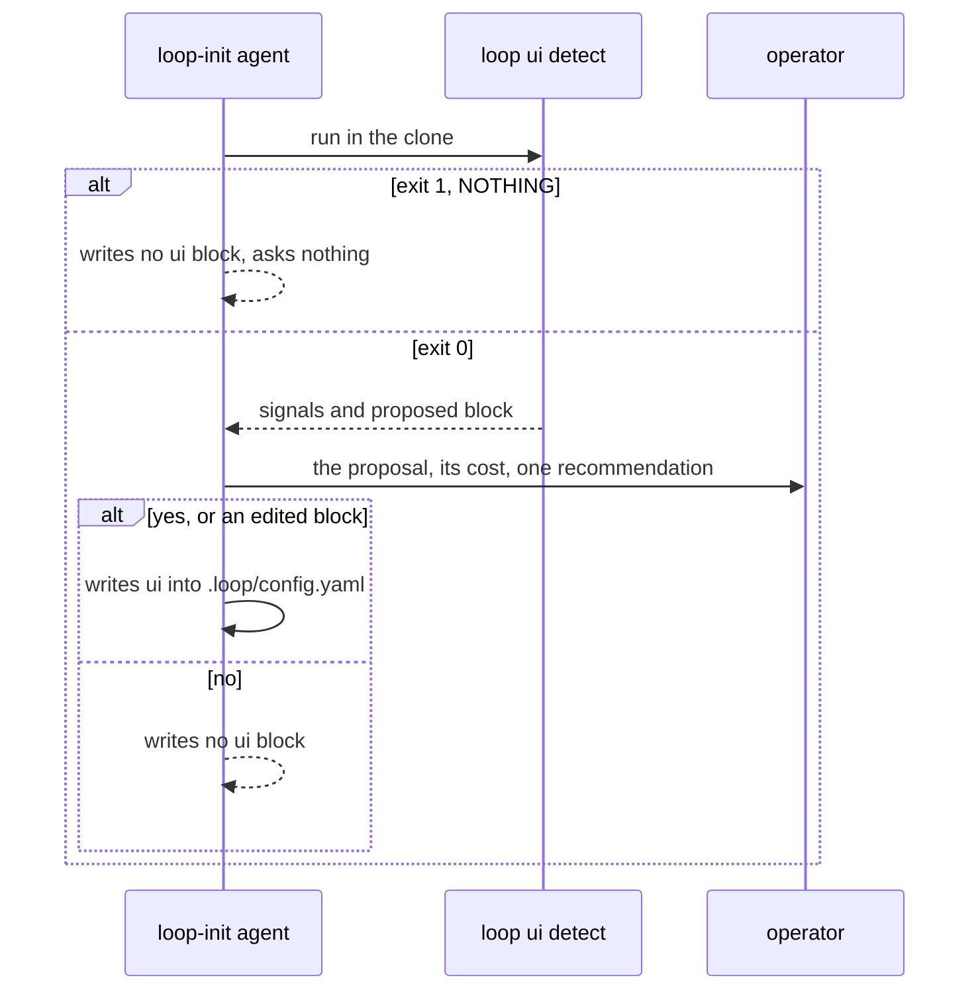

# Load a kernel skill only when its condition holds, starting with loop-impeccable: technical spec

## Source

- **Epic:** factorio-791i
- **Source:** `docs/prd/conditional-kernel-skills.md`, merged at `3112e8a`. No ADR names this epic
  on its `**Ticket:**` line. ADR 0007 and ADR 0013 bound it: this epic changes neither how the pack
  pins and fetches `impeccable` nor the `loop-` prefix.
- **Stories covered:** US-01, US-02, US-03, US-04.

The PRD uses the names "intake room" and "spec-author". factorio-vlle renamed them to the
brainstorm room and the planner (`7cd92d5`). This spec uses today's names. Part c of the epic body
already used them.

## Scope check

**Components:**

1. **The skill selection at a checkout's start.** The `ui` block in `internal/config`, the
   conditional mark in `pack/manifest.json` and `internal/pack`, the withheld skills and the two
   new brief fields in `internal/brief`, and the four callers that build a checkout's pack:
   `internal/sched/dispatch.go` (stage runs), `internal/sched/coordinator.go`,
   `internal/room/room.go` and `cmd/loop/register.go`.
2. **The frontend detector and its two readers.** A new package `internal/frontend`, the client
   verb `loop ui detect` that `loop-init` runs, and a new overwatch part `ui`. Why not its own
   epic: the operator accepted the seven parts as one epic, and only the operator agrees to a split
   (`../loop-sdlc-split/SKILL.md` § 3). The part also reads the `ui` key that component 1 adds, to
   stay quiet for a project that declares it (A17).

Entries 1 to 5 change component 1. Entries 6 to 8 change component 2. Entry 8 needs entry 1 only
for the `ui` key, and changes no file of component 1. The seam between the two components is the
one that the PRD's last open question names. The spec keeps both in one epic, because the
operator signed off the PRD as one epic, and two components fit one spec.

**Not in this spec:** userspace skills and project pins (factorio-yzrt, done). The QA stage and the
first runbook step that reads the design skill (factorio-nhb5). The design stage, its capture
command and its canvas skill (factorio-a4yq).

## Decisions

- **The kind of the item held sets a run's level.** We chose one rule for runs and rooms alike: an
  epic is the epic level, a ticket is the ticket level, and the brainstorm room is the epic level
  also before it holds an epic. We rejected a level for each runbook in the manifest, because the
  review room holds a ticket's pull request or a document's, and the decision room holds an item of
  any kind. Part c names the two levels, and its parentheses give examples, not a closed list. So
  the architect room, the review room on a document, the reviser, the decomposer and the retro of
  an epic fall under the epic rule. The review room on a ticket falls under the ticket rule. Each
  other run falls under the open question below.
- **The coordinator holds no conditional skill.** We chose this over the whole kernel. A condition
  reads a project's config, and the coordinator serves every project, so it has no config to read.
  Part a then applies: no `ui` block, no `loop-impeccable`. factorio-yzrt gave the coordinator
  kernel skills only for the same reason.
- **The ticket rule reads the "May change" list only.** We chose the "May change" list of `## Files`
  over every path of the section. This answers the PRD's second open question. US-02 gives the
  skill to "the runs whose work touches the declared UI", and a ticket's work never touches a path
  that it must not change. `admission.FileList` already parses the two lists apart.
- **One `**`-aware glob matcher in `internal/config`.** We chose about 40 lines over the standard
  `path.Match`, one call for each segment, with `**` as a whole segment for zero or more segments.
  We rejected the `doublestar` module, because a new dependency costs an audit entry for 40 lines.
  We rejected the literal-prefix rule of `internal/escalation/scope.go`, because the prefix of
  `**/*.tsx` is empty and would match every ticket.
- **A glob in a ticket's list matches when a `ui.paths` glob can match a path under its directory.**
  We chose this over an exact intersection of two globs. The directory is the entry's literal
  prefix, cut at the last `/` before its first glob character. A false match puts one skill in a
  checkout. A missed match keeps the design skill from UI work, which is the failure US-02 exists
  to stop.
- **A `ui` block with no paths does not load.** We chose a refusal over "epic runs only". This
  answers the PRD's fifth open question. US-01 declares "that the project has a user interface,
  and where its files are". An empty list says nowhere.
- **A condition names any top-level key of the project config.** We chose a lookup of the key in
  the parsed config over a `switch` on key names in the server. A second conditional skill on a
  key that the config already parses then needs one manifest line and no code (A10 uses `health`).
  A key that the config does not parse fails the pack test, so the mark never names a key that no
  config can set.
- **The mark lives in `pack/manifest.json` under `conditional`.** We chose the manifest over a field
  on the pin in `pack/third-party.json`. Part b names the manifest. A skill directory of the pack
  can then be conditional too, and `third-party.json` keeps the shape ADR 0007 gave it.
- **`pack_hash` covers each withheld skill.** We chose a hash of the release's whole kernel over a
  hash of what the run holds. The hash names the release's pack, and factorio-yzrt kept one hash for
  two projects' runs of one release. The brief's new `skills` list says what the run holds.
- **The brief lists each kernel directory the run holds, and names its design skill.** We chose a
  new `skills` list of every `loop-*` directory written, and a `design_skill` field, over a list of
  the conditional skills alone. Part d says that `brief.json` lists "each loaded skill". A runbook
  then reads one field for the UI design skill, whether it is `loop-impeccable` or a project's own.
- **`loop register` gives the clone `loop-impeccable` only when the project declares `ui`.** We
  chose the epic rule for the clone over the whole kernel. This answers the PRD's fourth open
  question. US-02 asks "that a project with no UI never loads it", and the clone is where the
  operator's own sessions on the project load skills. The writer clears an untracked
  `loop-impeccable` that an earlier register left.
- **No runbook names `loop-impeccable` in this epic, and a pack test binds each later one.** We
  chose a test of part d over a new step in the implementer, code-reviewer or brainstorm-room
  runbook. This answers the PRD's third open question. A harness offers each skill of its skill
  root to the agent by the skill's description, so a skill in the checkout is loaded. No PRD
  requirement asks for a step, and factorio-nhb5 owns the first runbook that reads the skill.
- **One frontend detector, in Go.** We chose `internal/frontend`, which both `loop ui detect` and
  the overwatch part call, over the signals written once in the `loop-init` text and once in Go.
  Two copies drift apart, and only a command proves A13 and A15 on a fixture repository.
- **The detector reads every tracked `package.json`, and any depth.** We chose every
  `package.json` that git tracks, with the keys `dependencies`, `devDependencies` and
  `peerDependencies`, over the root file only, because a monorepo keeps its app under `apps/`. An
  `ios` or `android` directory counts at any depth, for the same reason. A Go package named
  `android` then reads as a frontend. The next decision silences that report.
- **The operator's no to a report is a decision that quotes its key.** We chose the coordinator's
  existing rule over a new config key that turns the report off. This answers the PRD's sixth
  open question. `pack/runbooks/coordinator.md` § 1 already reads a finding as filed while a record
  that quotes its key is open. A filed decision stays open until someone fires, settles or moots
  it. Its trigger reads "the project's frontend signals change, or it declares a `ui` block".
- **On the operator's yes, the operator runs `loop-init` in the clone.** We chose the existing
  attended path over a block that the coordinator writes. US-03 asks that "no agent declares a UI
  for me", and `loop-init` writes the block only on the operator's yes.
- **A `design_skill` that names no skill of the project does not load.** We chose a refusal at
  config load over a run that holds no design skill and an alert. This answers the PRD's seventh
  open question. A project's skill is a pin of its `skills:` list or a directory that the default
  branch tracks under a skill root. The last good config stays in force, and the alert
  `project_config_invalid` names the field at the merge. ADR 0013 decision 1 refuses a clashing
  pin at load for the same reason, and `config.SkillDirs` already lists both skill roots.
- **The userspace design skill stays in each run of its project.** We chose to keep it over
  withholding it where the condition fails. This answers the PRD's eighth open question. The PRD's
  boundary with factorio-yzrt reads "This epic does not change that rule. US-04 changes only what
  the brief names as the design skill."
- **The override is code for the `ui` key.** We chose a `design_skill` field of the `ui` block over
  a generic override field in the manifest. Part b asks that a second condition need no code. Part
  g names one key and one field.
- **A design skill that the run does not hold is not named.** We chose an absent `design_skill`
  over a fallback to `loop-impeccable`, when the override's pin is not in the host's store. The
  operator chose the override, and the `project_skills_missing` alert of factorio-yzrt names the
  pin.

No entry passes all four parts of the ADR test (`../loop-sdlc-documents/SKILL.md` § 6). The two
format choices, the manifest's `conditional` map and the brief's two fields, fail part 3. The
binary that ships the pack reads the manifest, and the release that ships the runbooks writes
each brief again at each start. No copy of either outlives a release, so a change lands in one
pull request. Every other entry binds this epic only, and fails part 1.

## Assumptions

- Claude Code and Codex offer the agent each skill directory in their skill root, by its
  description, with no prompt that names it. This is wrong if a harness loads only the skills that
  a prompt or a runbook names. Then a withheld skill and a held one read the same.
- A ticket's "May change" list names each path that its pull request changes. This is wrong if a
  merged ticket's diff changes a path outside the list with no review reject.
- No project config holds a `ui` key today. The strict decoder refuses an unknown key, so such a
  config would not load. This is wrong if a project's last good config holds `ui`.
- `git ls-tree -r --name-only` of a project's default branch ends inside the part deadline of
  60 seconds. This is wrong for a tree whose listing takes longer. Then the `ui` part reads
  UNREAD for that project, and the other parts stand.
- A host that rolls back to a release before entry 1 keeps the last good config of a project that
  adds `ui`, and raises `project_config_invalid`. This is wrong if a rollback clears the last good
  config.

## Approach

**The block.** `config.ProjectConfig` gains `UI *UIConfig` under the key `ui`. The parse refuses a
kind other than `web` or `native`, an empty `paths` list, and a glob that breaks the syntax below.
A refused block refuses the whole file, so the last good config stays in force (`lkg.go`). The
`ui` key sits outside `stages`, `pools` and `merge`, so `config.SettingsChanged` ignores it and a
stage run's push can add it.

**The glob.** A glob is a slash path. Each segment is exactly `**`, or a `path.Match` pattern
that holds no `**`. A `**` segment matches zero or more whole segments, at any place in the glob,
so `web/**` matches `web` and `**/*.tsx` matches `App.tsx`. A glob holds no empty segment, no `.`
or `..`, no leading `/` and no `{`. The parse refuses a segment such as `**x` or `a**`, because
`path.Match` reads it as one `*` and the author meant more than one segment. `Glob.Match(path)` answers for a literal path. `Glob.Reaches(dir)` answers whether
the glob can match a path under a directory.

**The mark.** `pack/manifest.json` gains `"conditional": {"loop-impeccable": {"key": "ui"}}`.
`pack.ReadManifest` refuses an entry whose skill the layout does not hold, as a skill directory or
as the `loop-<name>` of a pin. It refuses a key that is not a top-level key of
`config.ProjectConfig`. `pack.BriefOf` copies the map into `brief.Pack.Conditional`.

**The withheld skills.** `brief.Pack.Without(names...)` returns a copy that writes, lists and
injects none of the names. `Pack.Hash` still reads the whole tree. `Pack.Skills` leaves the names
out, so `Prune` clears an untracked directory of a withheld skill, and `CheckReserved` still
refuses a tracked one. `Inject` writes `skills` from `Pack.Skills` and `design_skill` from
`Pack.Design`.

**The decision.** A new file `internal/sched/skills.go` holds the rule. `ScopeOf` maps the item
held to a scope: an epic is the epic level, a ticket is the ticket level with its "May change"
entries, and anything else is no level. `RoomScope` gives the brainstorm room the epic level, and
each other room the scope of its item. `Select` withholds each conditional skill whose condition
fails, and sets `Design`. A condition holds at the epic level when the project config declares
the key. At the ticket level, it holds when the key is declared and the key's block holds no
`paths`, or one of its globs matches a "May change" entry. A literal entry matches by
`Glob.Match`, and a glob or directory entry by `Glob.Reaches` on its literal directory.

Four callers call `Select` before they write a pack. `Scheduler.start` passes the scope of the
admitted item and the snapshot it already holds. The start reads the config once, so a merge
during the run changes no skill it holds. The room service reads a ticket's body from the item
that `Machine.Show` returns, which it already calls for the brief. The room adds no beads client. The coordinator passes no level. `loop register`
passes the epic level and the config it reads at `origin/<default branch>`. A config that does not
load passes no level.

**The override.** `UIConfig.DesignSkill` names a project skill. `config.DesignSkill` runs in
`Loader.Load` after `SkillDirs`. It refuses a name in the `loop-` namespace, a name that breaks
the pin name rule, and a name that is neither a pin of `skills:` nor an entry of a skill root at
the default branch. When the `ui` condition holds and an override is set, `Select` withholds
`loop-impeccable` and sets `Design` to the override. It sets the name only when the run's pack
holds that skill.

**The detector.** `frontend.Detect` takes the tracked paths of a tree and a reader of one file. It
returns each signal of part e with the path that shows it, and a proposed block. Kind is `native`
when an `ios` or `android` directory shows, and `web` otherwise. Each `package.json` signal
proposes `<its directory>/**`, each mobile directory `<dir>/**`, and the file signals
`**/*.tsx` or `**/*.vue` when no other glob covers them.

**The two readers.** `loop ui detect` is a client verb. It reads the tracked paths of the checkout
at `HEAD` and prints the signals and the proposal. `loop-init` § 5 runs it, shows the operator the
proposal and its cost, and writes the block only on a yes. The overwatch part `ui` reads, for each
project, the last good config and the tracked paths at `origin/<default branch>`. A project with
signals and no `ui` key is one finding, `overwatch:ui:<project>`. The coordinator's table sends
it to section 5.

## Domain model

```
internal/config

UIKind                   "web" | "native"
  invariant: no other value parses.

Glob                     one checked ui path glob
  invariant: slash segments, none empty, none "." or "..", no leading "/", no "{",
             each segment exactly "**", or a valid path.Match pattern that holds no "**".
             A "**" segment matches zero or more whole segments, wherever it stands.
             Nothing constructs an unchecked Glob, so no matcher checks one again.

UIConfig                 the ui block
  Kind         UIKind
  Paths        []Glob     invariant: at least one
  DesignSkill  string     invariant: empty, or a pin name outside loop- that names a pin of
                          skills: or an entry of a skill root at the default branch
                          (the last part checked at load, where the tree is read)

Declared                 what a project config holds under one top-level key
  Paths        []Glob     the key's paths list when its block holds one, else empty

internal/pack

Condition                one manifest mark
  Key          string     invariant: a top-level key of ProjectConfig
  (the map key)           invariant: a skill the layout holds

internal/sched

Scope                    a tagged union: the level of one checkout
  NoLevel                the coordinator; an item of kind bug or decision; no item outside
                         the brainstorm room
  EpicLevel              an epic; the brainstorm room
  TicketLevel{May}       a ticket, with the entries of its "May change" list
  invariant: TicketLevel only from a ticket. The level is a value, not two flags, so
             "ticket with no body" and "epic with paths" cannot be built.

internal/frontend

Signal                   one part e signal
  Kind         "package" | "file" | "mobile"
  Path         string     the tracked path that shows it
  Detail       string     the framework name, the extension, or the directory name
Detection
  Signals      []Signal   sorted by Path
  Proposed     *UIConfig  nil when Signals is empty
```

## Interfaces

```go
// internal/config
type UIKind string
const (UIWeb UIKind = "web"; UINative UIKind = "native")

type Glob struct{ /* unexported */ }
func ParseGlob(s string) (Glob, error)        // the error names the rule, never the glob
func (g Glob) Match(path string) bool          // a literal slash path
func (g Glob) Reaches(dir string) bool         // can match some path under dir/
func (g Glob) String() string

type UIConfig struct {
	Kind        UIKind `yaml:"kind"`
	Paths       []Glob `yaml:"paths"`
	DesignSkill string `yaml:"design_skill,omitempty"` // entry 5
}
// ProjectConfig gains: UI *UIConfig `yaml:"ui,omitempty"`

func ProjectKeys() []string                                      // each top-level yaml key
func (c *ProjectConfig) Declares(key string) (Declared, bool)
func DesignSkill(ctx context.Context, cfg *ProjectConfig, tree TreeReader, ref string) error // entry 5

// internal/admission
func MayChangeEntries(body string) []string // each backtick path of "May change", braces expanded, uncut

// internal/pack
type Condition struct{ Key string `json:"key"` }
// Manifest gains: Conditional map[string]Condition `json:"conditional,omitempty"`

// internal/brief
// Pack gains:
//   Conditional map[string]string // skill name to config key, from the manifest
//   Design      string            // the design skill the run holds, or ""
func (p Pack) Without(names ...string) Pack
// Brief gains:
//   Skills      []string `json:"skills"`                 // each loop-* directory written, sorted
//   DesignSkill string   `json:"design_skill,omitempty"`

// internal/sched
type Level int
const (NoLevel Level = iota; EpicLevel; TicketLevel)
type Scope struct {
	Level Level
	May   []string // TicketLevel only
}
func ScopeOf(kind machine.Kind, body string) Scope
func RoomScope(roomKind string, kind machine.Kind, body string) Scope // kind "" when the room holds no item
func Select(p brief.Pack, cfg *config.ProjectConfig, s Scope) brief.Pack // cfg nil: NoLevel

// internal/frontend
type Tree interface {
	Paths() []string                      // each tracked file path, slash form
	Read(path string) ([]byte, error)
}
func Detect(t Tree) Detection

// internal/overwatch
// World gains: Tracked(ctx context.Context, project string) (frontend.Tree, error)
```

`loop ui detect`, a client verb for anyone, with no flags. It exits 0 with
`{"signals": [...], "proposed": {"kind": "web", "paths": ["apps/web/**"]}}`, and exits 1
(`NOTHING`) with empty `data` when no signal shows. Outside a git checkout it exits 2 with
`USAGE`.

## Data

```
.loop/config.yaml (changed)
  + ui                    optional mapping
      kind                "web" | "native", required
      paths               list of globs, at least one, required
      design_skill        a project skill name, optional (entry 5)

.loop/brief.json (changed)
  + skills                list of strings, sorted, always present
  + design_skill          string, absent when the run holds no design skill

pack/manifest.json (changed)
  + conditional           map of skill name to {"key": <top-level project config key>}
                          {"loop-impeccable": {"key": "ui"}}
```

**Existing records:** no project config holds `ui`, by the assumption above. A stored last good
config without `ui` parses as before. Each brief is written again at each start, so no old brief
needs `skills`. `pack/third-party.json` does not change, and it still pins `impeccable`.

## Flows

The skill selection at a stage run's start:



The `ui` overwatch part and the coordinator:



`loop-init` § 5:



## Work

1. **The `ui` block and the glob.** Add `UIConfig` with `kind` and `paths`, the glob type and its
   matcher, and their refusals. No reader reads the block yet.
   - Files: `internal/config/ui.go` (new), `internal/config/glob.go` (new),
     `internal/config/project.go`, `internal/config/testdata/**`, `internal/github/**` (the push
     scan test of C6 only)
   - Needs: nothing
   - Proves: C1, C2, C3, C4, C5, C6
   - Done when: a config with `ui: {kind: desktop, paths: [web/**]}` does not load, and the last
     good config stays in force.
2. **The conditional mark and the withheld skills.** Add `conditional` to the manifest and its
   checks, `ProjectKeys`, `Pack.Without`, `Pack.Conditional`, and the brief's `skills` list. Add
   the pack test of part d. No caller withholds a skill yet, so every run still holds the whole
   kernel.
   - Files: `pack/manifest.json`, `internal/pack/layout.go`, `internal/pack/embed.go`,
     `internal/pack/conditional_test.go` (new), `internal/brief/pack.go`,
     `internal/brief/brief.go`, `internal/config/project.go`
   - Needs: 1, because `ReadManifest` refuses the key `ui` until `ProjectConfig` holds it
   - Proves: C7, C8, C9, C10
   - Done when: an injection of a pack without `loop-impeccable` writes no such directory, and its
     brief lists every other directory and the same `pack_hash`.
3. **The decision at a checkout's start.** Add `Scope`, `ScopeOf`, `RoomScope`, `Select`,
   `Declares` and `MayChangeEntries`. Call `Select` from the stage run start, the room start and
   the coordinator. Set `design_skill` when the run holds `loop-impeccable`.
   - Files: `internal/sched/skills.go` (new), `internal/sched/dispatch.go`,
     `internal/sched/coordinator.go`, `internal/room/room.go`, `internal/admission/inputs.go`,
     `internal/config/project.go`, `internal/brief/pack.go`, `internal/brief/brief.go`
   - Needs: 1, 2
   - Proves: C11, C12, C13, C14, C15, C16, C17, C18
   - Done when: a ticket run whose "May change" list holds `web/src/App.tsx`, in a project with
     `ui.paths: [web/**]`, holds `loop-impeccable`. The same run with `internal/x.go` holds none.
4. **The clone.** Make `loop register` select the clone's pack at the epic level, from the config
   it already reads at `origin/<default branch>`.
   - Files: `cmd/loop/register.go`
   - Needs: 3
   - Proves: C19
   - Done when: a register in a clone of a project with no `ui` block leaves no `loop-impeccable`
     directory, and removes an untracked one that an earlier register wrote.
5. **The design skill override.** Add `design_skill` to `UIConfig`, `config.DesignSkill` in
   `Loader.Load`, and the override in `Select`.
   - Files: `internal/config/ui.go`, `internal/config/lkg.go`, `internal/sched/skills.go`
   - Needs: 3
   - Proves: C20, C21, C22
   - Done when: a ticket run that A6 would give `loop-impeccable` holds none in a project with
     `design_skill: acme-design`, and its brief reads `"design_skill": "acme-design"`.
6. **The frontend detector and `loop ui detect`.** Add `internal/frontend` and the client verb.
   - Files: `internal/frontend/**` (new), `cmd/loop/ui.go` (new), `internal/cli/surface.go`
   - Needs: 1, for the `UIConfig` type of the proposal
   - Proves: C23, C24
   - Done when: `loop ui detect` in a fixture repository with `react` in `apps/web/package.json`
     exits 0 and proposes `apps/web/**`. In a repository with only Go files it exits 1.
7. **`loop-init` proposes the block.** Add the step to `loop-init` § 5, and its pack test.
   - Files: `pack/skills/loop-init/SKILL.md`, `internal/pack/loopinit_ui_test.go` (new)
   - Needs: 6
   - Proves: C25
   - Done when: the pack test fails on a `loop-init` text that writes `ui` before the operator's
     answer.
8. **The overwatch report.** Add the part `ui`, `World.Tracked` and its production read, and the
   coordinator's table row and section.
   - Files: `internal/overwatch/ui.go` (new), `internal/overwatch/overwatch.go`,
     `internal/overwatch/server.go`, `pack/runbooks/coordinator.md`
   - Needs: 1, 6
   - Proves: C26, C27, C28
   - Done when: a sweep over a project whose default branch tracks `web/App.tsx` and whose config
     has no `ui` key reports `overwatch:ui:<project>`, and the project's config bytes are the same
     after the sweep.

## Out of scope

- Userspace skills, project pins and the `user_skills` list of the brief. They belong to
  factorio-yzrt, which is done. This epic reads its pins for `design_skill` and changes no rule of
  it.
- A runbook step that reads the design skill. It belongs to factorio-nhb5, the QA stage. C10
  binds that step when it lands.
- The design stage, its capture command, its canvas skill and any key it adds to the `ui` block.
  They belong to factorio-a4yq. Whether its canvas skill is `design_skill` is its open question.
- A second conditional kernel skill. It belongs to the epic that needs one. This epic builds the
  mechanism and one user, `loop-impeccable`.
- A change to the text of `loop-impeccable`, or to how the pack pins and fetches it. Never, by
  ADR 0007.
- A `ui` block that an agent writes with no operator's yes. Never, by part f and US-03.
- The renames of the intake room and the spec-author. factorio-vlle made them.

## Contracts

**C1. Behaviour: a valid `ui` block loads.** Proves A1. A config whose `ui` block holds kind `web`
and the one glob `web/**` loads, and `UI.Kind` and `UI.Paths` read back as written. The same holds
for kind `native`.
*Example test on two config fixtures.*

**C2. Refusal: a kind other than `web` or `native` does not load.** Proves A2. A config with
`kind: desktop` fails with `ErrInvalid`, and the error names `ui.kind`. The loader returns the
last good config with `Stale` set, and raises `project_config_invalid`.
*Example test through `Loader.Load` with a stored last good config.*

**C3. Refusal: a `ui` block that breaks its shape does not load.** Proves A2, for the `paths`
field. Each of these fails and names `ui.paths`: an empty list, a missing list, `/web/**`,
`web/../x`, `web//x`, `web/{a,b}`, `web/[`, and `web/**x`. A missing `kind` fails and names
`ui.kind`. An unknown key under `ui` fails and names it.
*Table test, one row for each case, each asserting the field the error names.*

**C4. Behaviour: the glob matches literal paths.** Proves A5 and A6. These hold:

| Glob | Path | Match |
| --- | --- | --- |
| `web/**` | `web/src/App.tsx` | yes |
| `web/**` | `web` | yes |
| `web/**` | `webapp/x.ts` | no |
| `**/*.tsx` | `App.tsx` | yes |
| `**/*.tsx` | `a/b/c/App.tsx` | yes |
| `**/*.tsx` | `a/b/App.ts` | no |
| `apps/*/src/**` | `apps/web/src/main.ts` | yes |
| `apps/*/src/**` | `apps/web/lib/main.ts` | no |

*Table test, and a property test: for 1000 generated literal paths, `ParseGlob(p).Match(p)` holds.*

**C5. Boundary: the glob reaches a directory.** Proves A6, for a glob entry in a ticket.
`Reaches` answers yes for `web/**` and `web/src/`, for `**/*.tsx` and `internal/`, and for
`apps/*/src/**` and `apps/`. It answers no for `web/*.tsx` and `web/components/`, for `web/*` and
`web/x/`, and for `app/**` and `lib/`. The empty directory, the repository root, is reached by
every glob.
*Table test at the root, one level and three levels.*

**C6. Behaviour: a push that adds `ui` is no settings change.** Proves A24. The push scan passes a
stage run's push whose only change adds a `ui` block to `.loop/config.yaml`, and it refuses with
`SETTINGS_CHANGE` the same push when it also changes `stages`.
*Example test on the push scan with the two pushes.*

**C7. Behaviour: the pin stays, and the manifest marks it.** Proves A25. `pack.ThirdPartyPins()`
holds a pin named `impeccable`. `pack.ReadManifest` of the embedded source maps `loop-impeccable`
to the key `ui`.
*Example test on the embedded pack.*

**C8. Refusal: a mark that no checkout can honour fails the pack.** Proves A10, for the manifest.
`ReadManifest` refuses a `conditional` entry whose skill is neither a skill directory nor the
`loop-<name>` of a pin, and an entry whose key is not in `config.ProjectKeys()`. Each error names
the entry.
*Example test on two fixture sources.*

**C9. Behaviour: the brief lists what the run holds, and only that.** Proves A8 and A9. After
`Inject` of `pack.Without("loop-impeccable")`, the checkout holds no
`<skill root>/loop-impeccable` directory, and `brief.json` `skills` equals the sorted names of the
`loop-*` directories under the skill root. The same `Inject` of the whole pack lists
`loop-impeccable`. Both briefs hold one `pack_hash`.
*Example test that lists the skill root after each injection and compares it with `skills`.*

**C10. Invariant: no kernel runbook tests the repository to read a conditional skill.** Proves
A12. For each runbook and skill of the pack, each line that names a skill of `conditional` also
names `brief.json`, `skills` or `design_skill`. A fixture runbook with the line "Read
`loop-impeccable` when the repository holds a `.tsx` file" fails the test.
*Pack test over the embedded pack, and one example test on the fixture.*

**C11. Behaviour: a project with no `ui` key gives no checkout `loop-impeccable`.** Proves A3 and
A23. In a project whose config holds no `ui` key, a stage run on an epic, a stage run on a ticket
whose "May change" list holds `web/App.tsx`, and a brainstorm room each hold no
`loop-impeccable` directory, list no `loop-impeccable` in `skills`, and hold no `design_skill`.
*Example test for each of the three starts, through the scheduler's and the room's test seams.*

**C12. Behaviour: the epic level holds the skill when `ui` is declared.** Proves A4. In a project
with `ui: {kind: web, paths: [web/**]}`, a stage run on an epic holds `loop-impeccable`, lists it
in `skills`, and reads `"design_skill": "loop-impeccable"`. So do an architect room and a review
room on a document's pull request.
*Example test for the stage run and the two rooms.*

**C13. Behaviour: the brainstorm room holds the skill before and after its submit.** Proves A22.
In a project with a `ui` block, a brainstorm room with no item holds `loop-impeccable`. After its
`loop prd submit`, the room's next session holds the epic, and still holds `loop-impeccable`.
*Example test that starts the room, submits a fixture PRD, and starts its next session.*

**C14. Behaviour: the ticket level reads "May change" only.** Proves A5 and A6. In a project with
`ui.paths: [web/**]`:

| "May change" | "Must not change" | Holds `loop-impeccable` |
| --- | --- | --- |
| `web/src/App.tsx` | none | yes |
| `web/**` | none | yes |
| `internal/x.go` | none | no |
| `internal/x.go` | `web/**` | no |
| none | none | no |

A review room on the pull request of each ticket gives the same answer.
*Table test through `ScopeOf` and `Select`, and one room test for the first and third rows.*

**C15. Behaviour: a merge during a run changes no skill it holds.** Proves A7. A stage run starts
in a project with no `ui` key. A `ui` block then merges, and the loader reads it. The run's
checkout still holds no `loop-impeccable`, and its `brief.json` is byte for byte the same. The next
run on an epic holds the skill.
*Example test with a fake config ref that changes between the two starts.*

**C16. Equivalence: a second conditional skill needs only a manifest line.** Proves A10 and A11.
A fixture pack holds a skill `loop-probe` and marks it `{"key": "health"}`. With the same
`Select`, a run on an epic of a project that sets `health.ci_budget` holds `loop-probe`, and a run
of a project without `health` does not. The test changes no Go code between this case and C12.
*Example test that builds `brief.Pack` from the fixture source with `pack.BriefOf`.*

**C17. Behaviour: the coordinator holds no conditional skill.** Proves A3, for the coordinator.
The coordinator's injection and its `RefreshPack` after a new release write no `loop-impeccable`,
whatever any project declares. A coordinator checkout that holds an untracked
`loop-impeccable` from an earlier release holds none after the refresh.
*Example test on the coordinator start and on `tellCoordinatorRelease`.*

**C18. Behaviour: runs with no level hold no conditional skill.** This pins the default of the
open question below, and proves no PRD criterion until the operator answers it. In a project with
a `ui` block, a reproducer run on a bug, a retro run on a bug and a decision room on a decision
item each hold no `loop-impeccable`.
*Example test for each of the three.*

**C19. Behaviour: `loop register` follows the epic level.** Proves A3, for the clone. A register in
a clone whose `origin/<default branch>` config holds no `ui` key writes no `loop-impeccable`, and
removes an untracked one. With a `ui` block it writes `loop-impeccable`. A config that does not
load writes none, and the register still exits 0.
*Example test through `registerSkills` with its build seam and a fixture clone.*

**C20. Behaviour: the override replaces `loop-impeccable`.** Proves A19 and A20. In a project with
`ui: {kind: web, paths: [web/**], design_skill: acme-design}` and a held pin `acme-design`, a run
on an epic and a ticket run that C14 gives the skill both hold no `loop-impeccable`, hold the
`acme-design` directory, and read `"design_skill": "acme-design"`. A ticket run that C14 gives no
skill holds `acme-design`, by the rule of factorio-yzrt, and holds no `design_skill`.
*Example test with a fixture skill store.*

**C21. Refusal: an override that names no project skill does not load.** Proves A21. A config
whose `ui.design_skill` is `loop-x` fails and names `ui.design_skill`. So does `Acme` and so does
`acme-design` when `skills:` holds no such pin and neither skill root tracks such an entry. The
last good config stays in force. `acme-design` loads when it is a pin, and when
`.claude/skills/acme-design/` is tracked.
*Table test through `Loader.Load` with a fake tree reader.*

**C22. Behaviour: an override the run does not hold names no design skill.** Proves A20, for the
missing pin. When the store does not hold the `acme-design` pin, the run that C20 describes holds
no `loop-impeccable` and no `design_skill`.
*Example test with an empty fixture store.*

**C23. Behaviour: the detector finds each signal of part e, and nothing else.** Proves A13, A15
and A16. Each fixture tree holds one signal and Go files: `react` under `dependencies` of the
root `package.json`, `vue` under `devDependencies` of `apps/web/package.json`, `svelte` under
`peerDependencies`, `next`, a `.tsx` file, a `.vue` file, an `ios/` directory and an
`android/` directory. Each yields one signal with its path. A tree of Go files, a `package.json`
that names only `express`, a `package.json` that does not parse, and a file named `ios` each
yield none. A `react-dom`-only `package.json` yields none.
*Table test over in-memory trees.*

**C24. Behaviour: `loop ui detect` prints the proposal.** Proves A13 and A15. In a fixture git
repository whose `apps/web/package.json` names `react`, the verb exits 0, lists the signal, and
proposes `{kind: web, paths: [apps/web/**]}`. With an `ios/` directory too, it proposes kind
`native`. In a repository with no signal it exits 1 with empty `data`. An untracked `.tsx` file
yields no signal.
*CLI test on three fixture repositories.*

**C25. Behaviour: `loop-init` proposes, and writes only on a yes.** Proves A13 and A14. The
`loop-init` text runs `loop ui detect` in § 5, shows the proposal, asks the operator, and writes
the `ui` block only after a yes. It states that a `NOTHING` exit asks nothing. No step writes `ui`
before the question.
*Pack test that asserts the order of the three steps in § 5, and fails on a fixture text that
writes first.*

**C26. Behaviour: the sweep reports a frontend with no declaration.** Proves A16. A project whose
default branch tracks `web/App.tsx` and whose last good config holds no `ui` key yields one
finding with key `overwatch:ui:<project>`. Its line names the signal's path. A failed tree read
yields one UNREAD note for that project and part code 2. The other projects' readings stand.
*Example test on a fake World with two projects.*

**C27. Behaviour: the sweep says nothing about a declared UI.** Proves A17. A project whose
config declares `ui` yields no finding and no note from the part, whatever its tree holds, and its
tree is not read.
*Example test on a fake World whose `Tracked` fails the test when called.*

**C28. Invariant: the sweep never writes the block.** Proves A18. After a sweep that reports
`overwatch:ui:<project>`, the bytes of `.loop/config.yaml` at the project's default branch and in
its clone are the same as before. `World` holds no method that writes a file or a ref.
*Example test that hashes both copies before and after the sweep, and a compile-time interface
check.*

## Observable behaviour

None, because this epic draws no screen. A person reads its outputs as text: `brief.json` and
`brief.md`, the `loop ui detect` envelope, the sweep's `ui` line, and the question the coordinator
prepares from it. C9, C24 and C26 assert each one.

## Open questions

- Which level do the runs of a bug or a decision item hold, and the stage runs that hold no item?
  The PRD's first open question asked it, and part c names epic runs, ticket runs and the
  brainstorm room only. The Decisions section places every other room and run by the kind of the
  item it holds, and the coordinator by part a. That leaves the reproducer and the retro on a bug,
  the decision room on a decision, and any stage run with no item. This spec builds no level for
  them (C18), so none holds `loop-impeccable`. One answer keeps that default. Another gives a bug
  the epic level, because the reproducer shapes the ticket that later touches the UI. The answer
  changes one case of `ScopeOf` and the table of C18. This blocks work entry 3.
