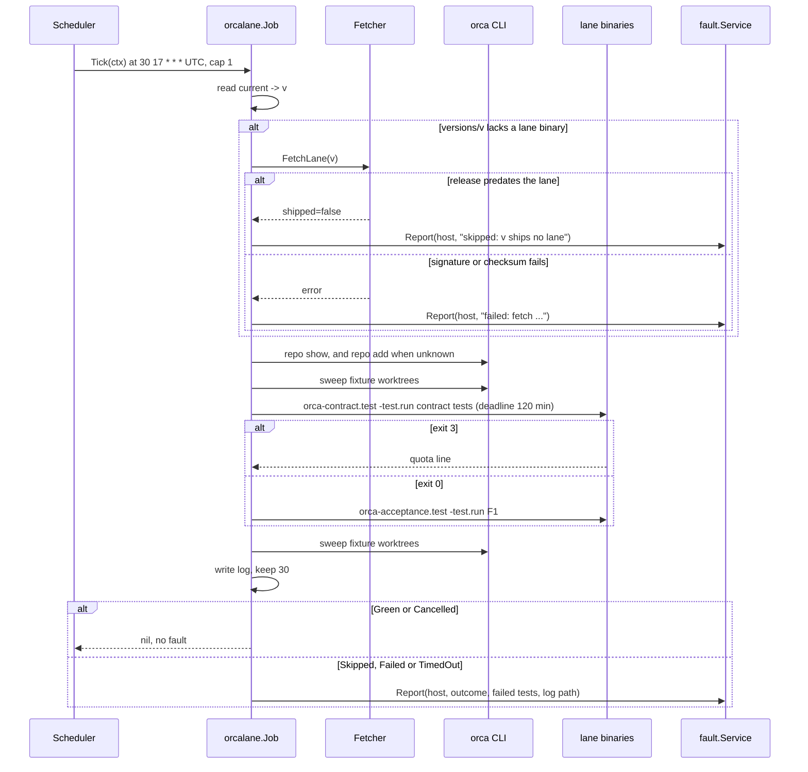
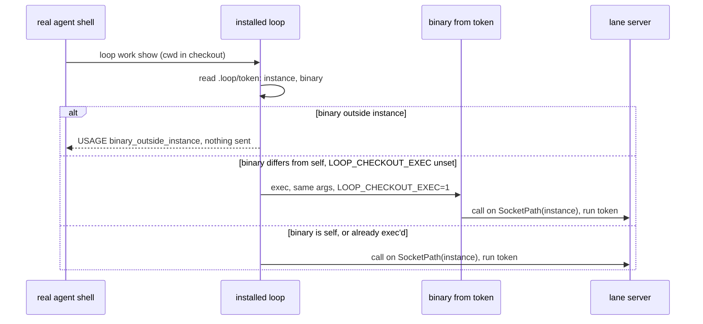
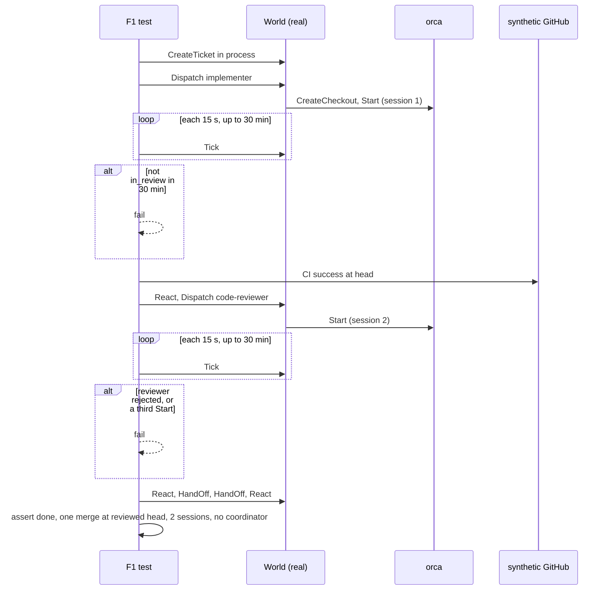

# Acceptance tests against a real orca backend: technical spec

## Source

- **Epic:** factorio-9ac
- **Source:** `docs/adr/0008-real-orca-acceptance.md`. Its `**Ticket:**` line names this epic.
- **Stories covered:** none. This is an architecture epic.

The ADR's acceptance criteria carry no labels, so this spec numbers the ones that the epic owns.
Each contract below cites one of them, or the ADR decision that it proves.

| Label | ADR acceptance criterion |
| --- | --- |
| A1 | `make -n orca-acceptance` prints the contract run and a `go test` run with the tags `acceptance orca` |
| A2 | `env -u LOOP_ORCA_ROOT make orca-acceptance` exits non-zero, and its output holds `LOOP_ORCA_ROOT is not set` |
| A3 | One file in `acceptance/scenarios/` defines `TestF1RealAgentsTakeATicketFromClaimToMerge`, and its first line is `//go:build acceptance && orca` |
| A4 | `internal/config/throughput.go` names `"orca-acceptance"` twice or more, and holds `30 17 * * *` |
| A5 | `make -n release-dist VERSION=v9.9.9` prints a `go test -c` command with the tags `acceptance orca` |
| A6 | `go test ./internal/agenthost/...` proves that a scenario that starts more sessions than it declares fails, and that a declared total above 20 starts nothing |
| A7 | `go test ./internal/server/...` proves one fault for a failed lane, one fault for a lane that exits 3, and no fault for a green lane |
| A8 | `go test ./internal/cli/...` proves two rules. A call from a checkout reaches the checkout's instance, with `LOOP_INSTANCE` unset. The CLI refuses a binary path outside the state directory |
| A9 | `docs/evidence/orca-acceptance.md` records one green lane run: its date, the orca version, the loop head and the session count |

The ADR's five day-one criteria passed when the ADR merged. This spec owns none of them, and no work
entry may break one: `GATES` names no orca target, no workflow names `orca` or `self-hosted`, the
orca contract file starts with `//go:build orca`, `acceptance/world.go` still imports the fake, and
`loop gates --docs` passes.

## Scope check

**Components:**

1. **The real-orca lane.** The test code that runs against real orca: the session plan and the
   lane mode of the agent-host contract (`internal/agenthost/agenthosttest`), the orca contract
   file, the real-host mode of the acceptance world, the real-agent F1 scenario, and the make
   target `orca-acceptance`.
2. **Checkout routing.** The run token file names its instance and its binary, and the CLI obeys
   them (`internal/cli`, `internal/rpc/tokens.go`). Why not its own epic: no other epic needs it,
   and the real-agent F1 scenario cannot pass without it, because a real agent would otherwise
   call the production server (ADR Gap 5).
3. **The `orca-acceptance` native job.** The throughput entry, the release's lane binaries, and a
   package under `internal/server/` that runs them each day and reports faults.

A third component breaks the template's rule of two. Open question 1 proposes the split. The work
entries are cut so that the split moves entries 6 to 8 unchanged.

Entries 1 and 2 make the contract a lane. Entry 3 builds checkout routing alone. Entries 4 and 5
add the real-host world and the F1 scenario. Entries 6 to 8 ship the lane binaries and build the
job. Entry 9 writes the operating docs and the evidence of the first green run. Each entry changes
one component.

**Not in this spec:** the fake-host acceptance suite (`make acceptance`), which stays as it is. The
overwatch sweep and the read-time default of an optional throughput entry, which
`docs/plans/factorio-a7r-overwatch-sweep-spec.md` owns. The quota chooser of production runs
(`internal/sched/quota.go`), which this epic reads and does not change.

## Decisions

ADR 0008 decided the two layers, the fake-only scenarios, the native job, the session bound, the
checkout routing and the rule for parity epics. Each line below is a choice that the ADR left to
this spec, or one where the code shows that the ADR's stated mechanism cannot run.

- **A host config with no `orca-acceptance` entry reads the default. Nothing writes the entry.** We
  chose the read-time default of the factorio-a7r spec (its work entry 1, `ThroughputFor` and the
  optional set) over the ADR's "`loop upgrade` writes the default entry". The factorio-a7r spec
  shows that path cannot run: the operator runs `loop upgrade` with the old binary, which does not
  know the new key (`internal/release/upgrade.go`, `Upgrader.Run`). The new server then refuses the
  file with "is missing" (`validateThroughput`). We rejected a write by the new server at its
  start, because an older release refuses an unknown key, so `loop rollback` would start a service
  that refuses its own config. The ADR's purpose, "the operator takes no step", holds. **This
  changes two lines of ADR 0008**: decision 3, "`loop upgrade` writes the default entry", and the
  Consequences bullet for `internal/config/throughput.go`. Work entry 7 amends both and cites this
  spec.
- **The job fetches the installed release's lane binaries when `versions/<v>/` lacks them.** We
  chose a fetch by the job, verified by the same signature and checksum path as `loop upgrade`, over
  a fetch by the upgrader alone. The old binary installs the first release that ships lane binaries
  (`Upgrader.install` writes only `loop` and three metadata files). So an upgrader-only fetch would
  leave the lane absent until the next upgrade, and this host has no upgrade cron. We rejected a
  build from source, because the job would then run code that no release passed. The ADR's rule,
  "the job runs the lane binaries that the installed release ships", holds: the signed checksum
  file of that release names each lane binary.
- **The release checksum file names the lane binaries, and `VerifyAssets` does not require them.**
  We chose this over a required asset, because `loop rollback` and `install.sh` verify releases
  that predate this epic. `WriteDistChecksums` requires them, so every new release ships them.
- **A lane binary takes the release's version through the same `-ldflags` as `loop`.** We chose
  this over a version-free test binary, because the world's server and the CLI pass a version
  handshake. A test binary that reports `dev` would refuse the release's `loop`.
- **The scenario binary runs the `loop` that `LOOP_ACCEPTANCE_LOOP` names, when the job sets it.** We
  chose an environment value over a build in `TestMain`, because a compiled test binary on the host
  has no module and no toolchain (`acceptance/binary.go`, `BuildBinary` runs `go build`). The
  binary refuses a `loop` whose `loop version` differs from its own version.
- **The lane stops at the chooser's limit, `sched.QuotaLimit` (90 %), not at `sched.QuotaSpent`
  (100 %).** ADR decision 4 says "a window is spent" and names no number. We chose the limit at
  which the chooser stops production runs, because the lane must not spend the last tenth that the
  chooser keeps for them.
- **The quota line names the reset time from orca's `resetsAt`.** `agenthost.QuotaWindow` gains
  `ResetsAt`. We chose this over a line with no reset time, because ADR decision 4 requires it, and
  orca's account list already reports it. A null `resetsAt` prints `reset unknown`.
- **The contract's `LOOP_ORCA_MODEL` is a full model id that the job holds as a constant,
  `claude-opus-5-5`.** We rejected the alias `opus`, because the receipt never verifies an alias
  (`internal/agenthost/orca/receipt.go:21-23`), so `requested_model_reads_verified` would fail. We
  rejected a host config field, because it adds an operator step. The F1 scenario does not use the
  constant. Its project config names no model, so its runs take `sched.DefaultModels`, as
  production runs do.
- **A real-orca scenario counts every call to `Host.Start`, accepted or refused, and the counter
  refuses the call past the declared count before it reaches the host.** We chose to refuse the
  call over a check after the test, because a check after the test lets the extra session spend.
  We chose to count refused calls, because a refused call can still start a harness on the host.
- **The real-host world creates its ticket through the server's work-create handler, in process,
  with a coordinator principal.** We rejected a real coordinator, which ADR decision 1 forbids. We
  rejected a composite host that runs the coordinator on the fake, because one inventory has one
  epoch (`agenthost.Inventory.Epoch`), and two hosts behind one inventory break `Lookup`. We
  rejected a `work create` for the host-admin credential, because it changes a production
  capability for a test.
- **The real-host world takes its host through `Options.Real`, a `*RealHost`.** `OrcaHost` builds
  the orca one from the `LOOP_ORCA_*` values. We chose an injected host over a `Real bool` that
  reads the environment, because CI then runs the real-mode path with the fake host injected. A
  defect in that path then shows before a lane spends a session.
- **The real-host world rewrites only a lane fixture, and refuses any other repository.** A lane
  fixture holds the marker file `.git/loop-orca-fixture`. With no marker, the real world fails
  before it resets `main`, changes `origin` or starts a session. The job's fixture step writes the
  marker. For a hand run, the operating docs give the commands that make a fixture. We chose a
  refusal in the world over a fixture that `make orca-acceptance` makes under a fixed path. The
  make target guards only its own path: a direct `go test -tags 'acceptance orca'`, or a compiled
  scenario binary run by hand, would still rewrite whatever checkout `LOOP_ORCA_REPO` names. The
  marker lives under `.git/`, so no commit carries it, and a reset of `main` keeps it. The contract
  binary needs no marker, because it only adds and removes worktrees.
- **Both lane binaries run one gate function, `agenthosttest.LaneGate`, first in their
  `TestMain`.** We chose one function over a check written in each `TestMain`. One unit test then
  proves the order and the exit codes for both, and each binary's own proof shows only that it
  calls the gate before anything else.
- **The scenario binary's gate runs from a hook that only a build with the tag `orca` sets.**
  `main_test.go` declares `var laneGate func() int`. The new file `lane_orca_test.go`, with the
  tags `acceptance && orca`, sets it in `init`. `TestMain` runs the hook first, and when the hook
  is set, a missing bd or dolt exits 1 as it does under `CI`. We rejected a second package for F1
  with its own `TestMain`, because F1 needs the helpers of package `scenarios`
  (`helpers_test.go`). We rejected a hook that an environment value switches on, because
  `make acceptance` shares the binary, and a stray value would then fail a dev box's skip.
- **The job runs each lane binary with a run pattern, and no lane binary holds a test that builds
  a lane binary.** The job runs the contract binary with
  `-test.run '^(TestOrcaContract|TestOrcaAgentRunsShellCommands)$'`, and the scenario binary with
  `-test.run '^TestF1RealAgentsTakeATicketFromClaimToMerge$'`. The two tests that build a lane
  binary carry a constraint that is false under the tag `orca`: `lane_main_test.go` has
  `//go:build !orca`, and `lane_gate_test.go` has `//go:build acceptance && !orca`. We rejected an
  unfiltered run of the compiled binary. Every untagged test of the package compiles into it, and
  on the host it runs from a directory with no module, no toolchain and no `testdata/`. So
  `lane_main_test.go`'s `go test -c`, `fixture` in `sim_test.go` and the read in `orca_test.go`
  would fail there each day, and no code fault would cause it. We rejected moving the gate tests
  into a package of their own, because each one runs its own package's `TestMain` path. The
  constraint alone does not cover the unit tests, and the run pattern alone would leave a binary
  that builds itself when someone runs it by hand. So we chose both.
- **The `lint` target gets a third pass, with the tags `beads acceptance`.** It runs
  `$(GOLANGCI_LINT) run --build-tags '$(LINT_GATE_TAGS)' ./...` and
  `$(GO) vet -tags '$(LINT_GATE_TAGS)' ./...`, with `LINT_GATE_TAGS := beads acceptance`. The
  constraint `acceptance && !orca` on `lane_gate_test.go` is false in both of today's passes: the
  untagged pass has `acceptance` unset, and the `LINT_TAGS` pass has `orca` set. The `Makefile`
  states the rule that each tagged file is linted and vetted. We rejected the tag `acceptance`
  alone on `lane_gate_test.go`. The `LINT_TAGS` pass would read it then, but the scenario lane
  binary would hold a test that builds a lane binary, and only the run pattern would keep it from
  running. That breaks the decision above for one of its two files. `lane_main_test.go`
  (`!orca`) needs no new pass, because the untagged pass reads it.
- **F1 reads no fixture file from a relative path.** F1 embeds its fixture files, such as `check.sh` and
  the project config, with `//go:embed`, or writes them inline. We chose this over files under
  `testdata/`, because the job runs the compiled scenario binary outside the package directory.
- **`make orca-acceptance` runs each `go test` with `-count=1 -timeout 120m`.** We chose
  `-count=1` over the test cache, because a cached pass starts no session and proves nothing
  (`go help test`). We chose `120m`, the job's `LaneDeadline`, over the default of 10 minutes,
  which ends F1 inside its own 60 minutes of waits (`go help testflag`).
- **F1 on real orca declares 2 sessions: one implementer and one code-reviewer.** We rejected a
  budget that allows a repair round, because the flow then branches on a model's answer, and the
  test proves less. A reject fails the lane, and the coordinator triages the fault. ADR 0008 accepts
  this ("A flaky model answer can fail the lane").
- **The fixture ticket carries a check that fails at the base.** The fixture project's one gate,
  `test`, runs `sh check.sh`, and `check.sh` fails until `greeting.txt` holds `hello, world`. We
  chose this over a ticket with no check, because the code-reviewer runbook proves each test red at
  the merge base, and a ticket with no test sends it to reject.
- **Checkout routing lives in the run token file, as two new fields.** We chose `.loop/token` over
  a new injected file, because the server already writes the token file at each run start
  (`internal/rpc/tokens.go:144`), at mode 0600. The run start already excludes it, and the push
  scan already refuses it. The CLI already reads it for every run call. An older CLI ignores the
  two fields, because `json.Unmarshal` ignores unknown keys.
- **In production the token file names `<instance>/current/loop` as its binary, and names none when
  that path does not exist.** We chose the `current` path over the server's resolved executable.
  `~/.local/bin/loop` already links to `current/loop` (`internal/release/hostsetup.go`, `linkCLI`),
  so a production call resolves to the running CLI and execs nothing, as today. A resolved
  `versions/<v>/loop` would make a run that outlives two upgrades, or a rollback, exec a release
  that the version handshake no longer accepts (`internal/rpc/handshake.go`, `previous_version`).
  A server outside a release, such as a dev build, writes no binary, and the CLI then routes by
  instance only. The acceptance world names its own copy of `loop` under its instance.
- **The CLI execs the named binary at most once.** The CLI sets `LOOP_CHECKOUT_EXEC=1` in the exec'd
  process, and a CLI that sees it never execs again. We rejected a check on the path alone, because
  two copies of one binary at two paths would exec each other.
- **The job sweeps the fixture repository's orca worktrees before and after each lane.** We chose a
  sweep over a clean stop of the lane, because a killed test binary runs no cleanup, and the
  120-minute stop and a server stop both kill it. The fixture repository belongs to the lane alone,
  so every worktree of it is the lane's.
- **The fault text holds the failed test names, the outcome and the log path. It never holds the
  log.** We chose this over a log tail, because `fault.Service.Report` does not check for secrets,
  and a lane log can hold a harness's output.
- **The job registers only on a host whose `agent_host.kind` is `orca`.** On another host kind the
  entry ticks, and no job runs, as for any native job with no registered work
  (`Scheduler.fireDue`). We rejected a job on every host that adds a `skipped` fault when the kind
  is not `orca`. A host with the fake or with no agent host, such as a dev box, would then add a
  fault each day that nobody can fix.
- **The job keeps the 30 newest lane logs.** We chose 30 over every log, because a host that
  nobody cleans would grow the directory without a bound. We chose 30 over 7, because a month of
  daily runs lets the coordinator compare a failure with the green runs before it. Each log is
  written at mode 0600, because it can hold a harness's output.
- **A lane that a server stop cancels adds no fault.** We chose this over a fault, because a server
  stop is the operator's or the upgrade's act, and the next tick runs the lane again.

## Assumptions

- The factorio-a7r work entry 1 lands before work entry 7. This is wrong if the factorio-a7r
  tickets change `ThroughputFor` or drop the optional set. Then entry 7 adds the set itself.
- The server process can read the host's `gh` login, so the job's fetch reaches the private
  release repository. This is wrong if `gh auth token` fails under the systemd service. The first
  fetch then fails with a fault that names the error.
- `orca worktree create --repo path:<fixture>` makes each worktree from the fixture's `main`, which
  the world resets to the synthetic remote before each checkout. This is wrong if a lane worktree
  starts from another commit. Then the world sets the base with `orca repo set-base-ref`.
- `orca worktree list --repo path:<fixture> --json` lists every worktree of the fixture
  repository, and only those. This is wrong if the sweep finds no worktree after a killed lane that
  left one.
- A real implementer and a real code-reviewer each finish the fixture ticket within 30 minutes (from
  the ADR). This is wrong if the first lane runs stop at the F1 wait.
- The installed `loop` on the agent's `PATH` is the release that this epic's checkout routing
  shipped in. This is wrong when a host runs `make orca-acceptance` with an older install. Then
  the real agent calls the production server, and F1 fails.
- The 13 sessions of one lane run spend a small share of the daily quota (from the ADR). This is
  wrong if the chooser skips a production run on the morning after a lane run.
- The darwin host behaves as the Linux host does (from the ADR). This is wrong if the first lane
  on the Mac fails where Linux passes.

## Approach

**The lane is two test binaries.** One holds the agent-host contract against real orca. The other
holds the acceptance scenarios with the tags `acceptance orca`, run with
`-test.run '^TestF1RealAgentsTakeATicketFromClaimToMerge$'`. `make orca-acceptance` runs both with
`go test`. The job runs the compiled copies that the installed release ships.

**One session plan bounds spend.** `agenthosttest` holds the lane plan, one table of every
real-orca test and the sessions it declares. Each contract scenario gets two fields: the sessions
it starts, and the capability that makes it fake-only (empty when it runs on orca). The plan reads
the contract scenarios from that table, and it adds `TestOrcaAgentRunsShellCommands` (1) and the
F1 scenario (2). `TestOrcaContract` has no entry of its own, because its sessions are its
scenarios' entries. Each lane binary's `TestMain` checks the plan before any session: a total
above `LaneSessionCap` (20) exits non-zero. Each real test wraps its host in a counter that refuses
a start past its declared count, and reads that count from the plan with `Declared`. Once F1
lands, the plan totals 13: nine contract scenarios start one session each, `outside_root_refused`
declares one refused start, and the shell test and F1 add 3. Before F1 lands, the plan holds no
F1 entry and totals 11, because the plan names only tests that exist (C3).

**Lane mode of the contract.** A build with the tag `orca` runs the contract in lane mode. Lane
mode does not run a fake-only scenario. It prints `fake-only: <scenario> needs <capability>` for
each one. A scenario that runs and then skips fails the lane. The six fake-only scenarios are the
ones the ADR names: `incomplete_inventory_never_absent`, `never_ready_yields_not_ready`,
`quiet_after_ended_turn_reads_ended`, `tool_call_running_never_ended`,
`dropped_model_reads_unverified` and `notify_refused_is_an_error`. The fake runs all 16, as today.

**Gates before any session.** Each lane binary's `TestMain` runs `agenthosttest.LaneGate` before
anything else. The contract binary's `TestMain` lives in `contract_orca_test.go`. The scenario
binary's `TestMain` runs the hook that `lane_orca_test.go` sets, under the tags
`acceptance && orca` only. The gate does three checks in this order, and starts no session until
all three pass. It builds no orca host until the first check passes:

1. The environment holds `LOOP_ORCA_ROOT`, `LOOP_ORCA_REPO` and `LOOP_ORCA_MODEL`. Each missing value
   prints `LOOP_ORCA_<NAME> is not set`, and the binary exits 1.
2. The lane plan totals 20 or fewer. Otherwise the binary exits 1.
3. The quota gate reads the harness's quota through the orca host. A window at or above
   `sched.QuotaLimit` prints `quota: <harness> window <name> at <n>% resets <RFC 3339 time>` (or
   `reset unknown`), and the binary exits 3. `ErrQuotaUnavailable` prints its reason, and the lane
   continues, because the plan bounds the spend.

`go test` turns exit 3 into a failure, so `make orca-acceptance` exits non-zero on a spent window.
The job runs the binaries directly and reads exit 3 as a skip.

After the gate, the scenario binary goes on as today, with one change under the lane: a missing bd
or dolt exits 1, and never 0. It then takes the `loop` binary from `LOOP_ACCEPTANCE_LOOP` when that
is set (C12), or builds it as today.

**The real-host world.** `acceptance.Options` gains `Real *RealHost`. A nil `Real` keeps today's
world. A `RealHost` names the agent host, the project's checkout host, the project's clone and the
sessions that the test declares. `OrcaHost` builds one from the `LOOP_ORCA_*` values, as
`cmd/loop`'s `realAgents` builds the orca host. The clone is the path of `LOOP_ORCA_REPO`, which
must use the `path:` form. A real world does these things:

1. It refuses a clone with no `.git/loop-orca-fixture` marker before it changes anything (C26).
2. It resets the clone's `main` to the seed, and points `origin` at synthetic GitHub.
3. It wraps `RealHost.Agents` in `Counting` with `RealHost.Declared`, and serves the wrapped host
   as `opts.Agents` and `World.Agents`.
4. It sets `opts.Sched.Checkouts` to a checkout host that first fetches the synthetic remote's
   `main` and resets the clone's `main` to it, then calls `RealHost.Checkouts`. This replaces the
   fake-mode `checkouts`, which adds the git worktree itself.
5. It runs the scheduler on the real clock, and its server options hold no coordinator
   (`sched.Config.Coordinator` nil).
6. It copies the `loop` binary under its instance directory, and sets `server.Options.LoopBinary`
   to the copy.

The world creates a ticket in process, through the work-create handler with a coordinator
principal. `World.Host` stays the fake for every scenario that is not real. CI proves the
real-mode path with a `RealHost` over the fake host. Its checkout host adds a git worktree from the
clone's `main`, as orca does.

**The F1 scenario on real orca.** The fixture project holds `check.sh` and a config whose one gate
is `test: sh check.sh`. The scenario creates the ticket "Add a greeting". It dispatches the
implementer, ticks the scheduler each 15 seconds, and waits up to 30 minutes for `in_review`. It
then sets green CI at the head, reacts, dispatches the code-reviewer, and waits up to 30 minutes
for `ready_to_merge`. It then reacts, hands off twice, reacts, and asserts `done`. It asserts one
merge at the reviewed head, two sessions started, and none of kind coordinator.

**Checkout routing.** `cli.TokenFile` gains `Instance` and `Binary`. The token issuer writes both at
each issue: the server's instance directory, and `server.Options.LoopBinary`. `compose`, which `server.Run` calls,
builds `rpc.Tokens` with both. In production, `cmd/loop` sets `LoopBinary` to `<instance>/current/loop`
when that path exists, and leaves it empty otherwise. The world names the copy under its instance.
The CLI reads a checkout's token file before `LOOP_INSTANCE`. When the call sends that token:

1. When `Binary` resolves (through symlinks) to a path other than the running executable, and
   `LOOP_CHECKOUT_EXEC` is unset, the CLI checks that the path lies under `Instance`. A path
   outside it gets the refusal `USAGE` with the rule `binary_outside_instance`, and the CLI sends
   nothing. A path inside it is exec'd with the same arguments, the same environment and
   `LOOP_CHECKOUT_EXEC=1`.
2. Otherwise the CLI uses `Instance` as the instance directory.

A call with the host-admin credential, from outside a checkout, reads neither field.

**The release ships the lane.** `release-dist` builds, for each platform,
`loop-orca-contract-<os>-<arch>` with `go test -c -tags orca ./internal/agenthost/orca/` and
`loop-orca-acceptance-<os>-<arch>` with `go test -c -tags 'acceptance orca'
./acceptance/scenarios/`, with `CGO_ENABLED=0` and the release's `-ldflags`.
`WriteDistChecksums` names both.

**The job.** The package `internal/server/orcalane` holds the job. It is an instance job, because
it tests the host, not a project. One tick does these steps:

1. Read the installed version from `current`, and the platform.
2. When `versions/<v>/` lacks `orca-contract.test` or `orca-acceptance.test`, fetch both assets and
   verify them against the signed checksum file of `v`. A checksum file that names neither means
   the release predates the lane. That is a skip.
3. Make `<instance>/orca-acceptance/fixture` when it is absent: `git init -b main`, one commit, and
   the marker `.git/loop-orca-fixture`. Run `orca repo show --repo path:<fixture>`, and run
   `orca repo add --path <fixture>` only when it finds nothing.
4. Sweep: for each worktree that `orca worktree list --repo path:<fixture>` names, close its
   terminals and remove it.
5. Run the contract binary with
   `-test.run '^(TestOrcaContract|TestOrcaAgentRunsShellCommands)$'`, then the scenario binary with
   `-test.run '^TestF1RealAgentsTakeATicketFromClaimToMerge$'`, under one 120-minute deadline. The job sets
   `LOOP_ORCA_ROOT` (host config `agent_host.checkout_root`), `LOOP_ORCA_REPO` (`path:<fixture>`),
   `LOOP_ORCA_MODEL` (`claude-opus-5-5`), `LOOP_ORCA_BIN` (host config `agent_host.binary`, when
   set), `LOOP_BD` and `LOOP_DOLT` (`bin/bd` and `bin/dolt`), and `LOOP_ACCEPTANCE_LOOP`
   (`versions/<v>/loop`). An exit 3 from the contract binary skips the scenario binary.
6. Sweep again.
7. Write one log for the tick to `<instance>/orca-acceptance/logs/<UTC stamp>.log`, at mode 0600.
   It holds the job's own lines (fetch, fixture, sweep), then the contract binary's output, then
   the scenario binary's output, each under a header that names the binary and its exit. A tick
   that stops before a binary runs still writes its log. Then remove the oldest logs by name, so 30
   remain.
8. Map the outcome to faults by the table under Domain model.

## Domain model

```
internal/agenthost/agenthosttest (changed)

LaneEntry           one real-orca test and the sessions it declares
  invariant: Sessions >= 0. Name is a test or a contract scenario name, unique in the plan.

LanePlan            every LaneEntry of the lane
  invariant: the plan holds one entry per contract scenario that is not fake-only,
             and one per lane test function (the C3 scan rule): today
             TestOrcaAgentRunsShellCommands, and the F1 scenario once it lands.
             It holds no entry for TestOrcaContract, whose sessions are its scenarios' entries.
             Total() <= LaneSessionCap (20), or no lane binary starts a session.

LaneGate            the checks one lane binary runs before any session
  invariant: Run returns 0, 1 or 3. It calls Quota only after the env check passes,
             and it never starts a session.

scenario (changed)  + sessions int, + fakeOnly string (a capability interface name, or "")
  invariant: a fake-only scenario declares 0 sessions on the lane, because it never runs there.

internal/agenthost (changed)

QuotaWindow         + ResetsAt time.Time (zero when orca reports null)

internal/agenthost/orca (changed)

lane fixture        a git repository whose .git holds the file loop-orca-fixture
  invariant: only the job's fixture step, or the operator by hand, writes the marker.

acceptance (changed)

RealHost            the host of a real world: Agents, Checkouts, Clone, Declared
  invariant: Clone is a lane fixture, or NewWorld fails before it changes the clone.
             Agents is wrapped in Counting with Declared.

internal/server/orcalane (new)

Outcome             a tagged union of exactly one of:
  Green                both binaries exited 0                         -> no fault
  Skipped{Why}         a binary exited 3, or the release predates the lane -> one fault
  Failed{Tests, Exit}  a binary exited other than 0 or 3, or a fetch or setup step failed -> one fault
  TimedOut             the 120-minute deadline passed                 -> one fault
  Cancelled            the job's context ended before the deadline     -> no fault
  invariant: each tick yields exactly one Outcome, and at most one fault.

internal/cli (changed)

TokenFile           + Instance string, + Binary string (absolute paths, or "")
  invariant: when Binary is set, Instance is set.
```

## Interfaces

```go
// internal/agenthost/agenthosttest

const LaneSessionCap = 20

type LaneEntry struct {
	Name     string
	Sessions int
}

// LanePlan returns every real-orca test and its declared sessions.
func LanePlan() []LaneEntry

// CheckPlan refuses a plan whose total passes cap.
func CheckPlan(plan []LaneEntry, cap int) error

// Counting wraps h. Start past declared fails t and returns ErrOverDeclared
// without calling h.
func Counting(t testing.TB, h agenthost.Host, declared int) agenthost.Host

var ErrOverDeclared = errors.New("agenthosttest: the scenario started more sessions than it declares")

// RequireLaneEnv returns one "LOOP_ORCA_<NAME> is not set" line per missing value.
func RequireLaneEnv(getenv func(string) string) (missing []string)

// QuotaGate returns ("", false) when the lane may run, or the quota line and true.
func QuotaGate(ctx context.Context, r agenthost.QuotaReader, h agenthost.Harness, limit float64) (line string, spent bool)

// Declared returns the sessions the plan declares for name. It fails tb
// when the plan holds no entry of that name.
func Declared(tb testing.TB, name string) int

const (
	LaneExitFail  = 1 // a missing value, or a plan above the cap
	LaneExitSpent = 3 // a quota window at or above the limit
)

// LaneGate is one lane binary's checks before any session.
type LaneGate struct {
	Getenv  func(string) string
	Plan    []LaneEntry
	Harness agenthost.Harness
	// Quota builds the quota reader. Run calls it only after the env check.
	Quota func() (agenthost.QuotaReader, error)
	Out   io.Writer
}

// Run does the env, plan and quota checks in that order, prints each line
// to Out, and returns 0, LaneExitFail or LaneExitSpent.
func (g LaneGate) Run(ctx context.Context) int

// ContractEnv (changed): + Lane bool. In lane mode RunContract runs no
// fake-only scenario, prints "fake-only: <name> needs <capability>" for
// each, fails a scenario that skips, and wraps Host in Counting.
```

```go
// acceptance

type Options struct {
	Config string
	Files  map[string]string
	// Real composes the world as production does on an orca host: the real
	// clock, no coordinator, the project clone at Real.Clone. Nil keeps the
	// fake world.
	Real *RealHost
}

type RealHost struct {
	Agents    agenthost.Host     // wrapped in Counting with Declared
	Checkouts sched.CheckoutHost // makes the project's checkouts from Clone
	Clone     string             // absolute path of a lane fixture
	Declared  int                // the sessions the test declares in the plan
}

// OrcaHost builds a RealHost from LOOP_ORCA_*, as cmd/loop's realAgents
// builds the orca host. Clone is the path of LOOP_ORCA_REPO.
func OrcaHost(declared int) (*RealHost, error)

// World (changed): + Agents agenthost.Host, the counted host of a real world.
// CreateTicket creates a ticket through the work-create handler with a
// coordinator principal. It works in both modes.
func (w *World) CreateTicket(title, body string) string

// LoopBinaryEnv names the loop binary a compiled scenario binary runs.
const LoopBinaryEnv = "LOOP_ACCEPTANCE_LOOP"
```

```go
// acceptance/scenarios

// main_test.go: set only by lane_orca_test.go (acceptance && orca).
// TestMain runs it first, and exits with any non-zero code it returns.
var laneGate func() int
```

```go
// internal/agenthost/orca

// LaneFixtureMarker is the file under a lane fixture's .git directory.
const LaneFixtureMarker = "loop-orca-fixture"

// IsLaneFixture reports whether clone's .git directory holds the marker.
func IsLaneFixture(clone string) bool
```

```go
// internal/server

type Options struct {
	// ... as today, and:
	// LoopBinary is the absolute loop binary each token file names. Empty
	// names none. cmd/loop sets <instance>/current/loop when it exists.
	LoopBinary string
}
```

```go
// internal/cli

type TokenFile struct {
	Token    string `json:"token"`
	RunID    string `json:"run_id"`
	Kind     string `json:"kind"`
	Project  string `json:"project,omitempty"`
	Item     string `json:"item,omitempty"`
	Instance string `json:"instance,omitempty"`
	Binary   string `json:"binary,omitempty"`
}

const CheckoutExecEnv = "LOOP_CHECKOUT_EXEC"

// The refusal of a binary outside the instance: CodeUsage, rule "binary_outside_instance".
```

```go
// internal/rpc: the token issuer gains the instance and the binary it writes
// into each token file. IssueToCheckout writes both.
type Tokens struct {
	Store      *store.Store
	Redactor   *secrets.Redactor // optional
	Instance   string            // absolute; written into each TokenFile.Instance
	LoopBinary string            // absolute; written into each TokenFile.Binary
}
```

```go
// internal/server/orcalane

const (
	JobName      = "orca-acceptance"
	LaneModel    = "claude-opus-5-5"
	LaneDeadline = 120 * time.Minute
	KeepLogs     = 30
)

// Runner runs one lane binary. Production runs a process. Tests script it.
type Runner interface {
	Run(ctx context.Context, bin string, args, env []string, out io.Writer) (exit int, err error)
}

// Orca is the slice of the orca CLI the job calls.
type Orca interface {
	RepoKnown(ctx context.Context, path string) (bool, error)
	RepoAdd(ctx context.Context, path string) error
	Worktrees(ctx context.Context, repoPath string) ([]string, error)
	CloseTerminals(ctx context.Context, worktree string) error
	RemoveWorktree(ctx context.Context, worktree string) error
}

// Fetcher puts the lane binaries of version into dir, verified, or says the release has none.
type Fetcher interface {
	FetchLane(ctx context.Context, version, platform, dir string) (shipped bool, err error)
}

// Faults is fault.Service's Report.
type Faults interface {
	Report(ctx context.Context, p rpc.Principal, text string) (fault.Fault, error)
}

type Job struct {
	Layout  release.Layout
	Host    func(context.Context) (*config.HostConfig, error)
	Runner  Runner
	Orca    Orca
	Fetcher Fetcher
	Faults  Faults
	Now     func() time.Time
}

// Tick is the instance job. It returns an error only when it cannot report.
func (j *Job) Tick(ctx context.Context) error
```

```
fault text, one fault per non-green outcome, reporter kind host:

orca-acceptance <outcome> on loop <version>, orca <orca version>.
<one line per failed test: "--- FAIL: <name>", or the quota line, or the stop reason>
Log: <absolute log path>
```

## Data

```
host config, throughput (changed)
  orca-acceptance   optional entry, cap 1, schedule "30 17 * * *" when absent.
                    DefaultThroughput holds it, so a new host config holds it.
                    A present entry is checked as every other entry is.

run token file .loop/token (changed)
  + instance   absolute path of the instance directory, optional
  + binary     absolute path of the loop binary, optional
               production: <instance>/current/loop, or absent

release assets (new, per platform)
  loop-orca-contract-<os>-<arch>     named in checksums.txt
  loop-orca-acceptance-<os>-<arch>   named in checksums.txt

instance directory (new paths)
  versions/<v>/orca-contract.test     mode 0755, fetched by the job
  versions/<v>/orca-acceptance.test   mode 0755, fetched by the job
  orca-acceptance/fixture/            the lane's git repository, registered with orca
  orca-acceptance/fixture/.git/loop-orca-fixture   the lane fixture marker, empty
  orca-acceptance/logs/<stamp>.log    the 30 newest lane logs, mode 0600
```

**Existing records:** a host config written before this epic holds no `orca-acceptance` entry. It
keeps none, it loads, and the job ticks on the default. Token files written before the upgrade
hold neither new field, and a run that started under the old release keeps calling through
`LOOP_INSTANCE` or the default instance, as today. A token file written after the upgrade names
`current/loop`, which follows each swap, so a run that outlives two upgrades or a rollback calls
with the server's release, as the installed CLI does today. No `versions/<v>/` directory holds a lane
binary before this epic, so the first tick fetches them. The faults table gains rows and no column.

## Flows

The job, one tick:



A lane binary, before any session:

```mermaid
sequenceDiagram
    participant M as TestMain
    participant Q as orca quota
    participant H as Counting(orca host)
    Note over M: LaneGate.Run, first in TestMain
    M->>M: RequireLaneEnv
    alt a value is missing
        M-->>M: print "LOOP_ORCA_<NAME> is not set", exit 1
    end
    M->>M: CheckPlan(LanePlan(), 20)
    alt total > 20
        M-->>M: exit 1, no session
    end
    M->>Q: QuotaGate(harness, QuotaLimit)
    alt a window >= 90 %
        M-->>M: print quota line, exit 3
    else unavailable
        M->>M: print the reason, continue
    end
    opt scenario binary only
        M->>M: bd or dolt missing -> exit 1
        M->>M: LOOP_ACCEPTANCE_LOOP of another version -> exit 1
    end
    M->>H: run tests; a real world refuses a clone with no marker
    M->>H: Start past declared -> ErrOverDeclared, test fails
```

A real agent's CLI call:



The F1 scenario on real orca:



## Work

1. **The lane plan, the lane gate and lane mode of the contract.** Add `sessions` and `fakeOnly` to
   each contract scenario, `LanePlan`, `CheckPlan`, `Declared`, `Counting`, `RequireLaneEnv`,
   `QuotaGate`, `LaneGate` and `ContractEnv.Lane`. The plan holds no F1 entry yet, and totals 11.
   Add `ResetsAt` to `agenthost.QuotaWindow`, and parse `resetsAt` in the orca quota reader. Every
   proof runs untagged against the fake.
   - Files: `internal/agenthost/agenthosttest/**`, `internal/agenthost/host.go`,
     `internal/agenthost/orca/quota.go`, with tests.
   - Needs: nothing.
   - Proves: C1, C2, C3, C4, C5, C6.
   - Done when: `go test ./internal/agenthost/...` passes, and a scenario that starts one session
     more than it declares fails with `ErrOverDeclared`.
2. **The orca contract as a lane, and the make target.** Give `contract_orca_test.go` a `TestMain`
   that runs `LaneGate` first and exits with its code when that is not 0. Drop the two tests' own
   `t.Skip` on a missing value, which the gate replaces. Run both tests in lane mode under
   `Counting`, each with its `Declared` count. Add the make target `orca-acceptance`, in this
   order: `go test -count=1 -timeout 120m -tags orca ./internal/agenthost/orca/`, then
   `go test -count=1 -timeout 120m -tags 'acceptance orca'
   -run '^TestF1RealAgentsTakeATicketFromClaimToMerge$' ./acceptance/scenarios/`. Add it to
   `.PHONY`, and to nothing else. Add the test `lane_main_test.go`, first line `//go:build !orca`,
   which builds the contract binary and runs its `TestMain` path (C24).
   - Files: `internal/agenthost/orca/contract_orca_test.go`,
     `internal/agenthost/orca/lane_main_test.go`, `Makefile`.
   - Needs: 1.
   - Proves: C7, C24.
   - Done when: `go test ./internal/agenthost/orca/` passes with `lane_main_test.go`,
     `env -u LOOP_ORCA_ROOT make orca-acceptance` exits non-zero and prints
     `LOOP_ORCA_ROOT is not set`, and `grep -n '^GATES :=' Makefile | grep orca` prints nothing.
3. **Checkout routing.** Add `Instance` and `Binary` to `TokenFile`, and `LoopBinary` to
   `server.Options`. `compose`, which `server.Run` calls, gives `rpc.Tokens` the instance and
   `LoopBinary`, and the token
   issuer writes both. `cmd/loop` sets `LoopBinary` to `<instance>/current/loop` when that path
   exists. The CLI reads the two fields by the rules under Approach, with the exec hop and the
   refusal.
   - Files: `internal/cli/instance.go`, `internal/cli/client.go`, `internal/rpc/tokens.go`,
     `internal/server/server.go`, `cmd/loop/serve.go`, with tests.
   - Needs: nothing.
   - Proves: C8, C9, C10.
   - Done when: `go test ./internal/cli/... ./internal/rpc/... ./internal/server/...` passes with
     `LOOP_INSTANCE` unset and with it set to a second instance.
4. **The real-host world and the scenario binary's gate.** Add `Options.Real`, `RealHost`,
   `OrcaHost`, `World.Agents` and `World.CreateTicket`, and the real-mode wiring of Approach, with
   its fetch-first checkout host. Add `LaneFixtureMarker` and `IsLaneFixture` to the orca package.
   In `main_test.go`, declare `laneGate`, run it first, exit 1 on a missing bd or dolt when it is
   set, and take `LOOP_ACCEPTANCE_LOOP` with its version check. Add `lane_orca_test.go`, first line
   `//go:build acceptance && orca`, which sets `laneGate` to a `LaneGate` over the orca host. Move
   `createTicket` onto `World.CreateTicket`. Prove the real-mode wiring with a scenario that passes
   a `RealHost` over the fake host, so CI runs it. Add the test `lane_gate_test.go`, first line
   `//go:build acceptance && !orca`, which builds the scenario binary under `acceptance orca` and runs its `TestMain`
   path (C25). Add the third `lint` pass of Decisions, with `LINT_GATE_TAGS := beads acceptance`,
   so that golangci-lint and `go vet` read `lane_gate_test.go`.
   - Files: `Makefile`, `acceptance/world.go`, `acceptance/binary.go`, `acceptance/scenarios/main_test.go`,
     `acceptance/scenarios/helpers_test.go`, `acceptance/scenarios/lane_orca_test.go`,
     `acceptance/scenarios/lane_gate_test.go`, `internal/agenthost/orca/fixture.go`, one new
     scenario file with the tag `acceptance`, with tests.
   - Needs: 1, 3.
   - Proves: C11, C12, C25, C26.
   - Done when: `make acceptance` passes, `go vet -tags 'acceptance orca' ./acceptance/...` passes,
     and the new scenario shows no coordinator launch and a token file that names the world's
     instance and binary. `make lint` passes, `make -n lint` prints both commands with
     `beads acceptance`, and
     `go list -tags 'beads acceptance' -f '{{.TestGoFiles}}' ./acceptance/scenarios` names
     `lane_gate_test.go`.
5. **F1 with real agents.** Add `acceptance/scenarios/f1_orca_test.go`, first line
   `//go:build acceptance && orca`, with `TestF1RealAgentsTakeATicketFromClaimToMerge` and its
   fixture files, embedded with `//go:embed` or written inline, and never read from a relative
   path. F1 builds its world with `OrcaHost(Declared(t, <its name>))`. Add the F1 entry,
   2 sessions, to `LanePlan`, which then totals 13.
   - Files: `acceptance/scenarios/f1_orca_test.go`, `internal/agenthost/agenthosttest/` (the plan
     entry), with tests.
   - Needs: 2, 4.
   - Proves: C28.
   - Done when: `go vet -tags 'acceptance orca' ./acceptance/...` passes, and
     `go test ./internal/agenthost/...` passes with the plan at 13. C13, the green run, belongs to
     entry 9.
6. **The release ships the lane.** Build the two lane binaries in `release-dist` for each
   platform with the release's `-ldflags`. `WriteDistChecksums` names them. `VerifyAssets` does
   not require them. Add the lane asset names to `internal/release`.
   - Files: `Makefile`, `internal/release/dist.go`, `internal/release/metadata.go`, with tests.
   - Needs: 2.
   - Proves: C14.
   - Done when: `make release-dry` passes, and `make -n release-dist VERSION=v9.9.9` prints both
     `go test -c` commands.
7. **The `orca-acceptance` throughput entry.** Add it to `nativeJobs`, `DefaultThroughput` and
   the optional set. Amend ADR 0008 decision 3 and its `throughput.go` Consequences bullet to the
   read-time default, and cite this spec.
   - Files: `internal/config/throughput.go`, `docs/adr/0008-real-orca-acceptance.md`, with tests.
   - Needs: factorio-a7r work entry 1 (`ThroughputFor` and the optional set).
   - Proves: C15.
   - Done when: a host config file from v0.0.58 loads, ticks `orca-acceptance` on the default
     schedule, and saves back with no `orca-acceptance` key.
8. **The job.** Build `internal/server/orcalane` with `Job`, its production `Runner`, `Orca` and
   `Fetcher`, and the outcome table. Register it in `cmd/loop/serve.go` as an instance job when
   `agent_host.kind` is `orca`.
   - Files: `internal/server/orcalane/**`, `cmd/loop/serve.go`, `internal/release/upgrade.go`
     where the job shares the verified fetch, with tests.
   - Needs: 4 (the fixture marker), 6, 7.
   - Proves: C16, C17, C18, C19, C20, C21, C22, C27.
   - Done when: `go test ./internal/server/...` passes with a scripted `Runner` for each outcome.
9. **Operating docs and the first green run.** Add the section "The orca acceptance lane" to
   `docs/operating.md`: the job, its entry, its fixture, its log and its faults. The job needs no
   operator step. For a hand run of `make orca-acceptance`, the section gives the `LOOP_ORCA_*`
   values and the commands that make a lane fixture: `git init -b main`, one commit, the marker
   `.git/loop-orca-fixture`, and `orca repo add --path`. Record the first green lane run in
   `docs/evidence/orca-acceptance.md`, from the job's log or a `make orca-acceptance` run on this
   host.
   - Files: `docs/operating.md`, `docs/evidence/orca-acceptance.md`.
   - Needs: 1 to 8, released and installed on this host.
   - Proves: C13, C23.
   - Done when: the evidence file names the date, the orca version, the loop head and the session
     count of one green run, and that run's log shows F1 passed.

## Out of scope

- A gate on `loop upgrade` that waits for a green lane. ADR 0008 postpones it until a host upgrades
  by cron.
- A real-orca restart or daemon-death scenario. ADR 0008 postpones it until a host where a restart
  keeps the operator's chat sessions.
- The live run with a real GitHub App (`docs/evidence/v1-e2e.md`). It stays a manual record. ADR
  0008 keeps it apart from the lane.
- Real-orca scenarios of the parity epics. ADR 0008 decision 6 gives each parity epic's spec the
  scenarios it adds and the sessions it declares.
- The `make acceptance` suite and its CI job. They stay on the fake. Nobody owns a change to them
  in this epic.
- The read-time default of an optional throughput entry. The factorio-a7r epic owns it.
- A fix for the production model alias `opus` and the verified-model receipt. Never in this epic,
  and no epic needs it today: no production dispatch sets `RequireVerifiedModel`, so production
  never verifies an alias. The first epic whose spec sets `RequireVerifiedModel` on a production
  dispatch owns the fix. This spec only avoids the alias in the contract.

## Contracts

**C1. Refusal: a scenario cannot start past its declared sessions.** Proves A6. A host wrapped by
`Counting` with `declared = n` passes the first n calls of `Start` to the host. Call n + 1 returns
`ErrOverDeclared`, fails the test, and the wrapped host records no call n + 1.
*Example test over the fake host at n = 0, 1 and 2, which asserts the fake's launch count.*

**C2. Refusal: a plan above the cap starts nothing.** Proves A6. `CheckPlan` returns an error for a
plan whose total is 21 or more, and nil at 20. A lane `TestMain` that gets the error exits 1 before
its first `Start`.
*Boundary tests at totals 0, 20 and 21, and a test that a `TestMain` path given a 21-session plan
makes zero launches on the fake.*

**C3. Invariant: every real test declares its sessions.** Proves ADR decision 4. Each contract
scenario either names a fake-only capability or has a plan entry. The lane test functions are
every top-level `func Test` in a `_test.go` file under `internal/agenthost/orca/` or
`acceptance/scenarios/` whose `//go:build` line is false when the tag `orca` is unset and the
other tags are set, except `TestOrcaContract`, whose sessions are its scenarios' entries. So
`f1_orca_test.go` counts, and `lane_orca_test.go` holds none. `LanePlan` holds exactly one entry
for each lane test function, and one for each contract scenario that is not fake-only. The total
is 11 before entry 5 lands, and 13 after.
*A table test over the scenario list and `LanePlan`. A source scan by the rule above, with
`go/build/constraint`, whose set of names must equal the plan's names that are not contract
scenarios.*

**C4. Behaviour: lane mode runs no fake-only scenario, and refuses any other skip.** Proves ADR
decision 2. In lane mode with a driver that lacks a fake-only capability, the output holds
`fake-only: <scenario> needs <capability>` for each of the six, and none of the six calls `Start`.
A non-fake-only scenario that calls `t.Skip` fails the run.
*Example test of `RunContract` in lane mode, over the fake with a driver that hides the six
capabilities, plus a scenario stub that skips.*

**C5. Refusal: a missing `LOOP_ORCA_*` value fails, and never skips.** Proves A2. With any of
`LOOP_ORCA_ROOT`, `LOOP_ORCA_REPO` or `LOOP_ORCA_MODEL` unset, `LaneGate.Run` returns 1, and its
output holds one line `LOOP_ORCA_<NAME> is not set` per missing value. It never calls `Quota`,
and so builds no host and starts no session. C24 and C25 prove that each binary runs this gate.
*Example test of `LaneGate.Run` over each subset of the three, with a `Quota` func that records
whether it was called.*

**C6. Behaviour: a spent window stops the lane with exit 3 and names the reset.** Proves ADR
decision 4. `QuotaGate` returns spent and the line
`quota: claude window session at 93% resets 2026-10-25T05:00:00Z` for a window at 93 % with that
reset. It returns spent at exactly 90 %, not spent at 89.9 %, and `reset unknown` for a zero
`ResetsAt`. An `ErrQuotaUnavailable` reading returns not spent. `LaneGate.Run` returns 3 on a
spent window, and 0 when the reading is unavailable.
*Boundary tests with a scripted `QuotaReader`. A test of `LaneGate.Run` over the fake host with a
spent window, which asserts 3 and zero launches. A parse test of an orca account-list fixture with
`resetsAt` set and null.*

**C7. Behaviour: the make target runs both layers, uncached, under the lane deadline.** Proves A1.
`make -n orca-acceptance` prints a `go test` command with `-tags orca` over
`./internal/agenthost/orca/`, then one with `-tags 'acceptance orca'` and the F1 run pattern over
`./acceptance/scenarios/`. Each of the two commands carries `-count=1` and `-timeout 120m`.
*The command `make -n orca-acceptance`, checked in the ticket's red-green evidence.*

**C8. Behaviour: a run call reaches the checkout's instance.** Proves A8. From a checkout whose
token file names instance I, a run call connects to `SocketPath(I)`. This holds with
`LOOP_INSTANCE` unset, and with it set to another instance J. A checkout whose token names no
instance keeps today's rule.
*Example tests with two test servers at I and J, which assert which one saw the call.*

**C9. Refusal: a binary outside the instance never runs.** Proves A8. A token whose `binary`
resolves, through symlinks, to a path outside its `instance` gets `USAGE` with the rule
`binary_outside_instance`. The CLI execs nothing and sends nothing. A symlink inside the instance
that points outside it gets the same refusal.
*Example tests for an outside path, a `..` path, and an inside symlink to an outside target. Each
asserts the refusal and that the test server saw no call.*

**C10. Invariant: the routing fields bind only a run's own call, and exec happens at most once.**
Proves ADR decision 5. A call with the host-admin credential, from outside a checkout, reads
neither field. A process with `LOOP_CHECKOUT_EXEC=1` never execs. The token issuer writes the
`Instance` and `LoopBinary` of `rpc.Tokens` into every token file that `IssueToCheckout` writes.
`compose`, which `server.Run` calls, passes its instance and `Options.LoopBinary` to
`rpc.Tokens`. In production the
binary is `<instance>/current/loop` when that path exists, and empty when it does not.
*Example tests: a host-admin call with a token file above the working directory, two binaries that
name each other, a token issue that asserts both fields, a server started through `Run` (or a test of
`compose`) with `LoopBinary` whose token file names it, and `cmd/loop`'s option with and without a `current` link.*

**C11. Behaviour: a real-host world runs with no coordinator, on the real clock, and counts its
starts.** Proves ADR decision 1. A world with `Real` starts no session of kind coordinator, its
scheduler reads the wall clock, and `CreateTicket` returns an item in `todo` with no coordinator
session. Its server's agent host and checkout host are the ones `RealHost` names, wrapped as
Approach says: a checkout first resets the clone's `main` to the synthetic remote's `main`. With
`Declared` = 1, a second `Start` returns `ErrOverDeclared` and the fake records one launch.
*An acceptance scenario that runs the real-mode path with a `RealHost` over the fake host, and
asserts the fake's launches, the item status and the new checkout's base commit.*

**C12. Refusal: the scenario binary runs only a `loop` of its own version.** Proves ADR decision 3.
With `LOOP_ACCEPTANCE_LOOP` set, `TestMain` runs that binary's `loop version`. A version that
differs from the test binary's version exits 1 with a line that names both versions.
*An acceptance-tagged test of the check with a stub binary that prints another version.*

**C13. Behaviour: real agents take a ticket from claim to merge.** Proves A3 and ADR decision 1. On
real orca, the fixture ticket reaches `done` with one merge at the reviewed head. The lane started
exactly 2 sessions, and none of kind coordinator. Entry 9 proves it, because it holds only on real
orca with entries 1 to 8 released and installed. C28 is what entry 5 proves when it lands.
*The F1 scenario itself, run by the lane on this host. Its first green run is C23's record.*

**C14. Behaviour: each release ships verified lane binaries.** Proves A5. `release-dist` writes
`loop-orca-contract-<os>-<arch>` and `loop-orca-acceptance-<os>-<arch>` for each platform, built with
the release's `-ldflags`, and `checksums.txt` names both. `WriteDistChecksums` fails on a dist that
lacks one. `VerifyAssets` passes a dist from before this epic that names neither.
*Example tests over a temporary dist directory. `make release-dry` as the weak proof.*

**C15. Behaviour: the entry defaults, and config load checks a present entry.** Proves A4. A host config
with no `orca-acceptance` key loads, ticks the job at `30 17 * * *` with cap 1, and saves back with
no key. Config load refuses a present entry with cap 0.
*Example tests over a v0.0.58 host config fixture and an invalid entry.*

**C16. Behaviour: each outcome maps to its faults.** Proves A7. A scripted lane that exits 0 twice
adds no fault. One that exits 3 adds one fault whose text starts `orca-acceptance skipped`. One
that exits 1 adds one fault that names each `--- FAIL:` test and the log path. One that passes the
deadline adds one fault that starts `orca-acceptance timed out`. A tick whose context the server
cancels adds no fault. Each fault's reporter is the host principal.
*Example test per outcome with a scripted `Runner` and a recording `Faults`.*

**C17. Invariant: a fault never carries lane output beyond its named lines.** Proves ADR decision 3.
For any lane output, the fault text holds only the header, the `--- FAIL:` lines, the quota line,
the stop reason and the log path.
*A property test over generated output that holds a planted marker line, which asserts the marker
never reaches the fault.*

**C18. Refusal: the job runs only lane binaries that the installed release signed.** Proves ADR
decision 3. With `versions/<v>/` lacking the binaries, the job fetches and verifies them. A checksum
mismatch or a bad signature adds one `failed` fault, and the `Runner` runs nothing. A release
whose checksum file names neither binary adds one `skipped` fault, and nothing runs. The job never
runs a binary from outside `versions/<v>/`.
*Example tests with a scripted release source: good, tampered, unsigned and pre-lane.*

**C19. Behaviour: the job makes and registers the fixture once.** Proves ADR decision 3. The first tick
makes the fixture repository with its marker, so `orca.IsLaneFixture` holds, and calls `RepoAdd`
once. A second tick, with `RepoKnown` true, calls no `RepoAdd` and reuses the fixture.
*Example test over two ticks with a scripted `Orca`.*

**C20. Behaviour: the sweep removes only the fixture's worktrees, before and after the lane.**
Proves ADR decision 3. Each tick closes the terminals of and removes each worktree that
`Worktrees(fixture)` returns, once before the first binary and once after the last. It asks for
no other repository's worktrees. A timed-out lane is swept too.
*Example test with a scripted `Orca` that records the call order against the `Runner`.*

**C21. Boundary: the job exists only on an orca host.** Proves ADR decision 3. `serve` registers
`orca-acceptance` when `agent_host.kind` is `orca`, and does not register it for `fake` or an
empty kind.
*Example test of the server's job registration for each kind.*

**C22. Behaviour: the job sets every lane value itself.** Proves ADR decision 3 ("sets each
`LOOP_ORCA_*` value itself"). The `Runner` receives `LOOP_ORCA_ROOT`, `LOOP_ORCA_REPO`,
`LOOP_ORCA_MODEL`, `LOOP_BD`, `LOOP_DOLT` and `LOOP_ACCEPTANCE_LOOP`, each from host config, the
layout or the job's constants. It receives `LOOP_ORCA_BIN` only when host config sets
`agent_host.binary`. The contract binary gets
`-test.run '^(TestOrcaContract|TestOrcaAgentRunsShellCommands)$'`, and the scenario binary gets
`-test.run '^TestF1RealAgentsTakeATicketFromClaimToMerge$'`. Neither runs with no run pattern.
*Example test that asserts the `Runner`'s environment and arguments for a fixture host config.*

**C23. Behaviour: one green lane run is on record.** Proves A9.
`docs/evidence/orca-acceptance.md` names the date, the orca version, the loop head and the session
count of a green run, and the session count is at most 20.
*A command proof: the record, checked by the reviewer against the named log.*

**C24. Refusal: the contract binary runs the gate before any orca call.** Proves A2 and ADR
decision 4. The binary from `go test -c -tags orca ./internal/agenthost/orca/` does these things:
- With `LOOP_ORCA_ROOT` unset, it exits 1, prints `LOOP_ORCA_ROOT is not set`, and never runs the
  orca binary.
- With every value set and `LOOP_ORCA_BIN` naming a stub that answers `account list --json` with
  a claude window at 93 %, it exits 3 and prints the quota line. The stub's record holds
  `account list --json` and no other command.

So it starts no session and makes no worktree in either case.
*The test `lane_main_test.go`, with `//go:build !orca`, so no lane binary holds it. It builds the
binary into a temporary directory, and runs it with `HOME` at a temporary directory, `CI` unset and a stub `orca` script that records each
command line.*

**C25. Refusal: the scenario binary runs the gate first, and under the lane it never passes on a
missing tool.** Proves A2 and ADR decisions 2 and 4. The binary from
`go test -c -tags 'acceptance orca' ./acceptance/scenarios/` does these things:
- With `LOOP_ORCA_ROOT` unset, it exits 1 and prints `LOOP_ORCA_ROOT is not set`.
- With the stub at 93 %, it exits 3, and the stub records only `account list --json`.
- With the stub at 10 %, and `LOOP_BD` and `LOOP_DOLT` naming absent files, it exits 1 and never
  0, with `CI` unset.

A build with the tag `acceptance` alone still exits 0 on a missing bd or dolt with `CI` unset, as
today.
*The test `lane_gate_test.go`, with `//go:build acceptance && !orca`, so no lane binary holds it.
It builds the binary and runs it as C24 does. The suite's own run under `make acceptance` proves
the last line. The third `lint` pass, with the tags `beads acceptance`, lints and vets the file.*

**C26. Refusal: a real world never rewrites a repository that is not a lane fixture.** Proves ADR
decisions 1 and 3. `NewWorld` with `Real.Clone` naming a repository with no
`.git/loop-orca-fixture` fails the test with a line that names the clone and the missing marker.
It fails before any change: the clone's `main` commit, its `origin` URL and its worktree list are
as they were, and the host records zero launches and zero checkouts. A clone with the marker
passes this check.
*An acceptance-tagged test with an unmarked clone and a `RealHost` over the fake. It reads the
three values before and after.*

**C27. Behaviour: each tick leaves one log, and the job keeps the 30 newest.** Proves ADR
decision 3. After a tick, `<instance>/orca-acceptance/logs/` holds one new log at mode 0600. The
log holds the contract binary's output before the scenario binary's output, each under a header
that names the binary and its exit. A tick that fails at the fetch writes a log that names the
error. With 30 logs present, a tick leaves 30 and removes the oldest name. The fault of a non-green
tick names this log's path (C16).
*Example tests with a scripted `Runner` that prints a marker line per binary, a failing `Fetcher`,
and a directory seeded with 30 logs.*

**C28. Behaviour: F1 is bounded by the plan from the day it lands.** Proves A3 and ADR decision 4.
`f1_orca_test.go` defines `TestF1RealAgentsTakeATicketFromClaimToMerge`, its first line is
`//go:build acceptance && orca`, and it builds under those tags. `LanePlan` declares 2 for it, and
the plan totals 13. F1 builds its world with `OrcaHost(Declared(t, <its name>))`, so the world's
`Counting` refuses a third start (C11).
*`go vet -tags 'acceptance orca' ./acceptance/...`, the C3 table test and scan at 13, and a source
check that F1's `OrcaHost` call takes `Declared` of its own name.*

## Observable behaviour

None, because this epic draws no screen. The operator sees a lane failure or skip as a fault in
the coordinator's inbox, and the lane's log lives under `<instance>/orca-acceptance/logs/`.

## Open questions

1. **This epic holds three components, so the template asks for two epics.** The components are
   the lane (entries 1, 2, 4 and 5), checkout routing (entry 3) and the native job (entries 6 to
   8). I propose this split. factorio-9ac keeps the lane and checkout routing, and entry 9 records
   a green `make orca-acceptance` run by hand. A new architecture epic, under the same ADR, takes
   entries 6 to 8 and the job's part of the operating docs. Each part lands on its own: the job's
   contracts run against a scripted `Runner`, and the lane runs by hand with no job. The new epic
   would depend on this one, because entry 8 needs entry 4's fixture marker. The hand run uses a
   fixture that the operator makes by the commands in entry 9's docs. ADR 0008 has one Ticket
   line, so the new epic needs an intake room. Keeping one epic is also workable: the
   entries above stand as written, and the decomposer cuts them in this order. This blocks the
   sign-off of the scope, and it blocks entries 6 to 9.
