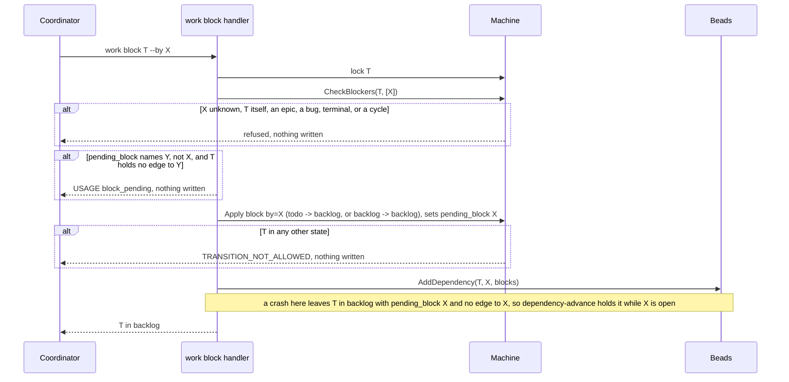
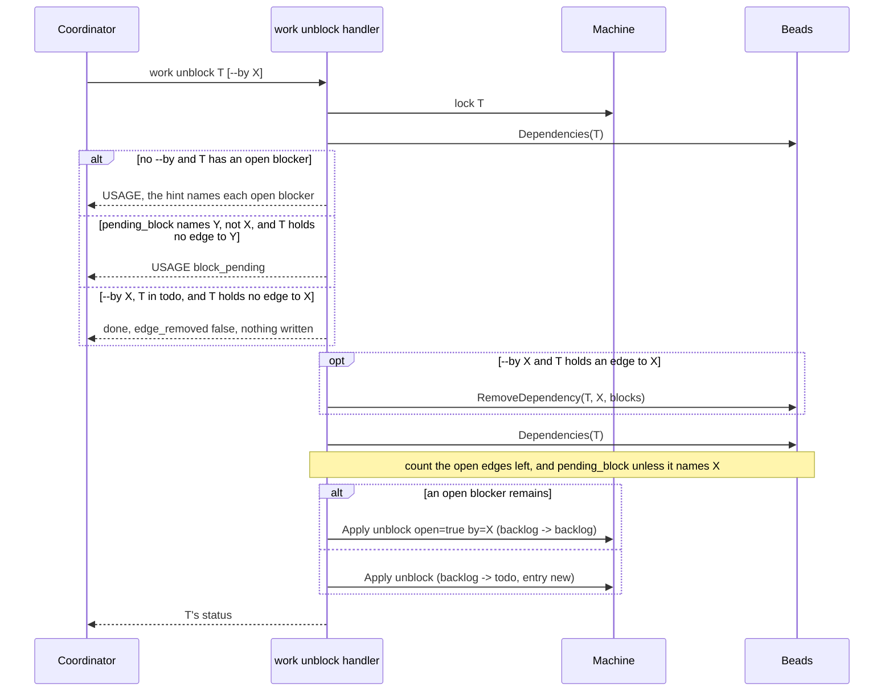
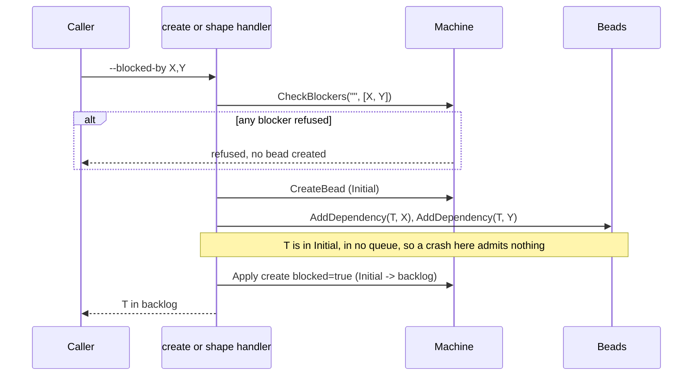
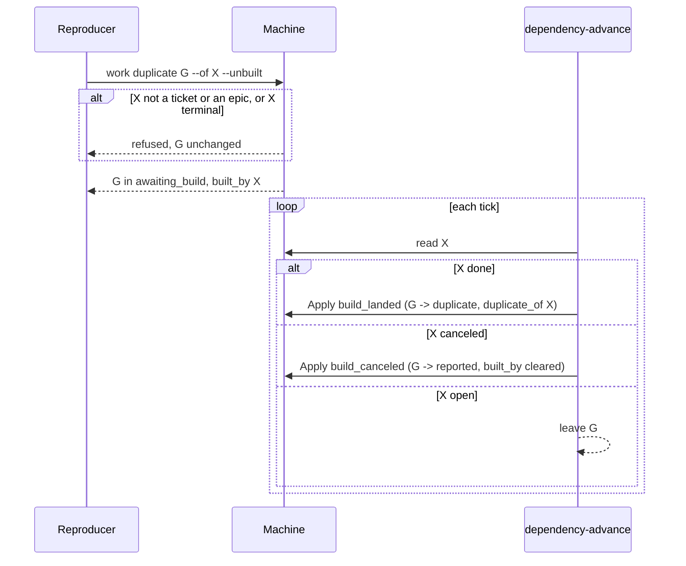
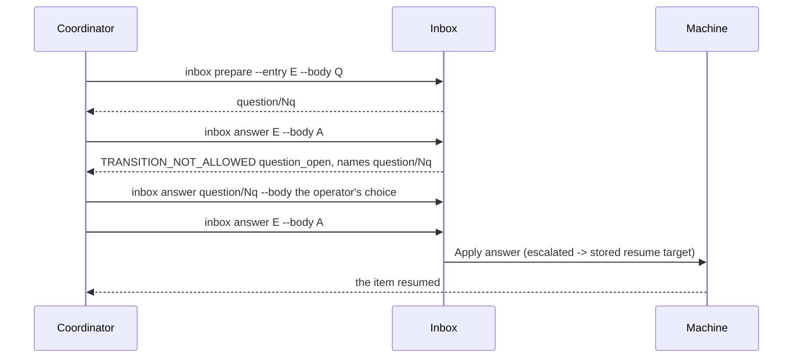
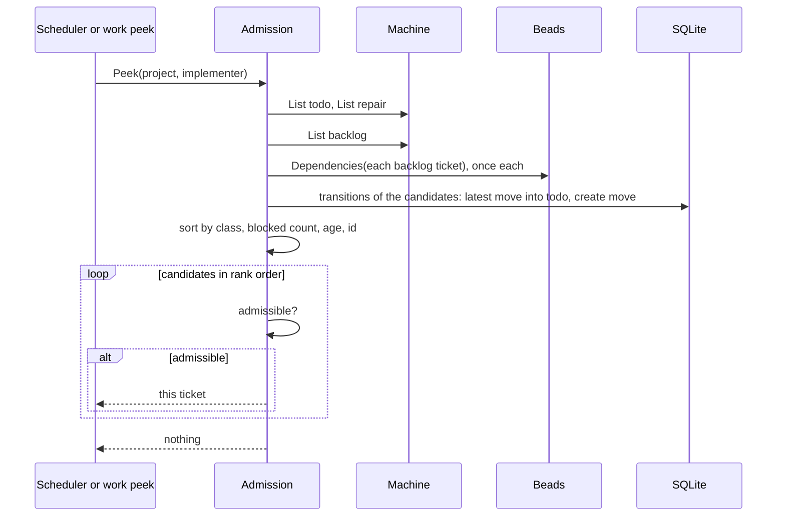

# Work-item fields and transitions: technical spec

## Source

- **Epic:** factorio-9wh
- **Source:** `docs/adr/0005-work-item-fidelity.md`, the one ADR whose `**Ticket:**` line names
  this epic.
- **Stories covered:** none. This is an architecture epic, and no story asks for it.

This spec cites the ADR by two kinds of label:

- **D1 to D11** are the eleven numbered items of the ADR's Decision section, in order.
- **AC1 to AC4** are the four acceptance lines that the ADR gives this epic, under "Epic
  factorio-9wh owns these":
  - AC1: `loop work create --help`, `loop work shape --help`, `loop work block --help` and
    `loop work unblock --help` each list `blocked-by` or `by`.
  - AC2: `loop decision file --title t --trigger t` exits 2 with code `USAGE`.
  - AC3: a test proves that `work peek --stage implementer` returns a repair before a new ticket.
  - AC4: a test proves that an escalated ticket with an open blocks edge resumes to `backlog`.

The base moved after the ADR was read. The ADR read the loop at `86f03e6`. This spec reads it at
`13a783e`. One change matters: `3b87176` (factorio-brs, loop fault F-19) made the implementer's
work query take a ticket in `repair` before any ticket in `todo`
(`internal/admission/policy.go`, `claimFirst`). Gap 7 of the ADR says the query walks `todo`
first. That is no longer true. D10 still holds, and work entry 12 replaces `claimFirst` with the
rank of D10.

Round 2 of this spec reads the base at `22d8fc4`. The changes since `13a783e` touch agent jobs,
usage limits, the implementer's cron and review proof. None of them changes a table, a verb or a
work query that this spec names. The implementer now runs every 5 minutes, so D10's overdue wait
of 90 minutes is 18 implementer ticks, not tickertown's 9.

Round 3 reads the base at `183d80b`. The changes since `22d8fc4` make an inbox answer on a
sign-off entry merge the document, and add `loop coordinator upgrade`. They add the epic row
`signoff_head`. None of them changes a ticket, bug or decision row, the work verbs, `inbox defer`,
the escalation answer or the implementer's work query. The coordinator runbook's
canceled-blocker bullet is still at lines 86 to 89.

## Scope check

**Components:**

1. **The work-item record.** The transition tables in `internal/machine`, and every verb and job
   that writes them: the verb handlers in `internal/machine/verbs.go` and
   `internal/pipeline/adhoc.go`, `decision file` and the decision-timers job in
   `internal/decision`, the inbox verbs in `internal/inbox`, the dependency-advance job in
   `internal/sched/deps.go`, the edge operations of `internal/beadsx`, and the flags in
   `internal/cli/surface.go`. The runbooks that call a changed verb change with it.
2. **The implementer work query**, in `internal/admission`. Why not its own epic: D10 ranks by a
   priority that only `work shape --priority` writes (D9), and by blocks edges that only this
   epic's verbs let a ticket hold outside `epic decompose` (D2). ADR 0005 decides both as one
   record, and its Ticket line names one epic.

Component 1 spans several packages, because the writers of one item record live in several
packages. Each work entry changes one cluster of verbs and the runbook lines that name those
verbs. Entries 1 to 11 change component 1. Entry 12 changes component 2, and reads the facts and
edges that entries 2 and 10 write.

**Not in this spec:** D1 (no labels), D4 (no `--to` on `inbox answer`) and D11 (no premerge verb)
change no code. Their acceptance lines hold on the base today. The tracker adapters, which the
plan defers.

## Decisions

The ADR made the eleven decisions D1 to D11. This section records the choices that the ADR left
to the spec.

1. **A blocker is a ticket or a decision.** We chose those two kinds over any kind, because
   dependency-advance frees a ticket when each blocker is `done` (`internal/sched/deps.go`,
   `blockersDone`). A ticket and a decision each reach `done` when their work or answer lands. D2
   refuses an epic. A bug never reaches `done`: it ends `shaped`, `duplicate` or `canceled`, so a
   ticket that waits on a bug would wait forever. The refusal names the ticket that the bug was
   shaped into, when it has one. This narrows the ADR's "a ticket can wait on any item"
   (Consequences) to the two kinds that can land.
2. **The server refuses a blocker that is already terminal.** We chose the refusal over an edge
   to it, because an edge to a `done` item holds nothing, and an edge to a `canceled` item holds
   the ticket until a person unblocks it.
3. **`--blocked-by` takes item ids separated by commas.** We chose one comma-separated value over
   a flag that repeats, as D2 writes it, because the CLI parser refuses a repeated flag
   (`internal/cli/parse.go`, `repeated_flag`) and an invocation holds one string for each flag.
   `--story` already takes a list this way.
4. **Each verb writes the edge and the move in the order that fails safe.** `work create` and
   `work shape` write each edge before the create move, as `epic decompose` does. `work block`
   moves the ticket to `backlog` and records the blocker as the fact `pending_block` in that same
   write, then writes the edge. `work unblock --by` deletes the edge, then moves the ticket. We
   chose these three orders over one order for every verb, because each crash then leaves the
   ticket held, never claimable. A ticket in `Initial` is in no queue. A `backlog` ticket with no
   blocker is a doubt that dependency-advance holds (`blockersDone`). A `backlog` ticket whose
   `pending_block` names an item that is not `done` is held too, whether its edge landed or not
   (Decision 22).
   A ticket can already hold edges to done items, because dependency-advance keeps those edges
   when it frees a ticket. Without the fact, a crash after the move would leave only those done
   edges, and the next tick would free the ticket while its new blocker is open.
5. **`work block` starts from `todo` and from `backlog` only.** We chose these two states over
   every live state, because a ticket in `in_progress` holds a run's lease, and a ticket in a
   pull request state holds a pull request. Neither can wait in `backlog` without dropping
   those. D2 names `todo`. A block from `backlog` adds an edge and keeps the state.
6. **`work unblock` with no `--by` moves only a `backlog` ticket that has no open blocker.** It
   deletes no edge. We chose this over an `--by` that is always required, because the coordinator
   runbook's doubt case, a `backlog` ticket with no edge, then has no exit. A ticket whose every
   edge leads to a done item moves too, as dependency-advance would move it at its next tick, and
   the acceptance scenario `epic_test.go:214` relies on that. We rejected an unblock with no
   `--by` that deletes every edge, because a person would delete edges that the person never
   read. An edge to a canceled item is open, so the person names it with `--by`, and the edge goes.
7. **An escalated ticket resumes to `backlog` when it was escalated from `backlog`.** We chose
   the state at the escalate write over a read of the edges at the answer, because R12 stores the
   resume target in the escalate write, and a table setter reads the item and its parameters,
   never its beads edges. A
   ticket in `backlog` holds an open blocks edge, or a doubt that a person resolves. A blocker
   that lands while the ticket waits on a person is read at the next dependency-advance tick
   after the answer.
8. **Priority is the loop fact `priority` on the shaped ticket.** We chose a fact over the
   native beads priority, which the ADR left open. The loop creates every bead at native priority
   2 (`internal/machine/seams.go`), so the native field cannot tell a shaped priority-2 ticket
   from an unshaped ticket. `beadsx.UpdateSpec` also writes no priority. The native field stays
   2.
9. **The "not built yet" route is `work duplicate --of <item> --unbuilt`.** We chose a flag on
   the verb that the reproducer runs today over a new verb, because a new verb needs a new RPC in
   `proto/loop/v1/services.proto`, a new handler and new capability rows. We rejected
   `work block` on a bug, because a blocks edge is a ticket's edge that dependency-advance and the
   rank read, and D9 puts the building item in a fact.
10. **A waiting bug closes as `duplicate` of the building item when that item is `done`.** We
    chose `duplicate` over `shaped`, because `shaped` means that the reproducer wrote a failing
    test and a ticket from this report. No test exists for a report that a later build answers.
    The `shape` and `duplicate` moves stay open from the waiting state, so the coordinator can
    route the report by hand. With the return to `reported`, these are the three edges that the
    ADR names.
11. **The building item is a ticket or an epic, and it is not terminal.** We chose those two
    kinds over any kind, because only a ticket or an epic builds a change. A terminal item builds
    nothing more.
12. **The rank sorts by class, then by blocked count, then by age, then by id.** We chose this
    total order over the classes of D10 alone, because two tickets of one class would otherwise
    tie in the order of `bd list`, which the ADR did not measure. The classes, in order: a
    priority-1 ticket, a repair, an overdue ticket, a resume, a rework, the rest. D10's "most
    open items wait on" and "oldest" then break each tie inside every class.
13. **The blocked count reads the edges of `backlog` tickets only.** We chose `backlog` tickets
    over every open item, because only a `backlog` ticket waits on blocks edges alone. An
    escalated ticket waits on a person first. A ticket leaves
    `backlog` only when each edge leads to a done item (dependency-advance) or a person removes
    the edge (`work unblock`, Decision 6). This bounds the read to one `Dependencies` call for
    each `backlog` ticket on each peek, which the ADR asks the spec to bound.
14. **Overdue and age come from the `transitions` table.** We chose the table over a new fact,
    because the table already records each applied move with its time
    (`internal/store/migrations/0003_transitions.sql`). The overdue clock starts at the latest
    move into `todo`. The age is the time of the create move.
15. **The overdue wait is `throughput.implementer.overdue` in host config, default 90 minutes.**
    We chose a field of the stage's throughput entry over a top-level key, because KTD30 keeps
    each stage's limits there. The default is tickertown's 9 ticks of 10 minutes
    (`implementer-rank.ts:133-158`).
16. **The defer reason lives in the `payload` of the defer's `schedule` row.** We chose the
    existing JSON column over a new column, because a new column needs a migration and
    `payload` already exists (`internal/store/migrations/0001_init.sql`).
17. **An early escalation answer refuses with `TRANSITION_NOT_ALLOWED`, rule `question_open`.**
    We chose an existing code over a new code, because a new code changes the schema's code
    table, and every runbook branches on codes. The code already means "read the hint and the
    next moves".
18. **The decision moves write four facts.** `why` holds the reason of the latest fire or
    defer. `defer_reason` holds the `--reason` of the inbox defer that the latest fire ended, and
    is empty when that fire ended no defer. `answer` holds the note of `decision settle`, as the
    inbox and a room write it today. `close_note` holds the note of a drop or a moot. We chose
    four facts over one fact for every move, because `answer` already means a person's answer, the
    fired inbox entry reads `why`, and a fire must not overwrite the defer's reason.
19. **The decision-timers job writes its own `why`, and carries the defer's reason.** We chose a
    server text over an exception to D6, because D6 records why on every fire. The text names the
    `--by` date, or the end of an inbox defer and its time. When the fire ends an inbox defer, the
    job reads the reason from that defer's `schedule` row, and passes it to the `fire` row as
    `defer_reason`, in the same write as the move. Every other fire passes none, so the fact
    clears. We chose a fact on the decision over a read of the `schedule` row at list time,
    because the job marks that row `done` when it fires, and `readDefers` reads `active` rows
    only. So a returned decision entry shows `defer_reason`, as every other returned entry does
    (D8).
20. **A decision that waits for a person makes no inbox entry while it is pending.** We chose
    the coordinator's pending list over a new inbox entry kind, because the coordinator runbook
    already reads each pending decision on each wake (section 6). The fact `waits_for` tells it
    what to look for.
21. **The decision `answer` move requires an answer.** We chose to refuse an empty answer over
    an optional one, because D6 rejects a settle that records no answer. `inbox answer` and
    `room apply` already send one.
22. **An open blocker is an edge or the `pending_block` fact.** An open blocker of a ticket is an
    item that is not `done`, and that the ticket names by a blocks edge or by `pending_block`.
    Dependency-advance frees a `backlog` ticket that has at least one blocker and no open blocker.
    We chose the fact over a third write that clears it after the edge lands, because a third write
    adds a third crash point. Once the edge lands, the fact and the edge name the same item, so the
    stale fact changes no answer of dependency-advance. One verb reads the fact differently:
    `work unblock --by X` never counts a `pending_block` that names X (Decision 23). That call ends
    the block on X, so the fact holds nothing after it.
    `work block` and `work unblock --by` refuse with `USAGE`, rule `block_pending`, while
    `pending_block` names an item other than their own `--by` that has no edge from the ticket.
    When the pending blocker is open, the hint says to run the earlier `work block` call again.
    When it is terminal, the server refuses that replay (Decision 2), so the hint says to run
    `work unblock <item> --by <pending blocker>`. We chose that refusal over a later block that
    overwrites the fact, because the overwrite would lose the blocker of the crashed call. Each
    `unblock` row that lands in `todo` clears `pending_block`. The `unblock` row that keeps
    `backlog` clears it when it names the `--by` blocker.
23. **`work unblock --by X` is safe to run again.** When the ticket holds no edge to X, the call
    skips the delete. On a `backlog` ticket it still runs the move step. The move step counts the
    ticket's open blockers with X left out: the remaining edges, and `pending_block` unless it names
    X. The ticket moves to `todo` when the step counts none, and stays otherwise. So a ticket that
    `work block T --by X` parked leaves `backlog` at `work unblock T --by X`, whether X is open or
    canceled, and whether the edge to X landed or not. On a `todo` ticket it writes nothing and
    answers exit 0 with `"edge_removed": false`, because the state the call asks for already holds.
    Every other state refuses with `TRANSITION_NOT_ALLOWED`. We chose this over a refusal of an
    `--by` that names no edge, because a replay after a crash finds the edge already deleted, and a
    refusal would then leave a `backlog` doubt where the first call would have freed the ticket. A
    wrong `--by` costs nothing: the move step lands only where the state of the edges allows it.
24. **A bug in `awaiting_build` takes no `cancel`.** We chose no `cancel` row over a fourth edge
    out of the waiting state, because D3 keeps the states of `work cancel`, and the ADR gives the
    waiting state only the edges to `shaped`, `duplicate` and `reported`. A coordinator that wants
    to drop a waiting report closes it with `work duplicate <bug> --of <item>`, as the reproducer
    closes a "not built yet" report today.

## Assumptions

- bd 1.3.1 `dep remove <from> <to>` deletes a `tracks` edge. This is wrong if the beads contract
  test of entry 1 shows the edge still listed after the call.
- bd 1.3.1 `dep remove` on an edge that does not exist either succeeds or fails with an error
  that `beadsx` can tell apart from every other error. This is wrong if the contract test finds
  no such error.
- A new state in a table reaches each project's beads at the next server start, because
  `cmd/loop/serve.go` passes `machine.Statuses()` to each workspace open. This is wrong if
  `machine.Statuses()` does not list a state that the bug table holds.
- A project holds at most a few hundred `backlog` tickets, so one `Dependencies` call for each
  on every implementer peek costs seconds at most. This is wrong if one `work peek --stage
  implementer` takes more than 10 seconds on a live project.
- Every ticket has a create row in `transitions`. This is wrong for a ticket created before
  migration 0003 ran. Entry 12 sorts such a ticket as the oldest.
- The pack runbooks and skills are the only text outside tests that names `loop decision file`,
  `decision fire`, `decision defer`, `decision settle`, `decision moot`, `work cancel`,
  `work shape` or `inbox defer`. This is wrong if `grep -rn` finds one of them in
  `.loop/policy/` or in a project's own documents.
- No live project holds a ticket in `todo` with a blocks edge to an open item today. This is
  wrong if a read of each `todo` ticket's edges finds one. Entry 4 does not move such a ticket.

## Approach

### Blockers (D2)

A new file, `internal/machine/blockers.go`, checks a list of blockers for one ticket. It reads
each id, and refuses an unknown id, the ticket itself, an epic, a bug, a terminal item and an id
that would close a cycle. The cycle check walks the blocks edges forward from each blocker, with
the beads client. `work create`, `work shape` and `work block` call it before any write.

`work create --blocked-by` and `work shape --blocked-by` add each edge while the ticket is in
`Initial`. Then they apply `create` with `blocked=true`, and the ticket lands in `backlog`. This
is the order of `epic decompose` (`internal/pipeline/decompose.go:137-150`). `--blocked-by` with
`--kind bug` is a usage fault, because a bug has no `backlog`.

`work block <item> --by <blocker>` takes the item lock, checks the blocker, checks the
`block_pending` rule (Decision 22), and applies `block` with the parameter `by`. From `todo` the
move lands in `backlog`. From `backlog` it keeps the state. Both rows write the fact
`pending_block`. Then the handler adds the edge. A retry after a crash finds the ticket in
`backlog`, applies the `backlog` row, and adds the edge again, which beads keeps as one edge.

`blockersDone` in `internal/sched/deps.go` reads the item as well as its edges. It counts
`pending_block` as one more blocker, and frees the ticket only when it has a blocker and none is
open (Decision 22). A crash between the move and the edge thus leaves the ticket held at every
tick until the replay adds the edge, or until the blocker reaches `done`.

`work unblock <item> --by <blocker>` takes the item lock and checks the `block_pending` rule. It
deletes the edge with the new `beadsx.Client.RemoveDependency`, and skips the delete when no edge
exists (Decision 23). Then it reads the edges that remain, and `pending_block` unless it names the
`--by` blocker. When an open blocker remains among those, it applies `unblock` with `open=true`
and `by`, which keeps `backlog`.
Otherwise it applies `unblock`, which lands in `todo`. `work unblock <item>` with no `--by` applies
`unblock` only when the item has no open blocker, and deletes no edge. The dependency-advance job
applies `unblock` through `Machine.Apply`, not through the CLI handler.

`ticketResume` returns `backlog` for a ticket escalated from `backlog`, and the ticket `answer`
row accepts `backlog` as a resume target beside `todo`.

### Reasons (D3, D5, D6, D8)

`work cancel` requires `--reason`. The ticket and bug `cancel` rows copy it into the fact
`cancel_reason`, in the same write as `canceled`. The states that `cancel` starts from stay as
they are. The waiting bug state of D9 adds none (Decision 24).

`decision file` requires exactly one of `--by` and `--waits-for-a-person`. The second writes the
fact `waits_for`. The decision-timers job reads `by` only, so it never fires a decision that waits
for a person.

The decision rows keep their states and edges. Each row gains a setter. `fire` and `defer` need
the parameter `why`. `answer` needs `answer`. `drop` and `moot` need `note`. A new handler maps
each CLI flag to its parameter. The timers job passes its own `why`, and the defer's reason as
`defer_reason` when the fire ends an inbox defer (Decision 19). `inbox defer` on a decision entry
passes its `--reason` as the `why` of the `defer` move.

The server refuses a reason, a why or a note that holds the value of a secret, with
`SECRET_IN_OUTPUT`, as it refuses a body today.

`inbox defer` requires `--reason`. The reason goes into the defer row's `payload` as
`{"reason": "..."}`. When the defer time passes, the entry returns with the reason in a new
field, `defer_reason`:

- An entry that is no decision returns while its defer row is still `active`. `readDefers` reads
  the row's `payload` with its time, and the entry takes the reason from there.
- A decision entry returns because the timers job fired the decision and marked the row `done`.
  The entry takes `defer_reason` from the decision's fact of that name (Decision 19). It also
  shows the `why` of the fire, which names the end of the defer.

### Early answers (D7)

`inbox answer` on an escalation entry first counts the open questions whose `entry` column names
that entry. While one is open, it refuses with `TRANSITION_NOT_ALLOWED`, rule `question_open`,
and names each open question entry in the hint. The item does not move. The escalation entry's
`next` line says to answer each open question first. The coordinator runbook states that order.

### Bugs (D9)

`work shape` requires `--priority`, 1 to 4, with the meanings of the reproducer runbook,
section 4. The shaped ticket holds the fact `priority`.

The bug table gains the state `awaiting_build`, in the beads category `frozen`, so no stage claims
it. `work duplicate <bug> --of <item> --unbuilt` checks that the item is a ticket or an epic and
not terminal, then applies `await_build`. The bug lands in `awaiting_build` with the fact
`built_by`. Each tick, dependency-advance lists the bugs in `awaiting_build` and reads each
building item. A `done` item applies `build_landed`, which closes the bug as `duplicate` with
`duplicate_of` set to the building item. A `canceled` item applies `build_canceled`, which returns
the bug to `reported` and clears `built_by`. Any other status leaves the bug alone. From
`awaiting_build`, the coordinator may still apply `shape`, `duplicate`, `note` and `edit`. It
may not apply `cancel` (Decision 24).

### The implementer rank (D10)

`PeekAs` keeps its walk for every other stage. For the implementer, it lists the tickets in
`todo` and `repair`, and ranks them in memory before it tests each one with `admissible`. The
first admissible ticket in rank order wins. The rank reads three things:

1. The facts of each listed ticket: `priority` and `entry`.
2. One `Dependencies` call for each `backlog` ticket. From these edges it builds the reverse
   graph, and counts for each candidate the distinct `backlog` tickets that reach it through
   blocks edges, at any depth.
3. One SQLite read of `transitions` for the candidates: the time of the latest move into `todo`,
   and the time of the create move.

`claimFirst` and `claimRank` go away, because the rank replaces them. `Admit` for a named item
does not rank. The scheduler's dispatch already peeks, then admits the item that the peek
named.

## Domain model

```
internal/machine (changed)

Ticket states       unchanged
  invariant (new): a ticket in todo has no open blocker: no blocks edge and no pending_block
             fact names an item that is not done. A ticket unblocked by a person before entry 3
             lands may still hold an edge to a canceled item, because the old `unblock` deleted
             no edge. No move after entry 3 makes such a ticket.
  invariant (new): a ticket in backlog whose pending_block names an item with no blocks edge
             from it is held while that item is not done. It leaves this case only when that
             item is done, when a replay of work block adds the edge, or when work unblock
             <ticket> --by <that item> ends the block. The last is the only exit when that item
             is canceled.

Bug states          + awaiting_build (frozen)
  invariant: a bug in awaiting_build holds the fact built_by, and built_by names a ticket or
             an epic.

Blocker             an item id that a ticket waits on
  invariant: its kind is ticket or decision. It is not the ticket itself. At the write that
             adds it, it is not terminal, and no chain of blocks edges leads from it back to
             the ticket.

Priority            the fact priority of a shaped ticket
  invariant: one of 1, 2, 3, 4. Only work shape writes it.

Decision            states and edges unchanged (DECISION_MOVES)
  invariant (new): a pending decision holds exactly one of the facts by and waits_for.
  invariant (new): every applied fire and defer records why. Every applied answer records
             answer. Every applied drop and moot records close_note.

internal/admission (changed)

RankClass           an ordered enumeration: priority1 < repair < overdue < resume < rework < rest
  A ticket takes the first class that fits it. Ties break by blocked count, from most to
  fewest, then by age, oldest first, then by id.
```

## Interfaces

```go
// internal/cli/surface.go: the changed flags. Every other flag stays.
// work create      + --blocked-by string  "item ids the ticket waits on, comma-separated; a ticket or a decision each"
// work shape       + --blocked-by string  (as above)
//                  + --priority string, Required, Enum 1|2|3|4
// work block       + --by string, Required    "the ticket or decision the item waits on"
//                  + --project
// work unblock     + --by string              "the blocker whose edge to delete; absent only for a ticket with no blocks edge"
// work cancel      + --reason string, Required
// work duplicate   + --unbuilt bool           "the --of item builds what the report asks for; the bug waits for it"
// decision file    + --waits-for-a-person string  "who or what the decision waits for; exactly one of --by and this"
// decision fire    + --why string, Required
// decision defer   + --why string, Required
// decision settle  + --note string, Required  "the answer, or why it was dropped with --dropped"
// decision moot    + --note string, Required
// inbox defer      + --reason string, Required "the act or the event the entry waits for"
```

```go
// internal/beadsx: one new Client method.

// RemoveDependency deletes the edge from issue `from` to issue `to` of the
// given kind. An edge that does not exist is no error, so a replay is safe.
// Edges of another kind and to another issue stay.
RemoveDependency(ctx context.Context, from, to string, kind DepKind) error
```

```go
// internal/machine: new fact names (rows.go) and verbs (kinds.go).
const (
	FactCancelReason = "cancel_reason" // why work cancel closed the item
	FactPriority     = "priority"      // the priority work shape gave the ticket: 1 to 4
	FactBuiltBy      = "built_by"      // the ticket or epic a waiting bug waits for
	FactWhy          = "why"           // the reason of a decision's latest fire or defer
	FactDeferReason  = "defer_reason"  // the --reason of the inbox defer that the latest fire ended
	FactCloseNote    = "close_note"    // why a decision was dropped or became moot
	FactPendingBlock = "pending_block" // the blocker of the latest work block, written before its edge
)

const (
	VerbBlock         = "block"          // ticket: todo -> backlog, backlog -> backlog
	VerbAwaitBuild    = "await_build"    // bug: reported, reproducing -> awaiting_build
	VerbBuildLanded   = "build_landed"   // bug: awaiting_build -> duplicate (server)
	VerbBuildCanceled = "build_canceled" // bug: awaiting_build -> reported (server)
)

const AwaitingBuild = "awaiting_build"

// CheckBlockers refuses a blocker list for ticket before any write: an
// unknown id, the ticket itself, an epic, a bug, a terminal item, or an id
// that would close a cycle. ticket is "" for a ticket not yet created.
func (m *Machine) CheckBlockers(ctx context.Context, project, ticket string, blockers []string) *cli.Refusal
```

```text
Machine parameters, by row:
  ticket create   blocked = "true" | ""                 (unchanged)
  ticket block    by, required                          -> pending_block
  ticket unblock  open = "true" | "", by = id | ""      "true" selects the row that keeps backlog;
                                                        it clears pending_block when it equals by.
                                                        The row to todo always clears pending_block
  ticket cancel   reason, required                      -> cancel_reason
  bug cancel      reason, required                      -> cancel_reason
  bug await_build of, required                          -> built_by
  bug build_landed  none; copies built_by               -> duplicate_of
  bug build_canceled none                               clears built_by
  decision fire   why, required; defer_reason, optional -> why, defer_reason (cleared when empty)
  decision defer  why, required                         -> why
  decision answer answer, required                      -> answer
  decision drop   note, required                        -> close_note
  decision moot   note, required                        -> close_note
```

```go
// internal/inbox
const FactWaitsFor = "waits_for" // beside FactTrigger, FactBy and FactFiledBy

type Entry struct {
	// ... every field it has now
	// DeferReason is the --reason of the defer that ended, when the entry
	// returned from one.
	DeferReason string `json:"defer_reason,omitempty"`
}
```

```go
// internal/config/throughput.go
type Throughput struct {
	Cap      int           `yaml:"cap"`
	Schedule string        `yaml:"schedule,omitempty"`
	// Overdue is how long a ticket waits in todo before the implementer's
	// work query ranks it overdue. Only the implementer entry takes it.
	// 90 minutes when absent.
	Overdue time.Duration `yaml:"overdue,omitempty"`
}
```

```go
// internal/admission: the rank. It makes no claim and no write.
type ranked struct {
	item    machine.Item
	class   int       // 0 priority-1, 1 repair, 2 overdue, 3 resume, 4 rework, 5 rest
	blocked int       // distinct backlog tickets that wait on it, at any depth
	created time.Time // the create move; zero when no row exists
}

func (a *Admission) rankImplementer(ctx context.Context, project string, candidates []machine.Item, now time.Time) ([]machine.Item, error)
```

## Data

```
beads metadata (new keys, each "loop." + name)
  cancel_reason   text, on a canceled ticket or bug
  priority        "1" | "2" | "3" | "4", on a shaped ticket
  built_by        item id, on a bug in awaiting_build
  why             text, on a decision
  defer_reason    text, on a decision whose latest fire ended an inbox defer
  close_note      text, on a canceled decision
  pending_block   item id, on a ticket that work block parked
  waits_for       text, on a decision filed with --waits-for-a-person

beads statuses
  + awaiting_build, category frozen, registered at workspace open

beads edges
  blocks edges (stored as bd "tracks") gain a delete: bd dep remove

SQLite schedule (unchanged schema)
  rows of kind inbox_defer: payload = {"reason": "<text>"}
```

**Existing records:** no migration. A defer row written before entry 7 holds `{}`, and its entry
returns with no `defer_reason`. A pending decision filed before entry 6 may hold neither `by` nor
`waits_for`. It keeps its state, and the coordinator reads it on each wake as today. A ticket or a
bug canceled before entry 5 holds no `cancel_reason`. No bug is in `awaiting_build` before entry
11. Every ticket created before entry 10 holds no `priority`, and the rank reads it as no
priority. No ticket holds `pending_block` before entry 3, so dependency-advance counts
only edges for it, as today. No decision holds `defer_reason` before entry 8. A decision whose
defer ended before entry 8 returns with no `defer_reason`.

## Flows

`work block`:



`work unblock`:



`work create` and `work shape` with blockers:



A bug that waits for a build:



An escalation answer with an open question:



The implementer's work query:



## Work

1. **Edge removal in beads.** Add `RemoveDependency` to `beadsx.Client`, the bd client and the
   fake. Extend the beads contract suite with it.
   - Files: `internal/beadsx/beadsx.go`, `internal/beadsx/bd.go`, `internal/beadsx/fake/fake.go`,
     `internal/beadsx/contract_test.go`, `internal/beadsx/suite_test.go`
   - Needs: nothing
   - Proves: C11
   - Done when: `make beads-contract` passes with a case that adds two edges, removes one, and
     lists only the other, and a case that removes an edge twice.
2. **Blockers at create and at shape.** Add `CheckBlockers`, and `--blocked-by` on `work create`
   and `work shape`. Edges go in before the create move.
   - Files: `internal/machine/blockers.go` (new), `internal/machine/verbs.go` (`workShape`,
     `shapedTicket`), `internal/pipeline/adhoc.go`, `internal/cli/surface.go`, their tests
   - Needs: nothing
   - Proves: C1, C2 for create and shape, C3, C4, C8 for create and shape
   - Done when: `loop work create --help` and `loop work shape --help` list `blocked-by`, and a
     PRD-less ticket created with `--blocked-by` lands in `backlog` with one edge for each id.
3. **Block and unblock with `--by`.** Add the ticket `block` rows, which write `pending_block`,
   and the `unblock` row that keeps `backlog`. Add the handlers of `work block` and
   `work unblock`, which today answers `NOT_IMPLEMENTED` for `work block`. Make `blockersDone`
   count `pending_block` as a blocker (Decision 22). Change the coordinator runbook's
   canceled-blocker bullet to `loop work unblock <item> --by <blocker>`.
   - Files: `internal/machine/ticket.go`, `internal/machine/rows.go` (`FactPendingBlock`),
     `internal/machine/verbs.go`, `internal/cli/surface.go`, `internal/sched/deps.go`,
     `pack/runbooks/coordinator.md`, `acceptance/scenarios/` (a scenario that applies each new
     ticket row), their tests. `acceptance/scenarios/epic_test.go:214` runs `work unblock` with no
     `--by` on a ticket whose one edge leads to a done ticket. It passes unchanged under
     Decision 6, and stays as the proof of that case.
   - Needs: entries 1 and 2
   - Proves: C2 for `work block`, C5, C6, C7, C8 for block and unblock, C9
   - Done when: `loop work block --help` and `loop work unblock --help` list `by`, and the
     acceptance catalogue passes with the new rows applied end to end.
4. **Resume to backlog.** `ticketResume` returns `backlog` for a ticket escalated from `backlog`.
   The ticket `answer` row accepts `backlog`.
   - Files: `internal/machine/ticket.go`, `acceptance/scenarios/` (a scenario that escalates a
     `backlog` ticket and answers it), their tests
   - Needs: nothing
   - Proves: C10
   - Done when: the scenario's ticket is in `backlog` after the answer, and the acceptance
     catalogue passes.
5. **A reason on cancel.** `work cancel` requires `--reason`. The ticket and bug `cancel` rows
   store it. Change the reproducer runbook's loop-fault route and the coordinator runbook's
   drop bullet to pass `--reason`.
   - Files: `internal/cli/surface.go`, `internal/machine/ticket.go`, `internal/machine/bug.go`,
     `internal/machine/verbs.go`, `pack/runbooks/reproducer.md`, `pack/runbooks/coordinator.md`,
     `internal/pack/` (the C25 test), their tests. The acceptance scenarios that call
     `work cancel` with no reason gain `--reason`: `acceptance/scenarios/ae_ticket_test.go:69`
     (AE3 still expects exit 3 from the table, so it needs `--reason` to reach the table),
     `acceptance/scenarios/ticket_rows_test.go:130` and `acceptance/scenarios/corpus_test.go:184`.
   - Needs: nothing
   - Proves: C12, C25 for `work cancel`
   - Done when: `loop work cancel <item>` with no `--reason` exits 2 with `USAGE`.
6. **A notice on every decision.** `decision file` requires exactly one of `--by` and
   `--waits-for-a-person`. Change each pack file that files a decision: the amender and
   code-reviewer runbooks, and the `loop-brainstorm` and `loop-encode-lessons` skills.
   - Files: `internal/cli/surface.go`, `internal/decision/decision.go`, `internal/inbox/entries.go`
     (`FactWaitsFor`), `pack/runbooks/amender.md`, `pack/runbooks/code-reviewer.md`,
     `pack/skills/loop-brainstorm/SKILL.md`, `pack/skills/loop-encode-lessons/SKILL.md`,
     `internal/pack/` (the C25 test), their tests. `acceptance/scenarios/stages_test.go:35` calls
     `decision file` with neither flag, and gains `--by` or `--waits-for-a-person`.
   - Needs: nothing
   - Proves: C13, C25 for `decision file`
   - Done when: `loop decision file --title t --trigger t` exits 2 with code `USAGE`.
7. **A reason on defer.** `inbox defer` requires `--reason`. The defer row stores it, and the
   entry returns with `defer_reason`. Change the coordinator runbook, section 5.
   - Files: `internal/cli/surface.go`, `internal/inbox/answer.go`, `internal/inbox/entries.go`
     (`readDefers` reads `payload`), `internal/inbox/inbox.go`, `pack/runbooks/coordinator.md`,
     `internal/pack/` (the C25 test), their tests
   - Needs: nothing
   - Proves: C16 for an entry that is no decision, C25 for `inbox defer`
   - Done when: a deferred escalation entry shows `defer_reason` in `loop inbox list` after its
     time.
8. **Text on every decision move.** `decision fire` and `decision defer` require `--why`.
   `decision settle` and `decision moot` require `--note`. The rows store each text. The timers
   job writes its own `why`, and passes the reason of the defer it ends as `defer_reason`.
   `inbox defer` passes its reason as the `why` of a decision's defer. The fired decision entry
   shows the `why` and the `defer_reason`. Change the coordinator runbook, section 6.
   - Files: `internal/cli/surface.go`, `internal/machine/decision.go`, `internal/machine/verbs.go`,
     `internal/decision/decision.go`, `internal/inbox/answer.go`, `internal/inbox/entries.go`,
     `pack/runbooks/coordinator.md`, `internal/pack/` (the C25 test), their tests
   - Needs: entry 7
   - Proves: C14, C15, C16 for a decision entry, C25 for the four decision verbs
   - Done when: `loop decision settle <decision>` with no `--note` exits 2 with `USAGE`,
     `internal/machine/parity_test.go` passes with the rows' states unchanged, and a decision
     deferred with a reason returns after its time with that reason in `defer_reason`.
9. **No early escalation answer.** `inbox answer` on an escalation refuses while a question
   about it is open. The escalation entry's `next` line names the order. Change the coordinator
   runbook, section 5, to answer each question first.
   - Files: `internal/inbox/answer.go`, `internal/inbox/entries.go`,
     `pack/runbooks/coordinator.md`, their tests
   - Needs: nothing
   - Proves: C17
   - Done when: an escalation with one open question refuses `inbox answer`, and accepts it
     after the question's answer.
10. **Priority on shape.** `work shape` requires `--priority`. The shaped ticket holds the fact
    `priority`. Change the reproducer runbook, sections 4 and 5.
    - Files: `internal/cli/surface.go`, `internal/machine/verbs.go`, `internal/machine/rows.go`,
      `pack/runbooks/reproducer.md`, `internal/pack/` (the C25 test), their tests. The C3 test
      of entry 2 gains `--priority`. `acceptance/scenarios/entry_test.go:36` calls `work shape`
      with no `--priority`, and gains it.
    - Needs: entry 2, which changes the same handler
    - Proves: C18, C25 for `work shape`
    - Done when: `loop work shape` with no `--priority` exits 2 with `USAGE`, and a shaped ticket
      shows `priority` in `loop work show`.
11. **A bug that waits for a build.** Add `awaiting_build` and its rows to the bug table,
    `--unbuilt` on `work duplicate`, and the two bug moves to dependency-advance. Change the
    reproducer runbook's "not built yet" route, and the bug states in the glossary skill.
    - Files: `internal/machine/bug.go`, `internal/machine/kinds.go`, `internal/machine/rows.go`,
      `internal/machine/verbs.go` (`workDuplicate`), `internal/cli/surface.go`,
      `internal/sched/deps.go`, `pack/runbooks/reproducer.md`,
      `pack/skills/loop-sdlc-glossary/SKILL.md`, their tests
    - Needs: nothing. The new state has no `cancel` row (Decision 24).
    - Proves: C12 for `awaiting_build`, C19, C20
    - Done when: a bug routed `--unbuilt` closes as `duplicate` one dependency-advance tick after
      its building ticket merges, and returns to `reported` one tick after that ticket is
      canceled.
12. **The implementer rank.** Replace `claimFirst` with the rank of D10. Add
    `throughput.implementer.overdue` to host config.
    - Files: `internal/admission/policy.go`, `internal/admission/rank.go` (new),
      `internal/admission/repair_first_test.go`, `internal/config/throughput.go`,
      `internal/config/host.go` (validation), their tests
    - Needs: entry 10, for `FactPriority`
    - Proves: C21, C22, C23, C24
    - Done when: a test with one candidate in each class sees `work peek --stage implementer`
      return them in class order as each one is claimed in turn.

## Out of scope

- Labels on create and edit. D1 ports none. A tracker adapter may need them, and the first
  adapter forces that decision.
- A `--to` resume target on `inbox answer`. D4 adds none.
- A premerge verdict verb. D11 adds none.
- A block from `in_progress` or from a pull request state. Decision 5 refuses it. A later ADR
  owns it, when a run needs to park its own ticket on a blocker.
- Header and choice fields on a question, `--hold`, and a timed resume. D7 and D8 reject them.
- A question that blocks the answer of a fired decision. D7 names an escalation only. Never in
  this epic.
- `--source`, `--from`, `--needs`, screenshots and a duplicate check at filing on bugs. D9 rejects
  them.
- A production-bug marker in the rank. D10 rejects it, and priority 1 covers the case.
- The `file-bug` skill, which waits on this epic. It belongs to epic factorio-cd4.

## Contracts

**C1. Behaviour: a ticket created with blockers waits in `backlog`.** Proves D2 and AC1.
`loop work create --blocked-by X,Y` creates a ticket in `backlog` with one blocks edge to X and
one to Y. With no `--blocked-by`, the ticket lands in `todo` as today. `loop work create --help`
lists `blocked-by`.
*An example test for each case, which reads the status and `Dependencies` of the new ticket, and
a test of the help text.*

**C2. Refusal: a bad blocker is refused before any write.** Proves D2. `work create`,
`work shape` and `work block` each refuse a blocker that is unknown (`NOT_FOUND`), the ticket
itself, an epic, a bug, a terminal item, or one whose blocks edges lead back to the ticket
(`USAGE`, each with its own rule). A refused call creates no bead and writes no edge. A bug that
was shaped is refused with a hint that names its ticket.
*An example test for each refusal, which asserts the code and the rule, and that the project's
item count and the ticket's edges did not change.*

**C3. Behaviour: a bug shaped with blockers makes a ticket that waits.** Proves D2.
`loop work shape <bug> --blocked-by X`, with every other flag that `work shape` requires when the
test runs, closes the bug as `shaped`, and its ticket is in `backlog` with one blocks edge to X.
`loop work shape --help` lists `blocked-by`.
*An example test.*

**C4. Refusal: a bug report takes no blocker.** Proves D2. `loop work create --kind bug
--blocked-by X` refuses with `USAGE`, and files no report.
*An example test.*

**C5. Behaviour: `work block` adds one edge, and parks a `todo` ticket.** Proves D2 and AC1.
From `todo` the ticket moves to `backlog` with the new edge. From `backlog` it stays in
`backlog` and gains the edge. From any other state the call refuses with
`TRANSITION_NOT_ALLOWED` and writes no edge. `work block` never answers `NOT_IMPLEMENTED`.
`loop work block --help` lists `by`.
*An example test for each starting state of the ticket table.*

**C6. Behaviour: `work unblock --by` deletes one edge, and frees the ticket only when no open
blocker remains.** Proves D2. After `work unblock T --by X`, T holds no edge to X, and every other
edge of T stays. T moves to `todo` when no open blocker is left other than X (Decisions 22 and
23). A `pending_block` that names X is not counted, and the move clears it. Otherwise T stays in
`backlog`. An `--by` that names no edge of a `backlog` T deletes nothing and runs the same move
step. An `--by` that names no edge of a `todo` T writes nothing and exits 0 with
`"edge_removed": false`. From any other state the call refuses with `TRANSITION_NOT_ALLOWED`.
`loop work unblock --help` lists `by`.
*Example tests: one edge removed of two open edges, the last open edge removed, a remaining edge
to a canceled item, an `--by` with no edge on a `backlog` ticket with and without an open
blocker, and an `--by` with no edge on a `todo` ticket. Two tests start from a ticket that
`work block T --by X` parked, so that it holds `pending_block` X. In the first, X is open and the
block ran with no crash: `work unblock T --by X` moves T to `todo` with no `pending_block`. In the
second, `work block` crashed before its edge and X was then canceled: `work unblock T --by X`
moves T to `todo` the same way.*

**C7. Refusal: `work unblock` with no `--by` frees only a ticket with no open blocker.** Proves
D2. On a `backlog` ticket with no blocks edge, or whose every edge leads to a `done` item, it
moves the ticket to `todo` and deletes no edge. On a ticket with an open blocker, an edge to a
canceled item among them, it refuses with `USAGE` and the hint names each open blocker.
*Example tests for no edge, only done edges, an open edge and a canceled edge. The acceptance
scenario `epic_test.go:214` covers the done edge end to end.*

**C8. Invariant: a crash never leaves a claimable ticket with an open blocker.** Proves D2. For
`work create --blocked-by`, `work shape --blocked-by`, `work block` and `work unblock --by`, a
crash between the edge write and the move leaves the ticket in `Initial` or in `backlog`. A
dependency-advance tick between the crash and the replay leaves it there too, also when the
ticket already held edges to done items before `work block`. A replay of the same call then
reaches the same status and the same edges as a call with no crash, and exits 0. While
`pending_block` names an item with no edge from the ticket, `work block` and `work unblock --by`
with another blocker refuse with `USAGE`, rule `block_pending`, and write nothing. The hint names
the replay of `work block` when the pending blocker is open, and
`work unblock <ticket> --by <pending blocker>` when it is terminal.
*A crash-injection test for each verb at the point between its two writes, as the `stop` hook of
`epic decompose` does, then one dependency-advance tick, then a replay. The `work block` case
starts from a `todo` ticket that holds one edge to a done ticket. A `work unblock --by` case
replays after the delete and after the move. One test for each `block_pending` refusal, and one
for each form of its hint. The test of the terminal form then runs the command the hint names,
and finds the ticket in `todo`.*

**C9. Equivalence: dependency-advance frees a ticket as before.** Proves D2. A `backlog` ticket
whose every blocks edge leads to a `done` item moves to `todo` at the next tick, with or without
the changes of entry 3. A ticket with no blocker, or with an edge to a canceled item, stays. A
ticket with no edge whose `pending_block` names a `done` item has a blocker and no open blocker,
so it moves (Decision 22).
*The existing `internal/sched` tests pass unchanged, and one new test frees a ticket that
`work block` parked.*

**C10. Behaviour: an escalated `backlog` ticket resumes to `backlog`.** Proves D2 and AC4. A
ticket escalated from `backlog` and then answered is in `backlog`. A ticket escalated from `todo`
or `in_progress` resumes to `todo` with entry `resume`. A ticket escalated from a pull request
state resumes to `todo` with entry `rework`.
*An acceptance scenario for the `backlog` case, and example tests for the other two.*

**C11. Boundary: `RemoveDependency` deletes exactly one edge.** Proves D2. After
`RemoveDependency(T, X, blocks)`, `Dependencies(T)` lists no blocks edge to X, and lists every
other edge of T. A second call succeeds and changes nothing. A call for an unknown issue returns
`ErrNotFound`.
*The beads contract suite, against the fake and against bd 1.3.1.*

**C12. Refusal: `work cancel` needs a reason.** Proves D3. With no `--reason`, or a blank one,
the call refuses with `USAGE` and the item stays. With a reason, the item moves to `canceled`, and
the same transition records the fact `cancel_reason`. The states that `cancel` starts from are
`escalated` for a ticket, and `reproducing` and `escalated` for a bug, and no others. A bug in
`awaiting_build` refuses `cancel` with `TRANSITION_NOT_ALLOWED` (Decision 24), which entry 11
proves when it adds the state.
*An example test for the refusal, a test that reads the reason from the transition's facts in
`transitions`, and a test that walks every state of both tables and finds `cancel` only in the
named states.*

**C13. Refusal: a decision names its notice.** Proves D5 and AC2. `loop decision file` with
neither `--by` nor `--waits-for-a-person`, or with both, exits 2 with code `USAGE` and files
nothing. `--waits-for-a-person` writes the fact `waits_for`. The decision-timers job never fires
a decision that holds `waits_for` and no `by`.
*Example tests for neither, both and each one alone, and a timers test over a date far in the
future.*

**C14. Behaviour: every fire records why.** Proves D5 and D6. A fire by the decision-timers job
records `why` naming the `--by` date, or the end of the inbox defer. A fire by `decision fire`
records the caller's `--why`, and clears `defer_reason`. The fired inbox entry's text holds the
`why`.
*A timers test with a fake clock, and an example test of the entry text.*

**C15. Refusal: every decision move records its text.** Proves D6. `decision fire` and
`decision defer` with no `--why`, and `decision settle` and `decision moot` with no `--note`,
refuse with `USAGE` and move nothing. `decision settle` stores its note as `answer`.
`decision settle --dropped` and `decision moot` store it as `close_note`. The machine refuses an
`answer` move on a decision with no answer. The states and edges of the decision table still
equal DECISION_MOVES.
*An example test for each verb, and `internal/machine/parity_test.go`.*

**C16. Behaviour: a deferred entry returns with its reason.** Proves D8 and D6. `inbox defer`
with no `--reason` refuses with `USAGE`, and defers nothing. With a reason, the entry is absent
until `--until`, then present with `defer_reason` equal to the reason. This holds for each kind of
entry:

- For an entry that is no decision, the entry returns once the time passes. Entry 7 proves it.
- For a decision entry, the defer records the reason as the `why` of the decision's `defer` move.
  After the time, one decision-timers tick fires the decision. The returned entry then shows
  `defer_reason` equal to the reason, and a `why` that names the end of the defer. Entry 8
  proves it.

*An example test with a fake clock, before and after the time, for an escalation entry. A test
with a fake clock for a decision entry, which runs the decision-timers tick after the time and
reads the returned entry.*

**C17. Refusal: an escalation answer waits for its questions.** Proves D7. While a question that
`inbox prepare --entry E` wrote has no answer, `inbox answer E` refuses with
`TRANSITION_NOT_ALLOWED`, rule `question_open`, the hint names each open question entry, and the
item stays `escalated`. After each such question has its answer, `inbox answer E` resumes the
item. A question about another entry does not hold E.
*Example tests for one open question, one answered question, and a question about another
entry.*

**C18. Refusal: a shaped ticket carries a priority.** Proves D9. `work shape` with no
`--priority`, or a value outside 1 to 4, refuses with `USAGE` and creates no ticket. With one,
the ticket holds the fact `priority` with that value, and its native beads priority stays 2.
*An example test for each case.*

**C19. Behaviour: a report that a build answers waits for that build.** Proves D9.
`work duplicate G --of X --unbuilt` moves G from `reported` or `reproducing` to `awaiting_build`
with `built_by` X. It refuses an X that is not a ticket or an epic, or that is terminal, and G
stays. No stage claims a bug in `awaiting_build`. `work cancel` on G in `awaiting_build` refuses
with `TRANSITION_NOT_ALLOWED`.
*Example tests, and a peek of the reproducer stage that finds nothing.*

**C20. Behaviour: the build's end routes the waiting report.** Proves D9. At the
dependency-advance tick after X reaches `done`, G is `duplicate` with `duplicate_of` X. At the
tick after X reaches `canceled`, G is `reported` with no `built_by`. While X is open, G stays.
*Example tests of one tick for each status of X.*

**C21. Behaviour: the implementer takes work in rank order.** Proves D10 and AC3. Given
admissible tickets, one of each kind: a ticket in `todo` with priority 1, a ticket in `repair`, a
ticket in `todo` longer than the overdue wait, a ticket with entry `resume`, a ticket with entry
`rework`, and a ticket with entry `new`, `work peek --stage implementer` names them in that
order, when the test claims each named ticket before the next peek. A ticket in `repair` comes
before a new ticket.
*A hand-built fixture with a fake clock and the fake beads client.*

**C22. Behaviour: inside a class, the most blocking ticket goes first, then the oldest.** Proves
D10. Of two tickets of one class, the one that more `backlog` tickets wait on, at any depth of
blocks edges, comes first. A ticket that one backlog ticket waits on directly and two wait on
through it counts three. On equal counts the earlier create move comes first, then the lower id.
*A fixture with a chain of three backlog tickets, and a fixture with equal counts.*

**C23. Boundary: overdue starts at the configured wait.** Proves D10. A ticket in `todo` for one
millisecond less than `throughput.implementer.overdue` is not overdue, and at exactly that wait
it is. With no `overdue` key, the wait is 90 minutes. Host config validation refuses a negative
`overdue`, and an `overdue` on any stage but the implementer.
*Example tests at the edge, with a fake clock, and config validation tests.*

**C24. Invariant: the rank's beads reads are bounded.** Proves D10, the ADR's "The spec must
bound that read". One implementer peek makes at most one `Dependencies` call for each ticket in
`backlog`, and none for a ticket in any other state. It makes one SQLite read of `transitions`.
*A test that counts the calls of the fake beads client over a project of 20 backlog tickets.*

**C25. Behaviour: the pack names each flag that this epic makes required.** Proves D3, D5, D6, D8
and D9. Every `loop work cancel`, `loop work shape`, `loop decision fire`, `loop decision defer`,
`loop decision settle`, `loop decision moot` and `loop inbox defer` command in `pack/` names that
verb's required flag. Every `loop decision file` command names `--by` or
`--waits-for-a-person`.
*A test in `internal/pack` that reads each pack file and asserts each rule. Each entry that adds
a required flag adds its rule.*

## Observable behaviour

None, because this epic draws no screen. Its behaviour shows in CLI envelopes and in
`loop inbox list`, which the contracts above prove.

## Open questions

None. The ADR settles each gap, and the choices it left are under Decisions.
