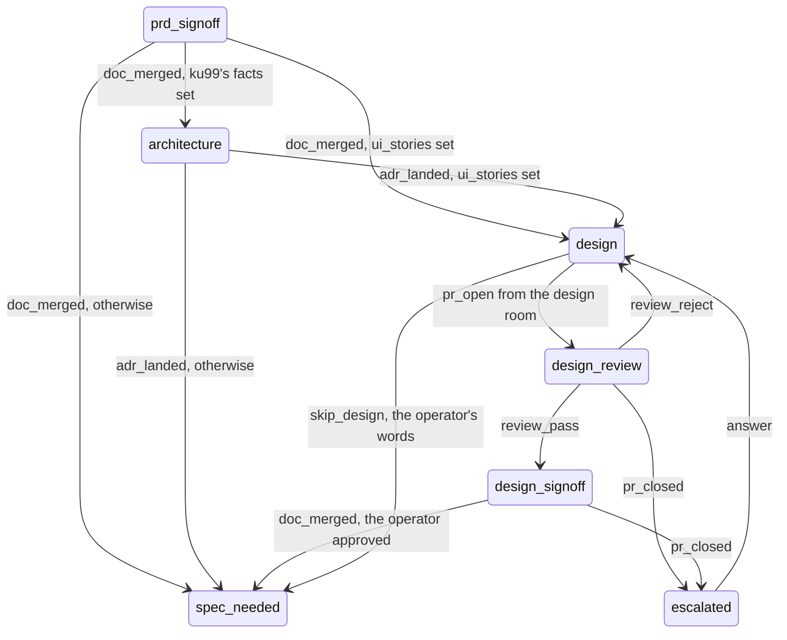
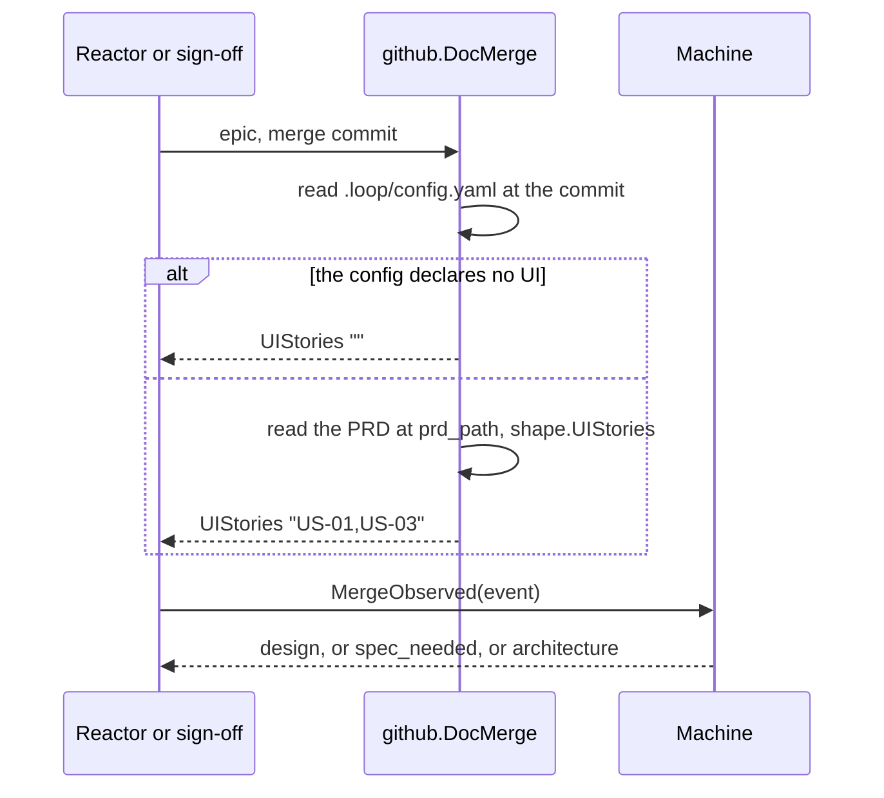
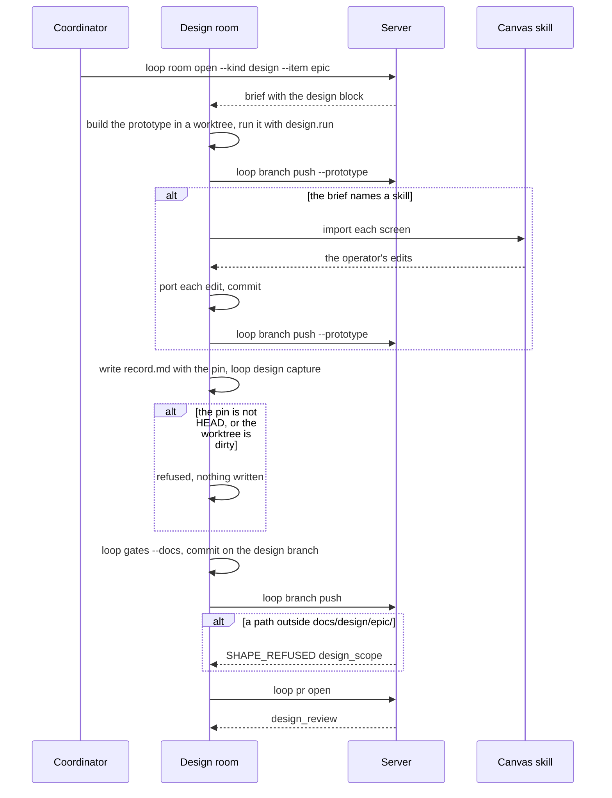
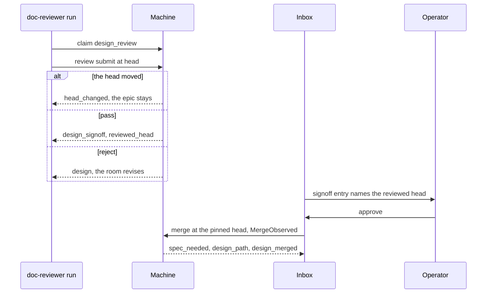

# Give a UI epic a design stage between its PRD and its spec: technical spec

## Source

- **Epic:** factorio-a4yq
- **Source:** `docs/prd/design-stage.md`, merged at `b40427f` (#243) on 2026-10-31. No ADR names
  factorio-a4yq on its `**Ticket:**` line, so the PRD is the only source.
- **Stories covered:** US-01, US-02, US-03, US-04, US-05, US-06, US-07.

The PRD's criteria are A1 to A32. Each contract below names the criterion it proves.

## Scope check

**Components:**

1. **The design stage in the server.** The epic transition table in `internal/machine`, the
   reactor and the push in `internal/github`, the design entry and the sign-off in
   `internal/inbox`, the design room in `internal/room`, the `design` block in `internal/config`,
   and the verbs that move an epic through the stage.
2. **The document gates.** The UI line of the `prd` gate, the new `design` gate, and the record
   parser that both the gate and the stage read, `internal/design`. Why not its own epic: the
   stage merges a record that only the gate checks, and the doc-reviewer's design review reads the
   parts of the record that the gate guarantees. Apart, the stage would merge a record that no gate
   reads, and the gate would guard a file that no stage writes.

The pack text is the agents' half of each component, and it is no third component. Each work
entry changes the runbooks and skills that describe the code it changes.

Each work entry lands in one component and proves its own contracts. Entries 1 and 3 change
component 2. Entries 2 and 4 to 9 change component 1.

**Not in this spec:** the check of the shipped screens against the record, which the sibling epic
owns (no item holds it yet). The `ui` block's fields and the conditional load of
`loop-impeccable`, which factorio-791i owns. The renames of roles, phases and paths, which
factorio-vlle owns. The ADR stage's own rows, which factorio-ku99 owns. This spec changes the
target of two of them and nothing else in them. The QA stage, which factorio-nhb5 owns.

## Decisions

### Answers a person already gave

- **Each choice in the PRD's stories is the operator's.** The operator chose each part of the
  design in intake room room-0fefd19b, and signed the PRD off by its merge at `b40427f`. US-01
  holds the UI line, US-02 the flow, US-03 the prototype-first room, US-04 the branch that never
  merges, US-05 the record of three parts, US-06 the doc review and the pull request sign-off, and
  US-07 the project setting that names a design skill. This spec builds each one as written.
- **No person answered an open question of the PRD.** The PRD merged with five open questions and
  no `**Answered` or `**Deferred` run under any of them. The epic holds no note and no amendment
  fact. A PRD sign-off reads no open questions, because the spec author settles them
  (`pack/runbooks/coordinator.md` section 5). This spec settles three of them below from the
  sources, places one outside this epic, and carries one to Open questions.

### Open questions of the PRD that the sources settle

- **How the Paper skill reaches Paper Desktop is the Paper skill's question, not this epic's.**
  The PRD says that the question blocks none of this epic's criteria, because A11 passes with a
  stub skill. The PRD's Out of scope gives the Paper skill to the project or the operator, as a
  userspace skill. So the live test with `tailscale serve` or `paper mcp` belongs to whoever writes
  that skill, before the first grinch design room. This spec builds nothing for it.
- **The canvas skill is a key of its own, in a `design` block, and not the override key of the
  `ui` block.** We chose a top-level `design` block with a `skill` key over the design skill
  override of factorio-791i. The override replaces `loop-impeccable` in each run that would get it:
  every epic run and each ticket run whose files match a `ui` glob (draft `03e3068`,
  `docs/prd/kernel-and-userspace-skills.md` lines 128 to 145). A canvas skill serves the design room
  only. One key would put the canvas skill's instructions into every implementer run of a UI
  ticket, and take `loop-impeccable` out of them. We rejected a second key inside the `ui` block,
  because factorio-791i owns that block's fields and has no PRD on the base yet.
- **The signed commit is the pin line at the head that the operator approves.** A sign-off is the
  operator's approval of a document pull request at one head (`loop-sdlc-glossary`), and the
  record at that head names one commit. So that commit is the signed one, whatever the prototype's
  branch holds later. The `design` gate checks that the branch holds the pinned commit, not that
  the pin is the branch's tip. We rejected the branch's tip at the merge, because nobody reviewed
  the commits after the pinned one.
- **The design gate reads record files only, so a skipped epic gets no gate run.** The gate reads
  each `docs/design/*/record.md` in the tree. An epic that the operator skipped has no design
  directory, so the gate reads nothing for it. We rejected a gate that refuses a UI epic with no
  record, because the gate runs in CI with no server, and only the server holds the skip.

### The flow

- **Three new epic states: `design`, `design_review` and `design_signoff`.** The design room works
  on an epic in `design`. The doc-reviewer claims one in `design_review`. The operator approves one
  in `design_signoff`. We chose three states over the spec states with a document-kind fact,
  because the scheduler claims an item by its state, the doc-reviewer knows what it reviews only
  from the state (`pack/runbooks/doc-reviewer.md` lines 8 to 9), and `loop work list` then shows
  the stage.
- **The design pull request is the epic's document pull request in the design states.** The
  `pr_open` row from `design` copies the pull request number into `doc_pr`, as the row from
  `spec_drafting` does. We chose `doc_pr` over a new `design_pr` fact, because the reactor moves an
  epic only on the pull request that `doc_pr` names (`internal/github/reactor.go` line 583), and
  the sign-off, the head check and the outran rows all read it. One fact reuses each of them.
- **The server computes the route once, at the PRD merge, into one fact, `ui_stories`.** At the PRD merge,
  the server reads the PRD at the merge commit and the project's config. When the project declares
  a UI, `ui_stories` holds each story label whose UI line reads `yes`. Otherwise it stays empty. The
  `doc_merged` row from `prd_signoff` gains a third target: `architecture` when factorio-ku99's
  facts ask for it, then `design` when `ui_stories` holds a label, and `spec_needed` otherwise. The
  `adr_landed` rows land on `design` when `ui_stories` holds a label and the epic holds no design
  outcome yet. An epic that factorio-ku99's `loop epic adr` returns to `architecture` after its
  design merged, or after a skip, then goes on to `spec_needed`, and never designs twice. We chose
  one fact over a second read of the PRD at the ADR merge, because the PRD at its merge is the
  document that the operator signed, and the ADR merge then needs no read of the PRD.
- **Both merge paths fill the merge event through one function.** The reactor's merge path
  (`reactor.go` line 591) and the sign-off's merge path (`internal/inbox/signoff.go` line 102)
  both call `MergeObserved`. A new `github.DocMerge` fills the spec path, `ui_stories` and the
  record path for both. We chose one function over a read in each caller, because two readers
  could route one epic two ways.
- **An epic with a UI story reaches the spec stage only through its design record or a skip.**
  The spec-author's claim refuses with rule `design_required` an epic that holds `ui_stories` and
  neither `design_merged` nor `design_skipped`. We chose a guard over trust in the table alone,
  because `answer` and `adr_misjoined` can also land an epic in `spec_needed`, and A8 says "not
  before".
- **A reject returns the epic to `design`, and the design room revises the record.** We chose
  `design` over an amender state, because a design finding needs a new state built in the
  prototype, a new capture, or a canvas round, and US-03 puts that work in a room with the
  operator. The design pull request stays open, and the next round reads its new head.
- **A design pull request gets no person-comment row.** The operator talks to the design room, and
  the doc-reviewer reads every thread in its round. A closed design pull request escalates the
  epic, as a closed PRD or spec pull request does, and the answer resumes at `design`. We rejected
  a comment row to `design`, because the reactor reads comments only for the amender's states
  (`AmendableStates`, `internal/machine/epic.go` line 81), and no amender answers a design.
- **One verb skips the design stage: `loop epic skip-design <epic> --request "<words>"`.** Only the
  coordinator runs it, with the operator's words, on an epic in `design` that has no open design
  pull request. It writes `design_skipped` and moves the epic to `spec_needed`. We rejected a skip
  from `prd_signoff` that marks the epic before its merge, because A6 and A25 need only the skip of
  an epic in the stage. We rejected a skip from `design_review` or `design_signoff`, because the
  open design pull request could then merge into an epic past the stage. The operator closes that
  pull request first.

### The branches

- **The record and the prototype each have a branch: `loop/<epic>-design` and
  `loop/<epic>-prototype`.** `BranchOf` gives the design branch to an epic in a design state. We
  chose a third suffix over the spec branch, because the spec branch opens after the design
  merges, and over the epic's PRD branch, because a PRD that merged by squash leaves that branch
  behind the base.
- **The design room pushes the prototype with `loop branch push --prototype`.** The server pushes
  the checkout's HEAD to `loop/<epic>-prototype`, and only for a design room on an epic in
  `design`. We chose a flag on the one push verb over a git push from the room, because only the
  server pushes (`loop-sdlc-turn` section 4). We rejected the prototype under a directory of the
  design branch, by US-04.
- **The push refuses a design branch that reaches outside the epic's design directory.** The
  server compares the push's head with its merge base on the base branch. A changed path outside
  `docs/design/<epic>/` refuses the push with `SHAPE_REFUSED` and rule `design_scope`. A commit
  that the prototype's branch holds and the base lacks refuses it with rule
  `prototype_in_design`. We chose the push over a gate, because only the push knows which branch
  it writes, and a refusal there stops the file before GitHub holds it.
- **The loop deletes no branch.** No code path of the loop deletes a ref today, and this spec adds
  none. The prototype's branch is never the head of a pull request, so GitHub's delete of a merged
  head never reaches it.

### The record

- **The record is one Markdown file, `docs/design/<epic id>/record.md`, with its pictures beside
  it.** We chose Markdown with fixed line shapes over YAML, because the doc-reviewer and the
  operator read the record in a pull request diff next to its pictures, and every other document
  gate reads Markdown with fixed line shapes. We chose the epic id over a slug for the directory,
  because the gate and the sibling epic find a record by its epic.
- **The record names its PRD on a `**PRD:**` line.** The gate runs in CI with no server, so it
  reads the stories from the PRD at that path in the tree.
- **One package parses the record: `internal/design`.** The gate, `loop design capture` and the
  sibling epic call it. We chose one parser over a parse in each reader, because two parsers of one
  format disagree, and the gate then passes a record that a later reader cannot read.
- **Each state names a picture and a target.** The target is the string that the capture command
  receives, such as a route or a story id. We chose a target in the record over a state id alone,
  because the sibling epic captures the shipped product at a pull request head with the same
  command, and only a target in the record tells it which view to open.
- **The gate checks the pin against the remote branch only for a record that the branch adds or
  changes.** It reads the merge base of HEAD and the base, as the `citations` gate does
  (`internal/gates/citations.go` line 225). We chose this over a check of every record, because a
  person can delete a prototype branch by hand, and every later build on the base would then fail.
- **The pixel threshold is the share of pixels that may differ, as a decimal.** A range needs a
  unit. The default and the range wait on the operator (Open questions, second entry).

### The config and the room

- **`loop design capture` is the one writer of the record's pictures.** It reads the record, checks
  that the prototype checkout is clean and at the pinned commit, and runs the project's capture
  command once for each state. We chose a verb over the room running the command by hand, because
  the verb makes "each picture is a capture of the prototype at the pinned commit" a check in code.
- **The capture command starts what it needs.** We chose a capture command that renders one state
  on its own over one that reads a running `run` process, because the sibling epic captures at a
  pull request head with no room and no running prototype. The `run` command serves the prototype
  to the operator and to the canvas import.
- **A project with a `ui` block and no `design` block still enters the design stage.** The design
  room then tells the operator that the project has no `run` or `capture` command. The operator
  adds the block in a pull request, or skips the stage. We rejected a config load that refuses a
  `ui` block with no `design` block, because factorio-791i's `ui` block also serves the conditional
  load of `loop-impeccable`, and a project that only wants that skill would have to set up a
  design stage first.
- **A `design` block with no `ui` block does not load.** The load refuses with rule
  `design_without_ui`, and the project counts as one with no UI. We chose a refusal over a block
  that does nothing, because A30 forbids a UI key of this epic's own, and a block that loads with
  no `ui` block reads as one.
- **The design room's brief names the `design` block.** We chose the brief over a read of
  `.loop/config.yaml` by the room agent, because factorio-791i's draft says that a runbook reads a
  conditional skill only when the brief lists it, and never inspects the repository to decide.
- **The unattended PRD author writes each UI line from the request.** The operator then signs the
  PRD off with the lines in it, so the operator still sets each one. We rejected an escalation for
  each UI line, because the doc review and the sign-off already put each line in front of the
  operator.
- **The base audit gives `design_merged` the checks of `spec_merged`.** The audit finds a merge's
  record through its merge fact (`internal/machine/history.go` line 96). A design merge recorded
  under no fact raises `unreviewed_merge`. A design pull request merges at a reviewed head, as a
  spec does, so the outran and head rules apply (`internal/github/baseaudit.go` line 43).

## Assumptions

- factorio-ku99 lands before work entry 4, with the split `doc_merged` rows from `prd_signoff` and
  the `adr_landed` rows from `architecture` and `adr_review` that its spec describes. This is
  wrong if its spec changes those rows at sign-off. Entry 4 then adds the `design` target to the
  rows that landed, or to today's two rows (`internal/machine/epic.go` lines 353 and 356).
- The beads store takes three new epic statuses with no migration, because the server registers
  each state of the table at start (`cmd/loop/serve.go` line 350). This is wrong if `bd` refuses a
  status on a database that an earlier release made.
- A git worktree inside the room's checkout shares the checkout's object store. So the push's
  fetch from the checkout path reads a prototype commit. This is wrong if the room makes the
  prototype in a separate clone.
- A project's CI checks out the remote branches, as `.github/workflows/ci.yml` line 29 does with
  `fetch-depth: 0`. This is wrong if a project's CI fetches only the head. Then the `design` gate
  refuses each new record with `pin_unreachable`, and its message names the branch to fetch.
- The doc-reviewer's harness reads a PNG file. This is wrong if a review run cannot open an image.
  Then the reviewer cannot check a state against a criterion.
- The names in this spec are the names on the base: spec-author, intake room, `spec_needed`. This
  is wrong if factorio-vlle lands first. Each entry then uses vlle's names, and entry 9 adds the
  design phase and its doc review between ADR and plan in vlle's phase list.
- factorio-yzrt's `skills` list lands before work entry 2. This is wrong if entry 2 lands first.
  The `design.skill` check then accepts kernel skill names only, until the list exists.

## Approach

**The record is a file with fixed line shapes.** `internal/design` parses
`docs/design/<epic>/record.md` into a `Record`: the epic, the PRD path, the pin, and the screens
with their states. It returns each problem with a line and a rule. The `design` gate in
`internal/gates` runs the parser on each record in the tree, reads the PRD that the record names,
and checks coverage with `shape.Stories`. That function is new in `internal/shape`, and it reads
each `### US-nn` story of a PRD and its UI line. For a record that the branch adds or changes, the
gate also checks the pin with `git merge-base --is-ancestor <commit> refs/remotes/origin/<branch>`.

**The UI declaration has one reader.** `config.ProjectConfig.DeclaresUI` is true when the config
holds a `ui` key. The `prd` gate, the merge route and the design room read it, and none of them
reads a field of the block. The `prd` gate refuses a story with no UI line, or a line that reads
neither `yes` nor `no`, when the repository's config declares a UI.

**The flow is the epic transition table.** The table gains three states, four facts, one verb and
these rows:

| Verb | From | To | Writes |
| --- | --- | --- | --- |
| `doc_merged` | `prd_signoff`, ku99's facts empty, `ui_stories` set | `design` | `prd_merged`, `ui_stories` |
| `doc_merged` | `prd_signoff`, otherwise | as ku99 decides | `prd_merged`, `ui_stories` |
| `adr_landed` | `architecture`, `adr_review`, `ui_stories` set, no design outcome | `design` | `adr`, `adr_merged` |
| `adr_misjoined` | `spec_needed`, `design` | `architecture` | clears `adr`, `adr_merged` |
| `pr_open` | `design` | `design_review` | `doc_pr` |
| `claim` | `design_review` | same | doc-reviewer lease |
| `review_pass` | `design_review` | `design_signoff` | `reviewed_head` |
| `review_reject` | `design_review` | `design` | drops the lease |
| `signoff_head` | `design_signoff` | same | `reviewed_head` |
| `doc_merged` | `design_signoff` | `spec_needed` | `design_path`, `design_merged` |
| `doc_merged` | `design_review`, outran | `design_signoff` | drops the lease |
| `pr_closed` | `design_review`, `design_signoff` | `escalated` | resume at `design` |
| `skip_design` | `design` | `spec_needed` | `design_skipped` |

`epicResume` sends `design` and `design_review` back to `design`, and `design_signoff` back to
itself. The spec-author's claim gains the `design_required` guard of Decisions.

**The merge event carries the route.** `machine.MergeEvent` gains `UIStories` and `DesignPath`.
`github.DocMerge` fills them. For an epic in `prd_signoff` or an outran PRD state, it reads the PRD
at the merge commit and the project config at the same commit. For an epic in a design state, it
names the record that the merged pull request adds.

**The pushes follow the stage.** `BranchOf` gives `loop/<epic>-design` to an epic in `design`,
`design_review` or `design_signoff`, and `ItemOf` with a new `DesignEpicOf` maps the branch back.
`Push` accepts the design branch for the epic's own push. It accepts the prototype branch only
for a `--prototype` push from a design room on an epic in `design`. A push of the design branch
runs the scope check of Decisions after the secret scan. `loop branch sync` adds a `prototype`
part with a fetch command for an epic in a design state, so a room or a review run can fetch the
pinned branch before it runs the gate.

**The design entry and the design room.** The inbox lists `design/<project>/<epic>` for an epic in
`design` with no open design room, as it lists an architecture entry. The coordinator brings the
entry to the operator, and opens the room with `loop room open --kind design --item <epic>`. The
room's brief gains a `design` object with the block's `run`, `capture` and `skill`. The runbook
`pack/runbooks/design-room.md` builds the prototype in a worktree on `loop/<epic>-prototype`,
pushes it, runs the canvas round when the brief names a skill, writes the record, captures the
pictures with `loop design capture`, and opens the design pull request with `loop pr open`.

**The review and the sign-off reuse the document path.** The doc-reviewer claims `design_review`
and reviews the record by a new section of its runbook. The inbox raises a sign-off entry for
`design_signoff`, and the operator's approval merges the pull request at the reviewed head, as
for a spec. `decidedSpec` does not run on a design record, because the record has no Open
questions section.

## Domain model

```
internal/machine (changed)

Epic status            the epic state machine gains design, design_review and design_signoff
  invariant: an epic in design_review or design_signoff holds doc_pr, the number of a pull
             request whose head branch is loop/<epic>-design.
  invariant: an epic that holds ui_stories leaves the design states for spec_needed only by
             doc_merged from design_signoff, or by skip_design from design.

UI route               ui_stories: the labels of the PRD's UI: yes stories, comma-separated
  invariant: empty when the project declared no UI at the PRD merge. Written once, by the
             doc_merged row from prd_signoff, and never changed after it.

Design outcome         design_merged and design_path, or design_skipped
  invariant: an epic holds at most one of the two. design_skipped holds the operator's words,
             and is never empty.

internal/shape (changed)

Story                  one ### US-nn heading of a PRD and its UI line
  UI                   one of missing, yes, no, bad
  invariant: a story has at most one UI line. A second line reads as bad.

internal/design (new)

Record                 the parsed record.md of one epic
  Epic                 the id on the **Epic:** line; it equals the directory name
  PRD                  the repository path on the **PRD:** line
  Pin                  branch and commit from the **Prototype:** line
  Screens              ordered, each with an id S<n>, a name, its story labels and its states

State                  one state of one screen
  ID                   S<n>.<m>, unique in the record
  Picture              a file name in the record's directory, ending .png
  Target               the string the capture command receives
  Pixel                absent, or a mark with a threshold or the default
  invariant: a parsed State always holds a picture and a target. A line that lacks either is a
             problem, not a State.

Pixel                  a mark for the sibling's pixel comparison
  Threshold            the share of pixels that may differ, a decimal
  invariant: Default is true exactly when the line names no number.

internal/config (changed)

DesignConfig           the design block: run, capture, and an optional skill
  invariant: run and capture are non-empty. A loaded DesignConfig always sits in a config that
             declares a UI.
```

## Interfaces

```
# The coordinator, at the operator's word. The epic leaves the design stage with no record.
loop epic skip-design <epic> --request "<the operator's words>"

# The coordinator opens the design room of an epic in design.
loop room open --kind design --item <epic> --reason "<why the room opens>"

# The design room pushes the prototype worktree's HEAD to loop/<epic>-prototype.
loop branch push --prototype

# The design room captures each state of the record at the pinned commit. Local, no server call.
loop design capture --prototype <worktree path> [--state <S<n>.<m>>]
```

`loop epic skip-design` refusals: `CAPABILITY_DENIED` for any caller but the coordinator, `USAGE`
with rule `no_operator_request` for an empty `--request`, `TRANSITION_NOT_ALLOWED` from any state
but `design`, and `SHAPE_REFUSED` with rule `design_pr_open` while `loop/<epic>-design` heads an
open pull request. Each refusal changes no state.

`loop room open --kind design` refuses with `TRANSITION_NOT_ALLOWED` and rule `not_in_design`
unless the epic is in `design`.

`loop branch push --prototype` refusals: `CAPABILITY_DENIED` with rule `prototype_room_only` for a
run caller, and with rule `not_in_design` for an epic outside `design`. A design branch push
refuses with `SHAPE_REFUSED` and rule `design_scope` or `prototype_in_design`. The hint names each
path or commit.

`loop design capture` refusals, each with exit 3 and code `SHAPE_REFUSED`: `no_design_config`,
`record_invalid`, `pin_mismatch` when the worktree's HEAD is not the pinned commit,
`prototype_dirty` when the worktree holds uncommitted changes, and `capture_failed` when the
command exits non-zero or writes no PNG. The hint of `capture_failed` names the state.

```go
// internal/machine/epic.go, kinds.go and rows.go
const (
	Design        = "design"
	DesignReview  = "design_review"
	DesignSignoff = "design_signoff"

	VerbSkipDesign = "skip_design"

	FactUIStories     = "ui_stories"     // the PRD's UI: yes labels at its merge
	FactDesignPath    = "design_path"    // the merged record's path
	FactDesignMerged  = "design_merged"  // the merge commit of the design pull request
	FactDesignSkipped = "design_skipped" // the operator's words that skipped the stage
)

// internal/machine/seams.go
type MergeEvent struct {
	// ... the fields of today
	UIStories  string // for a PRD merge: the UI: yes labels, or "" in a project with no UI
	DesignPath string // for a design merge: docs/design/<epic>/record.md
}

// internal/github/service.go
func DesignBranchFor(epic string) string    // "loop/" + epic + "-design"
func PrototypeBranchFor(epic string) string // "loop/" + epic + "-prototype"
func DesignEpicOf(branch string) string     // the epic of a design branch, or ""
func BranchOf(it machine.Item) string       // DesignBranchFor for an epic in a design state

// internal/github/merge.go (new): one filler for both merge paths
func (s *Service) DocMerge(ctx context.Context, p config.Project, it machine.Item, sha string) (machine.MergeEvent, error)

// internal/config/project.go and design.go (new)
type DesignConfig struct {
	Run     string `yaml:"run"`
	Capture string `yaml:"capture"`
	Skill   string `yaml:"skill,omitempty"`
}
// ProjectConfig gains: Design *DesignConfig `yaml:"design,omitempty"`
func (c *ProjectConfig) DeclaresUI() bool

// internal/shape/stories.go (new)
type UIMark int // UIMissing, UIYes, UINo, UIBad
type Story struct {
	Label string
	Line  int
	UI    UIMark
}
func Stories(prd string) []Story
func UIStories(prd string) []string // the labels whose UI is UIYes

// internal/design (new)
const RecordFile = "record.md"
func Dir(epic string) string // "docs/design/" + epic + "/"
type Problem struct {
	Line int
	Rule string
	Msg  string
}
func Parse(dir, text string) (Record, []Problem)

// internal/gates/design.go (new)
func Design() Gate // Name "design", Docs true

// internal/brief/brief.go
// Brief gains: Design *config.DesignConfig `json:"design,omitempty"`, set for a design room only.
```

The capture command runs in the prototype worktree with two variables in its environment.
`LOOP_DESIGN_TARGET` holds the state's target. `LOOP_DESIGN_OUT` holds the absolute path of the
PNG to write. `loop design capture` then moves the file to the state's picture in the record's
directory.

The record, as `pack/skills/loop-sdlc-documents/design.md` shows it:

```
# <epic title>: design record

**Epic:** <epic id>
**PRD:** docs/prd/<slug>.md
**Prototype:** `loop/<epic id>-prototype` at `<40-character commit>`

## Screens

### S1. <screen name>

**Stories:** US-01, US-03

- **S1.1 <state name>.** Picture `s1-1.png`, target `<target>`.
- **S1.2 <state name>.** Picture `s1-2.png`, target `<target>`, pixel.
- **S1.3 <state name>.** Picture `s1-3.png`, target `<target>`, pixel 0.02.
```

The UI line of a PRD story, as `pack/skills/loop-brainstorm/prd.md` shows it, on its own line
under the story heading:

```
### US-01 <story title>

**UI:** yes
```

The `design` gate's rules: `record_shape`, `prd_missing`, `ui_story_no_screen`,
`screen_no_story`, `screen_unknown_story`, `state_no_picture`, `picture_missing`, `pin_missing`,
`pin_branch`, `pin_unreachable` and `pixel_threshold`. The `prd` gate's new rule is `ui_line`.

## Data

```
epic bead metadata (changed)
  + loop.ui_stories      text, optional. Comma-separated story labels. Set by doc_merged from
                         prd_signoff.
  + loop.design_path     text, optional. Set by doc_merged from design_signoff.
  + loop.design_merged   40-character commit sha, optional. Set by doc_merged from
                         design_signoff.
  + loop.design_skipped  text, optional. Set by skip_design.

epic status (changed)
  + design               category active
  + design_review        category active
  + design_signoff       category active

.loop/config.yaml (changed)
  + design               mapping, optional. Requires a ui key in the same file.
      run                string, required. Serves the prototype to the operator.
      capture            string, required. Writes one PNG of one state.
      skill              string, optional. A kernel skill or a userspace pin of the project.

docs/design/<epic id>/ (new, in each project with a UI epic)
  record.md              the record
  <state picture>.png    one file for each state

brief.json (changed)
  + design               object, optional. The run, capture and skill of the design block,
                         for a design room only.
```

**Existing records:** no epic holds a new fact or a new status before this epic. No project
config holds a `design` block, and no repository holds `docs/design/`. An epic that is past
`prd_signoff` today holds no `ui_stories`, so the `design_required` guard never refuses it.

## Flows

The route of an epic through the design stage:



The PRD merge, on either path:



The design room:



The sign-off of a design record:



## Work

1. **The record parser and the `design` gate.** Add `internal/design` with `Parse` and `Dir`. Add
   `shape.Stories` and `shape.UIStories`. Add the `design` gate, and register it with `Docs: true`.
   Add the template `design.md`, and add the record's row and the gate to
   `loop-sdlc-documents/SKILL.md`.
   - Files: `internal/design/**` (new), `internal/shape/stories.go` (new),
     `internal/shape/stories_test.go` (new), `internal/gates/design.go` (new),
     `internal/gates/design_test.go` (new), `internal/gates/gates.go`,
     `internal/gates/testdata/design/**` (new), `pack/skills/loop-sdlc-documents/design.md` (new),
     `pack/skills/loop-sdlc-documents/SKILL.md`
   - Needs: nothing
   - Proves: C1, C2, C3, C4, C5, C6
   - Done when: each fixture record of C1 to C5 fails with its rule, the complete fixture passes,
     and this repository passes `loop gates --docs` unchanged.
2. **The UI declaration and the `design` block.** Add `DeclaresUI`, `DesignConfig` and the load
   checks. The server's config loader checks `design.skill` against the kernel skills and the
   project's pins, and raises `project_config_invalid` on a refusal.
   - Files: `internal/config/project.go`, `internal/config/design.go` (new),
     `internal/config/*_test.go`, `internal/server/` (the project config loader and its test)
   - Needs: the `ui` key in `config.ProjectConfig` (Open questions, first entry)
   - Proves: C7, C8
   - Done when: a config with a `ui` key declares a UI, and a config with a `design` block and no
     `ui` key does not load.
3. **The UI line in the `prd` gate and in the PRD writers.** The `prd` gate reads
   `Repo.Config.DeclaresUI` and `shape.Stories`. The PRD template shows the line. The brainstorm
   skill and the intake room set it with the operator. The PRD author writes it from the request.
   - Files: `internal/gates/prd.go`, `internal/gates/prd_test.go`,
     `pack/skills/loop-brainstorm/prd.md`, `pack/skills/loop-brainstorm/SKILL.md`,
     `pack/runbooks/intake-room.md`, `pack/runbooks/prd-author.md`,
     `internal/pack/design_stage_test.go` (new)
   - Needs: entry 1 for `shape.Stories`, entry 2 for `DeclaresUI`
   - Proves: C9, C10, C11
   - Done when: a PRD in a UI fixture repository fails on a story with no UI line, and this
     repository's PRDs pass.
4. **The design states and the route.** Add the three states, the four facts, the `doc_merged`
   and `adr_landed` targets, `adr_misjoined` from `design`, the resume entries and the
   `design_required` guard. Add `MergeEvent.UIStories` and `DocMerge`, and call it from the
   reactor and from the sign-off. Add `DesignBranchFor`, `DesignEpicOf` and the design case of
   `BranchOf`.
   - Files: `internal/machine/epic.go`, `internal/machine/kinds.go`, `internal/machine/rows.go`,
     `internal/machine/seams.go`, `internal/github/merge.go` (new), `internal/github/reactor.go`,
     `internal/github/service.go`, `internal/inbox/signoff.go`, and their tests
   - Needs: entry 1 for `shape.UIStories`, entry 2 for `DeclaresUI`, and factorio-ku99's rows
   - Proves: C12, C13, C14, C15
   - Done when: in a UI fixture project, the merge of a PRD with a `UI: yes` story puts the epic in
     `design`, and the spec-author cannot claim it.
5. **The skip.** Add `skip_design`, the `loop epic skip-design` verb, its `design_pr_open` check,
   and the step in `coordinator.md` that runs it with the operator's words.
   - Files: `internal/machine/epic.go`, `internal/machine/kinds.go`, `internal/cli/surface.go`,
     `internal/server/` (the verb handler), `pack/runbooks/coordinator.md`,
     `internal/pack/design_stage_test.go`, and their tests
   - Needs: entry 4
   - Proves: C16, C17
   - Done when: the coordinator's skip with words moves an epic from `design` to `spec_needed`, and
     every refusal of C17 changes nothing.
6. **The prototype branch and the design branch's scope.** Add `PrototypeBranchFor`, the
   `--prototype` push, the `design_scope` and `prototype_in_design` checks, and the `prototype`
   part of `loop branch sync`.
   - Files: `internal/github/push.go`, `internal/github/scan.go`, `internal/github/verbs.go`,
     `internal/github/service.go`, `internal/cli/surface.go`, and their tests
   - Needs: entry 4 for the design branch
   - Proves: C18, C19, C20
   - Done when: a design room's prototype push lands on `loop/<epic>-prototype`, and a design branch
     push that adds a file outside the design directory gets a refusal.
7. **`loop design capture`.** Add the local verb. It parses the record with `internal/design`,
   reads the `design` block from the room's brief, checks the worktree, and runs the capture
   command for each state.
   - Files: `cmd/loop/design.go` (new), `cmd/loop/design_test.go` (new),
     `cmd/loop/testdata/design/**` (new), `internal/cli/surface.go`
   - Needs: entry 1 for the parser, entry 2 for `DesignConfig`
   - Proves: C21
   - Done when: in a fixture whose capture command copies one fixed PNG, every picture of the
     record holds that PNG's bytes.
8. **The review, the sign-off and the merge of the design record.** Add the `pr_open`, `claim`,
   verdict, `signoff_head`, outran, `doc_merged` and `pr_closed` rows for the design states. Map
   `design` in `openVerbs`. Raise the sign-off entry for `design_signoff`, and teach `docOf` the
   record. Add `design_merged` to `mergeFacts` and to `mergeRules`. Add "Review a design record" to
   the doc-reviewer runbook.
   - Files: `internal/machine/epic.go`, `internal/machine/history.go`,
     `internal/github/verbs.go`, `internal/github/reactor.go`, `internal/github/baseaudit.go`,
     `internal/github/merge.go`, `internal/inbox/entries.go`, `internal/inbox/signoff.go`,
     `pack/runbooks/doc-reviewer.md`, `internal/pack/design_stage_test.go`, and their tests
   - Needs: entry 4 for the states, entry 6 for the design branch
   - Proves: C22, C23, C24
   - Done when: a design pull request in a fixture gets one doc-reviewer verdict at its head, and
     the operator's approval moves the epic to `spec_needed`.
9. **The design entry and the design room.** Add the room kind `design`, `not_in_design`, the
   brief's `design` object, the manifest entry and the runbook. Add the inbox entry
   `design/<project>/<epic>` and its refused answer, rule `design_entry`. Add the design stage to
   `coordinator.md`, to the glossary and to `loop-sdlc-documents/SKILL.md`. Add the canvas-name
   search test.
   - Files: `internal/room/room.go`, `internal/inbox/entries.go`, `internal/inbox/answer.go`,
     `internal/cli/surface.go`, `internal/config/manifest.go`, `internal/brief/brief.go`,
     `pack/manifest.json`, `pack/runbooks/design-room.md` (new), `pack/runbooks/coordinator.md`,
     `pack/skills/loop-sdlc-glossary/SKILL.md`, `internal/pack/design_stage_test.go`, and their
     tests
   - Needs: entries 5, 6, 7 and 8, because the runbook names each of their verbs
   - Proves: C25, C26, C27, C28
   - Done when: an epic in `design` shows a design entry, the coordinator's room open starts a
     room whose brief names the design block, and the runbook's steps follow the order of C26.

## Out of scope

- The citation of screen states in specs and tickets, the implementer's capture at a pull request
  head, the code-reviewer's comparison, and the pixel comparison of a marked state. They belong to
  the sibling epic. No item holds it yet.
- The fields of the `ui` block, its globs, and the conditional load of `loop-impeccable`. They
  belong to factorio-791i.
- How the Paper skill reaches Paper Desktop across Tailscale, and the Paper skill itself. They
  belong to the project or the operator, as a userspace skill by factorio-yzrt and ADR 0013.
- A spec-author step that reads the design record. It belongs to the sibling epic, which owns the
  citation of screen states in specs.
- The renames of roles, phases and paths. They belong to factorio-vlle.
- A QA stage and its visual QA. They belong to factorio-nhb5.
- A project-wide design file of tokens, type and components. It belongs to a later epic, by the
  operator's choice of record. No item holds it yet.
- An export of canvas code onto the base branch, and a merge of prototype code into the product.
  Never, by US-04 and US-05.
- A person-comment row for the design states. Never, by Decisions.

## Contracts

**C1. Refusal: a UI story with no screen fails the gate.** Proves A16. A record whose PRD holds a
`UI: yes` story that no screen cites gives one finding with rule `ui_story_no_screen`, and the
message names the story label.
*An example test with a PRD fixture of two UI stories and a record that cites one.*

**C2. Refusal: a screen that cites no story of the PRD fails the gate.** Proves A17. A screen with
no `**Stories:**` line, or with an empty one, gives rule `screen_no_story`. A screen that cites a
label the PRD lacks gives rule `screen_unknown_story`, and the message names the label.
*Example tests for the missing line, the empty line and the unknown label.*

**C3. Refusal: a state with no picture, or a missing picture, fails the gate.** Proves A18. A state
line with no picture gives rule `state_no_picture`. A state whose picture is absent from the
record's directory gives rule `picture_missing`. Each message names the state id.
*Example tests for both cases, each asserting the state id in the message.*

**C4. Refusal: a pin that the remote branch does not hold fails the gate.** Proves A15. A record
with no `**Prototype:**` line gives rule `pin_missing`. A pin whose branch is not
`loop/<epic>-prototype` gives rule `pin_branch`. For a record that the branch adds or changes
against the merge base, a commit that `refs/remotes/origin/<branch>` does not hold, or a branch
the repository lacks, gives rule `pin_unreachable`, and the message names the branch. A record
that the merge base holds unchanged passes with its branch absent.
*A test builds a git repository with a remote branch, and asserts the finding for a commit off the
branch, the pass for an ancestor of its tip, and the pass for an unchanged record on the base.*

**C5. Boundary: the pixel threshold has a range.** Proves A19 and A29. A state marked `pixel` with
no number passes. A state marked with a number inside the allowed range passes, at both ends of
it. A number outside the range, or a word that is not a number, gives rule `pixel_threshold`, and
the message names the state and the range.
*Example tests at the lower end, the upper end, the default, just outside each end, and a word.*

**C6. Behaviour: a complete record passes, and a repository with no record passes.** Proves A12
and A24 for the gate. The fixture record of `design.md`, with each picture present and the pin on
its branch, gives no finding. A repository with no `docs/design/` gives no finding. The gate reads
no file outside `docs/design/*/` except the PRD that a record names.
*Example tests for both repositories.*

**C7. Equivalence: one reader decides whether a project declares a UI.** Proves A30.
`DeclaresUI` is true for a config that holds a `ui` key, and false for every other config. The
`prd` gate, `DocMerge` and the room's brief read only `DeclaresUI`. A config with a `design` block
and no `ui` key does not load, the alert `project_config_invalid` names rule `design_without_ui`,
and the last good config stays in force.
*Example tests for each config. A test asserts that `internal/gates`, `internal/github` and
`internal/room` read no field of the `ui` block.*

**C8. Refusal: a `design` block that cannot run does not load.** Proves A10 and A24. A block with
an empty `run` or `capture` does not load, and the alert names the key. A `skill` that names
neither a kernel skill nor a pin of the project's `skills` list does not load, and the alert names
the skill. A `skill` named `zz-stub-canvas` that the project pins loads.
*Example tests for each refusal and for the stub pin.*

**C9. Refusal: a story with no UI line fails the `prd` gate in a UI project.** Proves A1. In a
repository whose config declares a UI, a PRD story with no `**UI:**` line, with two of them, or
with a value other than `yes` and `no`, gives rule `ui_line`, and the message names the story.
*Example tests for each case in a fixture repository with a `ui` key.*

**C10. Behaviour: a project with no UI asks for no UI line.** Proves A2. In a repository whose
config declares no UI, a PRD whose stories hold no UI line passes the `prd` gate. This
repository's PRDs pass unchanged.
*An example test, and the gate run on this repository.*

**C11. Behaviour: the PRD writers set the UI line.** Proves A1. `loop-brainstorm/prd.md` shows the
`**UI:**` line under a story. `loop-brainstorm/SKILL.md` and `intake-room.md` tell the room to set
the line of each story with the operator, in a project whose brief or config declares a UI.
`prd-author.md` tells the PRD author to write it from the request.
*A pack test reads the four files.*

**C12. Behaviour: the PRD merge of a UI epic lands on `design`.** Proves A3. In a project that
declares a UI, the merge of a PRD with a `UI: yes` story moves the epic from `prd_signoff` to
`design`, with `ui_stories` holding each such label and `prd_merged` set. The reactor's merge path
and the sign-off's merge path give the same status and the same facts.
*A machine test, and a test that runs one fixture merge through each path and compares the
results.*

**C13. Behaviour: an ADR merge of a UI epic lands on `design`.** Proves A4. An epic in
`architecture` whose `ui_stories` holds a label moves to `design` when its ADR lands. The same epic
moves to `spec_needed` instead when it already holds `design_merged` or `design_skipped`. An epic
in `design` that an ADR named only in prose returns to `architecture` by `adr_misjoined`.
*A reactor test with a mirror fixture for each case.*

**C14. Behaviour: an epic with no UI story goes on as today.** Proves A5. An epic whose stories are
all `UI: no`, or whose project declares no UI, moves to `spec_needed` at its PRD merge, and at its
ADR merge, with `ui_stories` empty. factorio-ku99's `doc_merged` and `adr_landed` tests pass
unchanged.
*Machine tests, and the existing tests.*

**C15. Invariant: a UI epic reaches the spec stage only through its record or a skip.** Proves A8.
For any sequence of table verbs from `prd_signoff`, an epic that holds `ui_stories` is in
`spec_drafting` only if it holds `design_merged` or `design_skipped`. The server refuses a spec-author claim on
such an epic without either, with rule `design_required`.
*A property test over generated verb sequences, and an example test for the guard.*

**C16. Behaviour: the operator's skip moves the epic and keeps the words.** Proves A6 and A25.
`loop epic skip-design <epic> --request "<words>"` from the coordinator, on an epic in `design`
with no open design pull request, moves it to `spec_needed`, and `design_skipped` holds the words
exactly.
*A machine test, and a verb test against a fake GitHub with no open pull request.*

**C17. Refusal: a skip with no words, or from the wrong place, changes nothing.** Proves A7. The
skip refuses with `USAGE` rule `no_operator_request` for an empty `--request`, `CAPABILITY_DENIED`
for a run or a room caller, `TRANSITION_NOT_ALLOWED` on an epic in `design_review`,
`design_signoff`, `spec_needed` or `prd_signoff`, and `SHAPE_REFUSED` rule `design_pr_open` while
the design branch heads an open pull request. After each refusal, the epic's status and facts are
as before.
*An example test for each case, asserting the code, the rule and the unchanged epic.*

**C18. Refusal: the design branch holds only the design directory.** Proves A13 and A31. A push of
`loop/<epic>-design` whose diff from the merge base with the base branch names a path outside
`docs/design/<epic>/` gets a refusal with rule `design_scope`, and the hint names each path. A
push that holds a commit of `loop/<epic>-prototype` that the base lacks gets a refusal with rule
`prototype_in_design`. A push that merges the base into the design branch passes.
*A push test with a mirror fixture for each case.*

**C19. Behaviour: the prototype has its own branch, and never heads a pull request.** Proves A31.
`loop branch push --prototype` from a design room on an epic in `design` pushes the checkout's
HEAD to `loop/<epic>-prototype`, and to no other branch. It refuses with rule
`prototype_room_only` for a run caller, and with rule `not_in_design` for an epic in any other
state. `loop pr open` from the same room opens a pull request whose head is
`loop/<epic>-design`.
*A push test, and a `pr open` test against a fake GitHub that records the head of each pull
request it opens.*

**C20. Invariant: the loop never deletes the prototype's branch.** Proves A14. Through the design
merge, the epic's `spec_approved`, `execution` and `done`, the fake GitHub records no ref delete
and no branch delete. No package under `internal/` calls the GitHub endpoint that deletes a ref,
and no git call in the mirror pushes a delete.
*A reactor test across the epic's life, and a source test that searches `internal/` for a ref
delete.*

**C21. Behaviour: each picture is a capture of the prototype at the pinned commit.** Proves A27 and
A11. In a fixture whose capture command copies one fixed PNG to `LOOP_DESIGN_OUT`, `loop design
capture` writes that PNG's bytes to every state's picture, and passes each state's target in
`LOOP_DESIGN_TARGET`. It refuses with `pin_mismatch` when the worktree's HEAD is not the pin, and
with `prototype_dirty` when the worktree holds an uncommitted change, and then writes no picture.
A capture command that exits non-zero, or writes a file that is not a PNG, gives `capture_failed`,
which names the state.
*Example tests in a temporary git repository with a fixture capture script.*

**C22. Behaviour: each design pull request gets one review at its head.** Proves A20. `loop pr
open` from the design room moves the epic from `design` to `design_review`, and writes `doc_pr`.
The doc-reviewer claims it. A pass at the pull request's head moves it to `design_signoff` with
`reviewed_head`. A reject moves it to `design`, and the pull request stays open. A verdict at a
head that the pull request left gets a refusal with rule `head_changed`, and the epic stays in
`design_review`. A closed design pull request escalates the epic, and the answer resumes it at
`design`.
*Machine and verb tests for each case.*

**C23. Behaviour: the doc-reviewer checks each visible criterion against a state.** Proves A21 and
A22. `doc-reviewer.md` holds a section that starts "Review a design record". It tells the reviewer
to read each acceptance criterion of each `UI: yes` story, and to reject when a criterion that a
user can see has no state, naming the criterion. It rejects when a criterion that says the product
refuses something has no state that shows the refusal. It submits with `loop review submit`, and
never merges.
*A pack test reads the section.*

**C24. Behaviour: only the operator's approval merges a design record.** Proves A23 and A8. The
inbox raises `signoff/<project>/<epic>` for an epic in `design_signoff`, at `reviewed_head`. No
other path merges a design pull request: the merge mechanism takes none, and a sign-off answer at
a head that moved raises the entry again. The approval merges the pull request, and the epic moves
to `spec_needed` with `design_path` and `design_merged`. The base audit passes that merge with the
rules of `spec_merged`, and raises no `unreviewed_merge`.
*An inbox test through the merge, an eligibility test that skips the design pull request, and a
base audit test.*

**C25. Behaviour: an epic in `design` has an entry that names the design room.** Proves A9 and
A26. The inbox lists `design/<project>/<epic>` for each epic in `design` with no open design room,
and the entry names `loop room open --kind design --item <epic>`. An answer to the entry is
refused with rule `design_entry`. `loop room open --kind design` refuses with rule
`not_in_design` on an epic in any other state. `coordinator.md` brings the entry to the operator
and opens the room on the operator's yes.
*Inbox and room tests, and a pack test reads `coordinator.md`.*

**C26. Behaviour: the design room builds first, and ports each canvas edit back.** Proves A10,
A11, A12 and A28. `design-room.md` tells the room to build the prototype in the project's stack, in
a worktree on `loop/<epic>-prototype`, and to run it with the brief's `run` command. It pushes the
prototype with `loop branch push --prototype` before any step that names the canvas skill. With a
skill in the brief, the room imports each screen, the operator edits, the room reads each edit
back, ports it into the prototype, commits and pushes. With no skill, the runbook names no canvas
step. Each picture comes from `loop design capture`, and the record holds the same three parts in
both cases.
*A pack test reads the runbook, and asserts the order of the push, the canvas steps, the pin and
the capture.*

**C27. Behaviour: the room reads the canvas skill by the name in its brief.** Proves A24. A design
room of a project whose `design.skill` is `zz-stub-canvas` gets a brief whose `design.skill` is
`zz-stub-canvas`, and its checkout holds that pin. `design-room.md` names the skill only as "the
skill that the brief names".
*A room start test with the stub pin, and a pack test reads the runbook.*

**C28. Refusal: no loop runbook, gate or state names a canvas.** Proves A32. A search of
`pack/runbooks/`, the `loop-*` skills under `pack/skills/`, `internal/gates/` and
`internal/machine/` for each name of a list finds nothing. The list lives in the test, and holds
`paper.design`, `Figma`, `Penpot` and `Framer`. It gains one name for each canvas that a project's
design skill drives.
*A pack test with the list, case-insensitive.*

## Observable behaviour

This epic draws no product screen. A person watches these flows of the loop:

- The coordinator brings a design entry to the operator, and opens a design room on the operator's
  yes.
- In the design room, the operator sees the prototype that the `run` command serves. With a canvas
  skill, the operator edits each screen on the canvas, and sees each edit in the prototype after
  the room ports it.
- The operator reads the design pull request: the record, and one picture for each state.
- The operator approves the design pull request from the sign-off entry, and the epic moves to the
  spec stage.
- The operator skips the design stage through the coordinator, and `loop work show` prints the
  words in `design_skipped`.

## Open questions

- Work entries 2, 3 and 4 read the `ui` key of `.loop/config.yaml`. The config loader refuses an
  unknown key (`internal/config/project.go` line 126), and no `ui` key exists on the base. The PRD
  gives the block to factorio-791i, which waits for factorio-yzrt and has no PRD yet. The loop
  records no edge between two epics, so the decomposer would cut entries 2 to 4 before
  factorio-791i lands. One answer: entry 2 adds the `ui` key to `ProjectConfig` as a mapping whose
  fields nobody reads, when factorio-791i has not added it, and factorio-791i then types its
  fields. The key stays the one that factorio-791i owns, so A30 holds. The other answer: the
  operator holds this spec in sign-off until factorio-791i lands. The proposed answer is the
  first. This blocks work entries 2, 3 and 4.
- PRD open question 4. What is the default threshold of a pixel mark, and its allowed range? The
  operator named no numbers. This spec reads the threshold as the share of pixels that may differ.
  The proposed answer is a default of 0.01 and a range from 0 to 0.1, both inclusive, so that a
  marked state stays close to its picture. This blocks work entry 1.
