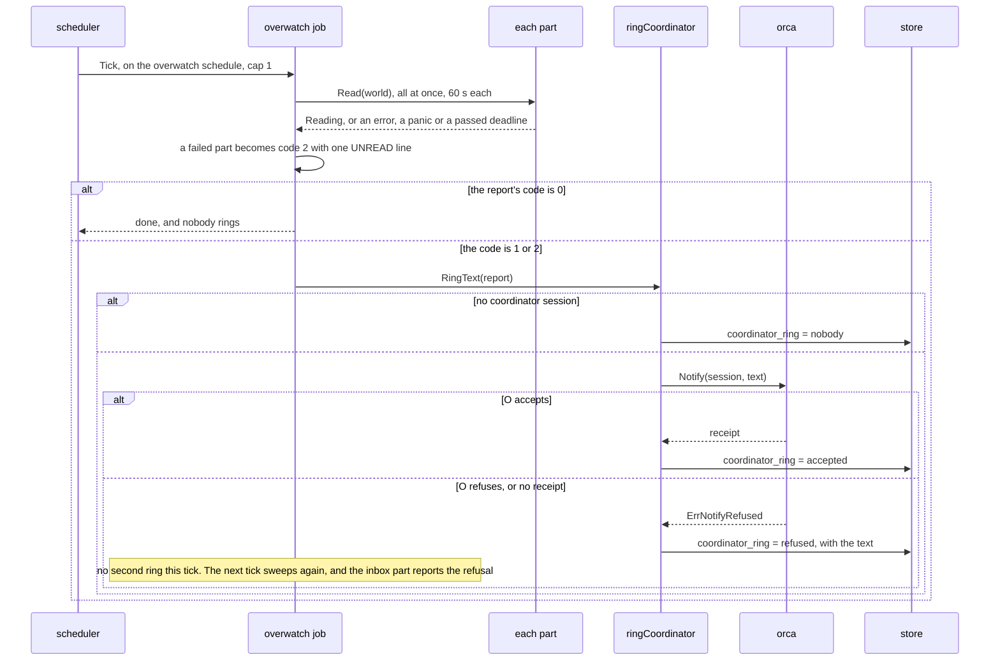
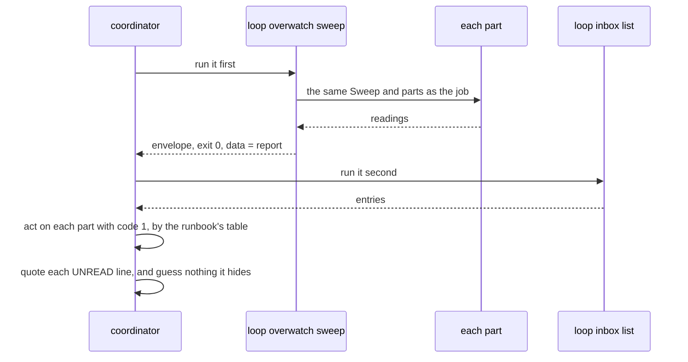

# Overwatch, a timed coordinator sweep: technical spec

## Source

- **Epic:** factorio-a7r
- **Source:** `docs/adr/0009-overwatch.md`. Its `**Ticket:**` line names this epic.
- **Stories covered:** none. This is an architecture epic.

The ADR's acceptance criteria carry no labels, so this spec numbers the ones the epic owns. Each
contract below cites one of them, or the ADR paragraph it proves.

| Label | ADR acceptance criterion |
| --- | --- |
| A1 | `go test ./internal/config/...` proves that `ThroughputKeys` holds `overwatch` |
| A2 | A sweep rings once when an `awaiting_panel` escalation's panel entry already rang, and a fixer run finished `done` after it |
| A3 | `grep -c 'the bug it became' .loop/policy/coordinator.md` prints `0` |
| A4 | `grep -c 'bugs. part' pack/runbooks/coordinator.md` prints at least `1` |
| A5 | A quiet sweep rings nobody |
| A6 | `loop schema` lists `overwatch sweep` |

The ADR's four document checks (gates, Ticket line, number, 25 verdict rows) passed when the ADR
merged. This spec owns none of them.

## Scope check

**Components:**

1. **The overwatch sweep.** The package `internal/overwatch`, the reads it makes of the store, the
   agent host and GitHub, the native job that runs it, the ring, and the verb
   `loop overwatch sweep`.
2. **The coordinator's instructions.** `pack/runbooks/coordinator.md`, the glossary, and this
   project's `.loop/policy/coordinator.md`. Why not its own epic: the pack gate checks each command
   that a runbook names against `loop schema`. So the runbook cannot name `loop overwatch sweep`
   before the verb lands. And a sweep that rings the coordinator with no runbook section to act on
   each part sends a wake that no rule reads.

Work entries 1 to 9 build the sweep, and each one proves its contracts with no runbook change.
Entry 10 changes the coordinator's instructions, and it needs only the verb and the `bugs` part.

**Not in this spec:** the inbox doorbell (`internal/inbox/notify.go`), which ADR 0009 keeps as it
is. Tickertown's four policy parts, which belong in a project's own policy. The merge pipeline's
waits, which `loop merge status` already reads.

## Decisions

The ADR decided the wake, the parts, the filed issues and the route of a finding. Each line below
is a choice that the ADR left to this spec, or one where the code shows that the ADR's stated
mechanism cannot run.

- **A missing `overwatch` entry in host config reads as its default. Config load does not refuse
  it, and nothing writes it to the file.** We chose a default at read time over the ADR's
  "`loop upgrade` writes the default entry", because the code shows that path cannot run. The
  operator runs `loop upgrade` with the old binary (`internal/release/upgrade.go`, `Upgrader.Run`).
  That code does not know the new key, and it never rewrites host config. Then the new server
  starts, and `validateThroughput` refuses the file with the reason "is missing". A server
  start needs a valid file. We also rejected a write by the new server at its start. The older
  release refuses an unknown key, with the reason "is not a stage, native job or pool of this
  loop". So `loop rollback` would start a service that refuses its own config. The
  ADR's purpose, "the operator edits no config", holds. The optional set holds `overwatch` only.
  Every entry that v0.0.22 requires stays required, so KTD30's check keeps its force for them.
  **This changes one line of ADR 0009's Consequences**, the bullet "A native job". The rest of that
  bullet stands.
- **The sweep is an instance job, not a job for each project.** We chose
  `Scheduler.RegisterInstanceJob` over `RegisterJob`, because one coordinator serves every project,
  and it needs one ring that names every project's parts. Each project's ring would cost one model
  turn per project for one tick. The schedule comes from host config only, as for `github-reactor`.
- **`loop overwatch sweep` runs a fresh sweep, and it never rings.** We chose a fresh sweep over
  the report of the last tick, because a stored report is up to ten minutes old. The coordinator
  reads state back after each write (runbook section 3), and an old report shows the state before
  the write. The job and the verb call the same function, so one producer stays.
- **The verb exits 0, and the envelope's `data.code` carries the sweep's 0, 1 or 2.** We chose this
  over mapping the sweep's code onto the CLI's exit codes, because CLI exit 1 promises that `data`
  is empty, and exit 2 means that the command could not decide. A quiet report holds lines, and a
  partial report decided every part it read.
- **The job rings on every tick whose report holds work or a failed read.** We chose this over a
  ring only when the set of findings changed. F-4 is a finding that stopped changing. A ring for
  each change rings once, and then it is silent, as the doorbell was.
- **Work means an act of the coordinator. A wait on a person reads code 0.** We chose this over
  "any inbox entry is work", because an escalation that waits on the operator would ring six times
  an hour with nothing for the coordinator to do. Tickertown's `questionsPart` makes the same cut
  (`scripts/sdlc/overwatch-parts.ts`, alpha: "The owner's act needs nothing yet").
- **Every part reads on every tick. No part has a slower cadence.** The ADR postponed this to the
  spec. We chose one cadence over a cadence for each part, because the arithmetic shows no need.
  On each tick, a project's GitHub parts make about 6 list reads, and `flaky` adds 2 reads for each
  rerun in its window. At 6 ticks an hour that is under 100 reads an hour for each project, against
  the App installation limit of 5,000 an hour. A second cadence would also be a second schedule
  that KTD30's host config does not hold.
- **Each part has its own deadline of 60 seconds. The sweep has none.** We chose a deadline for
  each part over one deadline for the sweep, because one slow vendor then costs its own part only.
  Fifteen parts run at once, so a sweep ends in about 60 seconds, well inside a ten-minute tick.
- **The loop's own project is the registered project whose repository is `release.ReleaseRepo`.**
  We chose this over a host config field and over the policy file's prose. A field is a config
  edit for the operator. The server cannot read prose. `release.ReleaseRepo` already names the
  repository that holds the loop's releases (`internal/release/upgrade.go:19`).
- **A bug names its fault by the fault id as a whole token in its body.** We chose this over a new
  `--fault` flag that writes a fact on the bug, because the 2026-10-23 authorization already puts
  the fault id in the bug's body. Bugs filed under it carry the id only there, and no verb could
  add a fact to them. The match is a whole token, so `F-1` does not match `F-12`.
- **A project's own health limits live in project config, under `health`.** We chose project
  config over constants in code for the CI budget and the audit workflow. Tickertown's 5-minute CI
  budget is its operator's words, so it is that project's preference. We rejected the policy file,
  because the server cannot read prose. A part whose limit is absent reports its reading and holds
  no work.
- **The limits that a fault in the loop sets are constants in code, ported from tickertown.** The
  flaky window is 48 hours (`FLAKY_WINDOW_HOURS`, `flaky-tests.ts`). An audit run is stale after
  36 hours (`STALE_HOURS`, `overwatch-audit.ts`). We rejected a config entry for each, because no
  project asked to tune them.
- **An item stalls after two fires of the stage that takes it, not after a number of minutes.** We
  chose a count of ticks over a time limit for each state, because the operator sets each stage's
  schedule (KTD30). A time limit that fits a five-minute stage reads every half-hourly stage as
  stalled. Two fires, not one: an item that entered its state just before a fire may miss that
  fire while the stage is at its cap.
- **One store row records the outcome of the last ring, whoever rang.** We chose one row that
  `ringCoordinator` writes for the doorbell and the overwatch ring over a row for the overwatch
  only, because the `inbox` part asks whether the coordinator is reachable. Either ring answers
  that.

## Assumptions

- The App installation's rate limit is 5,000 requests an hour, and the sweep spends under 2 % of
  it. This is wrong if `X-RateLimit-Remaining` falls by more than 100 across one hour of sweeps of
  one project.
- The service process can run the install drift check, `release.Installer.Check`. This is wrong if
  the check needs a terminal, or a user service bus that the service does not have.
- The loop's project holds few enough bugs that the `bugs` part reads every body inside its
  deadline. This is wrong if one read of every bug body in that project takes more than 10 seconds.
- Orca accepts a ring typed into a coordinator session that is in a turn, and it returns a receipt.
  This is wrong if `Notify` returns `ErrNotifyRefused` for a session that is only busy.
- The server pushes each item's branch with a name that starts `loop/<item id>`, as
  `loop/factorio-a7r-spec` does. The `pulls` part maps a pull request to its item by that prefix.
  This is wrong if `loop branch push` names a branch that the prefix maps to no item.
- One coordinator turn costs more than one sweep. ADR 0009 assumes this too, and nobody counted it.
  This is wrong if a sweep's reads cost more than one model turn, which no part's read comes close
  to.

## Approach

`internal/overwatch` holds the sweep. A sweep runs a fixed list of parts at one time. Each part
takes one `World`, the interface of every read it may make, and it returns a `Reading`: a code and
its lines. The code follows tickertown's convention (`overwatch-report.ts`, alpha). 0 means that
the part holds nothing for the coordinator. 1 means that the part holds work. 2 means that a read
failed, so the part is partial. The report's code is the highest code of its parts. A part never
writes. A part that returns an error, panics or passes its deadline reads as code 2, with one
`UNREAD` line that names the error. No other part waits on it.

Each part is one file with one pure classifier and the reads it needs. The classifier takes the
rows that the reads returned and the clock, and it returns the reading. So each part's rules are
tested on fixtures, with no store and no GitHub.

The server builds one `World` from what it already holds: the store, the machine, the project
list and their configs, the agent host, the GitHub service and the doctor checks. The job and the
verb both call `overwatch.Sweep` with that world and the same part list.

**The job.** `config.NativeJobs` gains `overwatch`. The server registers it as an instance job.
On each tick it sweeps. A report with code 0 ends the tick, and it rings nobody. A report with
code 1 or 2 rings once, through `Server.ringCoordinator`, with `overwatch.RingText`. The text is
fixed server text. It names each part with work and each part with a failed read, and it asks for
the sweep. It names no item, no entry and no agent text (KTD21). The job never types a ring twice
in one tick. A refused ring waits for the next tick, which sweeps again.

**The ring record.** `ringCoordinator` writes the outcome of every ring into one `schedule` row of
kind `coordinator_ring`: when, which source rang, and whether orca accepted it, refused it, or no
session ran. The `inbox` part reads that row.

**The verb.** `loop overwatch sweep` is a new noun and verb. The coordinator and the host may call
it. It sweeps and returns the report as the envelope's data. It never rings.

**The parts.** The ADR's table names fifteen parts that port. `sweep` folds into `stalls`. Each
part reads the loop's own state, and none reads Linear or orca's timer plan (R22). The work rule of
each part is its contract, under Contracts.

| Part | What it reads |
| --- | --- |
| `stalls` | Items in a state that a stage takes, their entry time, runs, holds and alerts. Escalations in `awaiting_panel` and the fixer runs of their project |
| `backlog` | Tickets in `backlog`, and the status of each blocker |
| `questions` | Escalations by state, and the prepared questions |
| `decisions` | Decisions in `pending`, and whether each names a date |
| `claims` | Leases, and the run that owns each one |
| `worktrees` | The `checkouts` table, the runs, and the directories under the checkout root |
| `timer-health` | The `cron` rows of `schedule`, and the liveness tick |
| `inbox` | The coordinator's session in the agent host inventory, and the `coordinator_ring` row |
| `server` | The install drift check, and the GitHub doctor lines |
| `bugs` | Open loop faults, the bugs of the loop's project and their bodies, and `reported` bugs in every project |
| `pulls` | Each project's open pull requests |
| `main` | The newest completed run of each workflow at the head of the base branch |
| `audit` | The newest base-branch run of the workflow that project config names |
| `ci` | The completed runs of the base branch and the merge queue in the flaky window |
| `flaky` | The runs in the flaky window that hold more than one attempt, and the jobs of each attempt |

**The coordinator.** Section 1 of the runbook runs `loop overwatch sweep` first and
`loop inbox list` second. A table maps each part to the section that acts on it. Section 6 reads
the `decisions` part instead of its own list. Section 9 step 3 files a bug for each fault that the
`bugs` part names, and for no other fault. This project's policy loses the report addition that
the `bugs` part now reports.

## Domain model

```
internal/overwatch (new)

Code                0 quiet, 1 work, 2 unread
  invariant: a report's code is the highest code of its parts. A part with an UNREAD line has
             code 2.

Reading             a code and its lines
  invariant: a part with code 1 has at least one line that names what the coordinator acts on.

PartReport          one part's name, its code, the command that repeats its read, its lines
  invariant: the name is one of PartNames. Each name appears once in a report.

Report              when the sweep ran, its code, and one PartReport for each part, in PartNames order
  invariant: it holds every part in PartNames, even a part that failed.

RingOutcome         when, the source (inbox or overwatch), the result (accepted, refused, nobody),
                    and the refusal's text
  invariant: result is one of the three values. Only "refused" carries text.
```

`PartNames`, in the order the runbook acts on them: `stalls`, `questions`, `decisions`, `bugs`,
`backlog`, `claims`, `pulls`, `worktrees`, `main`, `ci`, `flaky`, `audit`, `timer-health`,
`inbox`, `server`.

## Interfaces

```go
package overwatch

type Code int

const (
	Quiet  Code = 0
	Work   Code = 1
	Unread Code = 2
)

type Reading struct {
	Code  Code
	Lines []string
}

// Part is one read of the sweep. Read makes no write.
type Part struct {
	Name    string // one of PartNames
	Command string // the loop command that repeats the read by hand; empty when none does
	Read    func(ctx context.Context, w World) (Reading, error)
}

type PartReport struct {
	Name    string   `json:"name"`
	Code    Code     `json:"code"`
	Command string   `json:"command,omitempty"`
	Lines   []string `json:"lines"`
}

type Report struct {
	At    time.Time    `json:"at"`
	Code  Code         `json:"code"`
	Parts []PartReport `json:"parts"`
}

const PartDeadline = 60 * time.Second

var PartNames = []string{ /* the fifteen names above */ }

// Parts returns the shipped part list, one for each name in PartNames.
func Parts() []Part

// Sweep runs every part at once, each under PartDeadline. An error, a panic or a
// passed deadline becomes code 2 and one UNREAD line for that part only.
func Sweep(ctx context.Context, w World, parts []Part) Report

// RingText is the one line a ring types. ok is false for a report with code 0.
func RingText(r Report) (text string, ok bool)

// Job is the native job `overwatch`. Tick is a sched.InstanceJobFunc.
type Job struct {
	World World
	Parts []Part
	Ring  inbox.Doorbell // Server.ringCoordinator
}

func (j *Job) Tick(ctx context.Context) error

type RingOutcome struct {
	At     time.Time `json:"at"`
	Source string    `json:"source"` // "inbox" or "overwatch"
	Result string    `json:"result"` // "accepted", "refused" or "nobody"
	Detail string    `json:"detail,omitempty"`
}

// World is every read a part may make. The server builds the one production World.
type World interface {
	Now() time.Time
	Host(ctx context.Context) (*config.HostConfig, error)
	Projects(ctx context.Context) ([]config.Project, error)
	ProjectConfig(ctx context.Context, project string) (*config.ProjectSnapshot, error)
	Items(ctx context.Context, project string, f machine.ListFilter) ([]machine.Item, error)
	Body(ctx context.Context, project, item string) (string, error)
	Store() *store.Store // read transactions only
	Inventory(ctx context.Context) (agenthost.Inventory, error)
	Coordinator() sched.CoordinatorState
	GitHub() GitHubReads
	Doctor(ctx context.Context) ([]github.CheckLine, error) // install drift, then GitHub.Doctor
	LastRing(ctx context.Context) (RingOutcome, bool, error)
}

// GitHubReads are the GET reads of the GitHub parts, made with ScopeRead.
type GitHubReads interface {
	OpenPulls(ctx context.Context, p config.Project) ([]github.PR, error)
	WorkflowRuns(ctx context.Context, p config.Project, q github.RunQuery) ([]github.RunView, error)
	RunJobs(ctx context.Context, p config.Project, runID int64, attempt int) ([]github.JobView, error)
}
```

```go
package github

// RunQuery selects workflow runs. Empty fields select every value.
type RunQuery struct {
	Branch   string
	Event    string    // "push", "merge_group", "pull_request"
	Workflow string    // a file name under .github/workflows
	HeadSHA  string
	Since    time.Time // created at or after
}

// RunView is one workflow run, as the GitHub parts read it. The unexported
// workflowRun of reads.go stays the decode type of the existing reads.
type RunView struct {
	ID         int64     `json:"id"`
	Workflow   string    `json:"workflow"` // the file name under .github/workflows
	Event      string    `json:"event"`
	Branch     string    `json:"branch"`
	HeadSHA    string    `json:"head_sha"`
	Attempt    int       `json:"attempt"`
	Status     string    `json:"status"`
	Conclusion string    `json:"conclusion"`
	CreatedAt  time.Time `json:"created_at"`
	StartedAt  time.Time `json:"started_at"`
	UpdatedAt  time.Time `json:"updated_at"`
}

// JobView is one job of one attempt of a run.
type JobView struct {
	ID         int64  `json:"id"`
	Name       string `json:"name"`
	Conclusion string `json:"conclusion"`
}
```

`github.PR` is the existing type of `internal/github/pr.go`. `OpenPulls` reads every open pull
request of the project, one page of 100 at a time.

```go
package config

// ThroughputFor returns a stage's, job's or pool's entry. A native job that a
// later release added, which the host config does not hold, returns its
// DefaultThroughput entry. The returned value is never written into c.
func (c *HostConfig) ThroughputFor(name string) Throughput

// HealthConfig is project config's `health` block. Each field is optional.
type HealthConfig struct {
	CIBudget      time.Duration `yaml:"ci_budget,omitempty"`
	AuditWorkflow string        `yaml:"audit_workflow,omitempty"`
}
```

```proto
service OverwatchService {
  rpc Sweep(VerbRequest) returns (Envelope);
}
```

The CLI surface (`internal/cli/surface.go`):

```go
server("overwatch", "sweep", "run every overwatch part once and print the report; it rings nobody", coordinatorOrHost, nil)
```

The ring text, with each list in `PartNames` order and an empty list left out:

```
loop overwatch: work in <part>, <part>; unread <part>. Run `loop overwatch sweep`, then follow section 1 of your runbook.
```

## Data

```
host config, throughput (changed)
  overwatch     optional entry, cap 1, schedule "3,13,23,33,43,53 * * * *" when absent.
                DefaultThroughput holds it, so a new host config holds it.
                A present entry is checked as every other entry is.

project config (changed)
  + health.ci_budget        duration, optional. No default.
  + health.audit_workflow   a workflow file name under .github/workflows, optional. No default.

schedule (new row kind, no migration)
  kind = 'coordinator_ring', project = '', one row, updated in place.
  payload   the RingOutcome as JSON
```

**Existing records:** a host config written before this epic holds no `overwatch` entry, and it
keeps none. It loads, and the job ticks on the default. The `schedule` table holds no
`coordinator_ring` row until the first ring after the upgrade, and until then the `inbox` part
reports that the store holds no ring, with code 0. No project config holds `health`. An older
release reads a project config that holds `health` as invalid, and it keeps the last good config
(KTD20). So a project adds `health` only after its host runs this release.

## Flows

The timed sweep:



The coordinator's wake:



## Work

1. **The `overwatch` native job entry.** Add `overwatch` to `nativeJobs` and to
   `DefaultThroughput`. Add `ThroughputFor`, and make every reader of a throughput entry in the
   scheduler and admission use it. A host config with no `overwatch` entry loads.
   - Files: `internal/config/throughput.go`, `internal/config/host.go`, `internal/sched/scheduler.go`,
     `internal/admission/**` where it reads `Throughput`, with tests.
   - Needs: nothing.
   - Proves: C1, C2.
   - Done when: a host config file from v0.0.22 loads, ticks the `overwatch` row on the default
     schedule, and saves back with no `overwatch` key.
2. **The sweep, the job, the ring and the verb.** Build `internal/overwatch` with `Sweep`,
   `RingText` and `Job`, and an empty part list. Add the `coordinator_ring` record to
   `ringCoordinator`. Register the job. Add the `overwatch sweep` verb to the surface and to
   `services.proto`, and regenerate `gen/` with `make proto`.
   - Files: `internal/overwatch/{overwatch,ring,job}.go`, `internal/server/overwatch.go`,
     `internal/server/inbox.go`, `internal/server/server.go`, `internal/cli/surface.go`,
     `proto/loop/v1/services.proto`, `gen/**`, with tests.
   - Needs: 1.
   - Proves: C3, C4, C5, C6, C7, C8.
   - Done when: with one fake part that holds work, a tick rings once with the part's name, and
     `loop overwatch sweep` prints the same report and rings nobody.
3. **The `stalls` part.** It holds tickertown's `sweep` too.
   - Files: `internal/overwatch/stalls.go`, and an exported view of the stage claim states in
     `internal/admission/policy.go`, with tests.
   - Needs: 2.
   - Proves: C9, C10, C11.
   - Done when: the F-4 fixture, three escalations in `awaiting_panel` and a fixer run that ended
     `done` after them, makes a tick ring once and name `stalls`.
4. **The work-item parts: `questions`, `decisions` and `backlog`.**
   - Files: `internal/overwatch/{questions,decisions,backlog}.go`, with tests.
   - Needs: 2.
   - Proves: C12, C13, C14.
   - Done when: each part's fixtures give the codes that C12 to C14 state.
5. **The scheduler parts: `claims`, `worktrees` and `timer-health`.**
   - Files: `internal/overwatch/{claims,worktrees,timers}.go`, with tests.
   - Needs: 2.
   - Proves: C15, C16, C17.
   - Done when: each part's fixtures give the codes that C15 to C17 state.
6. **The reachability parts: `inbox` and `server`.**
   - Files: `internal/overwatch/{inbox,server}.go`, and the `World.Doctor` read in
     `internal/server/overwatch.go`, with tests.
   - Needs: 2.
   - Proves: C18, C19.
   - Done when: a refused ring recorded at one tick makes the next tick's `inbox` part hold work.
7. **The `bugs` part, the filed issues.**
   - Files: `internal/overwatch/bugs.go`, with tests.
   - Needs: 2.
   - Proves: C20, C21, C22.
   - Done when: an open fault that no bug names is work, and the same fault with a bug whose body
     names it is not.
8. **The GitHub base parts: `pulls`, `main` and `audit`.** Add `OpenPulls`, `WorkflowRuns` and
   `RunQuery` to the GitHub service, and `health.audit_workflow` to project config.
   - Files: `internal/github/reads.go`, `internal/config/project.go`,
     `internal/overwatch/{pulls,main,audit}.go`, with tests on `githubtest`.
   - Needs: 2.
   - Proves: C23, C24, C25, C26.
   - Done when: each part's fixtures give the codes that C23 to C26 state.
9. **The GitHub health parts: `ci` and `flaky`.** Add `RunJobs` to the GitHub service, and
   `health.ci_budget` to project config.
   - Files: `internal/github/reads.go`, `internal/config/project.go`,
     `internal/overwatch/{ci,flaky}.go`, with tests on `githubtest`.
   - Needs: 8, for `WorkflowRuns`.
   - Proves: C27, C28.
   - Done when: each part's fixtures give the codes that C27 and C28 state.
10. **The coordinator's instructions.** Section 1 of the coordinator runbook runs
    `loop overwatch sweep`, then `loop inbox list`. Add the table that maps each part to its
    section. Section 6 acts on the `decisions` part. Section 9 step 3 files a bug for each fault
    that the `bugs` part names. The glossary defines overwatch, sweep and part. Delete the report
    addition "Each open loop fault, the bug it became, and the release that will end it" from this
    project's coordinator policy.
    - Files: `pack/runbooks/coordinator.md`, `pack/skills/loop-sdlc-glossary/SKILL.md`,
      `.loop/policy/coordinator.md`.
    - Needs: 2 for the verb in the schema, and 7 for the `bugs` part.
    - Proves: C29, C30.
    - Done when: `make pack-check` passes, and A3 and A4 print what the ADR states.

## Out of scope

- The inbox doorbell's retry after a refused ring (`Notifier.Poke` keeps its cursor). ADR 0009
  keeps the doorbell as it is. It belongs to a later decision record, if a refused doorbell ring
  ever costs a resend.
- Tickertown's `night`, `frames`, `handoffs` and `watchers`. They belong in a project's
  `.loop/policy/coordinator.md`, as ADR 0009 states. No loop code reads them.
- A limit on how long a pull request may wait in the merge pipeline. `loop merge status` lists
  each one, longest wait first, and runbook section 3 reads it. No source gives a limit, so it
  belongs to a later epic when a merge wait goes unseen.
- The fix of F-4's own cause, why the fixer runs ended `done` with escalations waiting. It belongs
  to the bug that F-4 becomes in this project. This epic makes such a stall seen within one tick.
- A screen for the report. It belongs to no epic. The coordinator's reply is the operator's view.
- Filing a bug from the server. The coordinator files each one (ADR 0009 § Decision, "Filing a
  fault as a bug"). No part writes.

## Contracts

**C1. Behaviour: the job's entry exists.** Proves A1. `ThroughputKeys()` and `NativeJobs()` hold
`overwatch`. `DefaultThroughput()["overwatch"]` is cap 1 and schedule
`3,13,23,33,43,53 * * * *`.
*An example test in `internal/config`.*

**C2. Behaviour and refusal: an old host config loads, and stays as it was.** Proves ADR 0009
§ Decision, "Who fires it, and how often", with this spec's first decision. A host config with no
`overwatch` entry loads, and `ThroughputFor("overwatch")` returns the default. `SaveHost` of that
config writes no `overwatch` key. Config load refuses a host config whose `overwatch` entry has cap
0 or an empty schedule, with the same field errors as any other entry. A host config with no
`merge-handoff` entry is still refused.
*Example tests: a v0.0.22 host config fixture, a load and save round trip, and one refusal for
each bad field.*

**C3. Behaviour: a quiet sweep rings nobody.** Proves A5. A tick whose every part reads code 0
calls the doorbell zero times, and it writes no `coordinator_ring` row.
*An example test with fake parts and a counting doorbell.*

**C4. Behaviour: a sweep with work rings once, with server text.** Proves A2 and ADR 0009
§ Decision, "What the wake text asks for". A tick whose report holds code 1 or 2 calls the doorbell
exactly once. The text names each part with code 1 after `work in`, and each part with code 2
after `unread`, in `PartNames` order. It names `loop overwatch sweep`. It holds no item id, no
inbox entry id and no line of any part.
*An example test whose fake parts' lines hold an item id and an entry id, and which asserts that
neither reaches the text.*

**C5. Invariant: a failed part costs only itself.** Proves ADR 0009 § Decision, "Who reads, and
who acts". For any set of parts, when one part returns an error, panics, or passes
`PartDeadline`, its report has code 2 and one `UNREAD` line that names the failure. Every other
part's report equals its report from a sweep without the failed part. The report holds every name
in `PartNames`.
*A property test over generated part sets, with one failing part of each of the three kinds, and
a fake clock for the deadline.*

**C6. Refusal: a refused ring is never typed again in its tick.** Proves ADR 0009 § Consequences,
"A failed ring". When the doorbell returns `ErrNotifyRefused`, the tick calls it no second time,
and the `coordinator_ring` row holds `refused` with the refusal's text. With no coordinator
session, the row holds `nobody`, and the tick returns no error. An accepted ring writes
`accepted`. A doorbell ring of `Notifier.Poke` writes the row too, with source `inbox`.
*Example tests with a refusing, an absent and an accepting fake agent host.*

**C7. Behaviour: the verb sweeps, prints, and rings nobody.** Proves A6. `loop schema` lists
`overwatch sweep`. Called with the coordinator's or the host's token, it exits 0, and its data is
a `Report` that holds every name in `PartNames`. The verb calls the doorbell zero times, even when
a part holds work. The server refuses a run's token with `CAPABILITY_DENIED`.
*An example test through the RPC server, and a schema test.*

**C8. Equivalence: the job and the verb make one report.** Proves ADR 0009 § Consequences, "A
server package". Given one fake world and one clock, the report that `Job.Tick` builds and the
data that `loop overwatch sweep` returns are equal.
*Run both against the same fixture, and compare the two values.*

**C9. Behaviour: an escalation that a fixer run passed by is a stall.** Proves A2. An escalation in
`awaiting_panel` makes `stalls` hold work when a fixer run of its project ended after the
escalation's `created_at`. The line names the escalation id and that run id. An escalation in
`awaiting_panel` with no fixer run since its raise holds no work until two fixer fires pass.
With the F-4 fixture, whose panel entries already rang through `Notifier.Poke`, the tick
rings once and names `stalls`.
*Example tests on the F-4 fixture: three escalations, runs r-332c1c7116a7, r-53f391c45f88 and
r-131cf44e5259 ended `done` after them, and a doorbell that already rang for each entry.*

**C10. Boundary: an item stalls at the second fire of its stage.** Proves ADR 0009 § Decision,
"Which parts port", row `stalls`. An item in a state that its stage takes is work when two fires of
that stage's schedule (the project's override, else host config) passed after it entered the
state, and no run on the item started since then. These five are not work:

- Only one fire passed.
- A run started after the item entered the state.
- An open `retry_limit` or `run_blocked` alert names the item.
- A room's hold holds the item.
- Project config disables the stage.

Each of these prints a
line that says why the item waits, with code 0.
*Example tests at zero, one and two fires, and one test for each exclusion.*

**C11. Behaviour: lost work is a stall.** Proves ADR 0009 § Decision, "Which parts port", row
`sweep`. A ticket in `in_progress` that no lease holds and that no live run names is work for
`stalls`, at once.
*An example test.*

**C12. Behaviour: an escalation for a person with no question is work.** Proves ADR 0009
§ Decision, "What overwatch does with a finding". An escalation in state `person` whose inbox
entry has no prepared question makes `questions` hold work. A prepared question with no answer
reads code 0, because it waits on the operator. An escalation in `awaiting_panel` reads code 0
here, because `stalls` owns it.
*Example tests, one for each state.*

**C13. Behaviour: a decision with an event trigger is work.** Proves ADR 0009 § Decision, "Which
parts port", row `decisions`. A decision in `pending` with no `by` date makes `decisions` hold
work, and its line quotes the trigger. A decision with a `by` date reads code 0, because
`decision-timers` fires it.
*Example tests, one of each.*

**C14. Behaviour: a backlog ticket that nothing can free is work.** Proves ADR 0009 § Decision,
"Which parts port", row `backlog`. A ticket in `backlog` whose every blocker is `done` or
`canceled`, or that has no blocking edge, makes `backlog` hold work, and its line names the ticket
and each blocker. A ticket with an open blocker reads code 0, and its line names the open root.
*Example tests: all blockers done, one canceled, no edge, one open.*

**C15. Behaviour: a lease of an ended run is work.** Proves ADR 0009 § Decision, "Which parts
port", row `claims`. A lease whose owner run ended, or has no run row, makes `claims` hold
work. A lease of a live run reads code 0.
*Example tests, one of each.*

**C16. Behaviour: a leaked checkout is work.** Proves ADR 0009 § Decision, "Which parts port", row
`worktrees`. These three make `worktrees` hold work:

- A checkout row whose run ended longer ago than the agent host's quiet period plus the
  scheduler's cleanup interval.
- A directory under the checkout root that no row names.
- A row whose path does not exist.

 The coordinator's own checkout is never
work.
*Example tests in a temporary checkout root, one for each case, and one for the coordinator's
checkout.*

**C17. Behaviour: a timer that stopped is work.** Proves ADR 0009 § Decision, "Which parts port",
row `timer-health`. A `cron` row of `schedule` whose last fire is older than two periods of its
cron makes `timer-health` hold work. So does a liveness tick older than two liveness intervals. A
row that fired on time reads code 0.
*Example tests with a fake clock, at one and at two periods.*

**C18. Behaviour: an unreachable coordinator is work.** Proves ADR 0009 § Decision, "Which parts
port", row `inbox`. `inbox` holds work when the agent host inventory shows no live coordinator
session, or when the `coordinator_ring` row holds `refused`. An `accepted` row and a live session
read code 0. No row yet reads code 0, with one line that says so.
*Example tests for each row value, and one with no session.*

**C19. Behaviour: host drift is work.** Proves ADR 0009 § Decision, "Which parts port", row
`server`. A failed doctor line, from the install drift check or from the GitHub checks, makes
`server` hold work, and the line quotes the check's detail. All lines passed read code 0.
*Example tests with a fake doctor.*

**C20. Behaviour: an unfiled loop fault is work.** Proves ADR 0009 § Decision, "Filed issues". A
fault in status `open` or `acknowledged` makes `bugs` hold work when no bug in the loop's project
holds its id as a whole token in its body. The line names the fault, and the project to file it
in. A bug body that holds `F-12` files `F-12` and does not file `F-1`. A fault that is `fixed`,
`duplicate` or `not-a-fault` is never work.
*Example tests, with the `F-1` and `F-12` boundary.*

**C21. Behaviour: its repository names the loop's project.** Proves this spec's decision on
the loop's own project. The loop's project is the registered project whose repository equals
`release.ReleaseRepo`. With no such project, each fault in status `open` is work, and one line says
that no registered project holds the loop's repository. An `acknowledged` fault is then not work.
*Example tests with and without that project.*

**C22. Behaviour: a reported bug that nothing takes is work.** Proves ADR 0009 § Decision, "Filed
issues". A bug in `reported`, in any project whose config disables the reproducer stage, makes
`bugs` hold work. A bug in `reported` in a project whose reproducer stage runs reads code 0 here,
because `stalls` owns it.
*Example tests, one of each.*

**C23. Behaviour: two open pull requests for one item are work.** Proves ADR 0009 § Decision,
"Which parts port", row `pulls`. Two open pull requests whose head branches map to one item make
`pulls` hold work, and the line names both numbers. A pull request whose branch maps to no item
reads code 0.
*Example tests on `githubtest`.*

**C24. Behaviour: a red base branch is work.** Proves ADR 0009 § Decision, "Which parts port", row
`main`. The newest completed run of a workflow at the base branch's head that concluded `failure`
or `timed_out` makes `main` hold work. A run that concluded `cancelled`, `skipped` or `neutral`
reads code 0 (`overwatch-main.ts`, alpha, `SILENT`).
*Example tests on `githubtest`, one for each conclusion.*

**C25. Behaviour: a failed or stale audit is work.** Proves ADR 0009 § Decision, "Which parts
port", row `audit`. In a project whose config names `health.audit_workflow`, `audit` holds work
when the newest base-branch run of that workflow failed, or when it is older than 36 hours. A
project that names no audit workflow reads code 0, with one line that says so.
*Example tests at 35 and 37 hours, one failed run, and one project with no workflow.*

**C26. Refusal: a GitHub read that fails costs its project's part.** Proves ADR 0009 § Decision,
"Who reads, and who acts". When a GitHub read of one project fails, that project's lines in the
part read `UNREAD` and the part has code 2. Another project's lines in the same part, and every
store part, keep their readings. A 404 for a workflow that `health.audit_workflow` names is code 2,
and it names the workflow.
*Example tests on `githubtest` with two projects, one of which fails.*

**C27. Behaviour: CI over its budget is work.** Proves ADR 0009 § Decision, "Which parts port", row
`ci`. In a project whose config names `health.ci_budget`, `ci` holds work when the newest completed
run of the base branch, or of the merge queue, took longer than the budget. The lines give the
median and the 90th percentile of the window. A project with no budget reads code 0, with the
same lines.
*Example tests at the budget, one second over it, and with no budget.*

**C28. Behaviour: a test that failed and passed at one commit is work.** Proves ADR 0009 § Decision,
"Which parts port", row `flaky`. A job that failed in one attempt of a run and passed in a later
attempt at the same head, inside the 48-hour window, makes `flaky` hold work. The line names the
workflow, the job and the head. A job that failed and never passed reads code 0 here, because
`main` owns a red run.
*Example tests on `githubtest`: a rerun that passed, one that failed again, and one outside the
window.*

**C29. Behaviour: the runbook reads the sweep first.** Proves A4 and ADR 0009 § Consequences, "The
coordinator runbook". The first command in section 1 of `pack/runbooks/coordinator.md` is
`loop overwatch sweep`. Its table names each part in `PartNames` once. Section 9 step 3 names the
`bugs` part. `make pack-check` passes.
*A pack test that reads the runbook, and the pack gate. A4's `grep` prints at least 1.*

**C30. Behaviour: the policy drops what the sweep reports.** Proves A3.
`.loop/policy/coordinator.md` holds no line "the bug it became", and it keeps its standing
authorization word for word. The glossary
defines overwatch, sweep and part.
*A3's `grep` prints 0. A `grep` for each of the three glossary words prints at least 1.*

## Observable behaviour

None, because this epic draws no screen. The operator sees its effect in the coordinator's reply:
a stall reaches that reply within one tick of the sweep.

## Open questions
