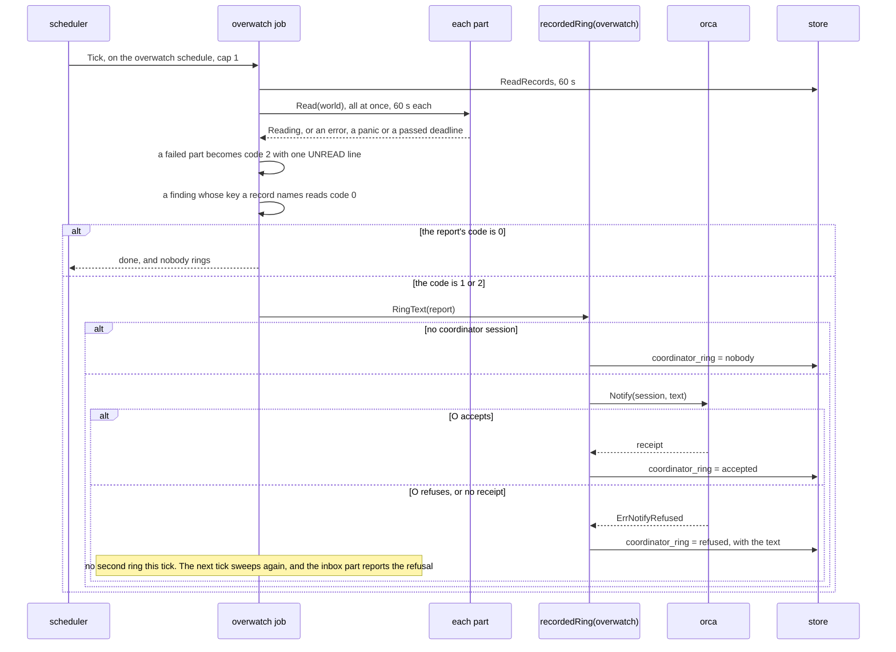
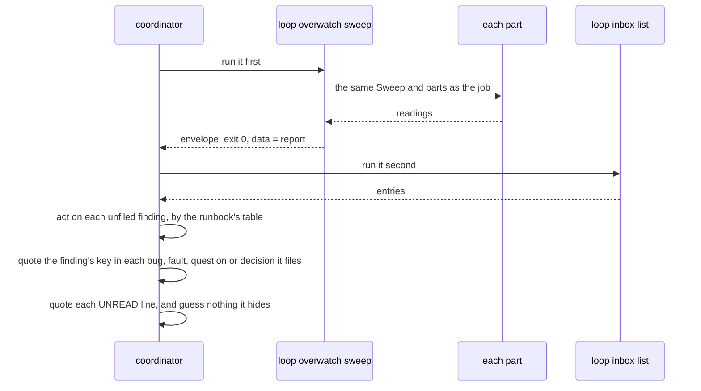

# Overwatch, a timed coordinator sweep: technical spec

## Source

- **Epic:** factorio-a7r
- **Source:** `docs/adr/0009-overwatch.md`. Its `**Ticket:**` line names this epic.
- **Stories covered:** none. This is an architecture epic.

The ADR's acceptance criteria carry no labels, so this spec numbers the ones the epic owns. Each
contract below cites one of them, or the ADR paragraph it proves.

| Label | ADR acceptance criterion |
| --- | --- |
| A1 | `go test ./internal/config/...` proves that `ThroughputKeys` holds `overwatch` |
| A2 | A sweep rings once when an `awaiting_panel` escalation's panel entry already rang, and a fixer run finished `done` after it |
| A3 | `grep -c 'the bug it became' .loop/policy/coordinator.md` prints `0` |
| A4 | `grep -c 'bugs. part' pack/runbooks/coordinator.md` prints at least `1` |
| A5 | A quiet sweep rings nobody |
| A6 | `loop schema` lists `overwatch sweep` |

The ADR's four document checks (gates, Ticket line, number, 25 verdict rows) passed when the ADR
merged. This spec owns none of them.

## Scope check

**Components:**

1. **The overwatch sweep.** The package `internal/overwatch`, the reads it makes of the store, the
   agent host and GitHub, the native job that runs it, the ring, and the verb
   `loop overwatch sweep`.
2. **The coordinator's instructions.** `pack/runbooks/coordinator.md`, the glossary, and this
   project's `.loop/policy/coordinator.md`. Why not its own epic: the pack gate checks each command
   that a runbook names against `loop schema`. So the runbook cannot name `loop overwatch sweep`
   before the verb lands. And a sweep that rings the coordinator with no runbook section to act on
   each part sends a wake that no rule reads.

Work entries 1 and 2 build the job, the verb and an empty part list. Entry 3 then points the
coordinator's section 1 at the verb, before any part can ring. Entries 4 to 10 add the parts, and
each one proves its contracts with no runbook change. Entry 11 moves sections 6 and 9 onto their
parts once every part has landed.

**Not in this spec:** the inbox doorbell (`internal/inbox/notify.go`), which ADR 0009 keeps as it
is. Tickertown's four policy parts, which belong in a project's own policy. The merge pipeline's
waits, which `loop merge status` already reads.

## Decisions

The ADR decided the wake, the parts, the filed issues and the route of a finding. Each line below
is a choice that the ADR left to this spec, or one where the code shows that the ADR's stated
mechanism cannot run.

- **A missing `overwatch` entry in host config reads as its default. Config load does not refuse
  it, and nothing writes it to the file.** We chose a default at read time over the ADR's
  "`loop upgrade` writes the default entry", because the code shows that path cannot run. The
  operator runs `loop upgrade` with the old binary (`internal/release/upgrade.go`, `Upgrader.Run`).
  That code does not know the new key, and it never rewrites host config. Then the new server
  starts, and `validateThroughput` refuses the file with the reason "is missing". A server
  start needs a valid file. We also rejected a write by the new server at its start. The older
  release refuses an unknown key, with the reason "is not a stage, native job or pool of this
  loop". So `loop rollback` would start a service that refuses its own config. The
  ADR's purpose, "the operator edits no config", holds. The optional set holds `overwatch` only.
  Every entry that v0.0.22 requires stays required, so KTD30's check keeps its force for them.
  **This changes one line of ADR 0009's Consequences**, the bullet "A native job". The rest of that
  bullet stands. Work entry 1 amends that bullet, so a later reader meets one mechanism.
- **The sweep is an instance job, not a job for each project.** We chose
  `Scheduler.RegisterInstanceJob` over `RegisterJob`, because one coordinator serves every project,
  and it needs one ring that names every project's parts. Each project's ring would cost one model
  turn per project for one tick. The schedule comes from host config only, as for `github-reactor`.
- **`loop overwatch sweep` runs a fresh sweep, and it never rings.** We chose a fresh sweep over
  the report of the last tick, because a stored report is up to ten minutes old. The coordinator
  reads state back after each write (runbook section 3), and an old report shows the state before
  the write. The job and the verb call the same function, so one producer stays.
- **The verb exits 0, and the envelope's `data.code` carries the sweep's 0, 1 or 2.** We chose this
  over mapping the sweep's code onto the CLI's exit codes, because CLI exit 1 promises that `data`
  is empty, and exit 2 means that the command could not decide. A quiet report holds lines, and a
  partial report decided every part it read.
- **The job rings on every tick whose report holds work or a failed read.** We chose this over a
  ring only when the set of findings changed. F-4 is a finding that stopped changing. A ring for
  each change rings once, and then it is silent, as the doorbell was. The next decision bounds what
  this costs.
- **A finding is work until the coordinator's act ends it: the state clears, or an open record
  names the finding's key.** Each finding carries a key, such as
  `overwatch:main:factorio:ci-yml@1a2b3c4d5e6f`. The sweep reads code 0 for a finding whose key an
  open record holds as a token, and it prints which record holds it. The records are open bugs and
  pending decisions in every project, unanswered prepared questions, and open loop faults (Approach,
  "Keys and records"). So each act of the coordinator ends the ring that it answers. A fix, a
  filed bug, a reported fault, a prepared question and a decision with a date each end it. We
  rejected work as the bare state of the world. A flake would then ring for its whole 48-hour
  window, about 288 rings, after the coordinator filed it. A red base branch would ring until its
  fix merged. We also rejected a store row that remembers which findings already rang. That row
  is state across sweeps with a second writer, and it hides a finding that nobody acted on. A record
  is the act itself, so a finding goes quiet only when someone acted. When that record closes and
  the state is still there, the finding rings again, because the fix did not end it.
- **A wait on a person reads code 0.** We chose this over "any inbox entry is work", because an
  escalation that waits on the operator would ring six times an hour with nothing for the
  coordinator to do. Tickertown's `questionsPart` makes the same cut
  (`scripts/sdlc/overwatch-parts.ts`, alpha: "The owner's act needs nothing yet"). A finding that
  needs the operator is work only until the coordinator prepares the question. The question then
  names its key.
- **A decision that waits on its event is a note with code 0, on every tick.** The `decisions` part
  prints one line for each `pending` decision, and the line quotes its trigger. The part holds no
  finding, so it never rings. The coordinator reads those lines on every wake from any source,
  because section 1 runs the sweep first, and section 6 checks each trigger. We rejected a
  waiting event decision as work. No act of the coordinator ends that work while the event has not
  happened: `defer` starts only from `needs_human` (`internal/machine/decision.go`), and `fire` or
  `moot` is wrong before the event. A record cannot end it either, because the decision's key
  cannot appear in its own body. So the decision would ring every tick until the event: six rings
  an hour. `factorio-jam`, "no host upgrade until factorio-88t ships", would ring that way until a
  release that holds the fix ships. We also rejected work only at the first sighting of a
  decision. A record that the sweep saw a decision before is the store row of rung findings that the
  decision above rejects. The cost of the note is a later fire: an event that happens while no
  part holds work waits for the next wake. A decision that cannot wait names a `by` date with
  `loop decision file --by`, and `decision-timers` fires it on that day.
- **Every part reads on every tick. No part has a slower cadence.** The ADR postponed this to the
  spec. We chose one cadence over a cadence for each part, because the arithmetic shows no need.
  On each tick, a project's GitHub parts make about 6 list reads, and `flaky` adds 2 reads for each
  rerun in its window. At 6 ticks an hour that is under 100 reads an hour for each project, against
  the App installation limit of 5,000 an hour. A second cadence would also be a second schedule
  that KTD30's host config does not hold.
- **Each part has its own deadline of 60 seconds. The sweep has none.** We chose a deadline for
  each part over one deadline for the sweep, because one slow vendor then costs its own part only.
  Fifteen parts and the records read run at once, so a sweep ends in about 60 seconds, well inside
  a ten-minute tick.
- **The loop's own project is the registered project whose repository is `release.ReleaseRepo`.**
  We chose this over a host config field and over the policy file's prose. A field is a config
  edit for the operator. The server cannot read prose. `release.ReleaseRepo` already names the
  repository that holds the loop's releases (`internal/release/upgrade.go:19`).
- **A bug names its fault by the fault id as a token in its body.** We chose this over a new
  `--fault` flag that writes a fact on the bug, because the 2026-10-23 authorization already puts
  the fault id in the bug's body. Bugs filed under it carry the id only there, and no verb could
  add a fact to them. One tokenizer reads fault ids and finding keys, so `F-1` does not match
  `F-12`.
- **A pull request maps to its item with `github.SpecEpicOf`, then `github.ItemOf`, on its head
  branch.** We chose the two exact functions of `internal/github/service.go` over a match on the
  prefix `loop/<item id>`. A prefix maps `loop/factorio-a7r` to an item `factorio-a7` too, and it
  maps a spec branch to an item id that ends in `-spec`. A branch that `SpecEpicOf` names is the
  epic's spec. Any other branch that `ItemOf` names is that item's work, or an epic's PRD. A pull
  request whose head repository is not the project's repository maps to no item.
- **An epic's PRD pull request and its spec pull request, open at once, are not work.** We chose
  to count by item and document over a count by item alone. `BranchOf` puts each document on a
  branch of its own by design, so two pull requests of one epic are two documents. Two open pull
  requests for one item and one document are work.
- **`ringCoordinator` stays as it is, and a new `recordedRing(source)` wraps it for the two rings
  that the loop sends.** We chose a doorbell for each source over a source argument on
  `inbox.Doorbell`. The `Doorbell` type and `Notifier` then stay as they are, and `Job.Ring` keeps
  the type `inbox.Doorbell`. The server binds `recordedRing("inbox")` to the notifier and
  `recordedRing("overwatch")` to the job.
- **`loop coordinator send` writes no ring row.** We chose no row over a third source `operator`.
  The operator reads the outcome of a send in its envelope already. And an accepted send would
  overwrite a refused ring before the next sweep's `inbox` part read it.
- **One store row records the outcome of the last ring that the loop sent.** We chose one row that
  both doorbells write over a row for the overwatch ring only, because the `inbox` part asks
  whether the coordinator is reachable. Either ring answers that.
- **`Sweep` reports the parts that it is given. `PartNames` is the fixed order of all fifteen.**
  We chose this over a report that always holds fifteen names, because entry 2 ships no part, and
  a report cannot hold a part that no code reads. `PartNames` orders the report, the ring text and
  the runbook's table. `Parts()` grows by the parts of each of entries 4 to 10. Entry 11 proves
  that it then holds every name in `PartNames`.
- **A project's own health limits live in project config, under `health`.** We chose project
  config over constants in code for the CI budget and the audit workflow. Tickertown's 5-minute CI
  budget is its operator's words, so it is that project's preference. We rejected the policy file,
  because the server cannot read prose. A part whose limit is absent reports its reading and holds
  no work.
- **The limits that a fault in the loop sets are constants in code, ported from tickertown.** The
  flaky window is 48 hours (`FLAKY_WINDOW_HOURS`, `flaky-tests.ts`). An audit run is stale after
  36 hours (`STALE_HOURS`, `overwatch-audit.ts`). We rejected a config entry for each, because no
  project asked to tune them.
- **An item stalls after two fires of the stage that takes it, not after a number of minutes.** We
  chose a count of ticks over a time limit for each state, because the operator sets each stage's
  schedule (KTD30). A time limit that fits a five-minute stage reads every half-hourly stage as
  stalled. Two fires, not one: an item that entered its state just before a fire may miss that
  fire while the stage is at its cap.
- **`backlog` holds work only for a ticket that `dependency-advance` cannot move.** We chose this
  over work for every ticket whose blockers are all done. `blockersDone` (`internal/sched/deps.go`)
  moves a ticket whose every blocks edge is done on the job's next fire, so that case is not a
  stall. A canceled blocker or no blocks edge holds the ticket until someone runs
  `loop work unblock`, so that case is work.
- **`worktrees` reads only directories named `loop-*`.** We chose the loop's own names over every
  directory under `agent_host.checkout_root`. That root is orca's workspace directory, and it also
  holds the operator's own worktrees. `internal/sched/dispatch.go` names a run's checkout
  `loop-<project>-<stage>-<run id>`, and `internal/room/room.go` names a room's `loop-<room id>`.

## Assumptions

- The App installation's rate limit is 5,000 requests an hour, and the sweep spends under 2 % of
  it. This is wrong if `X-RateLimit-Remaining` falls by more than 100 across one hour of sweeps of
  one project.
- The service process can run the install drift check, `release.Installer.Check`. This is wrong if
  the check needs a terminal, or a user service bus that the service does not have.
- Each project holds few enough open bugs and pending decisions that the records read takes every
  body inside its deadline. The `bugs` part reads every bug body of the loop's project the same
  way. This is wrong if one records read takes more than 10 seconds.
- Orca accepts a ring typed into a coordinator session that is in a turn, and it returns a receipt.
  This is wrong if `Notify` returns `ErrNotifyRefused` for a session that is only busy.
- `loop work shape` closes a bug and names its ticket in the fact `ticket`. The records read
  follows that fact, so a shaped bug's key stays filed while its ticket is open. This is wrong if a
  shaped bug holds no `ticket` fact.
- One coordinator turn costs more than one sweep. ADR 0009 assumes this too, and nobody counted it.
  This is wrong if a sweep's reads cost more than one model turn, which no part's read comes close
  to.
- A wake from some source reaches the coordinator soon enough after a decision's event, so a note
  serves where a ring would. This is wrong if the coordinator fires a decision with no `by` date more
  than a day after its event happened.

## Approach

`internal/overwatch` holds the sweep. A sweep reads the records once, and it runs a list of parts
at one time. Each part takes one `World`, the interface of every read it may make, and it returns
a `Reading`: its findings and its notes. A finding is one thing the coordinator acts on, with its
key. A note holds no work.

`Sweep` gives each part a code, by tickertown's convention (`overwatch-report.ts`, alpha). 0 means
that the part holds nothing for the coordinator. 1 means that at least one finding has a key that
no record names. 2 means that a read failed, so the part is partial. The report's code is the
highest code of its parts. A part never writes. A part that returns an error, panics or passes its
deadline reads as code 2, with one `UNREAD` line that names the error. No other part waits on it.

Each part is one file with one pure classifier and the reads it needs. The classifier takes the
rows that the reads returned and the clock, and it returns the reading. So each part's rules are
tested on fixtures, with no store and no GitHub.

The server builds one `World` from what it already holds: the store, the machine, the beads
clients, the project list and their configs, the scheduler's intervals, the agent host, the GitHub
service and the doctor checks. The job and the verb both call `overwatch.Sweep` with that world and
the server's part list, which is `Parts()` outside tests.

### Keys and records

A key is `overwatch:<part>:<subject>`. Its characters are letters, digits and `._/@:-`, and it never
ends in `.` or `:`. `Slug` lowers a name, and it turns each run of other characters into one `-`.
Each GitHub key names its project, because a record in any project may hold it.

| Part | Subject of the key | The act that ends the finding |
| --- | --- | --- |
| `stalls` | `<item>@<state>` | A run starts on the item, or a fault names the key |
| `stalls` | `escalation-<n>` | The escalation leaves `awaiting_panel`, or a fault names the key |
| `questions` | `escalation-<n>` | `loop inbox prepare --entry` for the escalation's entry |
| `decisions` | None. The part prints notes only (C13) | None. A note holds no work |
| `backlog` | `<ticket>` | `loop work unblock`, or a prepared question names the key |
| `claims` | `<item>` | The lease ends, or a fault names the key |
| `pulls` | `<project>:<item>:<document>` | One pull request closes, or a fault names the key |
| `worktrees` | `<directory name>` | The checkout goes, or a fault names the key |
| `timer-health` | `<schedule name>` | The timer fires, or a fault names the key |
| `inbox` | `no-session`, or `refused` | A session runs and a ring is accepted, or a fault names the key |
| `server` | `<check name>` | The check passes, or a fault or a question names the key |
| `bugs`, fault | `F-<n>`, the fault id itself | A bug in the loop's project names the id (C20), or `loop fault ack` (C21) |
| `bugs`, report | `<bug id>` | The project enables its reproducer, or a question names the key |
| `main` | `<project>:<workflow>@<head sha, 12>` | A later run at the head passes, the head moves, or a bug names the key |
| `audit` | `<project>:<workflow>@<run id>` | A newer run passes, or a bug names the key |
| `ci` | `<project>:<event>` | The newest run fits the budget, or a bug names the key |
| `flaky` | `<project>:<workflow>/<job>`, each a slug | The window holds no rerun that passed, or a bug names the key |

A record is one of these, read once for each sweep:

- A bug or a decision in any project, in a state that is not terminal for its kind. A bug that
  `loop work shape` closed counts while its ticket is not terminal. The read takes the body, and
  the title of a decision.
- A bug that `loop work duplicate` closed, while its `duplicate_of` item is done or not terminal.
  The read takes its body, for keys that start `overwatch:flaky:` only. While that item is open,
  the bug names the key. Once it is done, the bug names a flake only when the flake's run started
  before beads last wrote the done item. So a flake at a head older than a merged fix holds no
  work, and a later flake rings. A bug that duplicates a canceled item files nothing.
- A question that the coordinator prepared and the operator has not answered. The read takes its
  body.
- A loop fault in status `open` or `acknowledged`. The read takes its text. A fault's text counts
  for keys that start `overwatch:`, and never for a fault id. So a fault that cites another fault
  files nothing.

`Tokens` splits a text on each character that a key cannot hold, and it trims a final `.` or `:`
from each token. A record names a key when one of its tokens equals the key. The same rule reads a
fault id in a bug's body for the `bugs` part.

When the records read fails, `Sweep` cannot tell a filed finding from an unfiled one. Every finding
is then work, and the report has code 2 with the reason in `records`.

### The job

`config.NativeJobs` gains `overwatch`. The server registers it as an instance job. On each tick it
sweeps. A report with code 0 ends the tick, and it rings nobody. A report with code 1 or 2 rings
once, through `recordedRing("overwatch")`, with `overwatch.RingText`. The text is fixed server
text. It names each part with work and each part with a failed read, and it asks for the sweep. It
names no item, no entry, no key and no agent text (KTD21). The job never types a ring twice in one
tick. A refused ring waits for the next tick, which sweeps again.

### The ring record

`recordedRing(source)` returns an `inbox.Doorbell`. It calls `ringCoordinator`, and it writes the
outcome into one `schedule` row of kind `coordinator_ring`: when, which source rang, and whether
orca accepted it, refused it, or no session ran. It returns the ring's own error. A failed row write
is logged, and it does not change what the ring returns. The `inbox` part reads that row.
`coordinatorSend` keeps calling `ringCoordinator` directly, so the operator's message writes no row.

### The verb

`loop overwatch sweep` is a new noun and verb. The coordinator and the host may call it. It sweeps
and returns the report as the envelope's data. It never rings.

### The parts

The ADR's table names fifteen parts that port. `sweep` folds into `stalls`. Each part reads the
loop's own state, and none reads Linear or orca's timer plan (R22). The work rule of each part is
its contract, under Contracts.

| Part | What it reads |
| --- | --- |
| `stalls` | Items in a state that a stage takes, their entry time, runs, holds and alerts. Escalations in `awaiting_panel` and the fixer runs of their project |
| `backlog` | Tickets in `backlog`, and the beads edges of each one, through `World.Dependencies` |
| `questions` | Escalations by state, and the prepared questions |
| `decisions` | Decisions in `pending`, and whether each names a date |
| `claims` | Leases, and the run that owns each one |
| `worktrees` | The `checkouts` table, the runs, the `loop-*` directories that `World.CheckoutDirs` lists, and the cleanup interval |
| `timer-health` | The `cron` rows of `schedule`, the liveness tick, and the liveness interval |
| `inbox` | The coordinator's session in the agent host inventory, and the `coordinator_ring` row |
| `server` | The install drift check, and the GitHub doctor lines |
| `bugs` | Open loop faults, the bugs of the loop's project and their bodies, and `reported` bugs in every project |
| `pulls` | Each project's open pull requests, mapped by `SpecEpicOf` and `ItemOf` |
| `main` | The newest completed run of each workflow at the head of the base branch |
| `audit` | The newest base-branch run of the workflow that project config names |
| `ci` | The completed runs of the base branch and the merge queue in the flaky window |
| `flaky` | The runs in the flaky window that hold more than one attempt, and the jobs of each attempt |

### The coordinator

Entry 3 changes section 1 of the runbook. It runs `loop overwatch sweep` first and
`loop inbox list` second. A table maps each part to the section that acts on it. When the
coordinator files a bug, reports a fault, prepares a question or files a decision for a finding, it
quotes the finding's key in the body. The line on "health limits" names project config's `health`
block. Entry 11 changes the rest. Section 6 reads the `decisions` part's notes on every wake,
instead of its own list. It keeps `defer` for a decision in `needs_human` only, as the decision
table allows.
Section 9 step 3 files a bug for each fault that the `bugs` part names, and for no other fault.
This project's policy loses the report addition that the `bugs` part now reports.

## Domain model

```
internal/overwatch (new)

Code                0 quiet, 1 work, 2 unread
  invariant: a report's code is the highest code of its parts, and 2 when the records read
             failed. A part with an UNREAD line has code 2.

Finding             a key and the line that the coordinator acts on
  invariant: the key matches the key grammar. The line quotes the key.

Reading             a part's findings and its notes
  invariant: a note holds no work.

Records             each token of each open record, and the record that holds it
  invariant: a fault's text adds only tokens that start "overwatch:".

PartReport          one part's name, its code, the command that repeats its read, its lines
  invariant: the name is one of PartNames. Each name appears once in a report. Code 1 holds at
             least one finding that no record names.

Report              when the sweep ran, its code, the records read's failure, and one PartReport
                    for each part the sweep was given, in PartNames order

RingOutcome         when, the source (inbox or overwatch), the result (accepted, refused, nobody),
                    and the refusal's text
  invariant: result is one of the three values. Only "refused" carries text.
```

`PartNames`, in the order the runbook acts on them: `stalls`, `questions`, `decisions`, `bugs`,
`backlog`, `claims`, `pulls`, `worktrees`, `main`, `ci`, `flaky`, `audit`, `timer-health`,
`inbox`, `server`.

## Interfaces

```go
package overwatch

type Code int

const (
	Quiet  Code = 0
	Work   Code = 1
	Unread Code = 2
)

// Finding is one thing the coordinator acts on. It is work until a record
// names Key.
type Finding struct {
	Key  string // overwatch:<part>:<subject>, or a fault id for the bugs part
	Line string // quotes Key
}

type Reading struct {
	Findings []Finding
	Notes    []string // lines that hold no work
}

// Part is one read of the sweep. Read makes no write.
type Part struct {
	Name    string // one of PartNames
	Command string // the loop command that repeats the read by hand; empty when none does
	Read    func(ctx context.Context, w World) (Reading, error)
}

type PartReport struct {
	Name    string   `json:"name"`
	Code    Code     `json:"code"`
	Command string   `json:"command,omitempty"`
	Lines   []string `json:"lines"` // unfiled findings, then filed findings with their record, then notes
}

type Report struct {
	At      time.Time    `json:"at"`
	Code    Code         `json:"code"`
	Records string       `json:"records,omitempty"` // the UNREAD reason of the records read; empty when it worked
	Parts   []PartReport `json:"parts"`
}

const PartDeadline = 60 * time.Second

// PartNames is the order of every part that ports: of a report, of the ring
// text and of the runbook's table.
var PartNames = []string{ /* the fifteen names above */ }

// Parts returns the shipped part list. Each part entry adds its part.
func Parts() []Part

// Key builds overwatch:<part>:<subject>. Slug makes one subject segment safe.
func Key(part string, subject ...string) string
func Slug(name string) string

// Tokens splits text on every character a key cannot hold, and trims a final
// "." or ":" from each token.
func Tokens(text string) []string

// Records is every open record's tokens, and the record that holds each one.
type Records struct{ /* token -> record name, such as "factorio-x1y", "F-3" or "question 7" */ }

func ReadRecords(ctx context.Context, w World) (Records, error)

// Names returns the record that holds key as a token.
func (r Records) Names(key string) (record string, ok bool)

// Sweep reads the records and runs every part at once, each under
// PartDeadline. An error, a panic or a passed deadline becomes code 2 and one
// UNREAD line for that part only. The report holds one PartReport for each
// part given, in PartNames order.
func Sweep(ctx context.Context, w World, parts []Part) Report

// RingText is the one line a ring types. ok is false for a report with code 0.
func RingText(r Report) (text string, ok bool)

// Job is the native job `overwatch`. Tick is a sched.InstanceJobFunc.
type Job struct {
	World World
	Parts []Part
	Ring  inbox.Doorbell // the server's recordedRing("overwatch")
}

func (j *Job) Tick(ctx context.Context) error

const (
	SourceInbox     = "inbox"
	SourceOverwatch = "overwatch"
)

type RingOutcome struct {
	At     time.Time `json:"at"`
	Source string    `json:"source"` // SourceInbox or SourceOverwatch
	Result string    `json:"result"` // "accepted", "refused" or "nobody"
	Detail string    `json:"detail,omitempty"`
}

// RecordRing writes the one coordinator_ring row. LastRing reads it.
func RecordRing(ctx context.Context, st *store.Store, o RingOutcome) error
func LastRing(ctx context.Context, st *store.Store) (RingOutcome, bool, error)

// Intervals are the scheduler's own, from sched.Config.
type Intervals struct {
	Tick     time.Duration
	Liveness time.Duration
	Cleanup  time.Duration
}

// World is every read a part may make. The server builds the one production World.
type World interface {
	Now() time.Time
	Host(ctx context.Context) (*config.HostConfig, error)
	Projects(ctx context.Context) ([]config.Project, error)
	ProjectConfig(ctx context.Context, project string) (*config.ProjectSnapshot, error)
	Items(ctx context.Context, project string, f machine.ListFilter) ([]machine.Item, error)
	Body(ctx context.Context, project, item string) (string, error)
	// Dependencies are an item's beads edges of every kind, each with its
	// status. An empty list means the item has no edge.
	Dependencies(ctx context.Context, project, item string) ([]beadsx.Dependency, error)
	Store() *store.Store // read transactions only
	Intervals() Intervals
	// Jobs are the native jobs registered on the scheduler. A server with
	// no scheduler registers none.
	Jobs() sched.Jobs
	// CheckoutDirs lists each directory named loop-* one level under a
	// directory of agent_host.checkout_root, as absolute paths.
	CheckoutDirs(ctx context.Context) ([]string, error)
	Inventory(ctx context.Context) (agenthost.Inventory, error)
	Coordinator() sched.CoordinatorState
	GitHub() GitHubReads
	Doctor(ctx context.Context) ([]github.CheckLine, error) // install drift, then GitHub.Doctor
	LastRing(ctx context.Context) (RingOutcome, bool, error)
}

// GitHubReads are the GET reads of the GitHub parts, made with ScopeRead.
type GitHubReads interface {
	OpenPulls(ctx context.Context, p config.Project) ([]github.PR, error)
	WorkflowRuns(ctx context.Context, p config.Project, q github.RunQuery) ([]github.RunView, error)
	RunJobs(ctx context.Context, p config.Project, runID int64, attempt int) ([]github.JobView, error)
}
```

```go
package server

// recordedRing is the doorbell of one source. It rings through
// ringCoordinator and writes the outcome with overwatch.RecordRing.
func (s *Server) recordedRing(source string) inbox.Doorbell

// The two bindings:
//   s.Notifier = &inbox.Notifier{Inbox: s.Inbox, Ring: s.recordedRing(overwatch.SourceInbox)}
//   &overwatch.Job{World: w, Parts: s.overwatchParts, Ring: s.recordedRing(overwatch.SourceOverwatch)}
// ringCoordinator(ctx, text) keeps its signature. coordinatorSend calls it, and writes no row.
```

```go
package github

// RunQuery selects workflow runs. Empty fields select every value.
type RunQuery struct {
	Branch   string
	Event    string    // "push", "merge_group", "pull_request"
	Workflow string    // a file name under .github/workflows
	HeadSHA  string
	Since    time.Time // created at or after
}

// RunView is one workflow run, as the GitHub parts read it. The unexported
// workflowRun of reads.go stays the decode type of the existing reads.
type RunView struct {
	ID         int64     `json:"id"`
	Workflow   string    `json:"workflow"` // the file name under .github/workflows
	Event      string    `json:"event"`
	Branch     string    `json:"branch"`
	HeadSHA    string    `json:"head_sha"`
	Attempt    int       `json:"attempt"`
	Status     string    `json:"status"`
	Conclusion string    `json:"conclusion"`
	CreatedAt  time.Time `json:"created_at"`
	StartedAt  time.Time `json:"started_at"`
	UpdatedAt  time.Time `json:"updated_at"`
}

// JobView is one job of one attempt of a run.
type JobView struct {
	ID         int64  `json:"id"`
	Name       string `json:"name"`
	Conclusion string `json:"conclusion"`
}
```

`github.PR` is the existing type of `internal/github/pr.go`. `OpenPulls` reads every open pull
request of the project, one page of 100 at a time. The `pulls` part maps `PR.Head.Ref` with the
existing `github.SpecEpicOf` and `github.ItemOf`, and reads `PR.Head.Repo` to drop a fork's pull
request.

```go
package config

// ThroughputFor returns a stage's, job's or pool's entry. A native job that a
// later release added, which the host config does not hold, returns its
// DefaultThroughput entry. The returned value is never written into c.
func (c *HostConfig) ThroughputFor(name string) Throughput

// HealthConfig is project config's `health` block. Each field is optional.
type HealthConfig struct {
	CIBudget      time.Duration `yaml:"ci_budget,omitempty"`
	AuditWorkflow string        `yaml:"audit_workflow,omitempty"`
}
```

```proto
service OverwatchService {
  rpc Sweep(VerbRequest) returns (Envelope);
}
```

The CLI surface (`internal/cli/surface.go`):

```go
server("overwatch", "sweep", "run every overwatch part once and print the report; it rings nobody", coordinatorOrHost, nil)
```

The ring text, with each list in `PartNames` order and an empty list left out. A failed records
read adds `records` at the end of the unread list:

```
loop overwatch: work in <part>, <part>; unread <part>. Run `loop overwatch sweep`, then follow section 1 of your runbook.
```

## Data

```
host config, throughput (changed)
  overwatch     optional entry, cap 1, schedule "3,13,23,33,43,53 * * * *" when absent.
                DefaultThroughput holds it, so a new host config holds it.
                A present entry is checked as every other entry is.

project config (changed)
  + health.ci_budget        duration, optional. No default.
  + health.audit_workflow   a workflow file name under .github/workflows, optional. No default.

schedule (new row kind, no migration)
  kind = 'coordinator_ring', project = '', one row, updated in place.
  payload   the RingOutcome as JSON
```

**Existing records:** a host config written before this epic holds no `overwatch` entry, and it
keeps none. It loads, and the job ticks on the default. The `schedule` table holds no
`coordinator_ring` row until the first ring after the upgrade, and until then the `inbox` part
reports that the store holds no ring, with code 0. No project config holds `health`. An older
release reads a project config that holds `health` as invalid, and it keeps the last good config
(KTD20). So a project adds `health` only after its host runs this release. No bug, decision,
question or fault holds a key before this epic, so the first sweep reads every finding as work.

## Flows

The timed sweep:



The coordinator's wake:



## Work

1. **The `overwatch` native job entry.** Add `overwatch` to `nativeJobs` and to
   `DefaultThroughput`. Add `ThroughputFor`, and make every reader of a throughput entry in the
   scheduler and admission use it. A host config with no `overwatch` entry loads. Amend ADR 0009's
   Consequences bullet "A native job" to the default at read time, and cite this spec.
   - Files: `internal/config/throughput.go`, `internal/config/host.go`, `internal/sched/scheduler.go`,
     `internal/admission/**` where it reads `Throughput`, `docs/adr/0009-overwatch.md`, with tests.
   - Needs: nothing.
   - Proves: C1, C2.
   - Done when: a host config file from v0.0.22 loads, ticks the `overwatch` row on the default
     schedule, and saves back with no `overwatch` key.
2. **The sweep, the records, the job, the ring and the verb.** Build `internal/overwatch` with
   `Sweep`, `Key`, `Slug`, `Tokens`, `ReadRecords`, `RingText`, `Job`, `RecordRing` and `LastRing`,
   and an empty `Parts()`. Build the production `World`. Add `recordedRing`, and bind it to the
   notifier and the job. Register the job. Add the `overwatch sweep` verb to the surface and to
   `services.proto`, and regenerate `gen/` with `make proto`. The server holds its part list in a
   field that tests replace.
   - Files: `internal/overwatch/{overwatch,records,ring,job}.go`, `internal/server/overwatch.go`,
     `internal/server/inbox.go`, `internal/server/server.go`, `internal/cli/surface.go`,
     `proto/loop/v1/services.proto`, `gen/**`, with tests.
   - Needs: 1.
   - Proves: C3, C4, C5, C6, C7, C8, C31.
   - Done when: with one fake part that holds an unfiled finding, a tick rings once with the
     part's name, and `loop overwatch sweep` prints the same report and rings nobody. With a fake
     bug whose body holds that finding's key, the tick rings nobody.
3. **The coordinator's section 1, the table and the glossary.** Section 1 of the coordinator
   runbook runs `loop overwatch sweep`, then `loop inbox list`. Add the table that maps each name
   in `PartNames` to its section. Say that the coordinator quotes a finding's key in each bug,
   fault, question or decision it files for the finding. The line on "health limits" in the
   reading list names project config's `health` block, and the policy keeps no limit. The glossary
   defines overwatch, sweep, part and finding key.
   - Files: `pack/runbooks/coordinator.md`, `pack/skills/loop-sdlc-glossary/SKILL.md`.
   - Needs: 2, for the verb in the schema.
   - Proves: C29, C30.
   - Done when: `make pack-check` passes, and section 1 runs the sweep first. No part has landed
     yet, so the job cannot ring before the runbook reads the sweep.
4. **The `stalls` part.** It holds tickertown's `sweep` too.
   - Files: `internal/overwatch/stalls.go`, and an exported view of the stage claim states in
     `internal/admission/policy.go`, with tests.
   - Needs: 2, 3.
   - Proves: C9, C10, C11.
   - Done when: the F-4 fixture, three escalations in `awaiting_panel` and a fixer run that ended
     `done` after them, makes a tick ring once and name `stalls`.
5. **The work-item parts: `questions`, `decisions` and `backlog`.**
   - Files: `internal/overwatch/{questions,decisions,backlog}.go`, the `World.Dependencies` read in
     `internal/server/overwatch.go`, with tests.
   - Needs: 2, 3.
   - Proves: C12, C13, C14.
   - Done when: each part's fixtures give the codes that C12 to C14 state.
6. **The scheduler parts: `claims`, `worktrees` and `timer-health`.**
   - Files: `internal/overwatch/{claims,worktrees,timers}.go`, the `World.Intervals` and
     `World.CheckoutDirs` reads in `internal/server/overwatch.go`, with tests.
   - Needs: 2, 3.
   - Proves: C15, C16, C17.
   - Done when: each part's fixtures give the codes that C15 to C17 state.
7. **The reachability parts: `inbox` and `server`.**
   - Files: `internal/overwatch/{inbox,server}.go`, and the `World.Doctor` read in
     `internal/server/overwatch.go`, with tests.
   - Needs: 2, 3.
   - Proves: C18, C19.
   - Done when: a refused ring recorded at one tick makes the next tick's `inbox` part hold work.
8. **The `bugs` part, the filed issues.**
   - Files: `internal/overwatch/bugs.go`, with tests.
   - Needs: 2, 3.
   - Proves: C20, C21, C22.
   - Done when: an open fault that no bug names is work, and the same fault with a bug whose body
     names it is not.
9. **The GitHub base parts: `pulls`, `main` and `audit`.** Add `OpenPulls`, `WorkflowRuns` and
   `RunQuery` to the GitHub service, and `health.audit_workflow` to project config.
   - Files: `internal/github/reads.go`, `internal/config/project.go`,
     `internal/overwatch/{pulls,main,audit}.go`, with tests on `githubtest`.
   - Needs: 2, 3.
   - Proves: C23, C24, C25, C26.
   - Done when: each part's fixtures give the codes that C23 to C26 state.
10. **The GitHub health parts: `ci` and `flaky`.** Add `RunJobs` to the GitHub service, and
    `health.ci_budget` to project config.
    - Files: `internal/github/reads.go`, `internal/config/project.go`,
      `internal/overwatch/{ci,flaky}.go`, with tests on `githubtest`.
    - Needs: 9, for `WorkflowRuns`.
    - Proves: C27, C28.
    - Done when: each part's fixtures give the codes that C27 and C28 state.
11. **Sections 6 and 9 act on their parts.** Section 6 of the coordinator runbook acts on the
    `decisions` part's notes on every wake. It offers `defer` only for a decision in
    `needs_human`. Section 9 step 3 files a bug for each fault that the `bugs` part names. Delete
    the report addition "Each open loop fault, the bug it became, and the release that will end it"
    from this project's coordinator policy. Add the test that `Parts()` holds each name in
    `PartNames` once.
    - Files: `pack/runbooks/coordinator.md`, `.loop/policy/coordinator.md`,
      `internal/overwatch/parts_test.go`.
    - Needs: 4 to 10. The old trigger of section 9 step 3 stays until every part has landed.
    - Proves: C32, C33.
    - Done when: `make pack-check` passes, `go test ./internal/overwatch/...` passes, and A3 and A4
      print what the ADR states.

## Out of scope

- The inbox doorbell's retry after a refused ring (`Notifier.Poke` keeps its cursor). ADR 0009
  keeps the doorbell as it is. It belongs to a later decision record, if a refused doorbell ring
  ever costs a resend.
- Tickertown's `night`, `frames`, `handoffs` and `watchers`. They belong in a project's
  `.loop/policy/coordinator.md`, as ADR 0009 states. No loop code reads them.
- A limit on how long a pull request may wait in the merge pipeline. `loop merge status` lists
  each one, longest wait first, and runbook section 3 reads it. No source gives a limit, so it
  belongs to a later epic when a merge wait goes unseen.
- The fix of F-4's own cause, why the fixer runs ended `done` with escalations waiting. It belongs
  to the bug that F-4 becomes in this project. This epic makes such a stall seen within one tick.
- A screen for the report. It belongs to no epic. The coordinator's reply is the operator's view.
- Filing a bug from the server. The coordinator files each one (ADR 0009 § Decision, "Filing a
  fault as a bug"). No part writes.
- A verb that removes a leaked checkout. The scheduler's cleanup owns checkouts. A leak that it
  misses is a loop fault, and the coordinator reports it.

## Contracts

**C1. Behaviour: the job's entry exists.** Proves A1. `ThroughputKeys()` and `NativeJobs()` hold
`overwatch`. `DefaultThroughput()["overwatch"]` is cap 1 and schedule
`3,13,23,33,43,53 * * * *`.
*An example test in `internal/config`.*

**C2. Behaviour and refusal: an old host config loads, and stays as it was.** Proves ADR 0009
§ Decision, "Who fires it, and how often", with this spec's first decision. A host config with no
`overwatch` entry loads, and `ThroughputFor("overwatch")` returns the default. `SaveHost` of that
config writes no `overwatch` key. Config load refuses a host config whose `overwatch` entry has cap
0 or an empty schedule, with the same field errors as any other entry. A host config with no
`merge-handoff` entry is still refused.
*Example tests: a v0.0.22 host config fixture, a load and save round trip, and one refusal for
each bad field.*

**C3. Behaviour: a quiet sweep rings nobody.** Proves A5. A tick whose every part reads code 0
calls the doorbell zero times, and it writes no `coordinator_ring` row. A tick whose every finding
a record names reads code 0 too, and it rings nobody.
*An example test with fake parts, a fake record, and a counting doorbell.*

**C4. Behaviour: a sweep with work rings once, with server text.** Proves A2 and ADR 0009
§ Decision, "What the wake text asks for". A tick whose report holds code 1 or 2 calls the doorbell
exactly once. The text names each part with code 1 after `work in`, and each part with code 2
after `unread`, in `PartNames` order. A failed records read adds `records` to the unread list. The
text names `loop overwatch sweep`. It holds no item id, no inbox entry id, no key and no line of
any part.
*An example test whose fake parts' lines hold an item id, an entry id and a key, and which asserts
that none of them reaches the text.*

**C5. Invariant: a failed part costs only itself.** Proves ADR 0009 § Decision, "Who reads, and
who acts". For any set of parts, when one part returns an error, panics, or passes
`PartDeadline`, its report has code 2 and one `UNREAD` line that names the failure. Every other
part's report equals its report from a sweep of the same set in which the failed part returns no
finding and no note. The report holds one `PartReport` for each part given, in `PartNames` order,
and it holds the failed part's name too.
*A property test over generated sets of fake parts named from `PartNames`, with one failing part of
each of the three kinds, and a fake clock for the deadline.*

**C6. Refusal: a refused ring is never typed again in its tick.** Proves ADR 0009 § Consequences,
"A failed ring". When the doorbell returns `ErrNotifyRefused`, the tick calls it no second time,
and the `coordinator_ring` row holds `refused`, source `overwatch`, with the refusal's text. With
no coordinator session, the row holds `nobody`, and the tick returns no error. An accepted ring
writes `accepted`. A ring of `Notifier.Poke` writes the row with source `inbox`. A
`loop coordinator send`, accepted or refused, leaves the row as it was. A failed row write leaves
the ring's own result unchanged.
*Example tests with a refusing, an absent and an accepting fake agent host, one through the
notifier, one through `coordinatorSend`, and one with a store that refuses the write.*

**C7. Behaviour: the verb sweeps, prints, and rings nobody.** Proves A6. `loop schema` lists
`overwatch sweep`. Called with the coordinator's or the host's token, it exits 0, and its data is
a `Report` that holds one `PartReport` for each part of the server's part list. With an empty list
it holds no part and code 0. The verb calls the doorbell zero times, even when a part holds work.
The server refuses a run's token with `CAPABILITY_DENIED`.
*An example test through the RPC server with a replaced part list of two fake parts, one with the
empty list, and a schema test.*

**C8. Equivalence: the job and the verb make one report.** Proves ADR 0009 § Consequences, "A
server package". Given one fake world, one part list and one clock, the report that `Job.Tick`
builds and the data that `loop overwatch sweep` returns are equal.
*Run both against the same fixture, and compare the two values.*

**C9. Behaviour: an escalation that a fixer run passed by is a stall.** Proves A2. An escalation in
`awaiting_panel` makes `stalls` hold work when a fixer run of its project ended after the
escalation's `created_at`. The line names the escalation id, that run id and the key
`overwatch:stalls:escalation-<n>`. An escalation in `awaiting_panel` with no fixer run since its
raise holds no work until two fixer fires pass. With the F-4 fixture, whose panel entries already
rang through `Notifier.Poke`, the tick rings once and names `stalls`. A fault whose text holds the
escalation's key ends the work. The escalation's own move out of `awaiting_panel` ends it too.
*Example tests on the F-4 fixture: three escalations, runs r-332c1c7116a7, r-53f391c45f88 and
r-131cf44e5259 ended `done` after them, and a doorbell that already rang for each entry. One more
with a fault that names one escalation's key.*

**C10. Boundary: an item stalls at the second fire of its stage.** Proves ADR 0009 § Decision,
"Which parts port", row `stalls`. An item in a state that its stage takes is work when two fires of
that stage's schedule (the project's override, else host config) passed after it entered the
state, and no run on the item started since then. Its key is `overwatch:stalls:<item>@<state>`.
These six are not work:

- Only one fire passed.
- A run started after the item entered the state.
- An open `retry_limit` or `run_blocked` alert names the item.
- A room's hold holds the item.
- Project config disables the stage.
- A run that has not ended holds the item's lease.

Each of these prints a line that says why the item waits, with code 0.
*Example tests at zero, one and two fires, and one test for each exclusion.*

**C11. Behaviour: lost work is a stall.** Proves ADR 0009 § Decision, "Which parts port", row
`sweep`. A ticket in `in_progress` that no lease holds and that no live run names is work for
`stalls`, at once, with the key `overwatch:stalls:<item>@in_progress`.
*An example test.*

**C12. Behaviour: an escalation for a person with no question is work.** Proves ADR 0009
§ Decision, "What overwatch does with a finding". An escalation in state `person` whose inbox
entry has no prepared question makes `questions` hold work. A prepared question with no answer
reads code 0, because it waits on the operator. An escalation in `awaiting_panel` reads code 0
here, because `stalls` owns it.
*Example tests, one for each state.*

**C13. Behaviour: a decision that waits on its event is a note, and it never rings.** Proves ADR
0009 § Decision, "Which parts port", row `decisions`. Each decision in `pending` prints one note
that names the decision, quotes its trigger, and states its `by` date or that it has none. The
part's code is 0 on every tick that the decision waits, the first and every later one. It is 2
only when its read fails. A decision in any other state prints no line. These must not happen:

- A `pending` decision makes the part hold work, whether or not it names a `by` date.
- A sweep whose only lines are `decisions` notes rings the coordinator.

The note ends when the decision leaves `pending`, by `loop decision fire` or `moot`.
*Example tests: a decision with no `by` date, swept at three ticks, gives code 0 and the same line
each time. One more test each for a decision with a `by` date, a decision in `needs_human`, and a
failed read. A job test: a world whose only content is the `factorio-jam` fixture ticks three
times and rings nobody.*

**C14. Behaviour: a backlog ticket that `dependency-advance` cannot free is work.** Proves ADR 0009
§ Decision, "Which parts port", row `backlog`. A ticket in `backlog` with a canceled blocker, or
with no blocks edge, makes `backlog` hold work. Its line names the ticket and each blocker. Edges
of another kind are not blockers. These are not work, and each prints a line with code 0:

- Every blocker is `done`. The line says that `dependency-advance` moves it.
- A blocker is open. The line names the open root.

`loop work unblock` ends the work, or a prepared question that names the key.
*Example tests through a fake `World.Dependencies`: all blockers done, one canceled, no edge, only a
`related` edge, and one open.*

**C15. Behaviour: a lease of an ended run is work.** Proves ADR 0009 § Decision, "Which parts
port", row `claims`. A lease whose owner run ended, or has no run row, makes `claims` hold
work. A lease of a live run reads code 0.
*Example tests, one of each.*

**C16. Behaviour: a leaked checkout is work.** Proves ADR 0009 § Decision, "Which parts port", row
`worktrees`. These three make `worktrees` hold work:

- A checkout row whose run ended longer ago than the agent host's quiet period plus
  `Intervals().Cleanup`.
- A directory that `World.CheckoutDirs` lists and that no row names.
- A row whose path does not exist.

The coordinator's own checkout is never work. A directory under the root whose name does not start
`loop-` is never read. The work ends when the checkout goes, or when a fault names the key
`overwatch:worktrees:<directory name>`.
*Example tests in a temporary checkout root, one for each case, one for the coordinator's
checkout, and one for an operator's worktree named `feature-x`.*

**C17. Behaviour: a timer that stopped is work.** Proves ADR 0009 § Decision, "Which parts port",
row `timer-health`. A `cron` row of `schedule` whose last fire is older than two periods of its
cron makes `timer-health` hold work. So does a liveness tick older than two of
`Intervals().Liveness`. A row that fired on time reads code 0.
`timer-health` judges only the `cron` rows that the scheduler still fires (decision factorio-kbr,
2026-10-25). It names them with `sched.Timers`, the one selection that `fireDue` also fires by,
from `World.Host`, `World.Projects`, `World.ProjectConfig` and `World.Jobs`. The scheduler never
deletes a row. So a row of a project that `Projects` does not return, of a stage the project does
not enable, or of a native or agent job that no longer exists is never a stopped timer. It adds no
finding and no `overwatch:timer-health:<project>/<stage>` key.
*Example tests with a fake clock, at one and at two periods, and one for each kind of row the
scheduler no longer fires.*

**C18. Behaviour: an unreachable coordinator is work.** Proves ADR 0009 § Decision, "Which parts
port", row `inbox`. `inbox` holds work when the agent host inventory shows no live coordinator
session, or when the `coordinator_ring` row holds `refused`. An `accepted` row and a live session
read code 0. No row yet reads code 0, with one line that says so.
*Example tests for each row value, and one with no session.*

**C19. Behaviour: host drift is work.** Proves ADR 0009 § Decision, "Which parts port", row
`server`. A failed doctor line, from the install drift check or from the GitHub checks, makes
`server` hold work, and the line quotes the check's detail. All lines passed read code 0.
*Example tests with a fake doctor.*

**C20. Behaviour: an unfiled loop fault is work.** Proves ADR 0009 § Decision, "Filed issues". A
fault in status `open` or `acknowledged` makes `bugs` hold work when no bug in the loop's project,
in any state, holds its id as a token in its body. The line names the fault, and the project to
file it in. A bug body that holds `F-12` files `F-12` and does not file `F-1`. A fault that is
`fixed`, `duplicate` or `not-a-fault` is never work. Another fault's text that cites `F-12` does
not file `F-12`.
*Example tests, with the `F-1` and `F-12` boundary, and a fault that cites another.*

**C21. Behaviour: its repository names the loop's project.** Proves this spec's decision on
the loop's own project. The loop's project is the registered project whose repository equals
`release.ReleaseRepo`. With no such project, each fault in status `open` is work, and one line says
that no registered project holds the loop's repository. `loop fault ack` ends that work: an
`acknowledged` fault is then not work.
*Example tests with and without that project, and one fault before and after its ack.*

**C22. Behaviour: a reported bug that nothing takes is work.** Proves ADR 0009 § Decision, "Filed
issues". A bug in `reported`, in any project whose config disables the reproducer stage, makes
`bugs` hold work. A bug in `reported` in a project whose reproducer stage runs reads code 0 here,
because `stalls` owns it.
*Example tests, one of each.*

**C23. Behaviour: two open pull requests for one item and one document are work.** Proves ADR 0009
§ Decision, "Which parts port", row `pulls`. `pulls` maps each open pull request's head branch with
`github.SpecEpicOf`, and else with `github.ItemOf`. The document is `spec` for the first and `work`
for the second. Two open pull requests with one item and one document make `pulls` hold work, and
the line names both numbers. These read code 0:

- A pull request whose branch maps to no item.
- A pull request from a fork, whose head repository is not the project's.
- An epic's PRD pull request on `loop/<epic>` and its spec pull request on `loop/<epic>-spec`,
  open at once.
- `loop/factorio-a7r` and an item `factorio-a7`, which no exact function maps together.

The work ends when one of the two closes, or when a fault names the key.
Two pull requests on one branch to two bases are work, because they share one item and one
document.
*Example tests on `githubtest`, one for each case above, and one with two pull requests on one
branch to two bases.*

**C24. Behaviour: a red base branch is work.** Proves ADR 0009 § Decision, "Which parts port", row
`main`. The newest completed run of a workflow at the base branch's head that concluded `failure`
or `timed_out` makes `main` hold work. A run that concluded `cancelled`, `skipped` or `neutral`
reads code 0 (`overwatch-main.ts`, alpha, `SILENT`). The key names the project, the workflow and
the head. The work ends when a later run of that workflow at the head passes, when the head moves,
or when an open bug names the key. A new head that is red again is a new key, and it rings again.
*Example tests on `githubtest`, one for each conclusion, one rerun that passed, and one red head
with an open bug that names its key.*

**C25. Behaviour: a failed or stale audit is work.** Proves ADR 0009 § Decision, "Which parts
port", row `audit`. In a project whose config names `health.audit_workflow`, `audit` holds work
when the newest base-branch run of that workflow failed, or when it is older than 36 hours. The
key names the project, the workflow and that run's id. The work ends when a newer run passes, or
when an open bug names the key. A newer run that fails, or goes stale, is a new key.
A project that names no audit workflow reads code 0, with one line that says so.
*Example tests at 35 and 37 hours, one failed run, one failed run with a bug that names its key,
and one project with no workflow.*

**C26. Refusal: a GitHub read that fails costs its project's part.** Proves ADR 0009 § Decision,
"Who reads, and who acts". When a GitHub read of one project fails, that project's lines in the
part read `UNREAD` and the part has code 2. Another project's lines in the same part, and every
store part, keep their readings. A 404 for a workflow that `health.audit_workflow` names is code 2,
and it names the workflow.
*Example tests on `githubtest` with two projects, one of which fails.*

**C27. Behaviour: CI over its budget is work.** Proves ADR 0009 § Decision, "Which parts port", row
`ci`. In a project whose config names `health.ci_budget`, `ci` holds work when the newest completed
run of the base branch, or of the merge queue, took longer than the budget. The key is
`overwatch:ci:<project>:<event>`, one for `push` and one for `merge_group`. The work ends when the
newest run of that event fits the budget, or when an open bug names the key. The lines give the
median and the 90th percentile of the window. A project with no budget reads code 0, with the same
lines.
*Example tests at the budget, one second over it, over it with a bug that names the key, and with
no budget.*

**C28. Behaviour: a test that failed and passed at one commit is work.** Proves ADR 0009 § Decision,
"Which parts port", row `flaky`. A job that failed in one attempt of a run and passed in a later
attempt at the same head, inside the 48-hour window, makes `flaky` hold work. The line names the
workflow, the job and the head. The key names the project, the workflow and the job, and not the
head, so each later flake of that job keeps one key. The work ends when the window holds no such
rerun of that job, or when a record names the key: an open bug, or a bug closed as a duplicate of
an item that is open or done. A duplicate of a done item names only a flake whose run started
before beads last wrote that item. A job that failed and never passed reads code 0 here, because
`main` owns a red run.
*Example tests on `githubtest`: a rerun that passed, the same with a bug that names the key, one
that failed again, one outside the window, and a job name with spaces that `Slug` makes safe.*

**C29. Behaviour: the runbook reads the sweep first.** Proves ADR 0009 § Consequences, "The
coordinator runbook". The first command in section 1 of `pack/runbooks/coordinator.md` is
`loop overwatch sweep`. Its table names each of the fifteen names in `PartNames` once. The runbook
says to quote a finding's key in each bug, fault, question or decision filed for it. Its reading
list says that a project's health limits live in project config's `health` block. `make pack-check`
passes.
*A pack test that reads the runbook against the `PartNames` list, and the pack gate.*

**C30. Behaviour: the glossary names the sweep's words.** Proves ADR 0009 § Consequences, "The
glossary". The glossary defines overwatch, sweep, part and finding key.
*A `grep` for each of the four words in `pack/skills/loop-sdlc-glossary/SKILL.md` prints at least
1.*

**C31. Invariant: a finding that an open record names is not work.** Proves this spec's decision
on what ends a finding. For any part's finding, `Sweep` gives the part code 1 exactly when at least
one of its findings has a key that no record names. A named finding prints a line that names the
record. These records name a key that one of their tokens equals:

- A bug or a decision in any project, in a state that is not terminal for its kind.
- A bug that `work shape` closed, while its ticket is not terminal.
- An unanswered prepared question.
- A fault in `open` or `acknowledged`, for a key that starts `overwatch:`.
- A bug in `duplicate` whose `duplicate_of` item is not terminal, for a key that starts
  `overwatch:flaky:`. When that item is `done`, the bug names a flaky finding whose run started
  before beads last wrote the item.

These do not name a key:

- A bug in `canceled`, and a shaped bug whose ticket is `done`.
- A bug in `duplicate`, except as the list above states. So it never names a key outside
  `overwatch:flaky:`, or a flake whose run started after beads last wrote its done item. It names
  no key when its item is `canceled`.
- An answered question.
- A `fixed` fault.
- A token that holds the key as a prefix only, such as `<key>x`.

A key followed by `.` at the end of a sentence is a match. When the records read fails, every
finding is work, `records` holds the reason, and the report has code 2.
*A property test over generated keys and bodies for the tokenizer, and example tests for each
record kind and each exclusion.*

**C32. Behaviour: the shipped part list is whole.** Proves ADR 0009 § Decision, "Which parts
port". `Parts()` holds one part for each name in `PartNames`, and no other.
*An example test in `internal/overwatch`.*

**C33. Behaviour: sections 6 and 9 act on their parts, and the policy drops what the sweep
reports.** Proves A3 and A4. Section 6 of `pack/runbooks/coordinator.md` names the `decisions`
part, and it never offers `loop decision defer` for a `pending` decision. Section 9 step 3 names the `bugs` part. `.loop/policy/coordinator.md` holds no line "the bug
it became", and it keeps its standing authorization word for word.
*A3's `grep` prints 0. A4's `grep` prints at least 1. Each line of section 6 that names
`decision defer` also names `needs_human`. A diff of the authorization paragraph against the base
shows no change.*

## Observable behaviour

None, because this epic draws no screen. The operator sees its effect in the coordinator's reply:
a stall reaches that reply within one tick of the sweep.

## Open questions

None.
