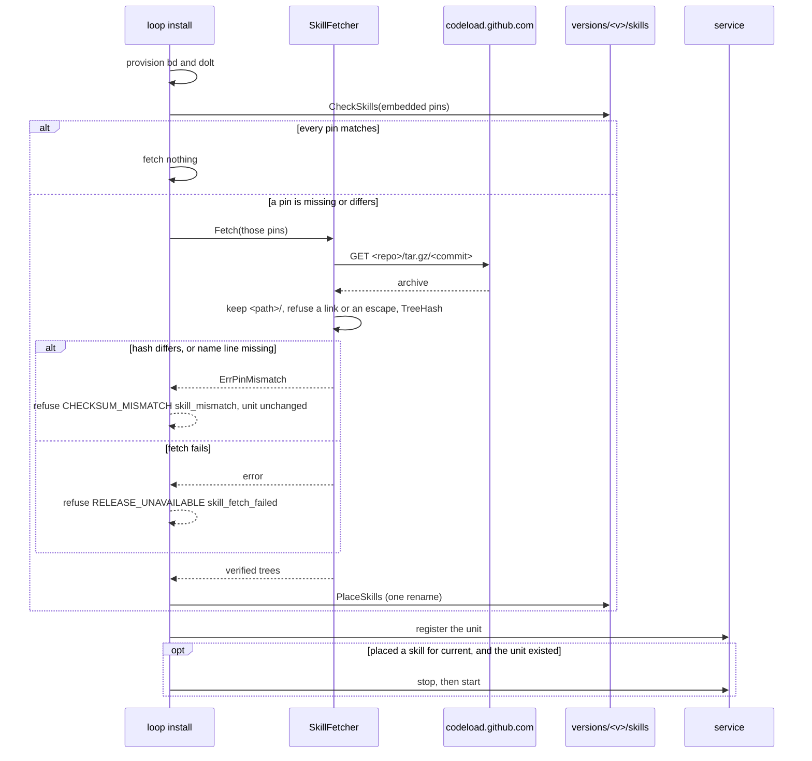

# Tickertown skills in every loop-managed project: technical spec

## Source

- **Epic:** factorio-cd4
- **Source:** `docs/adr/0007-shared-skill-pack.md`, the one ADR whose `**Ticket:**` line names
  factorio-cd4. It is on the base branch at `f00d2ce`.
- **Stories covered:** none. This is an architecture epic, and no story asks for it.

The contracts below cite the ADR's acceptance criteria by position, and the ADR's Consequences by
the labels below. The ADR does not number them, so this spec does.

| Label | ADR text |
| --- | --- |
| AC-1 | `ls pack/skills \| grep -v '^loop-'` prints nothing |
| AC-2 | `ls pack/skills \| grep -E 'willis\|sdlc-decisions\|design-ticket'` prints nothing |
| AC-3 | `grep -rlE '^name: (asd-ste100\|impeccable\|neon\|neon-postgres)$' pack/` prints nothing |
| AC-4 | `^disable-model-invocation: true` appears only in skills that a runbook in `pack/manifest.json` lists |
| AC-5 | `make pack-check` passes |
| AC-6 | `loop gates --docs` passes |
| AC-7 | `pack/manifest.json` lists `loop-<name>` for each of the 9 generic skills |
| AC-8 | `loop-encode-lessons/SKILL.md` holds `disable-model-invocation: true` |
| AC-9 | `pack/third-party.json` pins the 4 third-party skills, each with a commit and a sha256 |
| AC-10 | `loop upgrade` refuses a release whose fetched skill fails its hash |
| K-1 | `loop install` and `loop upgrade` fetch each pinned skill and check its hash. A failure refuses the verb, and the host keeps the release it runs |
| K-2 | The pack writer changes only the `name:` line of a fetched `SKILL.md` |
| K-3 | The pack hash in the brief covers the fetched skills' bytes |
| K-4 | Each run of every stage receives 13 more skills, and no stage changes |
| K-5 | Each ported skill carries a comment that names its tickertown source path and commit |

## Scope check

**Components:**

1. **The skill pack**: `pack/`, `internal/pack`, the pack writer in `internal/brief/pack.go`, and
   the two places that build the pack, `cmd/loop/serve.go` and `cmd/loop/register.go`.
2. **The host release verbs**: `loop install`, `loop install --check`, `loop doctor`,
   `loop upgrade` and the release build, in `internal/release` and `cmd/loop/release.go`. Why not
   its own epic: a fetched skill reaches no run until the pack injects it, and the pack has nothing
   to inject until a host verb places it. ADR 0007 decides both halves as one decision, and its
   Ticket line names one epic.

Work entries 1 to 3 change the pack alone, and port the 9 generic skills. Entry 4 adds the pin
file and the fetch. Entries 5 and 7 change the host verbs. Entry 6 changes the pack, so that each
run receives what entry 5 placed. Each entry changes one component.

**Not in this spec:** `file-bug`, which waits on epic factorio-9wh for the work-item fields.
`sdlc-intake`, which belongs to epic factorio-4n0. The tickertown cutover, which the plan defers.

## Decisions

- **Each runbook names a ported skill at the step that needs it.** We chose a reader table
  (below) and a path at each step over one reference in `loop-sdlc-turn`. The manifest gate counts
  the `skills` list of a runbook, and `runbookFindings` (`internal/pack/gate.go:557`) requires the
  runbook text to name each listed skill. A reference in a shared skill satisfies neither. Every run
  would then also read rules for steps it never takes. The rule that picks a reader: a runbook lists
  a skill when one of its steps does what the skill's `description` names. Tickertown's readers are
  the starting point, as the ADR asks.

  | Skill | Runbooks that list it, and the step |
  | --- | --- |
  | `loop-commit` | `implementer`, `spec-author`, `amender`, `intake-room`, `review-room`: each one that pushes, at its commit step |
  | `loop-bro` | `decomposer`: the document pass over each ticket draft, before `loop work create` |
  | `loop-unslop` | `decomposer` (ticket drafts), `spec-author`, `amender`, `intake-room` (each document they write) |
  | `loop-boundaries` | `implementer` (code), `code-reviewer` (check order) |
  | `loop-least-code` | `implementer` (before it finishes), `code-reviewer` (check order) |
  | `loop-reader-load` | `implementer` (before it finishes), `code-reviewer` (check order) |
  | `loop-verifiable-units` | `implementer`: work in this order |
  | `loop-test-behavior-not-implementation` | `implementer` (write the test first), `code-reviewer` (prove each contract), `reproducer` (the failing test) |
  | `loop-domain-modeling` | `implementer` (code), `spec-author` (the Domain model section), `doc-reviewer` (a spec's Domain model) |

  We rejected `reproducer` for `loop-commit`, because the reproducer never commits
  (`pack/runbooks/reproducer.md:92`). We rejected `coordinator` for `loop-commit`, because no
  coordinator step pushes.
- **The third-party pins travel in a new signed release asset, `third-party.json`, and not in
  `release.json`.** `ParseMetadata` refuses an unknown field (`internal/release/metadata.go`,
  `DisallowUnknownFields`). So a new `Metadata` field makes every installed binary up to v0.0.22
  refuse each later release with `bad_metadata`. An old binary ignores an asset it does not know.
  `checksums.txt` names the new asset, so the signature binds it.
- **A skill is checked by a tree hash over its extracted files, and not by the archive's sha256.**
  GitHub builds each archive on request, and does not promise stable archive bytes. The tree hash
  covers each file's path, executable bit and bytes, and nothing else. So an archive that GitHub
  rebuilds still passes, and any change to a file fails.
- **A skill is fetched as the GitHub tarball of the pinned commit, over `git clone` or
  `npx skills add`.** One HTTP GET reuses `httpGet` and its size bound from
  `internal/release/provision.go`. A clone puts git on the install path, and `npx` puts Node there.
  The default address is `https://codeload.github.com/<repo>/tar.gz/<commit>`.
- **Each release keeps its own set, in `versions/<v>/skills/<name>/`, over one shared directory.**
  `loop rollback` repoints `current` at an older version, whose pins can differ. The set then sits
  beside the binary that checks it. An upgrade writes the new set before `current` moves.
- **The executable bit is kept and hashed, over writing every file at mode 0644.** The one
  executable file in the four skills is `impeccable/scripts/impeccable`, mode 100755 in tickertown.
  `brief.Pack.Write` writes every file 0644 today, and every `impeccable` command would then fail
  with "permission denied".
- **At start, the server injects each fetched skill that matches its pin, and raises one alert for
  the rest. It neither refuses to start nor fetches.** An upgrade that a binary from before work
  entry 7 runs fetches no skill, and every installed host runs such a binary today. So a server that refused to start would never come up after that
  upgrade. A fetch at start puts the network on every restart, and ADR 0007 decision 7 names
  install and upgrade as the only fetch points. The alert names `loop install` as the repair.
- **`loop install` restarts a running service after it places skills for the current version.**
  We rejected a hint to restart by hand, because the repair is then one command. The same file
  already restarts the service after it adds the App (`internal/release/install.go`, `appAdded`).
- **Each pin names the head of the upstream default branch at the time the pin lands.** We
  rejected a search for the commit that tickertown's copy came from. `skills-lock.json` records no
  commit. Its `computedHash` is the format of the `skills` tool, not ours. A search would read
  tickertown's checkout, which no run of this repository holds. The pull request of work entry 4
  names each commit and each tree hash.
- **The proof of AC-10 lives in `internal/release/upgrade_test.go` and
  `cmd/loop/release_test.go`, not in `acceptance/`.** ADR 0007 says the acceptance suite proves
  it. The acceptance binary trusts only the key in `internal/release/trusted_keys.pub`, which the
  binary embeds, and no test can sign for that key. `World.Upgrade` in `acceptance/world.go` swaps a
  symlink and never runs `loop upgrade`. `TestUpgradeAcrossARealServer` already runs the real verb
  handler against a real server with a test key. That is the strongest place a test can reach.

## Assumptions

- The 4 upstream repositories stay public, and `codeload.github.com` serves a tarball of each
  pinned commit. This is wrong if a fetch answers 401, 403 or 404.
- Each upstream repository permits a host to fetch and use its skill (ADR 0007, "What I assumed").
  This is wrong if the repository root at the pinned commit holds no licence, or holds one that
  forbids use. Work entry 4 reads each root licence at its pin, and names it in its pull request
  body. A missing licence there is a finding for a person, at level 5.
- Each upstream skill directory holds only regular files and directories. This is wrong if the
  fetch of work entry 4 refuses a symlink or a link member at pin time.
- Claude Code honours `disable-model-invocation: true` and still lets a run read the file by its
  path. This is wrong if a run's read of `../loop-commit/SKILL.md` fails, or if the skill list of a
  run shows the description of a flagged skill.
- The 9 generic skills port into the loop's vocabulary with no rule lost. The ADR measured 7
  vocabulary hits, in `commit`, `bro`, `boundaries` and `unslop`. This is wrong if `make pack-check`
  reports a hit in another of the 9, or a hit that only the deletion of a rule clears.
- `internal/release` can import `internal/pack` with no import cycle. This is wrong if `go build`
  reports a cycle. The pin type and the tree hash then move to `internal/brief`, which both import.
- The alerts table accepts an alert with no project. `AlertHostConfigInvalid`
  (`internal/config/throughput.go:156`) already raises one. This is wrong if the raise fails.
- A run in flight survives a service restart, as AE2 and AE6 prove for an outage and an upgrade.
  This is wrong if a restart by `loop install` reclaims a lease.

## Approach

**The ported skills are pack files.** Each of the 9 becomes `pack/skills/loop-<name>/SKILL.md`.
Its front matter holds `name: loop-<name>`, its tickertown `description`, and
`disable-model-invocation: true`. Its first lines are an HTML comment with two parts. The first part
names the source, `skills/<name>/SKILL.md` in tickertown at commit
64e293f9ae2db7831d12462e76ffe1aa3deacd8c, the head of its main branch on 2026-10-23. The id stays
outside a code span, because the `standards` gate checks each quoted commit id against this
repository, and this repository does not hold that commit. The second part keeps the upstream fork line that
tickertown recorded. The comment names no host path, because the vocabulary gate refuses one. The
body keeps every rule of the source. It replaces only what the vocabulary gate refuses, and each
reference to a tickertown file or command, with the loop's own (`loop gates --fast`,
`../loop-<name>/SKILL.md`). A rule whose only subject is a tickertown tool is deleted, and the pull
request body names the deleted rule. Each mention of a bad pattern in `loop-unslop` sits in a code
span on one line, so the two prose linters read it as a mention.

**The manifest gate learns one rule.** `manifestFindings` reads the front matter of each listed
skill. A skill whose front matter holds `disable-model-invocation: true`, and that no runbook entry
lists, is a `manifest` finding. `loop-encode-lessons` gets its flag back in the same entry. The
`amender` and `coordinator` runbooks already list it.

**The pins are one embedded file.** `pack/third-party.json` lists each third-party skill: its
upstream name, the GitHub repository, the commit, the skill's path in the repository, and the tree
hash. `pack/embed.go` embeds it. `internal/pack` reads and checks it. The injected name is
`loop-<name>`, and `Layout` claims that directory as it claims a runbook's. So a pin whose
directory collides with a runbook or a first-party skill fails the pack test before a release.

**The fetch is a host step, beside the bd and dolt pins.** `internal/release` gains a skill fetcher
in the shape of `Provisioner`. It reads the tarball, keeps the members under
`<top>/<path>/`, and refuses any member that is not a regular file or a directory. It also refuses a
member whose path leaves the skill directory, and a tree over 32 MiB. It computes the tree hash,
and refuses a mismatch with `ErrPinMismatch`. It reads the fetched `SKILL.md`, and refuses a front
matter that does not hold `name: <name>`, because the pack writer could not rename it. It writes
nothing. A second function places a verified set into `versions/<v>/skills/` through a temporary
directory and one rename, so a crash leaves the old set or the new set, never part of one.

**Install fetches with the running binary's pins.** After it provisions bd and dolt, `Install`
fetches each pin whose directory is missing or does not match, and places the set. A refusal
returns before the service unit changes. `Check` adds one drift line for each skill that is missing
or does not match, so `loop install --check` and `loop doctor` report it. When install placed a
skill for the version that `current` names and the unit was already there, it stops and starts the
service.

**Upgrade fetches with the target release's pins, before its first state change.** `fetch` also
reads the asset `third-party.json`, and checks it against `checksums.txt`. `Run` then fetches each
skill. It does this after the bd and dolt pins and before the drain, so a refusal changes nothing.
After the stop, `install` places the set into `versions/<v>/skills/` before `current` moves.
`WriteDist` writes the asset from the embedded `pack/third-party.json`, byte for byte, and
`checksums.txt` names it. `VerifyAssets` requires it. CI already publishes every file in
`dist/<version>/`.

**The server builds the pack from the embedded source and the fetched set.** `pack.Brief` takes the
fetched set as an `fs.FS`. For each pin, it checks the tree hash of `<name>/` in that set. It lays
each matching skill out as `loop-<name>/`, with every byte as fetched, except the one `name:` line
of `SKILL.md`. It returns the pins it left out. `serve.go` passes
`os.DirFS(<instance>/versions/<cli.Version>/skills)`, and raises the alert
`third_party_skills_missing` from a `Setup` hook when the left-out list is not empty. It clears the
alert when the list is empty. `register.go` passes the same set, so a registered clone holds what a
run holds. `acceptance/world.go` passes a fixture set.

**The writer keeps the executable bit.** `brief.Pack.Write` writes a file at mode 0755 when its
source mode holds an executable bit, and 0644 otherwise. An embedded first-party file holds none.
`Pack.Hash` adds each file's mode to what it hashes, so the brief's hash changes when a mode
changes. Nothing compares a pack hash across releases. `internal/sched/dispatch.go:165` only
records it.

Nothing else changes. `brief.Inject` already lists every pack directory for `CheckTracked` and
`.git/info/exclude`. The push scan already treats `.claude/skills/loop-` and `.agents/skills/loop-`
as injected paths.

## Domain model

```
internal/pack (changed)

ThirdParty          one pinned third-party skill
  Name    the upstream skill name, such as impeccable
  Repo    owner/name on GitHub
  Commit  the pinned commit
  Path    the skill's directory in the repository; "" is the root
  SHA256  the tree hash of that directory at Commit
  invariant: Name is lower case, letters, digits and dashes, and does not start with "loop-".
  invariant: Commit is 40 hex characters. SHA256 is 64 hex characters.
  invariant: Path is clean, relative, and never leaves the repository.
  invariant: no two pins share a Name. loop-<Name> is no runbook's and no first-party skill's
             directory.
  ReadThirdParty refuses a file that breaks one, so no other code checks a pin again.

TreeHash            the identity of a skill directory
  invariant: two trees have one hash exactly when they hold the same set of regular-file paths,
             and each path has the same bytes and the same executable bit. Directories, other
             mode bits, timestamps and member order do not count.
```

A ported skill is a pack file and adds no type.

## Interfaces

```go
// internal/pack

// ThirdPartyFile is the pin file's path in the pack source.
const ThirdPartyFile = "third-party.json"

type ThirdParty struct {
	Name   string `json:"name"`
	Repo   string `json:"repo"`
	Commit string `json:"commit"`
	Path   string `json:"path"`
	SHA256 string `json:"sha256"`
}

// ReadThirdParty reads and checks the pin file of a pack source. The file is
// {"skills": [ThirdParty, ...]}, and an unknown field is refused.
func ReadThirdParty(src fs.FS) ([]ThirdParty, error)

// ThirdPartyPins are the pins this binary embeds.
func ThirdPartyPins() []ThirdParty

// TreeHash is the hex sha256 of tree: for each regular file, in byte order of its
// slash path, "<path>\x00<mode>\x00<len>\x00" then its bytes, where mode is "755"
// when any executable bit is set and "644" otherwise.
func TreeHash(tree fs.FS) (string, error)

// Brief is the pack this release injects. fetched holds one directory for each
// pin, named by ThirdParty.Name; nil holds none. Each pin whose directory is
// missing or fails its hash is left out of the pack and returned.
func Brief(fetched fs.FS) (brief.Pack, []ThirdParty, error)
```

```go
// internal/brief

// Write: a file whose FS mode holds an executable bit is written 0755, any other
// file 0644. Hash: each file adds "<path>\x00<mode>\x00<len>\x00" then its bytes.
func (p Pack) Write(checkout string, hs agenthost.Harness) error
func (p Pack) Hash() (string, error)
```

```go
// internal/release

// SkillsDir is versions/<v>/skills.
func (l Layout) Skills(v string) string

// ThirdPartyAsset is the release asset that holds the target release's pins,
// byte for byte pack/third-party.json. checksums.txt names it.
const ThirdPartyAsset = "third-party.json"

// SkillFetcher fetches pinned third-party skills.
type SkillFetcher struct {
	HTTP *http.Client
	// URL rewrites a pin's archive address. A test points it at a local server
	// or file. The tree hash, not the address, decides.
	URL func(pack.ThirdParty) string
}

// Fetch reads and verifies each pin, and returns one tree for each, keyed by
// Name. It writes nothing. A tree that fails its hash is ErrPinMismatch.
func (f SkillFetcher) Fetch(ctx context.Context, pins []pack.ThirdParty) (map[string]fs.FS, error)

// PlaceSkills replaces dir with the trees, through one rename.
func PlaceSkills(trees map[string]fs.FS, dir string) error

// CheckSkills reports each pin whose directory under dir is missing or fails its hash.
func CheckSkills(pins []pack.ThirdParty, dir string) []string
```

```go
// The new fields of the existing types.
type Installer struct {
	// ...
	Skills  []pack.ThirdParty
	Fetcher SkillFetcher
}

type Upgrader struct {
	// ...
	Fetcher SkillFetcher
}

type InstallReport struct {
	// ...
	Skills []string `json:"skills,omitempty"` // each skill install fetched
}

type UpgradeReport struct {
	// ...
	Skills []string `json:"skills,omitempty"` // each skill upgrade fetched
}
```

New refusal rules, under existing codes:

| Verb | Code | Rule | When |
| --- | --- | --- | --- |
| `loop install`, `loop upgrade` | `CHECKSUM_MISMATCH` | `skill_mismatch` | A fetched skill fails its tree hash, or its `SKILL.md` front matter does not name it |
| `loop install`, `loop upgrade` | `RELEASE_UNAVAILABLE` | `skill_fetch_failed` | An archive could not be read, or a member is refused |
| `loop upgrade` | `NOT_FOUND` | `no_release` | The release has no `third-party.json` (the existing rule of `get`) |
| `loop upgrade` | `CHECKSUM_MISMATCH` | `third_party_checksum` | `third-party.json` differs from its line in `checksums.txt` |

New alert kind: `config.AlertThirdPartySkills = "third_party_skills_missing"`, with no project and
one dedupe key. Its subject names each left-out skill. Its body names `loop install`.

## Data

```
pack/third-party.json (new, embedded)
  {"skills": [{"name", "repo", "commit", "path", "sha256"}, ...]}
  4 entries: asd-ste100 (danyuchn/asd-ste100-skill, path ""),
             impeccable (pbakaus/impeccable, path .agents/skills/impeccable),
             neon (neondatabase/agent-skills, path skills/neon),
             neon-postgres (neondatabase/agent-skills, path skills/neon-postgres)

release asset third-party.json (new)
  the same bytes, named in checksums.txt

<instance>/versions/<v>/skills/<name>/... (new)
  each file as fetched; mode 0755 for an executable member, 0644 otherwise; directories 0700

alerts (no schema change)
  + kind third_party_skills_missing
```

**Existing records:** no instance holds `versions/<v>/skills/` today. A release installed before
this epic has none, and its binary reads none. The first start of this release after an upgrade
from such a release finds none, and raises the alert. `loop install` then fills it.

## Flows



```mermaid
sequenceDiagram
    participant Up as loop upgrade v
    participant Rel as release v
    participant F as SkillFetcher
    participant Inst as instance
    Up->>Rel: checksums.txt, signature, release.json, binary
    Up->>Rel: third-party.json
    alt asset missing
        Up-->>Up: refuse NOT_FOUND no_release
    else differs from checksums.txt
        Up-->>Up: refuse CHECKSUM_MISMATCH third_party_checksum
    end
    Up->>Up: version rules, bd and dolt pins
    Up->>F: Fetch(release v pins)
    alt hash differs
        F-->>Up: ErrPinMismatch
        Up-->>Up: refuse CHECKSUM_MISMATCH skill_mismatch, nothing changed
    else fetch fails
        Up-->>Up: refuse RELEASE_UNAVAILABLE skill_fetch_failed, nothing changed
    end
    Note over Up,Inst: every check passed; state changes from here
    Up->>Inst: drain, stop, snapshot
    Up->>Inst: versions/v/ binary and files, versions/v/skills
    Up->>Inst: current -> v, start
```

```mermaid
sequenceDiagram
    participant S as loop serve
    participant P as pack.Brief
    participant FS as versions/<cli.Version>/skills
    participant A as alerts
    participant R as a run checkout
    S->>P: Brief(os.DirFS(FS))
    P->>FS: TreeHash(<name>/) for each embedded pin
    P-->>S: pack, left-out pins
    alt left-out list not empty
        S->>A: raise third_party_skills_missing, names each, names loop install
    else empty
        S->>A: clear third_party_skills_missing
    end
    S->>R: brief.Inject: loop-* runbooks, loop-* skills, loop-<name> fetched skills
    Note over R: SKILL.md name line is loop-<name>; every other byte and the exec bit as fetched
```

## Work

1. **The flag needs a reader.** Add the manifest rule to `manifestFindings`, and put
   `disable-model-invocation: true` back on `loop-encode-lessons`.
   - Files: `internal/pack/gate.go`, `internal/pack/gate_test.go`,
     `pack/skills/loop-encode-lessons/SKILL.md`
   - Needs: nothing
   - Proves: C1, C2
   - Done when: a fixture pack with a flagged skill that no runbook lists fails `Check` with a
     `manifest` finding, and `make pack-check` passes on the real pack.
2. **Port the writing skills: `loop-commit`, `loop-bro`, `loop-unslop`.** Write each skill, add
   it to `skills` in the manifest, list it in each runbook of the reader table, and name its path at
   that runbook's step.
   - Files: `pack/skills/loop-commit/**`, `pack/skills/loop-bro/**`, `pack/skills/loop-unslop/**`,
     `pack/manifest.json`, `pack/runbooks/{implementer,spec-author,amender,intake-room,review-room,decomposer}.md`,
     `internal/pack/pack_test.go`
   - Needs: 1
   - Proves: C3
   - Done when: `make pack-check` passes, and AC-1, AC-2 and AC-4 print nothing.
3. **Port the code skills: `loop-boundaries`, `loop-least-code`, `loop-reader-load`,
   `loop-verifiable-units`, `loop-test-behavior-not-implementation`, `loop-domain-modeling`.** The
   same steps as entry 2. It follows entry 2, because both edit `pack/manifest.json`,
   `implementer.md` and `spec-author.md`.
   - Files: `pack/skills/loop-{boundaries,least-code,reader-load,verifiable-units,test-behavior-not-implementation,domain-modeling}/**`,
     `pack/manifest.json`, `pack/runbooks/{implementer,code-reviewer,reproducer,spec-author,doc-reviewer}.md`,
     `internal/pack/pack_test.go`
   - Needs: 2
   - Proves: C4
   - Done when: `make pack-check` passes, and AC-7 holds for all 9 skills.
4. **Pins, tree hash and fetch.** Write `pack/third-party.json` with the 4 pins, embed it, read and
   check it, and claim each `loop-<name>` directory in `Layout`. Add `TreeHash` and
   `SkillFetcher`. Measure each pin: take the head of the upstream default branch
   (`git ls-remote https://github.com/<repo> HEAD`), fetch it with the new fetcher, and record its
   tree hash. Name each commit, each hash and each root licence in the pull request body.
   - Files: `pack/third-party.json`, `pack/embed.go`, `internal/pack/thirdparty.go`,
     `internal/pack/thirdparty_test.go`, `internal/pack/layout.go`, `internal/release/skills.go`,
     `internal/release/skills_test.go`
   - Needs: nothing
   - Proves: C5, C6, C7
   - Done when: the fetcher fetches each of the 4 real pins once and each hash matches, and AC-3
     and AC-9 hold.
5. **Install, check and doctor place the skills.** `Install` fetches and places the set, `Check`
   reports drift, and install restarts a running service after it places skills for `current`.
   Add `Layout.Skills`, `PlaceSkills` and `CheckSkills`. Wire the fetcher into `hostVerbs`.
   - Files: `internal/release/install.go`, `internal/release/install_test.go`,
     `internal/release/layout.go`, `internal/release/skills.go`, `cmd/loop/release.go`
   - Needs: 4
   - Proves: C8, C9, C10
   - Done when: `loop install` on an empty instance leaves 4 verified directories in
     `versions/<v>/skills/`, and `loop install --check` reports no drift.
6. **Each run receives the fetched skills.** `pack.Brief` takes the fetched set. The writer keeps
   the executable bit, and the hash covers modes. `serve.go` raises or clears the alert.
   `register.go` and `acceptance/world.go` pass a set.
   - Files: `internal/pack/embed.go`, `internal/pack/layout.go`, `internal/pack/pack_test.go`,
     `internal/brief/pack.go`, `internal/brief/brief_test.go`, `internal/config/lkg.go`,
     `cmd/loop/serve.go`, `cmd/loop/serve_test.go`, `cmd/loop/register.go`,
     `cmd/loop/register_test.go`, `acceptance/world.go`
   - Needs: 5
   - Proves: C11, C12, C13, C14
   - Done when: a run's checkout holds `.claude/skills/loop-impeccable/scripts/impeccable` at mode
     0755, and its `SKILL.md` says `name: loop-impeccable`.
7. **Upgrade fetches the target's skills, and the release carries its pins.** `WriteDist` writes
   the asset, `VerifyAssets` requires it, and `Upgrader` fetches and places the target's set.
   - Files: `internal/release/upgrade.go`, `internal/release/upgrade_test.go`,
     `internal/release/dist.go`, `internal/release/dist_test.go`, `cmd/loop/release.go`,
     `cmd/loop/release_test.go`
   - Needs: 5
   - Proves: C15, C16
   - Done when: each refusal case of C15 leaves `current`, `versions/` and the service as they
     were, and `TestUpgradeAcrossARealServer` ends with the target's skills in
     `versions/v1.1.0/skills/`.

## Out of scope

- `sdlc-decisions`, `willis-decisions` and `design-ticket`. They stay in tickertown (ADR 0007
  decision 4). Never in the pack.
- `file-bug`. The coordinator runbook already files a bug. Screenshots on a bug belong to epic
  factorio-9wh.
- `sdlc-intake` and the epic order rule. They belong to epic factorio-4n0.
- The tickertown cutover, and the double `sdlc-turn` it would hold. The plan defers it (plan,
  Scope Boundaries, "Deferred for later"). No epic holds it yet.
- A rewrite of the names and paths that the third-party text holds. Never (ADR 0007 decision 2).
- A prose or vocabulary check of third-party text. Never (ADR 0007 decision 8).
- A project's own version of a third-party skill. Never in the pack. The project tracks its own
  copy under another name (ADR 0007, Consequences).
- The platform binary that `impeccable` downloads on first use. It is upstream behaviour, and the
  ADR accepts it.
- The reactor that joins an ADR to an epic by any mention of its id. It belongs to loop fault
  F-10.

## Contracts

**C1. Refusal: a flagged skill needs a reader.** Proves AC-4. A pack skill whose front matter holds
`disable-model-invocation: true`, and that no runbook entry in the manifest lists, is a `manifest`
finding that names the skill. The same skill, listed by one runbook that names its path, is no
finding.
*Two fixture packs in `gate_test.go`, one finding and none.*

**C2. Behaviour: `loop-encode-lessons` is flagged and still read.** Proves AC-8. The embedded
`loop-encode-lessons/SKILL.md` holds `disable-model-invocation: true`, and the `amender` and
`coordinator` entries list it.
*A test over the embedded pack.*

**C3. Behaviour: the writing skills ship with their readers, and nothing else joins them.**
Proves AC-1, AC-2, AC-7, K-5. The embedded pack's `skills/` holds exactly the directories of a
literal list: the 10 of today, plus `loop-commit`, `loop-bro` and `loop-unslop`. So no name
outside `loop-` and none of `loop-sdlc-decisions`, `loop-willis-decisions`, `loop-design-ticket`,
`loop-file-bug` or `loop-sdlc-intake` can join it unseen. Each of the 3 holds the flag and a
comment that names `skills/<name>/SKILL.md` and the tickertown commit
64e293f9ae2db7831d12462e76ffe1aa3deacd8c. The set
of runbooks that list each one equals its row of the reader table, exactly.
*A test that compares the pack with the literal list, and the manifest with a literal copy of those
3 rows. It fails on the base branch, which holds none of the 3.*

**C4. Behaviour: the code skills ship with their readers.** Proves AC-1, AC-2, AC-7, K-5. The same
promise as C3, for the other 6 skills and their 6 rows. The literal list grows by the 6.
*The C3 test, with 6 more directories and 6 more rows.*

**C5. Refusal: a bad pin fails at load.** Proves AC-9. `ReadThirdParty` refuses a file with an
unknown field, an empty or upper-case name, a name that starts with `loop-`, a commit that is not
40 hex characters, a sha256 that is not 64 hex characters, two pins with one name, and a path that
is absolute or holds `..`. `Layout` refuses a pin whose `loop-<name>` is a runbook's or a
first-party skill's directory. Each error names the pin.
*An example test for each case.*

**C6. Invariant: the tree hash is the tree's identity.** Proves AC-9, AC-10. For generated trees,
a change to one file's bytes, a renamed path, an added or deleted file, or a flipped executable bit
changes `TreeHash`. A change of member order, timestamps, directory modes or a non-executable mode
bit does not.
*A property test over 500 generated trees, and one fixed tree with a literal expected hash.*

**C7. Refusal: the fetch accepts only the pinned tree.** Proves AC-10, K-1. `Fetch` returns
`ErrPinMismatch` for a tree whose hash differs, and for a `SKILL.md` whose front matter does not
hold `name: <name>`. It returns another error for a symlink, a hard link or a device member under
the skill path, a member path that leaves the skill directory, a tree over 32 MiB, and a 404. In
every case it returns no tree. An archive with the right tree and extra members outside the skill
path passes.
*Example tests against a local `httptest` server, with archives built in the test.*

**C8. Behaviour: install places the set, and keeps a matching one.** Proves K-1, K-4. On an empty
instance, `Install` leaves one directory for each embedded pin in `versions/<v>/skills/`, and each
one passes `CheckSkills`. The report's `skills` names each one. A second `Install` fetches nothing.
*An example test with a counting local server.*

**C9. Refusal: a failed skill fetch refuses install, and changes neither the skills nor the
unit.** Proves K-1. A pin that fails its hash refuses with `CHECKSUM_MISMATCH` and `skill_mismatch`.
A fetch error refuses with `RELEASE_UNAVAILABLE` and `skill_fetch_failed`. After either refusal,
`versions/<v>/skills/` holds what it held before, and the service manager registered nothing.
*Two example tests with a fake service manager.*

**C10. Behaviour: check reports the set, and install repairs a running host.** Proves K-1.
`loop install --check` reports one drift line for each skill that is missing, and one for each that
fails its hash, and the verb refuses with `DRIFT`. With the unit already registered, an `Install`
that places a skill for the version `current` names stops and starts the service once. An
`Install` that places nothing does not.
*Example tests with a fake service manager that records each call.*

**C11. Behaviour: a run receives each verified skill under `loop-`, renamed and otherwise
untouched.** Proves K-2, K-4, AC-3. `brief.Inject` with a pack from `Brief(fetched)` writes
`loop-<name>/` for each pin that matches. Its `SKILL.md` differs from the fetched file in exactly
one line: `name: <name>` becomes `name: loop-<name>`. Every other file is byte for byte as fetched.
A file with an executable bit is mode 0755 in the checkout, and every other file is 0644. Each
directory is in `.git/info/exclude`.
*An example test over a fixture set with one executable file. It compares each file with the
fixture, and reads each mode.*

**C12. Behaviour: the pack hash covers the fetched skills.** Proves K-3. `Pack.Hash` changes when
one fetched file's bytes change, and when its executable bit changes. The brief's `pack_hash`
equals `Pack.Hash` of the pack that `Brief` returned.
*Example tests.*

**C13. Behaviour: a server with a missing or wrong set still serves, and says so.** Proves K-1
(the host keeps the release it runs), K-4. With one pin's directory missing and one failing its
hash, `Brief` returns a pack that holds every other pin and every first-party skill, and returns
the two pins. The server raises one open alert of kind `third_party_skills_missing`, which names
both and names `loop install`. A later start with every pin matching closes it.
*An example test of `Brief`, and a `serve_test.go` test that reads the alerts table.*

**C14. Equivalence: a registered clone holds what a run holds.** Proves K-4. After
`loop register`, the clone's `.claude/skills/` and `.agents/skills/` each hold the same
`loop-<name>` trees, with the same bytes and modes, as `brief.Inject` writes from the same set.
*A test that runs both into two directories and compares them.*

**C15. Refusal: upgrade checks the target's skills before it changes anything.** Proves AC-10,
K-1. `loop upgrade` refuses each case below. After each refusal, `current`, `versions/`, the
database and the service are as they were, and no drain ran.

| Case | Code | Rule |
| --- | --- | --- |
| A fetched skill fails its tree hash | `CHECKSUM_MISMATCH` | `skill_mismatch` |
| A skill archive cannot be read | `RELEASE_UNAVAILABLE` | `skill_fetch_failed` |
| The release has no `third-party.json` | `NOT_FOUND` | `no_release` |
| `third-party.json` differs from `checksums.txt` | `CHECKSUM_MISMATCH` | `third_party_checksum` |

A release whose skills all match upgrades, and `versions/<v>/skills/` then holds each one.
*New cases in `TestUpgradeRefusalsChangeNothing`, and a matching and a mismatched skill in
`TestUpgradeAcrossARealServer`.*

**C16. Equivalence: the release carries the pins its binary checks.** Proves K-1. `WriteDist`
writes `third-party.json` byte for byte equal to the embedded `pack/third-party.json`, and
`checksums.txt` names it. `VerifyAssets` refuses a release directory without it. `SignDist` then
refuses to sign that directory.
*Example tests in `dist_test.go`.*

## Observable behaviour

None, because this epic draws no screen. The one new thing that a person sees is the alert of C13,
in the inbox that the coordinator reads.

## Open questions

None.
