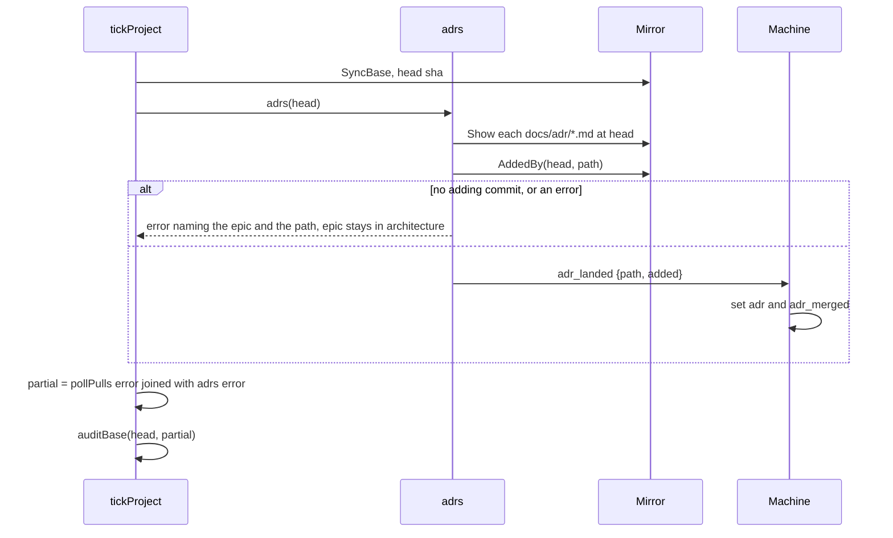
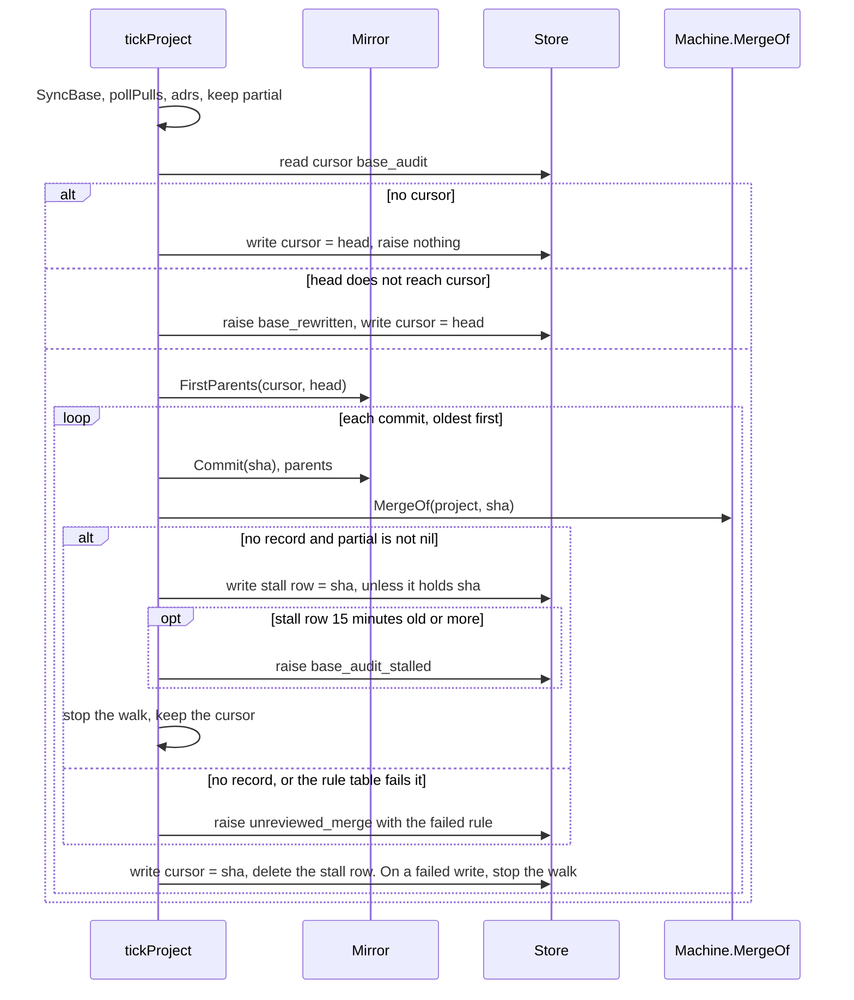

# Base audit: technical spec

## Source

- **Epic:** factorio-fgza
- **Source:** `docs/adr/0012-base-audit-adr-merges.md`. Its `**Ticket:**` line names this epic.
  ADR 0012 amends `docs/adr/0003-quality-ratchets-and-audits.md` § Decision, G5, so this spec
  reads both, and ADR 0012 wins a conflict.
- **Stories covered:** none. This is an architecture epic.

The operator split this epic from factorio-2u6 on 2026-10-27 (question/7: "Split
(Recommended)"). It takes work entries 7 and 8 and contracts C19 to C27 and C31 of
`docs/plans/factorio-2u6-quality-ratchets-spec.md` at `c3e0aff79b`. This spec numbers its
contracts from C1 again. The table at the end of Contracts maps each old number to its new one.

ADR 0012 lists five checks that this epic owns, with no labels. This spec numbers them.

| Label | ADR 0012 acceptance criterion |
| --- | --- |
| A1 | A first-parent commit with no merge record raises one `unreviewed_merge` alert, and the next tick raises no second alert |
| A2 | `adr_landed` sets `adr_merged` to the commit that added the ADR, when the base head of that tick is a later commit |
| A3 | The merge of an ADR whose Ticket line names an epic in `architecture` raises no alert on the tick that first sees it |
| A4 | A commit that edits an ADR that landed raises one `unreviewed_merge` alert |
| A5 | On a tick whose `adrs` step fails, the walk stops before an unrecorded ADR merge, and a later tick passes it |

ADR 0012's own document checks (the gates, the Ticket line, the number, the `adr_merged` word)
passed when it merged. This spec owns none of them.

This spec read the loop at the base `c739e0b`. Since `c3e0aff`, three facts that the old entries
cite changed. `doc_merged` from `spec_signoff` now sets `spec_path` (`internal/machine/epic.go:364`).
The ticket rows that clear a reviewed head moved to `internal/machine/ticket.go:186-195`. ADR 0010
made the operator's approval the sign-off: the server merges a document with `MergePR` at its
pinned head, with the merge method `merge` (`internal/inbox/signoff.go:87`,
`internal/github/merge_api.go:98`).

## Scope check

**Components:**

1. **The base audit.** One step of the reactor tick in `internal/github`, the mirror reads it
   needs, and the merge records it reads from `internal/machine`. The records and the step are
   one component, because no other code reads a merge record, and the step judges nothing
   without one.

Work entries 1 and 2 build the records in `internal/machine`, and entry 2 also teaches `adrs` to
pass the commit that added an ADR. Entries 3 and 4 build the step. Each entry proves its own
contracts with a test that needs no later entry.

**Not in this spec:** the ratchet gates of ADR 0003, G1 to G4 and G7. They belong to factorio-2u6,
work entries 1 to 6 of `docs/plans/factorio-2u6-quality-ratchets-spec.md`. The overwatch `main`
and `audit` parts. They belong to factorio-a7r, work entry 9 of
`docs/plans/factorio-a7r-overwatch-sweep-spec.md`. Neither shares a type, a file or a contract
with this spec.

## Decisions

ADR 0003 G5 decided the audit, and ADR 0012 decided the ADR record. Each line below is a choice
that the two ADRs left to this spec, or a choice that the code forces. ADR 0012 asks this spec to
decide again three rules of `c3e0aff`: the outran document merge, the 15-minute stall and the
rewritten base. Each one is here with its rejected alternative.

- **The audit reads its merge records from the `transitions` table.** We chose the history over
  the current facts of an item, because an epic's `reviewed_head` holds the spec's head once the
  spec passes review. The PRD's reviewed head survives only in history. We rejected a new table of
  merges, because each merge already writes one transition row in the transaction that applies it
  (`internal/machine/history.go:36`).
- **A spec merge records its merge commit in a new fact, `spec_merged`.** Today `doc_merged` from
  `spec_signoff` sets only `spec_path`, so no record names a spec's merge commit. A PRD merge sets
  `prd_merged`, and a ticket merge sets `merged_sha`. We rejected reusing `merged_sha` for the
  spec, because `merged_sha` means a ticket's merge in `loop work show` and in the merge pipeline.
  We rejected `spec_path` as the record, because it holds a path and names no commit.
- **`adr_landed` takes the adding commit in a new required parameter, `added`, and refuses the
  move without it.** ADR 0012 decided the record. This spec chose the parameter. We rejected the
  `sha` parameter that the reactor sends today, because it holds the base head of the tick, and
  ADR 0012 forbids that value unless that head added the ADR. The reactor stops sending `sha`. We
  rejected the `mark` setter of `prd_merged`, which writes `true` when the parameter is empty,
  because a record of `true` names no commit and hides the fault in the reactor.
- **The adding commit is the newest first-parent commit, reachable from the tick's base head,
  whose diff against its first parent adds the ADR's path.** The mirror finds it, and the reactor
  sends no GitHub request. We chose the newest over the oldest, because an ADR deleted and added again
  landed with its latest add. When the mirror finds no such commit, `adrs` applies no
  `adr_landed` to that epic and returns an error that names the epic and the path. The epic stays
  in `architecture`, and the partial-read rule below holds the walk. We rejected a fall-back to the
  base head, because ADR 0012 forbids it.
- **`MergeOf` returns a record from the row that set the fact, and a later row that clears the
  fact does not remove it.** `adr_misjoined` clears `adr_merged` with `adr`, as ADR 0012 states.
  The audit judges a commit as it was at its merge. A later edit of the Ticket line is a commit of
  its own, and the audit judges that commit too. We rejected a record that a later clear deletes,
  because the walk can reach a commit after the clear when a partial read held it, and the same
  commit would then pass on one tick and fail on another.
- **When two rows record one commit, `MergeOf` returns the row with the lowest `intent_id`.** One
  ADR pull request can add two ADRs for two epics, so two `adr_landed` rows hold one commit.
  `intent_id` is the primary key of `transitions` and an `AUTOINCREMENT` key of `intents`, so it
  orders every row of a project. We rejected a scan in store order, because a later fact could
  then make the verdict depend on that order. We rejected the lowest `seq`, because the store
  counts `seq` for each item, so two items' rows can hold the same `seq`.
- **A document merge that outran its review fails the audit, whatever its parents.** The record
  says so in `MergeRecord.Outran`: the item's history holds a `doc_merged` row from that
  document's review or amending state (`prd_review` or `prd_amending` for a PRD, `spec_review` or
  `spec_amending` for a spec) before the merge row. ADR 0003 passes "a person's merge of a
  reviewed PRD or spec". An outran merge was not reviewed, and the alert is the only trace that a
  document skipped its review. We chose history over the reviewed head, because an epic holds one
  `reviewed_head` for both documents, and no epic row clears it. A spec that a person merges during
  its review still finds the PRD's head there, so a rule that read only the head would pass that
  merge. We rejected a pass for every document merge, because it hides the skipped review. We
  rejected a check that the head was set in the same document round, because that needs the round
  boundaries replayed, and the outran row already marks the one path that skips the review.
- **Any other merge that a ticket, a PRD or a spec records passes at its reviewed head. A merge
  commit passes when its second parent is that head. A commit with one parent passes when that
  head is not empty.** The `direct` mechanism and the sign-off merge both merge with a merge
  commit at the reviewed head (`internal/github/merge_api.go:98`), so the second parent is exact.
  Mergify and a GitHub queue may squash, which leaves one parent and no head in git. We rejected a
  rule that every base commit has two parents, because the loop does not read a project's Mergify
  method, and that rule would raise an alert for every squash. A document that did not outrun its
  review reached sign-off through a pass, an unchanged amendment from sign-off, or `signoff_head`.
  Each of the three sets or keeps that document's pinned head (`internal/machine/epic.go`). A
  ticket clears its reviewed head on a reject, a head change and a dequeue
  (`internal/machine/ticket.go:186-195`).
- **An `adr_merged` record passes with no reviewed-head rule.** ADR 0012 decided this. No stage
  reviews an ADR, and the operator's merge is its sign-off. The judgement of a commit is a lookup
  from the record's fact to its rule, so this case adds a row to a table and no branch.
- **`auditBase` runs on every tick, directly after `adrs`. On a tick whose `pollPulls` or `adrs`
  returned an error, a commit with no merge record stops the walk, and the cursor stays before
  it.** ADR 0012 decided the order. This spec extends the partial-read rule of `c3e0aff` C25 to
  `adrs`, as ADR 0012 asks. A merge that a failed step did not record has no record yet, and the
  audit would report it. The audit judges a commit with a record on that tick, because a record never
  changes after its merge. We rejected skipping the whole step on such a tick, because `pollPulls`
  fails when any one pull request fails (`internal/github/reactor.go:263-301`), and one stuck pull
  request would then stop the audit for good and raise nothing. When neither step returned an
  error, a commit with no record fails at once. `SyncBase` fetches the base before both steps
  read, so GitHub merged every commit that the fetch brought before they read.
- **A commit that stops the walk for 15 minutes raises one `base_audit_stalled` alert.** The first
  tick that stops at a commit writes the commit to the cursor stream `base_audit_stall`. The row's
  `updated_at` keeps the time of that first stop. A tick that stops at the same commit 15 minutes
  or more after that time raises the alert. Its subject is `<project>@<sha>`, and its body names
  the commit, the time of the first stop and the first line of the partial-read error. The walk
  deletes the row when it passes the commit. We chose a duration over a count of ticks, because
  the host's schedule sets the tick rate (`internal/config/throughput.go:115`, every minute by
  default), and a slower schedule would delay a count. We rejected an alert at the first stop,
  because one failed GitHub read would raise it. We rejected no alert at all, because ADR 0003
  promises that a merge outside the loop reaches the inbox on the next tick, and a stuck pull
  request or a failed `adrs` step delays that with no trace.
- **A base that no longer holds the cursor raises one `base_rewritten` alert, and the cursor moves
  to the new head.** Neither ADR covers a forced push. We rejected an audit of the new range from
  the merge base, because a rewritten base breaks every record before it, and one alert names the
  event that a person must read. We rejected a silent move of the cursor, because a forced push to
  the base skips the loop as much as a direct push does.
- **The cursors live in `github_cursors`, under two new streams.** We chose the table that holds
  the pull-request cursor over a new table, because it already keys a cursor by project and
  stream, and it needs no schema change.

## Assumptions

- GitHub lists a merged pull request as merged as soon as the base fetch sees its commit. This is
  wrong if an `unreviewed_merge` alert names a commit that an item records as its merge one tick
  later.
- No merge mechanism rebases a pull request onto the base, and the operator merges an ADR pull
  request as one commit on the first-parent line. A rebase merge puts each commit on that line,
  and only the one that the record names passes. This is wrong if one merge raises an
  `unreviewed_merge` alert for a commit of its own pull request.
- The mirror holds the whole first-parent history of the base. `Mirror.Fetch` passes no
  `--depth` (`internal/github/git.go:211`). This is wrong if `adrs` reports that it found no adding
  commit for an ADR that the base holds.
- The coordinator reads each open alert by its existing rules (`pack/runbooks/coordinator.md`
  section 3, "An alert stays open after you read its cause"), and a new kind needs no runbook
  line. This is wrong if the coordinator runbook routes alerts by kind and names no default.
- One scan of a project's `transitions` rows for each audited commit costs well under a second.
  This is wrong if a project holds more than about a million transition rows.
- The base audit sees few commits on each tick, because a loop merges one pull request at a time.
  This is wrong if a tick after a long outage walks so many commits that the tick overruns its
  interval.

## Approach

**The merge records.** `internal/machine` sets `spec_merged` from the `sha` parameter on the
`doc_merged` row from `spec_signoff`, beside `spec_path`. The `adr_landed` row sets `adr_merged`
from its new `added` parameter, and refuses with code `USAGE` and rule `missing_added` when
`added` is empty. The
`adr_misjoined` row clears `adr_merged` with `adr`.

`Machine.MergeOf` finds the transition row of one project whose `set` holds the commit as one of
the four record facts. It replays that item's history up to the row, and returns the reviewed
head that the item held at that moment. For a PRD or a spec, it sets `Outran` when a `doc_merged`
row from that document's review or amending state comes before the merge row. For `adr_merged`,
`Outran` is false and the reviewed head is not read. When two rows hold the commit, it uses the
row with the lowest `intent_id`.

**The adding commit.** `Mirror.AddedBy` answers the newest first-parent commit, reachable from a
tip, whose diff against its first parent adds a path. `Reactor.adrs` calls it for each epic that
it lands, with the tick's base head as the tip, and passes the answer as `added`. An empty answer
or an error lands no epic and joins the error that `adrs` returns.

**The base audit.** `Reactor.auditBase` runs in `tickProject` directly after `adrs` on every tick.
It receives the joined error of `pollPulls` and `adrs` as `partial`, and nil when both passed. It
reads the cursor from `github_cursors` under the stream `base_audit`. With no cursor, it writes
the base head and audits nothing. Otherwise it checks that the base head reaches the cursor
(`Mirror.Reaches`). It lists the first-parent commits after the cursor, oldest first, and judges
each one by C6. It raises one alert for each commit that fails, and moves the cursor past each
commit once the store holds that commit's alert. A failed write stops the walk, and the next tick
starts at the first commit it did not finish. When `partial` is not nil, a commit with no merge
record also stops the walk, and C13 times that stop. The step reads the mirror and the store, and
it makes no GitHub request. Its own error joins the tick's errors.

**The stall clock.** The 15 minutes read the service clock, `Config.Now` of
`internal/github/service.go`, which a test sets. The stall row's `updated_at` holds that clock's
time of the first stop.

## Domain model

```
internal/machine (changed)

MergeRecord         Item, Kind, Verb, Fact, ReviewedHead, Outran, Seq
  invariant: Fact is one of merged_sha, prd_merged, spec_merged, adr_merged, and the row named
             by Seq set that fact to the commit. A later row that clears the fact leaves the
             record as it is.
  invariant: ReviewedHead is the reviewed_head the item held after the row before Seq, or "".
             It is "" for adr_merged.
  invariant: Outran is false for merged_sha and adr_merged. For prd_merged it is true when a
             doc_merged row from prd_review or prd_amending precedes Seq. For spec_merged it is
             true when one from spec_review or spec_amending precedes Seq.

internal/github (changed)

Verdict             the judgement of one first-parent commit, a tagged union
  Pass                the commit has a record, and its rule passes
  Fail(rule)          rule is no_record, outran, head_mismatch or no_reviewed_head
  Wait                no record, and the tick's read was partial. Only Wait stops the walk.
  invariant: a commit with a record is never Wait.

The rule table      a lookup from a record's Fact to the checks it runs, in order
  merged_sha          head rule
  prd_merged          outran rule, then head rule
  spec_merged         outran rule, then head rule
  adr_merged          no check
  invariant: a Fact outside the table is a programming error, and the test of C6 covers each
             row. A new record fact adds a row and no branch.

head rule           a merge commit passes when its second parent equals ReviewedHead. A
                    one-parent commit passes when ReviewedHead is not "". Else Fail.
```

## Interfaces

```go
// internal/machine/rows.go
const (
	FactSpecMerged = "spec_merged" // the merge commit of the epic's spec
	FactADRMerged  = "adr_merged"  // the first-parent commit that added the epic's ADR
)

// internal/machine/epic.go, changed rows
// doc_merged from spec_signoff: sets spec_path from "spec_path", and spec_merged from "sha".
// adr_landed: needs "path" and "added". Sets adr from "path", adr_merged from "added".
//             Refuses with code USAGE and rule missing_added when "added" is empty.
// adr_misjoined: clears adr and adr_merged.

// internal/machine/history.go
type MergeRecord struct {
	Item         string
	Kind         Kind
	Verb         string // merged, doc_merged or adr_landed
	Fact         string // merged_sha, prd_merged, spec_merged or adr_merged
	ReviewedHead string // the item's reviewed_head at that transition, or ""
	Outran       bool   // the document merged during its review or amendment
	Seq          int64
}

// MergeOf finds the record of one commit. ok is false when no row of the
// project set a record fact to sha.
func (m *Machine) MergeOf(ctx context.Context, project, sha string) (rec MergeRecord, ok bool, err error)

// internal/github/git.go
// FirstParents lists the first-parent commits after from, through to, oldest first.
func (m *Mirror) FirstParents(ctx context.Context, from, to string) ([]string, error)
func (m *Mirror) Commit(ctx context.Context, sha string) (Commit, error)
// AddedBy is the newest first-parent commit reachable from tip whose diff
// against its first parent adds path, or "" when none does.
func (m *Mirror) AddedBy(ctx context.Context, tip, path string) (string, error)

type Commit struct {
	SHA     string
	Parents []string
	Subject string
	Author  string
}

// internal/github/reactor.go
const (
	StreamBaseAudit       = "base_audit"
	StreamBaseAuditStall  = "base_audit_stall"   // cursor: the commit that stops the walk
	AlertUnreviewedMerge  = "unreviewed_merge"   // subject "<project>@<sha>"
	AlertBaseRewritten    = "base_rewritten"     // subject "<project>@<old cursor>"
	AlertBaseAuditStalled = "base_audit_stalled" // subject "<project>@<sha>"
)

const baseAuditStallAfter = 15 * time.Minute

// adrs sends adr_landed with Params {"path": <ADR path>, "added": <AddedBy answer>},
// and no "sha".

// partial is the joined error of pollPulls and adrs on this tick, or nil.
func (r *Reactor) auditBase(ctx context.Context, p config.Project, head string, partial error) error
```

## Data

```
github_cursors (no schema change)
  + rows with stream = "base_audit". cursor holds the full sha of the last audited commit.
  + rows with stream = "base_audit_stall". cursor holds the full sha of the commit that stops the
    walk, and updated_at the time of the first stop there. Absent when the walk is not stopped.

bead metadata (no schema change)
  + loop.spec_merged on an epic, set by doc_merged from spec_signoff
  + loop.adr_merged on an epic, set by adr_landed, cleared by adr_misjoined

transitions (no schema change)
  + the facts JSON of a spec's doc_merged row holds loop.spec_merged
  + the facts JSON of an adr_landed row holds loop.adr_merged

alerts (no schema change)
  + kinds unreviewed_merge, base_rewritten and base_audit_stalled, with no item
```

**Existing records:** no epic holds `spec_merged` or `adr_merged`. That costs nothing, because the
audit starts at the base head on its first tick and never reads an earlier merge. An epic that is
in `architecture` when work entry 2 lands gets `adr_merged` when its ADR lands. No row holds the
stream `base_audit` until the first tick after work entry 3 lands.

## Flows

An ADR lands, on the tick that first sees it:



The base audit on one reactor tick:



## Work

1. **The document and ticket merge records.** Set `spec_merged` on the spec's `doc_merged` row.
   Add `FactADRMerged` to `rows.go` as a name only, and add `MergeRecord` and `Machine.MergeOf`
   with all four facts in its lookup.
   - Files: `internal/machine/epic.go`, `internal/machine/rows.go`, `internal/machine/history.go`,
     `internal/machine/*_test.go`
   - Needs: nothing
   - Proves: C1, C4
   - Done when: `MergeOf` returns a PRD's reviewed head after the epic's spec passed review, and
     sets `Outran` on a spec merged during its review after the PRD passed.
2. **The ADR merge record.** `adr_landed` needs and records `added`, and `adr_misjoined` clears
   `adr_merged`. Add `Mirror.AddedBy`. `Reactor.adrs` passes its answer as `added`, and no `sha`.
   - Files: `internal/machine/epic.go`, `internal/machine/*_test.go`, `internal/github/git.go`,
     `internal/github/reactor.go`, `internal/github/adr_ticket_test.go`,
     `internal/github/git_test.go`, `internal/inbox/entries_test.go`,
     `internal/pipeline/archdecompose_test.go`, `acceptance/scenarios/entry_test.go`. Each of the
     last three applies `adr_landed` with `path` only, so each passes `added` beside `path`.
   - Needs: 1, because C2 reads the record back with `MergeOf`
   - Proves: C2, C3
   - Done when: on a test base where a ticket merge follows an ADR commit, one tick lands
     the epic with `adr_merged` equal to the ADR commit, and `MergeOf` of that commit returns it.
3. **The base audit.** Add `Mirror.FirstParents`, `Mirror.Commit`, the stream `base_audit`, the
   alert kinds `unreviewed_merge` and `base_rewritten`, the rule table and `Reactor.auditBase`.
   Call it from `tickProject` directly after `adrs`, with the joined error of `pollPulls` and
   `adrs`.
   - Files: `internal/github/git.go`, `internal/github/reactor.go`,
     `internal/github/baseaudit.go`, `internal/github/baseaudit_test.go`
   - Needs: 2
   - Proves: C5, C6, C7, C8, C9, C10, C11, C12, C14
   - Done when: a test repository with one direct push on the base raises one `unreviewed_merge`
     alert and the next tick raises none, and an ADR merge for an epic in `architecture` raises
     no alert on its first tick.
4. **The stall alert.** Add the stream `base_audit_stall`, the alert kind `base_audit_stalled`
   and the 15-minute clock to the walk's stop.
   - Files: `internal/github/baseaudit.go`, `internal/github/reactor.go`,
     `internal/github/baseaudit_test.go`
   - Needs: 3
   - Proves: C13
   - Done when: a pull list that fails on every tick raises one `base_audit_stalled` alert once
     15 minutes pass, and the stall row is gone after a tick with a working pull list.

## Out of scope

- The ratchet gates, `--update`, `--full` and the scheduled dependency audit of ADR 0003, G1 to
  G4 and G7. They belong to factorio-2u6.
- The overwatch `audit` and `main` parts. They belong to factorio-a7r, work entry 9.
- Branch protection for this repository. GitHub refuses it on the current plan. That is the
  operator's choice of plan, and this audit is the detective answer that ADR 0003 chose.
- A pass for a commit by the paths that its diff touches. ADR 0012 rejected it, and forbids it.
- An audit of first-parent commits before the cursor's first position, including the 201 commits
  on main today. ADR 0003 G5 starts the cursor at the base head. Never.
- A runbook line for the three alert kinds. The coordinator's generic alert rules hold them, by
  the Assumptions. A later epic owns a line if a kind needs its own route.

## Contracts

**C1. Behaviour: a spec merge records its commit.** Proves ADR 0003 § Decision, G5, "A person's
merge of a reviewed PRD or spec passes". `doc_merged` from `spec_signoff` sets `spec_merged` to
the `sha` parameter, and still sets `spec_path`. This holds on the outran path, whose second
apply is that row.
*An example test on the machine, for the sign-off path and the outran path.*

**C2. Behaviour: `adr_landed` records the adding commit, and refuses without one.** Proves A2.
`adr_landed` with `path` and `added` sets `adr` and `adr_merged`. Without `added`, it refuses with
code `USAGE` and rule `missing_added`, and the epic stays in `architecture`. `adr_misjoined` clears `adr` and `adr_merged`.
`MergeOf` of the `added` commit returns `Fact` `adr_merged`, `Outran` false and an empty
reviewed head, before and after `adr_misjoined`.
*Example tests on the machine.*

**C3. Behaviour: the reactor passes the commit that added the ADR, not the tick's head.** Proves
A2. On a test base where commit X adds `docs/adr/0001-x.md` naming an epic in `architecture`, and
a later first-parent commit Y edits another file, one tick lands the epic with `adr_merged` equal
to X and not Y. When the ADR was added, deleted and added again, `adr_merged` is the second add.
When the ADR came in through a merge commit, `adr_merged` is that merge commit and not the
commit on its second parent. When `AddedBy` fails, `adrs` returns an error that names the epic
and the path, and the epic stays in `architecture`.
*Example tests on a test mirror and store. The failure case runs `adrs` with a mirror whose git
command fails.*

**C4. Behaviour: `MergeOf` returns the reviewed head at the merge.** Proves ADR 0003 § Decision,
G5. For a ticket, a PRD and a spec, `MergeOf(project, sha)` returns the item, the fact, and the
reviewed head that the item held at its merge transition. After a PRD merges and the spec then
passes review, `MergeOf` of the PRD's commit still returns the PRD's reviewed head. A ticket
merged from `in_review` returns an empty reviewed head. An unknown sha returns not found. `Outran`
is true for a PRD merged from `prd_review` or `prd_amending`, and for a spec merged from
`spec_review` or `spec_amending`. It is false for a document merged from sign-off, and for a spec
merged from sign-off after its PRD outran its own review. When two epics record one commit as
`adr_merged`, `MergeOf` returns the epic whose row has the lower `intent_id`.
*Example tests on a store with history rows, one for each of the six `Outran` cases, and one with
two `adr_landed` rows for one commit. The two rows hold the same `seq`, and the test inserts the
row with the higher `intent_id` first, so it fails on a `seq` order and on a store order.*

**C5. Behaviour: a commit with no merge record raises one alert, once.** Proves A1. A
first-parent commit on the base that no item records raises one `unreviewed_merge` alert, with
subject `<project>@<sha>` and the rule `no_record`. The body names the commit's subject and
author. The next tick, with no new commit, raises no alert and does not count up the open one.
*An example test on a test mirror and store, over two ticks.*

**C6. Behaviour: each record passes only by its rule.** Proves ADR 0003 § Decision, G5, and A3. A
record whose `MergeOf` says `Outran` raises `unreviewed_merge`, whatever its parents and its
reviewed head. Any other merge commit with a `merged_sha`, `prd_merged` or `spec_merged` record
passes when its second parent equals the reviewed head. It raises `unreviewed_merge` when the
second parent differs, or when the reviewed head is empty. Any other one-parent commit with such
a record passes when the reviewed head is not empty. An `adr_merged` commit passes, whatever its
parents, and the audit reads no reviewed head. The body of each alert states the rule that failed:
`outran`, `head_mismatch` or `no_reviewed_head`.
*Example tests: a direct-mechanism ticket merge (passes), a PRD merge at its pinned head
(passes), a ticket merged from `in_review` (fails), a recorded squash ticket commit at a reviewed
head (passes), a spec squash-merged during its review after its PRD passed at another head
(fails `outran`), a PRD squash-merged during review after a pass, a comment and an amendment
(fails `outran`), an outran merge commit whose second parent equals the stale reviewed head
(fails `outran`), and an `adr_merged` merge commit on an epic with no reviewed head (passes).*

**C7. Refusal: an ADR change with no record raises an alert.** Proves A4, and ADR 0012 §
Consequences, "What still raises `unreviewed_merge`". Each of these raises one `unreviewed_merge`
alert with the rule `no_record`: a commit that edits an ADR that landed, a second ADR for an epic
past `architecture`, an ADR whose Ticket line reads `none`, and an ADR whose Ticket line names an
epic that is not in `architecture`. No commit passes because of the paths that its diff touches.
*Example tests on a test mirror and store, one for each case, each over one tick after the epic's
first ADR landed.*

**C8. Boundary: the first tick audits nothing.** Proves ADR 0003 § Decision, G5, "The cursor
starts at the base head on the first tick". With no `base_audit` cursor, the tick writes the base
head as the cursor and raises no alert, whatever the history holds.
*An example test on a base with ten direct pushes.*

**C9. Behaviour: a rewritten base raises one alert and moves the cursor.** Proves ADR 0003 §
Decision, G5. When the base head does not reach the cursor, the tick raises one `base_rewritten`
alert that names the old cursor and the new head. It raises no `unreviewed_merge` for the new
range, and it writes the new head as the cursor.
*An example test that resets the test base to an unrelated commit.*

**C10. Refusal: the audit never judges a commit on a partial read, and never skips a commit.**
Proves A1 and A5. On a tick whose `pollPulls` or `adrs` returns an error, the audit judges each
commit that holds a merge record, and stops at the first commit that holds none. It raises no
`unreviewed_merge` for that commit, and the cursor stays before it. On the next tick whose two
steps return no error, the audit judges that commit. When the alert write for a commit fails, the cursor
stays before that commit, and the next tick audits it.
*Example tests: a failing pull list over a base whose recorded merge comes before a direct push
(the audit judges the merge and the cursor stops before the push), the same base on a later tick with a
working pull list (the push raises one alert), an ADR merge on a tick whose `adrs` fails (the
cursor stops before it, and a later tick with a working `adrs` passes it with no alert), and a
store that fails one write.*

**C11. Invariant: the base audit makes no GitHub request.** Proves ADR 0003 § Decision, G5, "We
reject a port of `audit-main.ts`", and ADR 0012 § Decision, 1. `auditBase` and `Mirror.AddedBy`
send no request to the GitHub API.
*A test on `githubtest` that counts requests across one audit of three commits, one of them an
ADR merge.*

**C12. Behaviour: the base audit walks every first-parent commit in order.** Proves ADR 0003 §
Decision, G5. With three commits after the cursor, the step judges each one, oldest first, and
leaves the cursor at the newest. A commit that a merge brought in on a second parent is never
judged.
*An example test on a base with a merge whose branch holds two commits.*

**C13. Behaviour: a walk stopped for 15 minutes raises one alert.** Proves ADR 0003 §
Consequences, "What this makes easy": "A merge outside the loop reaches the inbox on the next
tick". When `pollPulls` fails on every tick and the walk stops at one commit, ticks before 15
minutes raise no alert. The first tick at 15 minutes or more after the first stop raises one
`base_audit_stalled` alert, with subject `<project>@<sha>`, and a body that names the commit and
the first line of the partial-read error. Later ticks raise no second alert while it is open. A
stop at a different commit starts the 15 minutes again. Once the walk passes the commit, the
stall row is gone.
*An example test with a fake `Config.Now` and a pull list that fails on every tick, over 16 ticks
one minute apart, then one tick with a working pull list.*

**C14. Behaviour: an ADR merge passes on the tick that first sees it.** Proves A3, and ADR 0012 §
Decision, 3. On a base whose cursor sits before an ADR merge commit, and whose Ticket line names
an epic in `architecture`, one call of `tickProject` lands the epic and raises no alert. The ADR
commit is not the base head of that tick, because a ticket merge follows it.
*An example test that runs `tickProject` once on a test mirror, store and `githubtest` world.*

Old numbers from `c3e0aff`, for a reader of the 2u6 history:

| `c3e0aff` | This spec |
| --- | --- |
| C19 | C1 |
| C20 | C4 |
| C21 | C5 |
| C22 | C6 |
| C23 | C8 |
| C24 | C9 |
| C25 | C10 |
| C26 | C11 |
| C27 | C12 |
| C31 | C13 |

C2, C3, C7 and C14 are new, from ADR 0012.

## Observable behaviour

None, because this epic draws no screen. Its outputs are three alert kinds and two cursor
streams. The inbox already lists every alert.

## Open questions

None. The operator answered the split on 2026-10-27 (question/7), and ADR 0012 answered how an
ADR merge passes. Each other choice is under Decisions.
