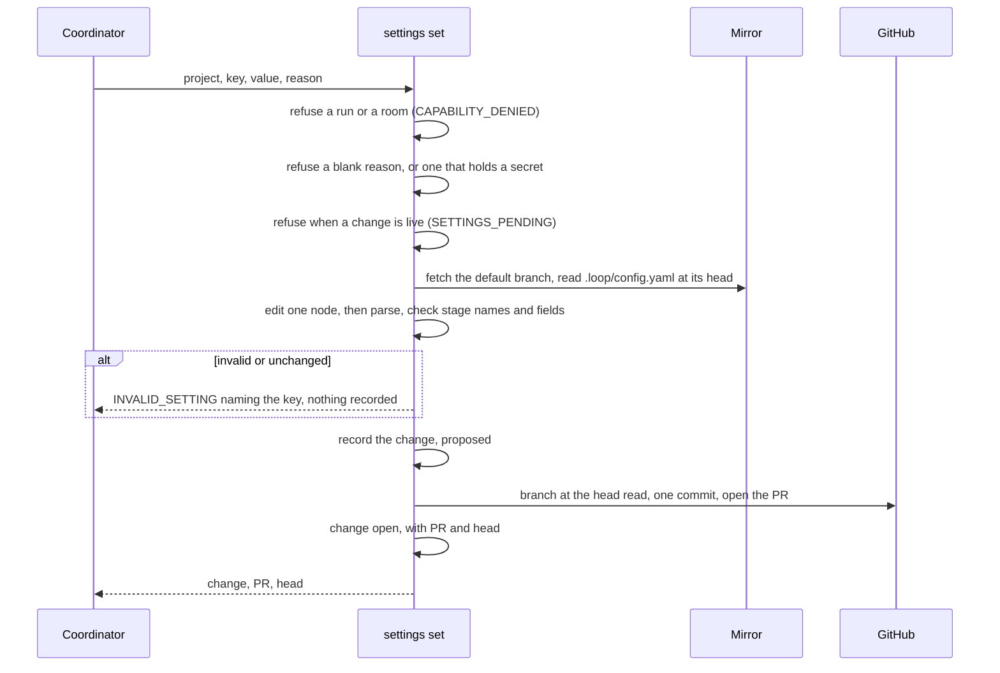
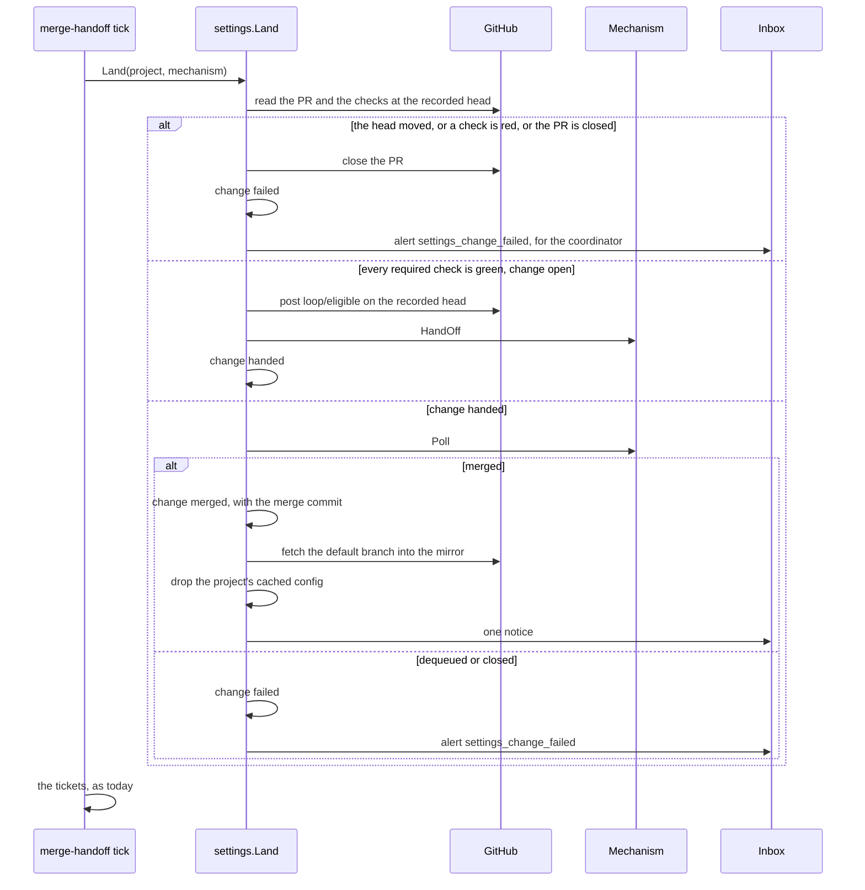
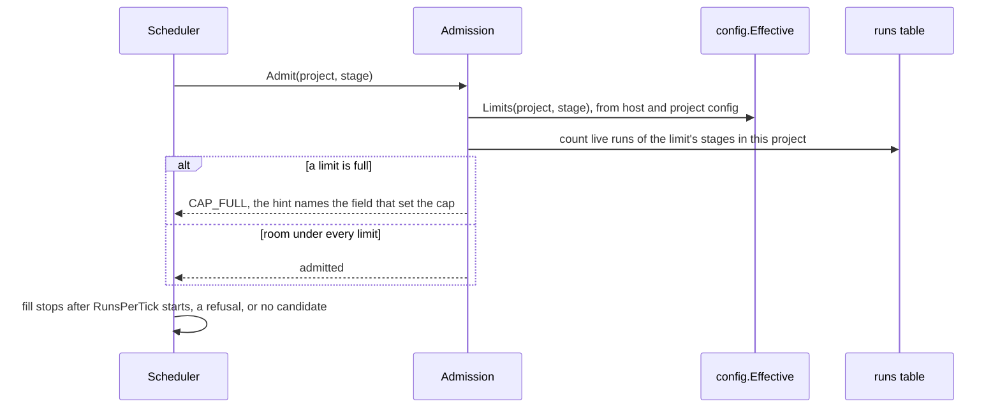
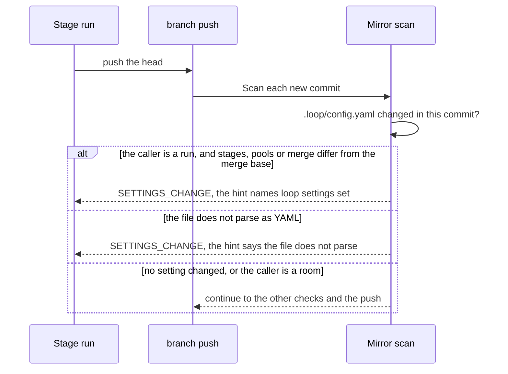
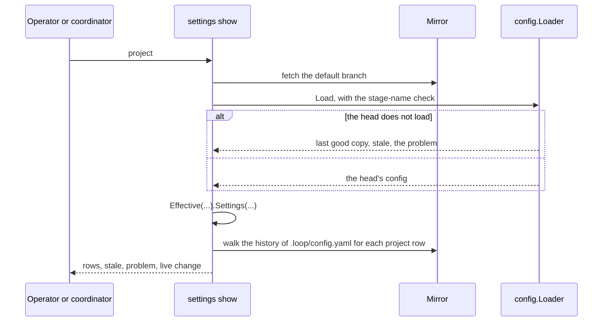

# Project-scoped settings: technical spec

## Source

- **Epic:** factorio-j4x
- **Source:** `docs/prd/project-scoped-settings.md`, merged at `1529576`.
- **Stories covered:** US-01, US-02, US-03, US-04, US-05, US-06, US-07.

The operator answered the PRD's two open questions at sign-off on 2026-10-27. The coordinator
recorded the answers in `question/9` and `signoff/factorio/factorio-j4x`, and the operator posted
them on PR #58:

1. The command opens a pull request that the project's merge mechanism merges after CI, with no
   person's approval. The loop App does not become a ruleset bypass actor. This unblocks A8 and
   A9.
2. US-03 stays, with the new promise that a job name under `stages` that names no job is refused.

Decisions records both answers. Neither question is open again.

## Scope check

**Components:**

1. **The project's settings and their enforcement.** The settings that `.loop/config.yaml` holds,
   the one resolver that merges them with host config, and the two readers that enforce them:
   admission's caps and the scheduler's firings. This is `internal/config`, with the readers in
   `internal/admission` and `internal/sched`.
2. **The settings change path.** The verbs `loop settings set` and `loop settings show`, the
   settings pull request that the merge-handoff job lands, the inbox notice, and the push refusal
   for stage runs. Why not its own epic: every part of it reads the settings that component 1
   defines. `settings set` validates a value against that definition, `settings show` lists it, and
   the push refusal compares it. A second epic would define the settings again, or wait for this
   one.

Work entries 1 to 3 build component 1, and each proves its contracts with no verb. Entry 4 adds
the push refusal. Entries 5 to 8 build the verbs and the landing, each on the entries before it.
Entry 9 updates the pack's runbooks and the loop plan's text once the verbs are in `loop schema`.

**Not in this spec:** the overwatch sweep's `health` section (factorio-a7r). The operator's
visibility commands (factorio-wd0), which may list `loop settings show` and own no part of it.
Host config edits, which the operator makes by hand as today.

## Decisions

- **The settings command lands its change through a pull request that the project's merge
  mechanism merges after CI.** The operator chose this at sign-off over a direct commit by the loop
  App as a ruleset bypass actor. So U10 and U14 of the loop plan stand unchanged: the default
  branch still blocks direct pushes, and the operator stays its only bypass actor. We also chose CI
  alone over a code-reviewer run on the settings pull request, because the operator's answer names
  CI as the gate. A review run would cost one model run for a one-key change that the command
  already validated.
- **The server posts `loop/eligible` on a settings pull request itself, once every required check
  is green at the head the server wrote.** We chose this over a new ruleset exception for settings
  pull requests, because U10 requires `loop/eligible` on every merge and the App is already its
  only poster (`internal/github/rules.go`). The server posts it on no other head of that branch. A
  push to the branch by anyone else fails the change (C27).
- **"In force from the next tick" counts from the tick after the merge-handoff job reads the
  merge.** We chose this reading of A8 over the command's own tick, because the operator's answer
  puts CI between the command and the merge. On that read the server fetches the default branch
  into the mirror and drops the project's cached config, so the next tick reads the new file with
  no restart. Without the drop, the 30-second cache in `internal/server/sched.go` would serve the
  old value for up to two 15-second ticks.
- **Every cap counts the live runs of its own project only. A host cap becomes the value for each
  project that sets none.** We chose this over keeping instance-wide counting for a project with
  no cap of its own. The operator's option for US-01 reads "the host value is only a default. Each
  project is counted alone", and A2 refuses any count across projects. The consequence is real:
  with two projects and a host implementer cap of 8, the host now runs up to 16 implementers. The
  PRD puts a host-wide total out of scope by the operator's choice. Each harness's quota check
  (`internal/sched/quota.go`) still reads the whole host.
- **An agent job's cap keeps counting the whole instance.** We chose this over per-project
  counting for agent jobs, because the PRD puts per-project settings for agent jobs out of scope,
  and their cap stays a host value that no project can set. `Limit` carries a project, and an
  agent job's limit carries none.
- **Each new setting sits in the stage's own entry: `stages.<stage>.cap`,
  `stages.<stage>.runs_per_tick`, `stages.intake.cap` and `pools.<pool>.cap`.** We chose this over a
  project `throughput` map that mirrors host config's, because `stages.<stage>.schedule` already
  holds the schedule override. Two places for one stage's values would let them disagree. The PRD's
  settings definition also lists cap and runs per tick as stage entries. A pool runs nothing, so it
  has no stage entry, and `pools` holds it.
- **Runs per tick, when the project sets none, is the stage's cap in force.** That is today's
  behaviour since factorio-lqo, where one firing fills the free cap. We chose this over a new host
  config key, because the PRD asks only for a project setting. A new host key would also make a
  host config that the new release writes unreadable by the older release after `loop rollback`,
  as the a7r spec found for `overwatch`. Runs per tick bounds one firing of the stage's schedule.
  The scheduler's 15-second tick fires a stage only when its schedule is due.
- **One resolver, `config.Effective`, gives every value in force.** Admission, the scheduler, the
  overwatch `stalls` and `timers` parts, and `loop settings show` all read it. We chose this over
  each reader merging host and project values itself, which is how `Timers` and `stalls.go` do it
  today. The settings read must show what the scheduler enforces, and C16 proves that against one
  function.
- **The server checks the stage names under `stages` when it loads a project's config, and the
  settings command checks them before it lands a change.** We chose the loader over
  `ParseProjectConfig`, because agent job names live in host config, which the parser never reads.
  We chose it over `loop gates`, which runs on the client with no host config. A name that is no
  run stage, no per-project native job and no agent job of host config makes the file invalid. The
  server then keeps the last good config and raises `project_config_invalid` (KTD20), as for any
  other invalid field. A name of an instance job, `github-reactor` or `overwatch`, is refused with
  its own reason: it runs once for the host. This is the operator's US-03 answer.
- **One command changes one setting.** We chose this over several keys in one call, because one
  change then maps to one commit, one reason and one notice, as A9 and A13 count them.
- **A project holds at most one open settings change. The command refuses a second with
  `SETTINGS_PENDING`.** We chose this over a second pull request beside the first, because two
  pull requests that edit one file from one base head conflict, or land in an order that nobody
  chose. A stuck change ends when CI reports or when a person closes its pull request (C30).
- **The server writes the settings commit through the contents API, on the branch
  `loop/settings/<change id>`.** We chose this over a git push from the mirror, because KTD14
  allows no git with the token, and `OpenFilePR` already writes this way. `ItemOf` maps a branch
  that holds a second `/` to no item, so the reactor, the overwatch parts and `branch push` ignore
  this branch.
- **The command edits the YAML node of the one key, and keeps every comment and the key order.**
  We chose a `yaml.v3` node edit over writing the parsed struct back, because the struct drops
  every comment of a file that people read and review.
- **The settings pull request lands inside the merge-handoff job's tick.** We chose this over a
  new native job, because a new job needs a host throughput key and would be a fourth per-project
  schedule that the PRD does not name. The merge-handoff job already resolves the project's
  mechanism and shares GitHub's rate-limit cooldown.
- **A notice is a new inbox entry kind, `notice`, put when the change merges.** We chose a new
  kind over an alert, because the coordinator dispatches `loop-alert-root-cause` for each open
  alert with no finding, and an alert reads as a fault. We chose the merge over the command, because
  a change whose CI goes red never takes effect, and a notice must report what is in force. The
  notice waits on a person, so the overwatch reminder brings it back if the coordinator never
  relays it. `loop inbox answer` dismisses it. No item, run or decision waits on it.
- **A settings change that cannot land fails, raises the alert `settings_change_failed` for the
  coordinator, and puts no notice.** Red CI, a conflict with the base, a dequeue and a person's
  close each fail it. We chose a failure over a retry, because red CI on a one-key change means the
  new value broke a gate, and a retry repeats it. The coordinator runs the command again when it
  judges the cause gone.
- **A change of `merge.mechanism` runs the new mechanism's `Check` before the command lands
  anything.** We chose this over the parse alone, because a mechanism whose needs fail, such as a
  missing `.mergify.yml`, merges no later pull request. The settings pull request would be the last
  one that merged.
- **The push refusal compares the setting sections at each pushed commit with the same sections
  at that commit's merge base with the base branch.** We chose the merge base over the commit's
  parent, as the `merge_config` rule of `internal/github/scan.go` does. A run's merge of the base
  then brings in the coordinator's change and passes. The setting sections are `stages`, `pools`
  and `merge`. A commit whose `.loop/config.yaml` does not parse as YAML is refused, because the
  server cannot show that it changes no setting.
- **The push refusal applies to a stage run's push, and not to a room's.** We chose this over
  every agent principal, because US-07 names stage runs, and a room acts in a session with the
  operator. A review room makes each edit the operator asks for.
- **Three new refusal codes: `SETTINGS_CHANGE`, `INVALID_SETTING` and `SETTINGS_PENDING`.** We
  chose new codes over `UNSAFE_PATH` and `USAGE`, because a run branches on the code
  (`loop-sdlc-turn` section 2). `UNSAFE_PATH` sends a run to escalate to the operator, and a
  settings change belongs to the coordinator's command. The PRD also asks that the code point to
  that command, so the meaning of `SETTINGS_CHANGE` in `loop schema` names `loop settings set`.
- **`loop settings show` admits the coordinator and the operator's shell. `loop settings set`
  admits the coordinator only.** US-06 is the operator's read, and the operator's shell is the
  `host` principal. Round 1 of the PRD review dropped "the operator may run that command too",
  because no operator words asked for it. The operator keeps editing the file by hand, as the
  ruleset's bypass actor.
- **`loop settings show` reads the commit that last changed each setting from the file's git
  history in the mirror, on each call.** We chose this over a commit stored when the command lands
  a change, because the operator also edits the file by hand, and a stored record misses those
  commits.
- **The loop plan's text changes in three places: R35, KTD30, and the key decision "Project config
  is committed in the repo".** The PRD gives this spec that change. R35 and KTD30 gain the project
  caps, pools and runs per tick, and lose "override `schedule` only". The key decision says that a
  settings change by the coordinator merges after CI with no person's review, by the operator's
  answer of 2026-10-27. U10 and U14 need no change.

## Assumptions

- The project's CI runs on a pull request that the loop App opens with its installation token.
  This is wrong if a settings pull request shows no check run within the project's CI budget.
- The default branch's ruleset requires no approving review. U10 requires CI and `loop/eligible`
  only, and ticket pull requests merge today with no review. This is wrong if
  `loop doctor-github` reports a required approval count above 0.
- A `yaml.v3` round trip of `.loop/config.yaml` keeps every comment and the key order. This is
  wrong if the round-trip test over this repository's config and the `loop-init` template shows a
  lost or moved comment.
- No registered project lists a stage name today that the new check refuses. This is wrong if,
  after the upgrade, any project raises `project_config_invalid` that names `stages.<name>`.
- A9's "one commit" is the settings commit on the pull request branch. The mechanism's merge
  commit is how the change reaches the default branch, and it is no second change. This is wrong
  if the project's mechanism squashes, and the operator reads the squash commit as the record. The
  squash commit then holds the same message, so the read still names the actor and the reason.
- The history of `.loop/config.yaml` is short enough that `settings show` reads all of it on each
  call. This is wrong if one call takes more than 2 seconds on a project.

## Approach

### The settings

A project's settings are the PRD's list: each stage entry's fields, each pool cap, the intake cap,
each per-project native job's schedule, and the `merge` section. `internal/config` owns one table,
the settings registry. It names each field that a stage kind may hold:

| Stage kind | Fields |
| --- | --- |
| A run stage that claims an item | `enabled`, `model`, `harness`, `effort`, `run_budget`, `schedule`, `cap`, `runs_per_tick`, `escalated.*` |
| The fixer, which claims no item | the same, except `runs_per_tick` |
| Intake | `cap` |
| A per-project native job | `schedule` |
| An agent job of host config | `enabled`, `model`, `harness`, `effort`, `run_budget`, `schedule`, `escalated.*` |

A pool holds `cap`. The `merge` section holds `mechanism` and `required_checks`. The registry
refuses only the two new fields, `cap` and `runs_per_tick`, on a stage kind that cannot hold them.
Today's config accepts any old field on any stage, and refusing that now could stop a working
project.

`config.Effective(host, project)` returns a `ProjectThroughput`. It answers each stage's limits,
schedule and runs per tick, and it lists every setting with its value and source. Its `Limits`
carry the project, so admission's count of live runs filters by project. A project with no config
yet, `ErrConfigMissing`, resolves to the host values.

### The readers

Admission gains a project config source, the same `ProjectSource` the scheduler holds. `Admit`,
`PeekAs` and `IntakeCap` read `Effective(host, project).Limits(stage)`. The SQL count of live runs
adds `AND project = ?` when the limit names a project. A `CAP_FULL` hint names the field that set
the cap, such as `stages.implementer.cap in .loop/config.yaml` or `throughput.implementer.cap in
host config`.

The scheduler's `launch` passes `RunsPerTick(stage)` to `fill`. `Timers` and the overwatch parts
read `Schedule(stage)`.

### The change path

`loop settings set <project> <key> --value <v> --reason <text>`, or `--unset` in place of
`--value`, runs these steps on the server, in this order. A refusal at any step lands nothing.

1. The capability matrix admits the coordinator only.
2. The reason is not blank, and it holds no stored secret value.
3. The project holds no open change.
4. The server fetches the default branch, reads `.loop/config.yaml` at its head, and edits the one
   key's node.
5. The new file parses, passes the stage-name check and every field rule, and differs from the old
   file. A change of `merge.mechanism` also passes that mechanism's `Check`.
6. The server records the change as `proposed`, with the old value in force and its source.
7. The server creates the branch at the head it read, writes the file with one commit, and opens
   the pull request. The change becomes `open`, with the pull request's number and head.

Each tick of the merge-handoff job reads each project's live change before its tickets. An `open`
change waits for every required check at its recorded head. When all are green, the server posts
`loop/eligible` on that head and hands the pull request to the mechanism, and the change becomes
`handed`. Each later tick polls the mechanism. A merge makes the change `merged`. The server then
fetches the default branch, drops the project's cached config, and puts the notice. A red check, a
conflict, a dequeue, a close, or a head that moved fails the change and raises
`settings_change_failed`. A `proposed` change with no pull request, after a crash in step 7, runs
step 7 again, because `OpenFilePR`'s steps are safe to repeat.

### The read

`loop settings show <project>` fetches the default branch and loads the config through
`config.Loader`, so it reports `stale` and the problem when the head does not load. It lists every
row of `Effective(...).Settings(...)`. For each row whose source is the project file, it walks the
file's history from the commit whose file holds the bytes in force. That is the head, or the last
good copy's commit when stale. It names the newest commit whose value differs from its parent's.
It also names the project's live change, when one exists.

### The push refusal

`Mirror.checkPath` gains one case: a change to `.loop/config.yaml` in a stage run's push. It
parses the file at the commit and at the merge base, and compares the `stages`, `pools` and `merge`
subtrees. A difference refuses the push with `SETTINGS_CHANGE`. `PushRequest` gains the caller's
principal kind, and only `run` takes the check.

## Domain model

```
internal/config (changed)

StageConfig (changed)
  + Cap          *int    nil: the host value applies. Never < 1.
  + RunsPerTick  *int    nil: the stage's cap in force applies. Never < 1.
  invariant: a pointer field holds a value only when the file names the key. cap: 0 is a
             value, and validation refuses it. An int with 0 for "unset" could not refuse it.

ProjectConfig (changed)
  + Pools  map[string]PoolConfig   keys are pool names of this loop
PoolConfig (new)
  Cap  *int   never < 1

StageKind (new)    a closed enum: item run stage, fixer, intake, project job, agent job
  invariant: config.KindOf(name, Known) gives every name exactly one kind, or refuses it. A
             table maps each kind to the fields it may hold. No reader branches on a stage name
             to decide a field.

Known (new)        the stage names a project config may hold
  RunStages, ProjectJobs from code. AgentJobs from host config.
  invariant: built only by KnownStages(host). ProjectJobs and InstanceJobs partition
             NativeJobs(), and a test checks that the scheduler registers the same split.

Source (new)       project | host | default

SettingKey (new)   one setting, such as stages.implementer.cap or pools.reviewers.cap
  invariant: built only by ParseSettingKey against Known. A SettingKey always names a field
             that its stage kind may hold, so no later step checks the key again.

ProjectThroughput (new)   one project's values in force: host config with project values over it
  invariant: the only place that merges host and project values. Limits, Schedule, RunsPerTick
             and Settings all read it, so the read and the enforcement agree.

Limit (changed)
  + Project string   "" counts the whole instance (an agent job). Otherwise this project only.
  + Field   string   the config field that set Cap, for the CAP_FULL hint

internal/settings (new package)

Change               one settings change by the command
  state machine:  proposed -> open -> handed -> merged
                  proposed | open | handed -> failed
  invariant: at most one change per project is proposed, open or handed. A unique partial index
             holds it.
  invariant: Head is the commit the server wrote. loop/eligible is posted on Head only, and only
             in the move open -> handed.
  invariant: Old is the value in force when the command read the file, with its Source. New is
             nil for --unset.

View                 the answer of settings show: rows, stale flag, problem, live change
Row                  one setting: key, value, source, commit (project source only)
```

## Interfaces

```go
// internal/config/settings.go

type PoolConfig struct {
	Cap *int `yaml:"cap,omitempty"`
}

type Source string

const (
	SourceProject Source = "project" // .loop/config.yaml on the default branch
	SourceHost    Source = "host"    // host config's throughput entry
	SourceDefault Source = "default" // the loop's own default
)

type Known struct {
	RunStages   []string // RunStages()
	ProjectJobs []string // merge-handoff, dependency-advance, decision-timers
	AgentJobs   []string // host config's agent_jobs
}

func KnownStages(hc *HostConfig) Known
func ProjectJobs() []string
func InstanceJobs() []string

// CheckStages refuses a name under stages that Known does not hold. An
// instance job's name is refused with the reason that it runs for the host.
func (c *ProjectConfig) CheckStages(k Known) error // replaces CheckStages(known []string)

type SettingKey struct{ /* unexported */ }

func ParseSettingKey(s string, k Known) (SettingKey, error)
func (k SettingKey) String() string

type Setting struct {
	Key    SettingKey
	Value  string // as `settings set --value` takes it; "" when no value is in force
	Source Source
}

// Defaults gives the loop's own default of a stage field that host config
// does not hold: the model, the effort and the escalated model. sched
// supplies it from DefaultModels, DefaultEfforts and DefaultEscalatedModels.
type Defaults func(stage, field string) (string, bool)

type ProjectThroughput struct{ /* unexported */ }

// Effective merges pc over hc. A nil pc gives the host values.
func Effective(hc *HostConfig, pc *ProjectConfig) ProjectThroughput
func (t ProjectThroughput) Limits(project, stage string) []Limit
func (t ProjectThroughput) Schedule(stage string) string
func (t ProjectThroughput) RunsPerTick(stage string) int
func (t ProjectThroughput) Settings(k Known, d Defaults) []Setting // sorted by key

// SetSetting returns raw with key set to value, or removed when value is
// nil. It edits the one node and keeps every comment. It does not validate.
func SetSetting(raw []byte, key SettingKey, value *string) ([]byte, error)

// SettingsChanged reports whether two config files differ in stages, pools
// or merge. A file that does not parse as YAML is an error.
func SettingsChanged(old, new []byte) (bool, error)

// internal/config/lkg.go (changed)
type Loader struct {
	LKG    LKGStore
	Alerts Alerter
	// Check runs after a parse. Its error makes the read invalid, so the
	// last good config stays in force. Nil checks nothing.
	Check func(*ProjectConfig) error
}
```

```go
// internal/admission (changed)
type Config struct {
	// ...as today, plus:
	Project func(ctx context.Context, project string) (*config.ProjectSnapshot, error)
}
// limitsFor gains the project: limitsFor(ctx, project, stage)

// internal/server/sched.go (changed)
// projectLoader returns a source and a forget func that drops one
// project's cached snapshot.
func (s *Server) projectLoader(refs RefSource) (sched.ProjectSource, func(project string))
```

```go
// internal/github (changed)
type PushRequest struct {
	// ...as today, plus:
	Caller string // the principal kind; cli.PrincipalRun takes the settings check
}

// FileChange is one edit of an existing file that the server proposes
// through its own pull request.
type FileChange struct {
	Branch  string // loop/settings/<change id>; never the base and never an item branch
	Path    string
	BaseSHA string // the default branch head the edit read; the branch starts here
	Content []byte
	Message string
	Title   string
	Body    string
}

// ProposeFile creates Branch at BaseSHA, writes Content over Path with one
// commit, and opens the pull request. It is safe to run again: an existing
// branch, an existing commit and an open pull request are no fault. It
// returns the pull request and the head commit.
func (s *Service) ProposeFile(ctx context.Context, p config.Project, f FileChange) (PR, string, error)
```

```go
// internal/settings (new)
type State string

const (
	Proposed State = "proposed"
	Open     State = "open"
	Handed   State = "handed"
	Merged   State = "merged"
	Failed   State = "failed"
)

type Change struct {
	ID        int64             `json:"change"`
	Project   string            `json:"project"`
	Key       config.SettingKey `json:"-"`
	Setting   string            `json:"setting"`
	Old       string            `json:"old"`
	OldSource config.Source     `json:"old_source"`
	New       *string           `json:"new"` // nil: --unset
	Reason    string            `json:"reason"`
	Actor     string            `json:"actor"`
	Branch    string            `json:"branch"`
	PR        int               `json:"pr,omitempty"`
	Head      string            `json:"head,omitempty"`
	State     State             `json:"state"`
	MergeSHA  string            `json:"merge_commit,omitempty"`
	Detail    string            `json:"detail,omitempty"`
}

type Row struct {
	Key    string        `json:"key"`
	Value  string        `json:"value"`
	Source config.Source `json:"source"`
	Commit string        `json:"commit,omitempty"` // project rows only
}

type View struct {
	Project string  `json:"project"`
	Branch  string  `json:"branch"`
	Head    string  `json:"head"`
	Stale   bool    `json:"stale"`
	Problem string  `json:"problem,omitempty"`
	Rows    []Row   `json:"settings"`
	Live    *Change `json:"live_change,omitempty"`
}

type SetRequest struct {
	Project string
	Key     string
	Value   *string // nil: --unset
	Reason  string
	Actor   string
}

func (s *Service) Show(ctx context.Context, project string) (View, *cli.Refusal)
func (s *Service) Set(ctx context.Context, r SetRequest) (Change, *cli.Refusal)

// Land moves the project's live change one step. merge-handoff calls it
// on each tick of the project, before its tickets.
func (s *Service) Land(ctx context.Context, p config.Project, m merge.Mechanism) error

// Eligible reports whether PR n is a handed settings change at its
// recorded head. github-queue's sweep reads it beside the tickets'.
func (s *Service) Eligible(ctx context.Context, project string, n int) (bool, error)
```

```go
// internal/merge/handoff.go (changed)
type Lander interface {
	Land(ctx context.Context, p config.Project, m Mechanism) error
	Eligible(ctx context.Context, project string, n int) (bool, error)
}
// Config gains Settings Lander. Nil lands no settings change.
```

```go
// internal/inbox (changed)
const KindNotice = "notice" // a change the operator reads; nothing waits on it
// Entry id notice/<row>. Awaits person. Next:
//   "tell the operator; `loop inbox answer notice/<row> --body <anything>` dismisses it"
// An answer sets dismissed_at. A notice is never deferred.
func PutNotice(tx *store.Tx, n Notice) (int64, error)

type Notice struct {
	Project string
	Subject string // such as "factorio: stages.implementer.cap 8 (host) to 3"
	Body    string // the setting, the old value and source, the new value, the merge commit, and the reason in agent tags
	Source  string // "settings_change"
	Ref     string // the change id
}
```

```
CLI surface (internal/cli/surface.go, proto/loop/v1/services.proto: SettingsService)

loop settings show <project>
  callers: coordinator, host. Read.
  data: View

loop settings set <project> <key> (--value <v> | --unset) --reason <text>
  callers: coordinator. Write, with an idempotency key (KTD13).
  data: Change, in state open
  --value of a list (merge.required_checks) is a comma-separated list.

Refusal codes (internal/cli/codes.go):
  SETTINGS_CHANGE   exit 3  "the push changes a setting in .loop/config.yaml; only the coordinator
                             changes settings, with loop settings set"
  INVALID_SETTING   exit 3  "the setting or its value does not validate; the hint names the
                             setting and the rule"
  SETTINGS_PENDING  exit 3  "the project already has an open settings change; the hint names its
                             pull request"

Alert kind (internal/settings): settings_change_failed, awaits the coordinator,
  dedupe key settings_change_failed:<project>:<change id>
```

The settings commit's message:

```
chore(settings): set stages.implementer.cap to 3

<the reason, as one paragraph>

Loop-Setting: stages.implementer.cap
Loop-Old-Value: 8 (host)
Loop-Changed-By: coordinator
```

`--unset` writes `chore(settings): unset stages.implementer.cap`. The commit's author is the loop
App's bot user, which the contents API records.

## Data

```
.loop/config.yaml (changed; the project file, no store)
  stages.<stage>
    + cap            integer >= 1, optional. Run stages and intake only.
    + runs_per_tick  integer >= 1, optional. Run stages that claim an item only.
  + pools
      reviewers
        cap          integer >= 1, optional

settings_changes (new, migration 0011)
  id            INTEGER PRIMARY KEY AUTOINCREMENT
  project       TEXT    NOT NULL
  setting       TEXT    NOT NULL   the key, such as stages.implementer.cap
  old_value     TEXT    NOT NULL   the value in force before; '' when none
  old_source    TEXT    NOT NULL   CHECK IN ('project', 'host', 'default')
  new_value     TEXT               NULL for --unset
  reason        TEXT    NOT NULL
  actor         TEXT    NOT NULL
  branch        TEXT    NOT NULL
  base_sha      TEXT    NOT NULL   the default branch head the edit read
  pr            INTEGER            NULL until the pull request opens
  head_sha      TEXT               NULL until the commit exists
  state         TEXT    NOT NULL   CHECK IN ('proposed', 'open', 'handed', 'merged', 'failed')
  detail        TEXT    NOT NULL DEFAULT ''
  merge_sha     TEXT
  created_at    INTEGER NOT NULL
  settled_at    INTEGER
  UNIQUE INDEX settings_changes_live ON settings_changes (project)
    WHERE state IN ('proposed', 'open', 'handed')

notices (new, migration 0011)
  id            INTEGER PRIMARY KEY AUTOINCREMENT
  project       TEXT    NOT NULL DEFAULT ''
  source        TEXT    NOT NULL   'settings_change'
  ref           TEXT    NOT NULL   the change id
  subject       TEXT    NOT NULL
  body          TEXT    NOT NULL
  at            INTEGER NOT NULL
  dismissed_at  INTEGER
  UNIQUE INDEX notices_ref ON notices (source, ref)
```

**Existing records:** none. Both tables are new and empty. No project file holds `cap`,
`runs_per_tick` or `pools` today, so every project runs at the host values after the upgrade. The
count changes with it: each project now counts its own runs against each host cap (Decisions). The
`notices_ref` index makes a repeated landing tick put one notice per change.

## Flows











## Work

1. **The settings model and the stage-name check.** Add `cap` and `runs_per_tick` to
   `StageConfig`, `pools` to `ProjectConfig`, and their field rules. Add the registry, `Known`,
   `SettingKey`, `ProjectThroughput`, `Effective`, `SetSetting` and `SettingsChanged`. Change
   `CheckStages` to take `Known`, and refuse an instance job's name with its own reason. Add
   `Loader.Check`, and set it in the server's two loaders (`internal/server/sched.go`,
   `internal/server/merge.go`) to `CheckStages(KnownStages(host))`. Change the comment on
   `Throughput` that says a project never overrides the cap.
   - Files: `internal/config/{project,throughput,lkg,settings}.go`, `internal/server/sched.go`,
     `internal/server/merge.go`, with tests.
   - Needs: nothing.
   - Proves: C1, C2.
   - Done when: a project config with `stages.implementr` keeps the last good config in force,
     and the alert names `stages.implementr`. A config with `stages.implementer.cap: 0` is
     refused and names that field.
2. **Per-project caps in admission.** Give admission the project config source. Read
   `Effective(...).Limits(project, stage)` in `Admit`, `PeekAs` and `IntakeCap`. Count live runs
   by project when the limit names one. Name the field in each `CAP_FULL` hint.
   - Files: `internal/admission/{policy,caps}.go`, `internal/server/server.go` where it composes
     admission, with tests.
   - Needs: 1.
   - Proves: C3, C4, C5, C6, C7, C8, C9.
   - Done when: two projects with a host implementer cap of 2 each hold 2 live implementer runs,
     and a project with `stages.implementer.cap: 1` holds 1.
3. **The scheduler reads the resolver.** `launch` passes `RunsPerTick(stage)` to `fill`. `Timers`
   reads `Schedule(stage)`. The overwatch `stalls` and `timers` parts read the same function.
   - Files: `internal/sched/{scheduler,timers}.go`, `internal/overwatch/{stalls,timers}.go`, with
     tests.
   - Needs: 1.
   - Proves: C10, C11.
   - Done when: a firing with `runs_per_tick: 3`, a cap of 8 and 5 candidates starts 3 runs.
4. **The push refusal for stage runs.** Add `Caller` to `PushRequest`, and set it in
   `branchPush` from the principal. Add the `.loop/config.yaml` case to `checkPath`, which calls
   `SettingsChanged` against the merge base. Add `SETTINGS_CHANGE` to the codes table.
   - Files: `internal/github/{push,scan,verbs}.go`, `internal/cli/codes.go`, with tests.
   - Needs: 1.
   - Proves: C12, C13, C14.
   - Done when: a run's push that sets `stages.implementer.cap` is refused, and the same push from
     a room lands.
5. **`loop settings show`.** Build `internal/settings` with `View`, `Row` and `Show`. Walk the
   file's history in the mirror. Add the verb to the surface and to `services.proto`, regenerate
   `gen/` with `make proto`, and register the handler.
   - Files: `internal/settings/{view,history}.go`, `internal/server/settings.go`,
     `internal/cli/surface.go`, `proto/loop/v1/services.proto`, `gen/**`, `internal/sched/quota.go`
     for the `Defaults` function, with tests.
   - Needs: 2 and 3, because C16 compares the read with what they enforce.
   - Proves: C15, C16, C17.
   - Done when: `loop settings show factorio` lists `stages.implementer.cap` as 8 from host, and
     after a commit that sets it to 3, lists 3 from project with that commit's sha.
6. **The inbox notice.** Add the `notices` table, `KindNotice`, `PutNotice`, its entries in
   `Entries`, and its dismissal in `answer`. A notice cannot be deferred.
   - Files: `internal/store/migrations/0011_settings.sql` (the `notices` table),
     `internal/inbox/{inbox,entries,answer}.go`, with tests.
   - Needs: nothing.
   - Proves: C18.
   - Done when: a notice put in a test appears in `loop inbox list` waiting on a person, and an
     answer removes it.
7. **`loop settings set`.** Add the `settings_changes` table, `Change`, `Set`, and
   `github.ProposeFile`. Add `INVALID_SETTING` and `SETTINGS_PENDING`. Add the verb to the surface
   and to `services.proto`, regenerate `gen/`, and register the handler.
   - Files: `internal/store/migrations/0011_settings.sql` (the `settings_changes` table),
     `internal/settings/{change,set}.go`, `internal/github/merge_api.go`,
     `internal/server/settings.go`, `internal/cli/{surface,codes}.go`,
     `proto/loop/v1/services.proto`, `gen/**`, with tests.
   - Needs: 1, and 5 for the package and the server file.
   - Proves: C19, C20, C21, C22, C23, C24, C25.
   - Done when: against a fake GitHub, the command opens one pull request whose branch holds one
     commit that changes `stages.implementer.cap` only.
8. **The landing.** Build `Land` and `Eligible`. Add `Lander` to the merge-handoff config, call it
   first in `TickProject`, and pass `Eligible` to the github-queue sweep beside the tickets'. On a
   merge, fetch the base, call the loader's forget function, and put the notice. On a failure,
   close the pull request and raise `settings_change_failed`.
   - Files: `internal/settings/land.go`, `internal/merge/handoff.go`, `internal/server/merge.go`,
     `internal/server/sched.go`, with tests.
   - Needs: 6 and 7.
   - Proves: C26, C27, C28, C29, C30.
   - Done when: with the fake mechanism, a change goes from open to merged across three ticks, the
     fourth tick admits against the new cap, and the inbox holds one notice.
9. **The runbooks and the plan's text.** The coordinator runbook gains a section on settings: when
   to change one, the command, the read, the notice, `SETTINGS_PENDING` and
   `settings_change_failed`. `loop-sdlc-turn` section 2 gains `SETTINGS_CHANGE`: the run reverts
   its change to the setting sections, and escalates when its ticket needs that setting. The
   glossary defines a setting and a settings change. The loop plan's R35, KTD30 and the key
   decision "Project config is committed in the repo" change as Decisions states.
   - Files: `pack/runbooks/coordinator.md`, `pack/skills/loop-sdlc-turn/SKILL.md`,
     `pack/skills/loop-sdlc-glossary/SKILL.md`,
     `docs/plans/2026-10-21-1328-feat-standalone-sdlc-loop-plan.md`.
   - Needs: 4, 5 and 7, for the code and both verbs in `loop schema`.
   - Proves: C31.
   - Done when: `make pack-check` passes, and the plan no longer says "Project config may override
     `schedule` only".

## Out of scope

- A host-wide total that bounds the sum of every project's caps. Never, by the operator's choice
  "Project overrides host" (PRD, Out of scope).
- Per-project settings for agent jobs, beyond the stage fields they hold today. They belong to no
  epic. Their cap stays a host value that counts the whole instance.
- A per-project schedule for `github-reactor` and `overwatch`. They are instance jobs, and this
  spec refuses their names under `stages` (C1).
- Changes to host config through a command. Never, by the PRD. The operator edits host config by
  hand.
- A command for the operator to change a setting. The PRD review dropped it, because no operator
  words asked for it. The operator edits the file by hand.
- Withdrawing a live settings change by a command. Never in this epic. A person closes its pull
  request, and the change fails (C30).
- Stopping live runs when a cap drops. Never, by the operator's choice "They finish" (US-01).
- Listing the settings read in a visibility command. It belongs to factorio-wd0, which may call
  `loop settings show`.
- The `health` section of project config. It belongs to factorio-a7r, and it is no setting.

## Contracts

**C1. Refusal: a name under `stages` that names no stage or job makes the config invalid.**
Proves the operator's US-03 answer (Source). For each name that is no run stage, no per-project
native job and no agent job of host config, the server's load keeps the last good config in
force, raises `project_config_invalid` for the project, and the alert's body names
`stages.<name>`. For `github-reactor` and `overwatch` the reason says the job runs once for the
host. A name of each known kind loads.
*An example test per kind through `config.Loader` with `Check` set, plus a misspelled name and
both instance jobs.*

**C2. Refusal: a setting value outside its rule makes the config invalid, and the error names the
field.** Proves A11. `cap: 0`, `cap: -1`, `runs_per_tick: 0`, `cap` under a per-project native job,
`runs_per_tick` under `fixer` or `intake`, a pool name that is not `reviewers`, and
`pools.reviewers.cap: 0` each fail the load, and the error names the field's full path. Each value at 1 loads.
*An example test per case, which asserts the field path in the error.*

**C3. Behaviour: a project cap bounds the project's live runs.** Proves A1. With
`stages.implementer.cap: 3` and a host cap of 8, admission admits 3 implementer runs of the
project and refuses the fourth with `CAP_FULL`.
*An example test against the store with fake items.*

**C4. Invariant: one project's live runs never count against another project's limit.** Proves
A2 and A4. For any set of live runs spread over two projects, and any stage caps and reviewers pool
caps on each, admission of a stage in project P refuses exactly when P's own live runs of the
limit's stages reach P's cap in force.
*A property test over 1,000 generated run sets and cap pairs, against a model that counts by
hand.*

**C5. Behaviour: a project with no cap of its own gets the host cap for that project alone.**
Proves A3. With a host implementer cap of 2 and no project cap, project P admits 2 implementer runs
while project Q holds 2 live implementer runs.
*An example test with two projects.*

**C6. Behaviour: a project's reviewers pool cap bounds both reviewer stages together.** Proves
A4. With `pools.reviewers.cap: 2`, one live code-reviewer run and one live doc-reviewer run of the
project, admission refuses a third reviewer run with a `CAP_FULL` hint that names the pool. Two live
reviewer runs of another project change nothing.
*An example test.*

**C7. Behaviour: a project's intake cap replaces the host value.** Proves A5. With a host intake
cap of 8, `stages.intake.cap: 1` and one epic in `prd_review`, `room open --kind intake` for the
project refuses with `CAP_FULL`. With the epic in `prd_signoff`, it opens.
*An example test through `IntakeCap`.*

**C8. Behaviour: a lowered cap stops no live run.** Proves A18. With 5 live implementer runs, a
config change from cap 5 to cap 2 ends none of the 5, and admission refuses every implementer run
until 1 run is live. With 1 run live, it admits one.
*An example test that changes the config source between admissions, and asserts that no run row
ends.*

**C9. Behaviour: a `CAP_FULL` hint names the field that set the cap.** Proves A1. A project cap's
refusal names `stages.implementer.cap` in `.loop/config.yaml`. A host cap's refusal names
`throughput.implementer.cap` in host config. A pool's refusal names `pools.reviewers.cap` or
`throughput.reviewers.cap`.
*An example test per source.*

**C10. Equivalence: a project's job schedule fires on that schedule, and another project keeps the
host schedule.** Proves A6, as a regression criterion. With `stages.merge-handoff.schedule` on P
only, `Timers` gives P that expression and Q the host's. Over one simulated hour, P's job fires on
P's minutes and Q's on the host's.
*An example test over `Timers`, and a scheduler test with a fake clock.*

**C11. Behaviour: runs per tick bounds one firing.** Proves A7. With `runs_per_tick: 3`, a cap of
8, no live run and 5 candidates, one firing starts 3 runs. With `runs_per_tick` unset, the same
firing starts 5. With `runs_per_tick: 3` and 7 live runs, the firing starts 1, because admission
refuses the second.
*A scheduler test with fake candidates and a fake dispatch.*

**C12. Refusal: a stage run's push that changes a setting is refused.** Proves A16. A run's push
whose commit changes any value under `stages`, `pools` or `merge` of `.loop/config.yaml` against the
merge base gets `SETTINGS_CHANGE`. The hint names `loop settings set` and the commit. A
commit whose file does not parse as YAML gets the same code. The remote branch does not
move.
*An example test per section, plus the unparsable file, against a fixture mirror.*

**C13. Behaviour: a stage run's push that changes no setting lands.** Proves A17. A run's push that
changes only `gates`, `setup`, `policy_hooks`, `signoff`, `tracker`, `manifest` or `health` lands. A
run's merge of the base whose base holds a settings change since the fork lands.
*An example test per field, and one merge commit fixture.*

**C14. Behaviour: a room's push that changes a setting lands.** Proves A16, through its scope: the
refusal reaches stage runs only. The same commit that C12 refuses from a run lands from a room.
*An example test with the principal kind `room`.*

**C15. Behaviour: the settings read lists every setting with its value, source and commit.**
Proves A14. `loop settings show` lists one row for each setting of each known stage, pool and the
`merge` section. A row from the project file names the newest commit that changed its value,
including a commit that a person pushed by hand. A row from host config or the loop's default names
no commit.
*An example test against a fixture repository with three commits that change two settings.*

**C16. Equivalence: the settings read shows what admission and the scheduler enforce.** Proves
A14. For any host config and project config, each `cap` row equals the cap that `Limits` gives
admission, each `schedule` row equals the expression that `Timers` fires, and each `runs_per_tick`
row equals the limit `launch` passes to `fill`.
*A property test over 1,000 generated config pairs.*

**C17. Behaviour: the settings read says when the last good copy is in force, and why.** Proves
A15. When the default branch's head holds a config that does not load, the read answers
`stale: true`, a problem that names the failing field, and the rows of the last good copy, with
commits from that copy's history.
*An example test with a valid commit, then an invalid one.*

**C18. Behaviour: a notice is an inbox entry that asks nothing.** Proves A13 and A19. A put notice
appears in `loop inbox list` with kind `notice`, awaits `person`, its subject and body, and a
`Next` that holds no question. `loop inbox answer` on it dismisses it, and it leaves the list.
`loop inbox defer` on it is refused. No item, run or decision changes state when a notice is put
or dismissed.
*An example test.*

**C19. Refusal: the command refuses every caller except the coordinator.** Proves A12. A run's
token and a room's token each get `CAPABILITY_DENIED` from `loop settings set`, and the store holds
no change row.
*An example test through the RPC server, per principal kind.*

**C20. Refusal: the command refuses a change with no reason, and lands nothing.** Proves A10. An
absent `--reason` gets `USAGE` from the CLI. A reason of only spaces gets `USAGE` from the
server. In both cases no change row, no branch and no pull request exist.
*An example test against a fake GitHub that counts calls.*

**C21. Refusal: the command refuses a value that does not validate, and lands nothing.** Proves
A11. A cap of 0, an unknown key, a key that its stage kind cannot hold, a malformed schedule, an
unchanged value, and a `merge.mechanism` whose `Check` fails each get `INVALID_SETTING`, and
the hint names the setting. No change row, branch or pull request exists.
*An example test per case.*

**C22. Refusal: a second change waits for the first.** Proves A9, one change at a time. While a
project's change is `proposed`, `open` or `handed`, the command refuses another with
`SETTINGS_PENDING`, and the hint names the pull request. Once that change is `merged` or `failed`,
the command accepts a new one.
*An example test.*

**C23. Invariant: the proposed file differs from the base file in exactly the named setting.**
Proves A9. For any valid config and any settable key and valid value, `SetSetting` gives a file
whose parsed config equals the base's with that one field changed. Every comment of the base file
is in the new file.
*A property test over 1,000 generated configs, keys and values, plus a comment-preservation test
over this repository's config and the `loop-init` template.*

**C24. Behaviour: one commit names the change, its actor and its reason.** Proves A9. The
settings branch holds exactly one commit over the base head the command read. Its message's
subject names the setting and the value, its body holds the reason, and its trailers name the
setting, the old value with its source, and the actor `coordinator`.
*An example test against a fake GitHub that records the contents API call.*

**C25. Refusal: a reason that holds a stored secret is refused, and lands nothing.** Proves A9,
because the reason enters a commit message. A reason that holds a stored secret value is refused
with `SECRET_IN_OUTPUT`, and no change row, branch or pull request exists.
*An example test with a stored fake secret.*

**C26. Behaviour: a settings change lands through the project's mechanism once its checks are
green, with no person's approval.** Proves A9 and A19. An `open` change whose every required check
is green at its recorded head gets `loop/eligible` on that head and goes to the mechanism. A
`Merged` poll makes it `merged` with the merge commit. No step waits on an inbox answer, an
approval or a run.
*A test with each of the three mechanisms' fakes.*

**C27. Refusal: `loop/eligible` is posted on a settings pull request only at the head the server
wrote, and only when every required check is green.** Proves A19. A pending check posts nothing.
A head that differs from the recorded head fails the change, and posts nothing. A red check fails
the change, and posts nothing.
*An example test per case, which asserts the outbox holds no status effect.*

**C28. Behaviour: a merged change is in force at the next tick, with no restart.** Proves A8. After
the tick in which `Land` reads the merge, the next scheduler tick's admission uses the new value,
inside one server process and with no new `HostLoader` or `Loader`.
*A test with a fake clock, a fake mirror, and the 30-second cache in place.*

**C29. Behaviour: each merged change puts exactly one notice.** Proves A13 and A19. The notice
names the project, the setting, the old value and its source, the new value, the merge commit and
the reason. A tick that reads the same merge again puts no second notice. An `--unset` change's
notice names the value in force after it and that value's source.
*An example test that runs `Land` twice on one merged change.*

**C30. Behaviour: a change that cannot land fails, alerts the coordinator, and puts no notice.**
Proves A13: a notice reports only what is in force. Red CI, a conflict, a `Dequeued` or `Closed`
poll, and a pull request a person closed each make the change `failed`, close the pull request
when it is open, and raise one `settings_change_failed` alert that waits on the coordinator. The
inbox holds no notice for that change.
*An example test per cause.*

**C31. Behaviour: the runbooks name the verbs and the code.** Proves A12 and A16. `loop schema`
lists `settings show` and `settings set` and the three new codes. The coordinator runbook names
both verbs. `loop-sdlc-turn` section 2 names `SETTINGS_CHANGE`. `make pack-check` passes.
`grep -c 'override .schedule. only' docs/plans/2026-10-21-1328-feat-standalone-sdlc-loop-plan.md`
prints `0`.
*`make pack-check`, `loop schema`, and the `grep`.*

## Observable behaviour

None, because this epic draws no screen. The operator reads its effect in the envelope of
`loop settings show`, in the coordinator's reply that relays a notice, and in the settings pull
request on GitHub.

## Open questions

None.
