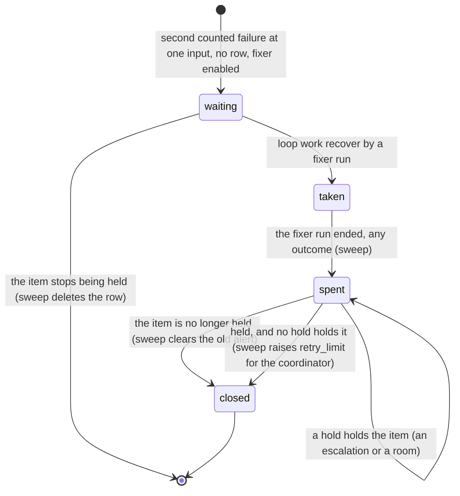

# Run integrity: technical spec

## Source

- **Epic:** factorio-jiv
- **Source:** `docs/adr/0006-run-integrity.md`, the one ADR whose `**Ticket:**` line names
  factorio-jiv. It is on the base branch at `7aad03b`.
- **Stories covered:** none. This is an architecture epic, and no story asks for it.

The ADR does not number its decisions or its acceptance criteria, so this spec does. The contracts
below cite these labels.

| Label | ADR text |
| --- | --- |
| D1 | Decision 1: check the model receipt of every stage run at start, and refuse only a recorded mismatch |
| D2 | Decision 2: name each stage model by the full id that the harness records |
| D3 | Decision 3: do not port `detach`, and let no job outlive its run |
| D4 | Decision 4: do not add a free-text alert verb for runs |
| D5 | Decision 5: give each twice-failed item one unattended recovery in the fixer stage |
| D6 | Decision 6: ship no harness pre-tool hook from the loop |
| AC-1 | `grep -rn 'coordinator send' pack/runbooks pack/skills` prints nothing |
| AC-2 | `ls pack/skills pack/runbooks \| grep -i -E 'detach\|shell-guard\|run-model'` prints nothing |
| AC-3 | `find . -path ./node_modules -prune -o -name settings.json -path '*pack*' -print` prints nothing |
| AC-4 | `grep -rn 'git worktree add' pack/runbooks/code-reviewer.md` prints at least one line |
| AC-5 | `loop gates --docs` passes |
| AC-6 | `grep -n 'RequireVerifiedModel' internal/sched/dispatch.go` prints the stage start |
| AC-7 | `go test ./internal/agenthost/...` proves that a recorded mismatch refuses the start, and that a missing receipt starts the session |
| AC-8 | `grep -n '"opus"' internal/sched/quota.go` prints nothing |
| AC-9 | Project config with a stage model `opus` fails validation, and a test proves it |
| AC-10 | `make acceptance` proves that a held item gets one fixer recovery, and that a second limit reaches the coordinator's inbox |
| K-1 | A later reader must not compare a requested model alias with a recorded id as a match |
| K-2 | A later reader must not refuse a stage start only because no transcript named a model yet |
| K-3 | A later reader must not reset the failure count of an item, or give it a second unattended recovery |

AC-1 to AC-5 already hold on the base. This run ran AC-1 to AC-4 at `7aad03b`: AC-1 and AC-2
printed nothing (exit 1), AC-3 printed nothing, and AC-4 counted 1 line. CI proves AC-5 on each pull
request of this epic, because `.github/workflows/ci.yml` runs `loop gates`. D3, D4 and D6 decide to
build nothing, so no work entry claims them (Decisions).

## Scope check

**Components:**

1. **The stage start guard**: the model receipt in `internal/agenthost` (the interface, the orca
   host, the fake host and the contract suite), the stage start in `internal/sched/dispatch.go`,
   the default models in `internal/sched/quota.go`, and stage config validation in
   `internal/config/project.go`.
2. **The twice-failed item recovery**: the recovery record and the fixer's work query in
   `internal/admission`, the `retry_limit` alert and a recovery sweep in `internal/sched`, the
   fixer's allowance on the recovered item in `internal/server`, `internal/machine` and
   `internal/escalation`, the verb surface in `internal/cli`, and the `fixer` and `coordinator`
   runbooks. Why not its own epic: ADR 0006 decides both halves, and its Ticket line names one
   epic. By `loop-sdlc-split`, the two halves are two units, because each lands alone and each
   proves its promises alone. So Open questions proposes the split, and this spec holds both
   halves so that either answer keeps it.

Work entries 1 to 3 change component 1 alone. Entries 4 to 8 change component 2 alone. No entry
needs the other component.

**Not in this spec:** the model check of the coordinator and of rooms, which ADR 0006 does not
decide. A job that outlives its run, which ADR 0006 postpones to the tickertown cutover. The
`stalls` check of overwatch, which belongs to epic factorio-a7r (see the `retry_limit` decision).

## Decisions

### The stage start guard

- **Start returns a recorded mismatch and a missing receipt as two errors.** We chose two
  sentinels: `ErrModelMismatch`, after which the host has closed the session, and
  `ErrNoModelReceipt`, which returns the live session. We rejected a receipt status on the returned
  `Session`. `Session` is the persisted run record (`hostRecord`), and the ADR's Consequences name
  two errors. We rejected a receipt check after the start, on the scheduler's tick. A run on the
  wrong model would then work, and push, until the tick stopped it, and D1 says that such a run
  never starts. `ErrModelUnverified` is removed. Today it names both facts, and that is the
  conflation that D1 removes.
- **A mismatch settles the run `refused` and uncounted, and raises one `model_mismatch` alert for
  each project and stage.** Each later mismatch counts up the open alert. We rejected an automatic
  pause of the harness. The cause is a config edit or a release, and a pause would also stop each
  stage on that harness whose model verifies. The coordinator already holds `loop stage pause`.
- **A missing receipt raises one `model_receipt_missing` alert for each project and stage, and the
  run keeps running.** A later start that verifies does not close the alert, and the coordinator
  answers it. We rejected one alert for each run, because one vendor change to its transcript store
  would then fill the inbox with one entry for each start.
- **A Claude model is valid only as `claude-` and then lower-case letters, digits and single
  dashes.** We chose this pattern over a list of the aliases to refuse. Claude Code adds aliases,
  such as `opusplan`, `default` and `opus[1m]`, and a list would miss the next one. The rule applies
  to a stage whose harness is `claude`, or names no harness. A Codex model is not checked, because
  the ADR names no Codex alias (Assumptions).
- **The default Claude model becomes `claude-opus-5-5`.** We chose the id that this host's
  transcripts record for the alias `opus` today (ADR 0006, gap 1), over a newer or older model. So
  the default keeps the model that every default run uses now. The coordinator and rooms read
  `DefaultModels` too, so they take the full id. Their sessions get no receipt check.
- **The full ids land before the check.** Work entry 1 lands before entry 3. Entry 3 alone would
  refuse every default Claude stage run, because each one requests `opus`. That includes the runs
  that build this loop.
- **A run that settles while Start waits for the receipt keeps its session record.** The receipt
  wait can last the whole 3-minute window while the session runs, and a run can finish inside it.
  `setRun` updates only a run that has not ended (`internal/sched/runs.go:120`). So today the
  record would lose the session, and no tick would close it. We chose to record the session on the
  ended run too, over a refusal of `loop run finish` during the start. A refused finish turns a
  correct run into a crashed run.

### The twice-failed item recovery

- **The recovery is a row in a new SQLite table, `recoveries`, keyed by project and item.** The
  ADR says that the item "records the recovery", and names a fact. We chose a row over a bead fact.
  The failure count, the holds and the escalations that decide admission all live in SQLite. So
  `RecordOutcome` opens the recovery in the transaction that records the second counted failure.
  The primary key also makes a second recovery of one item impossible (K-3). A bead fact would be a
  second write in another store, after the transaction.
- **The fixer takes a recovery with a new verb, `loop work recover <item>`, before any other write
  on the item.** The take spends the recovery, so a fixer run that crashes after it gives the item
  no second recovery. We rejected admission onto the item at start. The fixer claims no item
  (`internal/admission/policy.go:253`), and a run that dies before it starts would spend the
  recovery. We rejected a lease claim. A claim moves the item out of the state that its stage
  takes, and the stage must take the item again after the edit.
- **A fixer run takes one unit of work: the oldest waiting escalation, or else the oldest waiting
  recovery.** We chose escalations first, because an escalation holds its item at every stage,
  while a held item waits at one stage only. The server refuses a second take in one run.
- **The `retry_limit` alert opens at the first limit, as today, and its subject says that the
  fixer recovers the item first.** The ADR says that the alert waits for the coordinator only after
  a recovery left the item held. We keep that meaning through the alert's text: the coordinator
  answers a `retry_limit` alert only when its subject says that the recovery is spent. We rejected
  no alert until the recovery is spent, for two reasons. Overwatch's `stalls` check excludes only
  an item that an open `retry_limit` or `run_blocked` alert names (spec of factorio-a7r, C10), so
  it would report each waiting recovery as a stall. Also, an item whose fixer never runs would wait
  with no entry in the inbox.
- **The recovery is spent when a fixer takes it, and not at the limit.** A waiting recovery whose
  item stops being held is dropped, unspent. An item stops being held when a coordinator edit or a
  new release changes its inputs, or when the item moves. A later limit then opens a new waiting
  recovery. We rejected a recovery that is spent at the limit, because the item would then lose its
  one recovery to an edit that the coordinator made first.
- **A sweep on the scheduler's tick settles each recovery, and not the fixer's finish.** A fixer
  run that crashes ends with no finish. A panel that routes the fixer's escalation back to the loop
  ends the recovery with no fixer run at all. One sweep covers both, and the alert's dedupe key
  stops a second raise.
- **The fixer escalates a recovered item with `loop escalation raise --item <item>`, and the
  panel judges it.** We rejected an escalation that skips the panel. The operator asked for the
  triage rubric to be "ported over and respected" (ADR 0006, D4), and the server refuses levels 1
  to 3 for every run.
- **A recovery opens only when project config enables the fixer stage.** With no fixer, the
  first limit raises the alert with the coordinator's text, as today. We rejected a recovery that
  waits for a stage that never runs.
- **An item held before this release gets no recovery.** We rejected a backfill at migration. The
  open `retry_limit` alert of such an item already asks the coordinator, so a backfill would put
  two agents on one item.

### The three decisions that build nothing

- **D3, D4 and D6 get no work entry and no guard test.** Each one decides that the loop does not
  build something, and AC-1 to AC-4 already hold on the base. We rejected a guard test of each,
  because the proof rule needs a test that fails before the change, and no change exists.

## Assumptions

- Claude Code records the exact id passed in `--model` when that id is a full id, such as
  `claude-opus-5-5`. This is wrong if the first stage run after work entry 3 lands raises a
  `model_mismatch` alert.
- The first assistant record reaches the transcript well inside the 3-minute receipt window
  (ADR 0006, "What I assumed"). This is wrong if `model_receipt_missing` alerts open for Claude
  stages that do run.
- Codex records the id that the loop requests, `gpt-5-codex` (ADR 0006, "What I assumed"). This is
  wrong if a Codex stage run raises a `model_mismatch` alert.
- No registered project's config names a Claude Code alias as a stage model. Measured: no
  `.loop/config.yaml` under `/home/operator/projects` names `model:`. A run cannot list the
  registered projects, because `loop project list` is a host verb. This is wrong if a
  `project_config_invalid` alert names `stages.<stage>.model` after work entry 1 lands.
- One receipt wait delays only the next start of the same stage in the same project. Measured: the
  scheduler starts each dispatch in its own goroutine, one for each project and stage
  (`internal/sched/scheduler.go`, `launch`). This is wrong if a start of another stage waits on it.
- The fixer can decide a recovery from the item, its body and the notes of the failed runs. This is
  wrong if fixer recoveries mostly end with no edit, no supersede and no escalation.
- `loop work edit` changes the inputs of an item at every stage, because each stage's inputs hash
  reads the item's title and body (`internal/admission/inputs.go`, `computeInputs`). This is wrong
  if a stage admits no new attempt after a fixer's edit.

## Approach

### The stage start guard

**The full ids come first.** `DefaultModels[agenthost.Claude]` becomes `claude-opus-5-5`, and its
comment stops naming the alias, so AC-8 holds. `ProjectConfig.validate` refuses a stage whose
harness is `claude`, or empty, and whose model is set and fails `ClaudeModelID`. The message names
the field `stages.<stage>.model`.

**The host splits the receipt into two outcomes.** `orca.Host.awaitReceipt` polls
`ModelReceipt` as today. When the harness records another model, Start closes the session and
returns `ErrModelMismatch`. When the window passes and no transcript names a model, Start returns
the live session and `ErrNoModelReceipt`, and closes nothing. An error from the transcript read
counts as no model read. The fake host gains a second driver switch, beside the dropped model: a
silent model, under which its receipt names no model. The contract suite proves both outcomes on
every host whose driver offers each switch.

**Each stage start asks for the check.** `Scheduler.start` sets `RequireVerifiedModel` on the
`StartSpec` it sends. On `ErrModelMismatch`, it calls `fail` with `refused` set and the alert kind
`model_mismatch`. `abandon` settles the run not-ready, so the failure count does not change. On
`ErrNoModelReceipt`, it raises `model_receipt_missing` with the dedupe key
`model_receipt_missing:<project>/<stage>`, and continues as on success. After either success, it
writes the host record even when the run has ended, then sets the state `running` only when the
run has not ended. The coordinator and room starts do not change.

### The twice-failed item recovery

**The recovery record.** Migration `0009_recoveries.sql` adds the `recoveries` table (Data).
`RecordOutcome` opens a `waiting` row in the transaction that records a counted failure that
reaches `FailureLimit`, when three things hold. The item has no row in any state, the settlement
passes `FixerEnabled`, and the run's stage is not the fixer. `Outcome.RecoveryOpened` reports the
open. `alertHeld` raises the `retry_limit` alert with the same dedupe key as today. Its subject and
body take one of two texts:

- **Opened.** The subject ends with "the fixer recovers it first". The body says that the
  coordinator answers nothing yet.
- **Not opened.** The subject and body are today's, plus one line when the item already had its
  recovery: "Its one unattended recovery is spent: fixer run <run>."

**The fixer's work query.** `PeekAs` for the fixer finds work when an escalation waits for its
panel, or when a `waiting` recovery exists in the project. `Server.peek` adds `recoveries` to its
answer, oldest first, each with its failures at the row's inputs: run id, class and note. Its
`next` text names `loop work recover <item>` for the case with no escalation.

**The take.** `loop work recover <item>` is a server write that the surface admits for the
`fixer` label, and the handler narrows to the fixer stage, as `escalation route` does. In one
transaction, it moves the row from `waiting` to `taken` and records the run. It refuses a run that
already took a recovery. It also refuses when the item is no longer held at the row's stage,
because `Admission.Held` reads the current inputs.

**The fixer's allowance on the item.** `holdsItem` in `internal/server/server.go` also admits a
fixer run on the item of a `taken` row that names the run. On that item, `borrowed` also lets the
fixer run `work edit`. `escalation raise` gains `--item`. A fixer run may pass it only for the item
of its `taken` row. Every other run with `--item` gets `CAPABILITY_DENIED`. A fixer's `work edit`
on an escalation's item is still refused with `borrowed_item`. So the escalation path of section 4
of the fixer runbook keeps its rule: "never change the item".

**The sweep.** `Scheduler.sweepRecoveries` runs on each tick, beside the other sweeps. For each
project:

1. A `taken` row whose run has ended becomes `spent`.
2. For a `spent` row:
   - The item is not held at the row's stage, because its inputs changed, it moved, or it closed.
     The row becomes `closed`, and the sweep clears the `retry_limit` alert at the row's inputs.
   - The item is held, and a hold of the holds table holds it, such as the fixer's escalation or a
     room. The row stays `spent`.
   - The item is held, and no hold holds it. The sweep raises the `retry_limit` alert at the
     item's current inputs. Its subject says that the recovery is spent and names the fixer run.
     The row becomes `closed`.
3. A `waiting` row whose item is no longer held is deleted.

Nothing ever deletes a `taken`, `spent` or `closed` row. So the item's next limit, at any stage,
finds its row and opens no recovery (K-3). No step writes the `failures` table.

**The runbooks.** `pack/runbooks/fixer.md` gains a recovery section, after the escalation
sections. When no escalation waits and a recovery does, the fixer runs `loop work recover <item>`,
reads the item and the failures, and then does one of four things:

1. It edits the item with `loop work edit` to change what failed.
2. It closes a ticket with `loop work supersede`.
3. It escalates with `loop escalation raise --item <item> --score <level>`.
4. It writes its finding with `loop work note`, and finishes. The coordinator then gets the
   alert.

`pack/runbooks/coordinator.md:72` answers a `retry_limit` alert only when its subject says that
the recovery is spent or was spent before. While the subject says that the fixer recovers it first,
the alert needs no act.

## Domain model

```
internal/agenthost (changed)

ErrModelMismatch      the harness recorded another model than the start requested
  invariant: Start returns it only after it tried to close the session.
ErrNoModelReceipt     no transcript named a model inside the receipt window
  invariant: Start returns it with a session that it did not close.
ErrModelUnverified    removed

internal/admission (changed)

RecoveryState         a state machine: waiting -> taken -> spent -> closed
  waiting   the first limit opened it; no fixer took it
  taken     a fixer run took it; that run has not ended
  spent     the taking run ended; the sweep has not settled it
  closed    the item left the limit, or the coordinator's alert is raised
  invariant: no edge leads back to waiting, and a row leaves the table only from waiting.
             So one item has at most one recovery that a fixer took, ever.

Recovery              one item's recovery
  Project, Item       the key
  Stage               the stage that stopped taking the item
  Inputs              the inputs hash at that limit
  State               RecoveryState
  RunID               the fixer run that took it; "" while waiting
  Failures            the counted failures at Inputs, oldest first
  invariant: RunID is "" exactly when State is waiting.
```

## Interfaces

```go
// internal/agenthost

var (
	// ErrModelMismatch: the harness records another model than the start
	// requested. The host tried to close the session, and it did not start.
	ErrModelMismatch = errors.New("the harness records another model")
	// ErrNoModelReceipt: no transcript named a model inside the receipt
	// window. The session runs, and Start returns it.
	ErrNoModelReceipt = errors.New("no transcript named a model")
)

type StartSpec struct {
	// ...
	// RequireVerifiedModel makes Start read the model receipt before it
	// returns. A recorded mismatch returns ErrModelMismatch. No model in the
	// window returns the running session and ErrNoModelReceipt.
	RequireVerifiedModel bool `json:"require_verified_model,omitempty"`
}
```

```go
// internal/agenthost/agenthosttest

// ModelSilencer is a driver whose harness can record no model at all.
type ModelSilencer interface {
	SetSilentModel(silent bool)
}
```

```go
// internal/config

// ClaudeModelID reports whether m is a full Claude model id: "claude-", then
// lower-case letters and digits in groups that single dashes join.
func ClaudeModelID(m string) bool
```

```go
// internal/sched

const (
	AlertModelMismatch = "model_mismatch"        // dedupe key model_mismatch:<project>/<stage>
	AlertModelMissing  = "model_receipt_missing" // dedupe key model_receipt_missing:<project>/<stage>
)
```

```go
// internal/admission

type RecoveryState string

const (
	RecoveryWaiting RecoveryState = "waiting"
	RecoveryTaken   RecoveryState = "taken"
	RecoverySpent   RecoveryState = "spent"
	RecoveryClosed  RecoveryState = "closed"
)

type Recovery struct {
	Project   string        `json:"project"`
	Item      string        `json:"item"`
	Stage     string        `json:"stage"`
	Inputs    string        `json:"inputs"`
	State     RecoveryState `json:"state"`
	RunID     string        `json:"run_id,omitempty"`
	Failures  []Failure     `json:"failures"`
	CreatedAt int64         `json:"created_at"`
}

// Settlement gains FixerEnabled: project config enables the fixer stage.
// Outcome gains RecoveryOpened: this settlement opened the item's recovery.

// Held reports whether stage stops taking item now: the stage takes the
// item in its status, and the item has FailureLimit counted failures at its
// current inputs. It returns those inputs.
func (a *Admission) Held(ctx context.Context, project, item, stage string) (bool, string, error)

// Recoveries lists the project's waiting recoveries, oldest first.
func (a *Admission) Recoveries(ctx context.Context, project string) ([]Recovery, error)

// TakeRecovery moves the item's recovery from waiting to taken for run.
func (a *Admission) TakeRecovery(ctx context.Context, project, item, run string) (Recovery, *cli.Refusal)

// RecoveryTakenBy names the item whose recovery run took, or "".
func RecoveryTakenBy(ctx context.Context, st *store.Store, run string) (string, error)
```

```go
// internal/cli surface

write(server("work", "recover", "take the one unattended recovery of an item that a stage stopped "+
	"taking after two failed attempts; a fixer run only, before any other write on the item",
	[]string{"fixer"}, []Arg{itemArg}, projectFlag))

// escalation raise gains:
Flag{Name: "item", Type: FlagString, Description: "the item of the recovery this fixer run took; " +
	"a fixer run only, and every other run raises on the item it holds"}
```

New refusal rules, under existing codes:

| Verb | Code | Rule | When |
| --- | --- | --- | --- |
| `loop work recover` | `CAPABILITY_DENIED` | `fixer_only` | The run's stage is not `fixer` |
| `loop work recover` | `NOT_FOUND` | `no_recovery` | The item has no recovery row |
| `loop work recover` | `TRANSITION_NOT_ALLOWED` | `already_recovered` | The item's row is `taken`, `spent` or `closed` |
| `loop work recover` | `TRANSITION_NOT_ALLOWED` | `one_recovery_per_run` | This run already took a recovery |
| `loop work recover` | `STATUS_CHANGED` | `not_held` | The row's stage takes the item now |
| `loop work edit` | `CAPABILITY_DENIED` | `borrowed_item` | A fixer run edits an item whose recovery it did not take |
| `loop escalation raise` | `CAPABILITY_DENIED` | `borrowed_item` | `--item` from a run that is not a fixer, or for an item whose recovery the run did not take |

The answer of `loop work peek --stage fixer` gains `recoveries`, a list of `Recovery`.

## Data

```
recoveries (new, migration internal/store/migrations/0009_recoveries.sql)
  project     TEXT    NOT NULL
  item        TEXT    NOT NULL
  stage       TEXT    NOT NULL                  the stage that stopped taking the item
  inputs      TEXT    NOT NULL                  the inputs hash at that limit
  state       TEXT    NOT NULL                  waiting | taken | spent | closed
  run_id      TEXT    NOT NULL DEFAULT ''       the fixer run that took it
  created_at  INTEGER NOT NULL
  updated_at  INTEGER NOT NULL
  PRIMARY KEY (project, item)
  INDEX recoveries_state ON (project, state, created_at)
```

**Existing records:** none. The table is new, and the migration writes no row. An item that is
held when the release installs keeps its open `retry_limit` alert, and gets no recovery
(Decisions).

**Project config:** no change to the schema. A stage model that fails `ClaudeModelID` now fails
validation, and the server keeps the project's last good config, as for any invalid config.

## Flows

### A stage start reads the model receipt

```mermaid
sequenceDiagram
    participant D as sched start
    participant H as agent host
    participant T as harness transcript
    participant S as runs table and alerts
    D->>H: Start(spec, RequireVerifiedModel)
    H->>H: await ready (60 s)
    loop every poll, up to 3 min
        H->>T: read the recorded model
    end
    alt the recorded model equals the request
        H-->>D: session, nil
        D->>S: record the session, set running
    else another model is recorded
        H->>H: close the session
        H-->>D: ErrModelMismatch
        D->>S: settle refused, uncounted; release the claim
        D->>S: raise model_mismatch per project and stage
    else no model inside the window
        H-->>D: session, ErrNoModelReceipt
        D->>S: raise model_receipt_missing per project and stage
        D->>S: record the session even if the run ended; set running only if not
    end
```

### A recovery's life



### A fixer run recovers an item

```mermaid
sequenceDiagram
    participant F as fixer run
    participant A as server
    participant I as item
    participant C as coordinator inbox
    F->>A: loop work peek --stage fixer
    A-->>F: no escalation; recoveries, oldest first
    F->>A: loop work recover <item>
    alt the row waits and the item is held
        A-->>F: taken
    else refused
        A-->>F: no_recovery, already_recovered, one_recovery_per_run or not_held
        F->>A: loop run finish --outcome done
    end
    alt the task can change
        F->>A: loop work edit <item>
        A->>I: new title or body, new inputs
        Note over A,I: the stage admits the item at attempt 1; the sweep clears the old alert
    else the ticket has no work left
        F->>A: loop work supersede <item>
    else only a person can answer
        F->>A: loop escalation raise --item <item> --score 4 or 5
        Note over A,C: the next fixer run's panel routes it
    else nothing fits
        F->>A: loop work note <item>
    end
    F->>A: loop run finish --outcome done
    A->>C: the sweep raises retry_limit when the item is still held and no hold holds it
```

## Work

1. **Full Claude model ids.** Name the default Claude model by its full id, and refuse a Claude
   Code alias in stage config.
   - Files: `internal/sched/quota.go`, `internal/config/project.go`, and their tests.
   - Needs: nothing.
   - Proves: C7, C8.
   - Done when: a project config whose stage model is `opus` fails to parse with an error that
     names `stages.<stage>.model`, and `grep -n '"opus"' internal/sched/quota.go` prints nothing.
2. **Two receipt outcomes in the agent host.** Split `ErrModelUnverified` into `ErrModelMismatch`
   and `ErrNoModelReceipt`, and make the orca and fake hosts return each one. Add the silent-model
   switch to the fake, and one contract scenario for each outcome.
   - Files: `internal/agenthost/host.go`, `internal/agenthost/orca/start.go`,
     `internal/agenthost/fake/fake.go`, `internal/agenthost/agenthosttest/contract.go`, and their
     tests.
   - Needs: nothing.
   - Proves: C1, C2, C3.
   - Done when: `go test ./internal/agenthost/...` runs the mismatch, missing-receipt and verified
     scenarios against the fake host, and each passes.
3. **Every stage start requests the check.** Set `RequireVerifiedModel` at the stage start, settle
   a mismatch refused, raise the two alerts, and keep the session record of a run that ended during
   the wait.
   - Files: `internal/sched/dispatch.go`, `internal/sched/scheduler.go`, `internal/sched/runs.go`,
     and their tests.
   - Needs: entries 1 and 2. Entry 1 must land first, or every default Claude stage run is refused.
   - Proves: C4, C5, C6.
   - Done when: a scheduler test with a fake host that drops the model sees the run settle
     `refused`, the item's failure count unchanged, and one `model_mismatch` alert after two starts.
4. **The recovery record and the first limit.** Add the `recoveries` table, open a waiting row
   in `RecordOutcome` at the first limit, and give the `retry_limit` alert its two texts.
   - Files: `internal/store/migrations/0009_recoveries.sql`, `internal/admission/recovery.go`
     (new), `internal/admission/outcomes.go`, `internal/sched/finish.go`,
     `internal/sched/liveness.go`, and their tests.
   - Needs: nothing.
   - Proves: C9, C10.
   - Done when: an item that fails twice has one `waiting` row and an open `retry_limit` alert
     whose subject says that the fixer recovers it first. With the fixer stage disabled, it has no
     row and today's alert.
5. **The fixer's work query and the take.** Wake the fixer on a waiting recovery, list the
   recoveries in its peek, and add `loop work recover`.
   - Files: `internal/admission/policy.go`, `internal/admission/holds.go`,
     `internal/admission/recovery.go`, `internal/server/inbox.go`, `internal/server/server.go`
     (handler registration), `internal/cli/surface.go`, and their tests.
   - Needs: entry 4.
   - Proves: C11, C12.
   - Done when: `loop work peek --stage fixer` from inside a fixer run exits 0 with one recovery
     and no escalation, and a second `loop work recover` on the item is refused with
     `already_recovered`.
6. **The fixer's allowance on the recovered item.** Let the fixer that took a recovery read,
   note, edit, supersede and escalate that item, and nothing more.
   - Files: `internal/server/server.go` (`holdsItem`), `internal/machine/verbs.go` (`borrowed`),
     `internal/escalation/raise.go`, `internal/cli/surface.go`, and their tests.
   - Needs: entry 5.
   - Proves: C13.
   - Done when: after a take, the fixer's `loop work edit <item>` succeeds, and the same edit on
     an escalation's item is refused with `borrowed_item`.
7. **The recovery sweep.** Settle each recovery on the tick, and raise the coordinator's
   `retry_limit` alert when a spent recovery left the item held.
   - Files: `internal/sched/recovery.go` (new), `internal/sched/scheduler.go` (the tick),
     `acceptance/scenarios/recovery_test.go` (new), and their tests.
   - Needs: entries 4 and 5. Its acceptance scenario also uses the edit of entry 6.
   - Proves: C14, C15, C16, C17.
   - Done when: `make acceptance` passes a scenario in which a ticket fails twice, a fixer run
     takes the recovery and edits the ticket, the ticket fails twice more, and the inbox then holds
     a `retry_limit` alert with the coordinator's text and no `waiting` row exists.
8. **The runbooks.** Add the recovery section to the fixer runbook, and change the coordinator's
   `retry_limit` step.
   - Files: `pack/runbooks/fixer.md`, `pack/runbooks/coordinator.md`.
   - Needs: entries 5 and 6, because the pack gate refuses a verb or a flag that `loop schema`
     does not list.
   - Proves: C18.
   - Done when: `make pack-check` passes, and the fixer runbook names `loop work recover` and
     `loop escalation raise --item`.

## Out of scope

- The model check of the coordinator and of rooms. ADR 0006 decides stage runs only, so it
  belongs to no epic until a decision record asks for it.
- A job that outlives its run (D3). ADR 0006 postpones it, and the tickertown cutover forces it
  (plan, Scope Boundaries, "Deferred for later").
- A free-text alert verb for runs (D4). It belongs to no epic. The ADR rejects it.
- A harness pre-tool hook (D6). It belongs to no epic. A project keeps its own hook in its own
  settings.
- Push access from a run's checkout. ADR 0006 postpones it. A test of that push forces the
  decision.
- Overwatch's `stalls` check and its exclusions. They belong to epic factorio-a7r. This spec keeps
  the open `retry_limit` alert that its C10 reads.
- Tickertown's recovery waits on a named dependency. ADR 0006 keeps three outcomes and does not
  port that wait, so it belongs to no epic.

## Contracts

**C1. Refusal: a recorded mismatch refuses the start.** Proves AC-7, D1. A Start with
`RequireVerifiedModel`, on a harness that records another model than the request, returns an
error that `errors.Is` matches to `ErrModelMismatch`. A returned identity then never reads `Live`.
*A contract scenario with the dropped-model switch, run against the fake host.*

**C2. Behaviour: a missing receipt starts the session.** Proves AC-7, D1, K-2. A Start with
`RequireVerifiedModel`, on a harness that records no model, returns after the receipt window. It
returns an error that `errors.Is` matches to `ErrNoModelReceipt`, and a session that reads `Live`.
*A contract scenario with the silent-model switch and a short receipt window.*

**C3. Behaviour: a matching receipt starts the session with no error.** Proves D1. A Start with
`RequireVerifiedModel`, whose harness records the requested model, returns a nil error and a live
session. Exact equality decides: a request `opus` against a record `claude-opus-5-5` is a mismatch
(K-1).
*A contract scenario, and an orca unit test of `awaitReceipt` with a transcript that records
`claude-opus-5-5` for a request `opus`.*

**C4. Behaviour: every stage start requests the check.** Proves AC-6, D1. Each `StartSpec` that
`Scheduler.start` sends for a stage run has `RequireVerifiedModel` set, whatever the stage.
*A scheduler test that dispatches each stage on the fake host, and reads each recorded launch.*

**C5. Refusal: a mismatch start counts nothing, and raises one alert for each stage.** Proves D1.
After a mismatch, the run's `outcome_class` is `refused`, the item's counted failures at its inputs
are unchanged, the item is back in the state it was claimed from, and its lease is free. Two
mismatched starts of one stage leave one open `model_mismatch` alert with count 2. A mismatch at
another stage opens a second alert.
*A scheduler test on the fake host with the dropped-model switch.*

**C6. Behaviour: a missing receipt runs the session, and keeps its record.** Proves D1, K-2. After
`ErrNoModelReceipt`, the run is `running`, and one `model_receipt_missing` alert is open for its
project and stage. A run that finished during the wait keeps its settlement and its session record,
so the next tick closes the session.
*A scheduler test whose fake host returns `ErrNoModelReceipt`, and one in which the run finishes
before Start returns.*

**C7. Refusal: stage config refuses a Claude Code alias.** Proves AC-9, D2, K-1. `ParseProjectConfig`
refuses a stage with harness `claude`, or no harness, whose model is `opus`, `sonnet`, `haiku`,
`default`, `opusplan` or `opus[1m]`. The error names `stages.<stage>.model`. It accepts
`claude-opus-5-5` and `claude-haiku-4-5-20251001`, and a stage with harness `codex` and model
`gpt-5-codex`.
*A table test, one row for each value.*

**C8. Invariant: each default model is a full id.** Proves AC-8, D2. `DefaultModels[agenthost.Claude]`
passes `ClaudeModelID`, and `internal/sched/quota.go` holds no `"opus"`.
*A unit test, and AC-8 as a command.*

**C9. Behaviour: the first limit opens one waiting recovery, and the alert says the fixer goes
first.** Proves AC-10, D5. When a counted failure brings an item to `FailureLimit` at one inputs
hash, the item has no recovery row, and the fixer stage is enabled, then exactly one `waiting` row
exists for the item. It holds the stage and the inputs. The `retry_limit` alert is open, and its
subject ends with "the fixer recovers it first". With the fixer stage disabled, no row exists, and
the alert has today's subject. A crashed run that reaches the limit behaves the same as a failed
run.
*Admission and scheduler tests, one for each case.*

**C10. Refusal: the second limit of a recovered item goes to the coordinator.** Proves AC-10, D5,
K-3. When an item with a row in any state other than `waiting` reaches `FailureLimit` again, at any
stage and any inputs, no new row opens. The alert has the coordinator's subject and names the fixer
run that spent the recovery.
*A scheduler test that reaches the limit, takes and spends the recovery, changes the inputs, and
reaches the limit again.*

**C11. Behaviour: a waiting recovery wakes the fixer.** Proves D5. `loop work peek --stage fixer`
exits 0 when a recovery waits and no escalation does, also when the asking run is a live fixer run
that fills the fixer cap. Its answer lists each waiting recovery of the project, oldest first, with
the failures at the row's inputs. With no escalation and no recovery waiting, it exits 1.
*An admission test, and a server test of the peek answer.*

**C12. Refusal: a recovery is taken once.** Proves D5, K-3. `loop work recover` moves exactly one
row from `waiting` to `taken`, and records the run. It refuses each case in the refusal table:
`fixer_only`, `no_recovery`, `already_recovered`, `one_recovery_per_run` and `not_held`. A refused
take changes no row.
*An example test for each refusal, and one for the success.*

**C13. Behaviour: the fixer writes only on the item whose recovery it took.** Proves D5. After a
take, the fixer run's `work show`, `work note`, `work edit`, `work supersede` and
`escalation raise --item` on that item are admitted. Its `work edit` and `escalation raise --item`
on any other item are refused with `borrowed_item`, and that includes the item of a waiting
escalation. A run of any other stage that passes `--item` is refused with `borrowed_item`.
*A server test for each verb, before and after the take.*

**C14. Behaviour: a recovery that changes the inputs readmits the item, and closes the alert.**
Proves AC-10, D5. After the fixer's edit, the held stage admits the item at attempt 1. After the
next sweep, the row is `closed`, and the `retry_limit` alert at the old inputs is closed.
*The acceptance scenario of work entry 7, which uses the real binary.*

**C15. Behaviour: a spent recovery that left the item held reaches the coordinator.** Proves
AC-10, D5. When the taking run has ended, with any outcome or with a crash, and the item is still
held at the row's stage, and no hold holds it, the sweep opens or raises the `retry_limit` alert at
the current inputs. The subject says that the recovery is spent, and the body names the fixer run.
The row becomes `closed`. While the fixer's escalation holds the item, the sweep raises nothing.
After the panel routes that escalation back to the loop, the next sweep raises the alert.
*Scheduler tests for a fixer run that finishes with no edit, one that crashes, and one whose
escalation the panel routes back to the loop.*

**C16. Invariant: an item gets at most one recovery, and the count never resets.** Proves AC-10,
K-3. For any sequence of limits, edits, new releases, fixer runs and crashes on one item, at most
one `loop work recover` on the item succeeds. No recovery verb and no sweep step writes, deletes or
changes a row of the `failures` table.
*A property test over generated sequences on the scheduler's test world, which also compares the
`failures` table before and after each step.*

**C17. Boundary: a waiting recovery whose item stops being held is dropped unspent.** Proves D5.
When the coordinator edits a held item whose row is `waiting`, or a new release changes its inputs,
or the item moves to another state, the next sweep deletes the row. A later limit then opens a new
`waiting` row.
*A scheduler test for each of the three causes.*

**C18. Behaviour: the runbooks name the recovery verbs that the schema holds.** Proves D5. The
fixer runbook names `loop work recover` and `loop escalation raise --item`, and takes a recovery
only when no escalation waits. The coordinator runbook answers a `retry_limit` alert only when its
subject says that the recovery is spent. `make pack-check` refuses a runbook that names a verb or a
flag that `loop schema` does not list.
*`make pack-check` as a command, the weak proof. The doc-reviewer reads the two steps.*

## Observable behaviour

None, because this epic draws no screen. Its visible results are inbox entries: the
`model_mismatch` and `model_receipt_missing` alerts, and the two texts of the `retry_limit` alert.
The contracts above prove each one.

## Open questions

- **Is factorio-jiv one epic or two?** By `loop-sdlc-split`, the stage start guard (work entries 1
  to 3) and the twice-failed item recovery (entries 4 to 8) are two units. Each lands alone, and
  each proves its contracts alone. No entry of one half needs the other half. Proposed split: keep
  factorio-jiv for the stage start guard (D1, D2), and open a second epic in an intake room for
  the recovery (D5). That room also edits the Ticket line of ADR 0006, or adds an ADR for the
  second epic. If the operator keeps one epic, this spec needs no change. The cut is the same
  either way. This question blocks the sign-off. It does not change any work entry.
