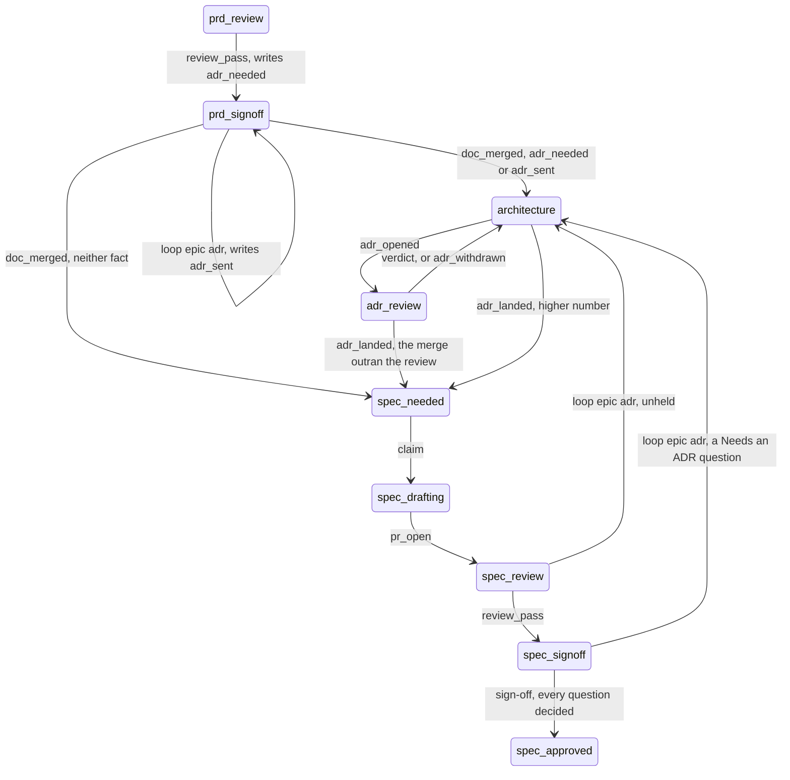
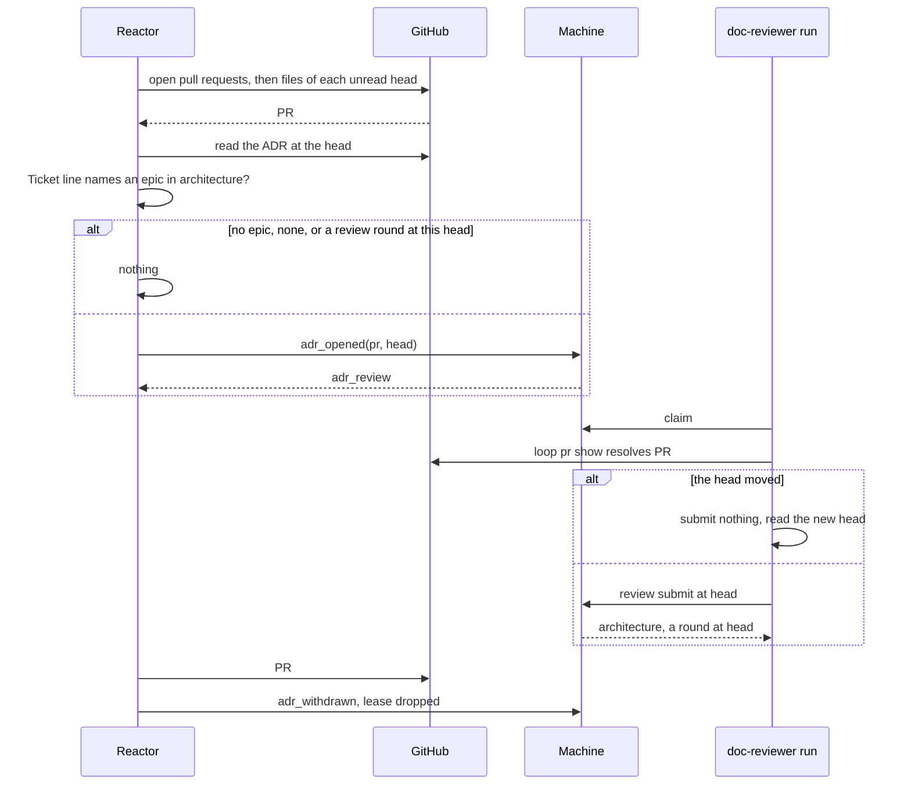
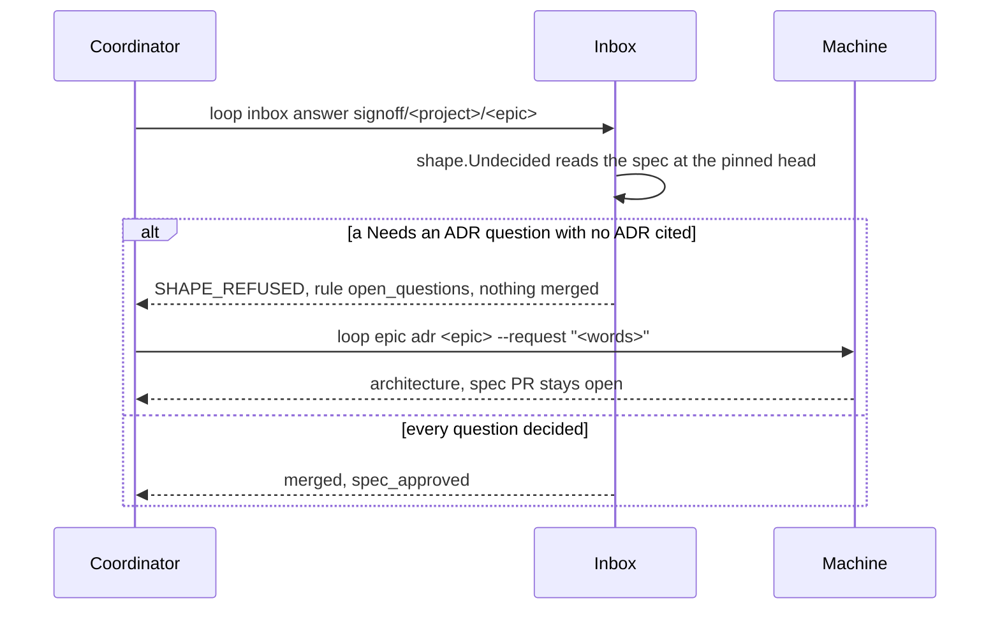

# Give a PRD epic an optional ADR stage, and one test for when a decision needs an ADR: technical spec

## Source

- **Epic:** factorio-ku99
- **Source:** `docs/prd/optional-adr-stage.md`, merged at `680b32e` on 2026-10-31. No ADR names
  factorio-ku99 on its `**Ticket:**` line, so the PRD is the only source.
- **Stories covered:** US-01, US-02, US-03, US-04, US-05.

The PRD's criteria are A1 to A23. Each contract below names the criterion it proves.

## Scope check

**Components:**

1. **The epic's ADR stage in the server.** The epic transition table in `internal/machine`, the
   reactor in `internal/github`, the verbs that move an epic into and out of the stage, and the
   two readers of a decision record that sit on that path: the ticket create in
   `internal/pipeline` and the open-question reader in `internal/shape`.
2. **The `adr` gate**, `internal/gates/adr.go`. Why not its own epic: the gate checks the Binds
   line and the Why an ADR section, and the doc-reviewer's ADR review in component 1 reads the
   same Binds line. Apart, the review would read a line that no gate guarantees, and the gate
   would guard a line that no stage reads.

The pack text is the agents' half of each component, and it is no third component. Each work
entry changes the runbooks and skills that describe the code it changes. Work entry 1 changes
pack text alone, because the test itself is text that every later entry cites.

Each work entry lands in one component and proves its own contracts. Entries 3 to 7 change
component 1. Entry 2 changes component 2.

**Not in this spec:** the renames of roles and paths, which the vocabulary epic owns. The doc
review subloop with subagent readers, which a later epic owns. The base audit of ADR merges,
which epic factorio-fgza owns, and which this spec leaves as ADR 0012 decides it (Open questions,
first entry).

## Decisions

### Answers a person already gave

- **A PRD epic can go PRD, then ADR, then spec.** The operator said so in the coordinator's chat:
  "yes, so it would be PRD --> (optional) ADR --> spec." (`request` fact, PRD US-02).
- **One test of four parts decides when a decision needs an ADR.** The operator asked for it: "we
  need to tighten that criteria." The coordinator wrote the four parts, the places for a decision
  that fails the test, and the enforcement into the epic body. The PRD states them in US-01 and
  US-04, and the operator signed the PRD off by its merge at `680b32e`.
- **No person answered an open question of the PRD.** The PRD merged with seven open questions
  and no answer under any of them. A PRD sign-off reads no open questions, because the spec author
  settles them (`pack/runbooks/coordinator.md` section 5). This spec settles four of them below
  from the sources, and carries three to Open questions.

### Open questions of the PRD that the sources settle

- **The test lives in `loop-sdlc-documents/SKILL.md`, and `adr.md` points to it.** We chose this
  over a test in `adr.md`, because the epic body says that `SKILL.md` replaces the "use one when"
  sentence, and the sentence sits in `adr.md` today. This is the reading that the PRD proposed
  (its sixth open question), and the doc-reviewer passed it.
- **The ADR template drops the Status value "Superseded by ADR NNNN".** We chose to drop it over
  keeping it, because the value needs an edit to the earlier ADR. The epic body says that nobody
  edits the earlier ADR, and ADR 0012 § Consequences says that an edit to an ADR that landed
  raises an `unreviewed_merge` alert. The superseding ADR names the ADR it supersedes in its
  Decision. `loop-sdlc-documents/SKILL.md` section 5 already tells a reader to search for a later
  ADR that cites an earlier one. The gate keeps reading the value as valid, because an ADR on a
  base branch may hold it (A21).
- **The spec pull request stays open when an epic returns to `architecture`.** We chose this over
  a close, because the spec-author runbook says "Never open a second spec" and brings an open spec
  pull request's head into its next round (`pack/runbooks/spec-author.md` section 1). A close also
  escalates the epic, by the `pr_closed` row of `internal/machine/epic.go`. The next round answers
  the open question that sent the epic to `architecture`, and cites the ADR.
- **One epic, not two.** We chose one epic over a split at the doc-reviewer stage, because each
  story lands alone and each promise is provable alone (PRD scope check), and both doc review
  rounds named no seam. Two components hold the work, by the Scope check above.

### The flow

- **A PRD epic records why it goes to the ADR stage in two facts, `adr_needed` and `adr_sent`.**
  `adr_needed` holds each requirement that the PRD's doc review found to pass the test.
  `adr_sent` holds the operator's words. We chose two facts over one, because each PRD review pass
  writes `adr_needed` again, and a later pass would erase the operator's send from a shared fact.
- **The PRD merge reads the two facts.** The `doc_merged` row from `prd_signoff` splits in two.
  It lands on `architecture` when either fact holds a value, and on `spec_needed` when neither
  does. We chose this over a separate move after the merge, because one row keeps the merge and
  the route in one write, and a crash between two writes would leave the epic in `spec_needed`.
- **One verb sends an epic to the ADR stage: `loop epic adr <epic> --request "<words>"`.** Only
  the coordinator runs it, with the operator's words. Before the PRD merges, it sets `adr_sent`
  and leaves the status as it is. In the spec stage, it moves the epic to `architecture`. We
  chose one verb over a verb for each case, because the operator asks for one thing, and the
  table picks the row by the epic's status.
- **An epic leaves `architecture` on an ADR with a higher number than the one it recorded.** The
  reactor joins an ADR whose Ticket line names the epic, and whose number is higher than the
  number of the epic's `adr` fact. When several such ADRs exist, the epic records the highest. We
  chose this over a list fact of joined ADRs, because ADR numbers only grow
  (`loop-sdlc-documents/SKILL.md` section 1), so the highest number is the whole record. We
  rejected today's rule, the first ADR in path order, because an epic that returns to
  `architecture` would leave again at once on the ADR that it already read.
- **An epic in the ADR stage that has a PRD or a landed ADR writes its ADR on
  `loop/<epic>-adr`.** We chose a third branch over the spec branch, because the spec pull request
  stays open on `loop/<epic>-spec` (above), and an architect room that pushed there would put its
  ADR into the spec pull request. A fresh architecture epic keeps `loop/<epic>`, so a room that is
  open today finds its pull request after the upgrade (A13).
- **A ticket under a PRD epic in the ADR stage cites the PRD's story labels, and takes no ticket
  shape.** We chose this over the architecture-epic rule, because the epic stays a PRD epic (PRD
  US-02). We skip the ticket shape, because its Contracts section names spec contracts, and the
  spec does not exist yet. Only the coordinator creates the ticket, with the operator's words, as
  for an architecture epic.

### Who runs the test

- **The PRD's doc reviewer names each passing requirement in a flag, not only in prose.** The flag
  is `--adr-needed` on a PRD pass. We chose a flag over a parse of the verdict text, because the
  server routes on the value, and prose has no shape a reader can trust.
- **The spec-author marks a decision that passes the test with an open question that starts
  `**Needs an ADR:**`.** That entry counts as undecided until its `**Answered` run cites an ADR
  number. We chose a marker over the existing rule alone, because the existing rule takes any
  `**Answered` or `**Deferred` run (`internal/shape/questions.go`), and the PRD requires that the
  question holds the sign-off until the epic leaves the spec stage. We rejected a check that the
  cited ADR is on the base, because the sign-off then reads the base for each question, and the
  ADR's merge already moved the epic.

### The ADR review

- **The doc-reviewer reviews an ADR in a new epic state, `adr_review`.** The reactor moves an
  epic from `architecture` to `adr_review` when an open pull request adds an ADR whose Ticket line
  names the epic, at a head with no review round. The doc-reviewer claims it, and its verdict
  returns the epic to `architecture`. We chose a state over a claim on `architecture` with a
  guard, because the scheduler takes an item by its state, and `loop work list` then shows the
  review.
- **The reactor finds an ADR pull request by its diff, not by its branch.** We chose the diff,
  because an ADR that a ticket writes sits on the ticket's branch, and an ADR that the operator
  writes by hand sits on a branch that names no epic. The reactor reads the files of an open pull
  request once for each head.
- **The ADR review is advisory, as this spec designs it.** A reject returns the epic to
  `architecture` and stops no merge. The base audit applies no reviewed-head rule to an
  `adr_merged` commit, as ADR 0012 decides. We chose this over a review that gates the merge,
  because a gating review supersedes part of ADR 0012, and the epic's own test then needs a new
  ADR. The operator chose the advisory review (Open questions, first entry).
- **An ADR whose Ticket line reads `none`, or names an epic outside `architecture`, gets no
  review.** We chose this over an item made for each such pull request, because a run takes one
  item, and no item holds such a pull request. This narrows A22, which the operator signed for
  each ADR pull request. The operator accepted the narrowing (Open questions, fifth entry).

## Assumptions

- The beads store takes a new epic status, `adr_review`, with no migration of existing data,
  because the server registers each state of the table at start. This is wrong if `bd` refuses
  the status on a database that a release before this epic made.
- Each project's CI checks out enough history for `git merge-base HEAD <base>` to answer, as
  `.github/workflows/ci.yml` does with `fetch-depth: 0`. The `adr` gate treats every ADR as one on
  the base when no merge base exists, as the `citations` gate does. This is wrong if a project's
  CI runs a shallow checkout and a new ADR with no Binds line passes there.
- GitHub returns the files of an open pull request in one read of up to 3,000 files. This is
  wrong if an ADR pull request changes more files than one read returns.
- The operator merges an ADR pull request as one commit on the first-parent line, as ADR 0012
  assumes. This is wrong if one ADR merge raises an `unreviewed_merge` alert.
- No epic is in `architecture` with an ADR on the base that names it and that the reactor did not
  join. This is wrong if `loop work list --kind epic --status architecture` shows an epic whose id
  an ADR's Ticket line on the base names, before the upgrade.

## Approach

**The test is text.** `pack/skills/loop-sdlc-documents/SKILL.md` gains a section, "When a
decision needs an ADR". It states the four parts, the costly changes of part 3, and the one place
for each decision that fails. It also states the supersession rule. Every other pack file cites
that section, and none restates a rule. `adr.md` loses its "Use one when" sentence and gains the
Binds line and the Why an ADR section. The brainstorm skill, the coordinator runbook, the
spec-author runbook, the architect room runbook and the doc-reviewer runbook each point to the
section.

**The flow is the epic transition table.** The table gains one state, `adr_review`, four facts and
these rows:

| Verb | From | To | Writes |
| --- | --- | --- | --- |
| `adr_send` | `prd_needed`, `prd_drafting`, `prd_review`, `prd_amending`, `prd_signoff` | same | `adr_sent` |
| `adr_send` | `spec_needed`, `spec_review`, `spec_signoff`, `spec_amending` | `architecture` | `adr_sent`, unheld guard |
| `doc_merged` | `prd_signoff`, when `adr_needed` or `adr_sent` | `architecture` | `prd_merged` |
| `doc_merged` | `prd_signoff`, otherwise | `spec_needed` | `prd_merged` |
| `review_pass` | `prd_review` | `prd_signoff` | `reviewed_head`, `adr_needed` |
| `adr_opened` | `architecture` | `adr_review` | `adr_pr`, `adr_head` |
| `claim` | `adr_review` | same | doc-reviewer lease |
| `review_pass`, `review_reject` | `adr_review` | `architecture` | `review` |
| `adr_withdrawn` | `adr_review` | `architecture` | drops the lease |
| `adr_landed` | `architecture`, `adr_review` | `spec_needed` | `adr`, `adr_merged` |

The PRD's `review_pass` writes `adr_needed` from the flag, and clears it when the flag is absent.
`adr_landed` from `adr_review` drops the reviewer's lease, as an outran document merge does.
`escalate` from `adr_review` resumes at `architecture`. `release` and `reclaim` take `adr_review`
as they take `spec_review`.

**The reactor drives the stage.** `adrs` keeps its read of `docs/adr/` on the base, with the
higher-number rule of Decisions. A new step, `adrPulls`, runs after `adrs` in `tickProject`. For
each epic in `architecture`, it reads each open pull request whose head it has not read, finds an
added `docs/adr/*.md` whose Ticket line at that head names the epic, and applies `adr_opened` when
no review round holds that head. For each epic in `adr_review` whose `adr_pr` closed with no
merge, it applies `adr_withdrawn`.

**The item's pull request follows the stage.** For an epic in `adr_review`, each item-scoped pull
request verb reads the pull request that `adr_pr` names. These are `pr show`, `pr threads`,
`pr files`, `pr diff`, `branch sync` and `review submit`. `BranchOf` gives `loop/<epic>-adr` to an
epic in `architecture` or `adr_review` that holds `prd_merged` or `adr`.

**The sign-off reads the marker.** `shape.Undecided` reads an entry that starts with
`**Needs an ADR:**` as undecided, unless an `**Answered` run in it cites `ADR NNNN`. The sign-off
refuses with the existing rule `open_questions`, and the decomposer's own read of the spec refuses
the same way.

**The gate reads the merge base.** The `adr` gate finds the merge base of HEAD and the base ref.
An ADR whose path is absent there is new. A new ADR needs the Binds line and the Why an ADR
section with its four labelled lines. Every ADR keeps today's checks.

## Domain model

```
internal/machine (changed)

Epic status            the epic state machine gains adr_review
  invariant: an epic in adr_review holds adr_pr and adr_head, and the doc-reviewer is the only
             stage that claims it.
  invariant: architecture and adr_review are one stage. adr_opened, adr_withdrawn and the
             review verdicts move an epic between the two. An epic leaves the pair only by
             adr_landed or escalate.

ADR stage request      why a PRD epic goes to the ADR stage at its PRD merge
  adr_needed           the PRD doc review's list of passing requirements; each PRD pass
                       replaces it
  adr_sent             the operator's words from loop epic adr; nothing clears it
  invariant: the PRD merge lands on architecture exactly when one of the two holds a value.
  The two are separate on purpose. They have two writers, and one writer must never erase the
  other's value.

Joined ADR             the adr fact: the path of the highest-numbered ADR the epic joined
  invariant: a later adr_landed records a path with a higher number than the one it replaces.

internal/gates (changed)

New ADR                an ADR whose path the merge base of HEAD and the base ref does not hold
  invariant: only a new ADR needs the Binds line and the Why an ADR section.

internal/shape (changed)

Question               gains NeedsADR, true when the entry starts with **Needs an ADR:**
  invariant: a NeedsADR question is decided only by an **Answered run that cites ADR NNNN.
```

## Interfaces

```
# The coordinator, at the operator's word. It sends the epic to the ADR stage.
loop epic adr <epic> --request "<the operator's words>"

# The doc-reviewer, on a PRD pass. The value lists each requirement that passes the test.
loop review submit <epic> --verdict pass --head <sha> --body "<comment>" --adr-needed "<requirements>"
```

`loop epic adr` refusals: `TRANSITION_NOT_ALLOWED` from any state outside the two `adr_send`
rows, `LEASE_HELD` with rule `lease_held` in the spec stage while a run holds the epic,
`CAPABILITY_DENIED` for any caller but the coordinator, and `USAGE` with rule `no_operator_request`
when `--request` is empty. `--adr-needed` refuses with `USAGE` and rule `adr_needed_scope` on any
verdict but a pass on an epic in `prd_review`.

```go
// internal/machine/kinds.go and rows.go
const (
	ADRReview        = "adr_review"
	VerbADRSend      = "adr_send"
	VerbADROpened    = "adr_opened"
	VerbADRWithdrawn = "adr_withdrawn"

	FactADRNeeded = "adr_needed" // the PRD review's list of requirements that pass the test
	FactADRSent   = "adr_sent"   // the operator's words that sent the epic to the ADR stage
	FactADRPR     = "adr_pr"     // the number of the ADR pull request under review
	FactADRHead   = "adr_head"   // that pull request's head when adr_opened read it
)

// internal/github/service.go
func ADRBranchFor(epic string) string // "loop/" + epic + "-adr"
func BranchOf(it machine.Item) string  // ADRBranchFor for an epic in architecture or adr_review
                                       // that holds prd_merged or adr; otherwise as today

// internal/github/reactor.go
func (r *Reactor) adrs(ctx context.Context, p config.Project, sha string) error // higher-number rule
func (r *Reactor) adrPulls(ctx context.Context, p config.Project) error

// internal/shape/questions.go
const NeedsADR = "**Needs an ADR:**"
type Question struct {
	Line     int
	Text     string
	Decided  bool
	NeedsADR bool
}

// internal/gates/adr.go
func checkNewADR(file, text string) []Finding // rules "binds" and "why_an_adr"
```

The ADR template's header and new section, as `adr.md` shows them:

```
**Status:** Proposed | Accepted
**Date:** YYYY-MM-DD
**Ticket:** <epic id>
**Binds:** <epic ids, comma-separated> | all

## Why an ADR

- **More than one epic:** <which epics, or why the whole project>
- **Rejected alternative:** <the alternative the Decision rejects>
- **Costly to undo:** <which change of part 3 it makes>
- **How, not what:** <the requirement it serves, or why it decides how>
```

The section sits between Decision and Consequences. The gate reads each of the four bold labels
at the start of a list item, with text after the colon.

## Data

```
epic bead metadata (changed)
  + loop.adr_needed   text, optional. Set by a PRD review pass with --adr-needed.
  + loop.adr_sent     text, optional. Set by loop epic adr.
  + loop.adr_pr       decimal pull request number, optional. Set by adr_opened.
  + loop.adr_head     40-character commit sha, optional. Set by adr_opened.

epic status (changed)
  + adr_review        category active
```

**Existing records:** no epic holds a new fact or the new status before this epic. Each epic in
`architecture` today keeps its `adr` fact, which is empty, so the higher-number rule joins any
ADR that names it, as today. Each existing ADR stays as it is.

## Flows

The route of a PRD epic through the ADR stage:



The sign-off edge refuses, and merges nothing, while a Needs an ADR question has no `**Answered`
run that cites an ADR. The third diagram below draws that branch.

The ADR review on one tick of the reactor:



The sign-off with a Needs an ADR question:



## Work

1. **The test in the pack.** Add the section "When a decision needs an ADR" to
   `loop-sdlc-documents/SKILL.md`. Remove the "Use one when" sentence from `adr.md`, and point to
   the section. Add the Binds line, the Why an ADR section and the two-value Status line to
   `adr.md`. Point the brainstorm skill's decision with no product source to the section. Point
   `coordinator.md` § 8, `spec-author.md` and `architect-room.md` to the section, and remove each
   second rule. The spec-author runbook runs the test on each Decisions entry, and writes a
   `**Needs an ADR:**` open question for each entry that passes. `spec.md` shows the marker under
   Open questions, and its Source line names the PRD and each ADR for an epic that has both.
   - Files: `pack/skills/loop-sdlc-documents/SKILL.md`, `pack/skills/loop-sdlc-documents/adr.md`,
     `pack/skills/loop-sdlc-documents/spec.md`, `pack/skills/loop-brainstorm/SKILL.md`,
     `pack/runbooks/coordinator.md`, `pack/runbooks/spec-author.md`,
     `pack/runbooks/architect-room.md`, `internal/pack/adr_stage_test.go` (new)
   - Needs: nothing
   - Proves: C1, C2, C3, C4, C5, C20, C24
   - Done when: the pack test fails on the base for each contract, and passes with the entry.
2. **The Binds line and the Why an ADR section in the `adr` gate.** Find the merge base, mark each
   ADR absent there as new, and run `checkNewADR` on each new ADR.
   - Files: `internal/gates/adr.go`, `internal/gates/adr_test.go`, `internal/gates/testdata/**`
   - Needs: entry 1, because each finding names the template section it misses.
   - Proves: C6, C7, C8
   - Done when: a new ADR with no Binds line fails the gate, and this repository's 12 ADRs pass it
     unchanged.
3. **The ADR stage transitions.** Add the facts, the `adr_send` rows, the split `doc_merged`
   row, the `loop epic adr` verb, the higher-number rule in `adrs`, and `BranchOf` with
   `ADRBranchFor`.
   - Files: `internal/machine/epic.go`, `internal/machine/kinds.go`, `internal/machine/rows.go`,
     `internal/pipeline/pipeline.go`, `internal/pipeline/adhoc.go`, `internal/github/reactor.go`,
     `internal/github/service.go`, `internal/cli/**`, and their tests
   - Needs: nothing
   - Proves: C9, C10, C11, C12, C13, C14, C15, C16, C17
   - Done when: an epic sent in `prd_signoff` lands on `architecture` at its PRD merge, and leaves
     it on an ADR that names it.
4. **The architecture entry of a PRD epic.** Let the coordinator create a ticket under a PRD
   epic in `architecture`, with story labels and no ticket shape. Rewrite the three ways of
   `coordinator.md` § 8 for a PRD epic.
   - Files: `internal/pipeline/adhoc.go`, `internal/pipeline/*_test.go`,
     `pack/runbooks/coordinator.md`, `internal/pack/adr_stage_test.go`
   - Needs: entry 3
   - Proves: C18, C19
   - Done when: the coordinator creates the ADR ticket of a PRD epic in `architecture`, and the
     decomposer still refuses a ticket of that epic that cites no story.
5. **The PRD doc review runs the test.** Add `--adr-needed` to `review submit`, and write
   `adr_needed` on a PRD pass. Add the test to the doc-reviewer's PRD checks.
   - Files: `internal/machine/verbs.go`, `internal/machine/epic.go`, `internal/cli/**`,
     `pack/runbooks/doc-reviewer.md`, and their tests
   - Needs: entry 3
   - Proves: C21, C22
   - Done when: a PRD pass with `--adr-needed` sends the epic to `architecture` at the PRD merge.
6. **The Needs an ADR question holds the spec sign-off.** Read the marker in `shape.Undecided`.
   Add the sign-off step to `coordinator.md` section 5: a Needs an ADR question goes to the
   operator. The operator's yes runs `loop epic adr`. On the operator's no, a review room removes
   the entry, and records the no under Decisions with the operator's words.
   - Files: `internal/shape/questions.go`, `internal/shape/questions_test.go`,
     `internal/inbox/signoff_test.go`, `pack/runbooks/coordinator.md`,
     `internal/pack/adr_stage_test.go`
   - Needs: entry 1 for the marker text, entry 3 for the verb
   - Proves: C23, C25
   - Done when: a spec whose Needs an ADR question holds a `**Deferred` run cannot be signed off.
7. **The ADR review.** Add `adr_review`, its claim and verdict rows, `adr_opened`,
   `adr_withdrawn`, `adr_landed` from `adr_review`, and `adrPulls`. Resolve an epic in
   `adr_review` to its `adr_pr` in each item-scoped pull request verb. Add "Review an ADR" to the
   doc-reviewer runbook. Add the state to the glossary, and remove "No stage reviews the pull
   request" from the architect room runbook.
   - Files: `internal/machine/epic.go`, `internal/machine/kinds.go`, `internal/machine/rows.go`,
     `internal/machine/verbs.go`, `internal/github/reactor.go`, `internal/github/verbs.go`,
     `pack/runbooks/doc-reviewer.md`, `pack/runbooks/architect-room.md`,
     `pack/skills/loop-sdlc-glossary/SKILL.md`, and their tests
   - Needs: entry 3 for the stage, entry 2 for the Binds line the review reads
   - Proves: C26, C27, C28, C29
   - Done when: an open ADR pull request for an epic in `architecture` gets one doc-reviewer
     verdict at its head, and the merge stays the operator's.

## Out of scope

- Renames of roles and paths, such as `architecture`, `architect room` and `doc-reviewer`. They
  belong to the vocabulary epic. No item holds it yet.
- The doc review subloop with subagent readers. It belongs to a later epic. No item holds it yet.
- A rewrite of the existing ADRs, ADR 0004 and ADR 0011 included. It belongs to no epic, never,
  by the epic body.
- A change to how an epic created with `--architecture` and no PRD moves. It belongs to no epic,
  never. C14 proves that it stays.
- A review that gates the merge of an ADR, and a reviewed-head rule in the base audit. It belongs
  to a new ADR that supersedes part of ADR 0012, if the operator chooses it (Open questions).

## Contracts

**C1. Behaviour: the test has four parts, and an ADR needs all four.** Proves A1.
`loop-sdlc-documents/SKILL.md` holds a section that starts "When a decision needs an ADR". It
lists four numbered parts: more than one epic or the whole project, a rejected alternative, costly
to undo, and how not what. It says that a decision needs an ADR only when all four hold.
*A pack test reads the section, finds each part, and finds "all four".*

**C2. Behaviour: each decision that fails the test has one place.** Proves A2. The section names
six places: the spec's Decisions section, the spec's Assumptions section, the PRD, a runbook or a
skill or `.loop/policy/<role>.md`, a gate, and the shaped bug ticket. It lists the costly changes
of part 3 as US-01 names them.
*A pack test asserts each of the six places and each costly change in the section.*

**C3. Refusal: no pack file states a second rule.** Proves A3. No file under `pack/` holds the
sentence "Use one when a choice has more than one defensible answer". `adr.md`, `coordinator.md`,
`spec-author.md` and `architect-room.md` each cite the section of C1.
*A pack test walks `pack/` for the sentence, and asserts the citation in each of the four files.*

**C4. Behaviour: the brainstorm skill sends a decision with no product source to the test.**
Proves A4. `loop-brainstorm/SKILL.md` section 3 names the section of C1 for a decision with no
product source, and holds no "Record it as a decision" with no place.
*A pack test reads section 3.*

**C5. Behaviour: a new ADR supersedes, and the earlier one stays.** Proves A5. The section of C1
states that a new ADR with a higher number supersedes an earlier one, and that nobody edits the
earlier ADR. The Status line of `adr.md` offers Proposed and Accepted only.
*A pack test reads the section and the Status line. The base audit's existing test of an edit to
an ADR that landed stays green.*

**C6. Refusal: a new ADR with no Binds line fails the gate.** Proves A19. An ADR absent at the
merge base with no `**Binds:**` line gives one finding with rule `binds`, and the message names
the line. A Binds value that is neither `all` nor a comma-separated list of work-item ids gives
the same rule.
*An example test for a missing line and one for a bad value, each asserting the rule and the
message.*

**C7. Refusal: a new ADR with no complete Why an ADR section fails the gate.** Proves A20. A new
ADR with no `## Why an ADR` heading gives rule `why_an_adr`. A section that lacks one of the four
labels, or holds a label with no text after it, gives the same rule, and the message names the
section and each missing part.
*Example tests: no section, three of four labels, one empty label.*

**C8. Boundary: an ADR on the base passes with no edit.** Proves A21. An ADR present at the merge
base passes the gate with no Binds line and no Why an ADR section, also after an edit on the
branch. With no merge base, every ADR counts as one on the base. This repository's 12 ADRs pass
`loop gates --docs` unchanged.
*A test builds a git repository with an old ADR on the base and a new ADR on the branch, and
asserts findings for the new ADR only. A second test runs the gate on `docs/adr/` at the merge
base of this epic.*

**C9. Behaviour: the operator's send before the PRD merge routes the merge.** Proves A6.
`loop epic adr` on an epic in `prd_signoff` writes `adr_sent` and keeps the status. The PRD merge
then lands the epic on `architecture` with `prd_merged` set, and not on `spec_needed`.
*A machine test applies the verb, then `doc_merged`, and asserts the status and both facts.*

**C10. Behaviour: an epic nobody sent goes on as today.** Proves A7. An epic in `prd_signoff`
with neither `adr_needed` nor `adr_sent` lands on `spec_needed` at its PRD merge.
*A machine test, and today's `doc_merged` tests unchanged.*

**C11. Behaviour: an ADR that names a PRD epic moves it.** Proves A8. A reactor tick whose base
adds an ADR whose Ticket line names a PRD epic in `architecture` moves it to `spec_needed`,
records the ADR's path in `adr`, and records the adding commit in `adr_merged`.
*A reactor test with a mirror fixture.*

**C12. Refusal: an ADR that names another epic moves nothing.** Proves A9. An ADR whose Ticket
line names a different epic, or `none`, or names this epic only in its prose, leaves a PRD epic in
`architecture`.
*A reactor test with three fixture ADRs, one for each case.*

**C13. Invariant: an epic leaves `architecture` only on an ADR it has not joined.** Proves A8 and
A18. An epic in `architecture` whose `adr` fact names ADR 0013 stays there while the base holds
only ADRs numbered 0013 or lower that name it. It moves on the first tick that sees ADR 0014 that
names it, and records the highest such number.
*A property test over generated sets of ADR numbers and Ticket lines.*

**C14. Equivalence: an architecture epic with no PRD moves as today.** Proves A13. An epic
created with `--architecture` moves from `architecture` to `spec_needed` when a merge adds its
ADR, writes on `loop/<epic>` before that, and its decomposition refuses a ticket that cites a
story.
*Today's reactor F-10 tests and `internal/pipeline/archdecompose_test.go` pass unchanged, and one
new test asserts the branch.*

**C15. Refusal: the send is refused outside its rows.** Proves A6. `loop epic adr` refuses with
`TRANSITION_NOT_ALLOWED` on an epic in `spec_drafting`, `spec_approved`, `decomposing`,
`execution`, `done`, `escalated`, `architecture` and `adr_review`. It refuses with `LEASE_HELD` on
an epic in `spec_review` that a run holds, with `CAPABILITY_DENIED` for a run caller, and with
`USAGE` rule `no_operator_request` for an empty `--request`. Each refusal changes no state.
*An example test for each case, asserting the code and the rule.*

**C16. Behaviour: the send in the spec stage returns the epic to `architecture`.** Proves A18.
`loop epic adr` on an unheld epic in `spec_needed`, `spec_review`, `spec_signoff` or
`spec_amending` moves it to `architecture`, writes `adr_sent`, and keeps `doc_pr`. After an ADR
lands, the spec-author's `pr show` finds the same open spec pull request.
*A machine test for each state, and a test across `adr_landed` that asserts `doc_pr` and
`BranchOf`.*

**C17. Behaviour: a PRD epic in the ADR stage writes on its ADR branch.** Proves A10. `BranchOf`
gives `loop/<epic>-adr` to an epic in `architecture` or `adr_review` that holds `prd_merged` or
`adr`, and `loop/<epic>-spec` to the same epic in `spec_needed`.
*A table test over status and facts.*

**C18. Behaviour: the coordinator ends a PRD epic's architecture entry in three ways.** Proves
A10. The inbox shows `architecture/<project>/<epic>` for a PRD epic in `architecture`. The server
opens an architect room on it. `loop work create --epic <epic> --story <label> --request
"<words>"` from the coordinator creates a ticket with the `epic` and `stories` facts and no ticket
shape. The same create refuses with no story, with a story the PRD lacks, and for a caller other
than the coordinator. `coordinator.md` § 8 names the three ways for a PRD epic.
*Example tests for the inbox entry, the room open, the create and its three refusals. A pack test
reads § 8.*

**C19. Refusal: a PRD epic's decomposition still needs story labels.** Proves A12. `loop epic
decompose` on a PRD epic that holds both `prd_merged` and `adr` refuses a ticket that cites no
story label of the PRD.
*An example test.*

**C20. Behaviour: the spec-author's source is the PRD and each ADR.** Proves A11. `spec-author.md`
section 1 names, for an epic that went through the ADR stage, the PRD and each ADR whose Ticket
line names the epic. The Source line of `spec.md` names both for such an epic.
*A pack test reads both files.*

**C21. Behaviour: the PRD review's flag records each passing requirement.** Proves A14. A PRD
pass with `--adr-needed "<text>"` writes `adr_needed` with that text, and the verdict comment
holds it. A later PRD pass with no flag clears it. The flag refuses with `USAGE` rule
`adr_needed_scope` on a reject, on an epic in `spec_review` or `adr_review`, and on a ticket.
`doc-reviewer.md` adds the test to the PRD checks and names the flag.
*Machine tests for the write, the clear and each refusal. A pack test reads the runbook.*

**C22. Behaviour: the PRD review's finding routes the merge.** Proves A15. An epic in
`prd_signoff` whose `adr_needed` holds a value lands on `architecture` at its PRD merge.
*A machine test from `review_pass` with the flag through `doc_merged`.*

**C23. Refusal: a Needs an ADR question holds the sign-off.** Proves A17. `shape.Undecided`
returns an entry that starts with `**Needs an ADR:**` as undecided when it holds no decision run,
a `**Deferred` run, or an `**Answered` run that cites no `ADR NNNN`. The spec sign-off then
refuses with `SHAPE_REFUSED` rule `open_questions` and merges nothing. An entry with an
`**Answered` run that cites `ADR 0014` is decided. Every other entry reads as today.
*Example tests in `internal/shape` for each case, and one sign-off test in `internal/inbox`.*

**C24. Behaviour: the spec-author names each passing decision.** Proves A16. `spec-author.md`
tells the spec-author to run the test on each Decisions entry, and to write an open question that
starts `**Needs an ADR:**` and names the entry for each one that passes. `spec.md` shows the
marker.
*A pack test reads both files.*

**C25. Behaviour: the coordinator returns the epic at the operator's word.** Proves A18.
`coordinator.md` section 5 brings a Needs an ADR question to the operator, and on the operator's
yes runs `loop epic adr <epic> --request "<the operator's words>"`. On the operator's no, it opens
a review room that removes the entry and records the no under Decisions.
*A pack test reads section 5 for the yes and the no.*

**C26. Behaviour: each ADR pull request gets one review at its head.** Proves A22, for an ADR
pull request that names an epic in `architecture` (Open questions, fifth entry). A reactor tick
that sees an open pull request add an ADR whose Ticket line at the head names an epic in
`architecture` moves the epic to `adr_review` with `adr_pr` and `adr_head`. The doc-reviewer
claims it. A verdict at that head returns the epic to `architecture` and records a round at the
head. A later tick at the same head moves nothing. A new head moves the epic to `adr_review`
again.
*A reactor and machine test over two ticks at one head, then a new head.*

**C27. Refusal: a verdict at a head the ADR pull request left is refused.** Proves A22. A
`review submit` on an epic in `adr_review` at a head that the `adr_pr` pull request no longer
holds refuses with rule `head_changed`, and the epic stays in `adr_review`.
*An example test.*

**C28. Boundary: a merge or a close ends the review.** Proves A22. A merge that adds the ADR
while the epic is in `adr_review` moves it to `spec_needed` and drops the reviewer's lease. A close
with no merge applies `adr_withdrawn`, and the epic returns to `architecture`. An open pull
request whose ADR reads `**Ticket:** none` moves no epic. This last case holds because the
operator accepted the narrowing of A22 (Open questions, fifth entry).
*A reactor test for each case.*

**C29. Behaviour: the doc-reviewer rejects an ADR that binds one epic.** Proves A23.
`doc-reviewer.md` holds a section that starts "Review an ADR". It checks the four lines of Why an
ADR against the test. It rejects an ADR whose decision binds one epic only, and the reject names
that epic. It submits with `loop review submit`, and never merges.
*A pack test reads the section.*

## Observable behaviour

None, because this epic draws no screen. The operator reads its effects in text: `loop work show`
prints `adr_review`, `adr_needed` and `adr_sent`, and the coordinator brings each inbox entry to
the operator in its chat.

## Open questions

- PRD open question 1. ADR 0012 § Consequences says "No stage reviews an ADR", and it forbids a
  reviewed-head rule on an `adr_merged` commit. This spec designs an advisory review: a reject
  returns the epic to `architecture` and stops no merge, so ADR 0012 stands. The other answer is a
  review that gates the merge. It adds a work entry that applies the reviewed-head rule to an
  `adr_merged` commit in `internal/github/baseaudit.go`. It also needs a new ADR that supersedes
  that part of ADR 0012, because that decision passes the epic's test. GitHub refuses no merge
  here (ADR 0012 § Context), so a gating review can only raise an alert after the merge. The
  proposed answer is advisory. This blocks work entry 7.
  **Answered (operator, 2026-10-31):** Advisory. A reject returns the epic to `architecture` and
  stops no merge, so ADR 0012 stands.
  The operator chose "Accept all five (Recommended)" in the coordinator's chat.
- PRD open question 2. The epic body says the operator can send an epic to `architecture` "at
  any time". This spec allows the send from `prd_needed` to `prd_signoff`, where it marks the
  epic for its PRD merge, and from `spec_needed`, `spec_review`, `spec_signoff` and
  `spec_amending`, where it moves the epic. It refuses the send from `spec_approved`,
  `decomposing` and `execution` (C15), because tickets exist or the decomposer is about to cut
  them. Is that set right? The proposed answer is yes. This blocks work entry 3.
  **Answered (operator, 2026-10-31):** Yes. The send starts from `prd_needed` to `prd_signoff`
  and from `spec_needed`, `spec_review`, `spec_signoff` and `spec_amending`. It is refused from
  `spec_approved`, `decomposing` and `execution`.
  The operator chose "Accept all five (Recommended)" in the coordinator's chat.
- PRD open question 4. The operator sees the PRD review's `adr_needed` at sign-off, in the review
  comment that the sign-off entry names. Can the operator overrule it, so that the epic skips the
  ADR stage at its PRD merge? A yes adds `loop epic adr <epic> --off --request "<words>"`, from
  `prd_signoff` only, which clears `adr_needed` and `adr_sent`. The proposed answer is yes. This
  blocks work entry 5.
  **Answered (operator, 2026-10-31):** Yes. Work entry 5 adds `loop epic adr --off` from
  `prd_signoff` only.
  The operator chose "Accept all five (Recommended)" in the coordinator's chat.
- Three decisions of this spec pass the test that this epic writes. The `adr_review` state binds
  every later epic's table and changes stored state. The Binds line and the Why an ADR section are
  a file layout that every later ADR follows. The higher-number rule changes how every epic leaves
  `architecture`. Each has a rejected alternative under Decisions, and each decides how. The test
  binds no decision until work entry 1 lands, and the PRD that the operator signed off states the
  flow and the template parts. Do these three stay in this spec, or does each take an ADR first?
  The proposed answer is Deferred: they stay in this spec. This blocks work entries 2, 3 and 7.
  **Deferred (operator, 2026-10-31):** The three decisions stay in this spec, and none takes an
  ADR first.
  The operator chose "Accept all five (Recommended)" in the coordinator's chat.
- PRD A22 says that each ADR pull request gets one doc-reviewer verdict. This spec reviews only an
  ADR pull request whose Ticket line names an epic in `architecture` (Decisions, The ADR review).
  Two cases get no review. The first is an ADR whose Ticket line reads `none`, such as a
  `**Binds:** all` decision that no epic asked for. The second is an ADR that names an epic in
  another state, such as one the operator writes by hand for an epic in `spec_review` without
  `loop epic adr`. Epic factorio-fgza reviews neither case. Its base audit raises an
  `unreviewed_merge` alert after the merge (ADR 0012 § Consequences), and a report after a merge is
  no review. To cover both cases, the reactor files an item of a new kind for each such pull
  request, and a doc-reviewer claims it. That adds a kind, its table and a work entry. The
  proposed answer is to narrow A22 to an ADR pull request that names an epic in `architecture`,
  and to leave the two cases to the operator, who reads the alert. This blocks work entry 7.
  **Answered (operator, 2026-10-31):** Narrow A22 to an ADR pull request that names an epic in
  `architecture`. The two cases go to the operator, who reads the alert.
  The operator chose "Accept all five (Recommended)" in the coordinator's chat.
