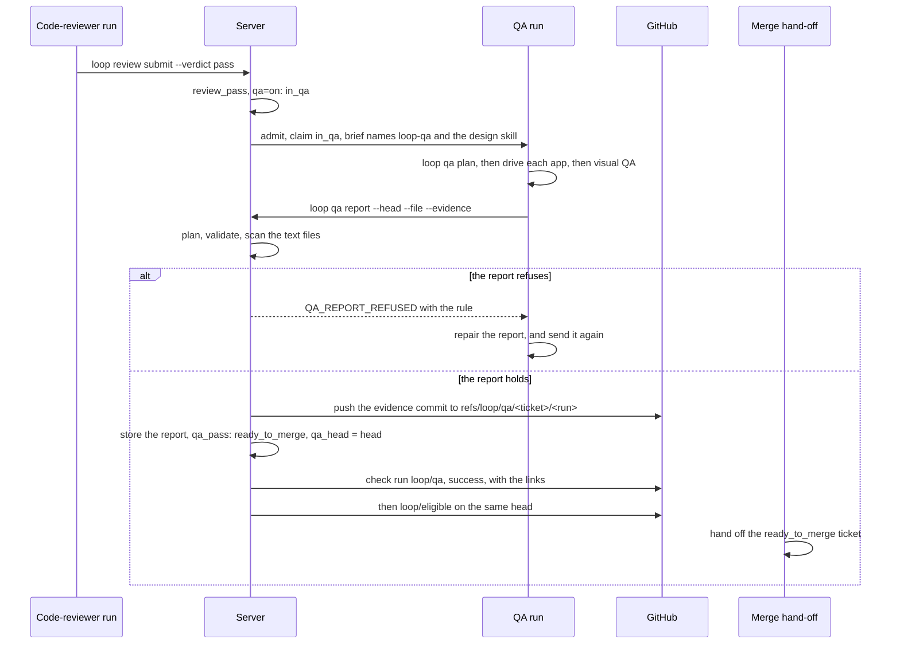
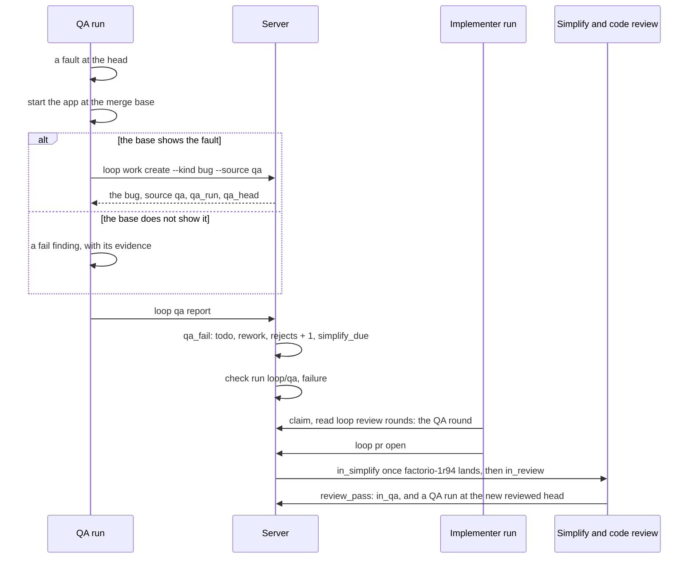
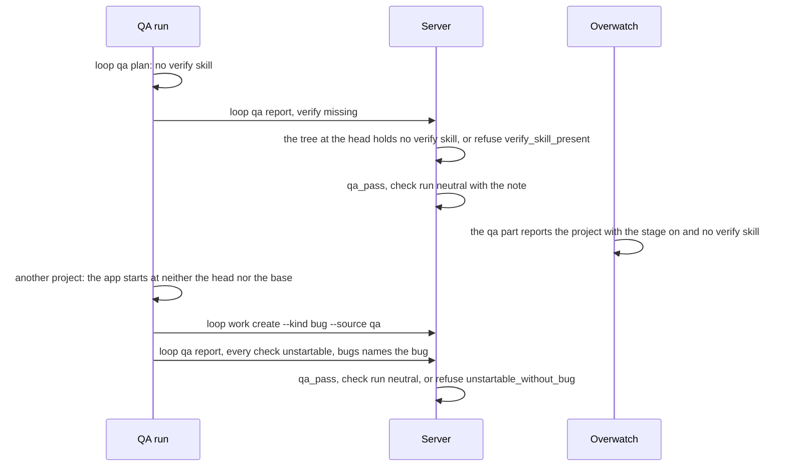
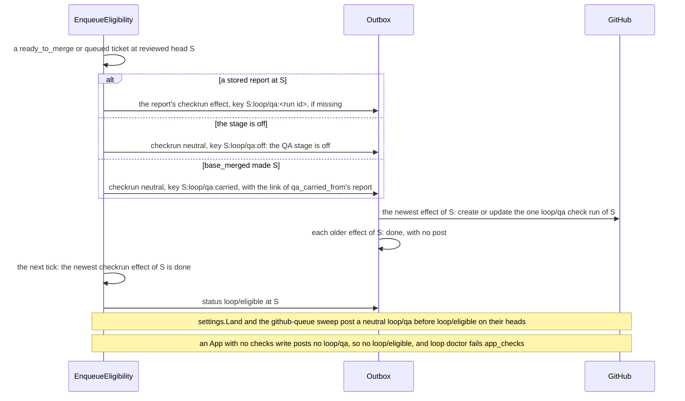
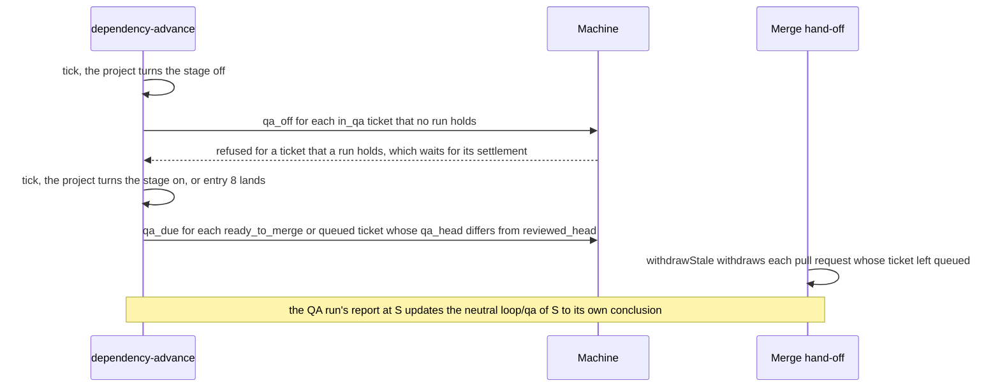

# Add a QA stage to build, with visual QA and fuzzy UAT: technical spec

## Source

- **Epic:** factorio-nhb5
- **Source:** `docs/prd/qa-stage.md`, merged at `c42f690`, and `docs/adr/0014-qa-stage.md`, merged
  at `a477965`, whose `**Ticket:**` line names this epic. ADR 0014 supersedes ADR 0002 gap G2 and
  ADR 0005 decision 9 in the parts it names, and this spec follows ADR 0014 where they differ.
- **Stories covered:** US-01, US-02, US-03, US-04, US-05, US-06.

The operator approved the PRD at head `6875207` and answered four of its open questions on
2026-11-01. ADR 0014 records the four answers and decides the flow, the report and the bug filer.
It leaves five questions to this spec. Decisions answers each of the five from the repository and
from tickertown's QA code, and names its source.

## Scope check

**Components:**

1. **The loop server.** The stage name and its defaults in `internal/config`, the ticket table in
   `internal/machine`, the plan and the report rules in a new package `internal/qa`, the report
   verb, the evidence push and the `loop/qa` check run in `internal/github`, the bug source in
   `internal/pipeline/adhoc.go`, the two sweeps in `internal/sched/deps.go`, and the missing-skill
   part in `internal/overwatch`.
2. **The pack.** The runbook `pack/runbooks/qa.md`, the skills `loop-verify-create` and
   `loop-verify-maintain`, their manifest entries, one step of `loop-init`, one rule of the
   implementer runbook, and the glossary. Why not its own epic: a runbook that no stage starts
   does nothing, and `TestEveryStageHasARunbook` in `internal/pack/pack_test.go` holds the
   manifest's runbooks equal to `config.RunStages()`. So the stage name and its runbook land in
   one change.

Entry 1 adds the stage name, the runbook and the two skills, and no ticket reaches the stage yet.
Entries 2 to 7 build the server parts in the order of their dependencies. The stage is on by
default only from entry 8. Entry 9 changes the glossary and the implementer runbook.

**Not in this spec:** the simplify run (factorio-1r94). The `ui` block and the rule that gives a
run its design skill (factorio-791i, built). The comparison of shipped screens with the signed
design record (`docs/prd/shipped-screen-check.md`).

## Decisions

The first four entries record the operator's answers at PRD sign-off on 2026-11-01, as the epic
body and ADR 0014 § Context quote them. The next five answer the questions that ADR 0014 leaves to
the planner. The rest are choices this spec makes.

- **Every project runs the stage, a project can turn it off, and no verify skill passes.** The
  operator chose `On; no skill passes (Recommended)`. A QA run in a project whose tree holds no
  `.claude/skills/verify-<app>/SKILL.md` posts `loop/qa` with the conclusion `neutral` and a note,
  and the overwatch sweep reports the project. The rejected answers were a stage a project turns
  on, and a fail or an escalation for a project with no skill.
- **A QA fail is a rework reason, and the next head goes through review and QA again.** The
  operator chose "Rework, then review (Recommended)". ADR 0014 decision 2 states the rows. The
  rejected answers were a return to `repair` and a return past code review.
- **The QA report is the required check run `loop/qa`.** The operator chose "Check run
  (Recommended)". ADR 0014 decision 3 states who posts it and on which heads. The rejected answer
  was a section of the pull request body.
- **The QA stage files a bug with `--source qa`, next to the coordinator.** The operator chose "QA
  stage files it (Recommended)". ADR 0014 decision 4 states the filer rule. The rejected answer was
  a QA run that asks the coordinator to file each bug.
- **A fault fails the ticket, unless the run reproduces it at the merge base. A fault that the
  merge base already shows is a bug, and it does not fail the ticket.** This answers the first
  question that ADR 0014 leaves to the planner. We chose a reproduction at the merge base over a
  rule on paths. A fault on a screen names no file, so a rule on the "May change" list cannot place
  it. We rejected a fail for every fault, because the ticket's implementer then repairs a fault
  that its change did not make, and the ticket waits on it. We rejected a bug for every fault,
  because a fault that the change made would then merge. Tickertown's code-reviewer applies the
  same rule: "A difference that the merge base already shows is not this change's fault"
  (`docs/agents/code-reviewer.md:537-552` in `slothware-labs/alpha`). The run fails
  the ticket when it cannot tell, because a regression that merges costs more than one rework.
- **Each verify skill names the paths of its app, and a run drives each app whose paths meet the
  ticket.** This answers the second question. The frontmatter of
  `.claude/skills/verify-<app>/SKILL.md` may hold `paths`, a list of globs in the syntax of
  `ui.paths`. An app reaches a ticket when one of its globs meets one "May change" entry of the
  ticket, by the rule of `meets` in `internal/sched/skills.go`. A skill with no `paths` reaches
  every ticket. When no app reaches the ticket, the run drives every app, so fuzzy UAT still runs
  on every ticket. We rejected a key in `.loop/config.yaml`, because only the coordinator changes a
  setting, and the verify skill is where a person describes the app. We rejected a run that drives
  every app on every ticket, because each app costs one launch and up to 20 minutes of a cap slot.
  We rejected a run that picks the apps by its own judgement, because the server could then not
  check which apps the report must cover. Tickertown has no rule to fork here: its QA hardcodes one
  app, `apps/tickertown` (`packages/qa/src/cli/paths.ts:13-14`).
- **Each evidence file lives in a commit with no parent, at `refs/loop/qa/<ticket>/<run id>` in
  the project's GitHub repository.** This answers the third question. The run hands the files to
  `loop qa report`. The server writes them into one commit and pushes it as the loop App before it
  applies the verdict. The check run links each file as
  `https://github.com/<owner>/<repo>/blob/<commit>/<path>`. So each link resolves after the
  checkout is gone, and a person who can read the pull request can open it. We rejected a
  directory on the host, which tickertown uses (`.qa/` in the checkout, `packages/qa/src/cli/paths.ts:16-23`),
  because cleanup deletes it with the checkout, and a host path is no link a person on GitHub can
  open. We rejected a branch, because a push to a branch starts each workflow that listens for a
  push, and the branch list fills. We rejected images in the check run's output, because GitHub
  shows only an image at a URL that some other host serves. ADR 0005 already rejects an attachment
  in beads.
- **A fuzzy UAT pass has a fixed bound for each app, and visual QA a fixed bound for each run.**
  This answers the fourth question. For each app the run drives, fuzzy UAT takes at most 25 steps
  toward the ticket's goal, then at most 3 variations of at most 10 steps each, and at most 20
  minutes in all. Visual QA reads at most 8 screens of each app, each at 1280x800 and at 390x844.
  A goal that the run does not reach inside its bound is a fail finding. The numbers are
  tickertown's: a drive stops after 25 steps (`packages/qa/src/cli/drive-run.ts:15-16`), an audit
  reads at most 8 screens below the first (`packages/qa/src/audit/fold.ts:14-15`), and it uses
  those two viewports (`packages/qa/src/audit/scenario.ts:13-14`). Tickertown sets no time bound.
  We add one, because a run that waits on a wedged browser holds a cap slot until the stall sweep
  ends it. We rejected one timeout for the whole run, because a run could then spend it all on one
  app and report nothing on the next. `internal/qa` holds the numbers once. `loop qa plan` prints
  them, and the server refuses a report that claims more.
- **A visual QA fail alone fails the report.** This answers the fifth question, as the PRD reads
  it. A finding has the severity `fail` or `note`. A check fails when one of its findings is `fail`,
  and the report fails when one check fails. A visual finding is `fail` when it breaks a rule of
  the design skill the run holds, or when the screen shows text that is cut or covered, an overlap,
  a control out of reach, or an element that leaves the screen at one of the two widths. Every
  other visual finding is a `note`. We rejected visual QA as advisory, because the operator asked
  for visual QA as part of the QA step, and an advisory finding sends no ticket to a fix. We
  rejected a fail for every visual finding, because a matter of taste would then cost four runs.
- **The server derives the verdict from the report.** `loop qa report` takes no `--verdict`. We
  rejected a verdict flag, because the flag and the checks could disagree, and the server would
  then have to pick one.
- **The server checks the report against a plan it computes itself.** `internal/qa.MakePlan`
  takes the verify skills at the head, the ticket's "May change" entries and the design skill the
  run holds. It returns the apps the run must drive, and whether visual QA runs. `loop qa plan`
  runs the same function in the checkout. The report verb runs it over the tree at the head in the
  mirror, and refuses a report that leaves out a planned check or adds an unplanned one. We
  rejected a server that trusts the report's list of checks, because the PRD's criteria A6 to A9
  then rest on the run's word.
- **Visual QA runs exactly when the run holds a design skill.** The server records the design
  skill of each run's brief on its row in `runs`. The report verb reads it there. So visual QA
  follows the rule of factorio-791i as built: a ticket-level run holds the design skill when a
  glob of `ui.paths` meets a "May change" entry of the ticket's Files section
  (`internal/sched/skills.go`, `holdsCondition`). This epic adds no rule of its own, as the PRD's
  boundary with factorio-791i says. We rejected a second check of `ui.paths` in the QA run, because
  two rules could then disagree.
- **The run reads each verify skill at the reviewed head.** We chose the head over the base,
  because code review already passed each change the ticket made to a verify skill, and a ticket
  that changes how the app starts would otherwise fail at the base's steps.
- **An app that starts at neither the head nor the merge base gives the conclusion `neutral`, with
  a bug.** The run then files a bug with `--source qa` that names the failed launch, and the report
  names the bug. We chose `neutral` over a fail, because a fault in the base would then stop every
  ticket of the project at QA. We chose it over `success`, because no check ran, and the check run
  must say so. An app that starts at the merge base and not at the head is a fail.
- **A report with one unstartable app concludes `neutral`, even when each other app passes.** A
  fail on any app still concludes `failure`. So a plan that drives `web` and `api`, with `web`
  passing and `api` unstartable, concludes `neutral`, and the check run's text names `api` and its
  bug. We rejected `success` with the unstartable app named in the text, because the pull request's
  checks list shows only the conclusion, and a person who reads `success` there would read that
  every planned app was driven. The reason of the entry above holds for one app as for all of them.
- **A QA run writes no commit.** We rejected the fix loop of ce-dogfood, which commits each small
  fix. A QA run reads a head that code review already passed. A commit of its own would need a
  review too, and ADR 0014 decision 2 sends each fix through the implementer and code review.
- **`loop qa report` is a verb of its own.** We rejected `loop review submit` with a QA flag. That
  verb's pass waits on green CI through `PassCI`, and it takes a comment body, not a report and
  files. One verb with two meanings makes each run learn both.
- **The QA rows record through the review facts, and `loop review rounds` lists each QA round.**
  `qa_pass` and `qa_fail` set the `review` fact to the rendered report, and `qa_fail` sets
  `rejected_head`, as `review_reject` does. `Round` gains a field `stage`, `code-reviewer` or `qa`.
  So the implementer reads a QA fail where it reads a reject, by `pack/runbooks/implementer.md`
  § 1. We rejected a separate `loop qa rounds`, because the implementer would then find a rework
  with no reject in `loop review rounds`, and that runbook calls such a rework a loop fault.
- **A QA fail counts as a reject.** `qa_fail` applies `reviewReject`: it adds one to `rejects`,
  and the second reject or QA fail raises the model tier. We rejected a counter of its own,
  because the model tier answers rework rounds of any cause, and a ticket could otherwise fail QA
  without end at the base tier.
- **`review_pass` reads the stage setting, and two sweeps follow a change of the setting.**
  `reviewSubmit` passes the parameter `qa`, `on` or `off`, from the project's setting, and the row
  picks `in_qa` or `ready_to_merge` by it, as ADR 0014 decision 1 says. The `dependency-advance`
  job applies `qa_off` to each `in_qa` ticket that no run holds in a project with the stage off,
  and `qa_due` to each `ready_to_merge` or `queued` ticket with no QA pass at its reviewed head in
  a project with the stage on. We rejected the sweeps alone, because each ticket in a project with
  the stage off would then wait up to five minutes after its review.
- **A ticket in flight when the stage turns on goes to `in_qa`.** ADR 0014 asks the spec to say
  whether a ticket in `ready_to_merge` with no QA pass merges. It does not. `qa_due` moves it, and
  each `queued` ticket with no QA pass, to `in_qa`. The merge hand-off's `withdrawStale` already
  withdraws a pull request whose ticket left `queued` (`internal/merge/handoff.go:386-415`). We
  rejected a merge of those tickets with a `neutral` `loop/qa`, because ADR 0014 § Consequences
  says a later reader must not merge a head that no QA run read while the stage is on.
- **A host whose App lacks checks write merges nothing until the operator accepts it.** ADR 0014
  decision 3 posts `loop/eligible` only on a head that holds `loop/qa`, and only an App with checks
  write can post `loop/qa`. Entry 5 adds the scope to the App manifest that `loop install` writes,
  and a `loop doctor` line that fails while the App lacks it. Entry 6 adds the gate. So a host that
  takes each release in order shows the failed line before any merge waits on it. The overwatch
  sweep's `server` part already reports each failed doctor line. We rejected `loop/eligible`
  without `loop/qa` on such a host, because ADR 0014 forbids it.
- **Each post of `loop/qa` has an outbox key of its own, and every post to one head updates the
  one check run of that head.** One head can get more than one `loop/qa` post. A head gets a
  `neutral` post while the stage is off, and a QA report later at the same head when the stage
  turns on. The key of a report's effect is `<project>:<sha>:loop/qa:<run id>`. The key of a
  `neutral` effect is `<project>:<sha>:loop/qa:off` for a stage-off head, and
  `<project>:<sha>:loop/qa:carried` for a head that `base_merged` made. `PostCheckRun` creates the
  head's check run on the first post, stores its id in `qa_check_runs`, and updates that check run
  on each later post. The effect runner posts only the newest `checkrun` effect of each head, by
  outbox id. It marks each older effect of that head done with no post, and a note that names the
  newer one. So the last post wins, even when an older effect waits on a retry. We rejected one key
  for each head, because the outbox holds one live row for each effect kind and key
  (`internal/store/migrations/0001_init.sql:67`), and `RecordIntent` refuses a key that a `done` row
  holds (`internal/store/intents.go:166-172`). A second post to a head would then never reach
  GitHub. We rejected a new check run for each post, because this spec would then depend on which
  of two check runs with one name the ruleset reads, and GitHub's documentation does not promise
  an answer. A `loop/eligible` that the stage-off head got stays `success` after a QA fail at that
  head. The required `loop/qa` then shows `failure`, so the ruleset blocks the merge.
- **A QA run files at most 3 bugs.** The fourth `loop work create --kind bug` from one QA run
  refuses. We rejected no cap, because a run that misreads the merge base could flood the
  reproducer, and each bug costs a reproducer run.
- **The report must name each bug the run filed, and only those.** The server refuses a report
  whose `bugs` list names an item that is no bug with source `qa` and this run's id, or leaves out
  one. So the check run lists every bug that the QA run filed.
- **The stage runs at effort `high`, with cap 3.** The cap is tickertown's machine-wide count of
  browser slots, `AUDIT_SLOTS = 3` (`packages/qa/src/cli/audit-slot.ts:28-35`). We chose `high`
  over `medium`, because a false fail costs four runs, and `DefaultEfforts` in
  `internal/sched/quota.go` gives the code-reviewer `high` for the same reason.
- **One runbook and two pack skills, forked.** The runbook `loop-qa` forks the diff-scoped matrix
  of ce-dogfood and the method of tickertown's `qa drive`, `qa audit` and `qa detect`. The skills
  `loop-verify-create` and `loop-verify-maintain` fork pstack `create-verification-skill` and
  `maintain-verification-skill`, and write to `.claude/skills/verify-<app>/` in place of
  `.cursor/skills/verify-<app>/`. Each fork records its upstream URL and commit, as
  `pack/skills/loop-unslop/SKILL.md` does. We rejected a port of tickertown's TypeScript, because
  ADR 0002 rejects files that name tickertown's product paths, and each path in
  `packages/qa/src/cli/paths.ts` names one.
- **This epic and factorio-1r94 share one default-on rule.** Entry 8 uses the `defaultOn` list and
  the `StageEnabled` rule of `docs/plans/factorio-1r94-simplify-stage-spec.md` § Interfaces, and
  adds `StageQA` to the list. When that spec's entry 4 has not landed, entry 8 adds the list and the
  rule as that spec writes them. `qa_fail` sets `simplify_due` and clears `simplify_from`, by ADR
  0014 decision 2. That spec says no row but `create` and `review_reject` writes `simplify_due`.
  ADR 0014 is a decision record and that spec is not, so ADR 0014 holds, and its fact needs no row
  that reads it before factorio-1r94 lands.

No entry passes the test of `pack/skills/loop-sdlc-documents/SKILL.md` § 6. ADR 0014 decides each
choice that binds more than this epic. Each entry above binds only this epic's stage, so each fails
part 1. The four operator answers also fail part 4, because each decides what the loop does.

## Assumptions

- GitHub accepts the loop App's push of a commit to `refs/loop/qa/<ticket>/<run id>`, and serves
  `blob/<commit>/<path>` for it to each person who can read the repository. This is wrong when the
  push refuses, or when the link answers 404 to a person who can read the pull request. C24 runs
  the push against the fake GitHub only, so the first real QA run is the proof.
- A push to a ref outside `refs/heads/` and `refs/tags/` starts no workflow. This is wrong when a
  workflow run appears for an evidence commit.
- GitHub accepts an update that changes the conclusion of a completed check run, and the ruleset
  and the checks list of the pull request then read the new conclusion. This is wrong when the
  update answers 422, or when the merge box still shows the old conclusion. C38 runs the update
  against the fake GitHub only, so the first real stage turn-on is the proof.
- GitHub counts a check run with the conclusion `neutral` as a pass of a required check. ADR 0014
  § Context holds this assumption, and this spec inherits it. This is wrong when a ruleset blocks a
  merge on a `neutral` `loop/qa`.
- Each project keeps its screenshots free of secrets, because its verify skill seeds test data and
  test accounts. This is wrong when a screenshot shows a key. The server scans the text of each
  evidence file for a secret, and it cannot scan an image.
- 20 MiB of evidence for each QA run keeps a repository's growth small. This is wrong when GitHub
  warns that a project's repository passes 5 GB. A retro then proposes the pruning that Out of
  scope leaves out.
- A verify skill's launch reaches a usable app inside a checkout. This is wrong when the app needs
  a service that the host does not run. The run then files a bug and gives `neutral`, by Decisions.
- The local clones that this spec read hold the upstream text of each source. It read tickertown's
  QA code in a clone of `slothware-labs/alpha` at the head of its main branch on 2026-11-01. It
  read pstack's two skills in a clone of `cursor/plugins` at the head of its main branch on
  2026-10-29, and ce-dogfood in a clone of `EveryInc/compound-engineering-plugin` at the head of
  its main branch on 2026-10-31. This is wrong when GitHub's text differs from those clones. Each
  file and line that Decisions cites from tickertown is in that clone. The implementer records the
  commit it forks from, and C1 checks only that a commit is there.
- No project lists `stages.qa` before entry 8. This is wrong when a project config lists it. Its
  tickets then reach `in_qa` after entry 3, and wait there with no report verb until entry 5.

## Approach

**The ticket's path.** The code-reviewer's pass applies `review_pass`. With the stage on, the row
lands on `in_qa`. The QA stage claims from `in_qa`. The run's `loop qa report` applies `qa_pass`,
which lands on `ready_to_merge`, or `qa_fail`, which lands on `todo` with the entry `rework`. The
next implementer hand-off enters `in_simplify` once factorio-1r94 lands, then `in_review`. A push
to the pull request while the ticket is in `in_qa` applies `head_changed`, which lands on
`in_review`.

**The run.** The runbook `pack/runbooks/qa.md` reaches a run as `loop-qa`. Its steps:

1. Read the turn skill and the glossary. Read the item, `loop pr show` and `loop pr diff`. Bring the
   pull request head into the checkout. It is the reviewed head.
2. Run `loop qa plan`. It prints the apps to drive, whether visual QA runs, the design skill, and
   the bounds. When it reports no verify skill, run `loop qa report` with `verify: missing`, and
   finish `done`.
3. For each app of the plan, follow its verify skill: launch, doctor, drive. Derive the goal from
   the ticket's title, its contracts and its "Done when" line. Drive toward the goal as a user
   would, inside the bound. Then try the variations of ce-dogfood's matrix that the change reaches:
   an empty input, an invalid input, a reload, and a return by the back control.
4. When the plan says visual QA runs, read each screen that the change reaches at both widths with
   the design skill. Run the design skill's detector when it ships one.
5. For each fault, start the app at the merge base and try to reproduce it. A fault that the base
   shows is a bug: file it with `loop work create --kind bug --source qa`. Every other fault is a
   `fail` finding of the report. When the app starts at neither head, file one bug, and report the
   app as `unstartable`.
6. Write the report and each evidence file into a directory from `mktemp -d`. Run
   `loop qa report <item> --head <sha> --file <report.json> --evidence <dir>`. Clean up each app
   the run started. Finish `done`.
7. When the run cannot finish a report, finish `failed`. The ticket stays in `in_qa` for the next
   run.

The runbook's header comment records the upstream and the commit of ce-dogfood and of tickertown's
QA code. It changes no product code, and it writes no commit.

**The server's checks of the report.** The handler of `loop qa report` reads the run's row, the
ticket and the tree at the head in the mirror. It computes the plan with `qa.MakePlan`. It checks
the report with `qa.Validate`: the shape, the planned checks, the bounds, the evidence files, the
bug list and the verify-skill claim. It scans each text evidence file for a secret. It then pushes
the evidence commit, stores the report in `qa_reports`, applies `qa_pass` or `qa_fail`, and enqueues
one `checkrun` effect for `loop/qa` at the head, with the key `<project>:<sha>:loop/qa:<run id>`.

**One check run for each head.** `qa_check_runs` stores the GitHub id of the one `loop/qa` check
run of each head. `PostCheckRun` updates that check run when the table holds its id. When the table
holds none, it lists the head's check runs named `loop/qa` from the loop App, and updates the newest
one it finds. So a crash between a create and the row reuses the check run that the create made.
It creates a check run only when GitHub holds none, and then stores the id. `RunCheckRunEffects`
posts only the newest runnable or held-back `checkrun` effect of each head, by outbox id, and marks
each older effect of that head done with no post.

**The other heads.** `EnqueueEligibility` enqueues the `loop/eligible` effect of a head only when
the newest `checkrun` effect of that head holds the state `done`. It enqueues a `neutral` `loop/qa` first on a
reviewed head in a project with the stage off, with the key suffix `off`, and on a head that
`base_merged` made, with the key suffix `carried`. It enqueues neither on a head that holds a
stored report. `settings.Land`'s `await` and the github-queue sweep call `PostCheckRun` with a
`neutral` conclusion before they post `loop/eligible` on their heads, as they post `loop/eligible`
today, with no outbox row. `RequiredChecks`, `Classify`, the job check in `internal/github/jobs.go:65` and the CI
discovery of `loop register` leave `loop/qa` out, as they leave `loop/eligible` out.

**The verify skills.** `loop-verify-create` writes `.claude/skills/verify-<app>/SKILL.md` with
frontmatter `name`, `description` and an optional `paths`, and the sections Launch, Doctor, Drive,
Evidence and Cleanup, then a feature map. It proves the skill once before it hands it over, as
pstack's step 4 says. `loop-verify-maintain` keeps the map and the steps true to the app. Both
reach the implementer. `loop-init` names `loop-verify-create` as its last step, for a project with
an app.

## Domain model

```
internal/qa (new)

App                 one verify skill: Name from the directory verify-<name>, Skill its path,
                    Paths its frontmatter globs
  invariant: Name matches [a-z0-9][a-z0-9-]*. Two skills never share a Name.

Plan                the checks one QA run must make, from MakePlan
  invariant: Drive is empty exactly when the tree holds no verify skill.
  invariant: Drive lists each app that reaches the ticket, or every app when none reaches it.
  invariant: Visual is true exactly when DesignSkill is not "".

Bounds              Steps 25, Variations 3, VariationSteps 10, Minutes 20, Screens 8,
                    Widths 1280x800 and 390x844
  invariant: one value, DefaultBounds. Nothing else holds the numbers.

Report              what the run hands in: head, verify (present or missing), checks, bugs, notes
  invariant: verify is missing exactly when the plan's Drive is empty, and then checks is empty.
  invariant: each app of Drive has one fuzzy_uat check, and one visual check when Visual is true.
             No other check is there.

Check               kind (fuzzy_uat or visual), app, result (pass, fail or unstartable),
                    goal, steps, minutes, screens, findings
  invariant: result is fail exactly when a finding has severity fail.
  invariant: result unstartable carries no finding, and the report's bugs name at least one bug.
  invariant: steps, minutes and screens stay inside Bounds.

Finding             summary, severity (fail or note), evidence paths, steps
  invariant: a fail finding cites at least one evidence path.

Conclusion          success, failure or neutral
  invariant: failure when a check fails. Otherwise neutral when verify is missing, or when at
             least one check is unstartable. success otherwise.

Evidence            the files of one report, by relative path
  invariant: each file is cited by a finding, and each cited path is a file.
  invariant: at most 40 files, 2 MiB each and 20 MiB in all. Types png, jpeg, webp, txt, log, json.
  invariant: no text field of the report, and no text file, holds image data.

internal/machine, the ticket table (changed)

TicketState         + in_qa, category active, between in_review and ready_to_merge
  invariant: a ticket in in_qa holds an open pull request, so prOpenStates lists it.
  invariant: only the QA stage claims from in_qa, and the QA stage claims from nowhere else.
  invariant: the merge hand-off never takes a ticket in in_qa.

qa_head             fact, the head of the latest QA pass, or the head base_merged made from it
  invariant: qa_pass sets it to reviewed_head. qa_fail and head_changed clear it.
qa_carried_from     fact, the head whose QA pass base_merged carried
  invariant: base_merged sets it when qa_head equals its from. qa_pass clears it.

internal/machine, the bug table (changed)

source              fact, operator or qa
  invariant: a bug that the coordinator files holds operator, and one that a QA run files holds
             qa. A bug with no source fact reads as operator.
qa_run, qa_head     facts of a bug with source qa: the QA run and the head it read
```

## Interfaces

```go
// internal/config
const StageQA = "qa" // in runStages after StageCodeReviewer, and in optional
// DefaultThroughput()[StageQA] = Throughput{Cap: 3, Schedule: "2,7,12,17,22,27,32,37,42,47,52,57 * * * *"}
// Entry 8: defaultOn gains StageQA (docs/plans/factorio-1r94-simplify-stage-spec.md § Interfaces).

// internal/sched
// DefaultEfforts[config.StageQA] = "high"
func Meets(g config.Glob, entry string) bool // meets, exported for internal/qa

// internal/qa (new)
type Viewport struct{ W, H int }
type Bounds struct {
	Steps, Variations, VariationSteps, Minutes, Screens int
	Widths                                             []Viewport
}
var DefaultBounds = Bounds{Steps: 25, Variations: 3, VariationSteps: 10, Minutes: 20, Screens: 8,
	Widths: []Viewport{{1280, 800}, {390, 844}}}
type App struct {
	Name, Skill string
	Paths       []config.Glob
}
type Plan struct {
	Apps        []App    `json:"apps"`
	Drive       []string `json:"drive"`
	Visual      bool     `json:"visual"`
	DesignSkill string   `json:"design_skill"`
	Bounds      Bounds   `json:"bounds"`
}
// Apps reads each .claude/skills/verify-<app>/SKILL.md of tree. A bad name or bad paths is an error.
func Apps(tree fs.FS) ([]App, error)
func MakePlan(apps []App, mayChange []string, designSkill string) Plan
type Report struct {
	Head    string   `json:"head"`
	Verify  string   `json:"verify"` // "present" or "missing"
	Checks  []Check  `json:"checks"`
	Bugs    []string `json:"bugs"`
	Notes   string   `json:"notes"`
}
type Check struct {
	Kind     string    `json:"kind"`   // "fuzzy_uat" or "visual"
	App      string    `json:"app"`
	Result   string    `json:"result"` // "pass", "fail" or "unstartable"
	Goal     string    `json:"goal"`
	Steps    int       `json:"steps"`
	Minutes  int       `json:"minutes"`
	Screens  int       `json:"screens"`
	Findings []Finding `json:"findings"`
}
type Finding struct {
	Summary  string   `json:"summary"`
	Severity string   `json:"severity"` // "fail" or "note"
	Evidence []string `json:"evidence"`
	Steps    []string `json:"steps"`
}
func (r Report) Conclusion() string // "success", "failure" or "neutral"
// QABug is what Validate needs to know of one bug id.
type QABug struct{ Source, Run string }
// Validate refuses with cli.CodeQAReportRefused and one rule of the list below.
func Validate(r Report, p Plan, run string, files map[string][]byte, filed []string, bug func(id string) (QABug, bool)) *cli.Refusal
// Render writes the check run's title, summary and text, with one link for each evidence file.
func Render(r Report, links map[string]string) (title, summary, text string)

// internal/machine
const (
	InQA              = "in_qa"
	StageQA           = config.StageQA
	FactQAHead        = "qa_head"
	FactQACarriedFrom = "qa_carried_from"
	FactSource        = "source"
	FactQARun         = "qa_run"
	VerbQAPass        = "qa_pass"
	VerbQAFail        = "qa_fail"
	VerbQAOff         = "qa_off"
	VerbQADue         = "qa_due"
	SourceOperator    = "operator"
	SourceQA          = "qa"
)
// Round gains Stage: "code-reviewer" for review_pass and review_reject, "qa" for qa_pass and qa_fail.
// SetQAEnabled lets reviewSubmit read the project's stage setting.
func (m *Machine) SetQAEnabled(fn func(ctx context.Context, project string) bool)
// SetQAGate runs in qa report's Before: plan, validate, scan, push the evidence, store the report.
func (m *Machine) SetQAGate(fn func(ctx context.Context, project, item, run, head string, r qa.Report, files map[string][]byte) (text string, ref *cli.Refusal))

// internal/github
const QAContext = "loop/qa"
const EffectCheckRun = "checkrun" // natural key checkRunKey(project, sha, post)
// checkRunKey is "<project>:<sha>:loop/qa:<post>". post is the QA run id for a report,
// "off" for a stage-off head, or "carried" for a head that base_merged made.
func checkRunKey(project, sha, post string) string
type CheckRunPayload struct {
	Project, Item, SHA, Name, Conclusion, Title, Summary, Text string
}
const ScopeChecks Scope = "checks" // {"checks": "write", "metadata": "read"}
// PostCheckRun updates the one loop/qa check run of c.SHA that qa_check_runs names, or that GitHub
// lists from the loop App. It creates one only when neither holds one, and stores its id.
func (s *Service) PostCheckRun(ctx context.Context, p config.Project, c CheckRunPayload) error
// RunCheckRunEffects posts the newest due checkrun effect of each head, by outbox id, and marks
// each older effect of that head done with no post.
func (s *Service) RunCheckRunEffects(ctx context.Context) error
// PushEvidence writes files into one commit with no parent and pushes it to evidenceRef.
func (s *Service) PushEvidence(ctx context.Context, p config.Project, ticket, run string, files map[string][]byte) (commit string, err error)
func evidenceRef(ticket, run string) string // "refs/loop/qa/<ticket>/<run>"
// EnqueueQAChecks enqueues the checkrun effect of each stored report that holds none.
func (s *Service) EnqueueQAChecks(ctx context.Context, p config.Project) (int, error)

// internal/cli
const CodeQAReportRefused = "QA_REPORT_REFUSED" // ExitRefused, codes.FailedPrecondition, not retryable
```

The rules of `CodeQAReportRefused`: `bad_report`, `verify_skill_present`, `verify_skill_missing`,
`check_missing`, `check_unplanned`, `over_bound`, `fail_without_evidence`, `result_mismatch`,
`evidence_missing`, `evidence_uncited`, `evidence_type`, `evidence_size`, `image_data`,
`bug_not_named`, `bug_not_filed`, `unstartable_without_bug`. The hint names the check, the file or
the bug.

The commands:

```
loop qa plan
    local; reads .loop/brief.json and the checkout; prints the Plan as JSON
loop qa report <item> --head <sha> --file <report.json> [--evidence <dir>]
    the CLI reads each file under <dir> and sends its bytes with the call
loop work create --kind bug --source qa --title <title> --body <body>
    a QA run only; takes no --request; at most 3 for each run
loop work create --kind bug --request <words> --title <title> --body <body>
    the coordinator, as today; the source is operator; --source qa refuses
--source <value>
    operator or qa; any other value refuses with USAGE and rule source_unknown
```

The rows that change in `ticketTable()`. A row that this list does not name stays as it is.

```
review_pass    in_review -> in_qa             when qa=on; sets reviewed_head
review_pass    in_review -> ready_to_merge    when qa=off, as today
claim          in_qa -> @same                 stage qa, lease take, bumps epoch
qa_pass        in_qa -> ready_to_merge        command "qa report", lease drop; head must equal reviewed_head;
                                              sets qa_head, review; clears qa_carried_from
qa_fail        in_qa -> todo                  command "qa report", lease drop; reviewReject, sets review,
                                              rejected_head, simplify_due; clears qa_head, simplify_from
qa_off         in_qa -> ready_to_merge        server only; refused while a run holds the lease
qa_due         ready_to_merge, queued -> in_qa
                                              server only; when qa_head differs from reviewed_head
head_changed   + from in_qa; lease drop, bumps epoch; clears qa_head
base_merged    + sets qa_head to head and qa_carried_from to from, when qa_head equals from
release        in_qa -> in_qa                 lease drop
reclaim        in_qa -> in_qa                 lease drop, bumps epoch
escalate, pr_closed, merged, note, edit
                                              prOpenStates and live gain in_qa
```

`HeadChanged` in `internal/machine/seams.go` gains `in_qa` in its list of states.
`Admission.inputsOf` reads the live head for the QA stage, as it does for the code-reviewer, so a
new head is new input.

`pack/manifest.json` gains one runbook entry and two skills in the implementer's list:

```json
"qa": {
  "attended": false,
  "skills": ["loop-sdlc-turn", "loop-sdlc-glossary", "loop-sdlc-triage", "loop-test-behavior-not-implementation"],
  "policy": "code-reviewer"
}
```

```
"implementer": skills + "loop-verify-create", "loop-verify-maintain"
```

`loop-impeccable` stays conditional on the `ui` key, as today. A QA run holds it, or the skill
that `ui.design_skill` names, by `sched.Select`.

The report file, for one app with visual QA:

```json
{
  "head": "4f1c...e9",
  "verify": "present",
  "checks": [
    {"kind": "fuzzy_uat", "app": "web", "result": "pass", "goal": "Save a strategy with two rules",
     "steps": 14, "minutes": 6, "screens": 0, "findings": []},
    {"kind": "visual", "app": "web", "result": "fail", "goal": "", "steps": 0, "minutes": 4, "screens": 3,
     "findings": [{"summary": "The save button leaves the screen at 390x844", "severity": "fail",
                   "evidence": ["web/visual/save-390.png"], "steps": ["open /strategies/new"]}]}
  ],
  "bugs": [],
  "notes": ""
}
```

## Data

- **Beads statuses.** `in_qa` joins the custom statuses that `beadsx` configures from the tables at
  each start. The configure step is idempotent, so the first start of the new release adds it.
- **Facts.** `qa_head` and `qa_carried_from` live on the ticket bead. `source`, `qa_run` and
  `qa_head` live on a bug bead. Each lives there as every other fact does.
- **SQL.** Two migrations.

```
0021_qa_runs.sql
runs (changed)
  + design_skill   TEXT NOT NULL DEFAULT ''   the design skill of the run's brief, or ''

0022_qa_reports.sql
qa_reports (new)
  run_id           TEXT PRIMARY KEY           the QA run
  project          TEXT NOT NULL
  item             TEXT NOT NULL
  head             TEXT NOT NULL              full sha
  conclusion       TEXT NOT NULL              CHECK (conclusion IN ('success', 'failure', 'neutral'))
  report           TEXT NOT NULL              the report JSON
  evidence_commit  TEXT NOT NULL DEFAULT ''   full sha, or '' with no evidence
  created_at       INTEGER NOT NULL
  INDEX qa_reports_head ON (project, item, head)
qa_check_runs (new)
  project          TEXT NOT NULL
  sha              TEXT NOT NULL              full sha
  check_run_id     INTEGER NOT NULL           GitHub's id of the head's one loop/qa check run
  PRIMARY KEY (project, sha)
```

- **Outbox.** One effect kind, `checkrun`, with the natural key `<project>:<sha>:loop/qa:<post>`.
  `<post>` is the QA run id for a report, `off` for a stage-off head, and `carried` for a head that
  `base_merged` made. So each post to a head is a row of its own, and the unique index on
  `(effect_kind, natural_key)` never refuses a later post to the same head. Each post updates the
  head's one check run, so each head holds one `loop/qa` check run, and its conclusion is the
  newest post's.
- **GitHub.** One ref for each QA run with evidence, `refs/loop/qa/<ticket>/<run id>`, holding one
  commit with no parent. Nothing deletes it.

**Existing records:** no ticket is in `in_qa` before entry 3 merges, and no row holds a
`design_skill` before then. The column's default reads as no design skill, which is true of every
run before it. Each bug that exists holds no `source` fact, and reads as `operator`. At entry 8,
each `ready_to_merge` or `queued` ticket with no QA pass moves to `in_qa` at the next tick of
`dependency-advance`. No migration writes a fact.

## Flows

A ticket that passes QA:



A ticket that fails QA, and its next round:



A project with no verify skill, and an app that does not start:



Each head that the server marks eligible:



A change of the setting:



## Work

1. **Register the stage name with its runbook and the verify skills.** Add `config.StageQA` to
   `runStages`, to `optional`, to `DefaultThroughput` and to `DefaultEfforts`. Leave
   `StageEnabled` as it is, so no project runs the stage, and add no claim row. Write
   `pack/runbooks/qa.md` by the Approach, with the fork records of ce-dogfood and tickertown's QA
   code. Write `pack/skills/loop-verify-create/` and `pack/skills/loop-verify-maintain/` from the
   pstack sources, with their fork records. Add the manifest entries, and the last step of
   `loop-init`.
   - Files: `internal/config/throughput.go`, `internal/sched/quota.go`, `pack/runbooks/qa.md`,
     `pack/skills/loop-verify-create/**`, `pack/skills/loop-verify-maintain/**`,
     `pack/skills/loop-init/SKILL.md`, `pack/manifest.json`, `internal/pack/*_test.go`,
     `internal/config/*_test.go`
   - Needs: nothing
   - Proves: C1, C2
   - Done when: `make pack-check` passes, `TestEveryStageHasARunbook` passes with the new stage,
     and the fork-record test fails on a copy of a skill that drops one commit.
2. **The QA plan.** Add `internal/qa` with `Bounds`, `App`, `Apps`, `Plan` and `MakePlan`. Export
   `meets` as `sched.Meets`. Add the local verb `loop qa plan`, which reads `.loop/brief.json` and
   the checkout.
   - Files: `internal/qa/plan.go`, `internal/qa/bounds.go`, `internal/sched/skills.go`,
     `cmd/loop/qa.go`, `cmd/loop/main.go`, and the tests of each package
   - Needs: nothing
   - Proves: C3, C4
   - Done when: `loop qa plan` in a fixture checkout with two verify skills prints the app whose
     paths meet the ticket, and the bounds.
3. **Tickets pass through the QA state.** Add `in_qa`, the facts and the rows of Interfaces to the
   ticket table. Add `stage` to `Round`, and the `qa` parameter to `reviewSubmit` through
   `SetQAEnabled`. Add `in_qa` to `HeadChanged`, and the QA stage to `inputsOf`. Add the `qa_off`
   and `qa_due` passes to `advanceDependencies`. Record the brief's design skill on the run's row,
   with migration `0021_qa_runs.sql`.
   - Files: `internal/machine/ticket.go`, `internal/machine/kinds.go`, `internal/machine/rows.go`,
     `internal/machine/verbs.go`, `internal/machine/seams.go`, `internal/machine/testdata/**`,
     `internal/admission/policy.go`, `internal/sched/deps.go`, `internal/sched/dispatch*.go`,
     `internal/store/migrations/0021_qa_runs.sql`, `internal/server/*.go` for the wiring, and the
     tests of each package
   - Needs: 1
   - Proves: C5, C6, C7, C8, C9, C10, C11, C12, C13, C14, C15
   - Done when: a ticket fixture moves from `in_review` through `in_qa` to `ready_to_merge` with one
     QA claim, and a second fixture moves from `in_qa` to `todo` with the entry `rework`.
4. **A QA run files a bug with source `qa`.** Add `--source` to `work create --kind bug`. Admit a
   QA run that holds a ticket, write the facts `source`, `qa_run` and `qa_head`, and cap each run at
   3 bugs. Write `source: operator` on each bug the coordinator files.
   - Files: `internal/pipeline/adhoc.go`, `internal/machine/bug.go`, `internal/cli/schema*.go` for
     the flag, and the tests of each package
   - Needs: 1, for the stage name
   - Proves: C16, C17
   - Done when: a QA run files a bug with `--source qa`, and an implementer run gets
     `CAPABILITY_DENIED`.
5. **The QA report, its evidence and its check run.** Add `Report`, `Validate`, `Conclusion` and
   `Render` to `internal/qa`. Add the verb `loop qa report` and its machine handler with
   `SetQAGate`. Add `PushEvidence`, the `checkrun` effect with `checkRunKey`, `PostCheckRun`
   over `qa_check_runs`, `RunCheckRunEffects`, `EnqueueQAChecks`, the scope `ScopeChecks` in the
   App manifest that `loop install` writes, the `loop doctor` line `app_checks`, and the refusal
   code. Add migration `0022_qa_reports.sql` with `qa_reports` and `qa_check_runs`. Teach the fake
   GitHub to create, update and list check runs, and to record each call in order.
   - Files: `internal/qa/report.go`, `internal/qa/render.go`, `internal/machine/verbs.go`,
     `internal/github/checkrun.go`, `internal/github/evidence.go`, `internal/github/token.go`,
     `internal/github/app.go`, `internal/github/rules.go`, `internal/github/githubtest/**`,
     `internal/cli/codes.go`, `internal/store/migrations/0022_qa_reports.sql`,
     `internal/server/*.go` for the wiring, and the tests of each package
   - Needs: 2, 3 and 4
   - Proves: C18, C19, C20, C21, C22, C23, C24, C25, C26, C27, C28
   - Done when: a QA run's report with one screenshot moves the ticket to `ready_to_merge`, the fake
     GitHub holds the evidence commit and one `loop/qa` check run that links it, and the checkout's
     deletion leaves the link resolving.
6. **`loop/qa` on every head that gets `loop/eligible`, and never as CI.** Gate the
   `loop/eligible` effect on the state `done` of the newest `checkrun` effect of the same head. Enqueue the
   `neutral` `loop/qa` of a stage-off head and a `base_merged` head, each with its own key suffix.
   Post the `neutral` `loop/qa` of a settings head and a merge-group commit through `PostCheckRun`.
   Leave `loop/qa` out of `RequiredChecks`, `Classify`, the job check and the CI discovery of
   `loop register`. Make `loop register` require `loop/qa` from the loop App, and `loop doctor`
   check it. Name it in the ruleset steps of `docs/operating.md`.
   - Files: `internal/github/status.go`, `internal/github/merge_api.go`, `internal/github/reads.go`,
     `internal/github/jobs.go`, `internal/github/rules.go`, `internal/settings/land.go`,
     `internal/merge/ghqueue/group.go`, `cmd/loop/register.go`, `docs/operating.md`, and the tests
     of each package
   - Needs: 5
   - Proves: C29, C30, C31, C38
   - Done when: the fake GitHub shows `loop/qa` before `loop/eligible` on each of the four kinds of
     head, a review pass at a head with green CI and no `loop/qa` is not refused, and a QA fail at a
     head that got the stage-off `neutral` leaves that head's one `loop/qa` at `failure`.
7. **The overwatch sweep reports a project with no verify skill.** Add the part `qa`, which reads
   each project with the stage on and no `.claude/skills/verify-*/SKILL.md` in its tracked tree.
   - Files: `internal/overwatch/qa.go`, `internal/overwatch/overwatch.go`, and the tests of
     `internal/overwatch`
   - Needs: 1
   - Proves: C32
   - Done when: the sweep over a fixture project with no verify skill holds one finding with the key
     `qa:<project>`.
8. **The stage is on by default.** Add `StageQA` to `defaultOn`, or add the list and the rule by
   factorio-1r94's spec when its entry 4 has not landed. Report the source of `stages.qa.enabled`.
   Add the acceptance scenario.
   - Files: `internal/config/project.go`, `internal/config/settings.go`,
     `acceptance/scenarios/qa_test.go`, and the tests of `internal/config`
   - Needs: 3, 5 and 6, so no project runs the stage by default before its report and its gate
   - Proves: C33, C34
   - Done when: the acceptance scenario runs one ticket through a QA fail, a rework and a QA pass to
     a merge.
9. **Name the stage in the glossary, and the QA round in the implementer runbook.** Add the `qa`
   row to the stage table, `in_qa` to the ticket states, and the QA run to the build phase. Extend
   `glossaryFaults` to check them. Add to the implementer runbook that a round of stage `qa` is a
   rejection, and that a change to how the app starts updates its verify skill by
   `loop-verify-maintain`.
   - Files: `pack/skills/loop-sdlc-glossary/SKILL.md`, `pack/runbooks/implementer.md`,
     `internal/pack/glossary_test.go`, `internal/pack/*_test.go`
   - Needs: 3
   - Proves: C35, C36, C37
   - Done when: `TestC21GlossaryHoldsTheNewWords` fails on a glossary with no `qa` row, and passes
     on the new glossary.

Every entry lists `pack/runbooks/code-reviewer.md`, `docs/adr/0002-document-and-ticket-gates.md`
and `docs/adr/0005-work-item-fidelity.md` under "Must not change", for C36 and C37.

## Out of scope

- The simplify run, and its state and facts. It belongs to factorio-1r94, by the epic body. This
  epic only sets `simplify_due` and clears `simplify_from` on a QA fail.
- The `ui` block, and the rule that gives a run `loop-impeccable` or the skill `ui.design_skill`
  names. It belongs to factorio-791i, which built it.
- The comparison of shipped screens with the signed design record. It belongs to the shipped-screen
  check epic, `docs/prd/shipped-screen-check.md`.
- A verify skill for any one project. Each project writes its own, through a ticket that holds
  `loop-verify-create`.
- Any change to the code-reviewer's runbook or its rules. Never, by the PRD's Out of scope.
- A port of tickertown's QA states or design rules on a ticket body, or of its TypeScript. Never,
  by ADR 0002 gap G2.
- A `needs` lock or any other lock on the browser. Never, by ADR 0014 decision 1.
- A QA run on a PRD, a spec or an ADR. Never: the stage takes tickets only.
- A QA run that commits a fix. Never, by Decisions.
- A deletion of old evidence refs. No epic holds it. A retro proposes one when the assumption on
  evidence size fails.
- A retro signal for a QA run. It belongs to factorio-1xq0.

## Contracts

**C1. Invariant: each fork records its source.** Proves A19. The header comment of
`pack/skills/loop-verify-create/SKILL.md` and of `pack/skills/loop-verify-maintain/SKILL.md` names
an upstream URL under `github.com/cursor/plugins/tree/main/pstack/skills/` and a commit of 40
lowercase hexadecimal characters. The header of `pack/runbooks/qa.md` names one under
`github.com/EveryInc/compound-engineering-plugin` for ce-dogfood, and the repository
`slothware-labs/alpha` with a commit for tickertown's QA code. A file that drops one source or one
commit fails.
*A test in `internal/pack` reads the three files from the pack source, with a case that drops one
commit and expects the failure.*

**C2. Behaviour: the release pack ships the runbook and the skills, and the stage starts no run
yet.** Proves A4 in part, and the PRD requirement that the pack ships the two verify skills. The
pack holds `runbooks/qa.md`, injected as `.claude/skills/loop-qa/SKILL.md`, and the two skills.
The implementer's manifest entry names both skills. With entry 1 alone, a project config that does
not list `qa` gets no firing of the stage from the scheduler's plan.
*`TestEveryStageHasARunbook`, a test of `pack.Injected("qa")`, and a plan test over a config with
no `qa` entry.*

**C3. Behaviour: the plan drives each app that reaches the ticket.** Proves A11. Over a fixture
tree with `verify-web` (paths `apps/web/**`) and `verify-api` (paths `apps/api/**`), a ticket whose
"May change" lists `apps/web/src/a.ts` gives Drive `[web]`. A ticket that lists `docs/x.md` gives
Drive `[api, web]`. A skill with no `paths` is in every Drive. A tree with no verify skill gives an
empty Drive. A directory `verify-Web` or two skills with one name make `Apps` fail with an error
that names the path. Visual is true exactly when the design skill is not "".
*Table tests of `Apps` and `MakePlan`, and a test of `loop qa plan` in a fixture checkout.*

**C4. Behaviour: one value holds the bounds.** Proves the planner's answer on bounds.
`loop qa plan` prints `DefaultBounds`: 25 steps, 3 variations of 10 steps, 20 minutes, 8 screens,
widths 1280x800 and 390x844.
*An example test of the verb's JSON.*

**C5. Behaviour: a review pass lands on `in_qa` with the stage on.** Proves A1. With `qa=on`,
`review_pass` moves a ticket from `in_review` to `in_qa` and sets `reviewed_head`. With `qa=off`,
it moves the ticket to `ready_to_merge`, as today. `reviewSubmit` passes `qa=on` exactly when the
project's `StageEnabled("qa")` is true.
*A machine table test, the golden tables in `internal/machine/testdata`, and a test of
`reviewSubmit` over a fake setting.*

**C6. Refusal: only the QA stage claims from `in_qa`, and only from there.** Proves A2. A QA claim
on a ticket in `in_review`, `todo` or `ready_to_merge` refuses with `TRANSITION_NOT_ALLOWED`. A
code-reviewer or implementer claim on a ticket in `in_qa` refuses the same way. A QA claim on a
ticket in `in_qa` takes the lease.
*A machine test for each case.*

**C7. Refusal: no ticket in `in_qa` merges.** Proves A1 and A15. `enqueue` from `in_qa` refuses with
`TRANSITION_NOT_ALLOWED`. One tick of the merge hand-off over a ticket in `in_qa` hands nothing to
the mechanism.
*A machine test, and a hand-off test over the fake mechanism.*

**C8. Behaviour: a bug's shaped ticket reaches `in_qa`.** Proves A3. A ticket that the reproducer's
shape creates, driven through claim, `pr_open` and `review_pass` with `qa=on`, lands on `in_qa`.
*A machine test that shapes a bug, then drives its ticket.*

**C9. Behaviour: a QA pass lands on `ready_to_merge` at the reviewed head.** Proves A16. `qa_pass`
with `head` equal to `reviewed_head` moves the ticket to `ready_to_merge`, sets `qa_head` to that
head and `review` to the rendered report, and drops the lease. `qa_pass` with any other head
refuses with `TRANSITION_NOT_ALLOWED` and rule `head_not_reviewed`.
*A machine test with both heads.*

**C10. Behaviour: a QA fail is a reject.** Proves A15. `qa_fail` moves the ticket from `in_qa` to
`todo` with the entry `rework`. It adds one to `rejects`, raises the model tier at the second
reject or QA fail, clears `reviewed_head` and `qa_head`, sets `rejected_head`, `review` and
`simplify_due`, and clears `simplify_from`. `loop review rounds` then lists the round with
`verdict: reject`, `stage: qa`, the head and the report. A review round lists `stage:
code-reviewer`.
*A machine test, and a test of `Rounds` over a history with one review pass and one QA fail.*

**C11. Behaviour: a new head in `in_qa` returns the ticket to review.** Proves A12. `HeadChanged`
with a head that differs from `reviewed_head` moves a ticket in `in_qa` to `in_review`, clears
`reviewed_head` and `qa_head`, drops the lease and bumps the epoch. The QA run's next `loop qa
report` refuses with `LEASE_NOT_HELD`, and no check run posts.
*A machine test, then a report call with the old lease.*

**C12. Behaviour: `base_merged` carries the QA pass.** Proves ADR 0014 decision 3 for F-66. On a
queued ticket with `qa_head` equal to `reviewed_head`, `base_merged` from that head to a merge
commit sets `reviewed_head` and `qa_head` to the merge commit and `qa_carried_from` to the old head.
A queued ticket with no `qa_head` keeps none.
*A machine test for each case.*

**C13. Behaviour: the QA run's brief names the stage, the runbook and its design skill.** Proves A4,
A10 and A21. The brief of an admitted QA run names stage `qa` and runbook
`.claude/skills/loop-qa/SKILL.md`. In a project with a `ui` block whose paths meet the ticket's
"May change" entry and no `ui.design_skill`, the brief names `loop-impeccable`, and the run's row
holds `design_skill = loop-impeccable`. With `ui.design_skill: house-style`, the brief names
`house-style`, the checkout holds no `loop-impeccable`, and the row holds `house-style`. With no
`ui` block, the brief names no design skill and the row holds "".
*A dispatch test over the fake agent host, one case for each config.*

**C14. Boundary: no more QA runs than the cap.** Proves A5. With `stages.qa.cap: 2` and five tickets
in `in_qa`, one firing admits two QA runs. The third admits after one of them settles.
*An admission test.*

**C15. Behaviour: the sweeps follow the setting.** Proves A1 and A16. In a project with the stage
off, one tick of `dependency-advance` moves each `in_qa` ticket that no run holds to
`ready_to_merge`, and leaves a held one in `in_qa`. In a project with the stage on, it moves each
`ready_to_merge` and `queued` ticket whose `qa_head` differs from `reviewed_head` to `in_qa`, and
leaves a ticket whose `qa_head` equals it. The next tick of the merge hand-off withdraws the pull
request of each ticket that left `queued`.
*A scheduler test with four tickets, and a hand-off test over the fake mechanism.*

**C16. Behaviour: each bug carries its source.** Proves A17 and A18. A bug that a QA run files with
`--source qa` holds `source: qa`, `qa_run` equal to the run's id and `qa_head` equal to the
ticket's `reviewed_head`. A bug that the coordinator files holds `source: operator`. A bug from
before entry 4 reads as `operator` in `loop work show`.
*A pipeline test for each filer, and a read of a fixture bug with no fact.*

**C17. Refusal: no other run files a bug, a QA run files at most 3, and a bug's source is
`operator` or `qa`.** Proves A17, by ADR 0014 decision 4, and the PRD requirement that "The QA
fields that this epic adds to tickets and bugs name no product path of any project"
(`docs/prd/qa-stage.md:151`). `loop work create --kind bug` from an implementer or a
code-reviewer run refuses with `CAPABILITY_DENIED`. From the coordinator with `--source qa`, and
from a QA run with no `--source` or with `--source operator`, it refuses with `USAGE` and rule
`source_mismatch`. From any filer, `--source` with a value other than `operator` or `qa`, such as
`qa-stagehand` or `apps/web`, refuses with `USAGE` and rule `source_unknown`, and writes no bug.
The refusal comes before the filer check, so the coordinator and a QA run get the same answer. The
fourth bug from one QA run refuses with `CAPABILITY_DENIED` and rule `qa_bug_cap`.
*An example test for each refusal, with `source_unknown` from the coordinator and from a QA run.*

**C18. Refusal: a report covers each planned app with fuzzy UAT.** Proves A6. With a plan that
drives `web` and `api`, a report with no `fuzzy_uat` check for `api` refuses with rule
`check_missing` and names `api`. A report with a check for an app outside the plan refuses with
rule `check_unplanned`.
*Example tests over `Validate`, and one through the verb.*

**C19. Refusal: visual QA runs exactly when the run holds a design skill.** Proves A7, A8 and A9. For
a run whose row holds `loop-impeccable`, a report with no `visual` check for a driven app refuses
with rule `check_missing`. For a run whose row holds "", a report with a `visual` check refuses
with rule `check_unplanned`. The run with no `ui` block holds "", by C13.
*Example tests through the verb, with each row.*

**C20. Behaviour: no verify skill gives `neutral`, and only then.** Proves A11 and A16, by the
operator's first answer. With no `verify-*` skill in the tree at the head, a report with
`verify: missing` and no checks applies `qa_pass` and enqueues `loop/qa` with the conclusion
`neutral` and a text that says no verify skill exists. With a verify skill at the head, that report
refuses with rule `verify_skill_present`. With none, a report with `verify: present` refuses with
rule `verify_skill_missing`.
*Example tests through the verb over two fixture trees.*

**C21. Refusal: an unstartable app needs a bug.** Proves the planner's answer on bugs. A report
whose every check is `unstartable` and whose `bugs` names a bug of this run applies `qa_pass` with
the conclusion `neutral`. The same report with an empty `bugs` refuses with rule
`unstartable_without_bug`. A report with one check `unstartable` and one `fail` concludes
`failure`. A report over a plan that drives `web` and `api`, whose `web` checks pass and whose
`api` checks are `unstartable`, with `bugs` naming a bug of this run, applies `qa_pass` with the
conclusion `neutral`, not `success`. Its check run's text names `api` as unstartable and names the
bug.
*Example tests over `Validate`, `Conclusion` and `Render`, and one through the verb for the mixed
case.*

**C22. Refusal: the report names each bug the run filed, and only those.** Proves A17. A report
whose `bugs` names an item that is not a bug with `source: qa` and `qa_run` equal to this run
refuses with rule `bug_not_filed`. A report that leaves out a bug this run filed refuses with rule
`bug_not_named`.
*Example tests through the verb.*

**C23. Refusal: a report inside its bounds, and a verdict that its findings make.** Proves the
planner's answer on bounds and the fifth answer. A check with 26 steps, 21 minutes or 9 screens
refuses with rule `over_bound`. A check whose result is `pass` with a `fail` finding, or `fail`
with none, refuses with rule `result_mismatch`. A report with a passing `fuzzy_uat` check and a
failing `visual` check concludes `failure`.
*A table test over `Validate` and `Conclusion`.*

**C24. Behaviour: each evidence file outlives the checkout at the link the report gives.** Proves
A13. A report with two evidence files pushes one commit with no parent to
`refs/loop/qa/<ticket>/<run id>`, whose tree holds exactly those two paths with their bytes. The
check run's text links each one as `https://github.com/<owner>/<repo>/blob/<commit>/<path>`. After
cleanup deletes the checkout, the fake GitHub still serves each linked path. The push lands before
`qa_pass` or `qa_fail` applies. A push that fails applies no row.
*A test of the verb over the fake GitHub, with a kill point between the push and the row.*

**C25. Refusal: a finding cites each evidence file, each citation names a file, and no text holds
an image.** Proves A13 and A14. A file under `--evidence` that no finding cites refuses with rule
`evidence_uncited`. A cited path with no file refuses with rule `evidence_missing`. A `fail`
finding with no evidence refuses with rule `fail_without_evidence`. A file of type `.gif`, a file of
3 MiB, or 41 files refuse with rules `evidence_type` and `evidence_size`. A report or a text file
that holds a `data:image/` URI, or a base64 run that decodes to a PNG or JPEG header, refuses with
rule `image_data`. A text file that holds a secret refuses with `SECRET_IN_OUTPUT`. After an
accepted report, no fact or note of the ticket holds image data.
*A table test over `Validate`, a test through the verb with a secret, and a scan of the ticket's
facts after a report.*

**C26. Behaviour: one check run for each head the run read.** Proves A12. An accepted report
enqueues one `checkrun` effect with the natural key `<project>:<head>:loop/qa:<run id>`, posted as
the loop App with the conclusion `Report.Conclusion()`. Its text names each check with pass or
fail, and each bug. A repeat of `loop qa report` after a lost answer replays, and the fake GitHub
holds one check run. A crash after the row and before the effect leaves a report that
`EnqueueQAChecks` enqueues at its next tick. A crash after GitHub created the check run and before
`qa_check_runs` stored its id leaves one check run at the head after the retry, because
`PostCheckRun` finds it by name and App and updates it.
*A test of the verb with a repeat, a test of `EnqueueQAChecks` over a stored report with no
effect, and a test of `PostCheckRun` with a kill point between the create and the row.*

**C27. Equivalence: `loop qa plan` and the server agree.** Proves A11. For each fixture of C3, the
plan that `loop qa plan` prints in the checkout at a head equals the plan that the report verb
computes over the mirror's tree at that head, for the same ticket and design skill.
*Run both over the same fixtures, and assert equal JSON.*

**C28. Behaviour: the App can post a check run, and `loop doctor` says when it cannot.** Proves ADR
0014 decision 3. `Permissions(ScopeChecks)` is `{"checks": "write", "metadata": "read"}`. The App
manifest that `loop install` writes asks for checks write. `loop doctor` prints a line `app_checks`
that fails while the installation's permissions lack checks write, and passes once they hold it.
*A test of `Permissions`, a manifest test, and a doctor test over two fake installations.*

**C29. Behaviour: `loop/eligible` follows `loop/qa` on each head.** Proves A1 and A16, by ADR 0014
decision 3. `EnqueueEligibility` enqueues no `loop/eligible` effect for a head whose newest
`checkrun` effect is not done. It enqueues a `neutral` `loop/qa` first on a reviewed head with the
stage off, with the key suffix `off` and a text that says so, and on a head that `base_merged` made,
with the key suffix `carried` and a text that links the report on `qa_carried_from`. It enqueues
neither on a head that holds a stored report. `settings.Land`'s `await` and the github-queue sweep post a `neutral`
`loop/qa` before `loop/eligible` on a settings head and on a merge-group commit. On a fake GitHub
that refuses check runs, no `loop/eligible` posts.
*A test for each of the four kinds of head over the fake GitHub, which records the order of posts,
and one with check runs refused.*

**C30. Boundary: `loop/qa` never counts as CI.** Proves ADR 0014 decision 3. `RequiredChecks` leaves
out `loop/qa`, so a review pass at a head with green CI and no `loop/qa` is not refused, in a
project whose ruleset requires it. A `loop/qa` check run with the conclusion `failure` does not make
`Classify` report the head red. The job check in `internal/github/jobs.go` and the CI discovery of
`loop register` leave it out.
*A test of `PassCI` over that ruleset, a `Classify` test, a jobs test and a register test.*

**C31. Behaviour: the ruleset requires `loop/qa` from the loop App.** Proves ADR 0014 decision 3.
The ruleset that `loop register` makes requires `loop/qa` and `loop/eligible`, each with the loop
App as its source. `loop doctor` fails a line `qa_required` on a ruleset that lacks `loop/qa`, and
its CI line counts neither loop context.
*A register test, and a doctor test over three rulesets.*

**C32. Behaviour: the overwatch sweep reports a project with no verify skill.** Proves the operator's
first answer. The part `qa` reports one finding with the key `qa:<project>` for each project with
the stage on and no `.claude/skills/verify-*/SKILL.md` in its tracked tree. Its line names
`loop-verify-create`. A project with the stage off, or with one verify skill, gives no finding.
*A table test over three fixture projects.*

**C33. Behaviour: the stage is on by default, and a project turns it off.** Proves A1, by the
operator's first answer. `StageEnabled("qa")` is true for a config with no `qa` entry, true for
`qa: {}`, and false for `qa: {enabled: false}`. `loop settings show` reports `stages.qa.enabled` as
`true` from `default` in the first case.
*A table test in `internal/config`, and a settings test.*

**C34. Equivalence: one ticket meets each QA run at its reviewed head, and merges only after a
pass.** Proves A1, A15 and A16. In the acceptance world, with scripted runs, one ticket goes through
the implementer, a code-reviewer pass, a QA run that fails it, a rework, a second pass and a QA run
that passes it, then the merge. The history holds two QA claims, one `qa_fail` at the first
reviewed head and one `qa_pass` at the second. The fake GitHub holds `loop/qa` `failure` at the
first head and `success` at the second, and `loop/eligible` only at the second.
*`acceptance/scenarios/qa_test.go`.*

**C35. Behaviour: the glossary names the stage and its state.** Proves the PRD's boundary with
factorio-vlle. The glossary's stage table defines `qa` once, with `in_qa` as the state it takes. Its
ticket states list `in_qa`. Its build phase names the QA run after the code-reviewer.
*`glossaryFaults` gains the three checks, and `TestC21GlossaryFaultsCatchAWrongGlossary` gains a
case with no `qa` row.*

**C36. Boundary: the implementer reads a QA round as a rejection, and the code-reviewer's runbook
does not change.** Proves A15 and the PRD's Out of scope. `pack/runbooks/implementer.md` says that
a round of stage `qa` is a rejection whose body is the QA report, and names `loop-verify-maintain`.
`git diff c42f690 <the last merge of this epic> -- pack/runbooks/code-reviewer.md` prints nothing.
*A pack test for the two lines, and the command, run when entry 9 lands.*

**C37. Boundary: ADR 0002 and ADR 0005 are the same before and after this epic.** Proves A20.
`git diff --quiet c42f690 <the last merge of this epic> -- docs/adr/0002-document-and-ticket-gates.md docs/adr/0005-work-item-fidelity.md`
exits 0.
*The command, run when entry 9 lands. Each entry lists both files under "Must not change".*

**C38. Boundary: a QA report at a head replaces the `neutral` that the head got while the stage
was off.** Proves A12 and A15, by ADR 0014 decision 3. In a project that does not list `qa`, a
ticket at reviewed head S gets one `loop/qa` check run at S with the conclusion `neutral`, from the
effect with the key `<project>:S:loop/qa:off`, then `loop/eligible` at S. The project then lists
`qa`. The next tick of `dependency-advance` applies `qa_due`, and the server accepts a QA run's report
at S with one `fail` finding. It applies `qa_fail`, and enqueues the effect with the key
`<project>:S:loop/qa:<run id>`. The fake GitHub then holds one `loop/qa` check run at S, the same
check run by id, with the conclusion `failure`, and `loop/eligible` at S posts no second time. The
same path with a passing report leaves `success` at S. When the `off` effect and the report's
effect of S are both due at one tick, only the report's effect posts, and the runner marks the
`off` effect `done` with no post. When the project then stops listing `qa` and lists it again, the
server enqueues no new effect at S, and the check run keeps the report's conclusion. A repeat of the `off` key at S
refuses in `RecordIntent` with `ErrEffectExists`, as today.
*A scenario test over the fake GitHub, which records each create and each update of a check run
in order, with one case for a fail, one for a pass, one with both effects due, and one for the
second turn-on.*

## Observable behaviour

This epic draws no screen of the loop. A person watches it on a pull request on GitHub:

- **A ticket passes QA.** The checks of the pull request show `loop/qa` as passed at the reviewed
  head, then `loop/eligible`. The check's page names fuzzy UAT for each app, visual QA when it ran,
  and a link for each evidence file. C26 and C29 assert it.
- **A ticket fails QA.** `loop/qa` shows failed, with each fail finding and its evidence links. The
  ticket shows `todo` in `loop work list`, and `loop review rounds` lists the QA round. C10 and C26
  assert it.
- **A project with no verify skill.** `loop/qa` shows neutral, with a note that names the missing
  skill. The coordinator brings the overwatch finding to the operator. C20 and C32 assert it.
- **A host whose App lacks checks write.** No pull request of the host gets `loop/eligible`, and
  `loop doctor` fails `app_checks`. C28 and C29 assert it.

## Open questions

None. The operator answered four of the PRD's open questions at sign-off, and ADR 0014 records
them. Decisions answers the five that ADR 0014 leaves to the planner, each from the repository or
from tickertown's QA code, and names its source. The ADR's own consequence, the ticket in flight
when the stage ships, has its answer under Decisions too.
