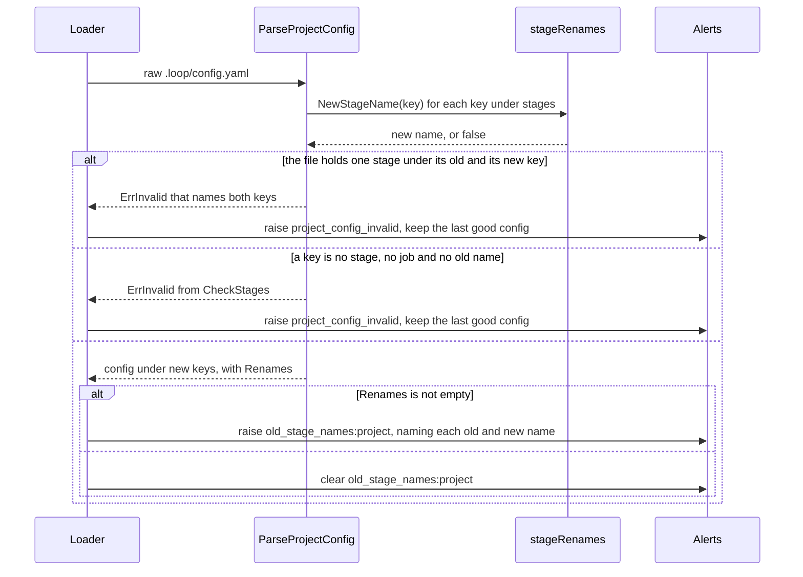
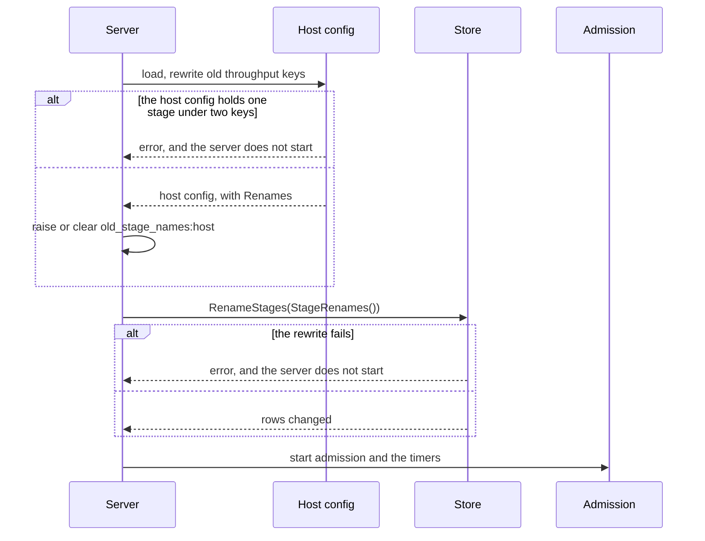
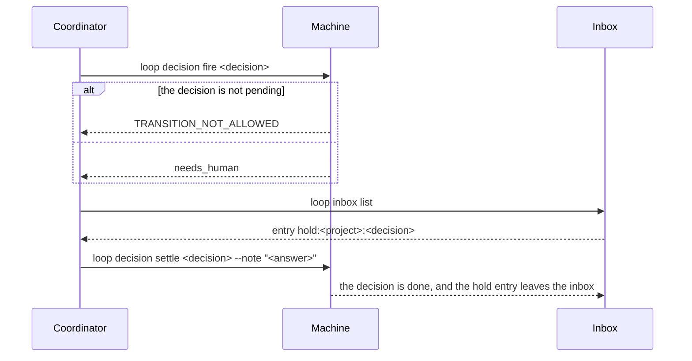
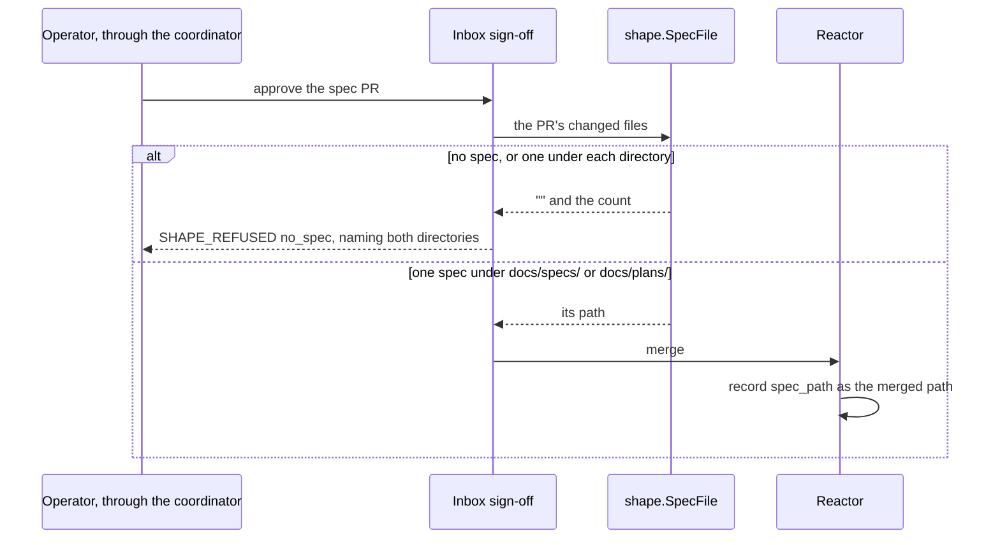

# Rename the loop's roles, phases and paths to the new vocabulary: technical spec

## Source

- **Epic:** factorio-vlle
- **Source:** `docs/prd/loop-vocabulary.md`, merged on the base branch at `d640eae`. The
  doc-reviewer passed it at head `b61d497`.
- **Stories covered:** US-01, US-02, US-03, US-04, US-05.

This spec cites the PRD's acceptance criteria A1 to A18. Where a contract proves a requirement
that no criterion holds, the contract quotes the requirement.

## Scope check

**Components:**

1. **The stage names in the server.** `internal/config` holds the stage keys, the old-name table
   and the grace. The other server packages read the keys from there: `internal/machine`,
   `internal/admission`, `internal/sched`, `internal/room`, `internal/inbox`, `internal/cli`,
   `internal/settings`, `internal/store`, `internal/shape` and `internal/gates`.
2. **The skill pack text.** The runbooks, the skills and `pack/manifest.json`. Why not its own
   epic: a run stage's runbook is `pack/runbooks/<stage>.md`, and it lays out as
   `loop-<stage>/SKILL.md` (`internal/pack/layout.go:2-5`). A stage rename in the server with no
   runbook rename starts a run with no runbook, so the two land in one change.

Work entries 1 and 2 build the grace for an old name in component 1 alone. Entries 3 to 7 each
rename one role in both components, because of the line above. Entry 8 turns a fired decision
into an inbox hold. Entry 9 moves the spec path. Entry 10 writes the new words of the glossary.

**Not in this spec:** the doc review subloop (factorio-4mb8), the simplify run (factorio-1r94),
the QA stage (factorio-nhb5), the retro stage and `machine.BugClosed` (factorio-1xq0), the kernel
and userspace split (factorio-yzrt), and the rule for when a decision needs an ADR
(factorio-ku99).

## Decisions

### Answers a person already gave

None. The PRD's pull request, #239, holds only the doc-reviewer's two rounds and the reviser's
reply. No inbox answer or note on factorio-vlle answers an open question of the PRD. This spec
answers each one from the repository where a rule picks the answer. One question stays open,
under Open questions.

### The names

- **The new stage keys are `reviser`, `planner`, `triage` and `unattended-brainstorm`. The cap on
  epics in flight takes the key `brainstorm`, the room kind is `brainstorm`, and the room's
  runbook is `brainstorm-room`.** This answers the PRD's open question on the keys of ADR 0001
  decision 6, and it keeps two keys, as that decision asks. We rejected `brainstorm` as the run
  stage, because a run stage's runbook lays out as `loop-<stage>` (`internal/pack/layout.go:2-5`),
  and `loop-brainstorm` is the skill that both writers read. We rejected `brainstormer`, because
  the PRD names the role "unattended brainstorm". We rejected `brainstorm-room` as the cap key,
  because the cap counts every epic in the brainstorm phase, from a room or from
  `loop epic create`, and not rooms (ADR 0001 decision 6). The cap key matches the room kind, as
  `intake` does today (`internal/room/room.go:359`).
- **The unattended brainstorm keeps a runbook of its own, `pack/runbooks/unattended-brainstorm.md`,
  and it sends the writer to `loop-brainstorm`.** We rejected `loop-brainstorm` as the run's
  runbook, because A4 names two runbooks, and the run's steps differ from a room's: it reads a
  brief, nobody answers a question, and `loop prd submit` moves an epic it holds in
  `prd_drafting` (ADR 0001 decision 5).
- **The fixer's new stage `triage` shares its word with the triage rubric. Its runbook skill is
  `loop-triage`, and `loop-sdlc-triage` keeps its name.** We rejected a rename of
  `loop-sdlc-triage`, because the PRD's rename table does not name it, every runbook cites it by
  path, and `loop escalation judge` reads it by path (`internal/pack/triage.go`). The glossary
  defines the triage stage as the run that applies the triage rubric, so the word names one job.
- **A fired decision is an inbox entry of kind `hold`. The admission hold keeps its name.** The
  glossary defines two terms: an inbox hold, which is a fired decision that waits on the operator,
  and a hold on an item, which is a room or a panel that keeps every stage off the item. We
  rejected a rename of the admission hold, because the rename table does not name it, `holds` is
  a stored table, and `loop work show` prints it under `wait.holds`.
- **The decision record, its verbs and the decision room keep the word "decision".** A pending
  decision waits for its trigger and appears in no inbox, so "hold" names only a fired one. We
  rejected `loop hold file` and the other verbs under `hold`, because a pending decision holds
  nothing. The decision room answers a fired decision or an escalation, and neither one takes a
  new name.
- **The item states `prd_amending` and `spec_amending`, and the verbs `prd_amended` and
  `spec_amended`, keep their names.** We rejected new names, because "amend" names no role, so no
  requirement asks for them. A state rename also rewrites each stored status in beads and each
  `transitions` row. The operator can ask for the rename at sign-off. It then adds one work entry
  with a beads migration.
- **No CLI verb takes a new name, so no old verb needs a grace.** The only new verb is
  `loop decision list`. Caller labels and help text take the new names. We rejected a rename of
  `loop escalation judge`, `loop escalation route` and `loop prd submit`, because none of them
  names an old role.
- **The loop names the ideate phase, and it builds no ideate room.** We rejected a room kind
  `ideate`, because a room needs a runbook and a flow, which is a new step. The epic body puts
  each new step outside this epic.
- **Go identifiers, Go file names, code comments, `docs/operating.md` and `README.md` take the new
  names with their stage. ADRs, PRDs and merged specs keep their text.** We rejected new names in
  the code only where a requirement asks, because two names for one stage in one repository is
  the fault this epic removes. We rejected edits to ADRs and merged documents, because each one
  records what a person decided at a date.
- **`epic.done` and `bug.closed` are names in the glossary, and this epic writes no code for
  them.** We rejected a `machine.BugClosed` in this epic, because work entry 2 of the retro spec
  owns that function (`docs/plans/factorio-1xq0-retro-spec.md` § Work). This epic names the set
  that the function returns.

### The grace for an old name

- **One table in `internal/config` maps each old stage name to its new name. Each config read
  rewrites an old key to its new key as it parses, so no other code reads an old name.** We
  rejected a lookup of both names at each read site, because the server code names a renamed
  stage in 55 places, and one missed place drops a setting with no error.
- **The grace covers three files: the `stages` keys of a project config, the `stages` lists of a
  secret manifest, and the `throughput` keys of the host config.** We rejected a grace for the
  project config only. A host config must hold an entry for each stage, and it refuses an unknown
  key (`internal/config/throughput.go:150-176`). So an upgrade with no host grace stops the
  server, and US-05 promises an upgrade before a config change. This repository's own manifest
  gives `TYPESAFE_API_KEY` to `stages: [fixer]`. With no manifest grace, the triage stage loses
  Jev, and each escalation routes to a person (loop fault F-23).
- **The warning is an open alert of kind `old_stage_names`, one for each project and one for the
  host. A read with no old name clears it.** The alert names each old name, its new name and the
  file that holds it. We rejected an inbox notice, because a notice is dismissed and nothing waits
  on it, and an old name needs a change before the next release. The config loader already raises
  and clears an alert for each project in this way (`internal/config/lkg.go:75-104`).
- **A file that holds one stage under its old name and its new name does not load.** The refusal
  names both keys. We rejected a rule that the new key wins, because it drops the old key's values
  with no error.
- **The next release removes the table. The config then refuses an old name by today's rule,
  "is no run stage, project job or agent job of this loop".** We rejected an alias with no end,
  because the epic body grants one release.
- **`loop settings set` refuses a key that names an old stage, and its hint names the new key. A
  change on a new key, in a file that holds the stage under its old key, moves the old entry to
  the new key in the same change.** We rejected a change that writes the new key next to the old
  one, because the file then holds both and does not load.
- **A CLI argument or flag that takes a stage name or a room kind refuses an old name with code
  `USAGE`, rule `stage_renamed`, and a hint that names the new name.** We rejected an alias in the
  CLI. The pack is built into the binary (`pack/embed.go`), so each runbook of a release calls the
  names of that release. Only a session that started under the old pack sends an old name, and a
  refusal teaches it the new one.
- **At each start, before admission runs, the server rewrites each old stage name in every column
  named `stage` to the new name.** The table drives the rewrite, so a pair and its rewrite land in
  one entry. We rejected one SQL migration for each rename, because a migration lands with no
  link to the code rename, and five entries would race for migration numbers. A stage pause,
  a stage mutex, a fault and a run then keep their stage after the rename.
- **The rewrite leaves `min_reader_schema` as it is.** An older binary after a rollback reads a
  renamed row as a stage it does not know, so a pause of a renamed stage lapses. We rejected a
  higher `min_reader_schema`, because it refuses every rollback past this epic, and a rollback is
  the operator's emergency tool. `loop stage list` shows a lapsed pause.
- **The rewrite leaves alert keys as they are.** The loop release version enters each inputs hash
  (`internal/admission/inputs.go:34-49`), and the blocked hold and the failure count key on that
  hash. So each upgrade already makes new keys, and an old key holds nothing.

### Units of work

- **`loop work list` lists no decision. `loop decision list` lists them.** The `--kind` flag of
  `loop work list` takes `ticket`, `epic` and `bug`. We rejected a filter that hides decisions
  only when no `--kind` is given, because A8 says that `loop work list` lists no decision. The
  coordinator finds a pending decision with `loop decision list` (coordinator runbook § 8).
- **`loop work show` still reads a decision.** A blocker can be a decision, and
  `loop work show <epic>` names it. We rejected a refusal, because the PRD keeps the decision's
  record.

### The spec path

- **A new spec lands at `docs/specs/<epic id>-<slug>-spec.md`. Each spec under `docs/plans/` stays
  where it is, and each reader of a spec reads both directories.** The readers are the `spec`
  gate, the `prose` gate, the sign-off, the reactor's merge record and the decomposer. We
  rejected a move of the merged specs. The `spec_path` fact of a merged spec names its path
  (`internal/machine/rows.go:60`), the decomposer reads that fact
  (`internal/pipeline/decompose.go:208-230`), and ADRs and code comments cite those paths.
- **No gate refuses a new spec under `docs/plans/`.** We rejected that refusal, because the spec
  of factorio-ku99 is in sign-off under `docs/plans/` on its branch, and a gate cannot tell a new
  file from one that a branch started before this epic. The planner runbook, the template and the
  documents skill name `docs/specs/`, and the doc-reviewer reads the path.

### The order of the work

- **Each role rename is one work entry, and it lands after the grace.** We rejected one sweep of
  every name, because its diff cannot be reviewed, and the PRD's Scope check pairs each rename
  with its grace.

## Assumptions

- `loop host upgrade` drains each live run before the new binary starts
  (`internal/release/host.go:62-72`). This is wrong if a lease taken under an old stage name
  outlives the upgrade. The item's `stage` fact then holds the old name until the lease ends.
- Every caller of a verb that takes a stage name or a room kind is a runbook of the same release.
  This is wrong if a script outside the pack calls `loop stage pause fixer`. That call then gets
  the `stage_renamed` refusal of C6.
- The judge parser of `loop escalation judge` reads only the thresholds table of
  `loop-sdlc-triage`. This is wrong if the parser matches a prose line that names the fixer.
  Entry 5 then changes what the judges read.
- No pending decision titled "The intake cap of `<project>` is full" exists when entry 7 lands.
  This is wrong if `loop decision list --status pending` shows one. Section 6 of the coordinator
  runbook then moots it when the cap frees, as it does today, and the coordinator files the next
  one under the new title.
- The `lessons` gate finds the table of `loop-encode-lessons` by its header row
  (`internal/gates/lessons.go:61`). This is wrong if another file holds a table with the old
  header. Entry 3 changes the skill and the gate together.

## Approach

The work runs in three parts.

The first part is the grace. A table in `internal/config/renames.go` maps each old stage name to
its new name. Entry 1 adds the table empty, and each rename entry adds its pair. Three parsers
call one function that rewrites an old key and records it: `ParseProjectConfig` for `stages`,
`ParseManifest` for each secret's `stages` list, and the host config parse for `throughput`. A
parsed config then holds the new names only, so `KindOf`, `CheckStages`, `StageEnabled`,
admission, the scheduler and `loop settings show` read new names and change nothing. Each parsed
config carries the list of renames it made. The project loader raises the `old_stage_names`
alert from that list, and clears it on a read with none. The host config load does the same
under one host key.

Entry 2 adds the rest of the grace. The store gets one function, `RenameStages`. It reads the
schema for each column named `stage`, and it updates each row that holds an old name. The server
calls it at start, before admission and the timers. A shared check in the CLI handlers refuses an
old stage name or room kind in an argument or a flag. `loop settings set` moves an old entry when
it writes the new key.

The second part is five rename entries. Each one adds its pair to the table, renames the Go
constant, the runbook file, the manifest key, every pack line that names the role, the
`loop-init` stage list, the glossary row, the help text and the tests. Each entry adds its old
names to the retired list of the vocabulary test from entry 1, so that test fails until the pack
and the help text change. Entry 5 also changes this repository's `.loop/secrets.yaml`, which a
run may change. Entry 7 also renames the room kind, and it adds one SQL migration that rewrites
`rooms.kind`.

The third part is three entries that rename no stage. Entry 8 renames the inbox kind and adds
`loop decision list`. Its SQL migration rewrites each prepared question that names a decision
entry. Entry 9 adds `docs/specs/` to every reader of a spec, and moves the writers to it. Entry
10 adds the phases, the units of work, the retro, the two event names and the closed bug states
to the glossary.

A golden file from entry 1 holds `loop schema`'s transition tables at the base. A test maps each
stage name in it through the table, and compares the result with the tables of the build. So
each rename entry proves that only names changed.

## Domain model

```
internal/config (changed)

stageRenames        map from an old stage name to its new name
  invariant: no new name is also an old name, so a rename never chains.
  invariant: each new name is a run stage, or the brainstorm cap key.
  invariant: each old name is no run stage, project job or instance job of this release.
  A test reads all three. A later release empties the map.

Rename              one old name that one config file held at a read
  Source  the file: .loop/config.yaml, the manifest path, or the host config path
  Old     a key of stageRenames
  New     stageRenames[Old]

ProjectSnapshot     (changed) + Renames []Rename, empty when the read held no old name
HostConfig          (changed) + Renames []Rename

StageKind           KindFixer becomes KindTriage. KindIntake becomes KindBrainstorm.

internal/inbox (changed)

KindHold = "hold"   replaces KindDecision. Entry id hold:<project>:<item>.
  invariant: a hold entry exists for a decision in needs_human, and for no other state.
```

## Interfaces

```go
// internal/config/renames.go

// NewStageName returns the new name of an old stage name, and false for
// any other name.
func NewStageName(old string) (string, bool)

// StageRenames returns a copy of the table, sorted by old name.
func StageRenames() [][2]string

// Rename is one old stage name that a config read rewrote.
type Rename struct {
	Source string `json:"source"`
	Old    string `json:"old"`
	New    string `json:"new"`
}

// AlertOldStageNames is the alert kind of a config that holds an old name.
// Its dedupe key is AlertOldStageNames + ":" + project, or + ":host".
const AlertOldStageNames = "old_stage_names"

// RetiredWords lists each old role word that no pack file, help text or
// inbox kind may hold: the old keys of the table, and the words that name
// no stage, such as "intake room" and "AAR".
func RetiredWords() []string

// internal/store

// RenameStages sets each column named stage that holds an old name in
// renames to its new name, in one transaction. It returns the count of
// rows it changed. A second call with the same renames changes nothing.
func (s *Store) RenameStages(ctx context.Context, renames [][2]string) (int, error)

// internal/cli: the refusal of an old stage name or room kind
// Code: CodeUsage, Rule: "stage_renamed", Hint: "<old> is now <new>; ..."

// internal/shape

// SpecDir is where a new spec lands.
const SpecDir = "docs/specs/"

// SpecDirs lists each directory that holds a spec, the new one first.
var SpecDirs = []string{"docs/specs/", "docs/plans/"}

// SpecFile keeps its signature. It now matches a spec in either SpecDirs
// directory, and still answers "" when the count is not exactly one.
func SpecFile(epic string, files []ChangedFile) (spec string, matches int)
```

```
loop decision list [--project <project>] [--status pending|needs_human]
  callers: coordinator, readers
  answers: each decision of the project, or of every project, with id, title, status and trigger

loop work list --kind ticket|epic|bug
  "decision" leaves the enum. No answer of work list holds a decision.

loop room open --kind brainstorm|decision|review|architect
  "intake" leaves the enum. --kind intake gets USAGE with rule stage_renamed.
```

## Data

```
every table with a column named stage (changed in place, at each server start)
  runs, failures, stage_mutexes, stage_pauses, schedule, run_tokens, escalations, faults
  stage: each old name becomes its new name

rooms (changed, SQL migration of entry 7, min_reader_schema 1)
  kind: 'intake' becomes 'brainstorm'

questions (changed, SQL migration of entry 8, min_reader_schema 1)
  entry: 'decision:<project>:<item>' becomes 'hold:<project>:<item>'
```

**Existing records:** each stored row keeps its id and every other value. A row with a new name
needs nothing. Alert keys and `transitions` rows keep the old names as history. No beads record
changes: item states, item kinds and decision records stay as they are. Specs under
`docs/plans/` stay.

## Flows

A config read with an old name:



A server start:



A fired decision:



A spec sign-off:



## Work

1. **The rename table and the config grace.** Add `internal/config/renames.go` with an empty
   table, `NewStageName`, `StageRenames`, `Rename` and `RetiredWords`. Rewrite old keys in
   `ParseProjectConfig`, `ParseManifest` and the host config parse, and refuse a stage under two
   keys. Raise and clear `old_stage_names` in the project loader and at host config load. Add the
   coordinator runbook's row for that alert: tell the operator, who commits the new key. Add the
   vocabulary test over the embedded pack, the CLI help and the inbox kinds. Add the golden file
   of today's transition tables, and its test.
   - Files: `internal/config/**`, `internal/server/server.go`, `internal/server/handlers.go`,
     `internal/pack/vocabulary_test.go`, `internal/cli/vocabulary_test.go`,
     `internal/machine/testdata/tables.golden.json`, `internal/machine/tables_golden_test.go`,
     `pack/runbooks/coordinator.md`.
   - Needs: nothing.
   - Proves: C1, C2, C3, C4, C5, C12.
   - Done when: with a test pair `old-stage` to `new-stage` in the table, a project config that
     sets `stages.old-stage.cap: 2` loads with the cap 2 under `new-stage`, and the project holds
     one open `old_stage_names` alert that names both.
2. **Old names after the load.** Add `Store.RenameStages`, and call it at server start before
   admission. Add the `stage_renamed` refusal to every verb that takes a stage name or a room
   kind: `stage pause`, `stage resume`, `work peek --stage`, `run list --stage`,
   `fault list --stage` and `room open --kind`. Change `loop settings set` to refuse an old key,
   and to move an old entry when it writes the new key.
   - Files: `internal/store/**`, `internal/server/**`, `internal/cli/**`, `internal/settings/**`.
   - Needs: entry 1.
   - Proves: C6, C7, C8.
   - Done when: with a test pair in the table, a store that holds a `stage_pauses` row under the
     old name holds it under the new name after one start, and a second start changes no row.
3. **amender becomes reviser.** Add the pair. Rename `StageAmender`, `pack/runbooks/amender.md`,
   the manifest key, each pack line that names the amender, the `loop-init` stage list, the
   glossary row, the help text, `docs/operating.md`, and the `loop-encode-lessons` header "What
   the amender does" with the `lessons` gate that reads it. Add "amender" to the retired words.
   - Files: `internal/config/**`, `internal/machine/**`, `internal/sched/**`,
     `internal/gates/lessons.go`, `pack/runbooks/**`, `pack/skills/**`, `pack/manifest.json`,
     `acceptance/**`, `docs/operating.md`.
   - Needs: entry 2.
   - Proves: C9, C10.
   - Done when: a project config that sets `stages.amender.cap` to 2 loads with the reviser's cap
     at 2, the alert names `amender` and `reviser`, and an epic in `prd_amending` starts a run
     whose brief names the runbook `.claude/skills/loop-reviser/SKILL.md`.
4. **spec-author becomes planner.** The same steps for `StageSpecAuthor` and
   `pack/runbooks/spec-author.md`. Add "spec-author" to the retired words.
   - Files: `internal/config/**`, `internal/machine/**`, `internal/admission/**`,
     `internal/sched/**`, `pack/**`, `acceptance/**`, `docs/operating.md`.
   - Needs: entry 2.
   - Proves: C9, C10.
   - Done when: an epic in `spec_needed` starts a planner run, and its brief names
     `.claude/skills/loop-planner/SKILL.md`.
5. **fixer becomes triage.** The same steps for `StageFixer`, `KindFixer`,
   `escalation.FixerStage`, the `fixer` caller label, the peek of panels, the overwatch stall
   read and the doctor check. Change this repository's `.loop/secrets.yaml` to `stages: [triage]`.
   Keep the thresholds table of `loop-sdlc-triage` byte for byte. Add "fixer" to the retired
   words.
   - Files: `internal/config/**`, `internal/admission/holds.go`, `internal/escalation/**`,
     `internal/server/**`, `internal/overwatch/stalls.go`, `internal/cli/**`, `internal/sched/**`,
     `pack/**`, `.loop/secrets.yaml`, `acceptance/**`, `README.md`, `docs/operating.md`.
   - Needs: entry 2.
   - Proves: C5, C9, C10.
   - Done when: an escalation that waits for its panel starts a triage run, the run receives
     `TYPESAFE_API_KEY`, and `loop escalation judge` runs from it.
6. **prd-author becomes unattended-brainstorm.** The same steps for `StagePRDAuthor`, the
   `optional` throughput key, `internal/pipeline/adhoc.go` and `pack/runbooks/prd-author.md`. The
   new runbook still sends the writer to `../loop-brainstorm/SKILL.md` and
   `../loop-brainstorm/prd.md`. Add "prd-author" and "PRD author" to the retired words.
   - Files: `internal/config/**`, `internal/machine/**`, `internal/pipeline/**`,
     `internal/admission/**`, `internal/sched/**`, `internal/cli/surface.go`, `pack/**`,
     `acceptance/**`.
   - Needs: entry 2.
   - Proves: C9, C10.
   - Done when: an epic in `prd_needed` starts an unattended-brainstorm run, and a host config
     with no `unattended-brainstorm` entry loads with its default.
7. **intake becomes brainstorm.** Add the pair `intake` to `brainstorm` for the cap key. Rename
   `StageIntake`, `KindIntake`, the room kind, `room.Kinds`, `pack/runbooks/intake-room.md` to
   `brainstorm-room.md`, the `intake room` caller label, the help of `loop prd submit` and
   `loop room open`, the cap decision's title in the coordinator runbook, and each pack line. Add
   the SQL migration of `rooms.kind`. Add "intake" to the retired words.
   - Files: `internal/config/**`, `internal/room/**`, `internal/admission/**`, `internal/sched/**`,
     `internal/pipeline/prd.go`, `internal/cli/**`, `internal/store/migrations/`, `pack/**`,
     `acceptance/**`, `docs/operating.md`.
   - Needs: entry 6.
   - Proves: C9, C10, C11, C13.
   - Done when: `loop room open --kind brainstorm` with no item meets the brainstorm cap and opens
     a room whose checkout holds `.claude/skills/loop-brainstorm-room/SKILL.md`, and a room that
     was open as `intake` reopens as `brainstorm`.
8. **A fired decision becomes an inbox hold.** Rename `inbox.KindDecision` to `KindHold`, with
   entry ids `hold:<project>:<item>`. Add the SQL migration of `questions.entry`. Drop `decision`
   from the `--kind` enum of `loop work list`, and drop each decision from its answer. Add
   `loop decision list`. Change coordinator runbook § 8 to find the cap decision with it.
   - Files: `internal/inbox/**`, `internal/machine/verbs.go`, `internal/decision/**`,
     `internal/cli/surface.go`, `internal/server/**`, `internal/store/migrations/`,
     `pack/runbooks/coordinator.md`, `acceptance/**`.
   - Needs: entry 1.
   - Proves: C14, C15, C16, C17.
   - Done when: a fired decision appears in `loop inbox list` as `hold:<project>:<item>`, and
     `loop work list` with no flag names no decision.
9. **Specs land under `docs/specs/`.** Add `shape.SpecDir` and `shape.SpecDirs`. Read both
   directories in `shape.SpecFile`, the `spec` gate, the `prose` gate, the repair globs of
   `internal/gates/runbooks_claims.go`, the decomposer's fallback and the sign-off hint. Name
   `docs/specs/` in the template line of `shape.TemplateLines`, the name hint, the template
   `loop-sdlc-documents/spec.md`, the `loop-sdlc-documents` table and the planner runbook.
   - Files: `internal/shape/**`, `internal/gates/**`, `internal/inbox/signoff.go`,
     `internal/pipeline/decompose.go`, `internal/github/reactor.go`,
     `pack/skills/loop-sdlc-documents/**`, `pack/runbooks/planner.md`.
   - Needs: entry 4.
   - Proves: C18, C19, C20.
   - Done when: a spec at `docs/specs/<epic>-<slug>-spec.md` passes the `spec` gate, signs off
     and decomposes, and so does one at `docs/plans/<epic>-<slug>-spec.md`.
10. **The glossary's new words.** Add the phases in order, with ideate and ADR marked optional.
    Define a unit of work, a ticket as a slice of a unit, the work kinds without the decision, an
    inbox hold and a hold on an item, the triage stage and the triage rubric, the retro, the
    events `epic.done` and `bug.closed`, and the closed bug states. Add "AAR" to the retired words.
    - Files: `pack/skills/loop-sdlc-glossary/SKILL.md`, `internal/pack/glossary_test.go`,
      `internal/config/renames.go`.
    - Needs: entries 3, 4, 5, 6, 7 and 8, and the answer to the open question.
    - Proves: C9, C21.
    - Done when: the glossary test reads the nine phases in order, the two events and the closed
      bug states, and the vocabulary test passes with every retired word.

## Out of scope

- The removal of the rename table in the release after this one. The operator times it: the
  `old_stage_names` alerts show when no project and no host still holds an old name.
- The rename of the stage keys in this repository's own `.loop/config.yaml`. A stage run's push
  that changes `stages` is refused with `SETTINGS_CHANGE`, so the operator commits it, or the
  first `loop settings set` on each stage moves it by C7.
- New names for `prd_amending`, `spec_amending`, `prd_amended` and `spec_amended`. Never in this
  epic, by Decisions. The operator can ask for them at sign-off.
- An ideate room. It belongs to no epic yet. The operator files one when the phase needs a room.
- `machine.BugClosed` and the retro stage. They belong to factorio-1xq0.
- The doc review subloop. It belongs to factorio-4mb8.
- The simplify run. It belongs to factorio-1r94.
- The QA stage. It belongs to factorio-nhb5.
- The kernel and userspace split. It belongs to factorio-yzrt.
- The rule for when a decision needs an ADR. It belongs to factorio-ku99.
- A move of the specs already under `docs/plans/`. Never, by Decisions.

## Contracts

**C1. Behaviour: an old stage key loads under its new key.** Proves A15. For each pair of the
table, a project config that sets a field under the old key loads, and the value in force for the
new stage is that value. `loop settings show` names the new key.
*A table-driven test over every pair of the table, plus one test with an injected pair, so the
test fails before entry 1. Entry 3 adds the fixture `stages.amender.cap: 2`.*

**C2. Behaviour: an old name raises one alert, and a clean read clears it.** Proves A16. A
project read that rewrote at least one old name leaves one open alert of kind `old_stage_names`
for the project. Its body names each old name, its new name and its file. A later read with no old
name clears it. A host config with an old `throughput` key does the same under the host key.
*Example tests on the loader with a fake alerter: raise, raise again with no second alert, then
clear.*

**C3. Refusal: one stage under two keys does not load.** Requirement: "A name under `stages` that
is no run stage, project job or agent job, and no old stage name, still refuses the project
config." A project config or host config that holds a stage under its old key and its new key
fails with `ErrInvalid`, and the error names both keys. The last good config stays in force.
*An example test for each of the two files.*

**C4. Refusal: an unknown stage name still refuses the config.** Proves A17. A project config
whose `stages` holds a name that is no run stage, project job, agent job or old stage name fails
`CheckStages`, and the error names `stages.<name>`.
*An example test with a name that no table holds.*

**C5. Behaviour: a secret manifest's old stage name reaches the new stage.** Proves A15. A secret
whose `stages` list holds an old name goes to each run of the new stage, and the read raises the
alert of C2. A list that holds both names gives the secret once.
*An example test of the manifest parse, and a dispatch test in entry 5 with `stages: [fixer]` that
asserts a triage run's `.env` holds the secret's name.*

**C6. Refusal: a CLI input that holds an old stage name or room kind.** Requirement: "No runbook,
skill, CLI help text or inbox entry names a role by its old name." Each verb that takes a stage
name or a room kind refuses an old name with code `USAGE` and rule `stage_renamed`, and the hint
names the new name. It writes nothing. `loop settings set stages.<old>.<field>` refuses with a
hint that names `stages.<new>.<field>`.
*An example test for each verb, with an injected pair.*

**C7. Behaviour: a settings change moves an old entry.** Proves A15. When a project config holds a
stage under its old key, `loop settings set stages.<new>.<field>` proposes a file that holds the
stage under the new key only, with the old entry's other fields and the new value. That file
loads.
*An example test on `editSetting`, which parses the proposed file again.*

**C8. Invariant: no stored stage name is old after a start.** Requirement: "An item takes the
same moves, in the same order, that it takes today." After a server start, no column named
`stage` in any table holds an old name of the table. A second start changes no row. A table that
gains a `stage` column later is covered with no change to the code.
*A property test over generated rows in each table that has a `stage` column, read from
`sqlite_master`.*

**C9. Invariant: no retired word in the pack, the help or the inbox kinds.** Proves A2 and A11.
No file of the embedded pack, no summary or flag description of the CLI surface, and no inbox kind
holds a word of `RetiredWords`, matched as a whole word with any case. Each rename entry adds its
words, so the test fails before the entry changes the text.
*A test that walks the embedded pack and the surface, and names each file, line and word it
finds.*

**C10. Behaviour: each renamed role has its runbook under the new name.** Proves A1. The manifest
holds `reviser`, `planner`, `triage`, `unattended-brainstorm` and `brainstorm-room`. Each lays out
as `loop-<name>/SKILL.md`. A run of each renamed stage gets a brief whose runbook path names the
new skill. The manifest holds none of the old keys.
*An example test of the layout for each name, and a dispatch test for each renamed run stage.*

**C11. Behaviour: one PRD template, and two runbooks that point to it.** Proves A4. The embedded
pack holds one file named `prd.md`, at `skills/loop-brainstorm/prd.md`. The runbooks
`unattended-brainstorm.md` and `brainstorm-room.md` each name `../loop-brainstorm/SKILL.md` and
`../loop-brainstorm/prd.md`.
*An example test over the embedded pack. It fails when a rename copies the template or drops a
pointer.*

**C12. Equivalence: the transition tables change names only.** Proves A6. Map each stage name in
the golden tables of the base through the rename table. The result equals the tables of the build:
the same kinds, states, rows, verbs, sources and targets. No row is added and no row is removed.
*A test that compares the mapped golden file with `loop schema`'s `transition_tables`.*

**C13. Behaviour: `--kind brainstorm` opens the room that `--kind intake` opened.** Proves A5.
`loop room open --kind brainstorm` with no item meets the brainstorm cap, answers `CAP_FULL` when
the epics in counted document states fill it, and otherwise opens a room whose runbook is
`brainstorm-room`. `--kind intake` gets the refusal of C6.
*Example tests at a cap of one: one epic in flight refuses, none opens.*

**C14. Behaviour: `loop work list` lists no decision.** Proves A8. With a project that holds a
ticket, an epic, a bug and a pending decision, `loop work list` answers the first three only.
`--kind decision` gets `USAGE`. `loop decision list --status pending` answers the decision.
*An example test of each call.*

**C15. Behaviour: a decision keeps each move.** Proves A8. A filed decision takes fire, defer,
settle, settle with `--dropped`, and moot, from the states that `decisionTable` names today. Each
other move is refused with `TRANSITION_NOT_ALLOWED`.
*The test of C12 covers the table. An example test runs each verb once through the CLI.*

**C16. Behaviour: a fired decision is an inbox hold, and a pending one is not.** Proves A9. A
decision in `needs_human` appears in `loop inbox list` once, with kind `hold` and id
`hold:<project>:<item>`. A decision in `pending` does not appear. A question that
`loop inbox prepare` made on the entry `decision:<project>:<item>` before the migration names
`hold:<project>:<item>` after it.
*Example tests of the inbox list, and a migration test from a store at the base schema.*

**C17. Boundary: a decision does not fire before its trigger.** Proves A10. A decision filed with
`--by <date>` stays `pending` while the `decision-timers` job runs on the day before that date. It
moves to `needs_human` on the first run on that date. A decision with no `--by` date stays
`pending` until `loop decision fire`.
*Example tests with a fake clock: the last minute of the day before, the first minute of the date,
and a decision with no date after both runs.*

**C18. Behaviour: a spec under `docs/specs/` is a spec.** Proves A13. A file at
`docs/specs/<epic>-<slug>-spec.md` is read by the `spec` gate and the `prose` gate. A sign-off
of its pull request finds it, the reactor records its path as `spec_path`, and the decomposer
reads it.
*An example test at each reader, with one spec fixture.*

**C19. Behaviour: a spec under `docs/plans/` is still a spec.** Proves A14. The same readers as
C18 accept `docs/plans/<epic>-<slug>-spec.md`. An epic whose spec merged with no `spec_path` fact
still finds its one file under `docs/plans/`.
*The tests of C18, run again with the fixture under `docs/plans/`.*

**C20. Refusal: two specs for one epic.** Requirement: "The `spec` gate reads each spec under
`docs/specs/`." A pull request that changes one spec of the epic under each directory has no
single spec. The sign-off answers `SHAPE_REFUSED` with rule `no_spec`, the hint names both
directories, and nothing merges.
*An example test of `SpecFile` with one file in each directory, and of the sign-off.*

**C21. Behaviour: the glossary holds the new words.** Proves A3, A7, A11, A12 and A18. The
glossary's phase list holds ideate, brainstorm, doc review, ADR, plan, doc review, decompose,
build and retro, in that order, with ideate and ADR marked optional. It defines a unit of work as
an epic or a bug, and a ticket as one slice of a unit. Its work kinds hold no decision. It defines
"retro", `epic.done` and `bug.closed`, and it lists the closed bug states. It defines each renamed
role once.
*An example test that parses the glossary's phase list and its definitions, and compares them
with the names above.*

## Observable behaviour

None, because this epic draws no screen. The operator reads the `old_stage_names` alert and the
hold entry through the coordinator. C2 and C16 prove both.

## Open questions

- Which bug states count as closed? The retro epic runs a retro on each bug that closes, and
  waits on this list (`docs/prd/retro.md` § Boundaries with other epics). A bug's terminal states
  are `shaped`, `duplicate` and `canceled` (`internal/machine/bug.go:101-103`). At `shaped` the
  bug's ticket is not built yet, so its retro reads the reproduction and not the build. A retro
  after the build needs a new bug state, which this epic cannot add. I recommend all three
  terminal states, because a canceled or duplicate bug can still hold a failed attempt or an
  escalation, and a retro that finds nothing ends with no learning. The other answer is `shaped`
  only, which skips a model run for each bug that the reproducer routed away. This blocks work
  entry 10.
