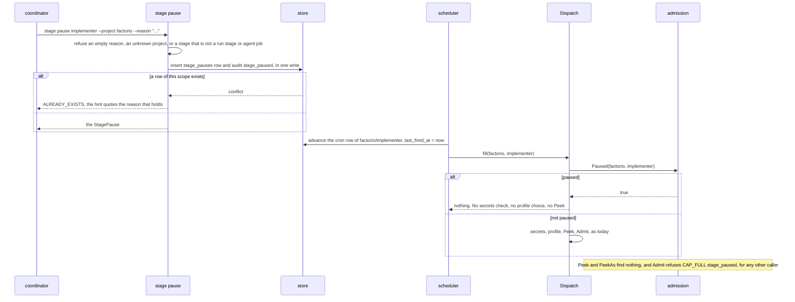
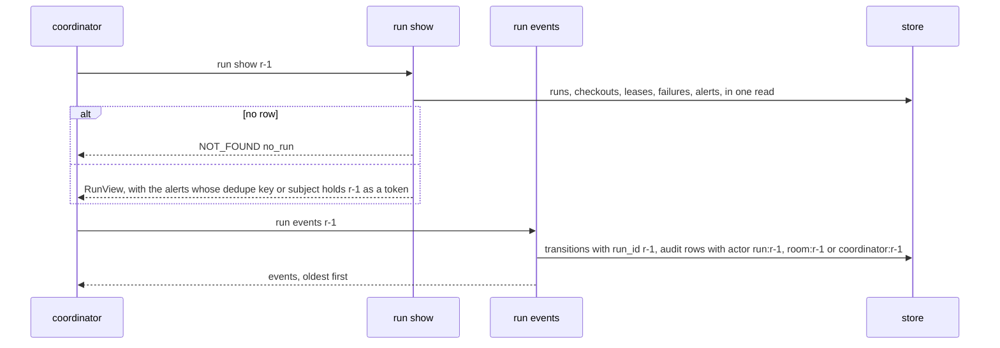
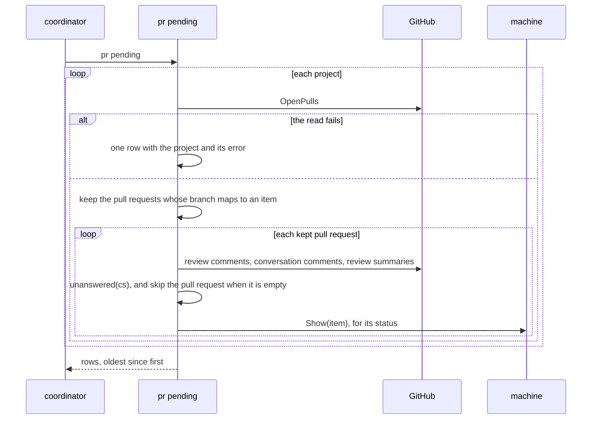
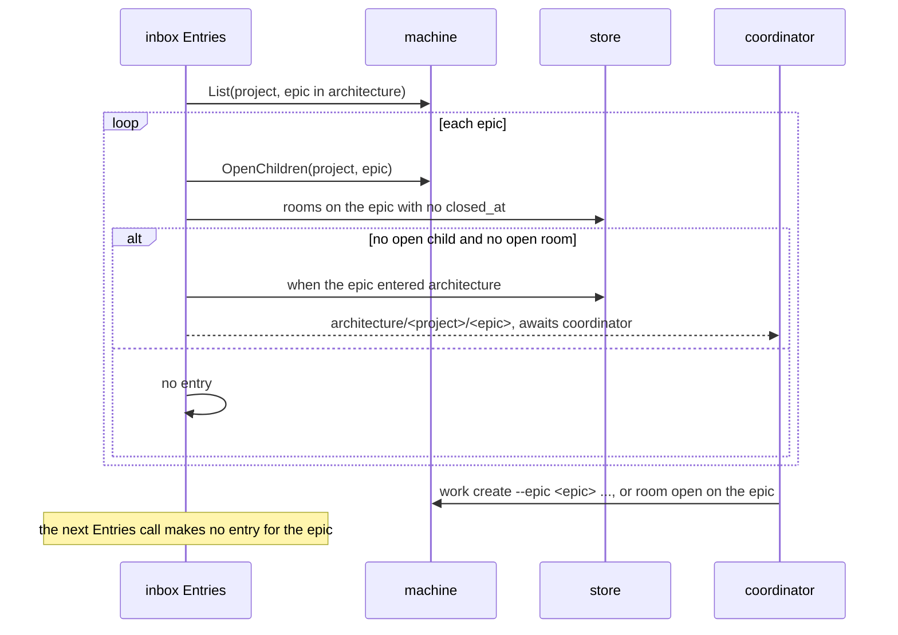
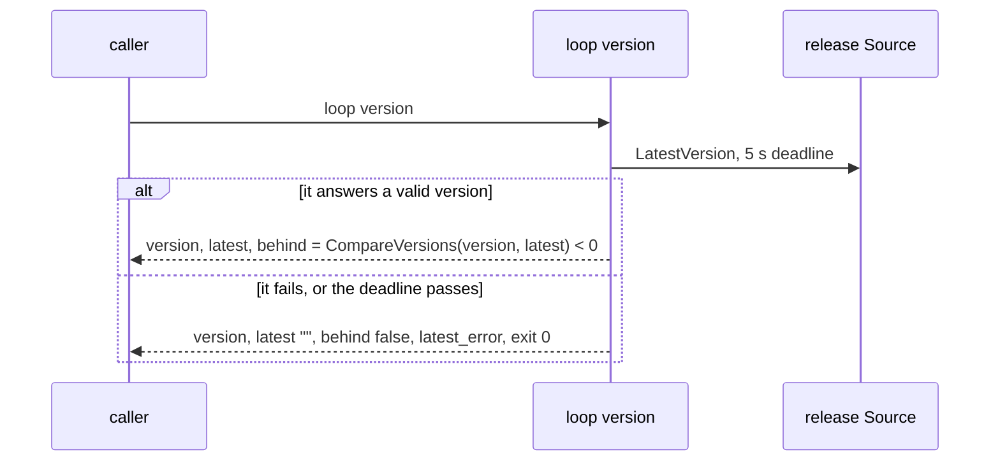

# Operator and coordinator visibility commands: technical spec

## Source

- **Epic:** factorio-wd0
- **Source:** `docs/adr/0004-operator-visibility.md`. Its `**Ticket:**` line names this epic. No
  other ADR names it.
- **Stories covered:** none. This is an architecture epic.

The ADR's acceptance criteria carry no labels, so this spec numbers the ones the epic owns. Each
contract below cites one of them, or the ADR decision it proves, as "ADR D3" for Decision 3.

| Label | ADR acceptance criterion |
| --- | --- |
| A1 | A test in `internal/server` proves that each server verb of the schema has a handler, so no coordinator call answers `NOT_IMPLEMENTED` |
| A2 | A test proves that a paused stage starts no run, that a live run continues, and that the pause survives a server restart |
| A3 | A test proves that an epic in `architecture` with no open item that names it makes one inbox entry. The entry goes when the coordinator creates such an item |
| A4 | `loop schema` lists `stage list` and `pr pending`, and `loop work list --help` lists `epic` |
| A5 | `loop version` prints a `latest` field |

The ADR's five document checks passed when the ADR merged. This run measured two of them again
on the base `f3963ec` (v0.0.79): the `pack` grep for `ci-minutes|merge-stats|pr link|epic done|epic children`
prints nothing, and the `loop schema` count of `epic children`, `epic done` and `pr link` prints
`0`. This spec owns none of the five, and C24 keeps the two greps true after the runbook changes.

The ADR read the loop at `6bfba44` and v0.0.64. This run read it again at `f3963ec`. The six verbs
with no handler are the same six. A comparison of each `server(...)` verb in
`internal/cli/surface.go` with every verb string in the handler packages finds `run show`,
`run list`, `run events`, `stage pause`, `stage resume` and `work block`, and no other.

## Scope check

**Components:**

1. **The loop's state reads, and the stage pause.** The server verbs that answer "what is the loop
   doing, and why": `run show`, `run list`, `run events`, `stage pause`, `stage resume`,
   `stage list`, `pr pending`, the new fields of `work show` and `work list`, the two new inbox
   sources, the new lines of `loop doctor`, and the new fields of `loop version`. Each one reads
   state that the server or the release source already holds. Only `stage pause` and
   `stage resume` write, and they write one table. The code sits in several packages, because each
   read lives beside the state it reads. One reader can understand the whole component as one
   thing: the loop's answer to the coordinator's questions.
2. **The coordinator's instructions.** `pack/runbooks/coordinator.md`. Why not its own epic: the
   pack gate checks each command that a runbook names against `loop schema`. So the runbook cannot
   name `loop stage list`, `loop pr pending` or `stage pause --reason` before those land. And a
   pause entry or an architecture entry in the inbox, with no runbook rule to act on it, reaches a
   coordinator that does not know what settles it.

Each of work entries 1 to 11 changes component 1 only, and proves its contracts with no runbook
change. Entry 12 changes component 2 only, after the verbs it names have landed. Entry 13 changes
one part of epic factorio-a7r's sweep, because a pause changes what that part reads as a stall
(Decisions, last line).

**Not in this spec:** `work block` (epic factorio-9wh, ADR 0005 decision 2). The stall list, CI time
and the flaky-test report (epic factorio-a7r, ADR 0009). Out of scope lists every other neighbour.

## Decisions

The ADR decided which verbs exist and what each one answers. Each line below is a choice that the
ADR left to this spec, or one where the code shows that the ADR's stated mechanism needs a rule
that the ADR does not give.

- **`work block` stays out of this epic, and the handler test names it as an exemption.** We chose
  a test with a list of exempt verbs, each with the epic that owns it, over a test with no
  exemption. ADR 0005 decision 2 gives `work block` a `--by` flag, a new table row and a
  blocks-edge write, and epic factorio-9wh owns it. A test with no exemption stays red until
  factorio-9wh lands, so no entry of this epic could merge it. We also rejected an implementation
  of `work block` here, because it would ship the shape that ADR 0005 rejected: a block that names
  no blocker. The test fails when an exempt verb has a handler. So each entry of this epic deletes
  its own exemptions, and factorio-9wh deletes the last one.
- **The handler test starts with five exemptions of this epic, and each entry deletes its own.** We
  chose to land the test first, in entry 1, over a test in the last entry. The first lets each
  later entry prove that it closed its own gap. A1 holds when entries 2 and 3 have both deleted
  their exemptions, and none that names factorio-wd0 is left.
- **An alert names a run or an item when the id is a token of its dedupe key or of its subject.**
  A token is a run of the characters `A-Z`, `a-z`, `0-9`, `.`, `_` and `-`, with a final `.`
  trimmed. An item also needs the alert's project. A run is also named by a token that ends in
  `-<run id>`, because the scheduler names a run's checkout
  `loop-<project>-<stage>-<item>-<title slug>-<run id>`, and the run id always stays last
  (`checkoutName` in `internal/sched/dispatch.go`). The item inside that name is no whole token,
  so a checkout alone names no item. `host_verb_from_checkout` and `checkout_kept` name a run by
  its checkout. We chose this rule over a new `item` column on `alerts`, because that column would be empty on every alert raised before it, and every raiser
  would change. We also rejected `overwatch.Tokens`, because it keeps `/` and `:` inside a token,
  so `retry_limit:factorio/factorio-5w6/implementer/<hash>` would be one token and name no item.
  The store held 51 alerts on 2026-10-25. Each one about a run or an item names it in one of the
  two fields: `run_over_budget:r-c5a6acf3a0e8`, `run_blocked:factorio/factorio-5w6/...`,
  "implementer run r-c5a6acf3a0e8 on factorio-q2i ...", and
  `host_verb_from_checkout:/.../loop-factorio-spec-author-r-197af489dab3`. Two name neither, and
  are about neither: `project_config_invalid:grinch` and `coordinator_start_failed`.
- **`run events` merges two sources: the transitions with the run's `run_id`, and the audit rows
  whose actor is the run.** A run's actor is `<kind>:<run id>`, as `rpc.Principal.Actor` writes
  it, for the kinds `run`, `room` and `coordinator`. We chose both sources over the transitions
  alone, because a host verb from a checkout and an answered alert write audit rows and no
  transition. The order is the time, then transitions before audit rows, then the row id.
- **`run list` prints the newest runs first, at most 50, and `--limit` takes up to 500.** We chose
  a limit over an unbounded list, because the store holds 473 runs today and gains one for each
  run. We rejected a time window, because a quiet week then shows nothing, and the coordinator
  asks for the last runs of a stage, not the runs of a day. `--live` lists only the runs with no
  end, and ADR D2 counts the in-flight runs with it.
- **A stage pause lives in a new table, `stage_pauses`, keyed by project and stage.** The project
  is empty for a pause of every project. We chose a table over a `schedule` row of a new kind,
  because `schedule` has no unique key on its kind, project and stage, so two pauses of one scope
  could exist. The ADR's Consequences names a table too.
- **Dispatch asks for the pause first, before the secrets check and the harness choice. Admission
  refuses a paused stage too.** We chose both checks over a check in admission alone. Dispatch
  checks the stage's secrets and raises a `missing_secret` alert before it calls `Peek`
  (`internal/sched/dispatch.go`). So a paused stage with a missing secret would raise an alert on
  each fire. Admission's check is the guard for any other caller: `Peek` and `PeekAs` find
  nothing, as they do while the server drains, and `Admit` refuses.
- **`Admit` refuses a paused stage with `CAP_FULL`, rule `stage_paused`.** We chose an existing
  code over a new one. No agent calls `Admit`, only dispatch. `CAP_FULL` already means "the stage
  starts no run now", and the rule `no_profile` uses it the same way. A new code is a schema change
  that each runbook's code table would have to learn.
- **A paused stage's schedule still fires, and its fire starts nothing.** We chose this over a
  schedule that skips a paused stage. The `timer-health` part of epic factorio-a7r (its C17) reads
  a `cron` row that has not fired for two periods as a stopped timer. A skipped fire would make
  each pause ring as a broken timer. `stage list` also shows a true next fire.
- **A project pause and an every-project pause are two rows. `stage resume` deletes the row of its
  own scope only.** We chose this over a resume that clears every row for the stage. A project
  resume would then end an every-project pause that the coordinator set for another reason. A
  second pause of one scope refuses with `ALREADY_EXISTS`. We rejected a pause that replaces the
  reason, because the first reason would go with no record. Each pause and each resume writes one
  `audit` row, so the history stays after the delete.
- **Only a run stage or an agent job pauses.** `stage pause merge-handoff` refuses with `USAGE`,
  rule `not_a_run_stage`. We chose this over a pause of a native job. ADR D3 says that admission
  starts no run of a paused stage, and a native job passes no admission. A paused merge hand-off
  would also hold each eligible pull request with no sign in the merge status.
- **The pause entry's id is `pause/<project>/<stage>`, or `pause/<stage>` for every project. An
  answer refuses, and names `loop stage resume`.** We chose a refusal over an answer that resumes.
  ADR D3 names `stage resume` as the act that ends the entry, and one act for one entry keeps the
  audit row clear. `inbox defer` works on the entry, as on any entry.
- **`stage list` and the scheduler read one function that names each firing and its schedule.**
  `fireDue` in `internal/sched/scheduler.go` holds three schedule rules inline: host config's
  entry, an agent job's own schedule, and the project's override. We chose to move them into one
  exported function that both read, over a second copy in the verb. Two copies of the override
  rules drift, and then the verb prints a schedule that the scheduler does not run.
- **`stage list` prints a row for each run stage of each project, enabled or not, each agent job,
  each native job of each project, and each instance job once with an empty project.** We chose
  every row over the enabled rows alone, because "the stage is disabled" is one answer the
  coordinator looks for. A row prints its limits, own cap and pool caps, as admission checks them
  (`HostConfig.Limits`). It prints the profiles in the order that dispatch tries them, and the
  escalated profile for the implementer. We rejected the first profile alone, because a fallback
  harness is the profile that runs when the first one is out of quota.
- **`work show` reads the wait through a seam that the server sets, as it sets the pull request
  head reader.** We chose `Machine.SetWaitReader` over a handler in the server package, because the
  machine owns its verb table. We rejected a machine that imports admission, because admission
  imports the machine. `Machine.List` and every other caller of `Machine.Show` read no wait.
- **`work show` lists every counted failure of the item, each with its stage and its inputs, and
  the limit.** We chose this over the failures at the item's current inputs only. Current inputs
  need a read of the base branch for each stage, and a pull request head for the code-reviewer,
  so each `work show` would make outside reads. The `retry_limit` alert already names the stage
  and the inputs that reached the limit.
- **An open room on the epic also ends the architecture entry.** We chose an open item or an open
  room over the ADR's open item alone. Section 8 of the coordinator runbook offers an architect
  room as one path. That room is the coordinator's act, and the entry would wait on the
  coordinator while the room works. An item counts as open by the rule that closes an epic
  (`children` in `internal/machine/epic.go`): its kind's table does not call its status terminal.
  We rejected a filter of its own, because two rules of "open child" drift.
- **An answer to an architecture entry refuses, and names the two acts that end it.** When the
  operator writes the ADR by hand, the coordinator defers the entry with `inbox defer --until`. We
  rejected an answer that hides the entry, because the epic would then wait with no entry and no
  act, which is the gap the ADR closes.
- **`pr pending` reads only the open pull requests whose head branch maps to an item.** It maps
  with `github.SpecEpicOf`, then `github.ItemOf`, as the overwatch `pulls` part does. We chose this
  over every open pull request, because a person's own branch holds no item, the loop owes it
  nothing, and each pull request costs three reads.
- **`pr pending` shares the reactor's rule through one function, `unanswered`, that returns the last
  person's comment of each thread that the App has not answered.** `awaitsAnswer` becomes
  `len(unanswered(cs)) > 0`. We chose one function over a copy of the rule, so the reactor and the
  verb agree on what is owed.
- **`pr pending` keeps no cache. Each call reads one list page for each project, and three comment
  lists for each item pull request.** We chose a fresh read over a cache that the reactor fills,
  because a cache is a second store of GitHub state, and it is old when the coordinator acts on
  it. This bounds the read that the ADR's Consequences names. On 2026-10-25 the project held 12
  open pull requests, all on item branches, so one call makes about 37 reads. At one call for each
  coordinator wake, 20 wakes an hour cost under 800 reads of the installation's 5,000.
- **The quota line reads `GET /rate_limit` six times, 500 ms apart, and counts the counters by
  their reset time.** These are tickertown's `READS` and `PAUSE_MS` (`scripts/sdlc/gh-quota.ts`,
  alpha). We chose them over one read, because tickertown measured two counters for one
  installation at 18:16Z on 2026-10-21. The line passes whenever the six reads answer, and fails
  only when a read fails. ADR D8 rejected a floor.
- **The judge key line is a server line of `loop doctor`, for each project whose config enables
  the fixer. The judge binaries line is a client line.** Only the server reads the secret store,
  and `secret check` is a run verb. So the key line joins the `doctor-github` answer, which is
  already "the checks of `loop doctor` that need the server". A project that runs no fixer needs
  no key, so it gets no line. This narrows ADR D12, which says "for each project". We rejected a
  line for every project, because a project with no fixer would then fail `loop doctor` on a key
  that nothing in it reads, and the operator would learn to ignore a red line. The binaries come from `escalation.Live()`, so a release that changes
  a judge changes the check. We rejected a fixed list of `claude` and `codex`, because it drifts
  from the panel.
- **`loop version` reads the newest release in the client, with a deadline of 5 seconds.**
  `cmd/loop` replaces the handler that `internal/cli` registers, because `internal/release` holds
  `LatestVersion`, and the CLI package does not import it. We chose the client over a server read,
  because `loop version` answers with no server today, and ADR D13 keeps exit 0 on a failed read.
  `behind` is true only when both versions are valid and the installed one is older.
- **`work list --epic` filters, and checks nothing.** An id that names no epic lists nothing, and
  exits 1. We chose this over a refusal of a non-epic id, because `--status` and `--kind` check
  nothing either, and an empty list already answers.
- **An item at a paused stage is no stall. Entry 13 adds this exclusion to the `stalls` part of
  epic factorio-a7r, and it waits for that part through its declared paths.** We chose to change
  that part over a stall that rings the coordinator about a pause it set itself. ADR 0009 keeps the
  sweep the one producer of the stall list, so the exclusion goes in the sweep. The part is ticket
  factorio-wcr, in `todo`, and `epic decompose` writes no blocks edge outside its batch. So entry
  13's ticket lists `internal/overwatch/stalls.go` under "May change". That path enters the
  ticket's retry identity (`admission.DeclaredPaths`). A run that finds no `stalls.go` finishes
  blocked. The merge of factorio-wcr then changes a declared path, which lifts the hold with no
  person.

## Assumptions

- A run id and an item id hold only `A-Z`, `a-z`, `0-9`, `.`, `_` and `-`. This is wrong if
  `hexid` or beads makes an id with another character.
- Every alert about one run or one item names its id, or the run's checkout directory, in the
  dedupe key or the subject. This is wrong if an alert kind names a run or an item only in its
  body. The 49 alerts in the store on 2026-10-25 that are about a run or an item all do.
- `GET /rate_limit` costs no request of the limit it reports. GitHub's documentation says so, and
  tickertown's header repeats it. This is wrong if `X-RateLimit-Remaining` falls by six across one
  quota line.
- The `claude` and `codex` binaries on the path of the operator's shell are the ones the fixer's
  session finds. The fixer runs the judges in its own process (`escalation judge` is a client
  verb). This is wrong if the agent host starts sessions with another `PATH`.
- Migration number 0010 is free when entry 3 merges. This is wrong if another epic's migration
  merges first. The implementer then takes the next free number. Nothing else reads the number.
- An older release ignores a table that it does not know. Each migration is additive with
  `min_reader_schema: 1`, so `loop rollback` keeps a store with `stage_pauses`. This is wrong if a
  rollback refuses a store with a newer schema version. A rolled-back server then admits a paused
  stage, and the inbox shows no pause. Data states this cost.
- The host's `gh` login reads the release repository. `LatestVersion` uses it for a GitHub source
  (`release.GHToken`). This is wrong if `gh auth token` prints nothing in the coordinator's
  session. The `latest_error` field then says so, and `loop version` still exits 0.

## Approach

Every new read is a read of state the server already writes, through a verb. No runbook reads
SQLite, and no verb reads a file of host config by hand.

### The run verbs

`internal/sched` already reads runs (`runs.go`, `queryRuns`). It gains the exported read model:
`ShowRun`, `ListRuns` and `RunEvents`, over the store. `ShowRun` adds the lease the run owns
(`leases.owner_run_id`), its `failures` row, its checkout, and the alerts that name it, open or
closed, newest first, at most 20. The handlers in `internal/server/runs.go` translate flags into a
`RunFilter` and the answer into the envelope. An unknown run refuses with `NOT_FOUND`, rule
`no_run`. Two functions, `admission.AlertNamesRun` and `admission.AlertNamesItem`, hold the token
rule of the alerts. Run show calls the first, and work show the second.

### The stage pause

Migration 0010 adds `stage_pauses`. `internal/admission/pause.go` reads and writes it:
`Pause`, `Resume`, `Pauses` and `Paused`. `Paused(project, stage)` is true when a row of that
project or of every project holds the stage. `Peek`, `PeekAs` and `Admit` read it after the drain
check. `Scheduler.Dispatch` asks `Paused` before anything else, and returns nothing. The handlers in
`internal/server/stages.go` check the stage name against `config.RunStages()` and host config's
agent jobs, check the project against the registry, and refuse an empty reason. Each write also
writes one audit row, `stage_paused` or `stage_resumed`, with the stage, the project and the reason.

The inbox reads `Pauses` in the same read transaction as its other store sources, and makes one
entry for each row.

### The stage list

`internal/sched/plan.go` holds `Firings`: for each project and each stage or job, its kind, whether
the scheduler fires it, and its effective schedule. `fireDue` loops over `Firings` and keeps its
own work: advance the deadline, then launch. `StageList` joins each firing with the limits
(`HostConfig.Limits`), the profiles (`profiles` and `escalatedProfiles`), the pauses, the `cron`
row of `schedule` (last fire and next fire), and the count of live runs. A project whose config
does not read prints its native jobs, as `fireDue` fires them, and an `error` on each run-stage row.

### Work show and work list

`machine.Wait` is the wait of one item: the lease, the holds, the counted failures with the limit,
and the open alerts that name it. `admission.WaitOf` builds it from the store. It selects the
failures with the `counted` SQL list in `internal/admission/failures.go`, which the retry gate
uses, and names no class itself. So a class that `Class.Counted()` adds later shows in the wait
with no change here. Today the list holds `failed`, `crashed` and `stalled`. The server binds it
with `Machine.SetWaitReader`. `workShow` sets `Item.Wait` when a reader is set. A failed wait read
leaves the item as it is, and adds `wait_error`, so `work show` still answers the item.
`workList` passes `--epic` as `ListFilter.Facts["epic"]`.

### The architecture entry

`machine.OpenChildren(project, epic)` exports the open half of `children`. The inbox lists the epics
in `architecture` for each project. For each one, it asks `OpenChildren`, then reads the rooms with
no `closed_at` on the epic. An epic with neither makes the entry
`architecture/<project>/<epic>`, which awaits the coordinator. Its time is when the epic entered
`architecture`, from `transitions`, as every item entry dates itself.

### Pending feedback

`internal/github/pr.go` gains `unanswered`, and `awaitsAnswer` calls it. `Service.Pending(project)`
lists the open pull requests, keeps those whose head branch maps to an item, reads each one's
comments with `allComments`, and keeps those with at least one unanswered comment. It names the
item, the pull request, the oldest unanswered comment's time, and the count. The handler in
`internal/server/github.go` asks each project, or only the one that `--project` names, and sorts
the answer oldest first. A `--project` that names no registered project refuses with `NOT_FOUND`,
rule `project_not_found`, as `stage pause` does, before any GitHub read.

### The doctor lines and the version

`internal/github` gains `Service.RateLimit(project)`, one `GET /rate_limit` with the
installation's token from `Service.Token(ctx, p, ScopeRead)`. It never calls `release.GHToken`. `GitHub.Doctor` in `internal/server/doctor.go` adds a `github_quota` line,
then a `judge_key` line for a project that enables the fixer. `internal/release/doctor.go` adds one
`judge_binaries` line when host config has a project. `cmd/loop` sets the `version` handler to one
that calls the local version handler, then `LatestVersion` with a deadline.

### The coordinator

Section 1 reads `loop stage list`, `loop pr pending` and `loop version` after the inbox. Section 3
pauses with `--reason`, and names the run verbs that now answer. Section 8 acts on an
architecture entry. Entry 12 makes these changes after every verb they name has landed.

## Domain model

```
internal/sched (changed)

RunView             one run: its row, its checkout, its session, its lease, its failure, and the
                    alerts that name it
  invariant: Ended is nil while State is a live state. Lease is nil unless leases names the
             run as owner_run_id.

RunEvent            one event of one run: when, its source (transition or audit), and its fields
  invariant: Source is "transition" or "audit". A transition event has Item, Verb, From and To.
             An audit event has Action and Detail.

RunFilter           project, stage, live, limit
  invariant: 1 <= Limit <= 500. The handler applies 50 when the flag is absent.

Firing              project ("" for an instance job), stage, kind (run, agent-job, job,
                    instance-job), enabled, schedule
  invariant: the scheduler fires exactly the firings with Enabled true, on Schedule.

StageRow            a Firing, its limits, its profiles, its escalated profile, the pauses that
                    hold it, its last and next fire, its live runs, and the project config error
  invariant: Pauses is empty for a native job. Profiles is empty for a job.

internal/admission (changed)

StagePause          project ("" for every project), stage, reason, who paused it, when
  invariant: Reason is not empty. Stage is a run stage or an agent job.

internal/machine (changed)

Wait                lease, holds, counted failures, the failure limit, and the open alerts that
                    name the item
  invariant: Failures holds a row only when admission.Class(row.class).Counted() is true,
             and every such row of the item. Limit equals admission.FailureLimit.

internal/github (changed)

Pending             one open pull request that owes a reply: project, item, number, branch, the
                    oldest unanswered comment's time, and the count of unanswered threads
  invariant: Count >= 1. Item is the item that SpecEpicOf, then ItemOf, names on the branch.

Quota               the lowest remaining of core and of graphql across the reads, each with its
                    limit and reset, and the count of counters met
  invariant: Counters >= 1. Counters counts the distinct reset times among the reads.
```

## Interfaces

```go
// internal/rpc

// Unhandled lists each server verb of the registry that has no handler,
// in path order.
func (s *Server) Unhandled() []string
```

```go
// internal/sched

type RunView struct {
	RunID      string          `json:"run"`
	Project    string          `json:"project"`
	Stage      string          `json:"stage"`
	Item       string          `json:"item,omitempty"`
	Harness    string          `json:"harness"`
	Model      string          `json:"model"`
	State      string          `json:"state"`
	Outcome    string          `json:"outcome,omitempty"` // outcome_class
	Fault      string          `json:"fault,omitempty"`
	PackHash   string          `json:"pack_hash,omitempty"`
	Started    time.Time       `json:"started_at"`
	Ended      *time.Time      `json:"ended_at,omitempty"`
	LastCall   *time.Time      `json:"last_cli_call_at,omitempty"`
	Checkout   string          `json:"checkout,omitempty"`
	Session    string          `json:"session,omitempty"` // the agent host's session id
	Lease      *LeaseView      `json:"lease,omitempty"`   // only on run show
	Failure    *FailureView    `json:"failure,omitempty"` // only on run show
	Alerts     []AlertRef      `json:"alerts,omitempty"`  // only on run show
}

type LeaseView struct {
	Item    string    `json:"item"`
	Epoch   int64     `json:"epoch"`
	Granted time.Time `json:"granted_at"`
	Renewed time.Time `json:"renewed_at"`
}

type FailureView struct {
	Stage   string    `json:"stage"`
	Class   string    `json:"class"`
	Inputs  string    `json:"inputs"`
	Note    string    `json:"note,omitempty"`
	At      time.Time `json:"recorded_at"`
}

type AlertRef struct {
	Entry   string `json:"entry"` // alert/<id>, as the inbox names it
	Kind    string `json:"kind"`
	State   string `json:"state"` // open or closed
	Subject string `json:"subject"`
}

type RunFilter struct {
	Project, Stage string
	Live           bool
	Limit          int
}

type RunEvent struct {
	At     time.Time         `json:"at"`
	Source string            `json:"source"` // transition or audit
	Item   string            `json:"item,omitempty"`
	Verb   string            `json:"verb,omitempty"`
	From   string            `json:"from,omitempty"`
	To     string            `json:"to,omitempty"`
	Says   string            `json:"says,omitempty"`
	Action string            `json:"action,omitempty"`
	Detail json.RawMessage   `json:"detail,omitempty"`
}

var ErrNoRun = errors.New("sched: no such run") // the exported errNoRun

func ShowRun(ctx context.Context, st *store.Store, run string) (RunView, error)       // ErrNoRun
func ListRuns(ctx context.Context, st *store.Store, f RunFilter) ([]RunView, error)  // newest first
func RunEvents(ctx context.Context, st *store.Store, run string) ([]RunEvent, error) // ErrNoRun; oldest first

type FiringKind string

const (
	FiringRun         FiringKind = "run"
	FiringAgentJob    FiringKind = "agent-job"
	FiringJob         FiringKind = "job"
	FiringInstanceJob FiringKind = "instance-job"
)

type Firing struct {
	Project  string     `json:"project"`
	Stage    string     `json:"stage"`
	Kind     FiringKind `json:"kind"`
	Enabled  bool       `json:"enabled"`
	Schedule string     `json:"schedule"`
}

// Firings names every firing of the host, in the order fireDue walks it.
// snaps maps a project to its config; a missing entry is a project whose
// config does not read. jobs reports whether the server registered a job.
func Firings(hc *config.HostConfig, projects []config.Project, snaps map[string]*config.ProjectSnapshot,
	jobs func(name string) bool) []Firing

type StageRow struct {
	Firing
	Limits    []config.Limit           `json:"limits,omitempty"`
	Profiles  []Profile                `json:"profiles,omitempty"`
	Escalated *Profile                 `json:"escalated,omitempty"`
	Pauses    []admission.StagePause   `json:"pauses,omitempty"`
	LastFire  *time.Time               `json:"last_fire,omitempty"`
	NextFire  *time.Time               `json:"next_fire,omitempty"`
	Live      int                      `json:"live_runs"`
	Error     string                   `json:"error,omitempty"`
}

func (s *Scheduler) StageList(ctx context.Context, project string) ([]StageRow, error)
```

```go
// internal/admission

type StagePause struct {
	Project string    `json:"project"` // "" pauses every project
	Stage   string    `json:"stage"`
	Reason  string    `json:"reason"`
	By      string    `json:"by"`
	At      time.Time `json:"at"`
}

var (
	ErrAlreadyPaused = errors.New("admission: the stage is already paused in this scope")
	ErrNotPaused     = errors.New("admission: no pause of the stage in this scope")
)

func Pause(ctx context.Context, st *store.Store, p StagePause) error         // ErrAlreadyPaused
func Resume(ctx context.Context, st *store.Store, project, stage, by string) (StagePause, error) // ErrNotPaused
func Pauses(ctx context.Context, tx *sql.Tx) ([]StagePause, error)         // every row, oldest first
func (a *Admission) Paused(ctx context.Context, project, stage string) (bool, error)

// AlertNamesRun reports whether a token of the alert's dedupe key or
// subject is the run id, or ends in "-" + the run id, as a checkout
// directory does. A token is a run of [A-Za-z0-9._-] with a final "."
// trimmed.
func AlertNamesRun(dedupeKey, subject, run string) bool

// AlertNamesItem reports whether a token of the alert's dedupe key or
// subject is the item id. The caller also matches the alert's project.
func AlertNamesItem(dedupeKey, subject, item string) bool

// WaitOf builds the wait of one item from the store.
func WaitOf(st *store.Store) machine.WaitReader
```

```go
// internal/machine

type Wait struct {
	Lease    *WaitLease    `json:"lease"`    // nil when no run holds the item
	Holds    []WaitHold    `json:"holds"`    // [] when none
	Failures []WaitFailure `json:"failures"` // Class.Counted() rows only, oldest first
	Limit    int           `json:"failure_limit"`
	Alerts   []WaitAlert   `json:"alerts"`   // open alerts that name the item
}

type WaitLease   struct { Run string; Epoch int64; Granted, Renewed time.Time }
type WaitHold    struct { Holder, Kind string; Since time.Time }
type WaitFailure struct { Run, Stage, Class, Inputs, Note string; At time.Time }
type WaitAlert   struct { Entry, Kind, Subject string }

type WaitReader func(ctx context.Context, project, item string) (Wait, error)

func (m *Machine) SetWaitReader(f WaitReader)

// Item gains two fields that only work show sets.
//	Wait      *Wait  `json:"wait,omitempty"`
//	WaitError string `json:"wait_error,omitempty"`

// OpenChildren lists the ids of the epic's children whose status is not
// terminal, by the rule that refuses complete.
func (m *Machine) OpenChildren(ctx context.Context, project, epic string) ([]string, *cli.Refusal)
```

```go
// internal/github

// unanswered returns, for each thread, the last comment when a person
// wrote it: a review thread by its root, and the conversation as one
// thread. awaitsAnswer(cs) == (len(unanswered(cs)) > 0).
func unanswered(cs []Comment) []Comment

type Pending struct {
	Project string    `json:"project"`
	Item    string    `json:"item"`
	Status  string    `json:"status,omitempty"` // the item's status, when it reads
	Number  int       `json:"pr"`
	Branch  string    `json:"branch"`
	Since   time.Time `json:"since"` // the oldest unanswered comment
	Count   int       `json:"threads"`
	Link    string    `json:"link"`
}

func (s *Service) Pending(ctx context.Context, p config.Project) ([]Pending, error)

type Bucket struct {
	Limit     int       `json:"limit"`
	Remaining int       `json:"remaining"`
	Reset     time.Time `json:"reset_at"`
}

type Quota struct {
	Core     Bucket `json:"core"`
	GraphQL  Bucket `json:"graphql"`
	Counters int    `json:"counters"`
}

func (s *Service) RateLimit(ctx context.Context, p config.Project) (Quota, error) // one read

// QuotaReads and QuotaPause port READS and PAUSE_MS of gh-quota.ts (alpha).
const (
	QuotaReads = 6
	QuotaPause = 500 * time.Millisecond
)

// Lowest keeps the lowest remaining of each bucket and counts the
// distinct reset times. It errors on an empty list.
func Lowest(reads []Quota) (Quota, error)
```

```go
// internal/escalation

// JudgeBins names the binary of each judge of the live panel, in panel
// order.
func JudgeBins() []string
```

The CLI surface (`internal/cli/surface.go`):

```
run show <run>                                        coordinator             (unchanged)
run list [--project] [--stage] [--live] [--limit]     coordinator             (flags added)
run events <run>                                      coordinator             (unchanged)
stage pause <stage> [--project] --reason <why>        coordinator, write      (flags added)
stage resume <stage> [--project]                      coordinator, write      (flag added)
stage list [--project]                                coordinator or host     (new)
pr pending [--project]                                coordinator             (new)
work list ... [--epic <id>]                           readers                 (flag added)
```

`services.proto` gains `StageService.List` and `PrService.Pending`, and `gen/` regenerates with
`make proto`.

The envelopes:

- `run show` answers `RunView`, `run list` a list of `RunView` with no lease, failure or alerts,
  and `run events` a list of `RunEvent`. An empty list exits 1.
- `stage pause` answers the `StagePause` it wrote. `stage resume` answers the row it deleted, with
  `resumed: true`.
- `stage list` answers a list of `StageRow`.
- `pr pending` answers a list of `Pending`, oldest `since` first. A project whose GitHub read fails
  adds one row with `project`, `error` and no pull request, and the other projects still answer.
  With `--project`, it reads and answers that project only.
- `work show` answers the item with `wait`.
- `loop version` adds `latest`, `behind` and, on a failed read, `latest_error`.
- `loop doctor` adds the lines `github_quota` and `judge_key` for each project, and
  `judge_binaries` once.

The inbox:

```
pause/<project>/<stage>    awaits coordinator   next: loop stage resume <stage> --project <project>
pause/<stage>              awaits coordinator   next: loop stage resume <stage>
architecture/<project>/<epic>  awaits coordinator
    next: loop work create --project <project> --epic <epic> ..., or loop room open on the epic
```

`inbox answer` refuses a pause entry with `USAGE`, rule `pause_entry`, and an architecture entry
with `USAGE`, rule `architecture_entry`. Each hint names the act that ends the entry.

## Data

```
stage_pauses (new, migration 0010_stage_pauses.sql, min_reader_schema: 1)
  project    TEXT    NOT NULL DEFAULT ''   -- '' pauses every project
  stage      TEXT    NOT NULL
  reason     TEXT    NOT NULL CHECK (reason <> '')
  paused_by  TEXT    NOT NULL              -- the principal's actor
  paused_at  INTEGER NOT NULL              -- unix milliseconds
  PRIMARY KEY (project, stage)
  WITHOUT ROWID

audit (new action values, no migration)
  stage_paused    detail: {"project", "stage", "reason"}
  stage_resumed   detail: {"project", "stage", "reason"}   -- the reason of the row it deleted
```

No other table changes. Every other read uses existing tables: `runs`, `checkouts`, `leases`,
`failures`, `alerts`, `transitions`, `audit`, `holds`, `rooms` and `schedule`.

**Existing records:** `stage_pauses` is empty after the migration, so no stage is paused. No audit
row holds the two new actions. A rollback to a release before this epic keeps the table and
ignores it: each paused stage then admits runs, and the inbox shows no pause. The coordinator reads
`loop stage list` after an upgrade or a rollback, and the pause holds again under this release.

## Flows

The stage pause and a fire of the stage:



A run, from the coordinator's view:



Pending feedback:



The architecture entry:



The version:



## Work

1. **The handler inventory.** Add `rpc.Server.Unhandled`. Add a test that builds the server with
   beads and the GitHub service, as the GitHub tests do, and compares `Unhandled()` with a list of
   exemptions. Each exemption names its owner epic: `run show`, `run list`, `run events`,
   `stage pause` and `stage resume` name factorio-wd0, and `work block` names factorio-9wh.
   - Files: `internal/rpc/server.go`, `internal/server/handlers_test.go`, with tests.
   - Needs: nothing.
   - Proves: C1.
   - Done when: the test passes, and it fails when a handler is added for an exempt verb or a new
     server verb has no handler.
2. **The run verbs.** Build `ShowRun`, `ListRuns` and `RunEvents`, and the two alert-name rules. Add
   the flags of `run list`. Add the handlers. Delete the three `run` exemptions.
   - Files: `internal/sched/runs.go`, `internal/admission/alerts.go`, `internal/server/runs.go`,
     `internal/server/server.go`, `internal/cli/surface.go`, `internal/server/handlers_test.go`,
     with tests.
   - Needs: 1.
   - Proves: C2, C3, C4, C5.
   - Done when: `loop run show` of a finished run prints its failure and its alerts, and
     `loop run list --live` prints only runs with no end.
3. **The stage pause.** Add migration 0010 (or the next free number) and the pause functions. Add
   the `--project` and `--reason` flags and the handlers. `Peek`, `PeekAs`, `Admit` and
   `Scheduler.Dispatch` read the pause. Delete the two `stage` exemptions.
   - Files: `internal/store/migrations/0010_stage_pauses.sql`, `internal/admission/pause.go`,
     `internal/admission/policy.go`, `internal/sched/dispatch.go`, `internal/server/stages.go`,
     `internal/server/server.go`, `internal/cli/surface.go`, `internal/server/handlers_test.go`,
     with tests.
   - Needs: 1.
   - Proves: C6, C7, C8, C9.
   - Done when: with the implementer paused in one project, a fire of the stage starts no run and
     advances the cron row, a live implementer run finishes, and the pause reads back after the
     store reopens.
4. **The pause entry in the inbox.** Add the pause source, the two id forms to `parseEntry`, and
   the `pause_entry` refusal of `inbox answer`.
   - Files: `internal/inbox/entries.go`, `internal/inbox/answer.go`, `internal/inbox/inbox.go`,
     with tests.
   - Needs: 3.
   - Proves: C10.
   - Done when: a pause makes one coordinator entry, and a resume removes it.
5. **The stage list.** Move the schedule rules of `fireDue` into `Firings`, and make `fireDue` loop
   over it. Build `StageList`. Add the verb to the surface and to `services.proto`, and regenerate
   `gen/`.
   - Files: `internal/sched/plan.go`, `internal/sched/scheduler.go`, `internal/server/stages.go`,
     `internal/cli/surface.go`, `proto/loop/v1/services.proto`, `gen/**`, with tests.
   - Needs: 3, for the pauses of a row.
   - Proves: C11, C12.
   - Done when: `loop stage list` prints a project's override schedule for a stage, and the
     scheduler fires that stage on it.
6. **The wait in `work show`.** Add `machine.Wait`, the seam and `admission.WaitOf`, and bind it in
   the server.
   - Files: `internal/machine/machine.go`, `internal/machine/verbs.go`,
     `internal/machine/seams.go`, `internal/admission/wait.go`, `internal/server/server.go`, with
     tests.
   - Needs: 2, for `AlertNamesItem`.
   - Proves: C13.
   - Done when: `work show` of an item with a `crashed` and a `stalled` failure prints both and
     a `failure_limit` of 2.
7. **`work list --epic`.** Add the flag, and pass it as a fact filter.
   - Files: `internal/cli/surface.go`, `internal/machine/verbs.go`, with tests.
   - Needs: nothing.
   - Proves: C14.
   - Done when: `loop work list --epic <id>` lists the epic's children and no other item.
8. **The architecture entry.** Add `machine.OpenChildren`, the source, its id form and the
   `architecture_entry` refusal.
   - Files: `internal/machine/epic.go`, `internal/inbox/entries.go`, `internal/inbox/answer.go`,
     `internal/inbox/inbox.go`, with tests.
   - Needs: nothing.
   - Proves: C15, C16.
   - Done when: an epic in `architecture` makes one entry, and a ticket filed under it removes the
     entry.
9. **`pr pending`.** Add `unanswered`, and make `awaitsAnswer` call it. Add `Service.Pending`, the
   verb, its proto line and the handler.
   - Files: `internal/github/pr.go`, `internal/github/pending.go`, `internal/server/github.go`,
     `internal/cli/surface.go`, `proto/loop/v1/services.proto`, `gen/**`, with tests on
     `githubtest`.
   - Needs: nothing.
   - Proves: C17, C18.
   - Done when: a pull request with a person's last comment lists, and the same pull request after
     the App's reply does not.
10. **The doctor lines.** Add `RateLimit`, `Lowest`, the `github_quota` and `judge_key` lines, and
    the `judge_binaries` line with `escalation.JudgeBins`.
    - Files: `internal/github/quota.go`, `internal/server/doctor.go`, `internal/release/doctor.go`,
      `internal/escalation/judge.go`, with tests.
    - Needs: nothing.
    - Proves: C19, C20, C21.
    - Done when: `loop doctor` prints the three lines, and a fake that answers two reset times
      prints `counters: 2`.
11. **The newest release in `loop version`.** Replace the `version` handler in `cmd/loop`.
    - Files: `cmd/loop/release.go`, `cmd/loop/main.go`, with tests.
    - Needs: nothing.
    - Proves: C22.
    - Done when: `loop version` prints `latest`, and a source that fails prints `latest_error`
      and exits 0.
12. **The coordinator's runbook.** Section 1 adds `loop stage list`, `loop pr pending` and
    `loop version` after `loop inbox list`, and says what to do with each. Section 3's stage line
    pauses with `--project` and `--reason`, says that a pause stays in the inbox until
    `loop stage resume`, and that `loop run list --live` counts the runs in flight. Section 8 adds:
    for an `architecture/` entry, file the ADR ticket under the epic, open an architect room, or,
    when the operator writes the ADR by hand, defer the entry with `loop inbox defer --until`.
    Section 9 reads `latest` and `behind` from `loop version` before it upgrades.
    - Files: `pack/runbooks/coordinator.md`.
    - Needs: 2, 3, 4, 5, 8, 9, 11.
    - Proves: C23, C24.
    - Done when: `make pack-check` passes, and the ADR's two greps print what the ADR states.
13. **A paused stage holds no stall.** Add one exclusion to the `stalls` part: an item whose stage
    a pause holds prints one note line that names the pause, with code 0.
    - Files: `internal/overwatch/stalls.go`, the `World` read of the pauses in
      `internal/overwatch/overwatch.go` and `internal/server/overwatch.go`, with tests.
    - Needs: 3, and ticket factorio-wcr of epic factorio-a7r merged. The ticket lists
      `internal/overwatch/stalls.go` under "May change". A run that finds no `stalls.go` finishes
      `blocked`, and the merge of factorio-wcr lifts that hold.
    - Proves: C25.
    - Done when: the `stalls` part's fixture with two passed fires reads code 1, and the same
      fixture with the stage paused reads code 0.

## Out of scope

- `work block`, with its `--by` flag and its table row. It belongs to epic factorio-9wh (ADR 0005
  decision 2). Entry 1's test names it as an exemption, and factorio-9wh deletes that exemption.
- The stall list, time in state, starved epics and idle polls. They belong to the `stalls` part of
  epic factorio-a7r (ADR 0009). This epic adds one exclusion to that part, in entry 13.
- CI time on the base branch and in the merge queue, and the flaky-test report. They belong to the
  `ci` and `flaky` parts of epic factorio-a7r.
- An orphan lease, a timer that stopped firing, and the timed coordinator wake. They belong to the
  `claims` and `timer-health` parts and the job of epic factorio-a7r.
- `ci-minutes` and `merge-stats`. They belong to never (ADR D7). A project that wants either keeps
  it in its own tooling.
- `epic children`, `epic done` and `pr link`. They belong to never (ADR D9 and D10).
- A floor and an exit code on the GitHub quota, and a read of the operator's own token. They
  belong to never (ADR D8).
- A time field on each inbox entry. It belongs to never (ADR D6).
- A route that sends a person's comment on a ticket's pull request to a stage. It belongs to epic
  factorio-9wh or a later one, when a measured comment goes unanswered (ADR Consequences).
  `pr pending` makes such a comment seen.
- A pause that ends at a time. It belongs to a later decision record, when a stage must resume on
  its own (ADR Consequences).
- A live probe of each judge model, and a call to Jev from the host. They belong to never (ADR
  D12).
- A list of the commits on `main` after the newest release. It belongs to never (ADR D13). The
  `main` part of epic factorio-a7r reports a red run at the head of the base branch.

## Contracts

**C1. Behaviour and refusal: each server verb has a handler, or a named exemption.** Proves A1. The
test builds the server with beads and the GitHub service. `Unhandled()` equals the exemption list
exactly. The test fails in three cases: a server verb with no handler and no exemption, an
exemption whose verb has a handler, and an exemption that names no epic. After entries 2 and 3,
the list holds `work block` (factorio-9wh) only.
*One test in `internal/server`, and a unit test of `Unhandled` with a fake registry.*

**C2. Behaviour and refusal: `run show` explains one run.** Proves ADR D1. For a finished run with
a counted failure, a checkout and one open `run_blocked` alert, `run show` answers its row, its
checkout path, its `failures` row and that alert as `alert/<id>`. A live run that owns a lease
answers the lease's item and epoch. A run with no lease answers no `lease` field. An unknown run
refuses with `NOT_FOUND`, rule `no_run`. A run principal calling `run show` is refused with
`CAPABILITY_DENIED`.
*Example tests on a store fixture, one for each case.*

**C3. Behaviour and boundary: `run list` filters and orders.** Proves ADR D1 and D2. `run list`
answers the runs newest `started_at` first, at most 50. `--project`, `--stage` and `--live` each
narrow the list, and they combine. `--live` lists exactly the runs whose `ended_at` is empty.
`--limit 1` answers one run, and `--limit 500` up to 500. `--limit 0`, `--limit 501` and a
non-number refuse with `USAGE`. No run that matches exits 1 with `[]`.
*Example tests at 0, 1, 50, 51 and 500 runs, and one for each refusal.*

**C4. Behaviour: `run events` merges the two sources in one order.** Proves ADR D1. For a run with
two transitions and one audit row with actor `run:<run>`, `run events` answers three events,
oldest first. At one time, a transition comes before an audit row. An audit row of actor
`run:<another run>` and a transition of another run are absent. A known run with no event exits 1
with `[]`. An unknown run refuses with `NOT_FOUND`, rule `no_run`.
*Example tests on a store fixture.*

**C5. Boundary: an alert names an id only as a whole token.** Proves ADR D1 and D5 with this
spec's decision on alert names. For a run, `AlertNamesRun` is true for `r-1` in
`run_liveness_unknown:r-1`, in "implementer run r-1 on x finished blocked", in "stopped at r-1.",
in the checkout path `/w/loop-factorio-implementer-r-1`, and in the checkout path
`/w/loop-factorio-implementer-factorio-5w6-fix-the-gate-r-1`. It is false for `r-1` in
`run_over_budget:r-12`, and in `/w/loop-factorio-implementer-factorio-5w6-fix-the-gate-r-12`. For an item,
`AlertNamesItem` is true for `factorio-5w6` in `run_blocked:factorio/factorio-5w6/implementer/<hash>`.
It is false for `factorio-5w` there, and false for `factorio-5w6` in the checkout path
`/w/loop-factorio-implementer-factorio-5w6-fix-the-gate-r-1`, because an item takes no suffix rule.
*A table test over these inputs.*

**C6. Behaviour: a paused stage starts no run, and a live run continues.** Proves A2. With the
implementer paused in project `p`, one fire of the stage in `p` makes no `Peek`, no secrets check
and no admission, starts no run, and raises no `missing_secret` alert when a secret is missing. The
stage's `cron` row records the fire. A live implementer run of `p` keeps its lease, and its
`run finish` settles as before. `work peek --stage implementer` in `p` exits 1. `Admit` for the
stage refuses with `CAP_FULL`, rule `stage_paused`. The implementer of another project starts.
*Example tests on the scheduler with a fake agent host and a fake clock.*

**C7. Behaviour: a pause survives a restart.** Proves A2. A pause written, then the store closed
and opened again with the migrations applied, reads back with its reason, and a fire of the stage
after the reopen starts no run.
*An example test that reopens the store file.*

**C8. Refusal: a bad pause or resume changes nothing.** Proves ADR D3. Each case below refuses,
and writes no `stage_pauses` row and no audit row:

- `stage pause` with no `--reason`, or a reason of spaces: `USAGE`, rule `no_reason`.
- `--project` that names no registered project: `NOT_FOUND`, rule `project_not_found`.
- A stage that is not a run stage or an agent job of host config, such as `merge-handoff` or
  `nope`: `USAGE`, rule `not_a_run_stage`.
- A second pause of one stage and one scope: `ALREADY_EXISTS`, rule `already_paused`, with a hint
  that quotes the reason that holds.
- `stage resume` of a scope with no row: `NOT_FOUND`, rule `no_pause`, with a hint that names each
  pause that holds the stage.

*An example test for each case, which reads both tables after it.*

**C9. Behaviour: the two scopes stay apart.** Proves ADR D3. A pause with no `--project` holds the
stage in every project. A pause with `--project p` holds it in `p` only. With both rows present,
`stage resume <stage> --project p` deletes the row of `p` only, and the stage stays paused in `p`.
Each pause and each resume writes one audit row, `stage_paused` or `stage_resumed`, that names the
project, the stage and the reason.
*Example tests with two projects.*

**C10. Behaviour and refusal: each pause is one inbox entry that awaits the coordinator.** Proves
ADR D3. A pause of every project makes `pause/<stage>`, and a pause of `p` makes
`pause/p/<stage>`. Each entry awaits the coordinator, quotes the reason, is dated at `paused_at`,
and names its `stage resume` command as `next`. `stage resume` removes it. `inbox answer` on it
refuses with `USAGE`, rule `pause_entry`, and the entry stays. `inbox defer` on it works.
*Example tests on the inbox with a store fixture.*

**C11. Behaviour: `stage list` prints each firing with its effective values.** Proves ADR D4. For
a host with one project, the list holds one row for each run stage, with `enabled` from project
config. It holds one row for each agent job and each native job of the project, and one row for
each instance job with an empty project. A row prints the stage's limits, the reviewers pool for
the code-reviewer, and the profiles in dispatch order. It prints the escalated profile for the
implementer, the pauses that hold the stage, the last and the next fire from its `cron` row, and
its count of live runs. A project whose config does not read prints its native jobs, and an
`error` on each run-stage row.
*Example tests on a host config, a project config and a store fixture.*

**C12. Equivalence: `stage list` prints the schedule that the scheduler fires on.** Proves ADR D4.
For a run stage with host config's schedule only, for an agent job with its own schedule, and for a
run stage that project config overrides, the `schedule` of the row equals the expression that
`fireDue` writes to the stage's `cron` row on its next tick. A stage that `stage list` prints with
`enabled` false gets no `cron` row write.
*An example test that ticks the scheduler once on a fake clock, then compares each row with the
store.*

**C13. Behaviour: `work show` explains why an item waits.** Proves ADR D5. For an item that a run
holds, that a room holds, with three counted failures and one open `retry_limit` alert that names
it, `work show` answers `wait` with the lease's run and epoch, the room's hold, all three failures
with their stage, class and inputs, `failure_limit` 2, and the alert as `alert/<id>`. The three
failures are one `crashed` and one `stalled` at the implementer, and one `failed` at the
code-reviewer. A failure of class `pending` or `blocked` is absent. An alert of another project
that names the same id is absent. An item with none of these answers `wait` with a null lease and empty lists.
`work list` answers no `wait`. When the wait read fails, `work show` still answers the item, and
`wait_error` holds the failure.
*Example tests on the machine with a store fixture and a failing fake reader.*

**C14. Behaviour: `work list --epic` lists the epic's children.** Proves A4 and ADR D9. With an
epic, two tickets whose `epic` fact names it and one ticket with no `epic` fact,
`work list --epic <epic>` answers the two tickets. With `--status todo` too, it answers the one in
`todo`. An id that no item's `epic` fact names exits 1 with `[]`. `loop work list --help` lists
`epic`.
*Example tests on the machine with fake beads, and one test on the schema.*

**C15. Behaviour: an architecture epic with no ADR ticket waits on the coordinator.** Proves A3.
An epic in `architecture` with no item whose `epic` fact names it makes one entry,
`architecture/<project>/<epic>`, that awaits the coordinator, dated when the epic entered
`architecture`. After a `work create --epic <epic>` of a ticket, the next `Entries` call holds no
entry for the epic. When that ticket reaches `done` or `canceled`, and the epic is still in
`architecture`, the entry is back. An epic in `spec_needed` makes no entry.
*Example tests on the inbox with fake beads and a store fixture.*

**C16. Behaviour and refusal: a room ends the entry, and an answer does not.** Proves ADR D11 with
this spec's decision on rooms. An epic in `architecture` with an open room on it makes no entry.
The same epic after `room close` makes the entry again. `inbox answer` on the entry refuses with
`USAGE`, rule `architecture_entry`, and the entry stays. The open-child rule of the entry equals the
rule of `complete`: for one set of children, `OpenChildren` names each child that makes
`complete` refuse with `children_open`.
*Example tests on the inbox, and an equivalence test on the machine.*

**C17. Behaviour: `pr pending` lists each item pull request that owes a reply.** Proves A4 and ADR
D10. On a fake GitHub with three open pull requests: a ticket's whose last review-thread comment is
a person's, a spec's whose person's conversation comment the App answered, and a person's own
branch that maps to no item with a person's comment. `pr pending` answers the ticket's pull
request only, with its item, its status, `since` at that comment's time and `threads` 1. Two
pull requests that owe replies come oldest `since` first. A project whose `OpenPulls` read fails
adds one row with its `error`, and the other project still answers. `loop schema` lists
`pr pending` and `stage list`.

With two projects that each owe a reply, `pr pending --project p` answers only the row of `p`, and
the fake GitHub of the other project records no read. `pr pending --project nope`, where `nope`
names no registered project, refuses with `NOT_FOUND`, rule `project_not_found`, and makes no
GitHub read.
*Example tests on `githubtest` that read each fake's call log, and one test on the schema.*

**C18. Equivalence: the reactor and `pr pending` read one rule.** Proves ADR D10. For every comment
list in a generated set of authors, kinds, threads and times, `awaitsAnswer(cs)` equals
`len(unanswered(cs)) > 0`. The reactor's existing tests of `awaitsAnswer` pass unchanged.
*A property test over 1,000 generated comment lists, and the existing reactor tests.*

**C19. Behaviour and refusal: the quota line reads the lowest of six reads.** Proves ADR D8. With a
fake `/rate_limit` that answers core 4,720 with one reset time twice, then core 2,654 with another
reset time four times, the line passes and prints core 2,654, the graphql value of the same rule,
and `counters: 2`. It makes six reads. A failed read makes a failed line that quotes the error. A
low value fails nothing. The line names no token.

Each of the six reads carries a token that the fake minted for the project's installation with
scope `read`, as `api.Minted()` lists it, and never the App's JWT. The test puts a decoy token in
`GH_TOKEN` and on a fake `gh` on the path, so `release.GHToken` would print it. A read that carries
the decoy, or any token the fake did not mint, fails the test. This refuses the read of the
operator's own pool that ADR D8 rejected.
*Example tests on `githubtest` with a fake clock for the pause, one of which records the
`Authorization` header of each `/rate_limit` read.*

**C20. Behaviour: the judge key line.** Proves ADR D12. For a project whose config enables the
fixer, `judge_key` passes when `TYPESAFE_API_KEY` is stored for the project or globally. It fails
when neither holds it, and its detail names `loop secret set TYPESAFE_API_KEY`. The line never
holds the value. A project that does not enable the fixer gets no `judge_key` line.
*Example tests on the server's doctor with a secret store fixture, one of which asserts that the
answer does not contain the stored value.*

**C21. Behaviour: the judge binaries line follows the panel.** Proves ADR D12. `JudgeBins()` equals
the `Bin` of each judge of `Live()`, in order. `judge_binaries` passes when each one is on the
path, and fails naming each one that is not. It makes no call to a model and no call to Jev.
*An example test with a fake `PATH` directory, and an equality test on `Live()`.*

**C22. Behaviour and boundary: `loop version` names the newest release.** Proves A5 and ADR D13.
With a source that answers `v0.0.80` and an installed `v0.0.79`, `loop version` answers
`latest: v0.0.80` and `behind: true`. With `v0.0.79`, `behind: false`. With a source that fails,
or that answers after the 5-second deadline, it answers `latest: ""`, `behind: false`, a
`latest_error`, and exit 0. With an installed version that is not valid, such as a dev build,
`behind` is false.
*Example tests with a fake source and a fake clock.*

**C23. Behaviour: the runbook names only verbs that exist.** Proves ADR Consequences, the
`pack/runbooks/coordinator.md` bullet. Section 1 names `loop stage list`, `loop pr pending` and
`loop version`. Section 3 names `stage pause <stage> --project <project> --reason`. Section 8
names the `architecture/` entry and the three acts that end it. `make pack-check` passes, so each
command and flag that the runbook names exists in `loop schema`.
*`make pack-check` in CI.*

**C24. Refusal: the runbook names no rejected verb.** Proves the ADR's third and fourth document
criteria, after this epic. `grep -rn -E 'ci-minutes|merge-stats|pr link|epic done|epic children' pack/runbooks pack/skills`
prints nothing, and the `loop schema` count of `epic children`, `epic done` and `pr link` prints
`0`.
*The two commands, run in the entry's pull request.*

**C25. Behaviour: an item at a paused stage is no stall.** Proves ADR D3 and ADR 0009's "one
producer of the stall list". An item that would stall by factorio-a7r's C10, at a stage that a
pause holds in its project or in every project, reads code 0 in the `stalls` part, with one line
that names the pause and its reason. After `stage resume`, the same fixture reads code 1.
*Example tests on the `stalls` part with a fake `World`.*

## Observable behaviour

None, because this epic adds verbs and envelope fields, and draws no screen. The coordinator's
reply to the operator is the operator's view of each read.

## Open questions

None.
