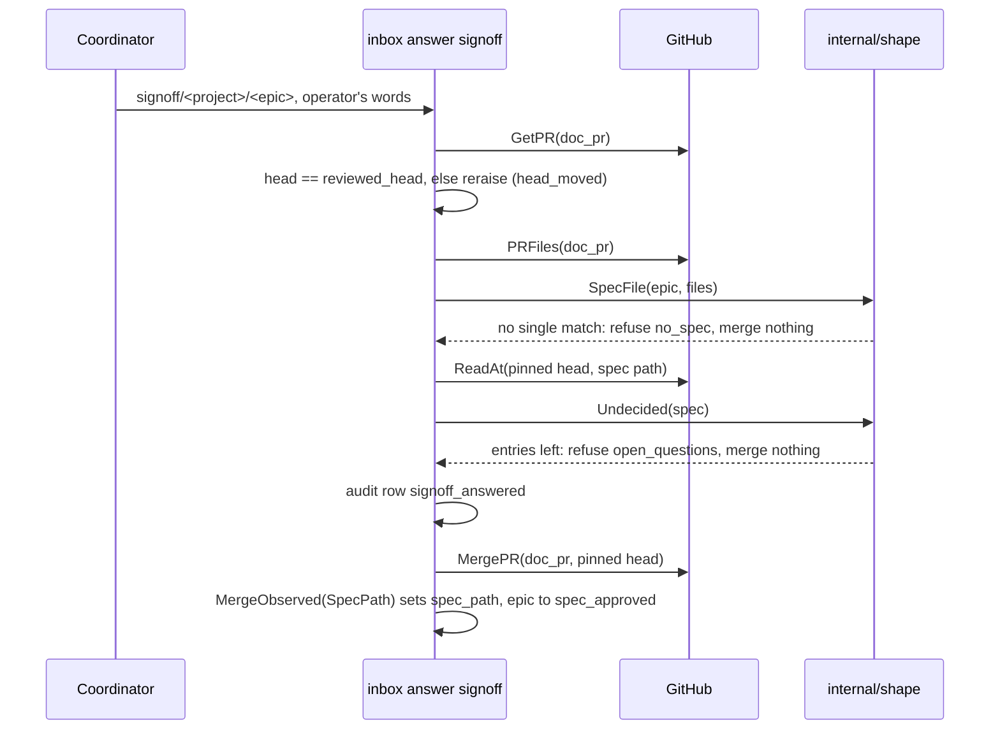
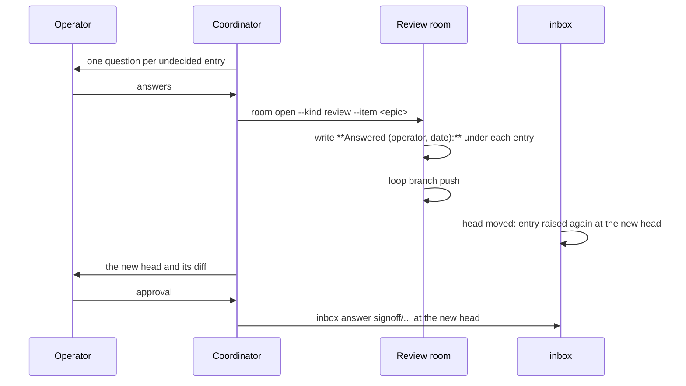
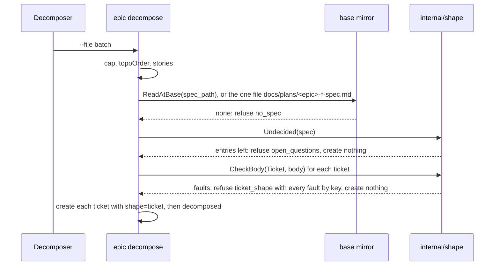
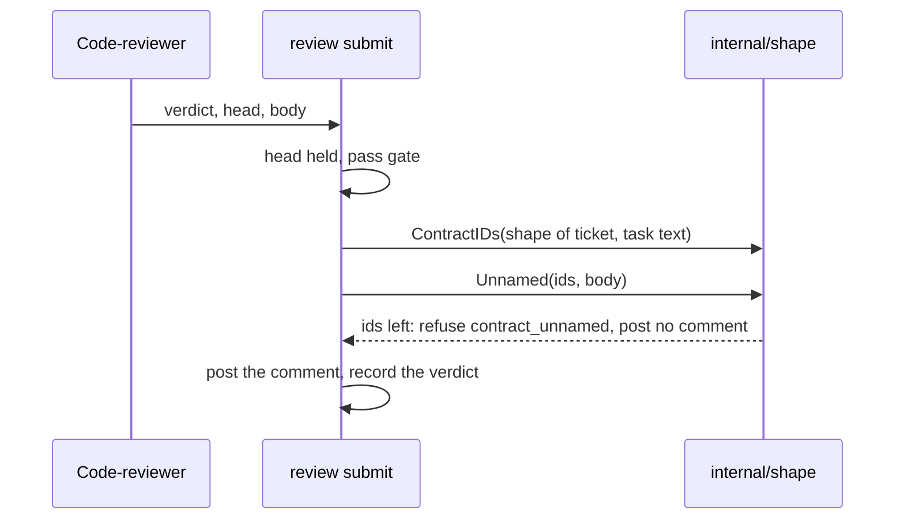

# Document and ticket-shape gates: technical spec

## Source

- **Epic:** factorio-wnl
- **Source:** `docs/adr/0002-document-and-ticket-gates.md`, the one ADR whose `**Ticket:**` line
  names factorio-wnl. It is on the base branch at `70c9681`.
- **Stories covered:** none. This is an architecture epic, and no story asks for it.

The ADR does not number its criteria, so this spec labels them. The contracts below cite these
labels.

| Label | ADR text |
| --- | --- |
| AC-1 | `loop gates --docs` passes |
| AC-2 | `grep -c '^\*\*Ticket:\*\* factorio-wnl$' docs/adr/0002-document-and-ticket-gates.md` prints `1` |
| AC-3 | `ls docs/adr \| grep -c '^0002-'` prints `1` |
| AC-4 | The ADR's decision table holds 6 gap rows |
| AC-5 | `grep -rn 'design/manifest.json\|@scope/' internal pack` prints nothing |
| AC-6 | `loop schema \| grep -c '"name":"coverage"'` prints `0` |
| E-1 | A sign-off answer on a spec with an undecided open question merges nothing, and refuses with `open_questions` |
| E-2 | `epic decompose` refuses on a spec at the base with an undecided entry |
| E-3 | The server refuses a ticket body with no Change section, or with 401 words outside Contracts to prove. It accepts a PRD-less ticket with the same body |
| E-4 | `work shape` refuses a bug body with no Reproduction section, or with 401 words outside the Contract section and the test fence. It accepts a bug body with no Change section, and one whose Reproduction fence holds 500 words |
| E-5 | `loop gates --list --docs` names a `spec` gate |
| E-6 | `review submit` refuses a body that omits one contract id of the ticket, and a body on a shaped bug that omits `C-bug-1` |
| K-1 | Sign-off reads the spec at the pinned head, and refuses with `open_questions`. A PRD sign-off is unchanged |
| K-2 | `epic decompose` reads the spec at the base through `spec_path`, and checks each ticket body by G2 |
| K-3 | `work create --epic` and `epic decompose` run the ticket shape. `work shape` runs the bug shape. `work edit` runs the shape of the ticket. A refusal names the shape, each missing section and each count over its limit |
| K-4 | The epic gains a `spec_path` fact, set when the spec PR merges |
| K-5 | The section list of the `spec` gate lives in Go once, and a test holds it equal to the template |
| K-6 | The pack's coordinator, decomposer, reproducer and code-reviewer runbooks name the new rules |

AC-1 to AC-4 are true at `70c9681`, and this epic does not change the ADR. CI runs `loop gates`
on each pull request, so AC-1 holds after each merge. AC-5 and AC-6 hold at `70c9681` (measured:
both commands print the expected output), and no entry below adds a frame rule, a `@scope/` alias
or a `--coverage` flag. The code-reviewer checks both commands on each pull request of this epic.
None of these six has a contract of its own.

## Scope check

**Components:**

1. **The shape rules and the server writes that enforce them.** A new leaf package,
   `internal/shape`, holds every rule: the spec's sections, its open questions, the two ticket
   body shapes, their word budgets and the contract ids. The server calls it in five verbs:
   `inbox answer signoff/...` (`internal/inbox`), `epic decompose` and `work create`
   (`internal/pipeline`), and `work shape`, `work edit` and `review submit` (`internal/machine`).
   The reactor (`internal/github`) records the spec's path.
2. **The `spec` docs gate**, in `internal/gates`. Why not its own epic: the gate reads the spec's
   section list from `internal/shape`, and ADR 0002 decides both under one Ticket line. The gate
   alone refuses a placeholder spec, and the server alone refuses an unanswered one. Neither half
   is the whole of G4 and G1.

Each runbook change in `pack/` lands in the work entry whose behaviour it describes. A runbook that
names a rule before the server holds it tells an agent something false.

Entry 1 builds the package with no caller. Entries 2 to 7 each add one caller, and each changes
one component.

**Not in this spec:** the `citations` extensions of G3 and the frame rules of G6. ADR 0002 rejects
both, so no epic owns them. Per-project limits for the budget (Decisions).

## Decisions

- **The rules live in a new leaf package, `internal/shape`, and not in `internal/pipeline`.**
  ADR 0002 puts the body check in `internal/pipeline`. But `work shape`, `work edit` and
  `review submit` are in `internal/machine`, and `internal/pipeline` imports `internal/machine`
  (`internal/pipeline/decompose.go:13`). So `internal/machine` cannot call a check in
  `internal/pipeline`. We rejected a copy of the rules in each package, because two copies drift.
  `internal/shape` imports nothing of the loop, so `internal/gates`, `internal/inbox`,
  `internal/pipeline` and `internal/machine` all import it.
- **A ticket records the shape that was checked at its creation as a `shape` fact, and
  `work edit` reads that fact. `work edit` does not infer the shape from the `epic` or `bug`
  fact.** ADR 0002 says that `workEdit` "runs the shape that the ticket's `epic` or `bug` fact
  names". Two cases make that rule wrong:
  - The ticket that writes an architecture epic's ADR carries an `epic` fact
    (`internal/pipeline/adhoc.go:83`). It is PRD-less work that the coordinator creates, and G2
    exempts that work from the check.
  - 19 open or done tickets carry an `epic` fact, and none was checked when it was written
    (measured with `loop work list --kind ticket`, 2026-10-24). This run cannot read their bodies,
    because `loop work show` refuses it with `CAPABILITY_DENIED` (`item_not_held`). An edit that
    fixes one word in such a ticket would then fail for sections that its author never knew of.

  With the fact, a ticket gets the check at its edit exactly when it got the check at its
  creation.
- **Every refusal of this epic uses one new code, `SHAPE_REFUSED` (exit 3, not retryable). Each
  rule has its own `rule` value.** We rejected `USAGE`, because the turn skill tells an agent to
  read `--help` on `USAGE`, and the schema is not at fault. We rejected `STORY_UNKNOWN` and
  `TRANSITION_NOT_ALLOWED`, because each one names a different repair. We rejected one code for
  each rule, because the repair is the same for each: change the text, and send it again. The
  rules are `open_questions`, `no_spec`, `ticket_shape`, `bug_shape` and `contract_unnamed`.
- **An operator's answer reaches the spec through a review room on the spec PR, or through the
  operator's own comment on GitHub. The coordinator does not carry it as a comment.** ADR 0002
  assumed that the coordinator can carry an answer to the amender as a comment. Measured false:
  `pr reply` admits the callers `run` and `room` only (`loop schema`). Also, the reactor never
  moves an epic for a comment that the loop App wrote (`internal/github/pr.go:536-540`,
  `awaitsAnswer`). A review room makes each edit the operator asks for, and pushes it
  (`pack/runbooks/review-room.md`, section 2). That push moves the head, so the sign-off entry is
  raised again at the new head (`internal/inbox/signoff.go`, `reraise`). An operator's own comment
  moves the epic to `spec_amending`, and the amender writes the answer. We rejected a new inbox
  path that writes into the spec. The server would then author a commit in a document, and no
  stage reviews a server's commit.
- **Sign-off reads the spec at the pinned head through the GitHub contents API, and not through
  the mirror.** A person can push the spec branch on GitHub. The mirror then lacks that head
  until a fetch. One `GET /repos/{repo}/contents/{path}?ref=<sha>` reads exactly the head that the
  operator approves. The server already reads that endpoint (`internal/github/merge_api.go:215`).
- **The spec's path comes from the PR's changed files: the one file that matches
  `docs/plans/<epic id>-*-spec.md` and is not removed.** We rejected the PR title and the branch
  name, because neither names a path. We rejected a path that the spec-author declares at
  `pr open`, because the amender can rename the file after that. Zero files or two files refuse
  the sign-off with `no_spec`.
- **`epic decompose` reads the spec through `spec_path`. When the fact is empty, it reads the one
  base file that matches `docs/plans/<epic id>-*-spec.md`.** An epic whose spec merged before
  this epic shipped has no `spec_path`. 4 epics are in `spec_signoff` today (measured with
  `loop work list --kind epic`). Any of them can merge before entry 3 lands. We rejected a
  refusal for an empty fact, because it would stop each such epic at `decomposing` with no repair
  but a hand edit of the record.
- **An open question is decided when its list entry holds a bold run that starts with
  `**Answered` or `**Deferred`.** This is the ADR's rule, made exact for a parser:
  - An entry is a top-level list item under `## Open questions`, with each line under it up to
    the next top-level item or heading. A nested item belongs to its entry.
  - A section that holds no list item, such as "None.", holds no entry. Both specs on the base
    write "None." (measured).
  - Text inside a fenced block is not read.

  We rejected a match on the word "answered" in plain text, because a question can say "this was
  not answered in the PRD".
- **A section of a ticket body is a `## ` heading. Each shape checks that each required section
  is present, and does not check their order.** The two runbooks list the sections in an order.
  But the server's job is to refuse a missing section, and a reviewer reads a body in any order.
  We rejected a check of the order, because it refuses a body that holds every fact. A heading
  matches when its text, trimmed, equals the section's name, ignoring case. Other headings are
  allowed.
- **Words are counted with `strings.Fields` over the text of a section. Heading lines do not
  count.** The body total counts every line outside the sections that the shape leaves out,
  with the text before the first heading included. We rejected a count of characters, because
  ADR 0002 sets every limit in words.
- **A contract of a ticket is one top-level list item under `## Contracts to prove`. Its ids are
  the tokens that match `\bC[0-9]+\b` in that section.** A ticket under an epic must name at least
  one id. A shaped bug's ids come from its `## Contract C-bug-<n>` headings. The decomposer
  writes one item for each contract, with id and title (`pack/runbooks/decomposer.md`, section 3).
  We rejected a count of ids as the count of contracts. An item that names one contract in two
  parts would then count twice.
- **The limits are constants in `internal/shape`. `.loop/config.yaml` cannot change them.** ADR
  0002 leaves this to the spec. We rejected a config key, because no project asks for one,
  and a limit that the project's own author can raise in the same pull request refuses nothing.
  A project that needs other limits brings a new ADR.
- **The `spec` gate reads every `docs/plans/*-spec.md`, and not only the changed ones.** The
  `adr` gate reads every ADR in the same way (`internal/gates/adr.go`, `ADR`). The two specs on
  the base pass every rule below (measured: each holds the 14 headings in order, and no line that
  the template marks). So the first run of the gate refuses no file on main.
- **The gate refuses a template line by an exact match of the trimmed line against a list that a
  test derives from the template.** The list holds the instruction block's first line, each line
  outside a code fence that holds a `<...>` placeholder, and the example markers `**Good**`,
  `> **Good**`, `> **Bad, and why**` and each `> **Bad.**` line. We rejected tickertown's 200-byte
  floor, as ADR 0002 does. We rejected a search for any `<...>` token, because a spec writes
  `<epic id>` in prose about paths.

## Assumptions

- The decomposer writes each ticket section as a `## ` heading after entry 5 updates its
  runbook. The runbook today names each section in bold, and does not name a heading level
  (`pack/runbooks/decomposer.md:58-67`). This is wrong if the first batch after entry 5 is refused
  with `ticket_shape` for sections that its bodies hold in bold.
- 400 words holds a decomposer ticket that names its contracts and does not copy them. Tickertown
  set the limit after tickets of 1385, 2552 and 1662 words (ADR 0002, G2). This is wrong if more
  than one batch in five is refused for the body total.
- A spec PR changes exactly one file that matches `docs/plans/<epic id>-*-spec.md`. The
  spec-author changes one document (`pack/runbooks/spec-author.md`, section 5). This is wrong if a
  sign-off is refused with `no_spec` on a PR that a run opened.
- The GitHub contents API serves a file at the head sha of an open PR whose branch is in the
  project's repository. The reactor already ignores PRs from a fork (`internal/github/reactor.go`,
  `fromRepo`). This is wrong if the read answers 404 at a head that `GetPR` names.
- A review room can push to the spec branch of an epic in `spec_signoff`. `branch push` fences
  only a run's epoch (`internal/github/verbs.go:57-72`, `fenced`), and a room holds no run. This is
  wrong if `loop branch push` from a review room on a spec PR is refused.

## Approach

**`internal/shape`** is a pure package. It reads Markdown text and returns findings. It does no
I/O, and it imports nothing of the loop. It has four parts:

1. A section reader. It splits a document at its `## ` headings, and skips the lines inside fenced
   blocks. Each section keeps its heading, its first line number and its lines.
2. The spec rules. `SpecSections` lists the 14 headings of the template in order. `CheckSpec`
   returns the gate's findings. `Undecided` returns each open question that holds no decision.
   `SpecFile` picks the spec's path from a list of changed files.
3. The body rules. Two shapes, `Ticket` and `Bug`, each with its required sections, its left-out
   parts and its limits. `CheckBody` returns each fault: a missing section, or a count over its
   limit. `Fault.String` is the text that a refusal's hint holds.
4. The contract ids. `ContractIDs` reads them from a body by its shape. `Unnamed` returns the ids
   that a review body does not hold as whole tokens.

**The server** calls the package at five writes. Each refusal is `SHAPE_REFUSED`, and each one
writes nothing. The check runs before the first write of the verb.

- `inbox answer signoff/...` on an epic in `spec_signoff`: after the head check, and before the
  audit row and the merge. It lists the PR's files, picks the spec, reads it at the pinned head,
  and refuses `open_questions` with the line and the first words of each undecided entry. The
  entry stays in the inbox. A PRD sign-off skips this step.
- `epic decompose`: after `topoOrder`, before the status switch. It reads the spec at the base,
  and refuses `open_questions`. Then it checks each ticket body by the `Ticket` shape, and
  refuses `ticket_shape` with every fault of every ticket, by key.
- `work create --epic` on an epic with a PRD: the `Ticket` shape, then the `shape` fact
  `ticket`. A ticket under an architecture epic, a PRD-less ticket and a bug get no check and no
  fact. Those are the three branches of `workCreate` that set a `request` fact and no `stories`
  fact (`internal/pipeline/adhoc.go`).
- `work shape`: the `Bug` shape, before `shapedTicket` creates the ticket. Then the ticket's
  `shape` fact is `bug`.
- `work edit` with `--body`: the shape that the ticket's `shape` fact names, in a `Before` hook.
  An item with no `shape` fact gets no check.
- `review submit` on a ticket with a `shape` fact: in the `Before` hook, after the head check and
  the pass gate, and before the comment posts. It reads the ticket's task text (`TaskText`), and
  refuses `contract_unnamed` with each id that the review body omits. It runs for a pass and for
  a reject. An epic's review skips it.

**The `spec_path` fact** is set by the `doc_merged` row from `spec_signoff` to `spec_approved`,
from a new `spec_path` parameter. `MergeEvent` gains a `SpecPath` field. The sign-off fills it from
the file it already picked. The reactor fills it from `PRFiles` when the merged PR is an epic's
spec PR. It leaves it empty when no single file matches. `loop work show` prints every fact, so it
prints `spec_path` with no change.

**The `spec` gate** is one more entry in `gates.All` with `Docs: true`, after `prd`. It globs
`docs/plans/*-spec.md`, and returns `shape.CheckSpec` findings as `gates.Finding`.

## Domain model

```
internal/shape (new)

Section             one "## " heading of a document and the lines under it
  invariant: no line of a fenced block starts a section.

Question            one top-level list entry under "## Open questions"
  Line      int      the entry's first line in the document
  Text      string   the entry's first line, trimmed to 80 characters for a hint
  Decided   bool
  invariant: Decided is true exactly when the entry, nested lines included, holds a bold run
             that starts "**Answered" or "**Deferred".

Shape               the rules of one kind of ticket body: Ticket or Bug
  Name      string            "ticket" or "bug": the value of the shape fact
  Required  []Need            each section that must be present
  Limits    []Limit           each word limit
  invariant: Ticket and Bug are the only values. Nothing outside the package constructs one.

Fault               one reason a body fails its shape
  Kind      FaultKind         missing | over | no_contract
  Section   string            "" for the body total
  Count     int               words, or contracts, found
  Limit     int
  invariant: a body with no fault passes its shape. CheckBody returns every fault, never only
             the first.
```

The two shapes, as ADR 0002 sets them:

| | Ticket | Bug |
| --- | --- | --- |
| Required sections | Source, Change, Contracts to prove, Files, Done means, Out of scope | one or more `Contract C-bug-<n>`, Source, Reproduction, What was seen, Priority, Files, Done means, Out of scope |
| Left out of the body total | Contracts to prove | each Contract section, and each fenced block inside Reproduction |
| Body total | 400 | 400 |
| Change | 150 | none |
| Done means | 60 | 60 |
| Out of scope | 60 | 60 |
| Contracts | at most 8 items, 80 words each, at least one id | 80 words for each Contract section |

`Stop conditions` is optional for a ticket, and it counts in the body total.

## Interfaces

```go
package shape

// SpecSections are the template's "## " headings, in order.
var SpecSections = []string{"Source", "Scope check", "Decisions", "Assumptions", "Approach",
	"Domain model", "Interfaces", "Data", "Flows", "Work", "Out of scope", "Contracts",
	"Observable behaviour", "Open questions"}

// TemplateLines are the trimmed lines of the spec template that no spec may keep.
var TemplateLines []string

// SpecFinding is one fault of a spec file. Rule is section, empty, template or name.
type SpecFinding struct {
	Line    int
	Rule    string
	Message string
}

func CheckSpec(path, text string) []SpecFinding
func Undecided(spec string) []Question

// SpecFile returns the one path of files that is epic's spec, or "" with the
// count of matches when there is not exactly one.
func SpecFile(epic string, files []string) (path string, matches int)

var Ticket, Bug Shape

// ByName returns the shape whose Name is name. ok is false for any other name.
func ByName(name string) (s Shape, ok bool)

func CheckBody(s Shape, body string) []Fault
func (f Fault) String() string

// ContractIDs returns each contract id of body, in order, once each.
func ContractIDs(s Shape, body string) []string

// Unnamed returns each id of ids that review does not hold as a whole token.
func Unnamed(ids []string, review string) []string
```

```go
// internal/cli/codes.go
CodeShapeRefused = "SHAPE_REFUSED" // ExitRefused, not retryable:
                                   // "the text does not hold the shape that the rule names"

// internal/machine/rows.go
FactSpecPath = "spec_path" // the spec's path in the repository, set when the spec merges
FactShape    = "shape"     // the body shape a ticket was checked against: ticket or bug

// internal/machine/seams.go
type MergeEvent struct {
	Project, Item, Base, Into, SHA string
	SpecPath string // the merged spec's path; "" for a PRD, a ticket, or an unknown path
}

// internal/inbox/signoff.go: DocGitHub gains two reads. *github.Service is one.
PRFiles(ctx context.Context, p config.Project, n int) ([]github.File, error)
ReadAt(ctx context.Context, p config.Project, sha, path string) ([]byte, error)

// internal/github: the new read behind DocGitHub.ReadAt. A path that the
// commit lacks matches fs.ErrNotExist.
func (s *Service) ReadAt(ctx context.Context, p config.Project, sha, path string) ([]byte, error)

// internal/gates/spec.go
func Spec(ctx context.Context, r *Repo) ([]Finding, error)
```

Each refusal's hint, by rule:

| Rule | Hint names |
| --- | --- |
| `open_questions` | the spec's path, and the line and first words of each undecided entry |
| `no_spec` | the PR, and the count of matching files, or the epic and the base path pattern |
| `ticket_shape` | for each ticket key (decompose) or the item: each fault, as `Fault.String` |
| `bug_shape` | each fault, as `Fault.String` |
| `contract_unnamed` | each id the review body omits |

`Fault.String` reads, for example, `missing section: Change`, `Change: 151 words, limit 150`,
`body: 401 words outside Contracts to prove, limit 400` or `Contracts to prove: 9 contracts,
limit 8`.

## Data

```
epic facts (bead metadata "loop." + name)
  + spec_path   string, set by doc_merged from spec_signoff; empty before

ticket facts
  + shape       "ticket" | "bug", set at create by the verb that checked the body; absent otherwise
```

**Existing records:** no record changes. Epics whose spec merged before entry 3 keep an empty
`spec_path`, and `epic decompose` falls back to the base path pattern. Tickets created before
entries 5 and 6 carry no `shape`, so `work edit` and `review submit` do not check them.

## Flows

Sign-off of a spec:



An answer to a refused sign-off:



Decompose:



A body write outside decompose:

```mermaid
sequenceDiagram
    participant A as Caller
    participant V as work create / work shape / work edit
    participant S as internal/shape
    A->>V: body
    V->>V: pick the shape: create --epic with PRD: Ticket; shape: Bug; edit: the shape fact; else none
    V->>S: CheckBody(shape, body)
    S-->>V: faults: refuse ticket_shape or bug_shape, write nothing
    V->>V: write the item, and set shape on create
```

Review of a ticket:



## Work

1. **The shape package and the refusal code.** Add `internal/shape` with every function and type
   under Interfaces, and `CodeShapeRefused` in the refusal table. Add `SHAPE_REFUSED` to the code
   list of `pack/skills/loop-sdlc-turn/SKILL.md`, section 2: change the text that the rule
   names, and send it again.
   - Files: `internal/shape/**`, `internal/cli/codes.go`, `pack/skills/loop-sdlc-turn/SKILL.md`
   - Needs: nothing
   - Proves: C1, C6, C7, C8, C9, C14
   - Done when: the package's table tests pass, and `loop schema` lists `SHAPE_REFUSED` with exit 3.
2. **The `spec` gate.** Add `internal/gates/spec.go` and its entry in `gates.All`. Add the test
   that derives the headings and the template lines from `pack/skills/loop-sdlc-documents/spec.md`
   and compares them with `shape.SpecSections` and `shape.TemplateLines`. In the same template,
   show the answered and deferred forms under `## Open questions`. Name the `spec` gate in
   `pack/skills/loop-sdlc-documents/SKILL.md`, section 2.
   - Files: `internal/gates/spec.go`, `internal/gates/spec_test.go`, `internal/gates/gates.go`,
     `internal/gates/testdata/**`, `internal/shape/**` (the two lists only),
     `pack/skills/loop-sdlc-documents/**`
   - Needs: 1
   - Proves: C10, C11
   - Done when: `loop gates --list --docs` names `spec`, and `loop gates --docs` passes on the
     base.
3. **The `spec_path` and `shape` facts.** Add both fact names. Add `SpecPath` to `MergeEvent`, and
   the `spec_path` parameter to the `doc_merged` row from `spec_signoff`. The reactor fills it from
   `PRFiles` and `shape.SpecFile` for an epic's spec PR.
   - Files: `internal/machine/rows.go`, `internal/machine/epic.go`, `internal/machine/seams.go`,
     `internal/github/reactor.go` and its tests
   - Needs: 1
   - Proves: C2
   - Done when: a reactor test merges a spec PR, and `loop work show` on the epic prints
     `spec_path`.
4. **Sign-off refuses an unanswered spec.** Add `ReadAt` to `*github.Service`. In
   `internal/inbox/signoff.go`, add the two reads to `DocGitHub`, and the spec check before the
   audit row. Pass `SpecPath` to `MergeObserved`. In
   `pack/runbooks/coordinator.md`, section 5, say how an answer reaches the spec: a review room
   writes it under the entry at the operator's word, or the operator comments on the PR. Also say
   what `open_questions` on a sign-off means.
   - Files: `internal/inbox/signoff.go`, `internal/inbox/inbox_test.go`, `internal/github/` (one
     new read and its test), `pack/runbooks/coordinator.md`
   - Needs: 1, 3
   - Proves: C3, C4
   - Done when: a test with a fake `DocGitHub` shows that `MergePR` is never called for a spec
     with an undecided entry, and that it is called for a PRD with the same section.
5. **Decompose refuses an unanswered spec and a misshaped ticket.** In
   `internal/pipeline/decompose.go`, read the spec, refuse `open_questions` and `no_spec`, and
   check each body. Set `shape=ticket` on each ticket. In `pack/runbooks/decomposer.md`, name each
   section as a `## ` heading and each limit. Say that the server refuses an undecided entry, and
   that the decomposer escalates it. Add a test that holds the runbook's section names equal to
   `shape.Ticket`.
   - Files: `internal/pipeline/decompose.go`, `internal/pipeline/*_test.go`,
     `pack/runbooks/decomposer.md`
   - Needs: 1, 3
   - Proves: C5, C12 (the decompose row), C15 (the decomposer half)
   - Done when: a refused batch leaves the epic in `decomposing` with no ticket created.
6. **`work create`, `work shape` and `work edit` check the body.** Add the `Ticket` check to
   `workCreate` on an epic with a PRD, the `Bug` check to `workShape`, and the check by the `shape`
   fact to `workEdit`. Set the `shape` fact on each created ticket. In
   `pack/runbooks/reproducer.md`, section 4, name each section as a `## ` heading and each limit.
   Add a test that holds the runbook's section names equal to `shape.Bug`.
   - Files: `internal/pipeline/adhoc.go`, `internal/machine/verbs.go`, their tests,
     `pack/runbooks/reproducer.md`
   - Needs: 1, 3
   - Proves: C12 (every row but decompose), C15 (the reproducer half)
   - Done when: each row of the C12 table has a test.
7. **`review submit` refuses a review that skips a contract.** In `reviewSubmit`, add the
   contract-id check to the `Before` hook, before the comment posts. In
   `pack/runbooks/code-reviewer.md`, section 6, say that the server refuses a comment that does
   not name each contract id.
   - Files: `internal/machine/verbs.go`, `internal/machine/*_test.go`,
     `pack/runbooks/code-reviewer.md`
   - Needs: 1, 3
   - Proves: C13
   - Done when: a refused verdict posts no comment and leaves the ticket in `in_review`.

Entries 4 to 7 do not need each other, and each can land in any order after 3.

## Out of scope

- The `citations` extensions: `--coverage`, `--since`, file arguments, the `@scope/` alias and the
  cross-PRD rule. ADR 0002 rejects each one (G3). No epic owns them.
- The frame rules of tickertown's `prd` gate. ADR 0002 names them tickertown policy (G6). A
  project that needs them adds them to its own `lint` command.
- A refusal of a PRD sign-off for its open questions. ADR 0002 rejects it, because the spec-author
  settles or escalates each PRD question.
- STE, unslop, bold-markup and product rules on a ticket body. ADR 0002 rejects them (G2). The
  `prose` gate keeps reading the documents.
- A JSON review checklist, and checks for each Done means line and each stop condition. ADR 0002
  rejects them (G5).
- Per-project limits for the budget. Never, under ADR 0002 (Decisions). A new ADR can change this.
- A check of the bodies of the tickets that exist today. Never: they carry no `shape` fact
  (Decisions).

## Contracts

**C1. Behaviour: an entry is decided only by a bold `**Answered` or `**Deferred` run.** Proves
E-1, E-2. `Undecided` returns exactly the top-level list entries under `## Open questions` whose
text, nested lines included, holds no bold run that starts `**Answered` or `**Deferred`. A section
that holds "None.", an empty section and a spec with no such section return none. A list item
inside a fenced block is no entry. The plain words "answered" or "deferred" decide nothing.
*A table test, with one row for each case.*

**C2. Behaviour: the spec's path is recorded when the spec merges.** Proves K-4. When a spec PR
that changes `docs/plans/<epic>-x-spec.md` merges, through a sign-off or on GitHub, the epic in
`spec_approved` holds `spec_path` = that path. A PRD merge sets no `spec_path`. A spec PR with two
matching files sets none, and the epic still moves to `spec_approved`.
*A machine test for the row, and a reactor test with a fake GitHub for a GitHub merge.*

**C3. Refusal: a spec sign-off with an undecided entry merges nothing.** Proves E-1, K-1. The
answer refuses with `SHAPE_REFUSED` and rule `open_questions`. The hint names each undecided
entry's line. `MergePR` is never called, no `signoff_answered` audit row is written, and the entry
stays in the inbox. A PR with no single spec file refuses with rule `no_spec`, in the same way.
With every entry decided, the sign-off merges, as it does today.
*An example test with a fake `DocGitHub` that records each call.*

**C4. Behaviour: a PRD sign-off does not read its open questions.** Proves K-1. A PRD sign-off
whose PRD holds an undecided list entry under `## Open questions` merges at the pinned head.
*An example test with the same fake, and the same section text as C3.*

**C5. Refusal: decompose refuses an unanswered spec, and creates nothing.** Proves E-2, K-2. On
an epic in `decomposing` whose spec at the base holds an undecided entry, `epic decompose` refuses
with `SHAPE_REFUSED` and rule `open_questions`. No ticket is created, and the epic stays in
`decomposing`. The spec is read at `spec_path`. When the fact is empty, it is read at the one base
file that matches `docs/plans/<epic>-*-spec.md`. Zero or two such files refuse with rule
`no_spec`.
*Example tests: one with `spec_path`, one with the fallback, one with two matching files.*

**C6. Refusal: a ticket body is refused for each missing section, all at once.** Proves E-3, K-3.
`CheckBody(Ticket, body)` returns one `missing` fault for each absent section of Source, Change,
Contracts to prove, Files, Done means and Out of scope. It returns a `no_contract` fault when
Contracts to prove holds no `C<n>` id. A body that lacks two sections returns both faults.
*A table test, with one row for each section.*

**C7. Boundary: the ticket budget.** Proves E-3. With every section present, each limit passes at
its value and fails at one more: the body outside Contracts to prove at 400 and 401 words, Change
at 150 and 151, Done means at 60 and 61, Out of scope at 60 and 61, 8 and 9 contract items, and a
contract item at 80 and 81 words. Words inside Contracts to prove never count toward the body
total.
*A table test at each edge.*

**C8. Refusal: a bug body is refused for each missing section.** Proves E-4, K-3.
`CheckBody(Bug, body)` returns a `missing` fault for each absent section of Source, Reproduction,
What was seen, Priority, Files, Done means and Out of scope, and one when no
`## Contract C-bug-<n>` heading is present. A bug body with no Change section and no Contracts to
prove section returns no fault for either.
*A table test.*

**C9. Boundary: the bug budget leaves the test fence out.** Proves E-4. With every section
present, the body outside each Contract section and outside each fenced block in Reproduction
passes at 400 words and fails at 401. A Reproduction fence of 500 words, with the rest at 400,
passes. The words around the fence in Reproduction count. A fenced block in another section
counts. A Contract section passes at 80 words and fails at 81.
*A table test at each edge.*

**C10. Refusal: the `spec` gate refuses a misshaped spec.** Proves E-5, K-5. `loop gates --list
--docs` names `spec`. For each `docs/plans/*-spec.md`, the gate reports `section` when one of the
14 headings is missing, repeated or out of order. It reports `empty` for a section with no
non-blank line, `template` for a line in `TemplateLines`, and `name` when the filename does not
start with the `**Epic:**` id and a dash. A copy of the template fails. Each spec on the base
passes.
*Example tests over files in `internal/gates/testdata`, and a gate run over the repository.*

**C11. Equivalence: the gate's lists match the template.** Proves K-5. The `## ` headings of
`pack/skills/loop-sdlc-documents/spec.md` equal `shape.SpecSections`, in order. The trimmed
marker and placeholder lines of that file equal `shape.TemplateLines` as a set.
*A test that reads the template and compares both lists. An edit of the template alone fails it.*

**C12. Behaviour: each write checks the shape that its source names, and no other.** Proves E-3,
E-4, K-3.

| Write | Shape checked | `shape` fact set |
| --- | --- | --- |
| `epic decompose`, each ticket | Ticket | `ticket` |
| `work create --epic` on an epic with a PRD | Ticket | `ticket` |
| `work create --epic` on an architecture epic | none | none |
| `work create` with `--request` and no epic | none | none |
| `work create --kind bug` | none | none |
| `work shape` | Bug | `bug` on the created ticket |
| `work edit --body` on an item with `shape` | that shape | unchanged |
| `work edit --body` on an item with no `shape` | none | none |
| `work edit --title` with no body | none | unchanged |

A refused write returns `SHAPE_REFUSED` with rule `ticket_shape` or `bug_shape`, creates no item,
records no fact and leaves the status as it was. A refused `work shape` leaves the bug in its
state with no ticket. A refused batch names every fault of every ticket, by key. The same body
that `work create --epic` refuses passes as a PRD-less ticket.
*An example test for each row, and one for each refusal.*

**C13. Refusal: a ticket review must name each contract id.** Proves E-6, K-3. On a ticket with
`shape=ticket`, `review submit` refuses a pass and a reject whose body omits one id under
`## Contracts to prove`. It refuses with `SHAPE_REFUSED` and rule `contract_unnamed`, and the hint
names each missing id. On a ticket with `shape=bug`, it refuses a body that omits `C-bug-1` when
the body holds `## Contract C-bug-1`. `C1` in the review does not name `C10`. A refused verdict
posts no comment and records nothing. A ticket with no `shape` fact, and a review of an epic, are
not checked.
*Example tests with a recording `ReviewCommenter`.*

**C14. Behaviour: `SHAPE_REFUSED` is one code with one exit.** Proves K-3. `loop schema` lists
`SHAPE_REFUSED` with exit 3, not retryable. The refusal tests of C3, C5, C12 and C13 each
assert this code, so each entry proves its own refusals.
*A test over the refusal table.*

**C15. Equivalence: the runbooks name the server's shapes.** Proves K-6. The section names that
`pack/runbooks/decomposer.md` lists as ticket body sections equal the required and optional
sections of `shape.Ticket`. The names that `pack/runbooks/reproducer.md` lists equal those of
`shape.Bug`. Each limit in Go appears as a number in the runbook that names its shape.
*A test that reads both runbooks. An edit of one side alone fails it.*

## Observable behaviour

None, because this epic draws no screen. Its effects are refusals that a run or the coordinator
reads in a CLI envelope.

## Open questions

None.
