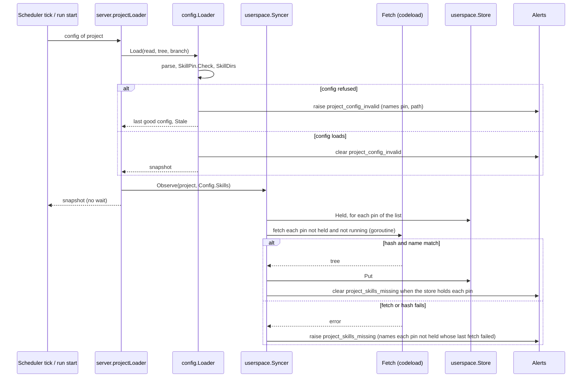
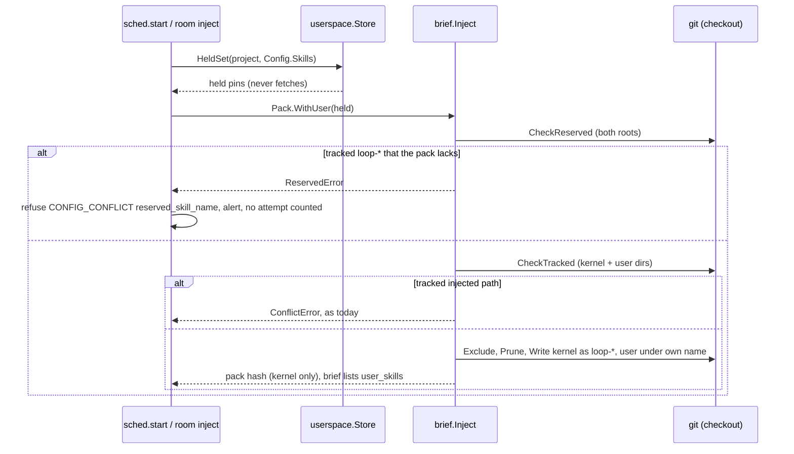
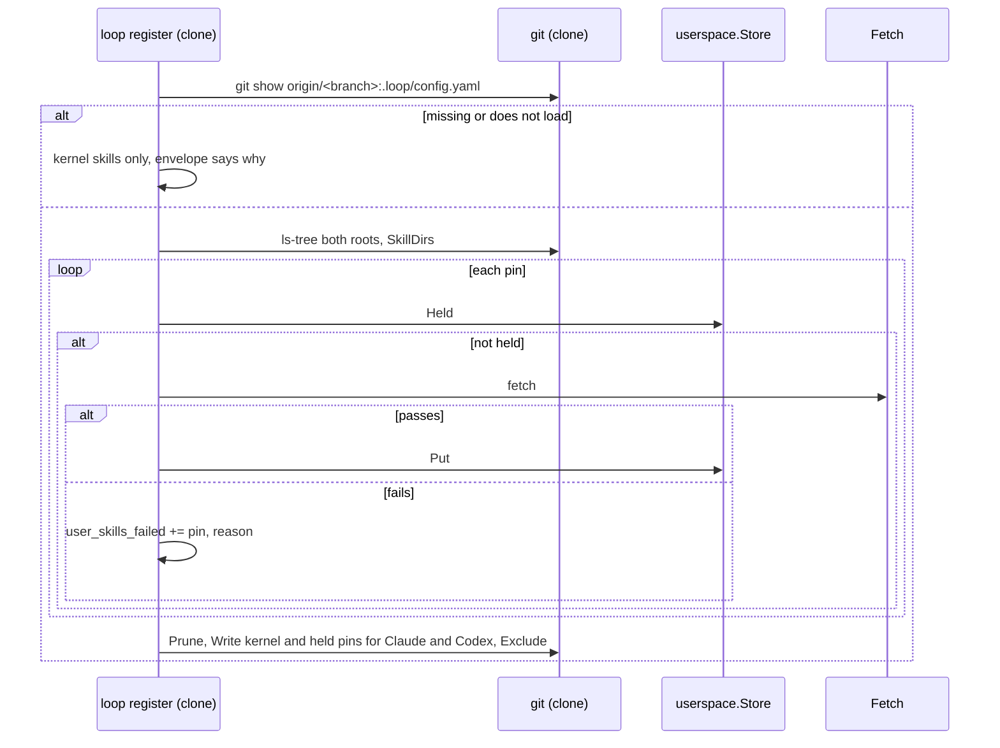
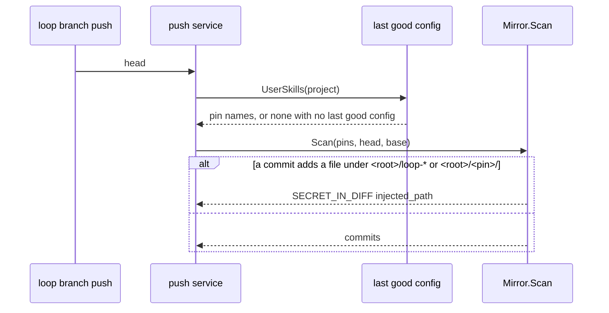

# Kernel and userspace skills: technical spec

## Source

- **Epic:** factorio-yzrt
- **Source:** `docs/prd/kernel-and-userspace-skills.md`, merged at `e8922d4`. Its architecture
  half is `docs/adr/0013-userspace-skill-pins.md` (ticket factorio-6bba, merged in #236), which
  replaces decisions 2 and 7 of `docs/adr/0007-shared-skill-pack.md` for a userspace pin. Where
  this spec and ADR 0007 differ on a userspace pin, ADR 0013 wins.
- **Stories covered:** US-01, US-02, US-03.

The contracts below cite the PRD's criteria A1 to A12, and the checks that ADR 0013 gives this
epic under its Acceptance criteria. The ADR does not number those, so this spec does.

| Label | ADR 0013 check |
| --- | --- |
| U-1 | A project config with a pin named `loop-x` does not load, and the last good config stays in force |
| U-2 | A project config with a pin `neon` does not load when the default branch tracks `.claude/skills/neon/SKILL.md`, and the alert names the pin and the path |
| U-3 | The push scan of a project that pins `neon` refuses a push that adds `.claude/skills/neon/SKILL.md`, and passes a push that adds `.claude/skills/neon-postgres/SKILL.md` |
| U-4 | A run of a project that pins `neon` holds a skill named `neon` whose bytes match the pin's hash, its `name:` line too |
| U-5 | A pin that fails its hash raises one alert for its project. Runs of that project and of a second project both start. The alert closes after the pin passes |
| U-6 | A run start makes no fetch |
| U-7 | `loop register` writes the project's pins into its clone, and no other project's pins |

## Scope check

**Components:**

1. **The skill pack and its writer.** `pack/`, `internal/pack` and `internal/brief`: what a
   checkout receives, which names it reserves, and the texts of `loop-fault` and the `loop-init`
   policy templates. The callers that build a checkout's pack, `internal/sched`, `internal/room`
   and `cmd/loop/register.go`, pass it one more input.
2. **A project's userspace pins.** The `skills:` list in `internal/config`, a new package
   `internal/userspace` that fetches, holds and reports each pin, and the three readers of the
   list: the push scan (`internal/github`), the config loader in `internal/server`, and
   `loop project show`. Why not its own epic: a pin that reaches no checkout proves no story. US-03
   asks that a project's runs hold its pins, and only the pack writer puts a file in a checkout.

Entries 1, 2, 5, 7 and 9 change component 2. Entries 3, 4 and 10 change component 1. Entry 6
joins the two: it hands the held pins of component 2 to the writer of component 1, and it changes
only the callers in `internal/sched` and `internal/room` and the writer's input type. Entry 8
changes `loop register`, which calls both.

**Not in this spec:** the conditional load of `loop-impeccable` (factorio-791i). Every rename of a
kernel skill (factorio-vlle).

## Decisions

- **One pin type for both spaces.** We chose a new `config.SkillPin`, with `pack.ThirdParty` as a
  type alias of it and one `Check` method, over a second type for userspace pins. The PRD asks for
  "the fields of a kernel pin today" and a hash check "as it checks a kernel pin today". One type
  makes the two the same by construction. `internal/config` holds it because `internal/pack`
  imports `internal/config` through `internal/brief`, and the config loader cannot import
  `internal/pack`.
- **`Check` now refuses a bad `repo`.** We chose to check `repo` as `owner/name` of GitHub's
  allowed characters, for both spaces, over leaving it unchecked as `ThirdParty.check` does today.
  The fetcher puts `repo` in a URL, and a userspace pin comes from a project's repository, not
  from the release. The four kernel pins pass the new check.
- **A pin and a committed directory with one name do not load.** This answers the PRD's open
  question. **Answered (ADR 0013 decision 1, operator's ADR, 2026-10-31):** the config load refuses
  a pin whose directory the default branch tracks under `.claude/skills/` or `.agents/skills/`. The
  alert `project_config_invalid` names the pin and the path, and the last good config stays in
  force. We rejected a refusal at run start alone, which refuses every run of the project.
- **The load reads the tree, not a file.** We chose a new `config.TreeReader`, which lists the
  entries that git tracks directly under one directory at the default branch, over a probe of
  `<dir>/SKILL.md` through `RefReader`. `CheckTracked` refuses any tracked file under an injected
  directory. A probe of one file would pass a config whose runs then all fail with
  `CONFIG_CONFLICT`.
- **A tracked `loop-*` directory that the pack lacks refuses the run with `CONFIG_CONFLICT`.** We
  chose the existing code with a new rule, `reserved_skill_name`, over a new refusal code. The code
  already means that the repository's tracked files clash with what the loop injects, and that the
  attempt does not count. Every runbook already branches on it. The check reads both skill roots,
  over the run's own harness root only, because one committed directory serves every harness of
  the project.
- **The writer clears each untracked `loop-*` directory that the pack lacks.** We chose to clear
  them, over keeping them as `Pack.Write` does today. The pack reserves the prefix, so nothing
  else owns such a directory. The coordinator's checkout and the operator's clone are
  reused, and they would keep `loop-neon` after entry 10. A directory outside the prefix is never
  cleared, because a project can keep an untracked skill of its own there.
- **A dropped userspace pin stays in a reused checkout.** We chose to leave its directory, over a
  record of the directories that the loop wrote. A stage run starts in a new checkout each time,
  so it never holds a dropped pin. A room checkout that reopens, and the operator's clone, keep it
  until a person deletes it. The writer cannot tell such a directory from a skill that the
  operator keeps there untracked.
- **The host keeps each fetched pin on disk by its hash.** We chose
  `<state_dir>/userspace-skills/<project>/<name>/<sha256>/` over the store database and over
  `versions/<v>/skills`. ADR 0013 decision 2 puts the pins outside `versions/<v>/`, so an upgrade
  keeps them. The writer reads an `fs.FS`, as it reads the kernel pins. The hash in the path makes
  a changed pin a new directory, so an old tree never serves under the new pin. We chose no
  cleanup of old directories, over a sweep, because each tree is at most 32 MiB and a pin changes
  only through a reviewed pull request. The operator can delete any directory of the store by
  hand, because the next config read fetches each pin that the store then lacks (C12).
- **The config read starts the fetch, in the background.** We chose a call from the server's
  project loader to `userspace.Syncer.Observe` after each load, over a native job on a timer and
  over a fetch inside `config.Loader.Load`. ADR 0013 decision 2 ties the fetch to the config read.
  A timer adds a second cadence. A fetch inside `Load` would make the caller wait for it, and a
  run start calls `Load`. `Observe` returns at once. At most one fetch runs for one pin of one
  project. A run start that reads the config through the loader can make `Observe` start a fetch
  in its own goroutine, and ADR 0013 decision 2 allows that fetch, because the config read starts
  it. The start makes no fetch call of its own, and never waits for a fetch.
- **The store decides what to fetch, not the syncer's memory.** We chose `Store.Held` as the one
  answer to "does the host hold this pin", over a state of each pin that the syncer keeps in
  memory. A run reads the store, so a memory state can disagree with what a run gets. A tree that
  goes missing or changes on disk would read as held in memory, and no fetch and no alert would
  follow until the server restarts. After a restart, a memory state would also fetch each pin
  again, even a pin that the store holds. ADR 0013 decision 2 defines a changed list by what the
  host holds. The syncer's memory keeps two facts for each pin only: whether a fetch runs, and how
  the last fetch that ended came out.
- **A project's failed pins raise one alert of a new kind.** We chose `project_skills_missing`,
  keyed by project, over `third_party_skills_missing`, which names no project (ADR 0013,
  Consequences). The alert names each pin of the list that the store does not hold and whose last
  ended fetch failed. A pin whose first fetch still runs raises nothing. We rejected an alert from
  the first read of a pin that the store lacks. Each new pin and each restart would then open an
  alert that closes a few seconds later, when the fetch passes.
- **The brief lists the userspace skills, and the pack hash covers the kernel only.** We chose a
  new `user_skills` list in the brief, with name, repo, commit and sha256, over adding the
  userspace trees to `pack_hash`. The hash names the release's pack, and two projects' runs of one
  release keep one hash. A run reads the list to see which pins it holds, as ADR 0013 Consequences
  expects.
- **The coordinator holds kernel skills only. A room holds its project's pins.** We chose this over
  giving the coordinator the pins of the project its checkout comes from. The coordinator serves
  every project, so one project's pin in its checkout breaks A7. A room works on one project, as a
  stage run does.
- **The push scan reads the pin names of the last good config.** We chose a `UserSkills` reader on
  the push service, over the config of the pushed branch, by ADR 0013 decision 1. A branch could
  otherwise drop a pin and add its directory in one push.
- **`loop register` reads the config at `origin/<default branch>` of the clone.** We chose that
  ref over the file in the worktree, because only the default branch holds a project's config
  (KTD20). Register fetches each pin the host does not hold into the same store as the server, and
  a failed pin does not fail the register (ADR 0013 decision 2).
- **`loop project show` lists the userspace skills.** We chose it over `loop overwatch sweep`. The
  PRD requirement names `loop project show`, and the sweep reports health, not what a project
  declares.
- **The Neon pins leave the kernel last.** We chose entry 10 after entries 6 and 8, over removing
  the pins with entry 1. A project that uses Neon must pin both skills before they leave the kernel
  (PRD scope check). Until entry 6 lands, a pin reaches no run.
- **A stop condition on entry 10 holds the Neon step, before its pull request opens.** We chose a
  `## Stop conditions` line in the ticket of entry 10 that guards `loop pr open`, over a line in
  `docs/operator-checklist.md` that the operator reads before the upgrade. The merge of entry 10
  is the gate in practice. Each push to `main` that passes CI becomes a release, and the
  coordinator runs `loop upgrade` itself when a newer release ends an open loop fault
  (`pack/runbooks/coordinator.md` § 9, `docs/operating.md` "Upgrade by hand"). A host can also
  upgrade each night by cron (`docs/operating.md` "Upgrade by cron"). No person reads the checklist
  before either upgrade. A project that uses Neon then loses both skills and raises no
  alert, because its config names no pin that the store lacks. We also rejected a decision item,
  because the decomposer creates tickets only, and `blocked_by` names keys of its own batch. A stop
  condition is a ticket section that exists today (`pack/runbooks/decomposer.md` § 3). The
  implementer stops before the act it guards and escalates (`pack/runbooks/implementer.md` § 5).
  The code-reviewer fails a fired stop condition unless a recorded answer of a person waives it.
  Which projects use Neon is a fact about other projects, level 5 by the triage rubric, so only
  the operator answers it. The run cannot read it either: the server admits `loop project show`
  from the coordinator's checkout only.

## Assumptions

- Every pin source is a public GitHub repository that `codeload.github.com` serves with no token.
  This is wrong if a project pins a private repository. Then the fetch fails, and the alert names
  the pin.
- Each stage run starts in a new checkout. This is wrong if `CreateCheckout` returns a path that an
  earlier run wrote. Then a dropped userspace pin can stay in a stage run's checkout.
- The upstream text of a userspace skill names its siblings by their upstream names, as `neon`
  names `neon-postgres` (ADR 0013, Context). This is wrong for a later pin that names its sibling
  by another name. The pin then works, and its text points at a name that no run holds.
- One fetch for each config read of a failing pin is cheap. The loader caches a read for 30
  seconds, so a failing pin costs about two fetches a minute. This is wrong if `codeload` limits
  the host's rate. The alert then stays open, and runs still start.
- To hash each pin's stored tree at each config read is cheap. The two Neon trees hold a few
  hundred KiB. This is wrong if a project pins a tree near the 32 MiB limit. Then `Observe` and
  each run start spend that hash, and the store needs a cheaper check, such as a size and time
  stamp beside the hash.
- No skill text in `pack/` names a path `../<name>/SKILL.md` with a name outside `loop-`. A grep
  of the base at `1c3ab21` finds none. This is wrong if the gate of entry 4 fails on the base.
  Entry 4 then rewrites that line.
- A host that runs a release before entry 1 refuses a `skills:` list as an unknown field. The
  project then keeps its last good config, and `project_config_invalid` names the field. This is
  wrong if the strict decode of `.loop/config.yaml` accepts an unknown field.

## Approach

**The pin.** `config.SkillPin` holds name, repo, commit, path and sha256. `Check` holds every
field rule that `ThirdParty.check` holds today, the `loop-` refusal among them, and adds the repo
rule. `ReadThirdParty` decodes into the alias and calls the same `Check`. `ProjectConfig` gains
`Skills []SkillPin` under the YAML key `skills`. `validate` checks each pin and refuses two pins
with one name. The error names the pin by its name, or by its index when the name is empty.

**The tracked-directory check.** `config.Loader` gains a `Tree` reader. After a parse, `Load`
lists `.claude/skills` and `.agents/skills` at the default branch, and refuses each pin whose name
is an entry there, as an `*InvalidError` that names the pin and the path. The existing fall back
then keeps the last good config and raises `project_config_invalid`. The server's `RefSource`
returns a `config.Refs` with both readers. The mirror lists a tree with `git ls-tree`, and
`LocalRefs` does the same in the project's clone.

**The reserved names in a checkout.** `brief.CheckReserved` lists the tracked files under both
skill roots, and returns a `*ReservedError` for each directory whose name starts with `loop-` and
that the pack lacks. `Inject` and `RefreshPack` call it before they write anything. The scheduler
and the room map the error to `CONFIG_CONFLICT` with rule `reserved_skill_name`, and raise
`AlertConfigConflict`, as they do for `*ConflictError`. `brief.Prune` then clears each untracked
`loop-*` directory that the pack lacks, under the harness root. `Inject`, `RefreshPack` and
`installSkills` call it.

**The store and the fetch.** `internal/userspace` holds the store, the syncer and the alert.
`Store.Held` reads one pin's directory, takes its `pack.TreeHash`, and checks that `SKILL.md` holds
the line `name: <name>`. A pin passes only when both hold, so a changed byte on disk reads as not
held. `Store.Put` writes a verified tree into a temporary directory beside the target and renames
it into place. The server and `loop register` can then write one pin at the same time, and neither
reads a half-written tree. The syncer takes a fetch function, which `cmd/loop/serve.go` builds from
`release.SkillFetcher`. `Observe` records the list, and calls `Store.Held` for each pin. For each
pin that the store does not hold and that no fetch runs for, it starts one goroutine that fetches,
puts and records the outcome. In memory, the syncer keeps only a running flag and the last ended
outcome of each pin: none, passed or failed. After each `Observe` and after each ended fetch, the
syncer settles the project's alert from the list that `Observe` last saw:

- When the store holds each pin of the list, it clears the alert.
- Otherwise, when some pin that the store does not hold has a last outcome of failed, it raises
  the alert with each such pin.
- Otherwise it leaves the alert as it is. A first fetch still runs, so its outcome decides.

A pin that leaves the list leaves the alert. A tree that goes missing or changes on disk reads as
not held at the next `Observe`, so the syncer fetches it again. When that fetch fails, the alert
names the pin. After a restart, each outcome is none. A pin that the store holds is not fetched,
and an alert from before the restart stays open until a fetch ends.

**A run's pack.** `brief.Pack` gains `User []UserSkill`, each one a pin and its verified tree.
`Pack.WithUser` returns a copy that holds them. `Write` writes each one under its own name, and
copies every byte, the `name:` line too. `packPaths` adds each user directory to the injected
directories, so `CheckTracked` and `Exclude` cover it. `Hash` reads the kernel part only. The
scheduler, at each stage start, and the room, at each injection, read the snapshot's
`Config.Skills`, take `Store.Held` for each pin, and pass the held ones to `WithUser`. The pack
leaves out a pin that the store lacks, and nothing on that path fetches. The brief's `user_skills` lists each
held pin. The coordinator's pack takes no user skill.

**The push scan.** `Mirror.Scan` takes the project's pin names. `injected` matches a path under
`<root>/<name>/` for each pin name and both roots, as an exact directory, with the two kernel
prefixes. `push.go` reads the names from the last good config through `UserSkills`. A project with
no last good config passes none.

**Register.** `registerSkills` reads `.loop/config.yaml` at `origin/<branch>` with `git show`,
parses it, and runs the tracked-directory check with a tree reader over the clone. On a config that
does not load, it writes the kernel skills only, and the envelope says why. For each pin, it takes
the stored tree, or fetches and stores it. Then it writes the kernel and the held pins with
`installSkills` for both harnesses. The envelope lists each pin it wrote and each pin that failed,
with the reason.

**Project show.** `projectShow` reads the last good config, `Store.Held` for each pin, and the tree
of both skill roots at the default branch. It adds `user_skills` to the project view: each pin with
its fields and `held`, and each committed directory outside `loop-` with its root.

**The texts.** `loop-fault` § 1 gains a bullet under "These are no loop fault". Each `loop-init`
policy template gains a section that names a userspace skill and the step that reads it. The pack
gate refuses a runbook that names a skill outside `loop-`.

**The Neon pins.** Entry 10 deletes the `neon` and `neon-postgres` lines of
`pack/third-party.json`. `asd-ste100` and `impeccable` stay. A stop condition holds its pull
request until the operator says that each project that uses Neon pins both skills.

## Domain model

```
internal/config

SkillPin            one pinned skill: Name, Repo, Commit, Path, SHA256 (new)
  invariant: Check passes. Name is lower-case letters, digits and dashes, and does not start
             with loop-. Repo is owner/name. Commit is 40 lower-case hex, SHA256 is 64. Path is
             "" or a clean relative path. pack.ThirdParty is this type.

ProjectConfig.Skills []SkillPin    (new field)
  invariant: no two pins share a name. A config that breaks it does not parse, so the scheduler,
             the scan and register never read one.

internal/userspace (new package)

Held                a pin and its tree, read from the store
  invariant: TreeHash(Tree) == Pin.SHA256, and Tree's SKILL.md holds the line name: <Pin.Name>.
             Store.Held is the only constructor.

fetchRecord         running bool, last outcome none | passed | failed
  One record for each (project, name, sha256), kept in the syncer's memory. It holds no "held"
  value: Store.Held is the one answer to whether the host holds a pin, so a run and the syncer
  never disagree. running guards one fetch for each pin. last decides only the alert, and only
  for a pin that the store does not hold.

internal/brief

UserSkill           a Held as the writer takes it: Pin and Tree
  Not merged with userspace.Held. internal/pack imports internal/brief, and internal/userspace
  imports internal/pack for TreeHash. So internal/brief cannot import internal/userspace, and the
  caller copies each Held into a UserSkill.
Pack.User []UserSkill   (new field)
  invariant: no name starts with loop-, and no name is a kernel directory. Write refuses the
             pack otherwise.
```

## Interfaces

```go
// internal/config
type SkillPin struct {
	Name   string `yaml:"name" json:"name"`
	Repo   string `yaml:"repo" json:"repo"`
	Commit string `yaml:"commit" json:"commit"`
	Path   string `yaml:"path" json:"path"`
	SHA256 string `yaml:"sha256" json:"sha256"`
}
func (p SkillPin) Check() error

// ProjectConfig gains:
//	Skills []SkillPin `yaml:"skills,omitempty"`

// TreeEntry is one entry that git tracks directly under a directory.
type TreeEntry struct {
	Name string
	Dir  bool
}
// TreeReader lists the tracked entries directly under dir at ref. A ref or dir that the
// repository lacks returns no entry and no error.
type TreeReader func(ctx context.Context, ref, dir string) ([]TreeEntry, error)

// Refs reads a project's committed files and tree.
type Refs struct {
	Read RefReader
	Tree TreeReader
}

// Loader gains Tree. A nil Tree checks no directory.
//	Tree TreeReader
// SkillDirs refuses each pin whose name is an entry of .claude/skills or .agents/skills at ref.
func SkillDirs(ctx context.Context, cfg *ProjectConfig, tree TreeReader, ref string) error

const AlertProjectSkills = "project_skills_missing" // dedupe key: AlertProjectSkills + ":" + project

// internal/pack
type ThirdParty = config.SkillPin

// internal/userspace
type Store struct{ Dir string } // <state_dir>/userspace-skills
func (s Store) Held(project string, pin config.SkillPin) (Held, bool)
func (s Store) Put(project string, pin config.SkillPin, tree fs.FS) error

type Held struct {
	Pin  config.SkillPin
	Tree fs.FS
}

// Fetch returns one pin's verified tree, or an error that names the pin.
type Fetch func(ctx context.Context, pin config.SkillPin) (fs.FS, error)

type Syncer struct { /* Store, Fetch, config.Alerter, logger */ }
func NewSyncer(st Store, fetch Fetch, alerts config.Alerter, log *slog.Logger) *Syncer
// Observe records pins as project's list, and starts a fetch of each pin that Store.Held does
// not hold and that no fetch runs for. It settles the project's alert, and returns before any
// fetch ends.
func (s *Syncer) Observe(ctx context.Context, project string, pins []config.SkillPin)
// HeldSet returns the held pins of pins, in their order, and never fetches.
func (s Store) HeldSet(project string, pins []config.SkillPin) []Held

// internal/brief
type UserSkill struct {
	Pin  config.SkillPin
	Tree fs.FS
}
// Pack gains:
//	User []UserSkill
func (p Pack) WithUser(skills []UserSkill) Pack
func (p Pack) UserSkills() ([]string, error) // sorted names; refuses loop-* and kernel names

// ReservedError is a tracked directory in the loop- namespace that the pack lacks.
type ReservedError struct{ Dirs []string }
func CheckReserved(ctx context.Context, checkout string, p Pack) error
// Prune removes each untracked <root>/loop-* directory of the harness that p lacks.
func Prune(ctx context.Context, checkout string, h agenthost.Harness, p Pack) error

// Brief gains:
//	UserSkills []BriefSkill `json:"user_skills,omitempty"`
type BriefSkill struct {
	Name   string `json:"name"`
	Repo   string `json:"repo"`
	Commit string `json:"commit"`
	SHA256 string `json:"sha256"`
}

// internal/github
func (m *Mirror) Tree(ctx context.Context, ref, dir string) ([]config.TreeEntry, error)
// Scan gains the project's pin names.
func (m *Mirror) Scan(ctx context.Context, red *secrets.Redactor, settings bool, pins []string, head, base string, exclude ...string) ([]string, error)
// The push service's config gains:
//	UserSkills func(ctx context.Context, project string) ([]string, error) // names of the last good config

// internal/server
type RefSource func(ctx context.Context, p config.Project) (config.Refs, string, error)
// Options gain:
//	UserSkills *userspace.Syncer // nil: no project's runs hold a pin
//	SkillStore userspace.Store
```

```
loop project show <project>   data gains:
  "user_skills": {
    "pins":      [{"name", "repo", "commit", "path", "sha256", "held": bool}],
    "committed": [{"root": ".claude/skills" | ".agents/skills", "name"}]
  }

loop register   data gains:
  "user_skills":        ["neon", ...]              each pin it wrote into the clone
  "user_skills_failed": [{"name", "reason"}]       each pin it could not write
  "user_skills_config": "<why the config did not load>"   only when it did not

refusal of a run start:
  code CONFIG_CONFLICT, rule reserved_skill_name,
  hint "the repository tracks <dir>, a loop- skill directory the release pack does not hold; rename it"
```

## Data

The project config gains one optional list:

```yaml
skills:
  - name: neon
    repo: neondatabase/agent-skills
    commit: ccca3334a7542d3133134cc6926f2fafc6edeb1f
    path: skills/neon
    sha256: 0aa0de4b6aced6c4c740944a83e7da8eee61c891e8d05a337bc60a98c67d4d5a
```

The host gains one directory tree:

```
<state_dir>/userspace-skills/<project>/<name>/<sha256>/   one verified tree, written by rename
  SKILL.md and each other file of the pin, at its mode (0644, or 0755 with an exec bit)
```

The alerts table gains rows of kind `project_skills_missing`, with dedupe key
`project_skills_missing:<project>`. Its columns do not change.

`pack/third-party.json` loses the `neon` and `neon-postgres` entries.

**Existing records:** no project config holds `skills:` today. The state directory holds no
`userspace-skills/`. The last good config of each project is raw bytes, and it parses again under
the new field, which is optional. Each fetched kernel pin stays in `versions/<v>/skills`.

## Flows









## Work

1. **The pin type and the `skills:` list.** Add `config.SkillPin` and `Check`, with the repo rule.
   Make `pack.ThirdParty` an alias, and move its field checks into `Check`. Add `Skills` to
   `ProjectConfig`, with the duplicate-name refusal.
   - Files: `internal/config/skills.go` (new), `internal/config/project.go`,
     `internal/pack/thirdparty.go`, their tests
   - Needs: nothing
   - Proves: C1, C2, C3
   - Done when: a project config with a pin `loop-x` keeps the last good config and raises
     `project_config_invalid` that names `loop-x`.
2. **The tracked-directory check at load.** Add `TreeReader`, `Refs` and `SkillDirs`. Give
   `Loader` a `Tree` reader, and change `RefSource` to return `config.Refs`. Implement
   `Mirror.Tree` and the tree reader of `LocalRefs`.
   - Files: `internal/config/lkg.go`, `internal/config/project.go`, `internal/config/skills.go`,
     `internal/server/sched.go`, `internal/github/git.go`, `internal/github/service.go`,
     `cmd/loop/serve.go`
   - Needs: 1
   - Proves: C4
   - Done when: a config that pins `neon` on a default branch that tracks
     `.claude/skills/neon/SKILL.md` does not load, and the alert names `neon` and that path.
3. **Reserved names in a checkout.** Add `CheckReserved`, `ReservedError` and `Prune`. Call them
   from `Inject`, `RefreshPack` and `installSkills`. Map `ReservedError` to `CONFIG_CONFLICT` with
   rule `reserved_skill_name` in the scheduler, the coordinator start and the room.
   - Files: `internal/brief/exclude.go`, `internal/brief/brief.go`, `internal/brief/pack.go`,
     `internal/sched/dispatch.go`, `internal/sched/coordinator.go`, `internal/room/room.go`,
     `cmd/loop/register.go`
   - Needs: nothing
   - Proves: C5, C6
   - Done when: the server refuses a run of a project that tracks
     `.agents/skills/loop-x/SKILL.md` with `reserved_skill_name`, its attempt does not count, and the hint names the directory.
4. **The skill texts and the pack gate.** Add the userspace bullet to `loop-fault` § 1. Add a
   "Userspace skills" section to each `loop-init` policy template, and a step to `loop-init` § 6
   that keeps it or deletes it. Make the pack gate refuse a runbook whose manifest `skills` entry,
   or whose `../<name>/SKILL.md` path, names a skill outside `loop-`.
   - Files: `pack/skills/loop-fault/SKILL.md`, `pack/skills/loop-init/SKILL.md`,
     `pack/skills/loop-init/policy/*.md`, `internal/pack/gate.go`, `internal/pack/*_test.go`
   - Needs: nothing
   - Proves: C7, C8, C9
   - Done when: `make pack-check` passes, and fails on a runbook fixture that names
     `../neon/SKILL.md`.
5. **The store, the syncer and the project alert.** Add `internal/userspace` with `Store`,
   `Held`, `Syncer` and the alert. Wire the syncer into the server's project loader, and build its
   fetch from `release.SkillFetcher` in `cmd/loop/serve.go`. Limit the comment on `skillsAlert`
   that says the server never fetches a skill to kernel pins.
   - Files: `internal/userspace/**` (new), `internal/config/lkg.go`, `internal/server/sched.go`,
     `internal/server/server.go`, `cmd/loop/serve.go`
   - Needs: 1
   - Proves: C10, C11, C12
   - Done when: a config read that names a pin the host lacks stores the pin's tree under
     `<state_dir>/userspace-skills/`, a pin with a wrong hash opens one alert for its project, and
     a stored tree that is deleted is fetched again at the next config read.
6. **Userspace skills in runs and rooms.** Add `Pack.User`, `WithUser`, `UserSkills` and the
   brief's `user_skills`. Write each user skill under its own name, add its directory to the
   injected paths, and keep `Hash` on the kernel. Build each stage run's and each room's pack with
   the project's held pins. Keep the coordinator's pack kernel-only.
   - Files: `internal/brief/pack.go`, `internal/brief/brief.go`, `internal/sched/dispatch.go`,
     `internal/sched/scheduler.go`, `internal/room/room.go`, `internal/server/sched.go`,
     `internal/server/inbox.go`
   - Needs: 3, 5
   - Proves: C13, C14, C15
   - Done when: a run of a project that pins `neon` holds `.claude/skills/neon/` with the fetched
     bytes, and a run of a second project holds no `neon`.
7. **The push scan reads the pins.** Give `Scan` the pin names, and match each pin directory under
   both roots. Read the names from the last good config in the push service.
   - Files: `internal/github/scan.go`, `internal/github/push.go`, `internal/server/github.go`
   - Needs: 1
   - Proves: C16
   - Done when: a push that adds `.claude/skills/neon/SKILL.md` to a project that pins `neon` is
     refused, and a push that adds `.claude/skills/neon-postgres/SKILL.md` passes.
8. **`loop register` writes the project's pins.** Read the config at `origin/<branch>`, check it,
   take or fetch each pin into the store, and write the held pins with the kernel skills. Report
   each pin written and each pin that failed.
   - Files: `cmd/loop/register.go`, `cmd/loop/register_test.go`
   - Needs: 2, 5, 6
   - Proves: C17
   - Done when: `loop register` in a clone whose config pins `neon` writes `.claude/skills/neon/`
     and `.agents/skills/neon/`, and writes no pin of another project.
9. **`loop project show` lists the userspace skills.** Add `user_skills` to the project view, from
   the last good config, the store and the tree at the default branch.
   - Files: `internal/server/handlers.go`, `internal/server/handlers_test.go`, the verb's schema
     in `internal/cli`
   - Needs: 2, 5
   - Proves: C18
   - Done when: `loop project show` of a project that pins `neon` and commits
     `.claude/skills/house-style/` lists the pin with its four fields and `held`, and the directory.
10. **The Neon pins leave the kernel.** Delete the `neon` and `neon-postgres` entries of
    `pack/third-party.json`.
    - Files: `pack/third-party.json`, any test that counts the embedded pins
    - Needs: 6, 8, 9. Entry 9 gives the operator `loop project show`, which the stop condition
      asks for.
    - Proves: C19
    - Stop condition, which the decomposer copies into the ticket's `## Stop conditions`: stop
      before `loop pr open`, unless a recorded answer of a person on this ticket says that each
      project that uses Neon holds both pins. Escalate at score 5. Ask the operator to run
      `loop project show <project>` for each project that uses Neon, and to confirm that
      `user_skills.pins` holds `neon` and `neon-postgres` with `held` true. The merge of this
      entry releases it, and the coordinator can upgrade the host with no person present.
    - Done when: `pack.ThirdPartyPins()` returns `asd-ste100` and `impeccable` only, a run of a
      project with no `skills:` holds no `loop-neon` and no `loop-neon-postgres`, and the pull
      request body quotes the operator's answer.

## Out of scope

- The conditional load of a kernel skill, `loop-impeccable` among them. It belongs to epic
  factorio-791i, which this epic blocks.
- A rename of any kernel skill. It belongs to the vocabulary epic, factorio-vlle.
- A registry or catalogue of userspace skills that projects share. Never, by the epic body.
- A rewrite of the text of any pinned skill. Never, by ADR 0007 and ADR 0013.
- A licence review of a userspace pin's source. It belongs to the project that pins it.
- The `skills:` pins in another project's repository, such as a project that uses Neon. They
  belong to that project, through its own pull request, before the operator answers the stop
  condition of work entry 10.
- A sweep of old pin directories in `<state_dir>/userspace-skills/`. Never in the loop. It belongs
  to the operator, by hand. Each directory grows by one tree of at most 32 MiB for each reviewed
  pin change. A delete is safe, because the next config read fetches each pin that the store then
  lacks (C12).
- A pin from a private repository. Never, while each pin source is public, by the first
  assumption. The operator asks the coordinator for an epic when a project needs one. Until then,
  such a pin fails its fetch, and `project_skills_missing` names it (C11).
- The retro's scope rubric text. It belongs to factorio-vlle.
- A new stage. The QA epic, factorio-nhb5, and the simplify epic, factorio-1r94, own theirs.

## Contracts

**C1. Refusal: a userspace pin in the `loop-` namespace does not load.** Proves A1, U-1. A project
config whose `skills:` list holds a pin named `loop-x` fails `ParseProjectConfig` with an error
that names `loop-x`. Through `Loader.Load`, the snapshot returned is the last good config with
`Stale` set, and one open `project_config_invalid` alert for the project holds `loop-x` in its
body. A project with no last good config returns the error, and no run of it starts.
*An example test over `ParseProjectConfig`, and a `Loader` test with a stored last good config and
a fake alerter.*

**C2. Refusal: a userspace pin with a bad field does not load.** Proves A1, A6. Each of these
fails the parse with an error that names the pin and the field: a name with an upper-case letter
or a slash, a commit of 39 characters, a sha256 with a character outside `0-9a-f`, a path that is
`.` or absolute or holds `..`, a repo that is not `owner/name` or holds `..`, an unknown field,
and two pins with one name. A config with two valid pins of distinct names parses, and keeps their
order.
*A table test, one row per case, asserting the error text names the pin and the field.*

**C3. Equivalence: a kernel pin and a userspace pin pass one check.** Proves A6. For each row of
C2's table, and for each valid pin, `ReadThirdParty` over a one-pin `third-party.json` and
`ParseProjectConfig` over a one-pin `skills:` list both accept it, or both refuse it. The row "two
pins with one name" runs over a two-pin file in both readers, and both refuse it. The four pins
of the base's `pack/third-party.json` pass the repo rule.
*Run both readers over the same table, and assert equal outcomes. Read the embedded pins.*

**C4. Refusal: a pin whose directory the default branch tracks does not load.** Proves A6, U-2.
With a pin `neon`, a default branch that tracks `.claude/skills/neon/SKILL.md` makes the load
return the last good config with `Stale` set. The alert body names `neon` and
`.claude/skills/neon`. The same holds for `.agents/skills/neon/README.md`, and for a tracked file
at `.claude/skills/neon`. A default branch that tracks `.claude/skills/neon-postgres/SKILL.md`
loads a config that pins `neon`.
*`Loader` tests over a fake `TreeReader`. A `Mirror.Tree` test over a real repository fixture,
which proves that a missing directory returns no entry and no error.*

**C5. Refusal: a tracked `loop-*` directory that the pack lacks refuses the run.** Proves A2. A
stage run, a room or a coordinator start in a checkout whose `HEAD` tracks
`.claude/skills/loop-x/SKILL.md` or `.agents/skills/loop-x/SKILL.md`, with no `loop-x` in the
pack, writes no injected file. The server refuses it with `CONFIG_CONFLICT`, rule
`reserved_skill_name`, and a hint that names the directory. It raises `AlertConfigConflict`, and the attempt does not
count. A tracked `.claude/skills/house-style/SKILL.md` refuses nothing.
*Example tests over `CheckReserved` with a real git fixture, and a scheduler test that asserts
the refusal code, the rule, the hint and the attempt count.*

**C6. Behaviour: the writer clears only stale, untracked `loop-*` directories.** Proves A5. After
`Inject`, `RefreshPack` or `installSkills` with a pack that lacks `loop-neon`, an untracked
`.claude/skills/loop-neon/` is gone. An untracked `.claude/skills/house-style/` keeps every byte.
Each directory of the pack is present. No tracked file changes.
*An example test over a git fixture with the three directories, which asserts each file after the
write.*

**C7. Behaviour: `loop-fault` sends a userspace fault to the project.** Proves A3. Section 1 of
`pack/skills/loop-fault/SKILL.md`, under "These are no loop fault", holds a bullet that says a
fault in a userspace skill is a fault of the project, and names the project's own fix: a policy
edit, the pin or the committed directory, or a project ticket.
*A pack test that reads the section and asserts the bullet.*

**C8. Behaviour: each policy template shows how to name a userspace skill.** Proves A4. Each of
`implementer.md`, `code-reviewer.md` and `coordinator.md` under `pack/skills/loop-init/policy/`
holds a `## Userspace skills` section with a line that names a skill by `<name>` and the step that
reads it. `loop-init` § 6 says to keep the section when the project declares a userspace skill,
and to delete it otherwise.
*A pack test over the three templates and § 6.*

**C9. Refusal: a kernel runbook never names a userspace skill.** Proves A4. The pack gate reports
a finding for a runbook whose `pack/manifest.json` `skills` entry does not start with `loop-`, and
for a runbook text that holds `../<name>/SKILL.md` with `<name>` outside `loop-`. The finding
names the runbook and the skill. The pack at the base passes.
*Gate tests over two fixtures, one per kind, and `make pack-check` over the real pack.*

**C10. Refusal: the store holds only a pin's own tree.** Proves A6, A8. `Store.Held` returns false for a
pin whose directory is missing, whose tree hash differs from the pin's sha256 in one byte or one
exec bit, or whose `SKILL.md` lacks `name: <name>`. It returns true with the exact tree otherwise.
`Store.Put` of a tree that fails either check writes nothing. After a `Put`, the path holds the
whole tree or nothing, also when two writers put the same pin at once. A `Store` with the same
`Dir` reads the pin whatever release wrote it.
*Example tests per case. A test that runs two `Put` calls at once and asserts the tree.*

**C11. Behaviour: one alert for each project, and it closes.** Proves A8, A9, U-5. When the fetch
of pin `neon` of project `p1` fails, or returns a tree with another hash, one open alert of kind
`project_skills_missing` with key `project_skills_missing:p1` names `neon`. A second failed pin
adds its name to the same alert. Project `p2`, which pins nothing, has no such alert. After a
fetch passes for each pin of the list, the alert closes. After `Observe` with a list that drops
the failed pin, while the store holds each other pin of the list, the alert closes. A pin whose first
fetch still runs raises no alert. After the stored tree of a held pin `neon` is deleted, or one
byte of it changes, and the next fetch of `neon` fails, the alert names `neon`. A retry of a failed
pin does not close the alert while it runs.
*Syncer tests with a fake fetch and a store alerter over a test store.*

**C12. Behaviour: a pin that the store does not hold is fetched, and no other pin is.** Proves A8,
A12. "Held" here means that `Store.Held` returns true. `Observe` with a pin that the store does not
hold calls the fetch once. A second `Observe` while that fetch runs calls none. An `Observe` after
a failed fetch calls it again. An `Observe` whose pins the store holds calls none. After the
stored tree of a held pin is deleted, or one byte of it changes, the next `Observe` calls the
fetch again. A new `Syncer` over a store that holds each pin, as after a restart, calls no fetch
at its first `Observe`. `Observe` returns before a fetch that blocks ends. The server's project
loader calls `Observe` with the `Skills` of the config in force after each load.
*Syncer tests with a counting fetch that blocks on a channel, over a test store whose files the
test deletes or changes. A `projectLoader` test with a fake syncer.*

**C13. Behaviour: a run holds its project's pin, byte for byte.** Proves A6, U-4. A stage run of a
project that pins `neon`, with `neon` held, holds `<root>/neon/` for its harness. Each file has
the stored bytes and mode, `name: neon` too. `info/exclude` lists `/<root>/neon/`. The brief's
`user_skills` holds `neon` with its repo, commit and sha256. The run's `pack_hash` equals the
`pack_hash` of a run of a project that pins nothing, at the same release. A room of that project
holds the same directory.
*A scheduler test and a room test over a fake checkout host and a real git checkout fixture.*

**C14. Refusal: a pin reaches only its own project.** Proves A7. In the test of C13, a stage run
and a room of project `p2`, which pins nothing, hold no `neon` under either root, and their briefs
hold no `user_skills`. The coordinator's checkout holds no userspace skill, whichever project it
comes from.
*The same fixtures as C13, with a second project and the coordinator start.*

**C15. Behaviour: a run start never fetches, and never waits.** Proves A8, A12, U-5, U-6. A stage
run of a project that pins `neon`, while the store does not hold `neon`, starts. It holds no
`neon`, and its brief lists none. The start makes no fetch call of its own: it reads the store
through `HeldSet` only. A fetch that `Observe` starts from the start's config read runs in its own
goroutine, which ADR 0013 decision 2 allows. A start that runs while a fetch of `neon` blocks
completes before the fetch ends.
*A scheduler test whose fetch blocks on a channel until the test ends, and whose syncer is the
only holder of that fetch. The test asserts that the start returns while the fetch still blocks.*

**C16. Behaviour: the push scan covers each pin directory, exactly.** Proves U-3. With project
pins `neon` in its last good config, `Scan` refuses a commit that adds
`.claude/skills/neon/SKILL.md` or `.agents/skills/neon/x.md`, with `SECRET_IN_DIFF` rule
`injected_path`. It passes a commit that adds `.claude/skills/neon-postgres/SKILL.md`. With no last
good config, it passes `.claude/skills/neon/SKILL.md` and still refuses
`.claude/skills/loop-x/SKILL.md`.
*Scan tests over a mirror fixture, one commit per case.*

**C17. Behaviour: register writes its project's pins, and no other.** Proves A10, U-7. `loop
register` in the clone of `p1`, whose config at `origin/<branch>` pins `neon`, writes
`.claude/skills/neon/` and `.agents/skills/neon/` with the pin's bytes and lists them in
`info/exclude`. The envelope's `user_skills` holds `neon`. With the store holding a pin of `p2`,
the clone of `p1` holds no directory of it. A pin whose fetch fails is in `user_skills_failed` with
its reason, and the register exits 0. A config that does not load writes the kernel skills only,
and `user_skills_config` names the reason. A `skills:` list in the worktree that the default
branch lacks writes no pin.
*Register tests over a clone fixture with a fake fetch and a test store.*

**C18. Behaviour: project show lists the userspace skills.** Proves A11. `loop project show p1`
for a project that pins `neon` and commits `.claude/skills/house-style/SKILL.md` and
`.agents/skills/house-style/SKILL.md` returns `user_skills.pins` with one entry: name, repo,
commit, path and sha256 of the pin, and `held`, true when the store holds it and false otherwise.
`user_skills.committed` holds `house-style` once for each root. It holds no `loop-*` entry. A
project that declares nothing returns two empty lists.
*A handler test over a fake tree reader, a test store and a stored last good config.*

**C19. Behaviour: the kernel keeps `asd-ste100` and `impeccable` only.** Proves A5. The embedded
`pack/third-party.json` pins exactly `asd-ste100` and `impeccable`. A stage run of a project with
no `skills:` holds `loop-asd-ste100` and `loop-impeccable`, and holds no `loop-neon`, no
`loop-neon-postgres`, no `neon` and no `neon-postgres` under either root. The stop condition of
entry 10 is no contract, because no test reads another project's config. The code-reviewer checks
it against the recorded answer.
*A pack test over `ThirdPartyPins()`, and a scheduler test over a fetched kernel set that holds
the two pins.*

## Observable behaviour

None, because this epic draws no screen. A person reads its two outputs as CLI envelopes and
inbox alerts: `loop project show` (C18) and the `project_skills_missing` alert (C11). Their tests
assert both.

## Open questions

None. The PRD's one open question, a pin and a committed directory with one name, has its answer
under Decisions, from ADR 0013 decision 1.
