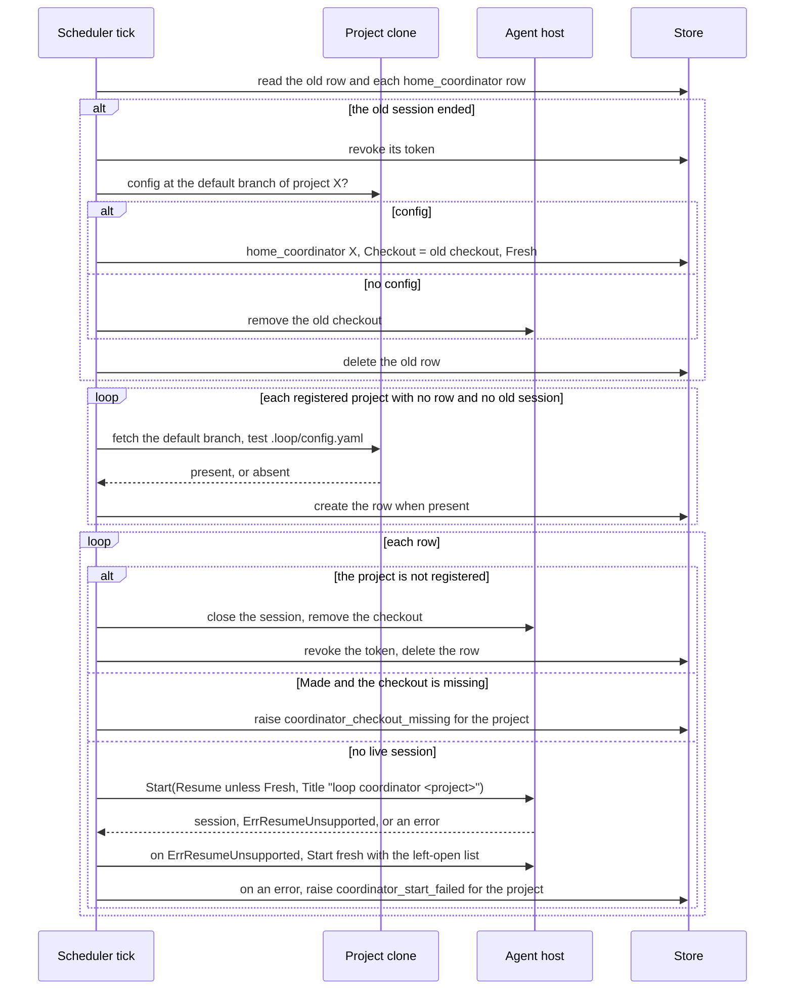
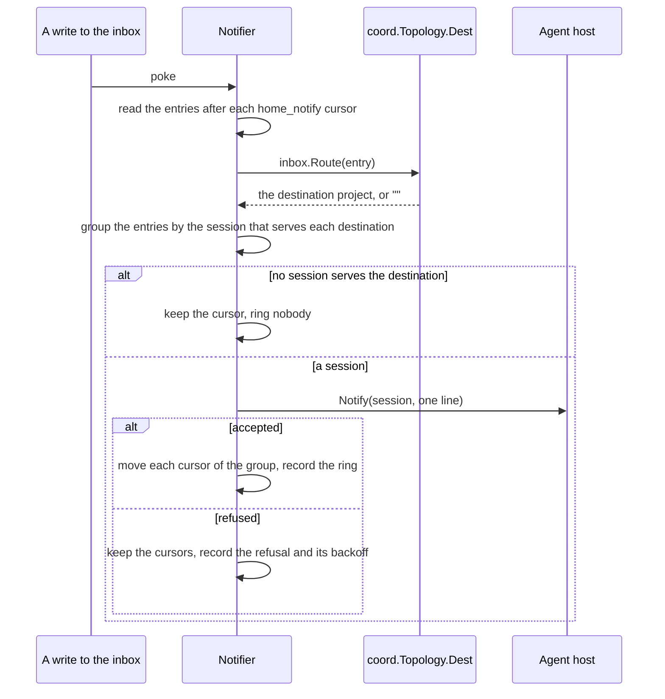
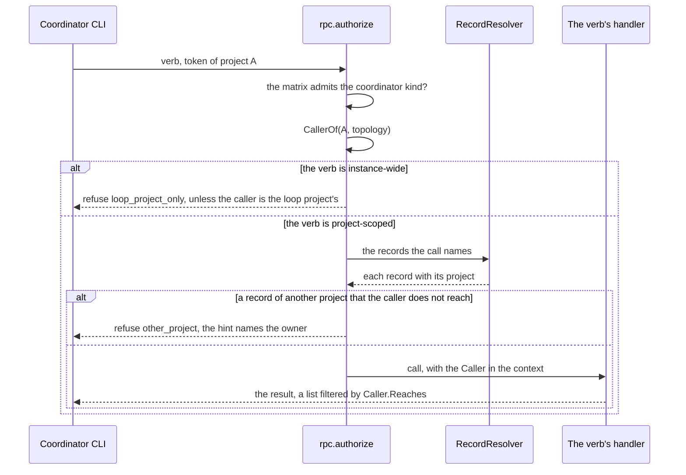
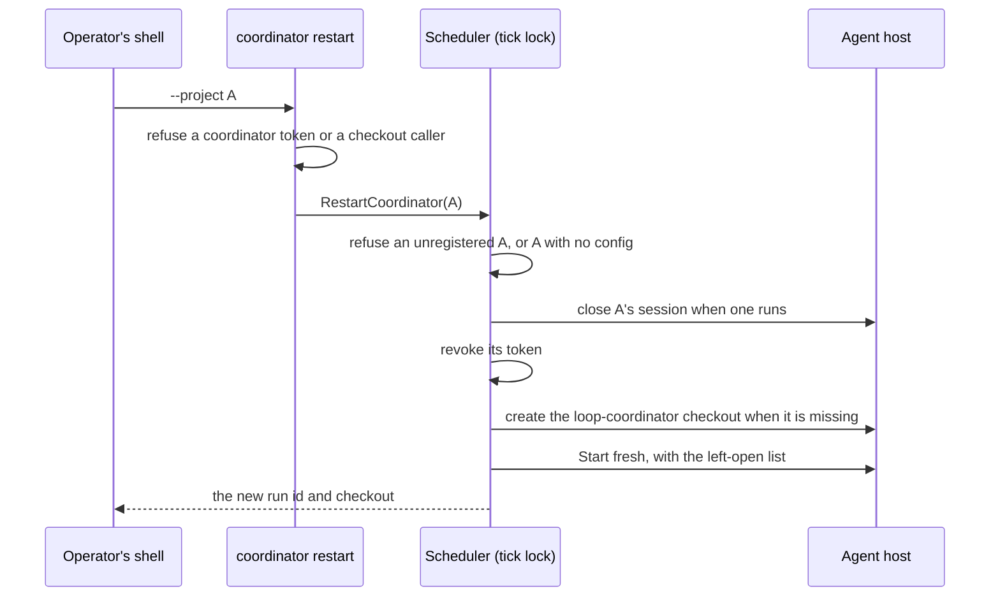
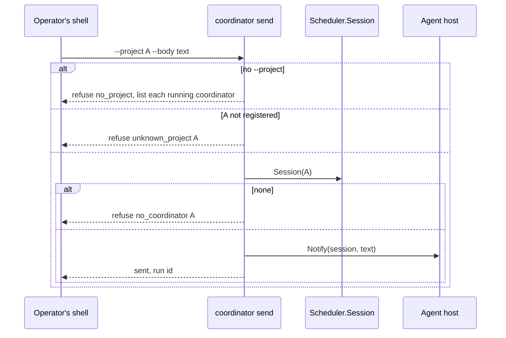

# Give each project its own home coordinator: technical spec

## Source

- **Epic:** factorio-1edo
- **Source:** `docs/prd/project-home-coordinators.md`, merged at `27b95a8`, and
  `docs/adr/0015-one-home-coordinator-per-project.md`, merged at `a7ca870`. ADR 0015 is the one ADR
  whose `**Ticket:**` line names factorio-1edo. It amends decision 3 of
  `docs/adr/0004-operator-visibility.md` and decision 4 of `docs/adr/0010-approval-is-enough.md`,
  and by `loop-sdlc-documents` § 5 the later ADR wins each conflict.
- **Stories covered:** US-01, US-02, US-03, US-04, US-05, US-06, US-07.

The PRD numbers its acceptance criteria A1 to A30. ADR 0015 numbers its decisions 1 to 6. This spec
cites both by those numbers, and cites a PRD requirement by its line at `27b95a8`, such as PRD
L206.

This run read the loop at `a7ca870` on 2026-11-04. Each file and line below is at that commit.

## Scope check

**Components:**

1. **The loop server.** The coordinator sessions of the scheduler in `internal/sched`, the token
   and the capability check in `internal/rpc` and `internal/cli`, the doorbell in
   `internal/inbox` and `internal/server`, the overwatch ring in `internal/overwatch`, and the
   verbs `loop coordinator send` and `loop coordinator restart`.
2. **The coordinator's text.** `pack/runbooks/coordinator.md`, the glossary entry in
   `pack/skills/loop-sdlc-glossary/SKILL.md`, and `docs/operating.md` § Talk to the coordinator.
   Why not its own epic: the runbook must tell a project's coordinator which sections it skips, and
   the server's refusals are the only reason those sections change. A runbook that changed first
   would tell the one coordinator of today to skip the loop's own work.

Work entries 1 to 6 build the server parts that stay inert while one coordinator runs. Entry 7
starts one coordinator for each project, so entries 1 to 7 are the one change that the PRD scope
check asks US-01 to US-04 to merge as (PRD L115-L122). Entry 8 changes the runbook right after it.
Entries 9 to 11 build US-06, US-05 and US-07, each alone. Entry 12 changes the operating guide.

**Not in this spec:** the conditional skills of a coordinator, which the conditional-kernel-skills
epic owns (PRD § Boundaries). The steps of the retro's rule comparison, which the retro epic owns.
The parts of the overwatch sweep, which ADR 0009 owns. This spec changes only which coordinator
each finding rings. The settings change path, which the project-scoped-settings epic owns.

## Decisions

### Answers a person already gave

- **One coordinator for each registered project with a project config, and the loop project's
  coordinator serves the instance-wide work.** The operator signed off ADR 0015 by its merge at
  `a7ca870`. ADR 0015 also answers the PRD's open question on whether this needs an ADR.
- **The session that ran before this release keeps its unscoped token until it ends.** The PRD
  says so at L188-L196, and the doc-reviewer's round 2 of ADR 0015 named this choice as the
  operator's. This spec keeps it.
- **Only the operator's shell runs `loop coordinator restart`.** ADR 0015 decision 6 and PRD
  L308-L310.

### The loop project

- **The loop project is the one registered project whose repository is
  `release.ReleaseRepo`.** We chose this over a new host config key, because it needs no operator
  step on any host, and it can never name a project that is not registered. ADR 0015 decision 5
  leaves the choice to this spec, and the PRD names "the repository the loop releases from" as one
  answer (PRD L449-L452). `release.ReleaseRepo` is `slothware-labs/factorio`
  (`internal/release/upgrade.go:25`). The match ignores case. When no registered project matches,
  or more than one does, the host has no loop project.
- **With no loop project, the instance-wide work rings no coordinator, and it waits in the inbox.**
  We chose this over handing it to another project's coordinator, because that puts the loop's own
  work into a conversation about one unrelated project, which US-02 forbids. ADR 0015 decision 5
  leaves this case to the spec. The operator reads the waiting entries with `loop inbox list` from
  a shell, and runs the host verbs there. This answers the PRD's first open question.
- **The server reads the loop project at each call and each tick.** We chose this over a flag
  that the server writes into a token when it issues it, because the operator can register or
  remove the loop project while a token lives. A stale flag would keep instance-wide power in a
  token whose project is no longer the loop project.

### Where each entry and finding rings

- **One function, `coord.Topology.Dest`, names the coordinator for each entry and each finding.
  The doorbell, `loop inbox list`, `loop inbox wait` and `loop overwatch sweep` all call it.** We
  chose one function over a filter in each verb, because a ring that reaches one coordinator while
  the entry lists under another is the fault that A5 and A6 test.
- **A ring goes to the session that serves the destination project, and entries with one session
  share one ring.** We chose this over one ring for each project, because entries 4 to 6 land
  while one coordinator serves every project. Each poke then still rings that session once, as
  today.
- **The session from before this release is the coordinator of its own project X until it ends,
  also when X has no project config.** PRD L176-L178 gives a project with no config no
  coordinator. PRD L193-L196 makes the old session X's coordinator until it ends. We read L193 as
  the transition rule that holds over L176 while the old session lives, because L200-L204 then
  settles what X gets when it ends. So X's entries ring the old session, and not the loop
  project's coordinator. The doc-reviewer named this pair of lines for the operator. This spec
  takes the reading that ends no conversation.

### Scope of a coordinator's verbs

- **Each coordinator verb names its scope in the CLI surface, and `cli.DeriveMatrix` refuses a
  coordinator verb with no scope.** We chose a field that the build checks over a check in each
  handler, because ADR 0015 decision 4 binds every later epic, and a handler check that a later
  epic forgets fails silently. The scope is `project` or `instance`, the two words of decision 4.
- **`rpc.Server.authorize` enforces the scope for each coordinator token that names a project.**
  We chose one check before every handler over a check in each service, because the services
  (`inbox`, `room`, `decision`, `pipeline`) each test `p.Kind == cli.PrincipalCoordinator` today
  and none reads a project. One place reads the record's project and the caller's reach.
- **The scope binds a read as it binds a write.** A project's coordinator reads only its own project's
  records, and a list verb lists only them. We chose this over open reads, because PRD L223-L226
  binds every coordinator verb on a record, and US-02 promises a conversation about one project.
- **The loop project's coordinator may run a project-scoped verb on a record of another project
  only when an entry that rings it names the record.** A loop fault entry names its project, its
  item and its run, so the loop project's coordinator reads the run that reported the fault
  (runbook § 9 step 2). We chose this over open reads for the loop project's coordinator, because
  PRD L238-L240 grants it the entries that ring it, and nothing more. It also reads the
  registration of every project (`project list`, `project show`), because PRD L258-L259 lets it
  read each project's default branch for the `rules` part.
- **`project list` and `project show` stay open to every coordinator, scoped.** A project's
  coordinator lists and shows its own project. We chose this over a refusal, because the runbook's
  own-project steps read `project show` for the project's user skills, and a refusal stops no
  write. This answers the PRD's third open question.
- **The server admits the loop project's coordinator's `work create --kind bug --project <B>` only
  when the body names a loop fault whose project is B.** We chose this check over admitting any bug
  in any project, because PRD L231-L235 allows only the filing of a loop fault. The project's
  policy authorization stays a runbook step (§ 9 step 3), because the server cannot read what a
  policy means.
- **`fault show` and `fault list` from a project's coordinator name only its own project's
  faults.** We chose this over open fault reads, because ADR 0015 decision 4 refuses an
  instance-wide verb to a project's coordinator. A run keeps its fault reads as today, because this
  epic changes only coordinators.

### Sessions and state

- **Each project's coordinator state is a `schedule` row of the new kind `home_coordinator`, keyed
  by project. The row of today, kind `coordinator` with an empty project, stays only for the old
  session, and the server deletes it when that session ends.** We chose new kinds over rewriting
  the old row in place, because a release before this one reads `kind = 'coordinator'` with one
  `QueryRow` (`internal/sched/coordinator.go:63`). After a rollback it would act on an arbitrary
  project's row. New kinds keep `min_reader_schema` at 1, so a rollback needs no restore.
- **The start rule reads `.loop/config.yaml` at the fetched head of the default branch, on each
  tick, for each registered project with no `home_coordinator` row.** We chose this over the
  config loader's cache, because that cache holds a read for 30 seconds
  (`internal/server/sched.go:92`) and A3 bounds the start at one tick of 15 seconds. The rule asks
  whether the file exists. A file that does not parse still starts the coordinator, and its
  `project_config_invalid` alert rings that coordinator.
- **The list of the work that a previous session left open goes into the new session's prompt
  file.** We chose the prompt over a message after the start, because the agent host can refuse a
  message, and a refused list would need a record and a retry. The list names each unanswered
  question of the project, each open room of the project that a coordinator opened, and each entry
  after the project's doorbell cursor.
- **A next session resumes its conversation through a new `StartSpec.Resume`, and the orca host
  answers `ErrResumeUnsupported`.** We chose this over `orca terminal create --command "claude
  --continue"`, because that skips `orca agent launch`, whose flags keep permission prompts off and
  let orca track the session as an agent (`internal/agenthost/orca/start.go:14-21`). On this host
  every next session therefore starts fresh, with the left-open list (A25). A host that can resume
  takes the A24 path. PRD L282-L283 asks for a resume only "when the harness can resume it".
- **The tick closes the coordinator of a removed project, as it closes the one coordinator
  today.** We chose the tick over a hook in `project remove`, because the tick already owns every
  start and close of a coordinator session, and a second path could start and close one session
  at once.
- **`loop coordinator restart` runs in the scheduler under the tick's lock.** We chose this over
  a server handler that writes the row, so the tick and the verb never both start a session for
  one project.
- **Every coordinator takes one harness, model and effort, from `CoordinatorConfig`.** We chose
  this over a model for each project in project config, because no story asks for one.
- **A coordinator's terminal title is `loop coordinator <project>`.** We chose this over the
  repository name, because the project id is what every verb names.

### The send verb

- **`loop coordinator send` with no `--project` refuses, and its hint lists each project with a
  running coordinator.** We chose this over the project of the clone that the shell runs in,
  because US-05 says "the coordinator of one project that I name", and a wrong guess types the
  message into another project's conversation. This answers the PRD's second open question from
  the story's words.

### Overwatch

- **Each `overwatch.Finding` names its project, and each part sets it.** We chose a field over
  parsing the project out of the key, because the key grammar puts the project in a different
  segment for each part. A finding with no project, a finding of the `rules` part, and an UNREAD
  line ring the loop project's coordinator (PRD L213-L214, L255-L260).

## Assumptions

- A host runs at most about five projects, as this host does. The start rule fetches the default
  branch of each project with no coordinator on each tick. This is wrong if `loop stage list`
  shows a tick that takes longer than its 15-second interval.
- `orca agent launch` takes no flag that resumes a conversation. `orca agent launch --help` on
  this host on 2026-11-04 lists none. This is wrong once orca adds one, and then the orca host
  implements `StartSpec.Resume`.
- The registration of factorio on this host names `slothware-labs/factorio` as its repository.
  This is wrong if `loop project show factorio`, from the operator's shell, names a fork.
- Every inbox entry kind except `question` carries its project in `inbox.Entry.Project`, as
  `internal/inbox/entries.go` sets it. This is wrong if a kind leaves the field empty for an entry
  about one project. That entry then rings the loop project's coordinator.
- A question that a coordinator prepared before this release names its project in its `entry`
  column, or names no entry. This is wrong if `SELECT entry FROM questions WHERE answered_at IS
  NULL` returns an entry id with no project segment.

## Approach

**One package holds the rules.** A new package `internal/coord` holds the loop project, the
topology and the reach of a caller. It reads no store and starts no session, so every rule in it
has a table test. The scheduler builds a `coord.Topology` from its rows on each tick, and the
server reads the latest one for each call.

**The loop project.** `coord.LoopProject` reads the registered projects and returns the one whose
repository is `release.ReleaseRepo`. Every caller that needs the loop project asks it again. No
token, row or brief stores the answer as truth. The brief stores a copy for the runbook to read.

**Routing.** `coord.Topology.Dest(project, instanceWide)` returns the project whose coordinator
gets an entry or a finding. Instance-wide work goes to the loop project. A project that has a
coordinator gets its own work. A project that has none, because its default branch holds no
config, sends its work to the loop project. `inbox.Route` decides `instanceWide` for an entry: a
fault, the alert of a coordinator that failed to start, and an entry with no project.
`overwatch.Route` decides it for a finding: a `rules` finding, a finding with no project and an
UNREAD line.

**The doorbell.** `inbox.Notifier` keeps one cursor for each destination project, in rows of kind
`home_notify`. A poke reads the entries after each cursor, groups them by the session that serves
each destination, rings each session once, and moves each cursor of an accepted ring. A
destination with no session keeps its cursor, so the next session's first ring names each entry
it missed (A19). The server's `Sessions` interface names the session for a project. Before entry
7 it returns the one coordinator for every project, and for the destination `""` of a host with
no loop project, so each ring reaches the one coordinator as today. After entry 7 it returns the
project's `home_coordinator` session, or the old session for the old session's project, and no
session for `""`.

**The overwatch ring.** The job sweeps once, as today. It splits the report by `overwatch.Route`,
and rings each session with the parts that hold work for its projects. `loop overwatch sweep`
prints the part of the report that routes to the caller. The host gets the whole report.

**Scope.** Each verb in `internal/cli/surface.go` whose callers include `coordinator` or `host
coordinator` carries `Scope: ScopeProject` or `Scope: ScopeInstance`. `rpc.Server.authorize` runs
the scope check after the matrix, for a coordinator token. It builds a `coord.Caller` from the
token's project and the current topology. A token with no project is the old session, and it is
unscoped. For a project-scoped verb, a `rpc.RecordResolver` reads the project of each record that
the call names: the item, entry, decision, room, run, learning or fault argument, the `--entry`
flag and the `--project` flag. The server refuses a record of another project with
`CAPABILITY_DENIED`, rule `other_project`, and a hint that names the owner. For a list verb, the server passes the
caller to the service, and the service filters its rows by `Caller.Reaches`. For an instance-wide
verb, the server admits only the loop project's coordinator and, on a host verb, the host.
`rpc.Call.Project` stops exempting a coordinator from the `other_project` refusal, so a missing
`--project` names the caller's own project.

The loop project's coordinator also reaches a record that an entry routed to it names. The
resolver asks the inbox for the open entries that route to the loop project, and compares each
entry's project, item and run with the record.

**Stage pause.** `loop stage pause` and `loop stage resume` with no `--project` act on the
caller's project. From the loop project's coordinator they act in every project, as ADR 0004
decision 3 says. ADR 0015 wins that conflict, and nobody edits ADR 0004.

**Sessions.** `Scheduler.ensureCoordinators` replaces `ensureCoordinator`. On each tick it does
these steps, in this order:

1. Read the old row. When the old session lives, send it the release message once, as
   `tellCoordinatorRelease` does today. When it ended, revoke its token, run the hand-over of
   PRD L200-L204, and delete the old row.
2. For each `home_coordinator` row whose project is no longer registered, close the session,
   revoke the token, remove the checkout and delete the row.
3. For each registered project with no row and no old session, fetch the default branch with
   `BaseHead`, and test for `.loop/config.yaml` at that head. With the file, create the row.
4. For each row, keep a live session, rebind a moved one as today, or start the next one. A
   missing checkout that the server made starts nothing, and raises the alert
   `coordinator_checkout_missing` that names `loop coordinator restart --project <project>`.

One project's failure raises its alert and goes on to the next project. Each start writes a
brief whose `project` names the project and whose new `loop_project` field is true for the loop
project's coordinator. Each start issues the token with `Project` set.

**The first message.** A start with `Resume` set asks the agent host to resume. When the host
answers `ErrResumeUnsupported`, or when the start follows the old session or a restart, the
scheduler writes the left-open list into the prompt file and starts fresh.

**Restart.** `loop coordinator restart --project <p>` is a host-only server verb. Its handler
calls `Scheduler.RestartCoordinator`, which takes the tick's lock, refuses an unregistered project
or one with no config at its default branch, ends a running session, revokes its token, creates
the checkout again when it is missing, and starts a fresh session with the left-open list.

**Send.** `loop coordinator send --project <p> --body <text>` types the text into the session
that `Sessions` names for p. It refuses an unregistered project, a project with no running
coordinator, and a call with no `--project`.

**Text.** The runbook stops calling itself the one resident agent. It names the sections that
only the loop project's coordinator follows: § 9 Loop faults, the `rules` part of § 9, the host
verbs of § 4, and the every-project pause of § 3. It tells each coordinator to read `project` and
`loop_project` in `.loop/brief.json`. The operating guide names one coordinator for each project,
the start at loop-init's merge, `--project` on send, the restart verb, and the removal that moves
no coordinator.

## Domain model

```
internal/coord (new)

Topology            the coordinators of one instance, at one tick
  Loop    string            the loop project, "" when the host has none
  Homes   set of project    each project with a home_coordinator row
  Old     string            the project of the session from before this release,
                            "" once it ended
  invariant: Loop, when not "", is a registered project. Old is not in Homes.
  Dest(project, instanceWide) string
    instanceWide           -> Loop
    project in Homes       -> project
    project == Old         -> project
    otherwise              -> Loop
  invariant: Dest returns exactly one project or "". "" means the host has no loop project.
             After entry 7 no session serves "", so that work waits in the inbox.

Reach               a tagged union: what one coordinator token may act on
  Unscoped                  the old session: every record, every verb, as today
  Loop(project)             its project, each record that an entry routed to it names,
                            every project's registration, and every instance-wide verb
  Project(project)          its project only
  invariant: a token that names a project is never Unscoped. Only a token with no project,
             which only the old session holds, is Unscoped.

Caller              Reach plus the topology it was read from
  Reaches(record) bool
  Admits(scope)   bool      ScopeInstance admits Loop and Unscoped only

Record              Kind (item, entry, decision, room, alert, setting, run, fault, learning,
                    registration), ID, Project
```

```
internal/sched (changed)

CoordinatorState    one project's coordinator: the payload of a home_coordinator row
  + Made   bool             the server made Checkout, so a missing directory is an alert,
                            and not a first start
  + Fresh  bool             the next session starts fresh with the left-open list:
                            set after the old session's hand-over and by restart
  invariant: Project is the row's project and never changes. Session is nil or names a
             session whose checkout is Checkout.

Home lifecycle (a state machine over one row)
  none        -- config on the default branch -->     starting
  starting    -- session started -->                  running
  starting    -- start failed -->                     starting, with the alert of PRD L185
  running     -- session ended -->                    starting   (Resume unless Fresh)
  running     -- operator restart -->                 starting   (Fresh)
  any         -- checkout missing and Made -->        missing    (alert, no start)
  missing     -- operator restart -->                 starting   (checkout made again)
  any         -- project removed -->                  none       (row deleted)
```

The old row keeps the type `CoordinatorState` and stays outside `Topology.Homes`. One branch at
the top of the tick handles it, and no other code reads it.

## Interfaces

```go
// internal/coord
func LoopProject(ps []config.Project) (id string, ok bool)

type Topology struct {
	Loop  string
	Homes map[string]bool
	Old   string
}

func (t Topology) Dest(project string, instanceWide bool) string

type Reach int

const (
	ReachProject Reach = iota
	ReachLoop
	ReachUnscoped
)

type Caller struct {
	Reach   Reach
	Project string
	// Routed reports whether an open entry that routes to the loop project names r.
	Routed func(ctx context.Context, r Record) (bool, error)
}

// CallerOf reads a coordinator token's project against the topology. An empty project is
// the old session.
func CallerOf(tokenProject string, t Topology, routed func(context.Context, Record) (bool, error)) Caller
func (c Caller) Reaches(ctx context.Context, r Record) (bool, error)
func (c Caller) Admits(s cli.VerbScope) bool
```

```go
// internal/cli
type VerbScope string

const (
	ScopeProject  VerbScope = "project"
	ScopeInstance VerbScope = "instance"
)

type Verb struct {
	// ...each field of today...
	// Scope is required on a verb whose callers name "coordinator" or "host coordinator".
	Scope VerbScope `json:"scope,omitempty"`
}
```

The scope of each coordinator verb at `a7ca870`, which `loop schema` prints after entry 2:

The verbs of scope `project`, by noun:

- `work`: `peek`, `show`, `list`, `edit`, `note`, `block`, `unblock`, `cancel`, `shape`, `ask`,
  `duplicate`, `supersede`, `create`
- `run`: `show`, `list`, `events`
- `pr pending`, `merge status`, `overwatch sweep`
- `decision`: `file`, `list`, `fire`, `defer`, `settle`, `moot`
- `fault`: `report`, `show`, `list`
- `inbox`: `list`, `answer`, `defer`, `prepare`, `wait`, `note`
- `room`: `open`, `close`, `list`
- `epic`: `create`, `adr`, `skip-design`, `accept-difference`
- `stage`: `pause`, `resume`, `list`
- `settings`: `show`, `set`
- `project`: `list`, `show`

The verbs of scope `instance`:

- `fault ack`, `fault resolve`, `retro compared`, `coordinator upgrade`
- the host verbs `upgrade`, `rollback`, `doctor`, `doctor-github`, `doctor-env`

`stage pause` and `stage resume` with no `--project` from the loop project's coordinator act in
every project. That case is instance-wide work by PRD L164, and the handler checks
`Caller.Reach == ReachLoop`.

```go
// internal/rpc
// RecordResolver names the project of each record a call names. The server
// builds it over the machine, the inbox, rooms, decisions, runs, faults and retros.
type RecordResolver func(ctx context.Context, inv cli.Invocation) ([]coord.Record, error)

type Options struct {
	// ...each field of today...
	Records  RecordResolver
	Topology func() coord.Topology
}

// CallerFrom returns the coordinator caller of the call, for a service that filters a list.
func CallerFrom(ctx context.Context) (coord.Caller, bool)
```

```go
// internal/inbox
func Route(e Entry, t coord.Topology) string

// Sessions names the coordinator session that serves a project.
type Sessions func(project string) (agenthost.RunID, bool)

type Notifier struct {
	Inbox    *Inbox
	Ring     func(ctx context.Context, id agenthost.RunID, text string) error
	Sessions Sessions
	Topology func() coord.Topology
}
```

```go
// internal/overwatch
type Finding struct {
	Key     string
	Line    string
	At      time.Time
	Project string // the project the finding is about; "" for the instance
}

func Route(part string, f Finding, t coord.Topology) string

// Split returns the part of a report that routes to each project.
func Split(r Report, t coord.Topology) map[string]Report

type World interface {
	// ...each method of today, with these two changed...
	Coordinators() map[string]sched.CoordinatorState
	LastRings(ctx context.Context) (map[string]RingOutcome, error)
}
```

```go
// internal/sched
func (s *Scheduler) Coordinators() map[string]CoordinatorState
func (s *Scheduler) Topology() coord.Topology
func (s *Scheduler) Session(project string) (agenthost.RunID, bool)
func (s *Scheduler) RestartCoordinator(ctx context.Context, project string) (CoordinatorState, error)

// The alert kinds this epic adds. AlertCoordinator stays, and its alert now names its project.
const AlertCoordinatorCheckoutMissing = "coordinator_checkout_missing"
```

```go
// internal/agenthost
type StartSpec struct {
	// ...each field of today...
	// Resume asks the harness to continue the last conversation in Checkout.
	Resume bool `json:"resume,omitempty"`
}

// ErrResumeUnsupported is Start's answer when the host cannot resume. It starts nothing.
var ErrResumeUnsupported = errors.New("agenthost: this host cannot resume a conversation")
```

```go
// internal/brief
type Brief struct {
	// ...each field of today...
	LoopProject bool `json:"loop_project,omitempty"`
}
```

The CLI changes:

```
loop coordinator send --project <project> --body <text>   host; --project is required
loop coordinator restart --project <project>              host only; new
loop inbox list [--awaits <actor>]                        coordinator, and now host
```

The refusals:

| Verb | Code | Rule | When |
| --- | --- | --- | --- |
| any project-scoped verb | `CAPABILITY_DENIED` | `other_project` | a record of another project, and the hint names the owner |
| any instance-wide verb | `CAPABILITY_DENIED` | `loop_project_only` | a coordinator other than the loop project's |
| `work create` | `CAPABILITY_DENIED` | `fault_bug_only` | the loop project's coordinator, another project, and no fault of it in the body |
| `coordinator send` | `USAGE` | `no_project` | no `--project`, and the hint lists each running coordinator |
| `coordinator send` | `NOT_FOUND` | `unknown_project` | the project is not registered |
| `coordinator send` | `NOT_FOUND` | `no_coordinator` | no session runs for the project |
| `coordinator restart` | `NOT_FOUND` | `unknown_project` | the project is not registered |
| `coordinator restart` | `NOT_FOUND` | `no_project_config` | no `.loop/config.yaml` at its default branch |
| `coordinator restart` | `CAPABILITY_DENIED` | `principal_not_allowed` | a coordinator token |

## Data

```
schedule (existing table, new row kinds)
  kind 'home_coordinator', project <id>     payload: CoordinatorState JSON, one row for each
                                            project that has a coordinator
  kind 'home_notify',      project <dest>   due_at: the doorbell cursor of one destination
  kind 'coordinator_ring', project <dest>   payload: RingOutcome of the last ring to that
                                            destination; the row with project '' stays the
                                            old session's

questions (changed), migration 0023_question_project.sql, min_reader_schema: 1
  + project   TEXT NOT NULL DEFAULT ''      the project of the coordinator that prepared it
```

**Existing records.** The `coordinator` row with project `''` stays as the old session's row, and
the tick deletes it when the session ends. The `inbox_notify` row stays. On the first tick of this
release, each new `home_notify` row starts at its value, so no entry rings twice. Each existing
question keeps project `''`. `inbox.Route` reads the project out of its `entry` id, and a question
with no entry routes to the loop project. A release before this one reads none of the new kinds,
and it reads the new column of `questions` as a column it does not select.

## Flows











## Work

1. **The loop project and the topology.** Add `internal/coord` with `LoopProject`, `Topology`,
   `Dest`, `Reach`, `Caller`, `CallerOf` and `Record`. Nothing calls it yet.
   - Files: `internal/coord/**`
   - Needs: nothing
   - Proves: C1, C2, C3
   - Done when: the table tests of `LoopProject`, `Dest` and `Caller.Reaches` pass, with the
     cases of none and two matching projects.
2. **Every coordinator verb names its scope.** Add `VerbScope` and `Verb.Scope`. Set the scope of
   each verb in the Interfaces table. Make `DeriveMatrix` refuse a coordinator verb with no scope.
   `loop schema` prints the scope.
   - Files: `internal/cli/surface.go`, `internal/cli/capabilities.go`, `internal/cli/schema.go`,
     `internal/cli/*_test.go`
   - Needs: nothing
   - Proves: C4
   - Done when: a registry with a coordinator verb that names no scope fails `DeriveMatrix` with an
     error that names the verb.
3. **The capability check reads the scope.** Add `RecordResolver`, `Options.Records`,
   `Options.Topology` and `CallerFrom`. Run the scope check in `authorize` for a coordinator token
   with a project. Stop exempting the coordinator in `Call.Project`. Build the resolver in the
   server over the machine, the inbox, rooms, decisions, runs, faults and retros. Add
   `inbox.Route`, which the resolver reads to find the entries that route to the loop project.
   Admit the loop project's `work create --kind bug` on another project only by the fault rule. A token with no
   project stays unscoped, so the one coordinator of today changes nothing.
   - Files: `internal/rpc/capabilities.go`, `internal/rpc/server.go`, `internal/server/scope.go`
     (new), `internal/server/server.go`, `internal/pipeline/adhoc.go`, `internal/inbox/route.go`
     (new), and the tests of each package
   - Needs: 1, 2
   - Proves: C5, C6, C7, C8, C9
   - Done when: a test issues a token of project A and gets `other_project` on an item of project
     B for each project-scoped verb of the table, and B's item does not change.
4. **List verbs filter by the caller.** Filter `work list`, `run list`, `pr pending`,
   `merge status`, `decision list`, `fault list`, `room list`, `stage list`, `project list` and
   `inbox list` by `Caller.Reaches`. Add the `project` column of `questions`
   with migration `0023_question_project.sql`, and write it in `inbox prepare`. Make
   `stage pause` and `stage resume` with no `--project` act on the caller's project, except for
   the loop project's coordinator.
   - Files: `internal/inbox/**`, `internal/store/migrations/0023_question_project.sql`,
     `internal/machine/verbs.go`, `internal/server/runs.go`, `internal/server/stages.go`,
     `internal/server/merge.go`, `internal/server/github.go`, `internal/server/handlers.go`,
     `internal/room/room.go`, `internal/decision/**`, `internal/fault/**`, and the tests of each
     package
   - Needs: 3
   - Proves: C10, C11, C12
   - Done when: the inbox of a coordinator of project A, over a fixture with entries of A, B, a
     fault of B and an entry with no project, lists the entries of A only.
5. **The doorbell rings the session that serves each entry.** Change `Notifier` to keep a cursor
   for each destination in `home_notify` rows, to group entries by `Sessions`, and to ring each
   session once. Write the ring record of each destination in its own `coordinator_ring` row. The
   server's `Sessions` names the one coordinator for every project until entry 7.
   - Files: `internal/inbox/notify.go`, `internal/server/inbox.go`, `internal/server/overwatch.go`
     for `recordedRing`, `internal/overwatch/ring.go`, and their tests
   - Needs: 4
   - Proves: C13, C14
   - Done when: with one coordinator for every project, a poke over entries of two projects rings
     that session once, as before this entry.
6. **The overwatch ring reaches each project's coordinator.** Add `Finding.Project`, and set it
   in each part. Add `overwatch.Route` and `Split`. Ring each session with its split. Filter
   `loop overwatch sweep` by the caller. Change `World.Coordinator` and `World.LastRing` to their
   plural forms, and read them in the `inbox` and `worktrees` parts.
   - Files: `internal/overwatch/**`, `internal/server/overwatch.go`, and their tests
   - Needs: 5
   - Proves: C15, C16
   - Done when: a sweep fixture with a `stalls` finding of A and a `rules` finding of B rings A's
     session with `stalls`, and the loop project's session with `rules`.
7. **One coordinator for each project, and the hand-over from the old session.** Replace
   `ensureCoordinator` with `ensureCoordinators` over `home_coordinator` rows, by the Approach.
   Add the start rule, the title, the scoped token, the brief's `project` and `loop_project`, the
   alert of a failed start that names its project, the release message for each session, the old
   session's hand-over, `Session`, `Topology` and `Coordinators`. Add `StartSpec.Resume` and
   `ErrResumeUnsupported`, and make the orca host and the fake host answer it. Write the left-open
   list into the prompt. Drop `CoordinatorConfig.Project` and its setting in `cmd/loop/serve.go`.
   A removed project's coordinator runs on until entry 9 lands. Entry 9 follows this entry at
   once.
   - Files: `internal/sched/coordinator.go`, `internal/sched/scheduler.go`,
     `internal/sched/checkouts.go`, `internal/brief/brief.go`, `internal/agenthost/host.go`,
     `internal/agenthost/orca/start.go`, `internal/agenthost/fake/**`,
     `internal/agenthost/agenthosttest/contract.go`, `cmd/loop/serve.go`, `internal/server/inbox.go`
     for `Sessions`, and the tests of each package
   - Needs: 6
   - Proves: C17, C18, C19, C20, C21, C22, C23, C24, C25, C26, C27, C33
   - Done when: `grep -n 'serves every' internal/sched/coordinator.go` prints nothing, and a test
     with two fixture projects and the fake agent host starts two sessions with two titles.
8. **The coordinator's runbook and the glossary.** Rewrite the opening of
   `pack/runbooks/coordinator.md` and the glossary entry for one coordinator for each project.
   Mark § 9, the `rules` part, the host verbs of § 4 and the every-project pause of § 3 as the
   loop project's coordinator's work. Tell each coordinator to read `project` and `loop_project`
   in `.loop/brief.json`. Name `loop coordinator restart` as a verb only the operator's shell runs.
   - Files: `pack/runbooks/coordinator.md`, `pack/skills/loop-sdlc-glossary/SKILL.md`,
     `internal/pack/*_test.go`
   - Needs: 7
   - Proves: C28
   - Done when: `grep -n 'one resident agent' pack/runbooks/coordinator.md` prints nothing, and
     `make pack-check` passes.
9. **Removal and registration again.** The tick closes the coordinator of a project that is no
   longer registered: it ends the session, revokes the token, removes the checkout and deletes the
   row. A registration again gets a new row, and a new checkout, by the start rule.
   - Files: `internal/sched/coordinator.go` and its tests
   - Needs: 7
   - Proves: C29, C30
   - Done when: a test removes project A of two, and B's session id stays the same.
10. **Send to one project's coordinator.** Add `--project` to `loop coordinator send`, required,
    and the refusals of the Interfaces table.
    - Files: `internal/cli/surface.go`, `internal/server/inbox.go`, and their tests
    - Needs: 7
    - Proves: C31
    - Done when: a send to A types the text into A's fake session only.
11. **Restart, a missing checkout and the host's inbox.** Add `loop coordinator restart` and
    `Scheduler.RestartCoordinator`. Raise `coordinator_checkout_missing` in place of a start. Admit
    the host on `loop inbox list`.
    - Files: `internal/cli/surface.go`, `internal/sched/coordinator.go`,
      `internal/server/coordinator.go` (new), `internal/server/handlers.go`, and their tests
    - Needs: 7
    - Proves: C32, C34, C35, C36, C37
    - Done when: a test deletes A's checkout, sees the alert, runs the restart as the host, and
      sees A's new session in a new checkout with B's session id unchanged.
12. **The operating guide.** Rewrite `docs/operating.md` § Talk to the coordinator. Replace "The
    server starts it in Orca when the first project registers" with the start at loop-init's
    merge, and "One coordinator serves every project" with one coordinator for each project. Name
    the terminal title `loop coordinator <project>`, `loop coordinator send --project`,
    `loop coordinator restart --project`, and the host verbs that only the loop project's
    coordinator runs. Replace "When you remove the coordinator's project, the server ends the
    session and starts the next one in a project that is still registered" with the removal of
    entry 9.
    - Files: `docs/operating.md`
    - Needs: 9, 10, 11
    - Proves: C38
    - Done when: `grep -n 'One coordinator serves every' docs/operating.md` prints nothing.

## Out of scope

- A coordinator for a project on another host. Never, by the PRD § Out of scope.
- A change to what a coordinator does with an entry, a fault or a finding. The coordinator
  runbook keeps its steps. Entry 8 changes only which coordinator takes each section.
- The conditional skills of a project's coordinator. The conditional-kernel-skills epic owns it,
  and `coordinatorPack` still selects none.
- A change to `loop register` and to loop-init. Register starts no coordinator, as it does today,
  and loop-init's merge is the start signal.
- The scope of a run's or a room's fault reads. This epic changes only coordinators.
- An edit of ADR 0004 or ADR 0010. ADR 0015 amends both, and nobody edits a merged ADR.
- The move of a conversation's history to a new machine. Never, by the PRD § Out of scope.
- A resume on the orca host. It waits for orca to offer a resume, by the assumption above.

## Contracts

**C1. Behaviour: the loop project is the one registered project of the release repository.**
Proves the PRD requirement at L155-L156, and ADR 0015 decision 5. `LoopProject` over projects
whose repositories are `slothware-labs/factorio` and `acme/app` returns the first one's id.
`Slothware-Labs/Factorio` matches. Two projects of the release repository, or none, return
`ok == false`.
*A table test of `LoopProject`.*

**C2. Invariant: every entry and finding has exactly one destination.** Proves A5, A9 and A21 in
part. For any generated topology and any project, `Dest` returns one project or `""`. It returns
`Loop` for instance-wide work, the project itself for a project in `Homes` or equal to `Old`, and
`Loop` otherwise. `""` comes back only when `Loop` is `""`.
*A property test over 1,000 generated topologies.*

**C3. Behaviour: a token's reach.** Proves A7 and A23 in part. A token with no project is
`ReachUnscoped`. A token of the loop project is `ReachLoop`. Any other token is `ReachProject`. A
token of a project that was the loop project, after the loop project's removal, is
`ReachProject`.
*A table test of `CallerOf`.*

**C4. Invariant: every coordinator verb names its scope.** Proves ADR 0015 decision 4. Each verb
of `cli.Surface()` whose callers include `coordinator` or `host coordinator` has `Scope` set.
`DeriveMatrix` refuses a registry whose coordinator verb has none, and names the verb.
*A test over `cli.Surface()`, and a test of a registry with one verb that names no scope.*

**C5. Refusal: a project's coordinator acts on no record of another project.** Proves A7 and A8.
For each project-scoped verb that names a record, a token of project A on a record of project B
gets `CAPABILITY_DENIED`, rule `other_project`, with a hint that names B. The record does not
change. `settings set B <key>` from A's token refuses the same way, and B's settings do not
change.
*A table test over the project-scoped verbs of the Interfaces table, with two fixture projects.*

**C6. Refusal: an instance-wide verb only from the loop project's coordinator.** Proves A10. A
token of a project other than the loop project gets `CAPABILITY_DENIED`, rule
`loop_project_only`, on each instance-wide verb. For `upgrade` the CLI's authorization call
returns the refusal, and the upgrade starter never runs. The server admits the loop project's
token.
*A table test over the instance-wide verbs, with a fake upgrade starter that counts its starts.*

**C7. Behaviour: the loop project's coordinator acts on the entries that ring it.** Proves A23
and PRD L238-L240. `inbox.Route` sends a loop fault of project A to the loop project, and the loop
project's token gets success on `fault ack`, `fault show` and `run show` of the fault's run. After
`fault resolve`, its `run show` of that run of A refuses with `other_project`.
*An example test with two fixture projects and one fault.*

**C8. Refusal: the loop project's coordinator files a bug in another project only for a loop
fault of it.** Proves PRD L231-L235. `work create --kind bug --project A` from the loop project's
token succeeds when the body names fault F-n of project A. It refuses with `fault_bug_only` when
the body names no fault, or a fault of another project. `--kind ticket --project A` refuses with
`other_project`.
*Example tests.*

**C9. Behaviour: the old session stays unscoped.** Proves PRD L188-L196. A token with no project
gets success on a record of every project, as before this release.
*An example test with a token issued with no project.*

**C10. Equivalence: the inbox a coordinator lists is the set of entries that ring it.** Proves A6
and A21. For any generated set of entries and any topology, the entries that `inbox list` returns
to a coordinator of project P are the entries whose `inbox.Route` is P.
*A property test that runs both paths over the same generated inbox.*

**C11. Behaviour: a pause with no project acts on the caller's project.** Proves A22. A's
coordinator runs `stage pause implementer` with no `--project`. The stage pauses in A, and B's
implementer still starts a run. The loop project's coordinator, with no `--project`, pauses the
stage in A and in B.
*An example test with two fixture projects.*

**C12. Behaviour: an old question routes by its entry.** Proves PRD L216-L218 for the records of
before this release. A question with project `''` whose entry is `hold:B:B-1` lists in B's inbox.
A question with project `''` and no entry lists in the loop project's inbox.
*An example test over a store migrated to 0023.*

**C13. Behaviour: one ring for each session.** Proves A5 and A19. Two projects with one session
each: an entry of A rings A's session, and B's session gets no ring. One session that serves both
projects gets one ring that names both entries. A destination with no session keeps its cursor,
and the first ring after its session starts names the entry.
*Example tests with a fake doorbell that records each ring by session.*

**C14. Boundary: the first ring of this release rings no old entry again.** Proves A17 in part.
A store with an `inbox_notify` cursor at T and entries before and after T. The first poke rings
each destination with the entries after T only.
*An example test.*

**C15. Behaviour: a finding rings its project's coordinator.** Proves PRD L213-L214, L255-L260.
A `stalls` finding of A rings A's session only. A `rules` finding whose key names B rings the
loop project's session. A finding with no project and an UNREAD part ring the loop project's
session. A sweep with no finding for A rings A's session never.
*Example tests of `Route`, `Split` and the job's ring.*

**C16. Behaviour: the sweep shows the caller its own part.** Proves A6 for overwatch. `loop
overwatch sweep` from A's token lists A's findings and no finding of B. The host gets every
finding.
*An example test.*

**C17. Behaviour: one coordinator for each project with a project config.** Proves A1 and A2.
Two registered projects with `.loop/config.yaml` at their default branch, and one with none. After
one tick, two sessions run, each in a `loop-coordinator` checkout made from its own project's
default branch head. The third project has no session and no row.
*A scheduler test with the fake agent host and three fixture clones.*

**C18. Boundary: the start follows the config within one tick.** Proves A3 and PRD L176-L177. A
registered project with no config gets no session. After a commit that adds `.loop/config.yaml`
reaches its remote default branch, the next tick starts its coordinator.
*A scheduler test that commits to the fixture remote between two ticks.*

**C19. Behaviour: each title names its project.** Proves A4. The two sessions of C17 carry the
titles `loop coordinator <id>` of their projects, and the titles differ.
*Part of the C17 test.*

**C20. Behaviour: a session end restarts that project's coordinator only.** Proves A16. A's
session exits. The next tick starts A's next session in A's existing checkout, and B's session id
stays the same.
*A scheduler test.*

**C21. Behaviour: a failed start names its project and stops no other.** Proves A20. The fake
host fails A's start. An alert `coordinator_start_failed` that names A lists in the loop project's
inbox, and B's coordinator starts in the same tick.
*A scheduler test.*

**C22. Behaviour: an entry of a project with no config rings the loop project's coordinator.**
Proves A21. An alert of project C, which has no config, rings the loop project's session.
*An integration test over the scheduler, the inbox and the fake host.*

**C23. Behaviour: a loop fault rings the loop project's coordinator only.** Proves A9 and ADR
0015's criterion. A fault that a run of A reports rings the loop project's session, and A's
session gets no ring.
*The integration test of C22, with a fault.*

**C24. Behaviour: each token names its project.** Proves ADR 0015's criterion that no new token
names no project. Each coordinator session that the scheduler starts holds a token whose
`run_tokens.project` is its project.
*Part of the C17 test, read from the store.*

**C25. Behaviour: the first start of this release keeps the old session.** Proves A17. A store
with the old `coordinator` row and its live session in project X, and a second project Y with a
config. After the first tick, the old session got one message that names the new release, its
session id is the same, and Y's coordinator runs with the title `loop coordinator Y`. X gets no
second session.
*A scheduler test.*

**C26. Behaviour: the old session hands its project over when it ends.** Proves A18. The old
session of C25 exits. Its token no longer verifies. With a config at X's default branch, X's new
session starts in the old checkout, with no resume, and its prompt names X's unanswered
questions and open rooms. With no config, the old checkout is gone and X has no row. When X's
config later reaches its default branch, X's coordinator starts in a new `loop-coordinator`
checkout, and no alert names `loop coordinator restart`.
*Scheduler tests, one for each branch.*

**C27. Behaviour: a next session resumes when the host can, and lists the open work when it
cannot.** Proves A24 and A25. With a fake host that resumes, A's next session starts with
`Resume`, the old token no longer verifies, and the new token does. With a fake host that answers
`ErrResumeUnsupported`, A's next session starts fresh, and its prompt names each question A's
coordinator prepared, each open room of A, and each entry of A after A's cursor.
*Scheduler tests with both fake hosts.*

**C28. Behaviour: the runbook names one coordinator for each project.** Proves ADR 0015's
criteria. `grep -n 'one resident agent of this loop instance' pack/runbooks/coordinator.md`
prints nothing. The runbook names `loop_project` and § 9 as the loop project's coordinator's work.
`make pack-check` passes.
*A pack test that reads the runbook text, and `make pack-check` in CI.*

**C29. Behaviour: a removal closes one coordinator.** Proves A14 and PRD L275-L277. The operator
removes A. Within one tick, the server closes A's session and deletes its row. A's token no
longer verifies, and its checkout is gone. B's session id stays the same, and no session starts in a checkout
of B for A.
*A scheduler test.*

**C30. Behaviour: a registration again starts a new coordinator.** Proves A15. After C29, the
operator registers A again with its config. A's new session runs in a new `loop-coordinator`
checkout, and the removed session is not in the fake host's inventory.
*A scheduler test.*

**C31. Behaviour and refusal: send reaches the named coordinator only.** Proves A11 and A12. `loop
coordinator send --project A --body x` types `x` into A's session, and B's session gets nothing.
A project with no session refuses with `no_coordinator`, an unknown project with
`unknown_project`, each hint names the project, and no session gets the text. No `--project`
refuses with `no_project`, and the hint lists A and B.
*Example tests with the fake host.*

**C32. Behaviour: a missing checkout starts nothing.** Proves A26 and A30 in part. The operator
deletes A's checkout that the server made, while A stays registered. The next tick starts no
session for A, and raises one `coordinator_checkout_missing` alert that names A and
`loop coordinator restart --project A`.
*A scheduler test.*

**C33. Behaviour: an upgrade messages each running coordinator once.** Proves A13. Two live
sessions that started under release R1, and the server now runs R2. After three ticks, each
session got exactly one message that names R2. A next session starts under R2 in the same
checkout.
*A scheduler test.*

**C34. Behaviour: restart creates the checkout again and starts the coordinator.** Proves A26 and
A27. After C32, `loop coordinator restart --project A` as the host creates the checkout, starts
A's session with no resume, and its prompt names A's open work. With A's session running, the
restart ends it, its token no longer verifies, and the new session starts fresh. B's session id
stays the same in both cases.
*Server tests with the fake host.*

**C35. Refusal: no coordinator runs restart.** Proves A28. A coordinator token's
`loop coordinator restart --project A` refuses with `principal_not_allowed`, and no session
changes.
*An example test.*

**C36. Refusal: restart needs a registered project with a config.** Proves A29 and PRD
L311-L312. A project with no config at its default branch refuses with `no_project_config`, and an
unknown project with `unknown_project`. No session starts.
*Example tests.*

**C37. Behaviour: the host reads the inbox.** Proves A30. With the loop project's checkout
deleted and no coordinator session of the loop project, `loop inbox list` as the host lists the
`coordinator_checkout_missing` alert that names the loop project and `loop coordinator restart`.
*An example test.*

**C38. Behaviour: the operating guide names one coordinator for each project.** Proves the PRD
boundary on `docs/operating.md`. `grep -n 'One coordinator serves every' docs/operating.md` prints
nothing, and the section names `loop coordinator send --project` and `loop coordinator restart`.
*A grep in the entry's pull request. This is a weak proof, because no test runs it again.*

## Observable behaviour

None, because this epic draws no screen. The operator sees its effect in Orca's terminal list: one
terminal titled `loop coordinator <project>` for each project with a project config. C17, C19 and
C25 prove those titles.

## Open questions

None. ADR 0015 answers the PRD's open question on an ADR. Decisions answers the PRD's other four
open questions from the sources: the host with no loop project and the name of the loop project
from ADR 0015 decision 5, the send with no project from US-05, and `project list` and
`project show` from the runbook and PRD L258-L259. Decisions also settles the pair of lines at PRD
L176-L178 and L193-L196 that the doc-reviewer named for the operator. The PRD's last open question
asks for one epic, and the scope check finds one, with the seam between the server and the text.
