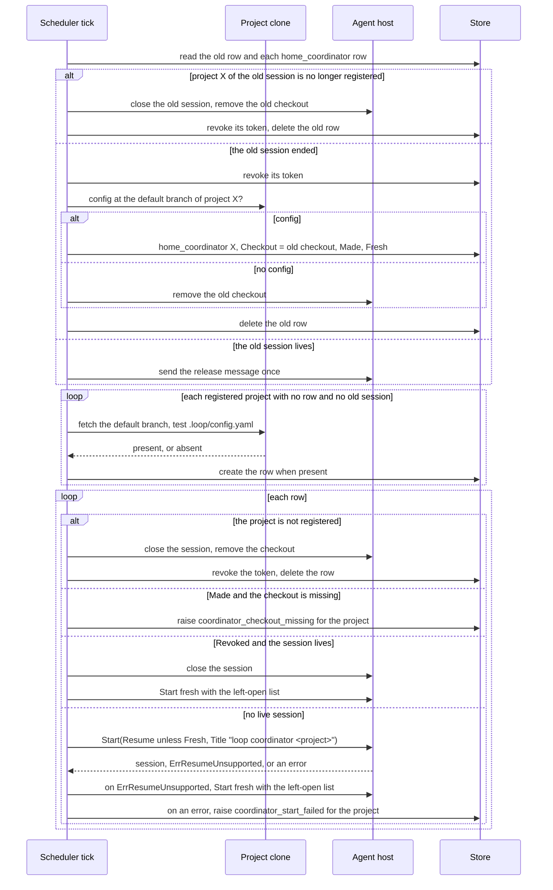
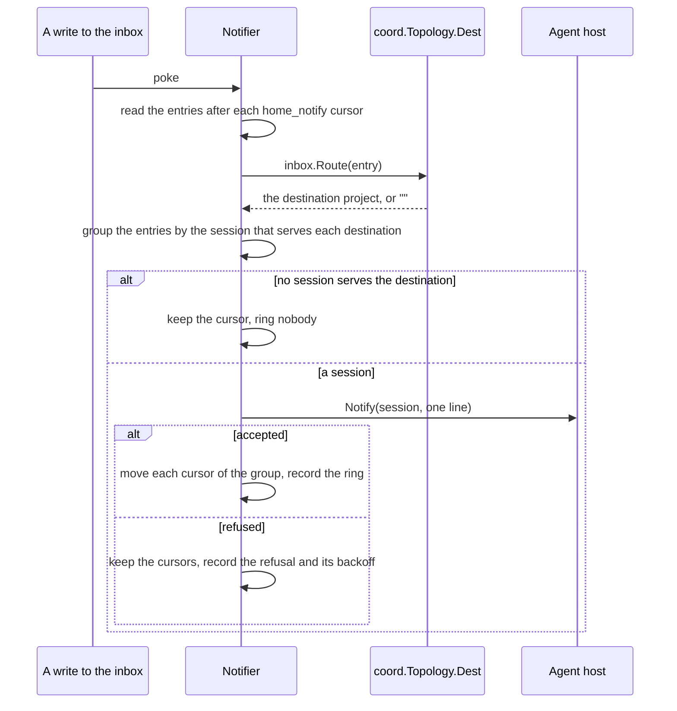
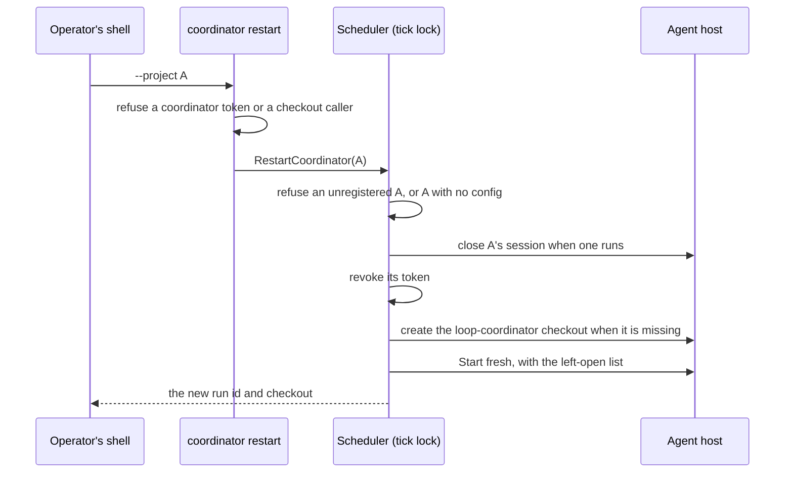
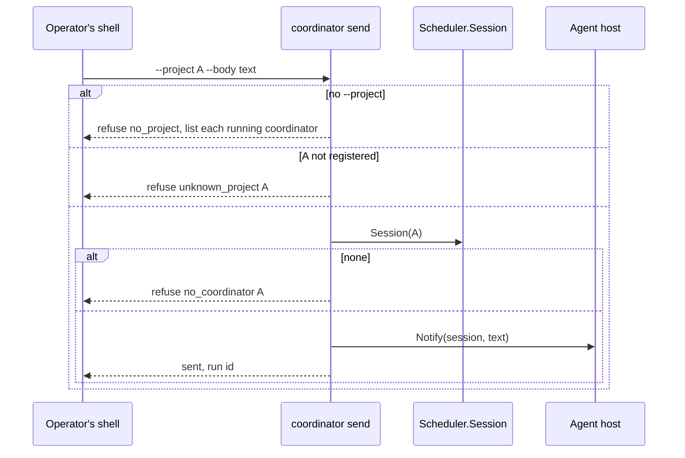
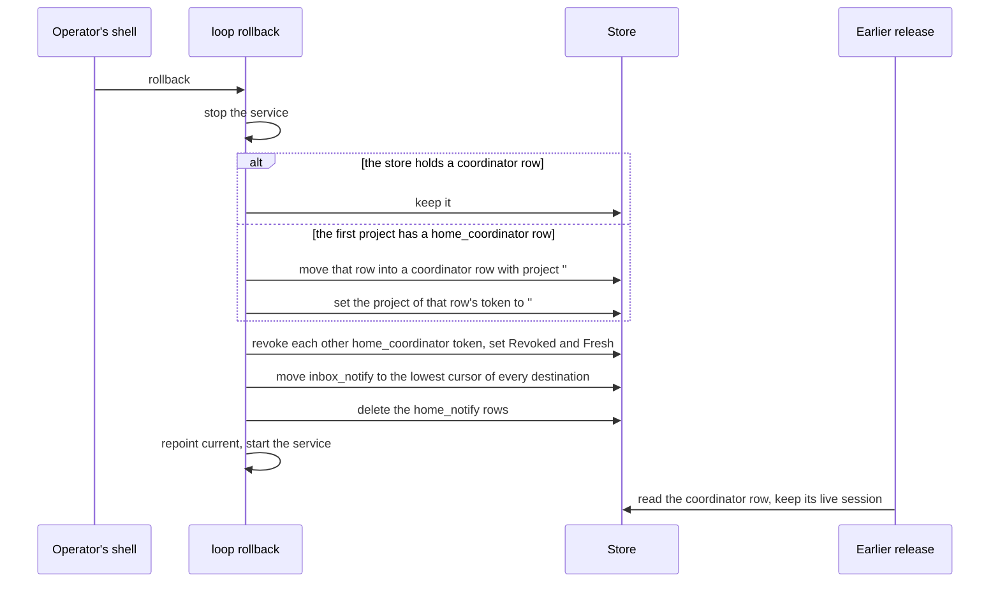

# Give each project its own home coordinator: technical spec

## Source

- **Epic:** factorio-1edo
- **Source:** `docs/prd/project-home-coordinators.md`, merged at `27b95a8`, and
  `docs/adr/0015-one-home-coordinator-per-project.md`, merged at `a7ca870`. ADR 0015 is the one ADR
  whose `**Ticket:**` line names factorio-1edo. ADR 0015 amends decision 3 of
  `docs/adr/0004-operator-visibility.md` and decision 4 of `docs/adr/0010-approval-is-enough.md`.
  By `loop-sdlc-documents` § 5, the later ADR wins each conflict.
- **Stories covered:** US-01, US-02, US-03, US-04, US-05, US-06, US-07.

The PRD numbers its acceptance criteria A1 to A30. ADR 0015 numbers its decisions 1 to 6. This spec
cites both by those numbers, and cites a PRD requirement by its line at `27b95a8`, such as PRD
L206.

This run read the loop at `a7ca870` on 2026-11-04. Each file and line below is at that commit.
Round 2 read the base again at `c8b5ccf`. The overwatch sweep gained the `starved` part there. No
line that this spec cites moved. Round 3 read the base at `0dd5218`. It changes no file that this
spec cites. Round 4 read the base at `8d687c5`. It adds the `files_in_flight` admission rule and
changes `internal/overwatch/overwatch.go` after line 150. No line that this spec cites moved. The
new rule stops a ticket from starting while a live implementer run holds its files. So work
entries 10 and 11, which both change `internal/cli/surface.go`, land one after the other. Round 5
read the same base, `8d687c5`.

## Scope check

**Components:**

1. **The loop server.** It holds these parts:
   - the coordinator sessions of the scheduler in `internal/sched`
   - the token and the capability check in `internal/rpc` and `internal/cli`
   - the doorbell in `internal/inbox` and `internal/server`
   - the overwatch ring in `internal/overwatch`
   - the rollback in `internal/release`
   - the verbs `loop coordinator send` and `loop coordinator restart`
2. **The coordinator's text.** `pack/runbooks/coordinator.md`, the glossary entry in
   `pack/skills/loop-sdlc-glossary/SKILL.md`, and `docs/operating.md` § Talk to the coordinator. The
   text is not its own epic. The runbook must tell a project's coordinator which sections it skips.
   The server's refusals are the only reason those sections change. A runbook that changed first
   would tell the one coordinator of today to skip the loop's own work.

Work entries 1 to 6 build server parts that change no behaviour while one coordinator runs, except
one case. When two registered projects hold the loop's repository, work entry 1 makes
`retro.loopProject` and the `bugs` part name no loop project. Work entry 7 starts one coordinator
for each project. The PRD scope check asks US-01 to US-04 to merge together (PRD L115-L122). Work
entries 1 to 7 are that one change. Work entry 9 lands directly after work entry 7. Work entry 8
lands directly after work entry 9 and changes the runbook. Work entries 9, 10 and 11 build US-06,
US-05 and US-07, each alone. Work entry 12 changes the operating guide.

The old session is the one coordinator session that runs when this release first starts. Work
entry 7 builds no part of US-07. It starts each next session fresh, as today. It writes the
left-open list only into the first session after the old session (PRD L200-L204, US-01), and into
the next session of a row that a rollback's hand-back marked `Revoked`. Work entry 11 adds the
resume and the left-open list for every next session, because the PRD merges US-07 alone.

**Not in this spec:**

- The conditional skills of a coordinator. The conditional-kernel-skills epic owns them (PRD
  § Boundaries).
- The steps of the retro's rule comparison. The retro epic owns them.
- The parts of the overwatch sweep. ADR 0009 owns them. This spec changes only which coordinator
  each finding rings.
- The settings change path. The project-scoped-settings epic owns it.

## Decisions

### Answers a person already gave

- **One coordinator for each registered project with a project config, and the loop project's
  coordinator serves the instance-wide work.** The operator signed off ADR 0015 by its merge at
  `a7ca870`. ADR 0015 also answers the PRD's open question on whether this needs an ADR.
- **The old session keeps its unscoped token until it ends.** The PRD says so at L188-L196. The
  doc-reviewer's round 2 of ADR 0015 named this choice as the operator's. This spec keeps it.
- **Only the operator's shell runs `loop coordinator restart`.** ADR 0015 decision 6 and PRD
  L308-L310.

### The loop project

- **The loop project is the one registered project whose repository is `release.ReleaseRepo`.** We
  chose this over a new host config key. It needs no operator step on any host, and it can never
  name a project that is not registered. ADR 0015 decision 5 leaves the choice to this spec. The PRD
  names "the repository the loop releases from" as one answer (PRD L449-L452). `release.ReleaseRepo`
  is `slothware-labs/factorio` (`internal/release/upgrade.go:25`), and `coord.LoopRepo` holds a copy
  of it. The match ignores case. When no registered project matches, or more than one does, the host
  has no loop project.
- **With no loop project, the instance-wide work rings no coordinator, and it waits in the inbox.**
  We chose this over handing it to another project's coordinator. That puts the loop's own work
  into a conversation about one unrelated project, which US-02 forbids. ADR 0015 decision 5 leaves
  this case to the spec. The operator reads the waiting entries with `loop inbox list` from a
  shell, and runs the host verbs there. Work entry 7 admits the host on `loop inbox list`, in the
  same change that stops each ring to `""`. This answers the PRD's first open question.
- **The server reads the loop project at each call and each tick.** We chose this over a flag that
  the server writes into a token when it issues it. The operator can register or remove the loop
  project while a token lives. With a stale flag, a token keeps the instance-wide verbs after its
  project stops being the loop project.

### Where each entry and finding rings

- **One function, `coord.Topology.Dest`, names the coordinator for each entry and each finding.
  The doorbell, `loop inbox list`, `loop inbox wait` and `loop overwatch sweep` all call it.** We
  chose one function over a filter in each verb. A ring that reaches one coordinator while the
  entry lists under another is the fault that A5 and A6 test.
- **A ring goes to the session that serves the destination project, and the entries that one session
  serves share one ring.** We chose this over one ring for each project, because work entries 4 to 6
  land while one coordinator serves every project. A poke is one call of `Notifier.Poke`, which the
  server makes after a write to the inbox (`internal/server/inbox.go:207`). Each poke then still
  rings that session once, as today.
- **`inbox list` and `inbox wait` return the entries whose destination the caller's session
  serves.** We chose the session over `Caller.Reaches`. The old session's token names no project, so
  it reaches every record. After work entry 7, a filter by reach lists B's entries to the old
  session. B's own coordinator gets their rings. Before work entry 7, one session serves every
  destination, so the list holds every entry, as today. The old session keeps its unscoped token, as
  the operator chose. Only its list changes.
- **The old session is the coordinator of its own project X until it ends, also when X has no
  project config.** PRD L176-L178 gives a project with no config no coordinator. PRD L193-L196 makes
  the old session X's coordinator until it ends. We read L193 as a transition rule. While the old
  session lives, L193 wins over L176. L200-L204 then settles what X gets when the old session ends.
  ADR 0015 at L149-L152 makes the old session the coordinator of that project, with no exception for
  config. The later signed-off document settles the pair. So X's entries ring the old session, and
  not the loop project's coordinator.

### Scope of a coordinator's verbs

- **Each coordinator verb names its scope in `cli.Surface()`, and `cli.DeriveMatrix` refuses a
  coordinator verb with no scope.** We chose a field that the build checks over a check in each
  handler. ADR 0015 decision 4 binds every later epic, and a handler check that a later epic
  forgets fails with no error. The scope is `project` or `instance`, the two words of decision 4.
- **`rpc.Server.authorize` enforces the scope for each coordinator token that names a project.**
  We chose one check before every handler over a check in each service. Today `room` and
  `pipeline` test `p.Kind == cli.PrincipalCoordinator`, and `inbox` and `decision` rely on the
  matrix alone. None of them reads a project. One place reads the record's project and the
  caller's reach.
- **`rpc.Call.Project` keeps the coordinator exemption.** `authorize` refuses another project's
  record and `--project` for a scoped token before any handler runs. So the exemption admits only
  what `authorize` admitted. We chose this over dropping the exemption, because the handlers of
  `work create` (`internal/pipeline/adhoc.go:44`) and the machine verbs
  (`internal/machine/verbs.go:110`) call `Call.Project`. Without the exemption they refuse the
  loop project's coordinator on the records of another project that `authorize` admitted.
- **The scope binds a read as it binds a write.** A project's coordinator reads only its own
  project's records, and a list verb lists only them. We chose this over open reads, because PRD
  L223-L226 binds every coordinator verb on a record, and US-02 promises a conversation about one
  project.
- **The loop project's coordinator reaches another project's record only through an entry.** It runs
  a project-scoped verb on that record only when an entry that rings it names the record. A loop
  fault entry names its project, its item and its run. So the loop project's coordinator reads the
  run that reported the fault, by runbook § 9 step 2. We chose this over open reads for the loop
  project's coordinator, because PRD L238-L240 grants it the entries that ring it, and nothing more.
  The loop project's coordinator also reads the registration of every project with `project list`
  and `project show`. PRD L258-L259 lets it read each project's default branch for the `rules` part.
- **`project list` and `project show` stay open to every coordinator, and the scope binds them.**
  A project's coordinator lists and shows its own project. We chose this over a refusal. The
  runbook's own-project steps read `project show` for the project's user skills, and a refusal
  stops no write. This answers the PRD's third open question.
- **The server admits the loop project's coordinator's `work create --kind bug --project <B>` only
  when the body names a loop fault whose project is B.** We chose this check over admitting any bug
  in any project, because PRD L231-L235 allows only the filing of a loop fault. The runbook keeps
  the check of the project's policy (§ 9 step 3), because the server cannot read what a policy
  means.
- **`fault show` and `fault list` from a project's coordinator name only its own project's
  faults.** We chose this over open fault reads, because ADR 0015 decision 4 refuses an
  instance-wide verb to a project's coordinator. A run keeps its fault reads as today, because this
  epic changes only coordinators.
- **`stage pause` and `stage resume` with no `--project` act in every project for the loop
  project's coordinator and for the old session.** We chose this over the caller's own project for
  the old session, because its token names no project. Before work entry 7 it is the one
  coordinator of today, and its pause acts in every project as ADR 0004 decision 3 says.

### Sessions and state

- **Each project's coordinator state is a `schedule` row of the new kind `home_coordinator`, keyed
  by project. The row of today, kind `coordinator` with an empty project, stays only for the old
  session. The server deletes it when that session ends.** We chose new kinds over rewriting the
  old row in place. A release before this one reads `kind = 'coordinator'` with one `QueryRow`
  (`internal/sched/coordinator.go:63`). After a rollback it acts on an arbitrary project's row. New
  kinds keep `min_reader_schema` at 1.
- **A rollback past this release hands one coordinator back to the earlier release.** `loop
  rollback` runs a hand-back after it stops the service and before it repoints `current`. We chose
  this over a raised `min_reader_schema`, because that refuses every rollback past this release and
  leaves the operator only `loop restore`. We chose it over no hand-back too. With no `coordinator`
  row, the earlier release tries to create `loop-coordinator` in its first project
  (`internal/sched/coordinator.go:175-185`). A `home_coordinator` row already holds that path. The
  Approach states the steps and what the operator sees.
- **The hand-back clears the project of the handed-back session's token.** We chose this over a
  token that still names its project. At the next upgrade to this release, that session is the old
  session, and only a token with no project is `Unscoped`. A token that names A would bind the old
  session to A while it still serves every project.
- **The start rule reads `.loop/config.yaml` at the fetched head of the default branch, on each
  tick, for each registered project with no `home_coordinator` row.** We chose this over the
  config loader's cache. That cache holds a read for 30 seconds (`internal/server/sched.go:92`),
  and A3 bounds the start at one tick of 15 seconds. The rule asks whether the file exists. A file
  that does not parse still starts the coordinator, and its `project_config_invalid` alert rings
  that coordinator.
- **The list of the work that a previous session left open goes into the new session's prompt
  file.** We chose the prompt over a message after the start. The agent host can refuse a message,
  and a refused list needs a record and a retry. The list names each unanswered question of the
  project, and each open room of the project that a coordinator opened. It also names each entry
  after the project's doorbell cursor.
- **A next session resumes its conversation through a new `StartSpec.Resume`, and the orca host
  answers `ErrResumeUnsupported`.** We chose this over `orca terminal create --command "claude
  --continue"`. That command skips `orca agent launch`. The flags of `orca agent launch` disable
  permission prompts. They also let orca track the session as an agent
  (`internal/agenthost/orca/start.go:14-21`). So on this host every next session starts fresh,
  with the left-open list (A25). A host that can resume takes the A24 path. PRD L282-L283 asks for
  a resume only "when the harness can resume it".
- **The tick closes the coordinator of a removed project, as it closes the one coordinator today.**
  We chose the tick over a hook in `project remove`. The tick already owns every start and close of
  a coordinator session. A second path can start and close one session at the same time.
- **`loop coordinator restart` runs in the scheduler under the tick's lock.** We chose this over
  a server handler that writes the row, so the tick and the verb never both start a session for
  one project.
- **Every coordinator takes one harness, model and effort, from `CoordinatorConfig`.** We chose
  this over a model for each project in project config, because no story asks for one.
- **A coordinator's terminal title is `loop coordinator <project>`.** We chose this over the
  repository name, because the project id is what every verb names.

### The send verb

- **`loop coordinator send` with no `--project` refuses, and its hint lists each project with a
  running coordinator.** We chose this over the project of the clone that the shell runs in.
  US-05 says "the coordinator of one project that I name". A wrong guess types the message into
  another project's conversation. This answers the PRD's second open question from the story's
  words.
- **`--project` is an optional flag, and the server refuses a call without it.** We chose this
  over a required flag. The parser refuses a missing required flag with `missing_flag`
  (`internal/cli/parse.go:155-157`) before the server runs, so the hint that lists the running
  coordinators never prints.

### Overwatch

- **Each `overwatch.Finding` names its project, and each part sets it.** We chose a field over a
  parse of the key. The key grammar puts the project in a different segment for each part. Three
  kinds ring the loop project's coordinator (PRD L213-L214, L255-L260): a finding with no project, a
  finding of the `rules` part, and an UNREAD line.
- **`overwatch.Split` reads each part's `Reading` before `classify` turns the findings into
  lines.** We chose the readings over the `Report`. A `PartReport` holds only `Lines []string`
  (`internal/overwatch/overwatch.go:66-72`). So a split over a report must parse the text to find
  the project. The decision above rejects that parse.

## Assumptions

- A host runs at most about five projects, as this host does. The start rule fetches the default
  branch of each project with no coordinator on each tick. This is wrong if `loop stage list`
  shows a tick that takes longer than its 15-second interval.
- `orca agent launch` takes no flag that resumes a conversation. `orca agent launch --help` on
  this host on 2026-11-04 lists none. This is wrong once orca adds one, and then the orca host
  implements `StartSpec.Resume`.
- The registration of factorio on this host names `slothware-labs/factorio` as its repository.
  This is wrong if `loop project show factorio`, from the operator's shell, names a fork.
- Every inbox entry kind except `question` carries its project in `inbox.Entry.Project`, as
  `internal/inbox/entries.go` sets it. This is wrong if a kind leaves the field empty for an entry
  about one project. That entry then rings the loop project's coordinator.

## Approach

**One package holds the rules.** A new package `internal/coord` holds the loop project, the
topology and the reach of a caller. It reads no store and starts no session, so every rule in it
has a table test. The scheduler builds a `coord.Topology` from its rows on each tick, and the
server reads the latest one for each call.

**The loop project.** `coord.LoopProject` reads the registered projects and returns the one whose
repository is `coord.LoopRepo`. Every caller that needs the loop project asks it again. No
token or row stores the answer. The brief holds a copy for the runbook to read, and no server part
reads that copy.

`coord` cannot import `release`. `release` imports the server. The server imports `rpc`
(`go list -deps ./internal/release`). From work entry 3, `rpc` imports `coord`. So `coord` holds
its own constant `LoopRepo`, and a test holds it equal to `release.ReleaseRepo`, as
`internal/retro/route.go:18-21` does today. Two packages keep their own copy of the rule today.
`retro.loopProject` (`internal/retro/route.go:308-315`) and the `bugs` part of overwatch
(`internal/overwatch/bugs.go:63-67`) each match one repository. Both then call `coord.LoopProject`,
so all three agree when two registered projects match. Then none of them names a loop project.

**Routing.** `coord.Topology.Dest(project, instanceWide)` returns the project whose coordinator
gets an entry or a finding. Instance-wide work goes to the loop project. A project that has a
coordinator gets its own work. A project that has none, because its default branch holds no
config, sends its work to the loop project.

`inbox.Route` decides `instanceWide` for an entry. These entries are instance-wide:

- a loop fault
- an alert of a failed coordinator start, of one of three kinds:
  - `coordinator_start_failed`
  - `coordinator_checkout_missing`
  - `config_conflict` whose dedupe key names the `coordinator` stage
    (`internal/sched/coordinator.go:186-187`)
- an entry with no project

An alert entry carries its kind in `Entry.Status`. The alerts query also reads `dedupe_key` into
a new field `Entry.Dedupe`. The JSON of an entry does not hold that field.

A question routes by the project of the coordinator that prepared it. A question with project
`''` routes by the entry it names. `inbox.Route` reads the `Project` of that entry. A question with
no entry, or whose entry no longer lists, routes to the loop project. Entry ids such as `alert/<n>`
and `room/<id>` hold no project, so the id alone cannot route.

`overwatch.Route` returns `instanceWide` for three kinds of finding: a `rules` finding, a finding
with no project, and an UNREAD line.

**The doorbell.** `inbox.Notifier` keeps one cursor for each destination project, in rows of kind
`home_notify`. A poke reads the entries after each cursor, and groups them by the session that
serves each destination. It rings each session once, and moves each cursor of an accepted ring. A
destination with no session keeps its cursor. So the next session's first ring names each entry
it missed (A19).

The server's `Sessions` interface names the session for a project. Before work entry 7 it returns
the one coordinator for every project. It also returns the one coordinator for the destination
`""` of a host with no loop project. So each ring reaches the one coordinator, as today. After work
entry 7 it returns the project's `home_coordinator` session, or the old session for the old
session's project. It returns no session for `""`.

**The overwatch ring.** The job sweeps once, as today. `overwatch.Split` takes the readings of
that sweep and returns one report for each destination project. Each session gets a ring with the
reports of the projects it serves. A note goes to the loop project's report, because a note holds
no work. `loop overwatch sweep` prints the findings that route to the caller. The host gets the
whole report.

**Scope.** Each verb in `internal/cli/surface.go` whose callers include `coordinator` or `host
coordinator` carries `Scope: ScopeProject` or `Scope: ScopeInstance`. `rpc.Server.authorize`
runs the scope check after the matrix, for a coordinator token. These are its steps:

1. Build a `coord.Caller` from the token's project and the current topology. A token with no
   project is the old session, and no scope binds it. The check ends there for it.
2. For an instance-wide verb, admit only the loop project's coordinator. On a host verb, admit
   the host too.
3. For a project-scoped verb, ask the `rpc.RecordResolver` for the project of each record that
   the call names. The records are the item, entry, decision, room, alert, setting, run, learning,
   fault or registration argument, the `--entry` flag and the `--project` flag. The `project`
   argument of `settings show` and `settings set` is a setting. The `project` argument of
   `project show` is a registration.
4. Refuse a record of another project that the caller does not reach. The refusal is
   `CAPABILITY_DENIED`, rule `other_project`, and its hint names the owner.
5. For the loop project's coordinator, check `--project` of another project B last. Admit it only
   when the call names at least one other record, and each other record is a record of B that the
   caller reaches. Admit `work create --kind bug` by the fault rule. Refuse a bug that names no
   fault of B with `fault_bug_only`. Refuse every other call with `--project` B and no other record
   with `other_project`.
6. Pass the caller to the handler in the context. A list verb filters its rows by
   `Caller.Reaches`. `inbox list` and `inbox wait` keep an entry when the session that `Sessions`
   names for its destination is the caller's run.

The loop project's coordinator also reaches each record that an entry names, when that entry routes
to the loop project. The resolver asks the inbox for the open entries that route to the loop
project. It compares each entry's own id, item and run with the record. An entry names no setting
and no registration, so an entry of B never lets the loop project's coordinator change B's settings.

**Stage pause.** `loop stage pause` and `loop stage resume` with no `--project` act on the
caller's project. From the loop project's coordinator and from the old session they act in every
project, as ADR 0004 decision 3 says. ADR 0015 wins that conflict, and nobody edits ADR 0004.

**Sessions.** `Scheduler.ensureCoordinators` replaces `ensureCoordinator`. On each tick it does
these steps, in this order:

1. Read the old row. Then act on the first case that holds:
   - X is no longer registered. Close the old session, revoke its token, remove its checkout and
     delete the old row.
   - The old session ended. Revoke its token, run the hand-over of PRD L200-L204, and delete the
     old row. When X has a config, the hand-over writes X's `home_coordinator` row. The row holds
     the old checkout, and the hand-over sets `Fresh` and `Made`. The server made the old
     checkout, so a missing directory is an alert.
   - The old session lives. Send it the release message once, as `tellCoordinatorRelease` does
     today.
2. For each `home_coordinator` row whose project is no longer registered, close the session,
   revoke the token, remove the checkout and delete the row. Work entry 9 builds this step.
3. For each registered project with no row and no old session, fetch the default branch with
   `BaseHead`, and test for `.loop/config.yaml` at that head. When the file is there, create the
   row.
4. For each row, keep a live session, rebind a moved one as today, or start the next one. For a
   row that a rollback's hand-back marked `Revoked`, close its live session first. When the server
   made the checkout and the checkout is missing, start nothing. Raise the alert
   `coordinator_checkout_missing`, which names `loop coordinator restart --project <project>`.

When one project fails, the tick raises that project's alert and continues with the next project.
Each start writes a brief whose `project` names the project. The brief's new `loop_project` field
is true for the loop project's coordinator. Each start issues the token with `Project` set.

**The first message.** A start follows one of three cases:

- After the old session's hand-over, a restart or a rollback's hand-back, the row holds `Fresh`.
  The scheduler writes the left-open list into the prompt file and starts fresh.
- From work entry 11, any other start sets `Resume`. When the host answers
  `ErrResumeUnsupported`, the scheduler writes the left-open list into the prompt file and starts
  fresh.
- Before work entry 11, any other start is fresh with no list, as today.

A session that starts clears `Fresh`.

**Restart.** `loop coordinator restart --project <p>` is a host-only server verb. Its handler
calls `Scheduler.RestartCoordinator`, which does these steps under the tick's lock:

1. Refuse an unregistered project, or one with no config at its default branch.
2. Close a running session, and revoke its token.
3. Create the checkout again when it is missing.
4. Start a fresh session with the left-open list.

**Send.** `loop coordinator send --project <p> --body <text>` types the text into the session
that `Sessions` names for p. It refuses an unregistered project, a project with no running
coordinator, and a call with no `--project`.

**Rollback.** `release.Rollback` gains a `HandBack` step. It runs after the service stops and
before `current` moves. `cmd/loop` sets it to a closure that calls `sched.HandBack` with the
store and the registered projects. `HandBack` does these steps:

1. When the store holds a `coordinator` row, keep it. The earlier release finds its old session.
2. Otherwise, move the `home_coordinator` row of the first registered project into a `coordinator`
   row with project `''`. The earlier release names that project as the coordinator's
   (`cmd/loop/serve.go:218-220`), so it keeps that session. The session keeps its token, and
   `HandBack` sets that token's `run_tokens.project` to `''`. The token then names no project, as
   the earlier release's own coordinator token does (`internal/sched/coordinator.go:291-292`). At
   the next upgrade to this release, that session is the old session, and its token is
   `Unscoped`. When that project has no row, move none. The earlier release then starts its
   coordinator there, as before this release.
3. Revoke the token of each other `home_coordinator` row, and set its `Revoked` and `Fresh`.
4. Move the `inbox_notify` row to the lowest cursor over every destination of the topology. A
   destination with no `home_notify` row counts at the `inbox_notify` value, so the row then stays
   where it is. Delete each `home_notify` row. Delete each `coordinator_ring` row whose project is
   not `''`. The earlier release then rings the one coordinator once for each entry that a
   destination did not ring yet. At the next upgrade to this release, each cursor starts at the
   `inbox_notify` value that the earlier release moved. So no stale cursor rings an entry again.

After the rollback, the operator sees one coordinator that the earlier release rings for every
project. That session gets the earlier release's release message. Each other `loop coordinator
<project>` terminal stays open. Each of its verbs refuses, because the hand-back revoked its
token. The operator may close those terminals. At the next upgrade to this release, step 4 of the
tick closes each live session of a `Revoked` row. It then starts that project's next session
fresh.

**Text.** The runbook stops calling itself the one resident agent. It names the sections that
only the loop project's coordinator follows:

- § 9 Loop faults
- the `rules` part of § 9
- the host verbs of § 4
- the every-project pause of § 3

It tells each coordinator to read `project` and `loop_project` in `.loop/brief.json`. The
operating guide names these changes:

- one coordinator for each project
- the start at loop-init's merge
- `--project` on send
- the restart verb
- the removal that moves no coordinator

## Domain model

```
internal/coord (new)

Topology            the coordinators of one instance, at one tick
  Loop    string            the loop project, "" when the host has none
  Homes   set of project    each project with a home_coordinator row
  Old     string            the project of the session from before this release,
                            "" once it ended
  invariant: Loop, when not "", is a registered project. Old is not in Homes.
  Dest(project, instanceWide) string
    instanceWide                     -> Loop
    project in Homes                 -> project
    Old != "" and project == Old     -> project
    otherwise                        -> Loop
  invariant: Dest returns exactly one project or "". "" means the host has no loop project.
             After work entry 7 no session serves "", so that work waits in the inbox.

Reach               a tagged union: what one coordinator token may act on
  Unscoped                  the old session: every record, every verb, as today
  Loop(project)             its project, each record that an entry routed to it names,
                            every project's registration, and every instance-wide verb
  Project(project)          its project only
  invariant: a token that names a project is never Unscoped. Only a token with no project,
             which only the old session holds, is Unscoped.

Caller              one coordinator token, read against the topology of one call
  Reach    Reach
  Project  string           the token's project, "" for the old session
  Routed   func             whether an open entry that routes to the loop project names a record
  Reaches(ctx, record) (bool, error)
  Admits(scope)        bool ScopeInstance admits Loop and Unscoped only

Record              Kind (item, entry, decision, room, alert, setting, run, fault, learning,
                    registration, project), ID, Project
                    Kind project is the --project flag of a call.
```

```
internal/sched (changed)

CoordinatorState    one project's coordinator: the payload of a home_coordinator row
  + Made     bool           the server made Checkout, so a missing directory is an alert,
                            and not a first start
  + Fresh    bool           the next session starts fresh with the left-open list.
                            The old session's hand-over, a restart and a rollback's
                            hand-back set it. A session that starts clears it.
  + Revoked  bool           a rollback's hand-back revoked the token of Session.
                            The tick closes that session, clears Revoked, and starts
                            the next one fresh.
  invariant: Project is the row's project and never changes. Session is nil or names a
             session whose checkout is Checkout.

Home lifecycle (a state machine over one row)
  none        -- config on the default branch -->     starting
  starting    -- session started -->                  running
  starting    -- start failed -->                     starting, with the alert of PRD L185
  running     -- session ended -->                    starting   (Resume unless Fresh)
  running     -- operator restart -->                 starting   (Fresh)
  running     -- rollback hand-back -->               revoked    (token revoked)
  revoked     -- the tick of this release -->         starting   (session closed, Fresh)
  any         -- checkout missing and Made -->        missing    (alert, no start)
  missing     -- operator restart -->                 starting   (checkout made again)
  any         -- project removed -->                  none       (row deleted)
```

The old row keeps the type `CoordinatorState` and stays outside `Topology.Homes`. One branch at
the top of the tick handles it. `Topology.Old` and `Sessions` also read it.

## Interfaces

```go
// internal/coord

// LoopRepo is release.ReleaseRepo. coord cannot import release, so a test holds the two equal.
const LoopRepo = "slothware-labs/factorio"

func LoopProject(ps []config.Project) (id string, ok bool)

type Topology struct {
	Loop  string
	Homes map[string]bool
	Old   string
}

func (t Topology) Dest(project string, instanceWide bool) string

type Reach int

const (
	ReachProject Reach = iota
	ReachLoop
	ReachUnscoped
)

type Caller struct {
	Reach   Reach
	Project string
	// Routed reports whether an open entry that routes to the loop project names r.
	Routed func(ctx context.Context, r Record) (bool, error)
}

// CallerOf reads a coordinator token's project against the topology. An empty project is
// the old session.
func CallerOf(tokenProject string, t Topology, routed func(context.Context, Record) (bool, error)) Caller
func (c Caller) Reaches(ctx context.Context, r Record) (bool, error)
func (c Caller) Admits(s cli.VerbScope) bool
```

```go
// internal/cli
type VerbScope string

const (
	ScopeProject  VerbScope = "project"
	ScopeInstance VerbScope = "instance"
)

type Verb struct {
	// ...each field of today...
	// Scope is required on a verb whose callers name "coordinator" or "host coordinator".
	Scope VerbScope `json:"scope,omitempty"`
}
```

The two lists below give the scope of each coordinator verb at `a7ca870`. `loop schema` prints
the scope after work entry 2.

The verbs of scope `project`, by noun:

- `work`: `peek`, `show`, `list`, `edit`, `note`, `block`, `unblock`, `cancel`, `shape`, `ask`,
  `duplicate`, `supersede`, `create`
- `run`: `show`, `list`, `events`
- `pr pending`, `merge status`, `overwatch sweep`
- `decision`: `file`, `list`, `fire`, `defer`, `settle`, `moot`
- `fault`: `report`, `show`, `list`
- `inbox`: `list`, `answer`, `defer`, `prepare`, `wait`, `note`
- `room`: `open`, `close`, `list`
- `epic`: `create`, `adr`, `skip-design`, `accept-difference`
- `stage`: `pause`, `resume`, `list`
- `settings`: `show`, `set`
- `project`: `list`, `show`

The verbs of scope `instance`:

- `fault ack`, `fault resolve`, `retro compared`, `coordinator upgrade`
- the host verbs `upgrade`, `rollback`, `doctor`, `doctor-github`, `doctor-env`

`stage pause` and `stage resume` with no `--project` from the loop project's coordinator act in
every project. That case is instance-wide work by PRD L164. The handler checks that
`Caller.Reach` is `ReachLoop` or `ReachUnscoped`.

```go
// internal/rpc
// RecordResolver names the project of each record a call names. The server
// builds it over the machine, the inbox, rooms, decisions, runs, faults and retros.
type RecordResolver func(ctx context.Context, inv cli.Invocation) ([]coord.Record, error)

type Options struct {
	// ...each field of today...
	Records  RecordResolver
	Topology func() coord.Topology
}

// CallerFrom returns the coordinator caller of the call, for a service that filters a list.
func CallerFrom(ctx context.Context) (coord.Caller, bool)
```

```go
// internal/inbox
func Route(e Entry, t coord.Topology) string

type Entry struct {
	// ...each field of today...
	// Dedupe is an alert's dedupe key. Route reads it, and JSON leaves it out.
	Dedupe string `json:"-"`
}

// Sessions names the coordinator session that serves a project.
type Sessions func(project string) (agenthost.RunID, bool)

type Notifier struct {
	Inbox    *Inbox
	Ring     func(ctx context.Context, id agenthost.RunID, text string) error
	Sessions Sessions
	Topology func() coord.Topology
}
```

```go
// internal/overwatch
type Finding struct {
	Key     string
	Line    string
	At      time.Time
	Project string // the project the finding is about; "" for the instance
}

// Readings is one sweep before classify turns its findings into lines.
type Readings struct {
	At            time.Time
	Parts         []PartReading
	Records       Records
	RecordsUnread string
}

type PartReading struct {
	Part    Part
	Reading Reading
	Unread  string
}

// ReadAll runs every part, as Sweep does today. Sweep is ReadAll, then Report.
func ReadAll(ctx context.Context, w World, parts []Part) Readings
func (r Readings) Report() Report

func Route(part string, f Finding, t coord.Topology) string

// Split returns the report of each destination project.
func Split(r Readings, t coord.Topology) map[string]Report

type World interface {
	// ...each method of today, with these two changed...
	Coordinators() map[string]sched.CoordinatorState
	LastRings(ctx context.Context) (map[string]RingOutcome, error)
}
```

```go
// internal/sched
func (s *Scheduler) Coordinators() map[string]CoordinatorState
func (s *Scheduler) Topology() coord.Topology
func (s *Scheduler) Session(project string) (agenthost.RunID, bool)
func (s *Scheduler) RestartCoordinator(ctx context.Context, project string) (CoordinatorState, error)

// HandBack runs in loop rollback while the service is stopped.
func HandBack(ctx context.Context, st *store.Store, ps []config.Project) error

// The alert kinds this epic adds. AlertCoordinator stays, and its alert now names its project.
const AlertCoordinatorCheckoutMissing = "coordinator_checkout_missing"
```

```go
// internal/release
type Rollback struct {
	Host
	// HandBack runs after the service stops and before current moves. Nil runs nothing.
	HandBack func(ctx context.Context) error
}
```

```go
// internal/agenthost
type StartSpec struct {
	// ...each field of today...
	// Resume asks the harness to continue the last conversation in Checkout.
	Resume bool `json:"resume,omitempty"`
}

// ErrResumeUnsupported is Start's answer when the host cannot resume. It starts nothing.
var ErrResumeUnsupported = errors.New("agenthost: this host cannot resume a conversation")
```

```go
// internal/brief
type Brief struct {
	// ...each field of today...
	LoopProject bool `json:"loop_project,omitempty"`
}
```

The CLI changes:

```
loop coordinator send [--project <project>] --body <text>   host; refused with no --project
loop coordinator restart --project <project>                host only; new
loop inbox list [--awaits <actor>]                          coordinator, and now host
```

The refusals:

| Verb | Code | Rule | When |
| --- | --- | --- | --- |
| any project-scoped verb | `CAPABILITY_DENIED` | `other_project` | a record of another project, and the hint names the owner |
| any instance-wide verb | `CAPABILITY_DENIED` | `loop_project_only` | a coordinator other than the loop project's |
| `work create` | `CAPABILITY_DENIED` | `fault_bug_only` | the loop project's coordinator, another project, and no fault of it in the body |
| `coordinator send` | `USAGE` | `no_project` | no `--project`, and the hint lists each running coordinator |
| `coordinator send` | `NOT_FOUND` | `unknown_project` | the project is not registered |
| `coordinator send` | `NOT_FOUND` | `no_coordinator` | no session runs for the project |
| `coordinator restart` | `NOT_FOUND` | `unknown_project` | the project is not registered |
| `coordinator restart` | `NOT_FOUND` | `no_project_config` | no `.loop/config.yaml` at its default branch |
| `coordinator restart` | `CAPABILITY_DENIED` | `principal_not_allowed` | a coordinator token |

## Data

```
schedule (existing table, new row kinds)
  kind 'home_coordinator', project <id>     payload: CoordinatorState JSON, one row for each
                                            project that has a coordinator
  kind 'home_notify',      project <dest>   due_at: the doorbell cursor of one destination
  kind 'coordinator_ring', project <dest>   payload: RingOutcome of the last ring to that
                                            destination, from work entry 5

questions (changed), migration 0023_question_project.sql, min_reader_schema: 1
  + project   TEXT NOT NULL DEFAULT ''      the project of the coordinator that prepared it
```

**Existing records.** The `coordinator` row with project `''` stays as the old session's row. The
tick deletes it when the session ends.

The `inbox_notify` row stays. From this release on, only `HandBack` writes it. Two writers touch
`home_notify` rows, each by its own rule:

- The Notifier moves a cursor. A destination with no `home_notify` row reads the `inbox_notify`
  value. The Notifier inserts the row when it first moves that cursor. It moves a cursor only from
  the value it read. When the row changed since that read, the poke reads the rows again.
- The tick inserts a project's `home_notify` row in the transaction that creates its
  `home_coordinator` row, and only when the project has no `home_notify` row. The row starts at the
  cursor of the destination that `Dest` returns for the project before the row exists. When that
  destination has no row, the row starts at the `inbox_notify` value. That destination's session got
  the project's entries until then, so no entry rings twice.

When this release first runs, no `home_notify` row exists. So each cursor starts at the
`inbox_notify` value, and no entry rings twice. The `coordinator_ring` row
with project `''` stops being the one ring record at work entry 5. From then on, it holds the ring
of the destination `""`. `LastRings` returns it only on a host with no loop project.

Each existing question keeps project `''`. `inbox.Route` routes it by the `Project` of the entry
it names, and a question with no entry routes to the loop project.

A release before this one reads none of the new kinds. It does not select the new column of
`questions`. A rollback's hand-back writes one `coordinator` row in the shape of today.

## Flows












## Work

1. **The loop project and the topology.** Add `internal/coord` with `LoopRepo`, `LoopProject`,
   `Topology`, `Dest`, `Reach`, `Caller`, `CallerOf` and `Record`. Work entry 3 adds
   `Caller.Admits`, because it takes `cli.VerbScope` from work entry 2. Make `retro.loopProject`
   read every registered project and call `coord.LoopProject`. Make the `bugs` part of overwatch
   name the loop project with `coord.LoopProject`, and delete its copy `loopRepo`. Nothing else
   calls `coord` yet.
   - Files: `internal/coord/**`, `internal/retro/route.go`, `internal/overwatch/bugs.go`,
     `internal/overwatch/export_test.go`, and their tests
   - Needs: nothing
   - Proves: C1, C2, C3
   - Done when: the table tests of `LoopProject`, `Dest` and `Caller.Reaches` pass, with the
     cases of none and two matching projects.
2. **Every coordinator verb names its scope.** Add `VerbScope` and `Verb.Scope`. Set the scope of
   each verb by the two scope lists of Interfaces. Make `DeriveMatrix` refuse a coordinator verb
   with no scope. `loop schema` prints the scope.
   - Files: `internal/cli/surface.go`, `internal/cli/capabilities.go`, `internal/cli/schema.go`,
     `internal/cli/*_test.go`
   - Needs: nothing
   - Proves: C4
   - Done when: a registry with a coordinator verb that names no scope fails `DeriveMatrix` with an
     error that names the verb.
3. **The capability check reads the scope.** Add `Caller.Admits`, `RecordResolver`,
   `Options.Records`, `Options.Topology` and `CallerFrom`. Run the scope check in `authorize` for a
   coordinator token with a project. Keep the coordinator exemption in `Call.Project`. Build the
   resolver in the server over the machine, the inbox, rooms, decisions, runs, faults and retros.
   Add `inbox.Route` and `Entry.Dedupe`. In this work entry, `inbox.Route` routes every question by
   the entry it names, because the `project` column of `questions` arrives in work entry 4. A
   question with no entry, or whose entry no longer lists, routes to the loop project. The resolver
   reads `inbox.Route` to find the entries that route to the loop project. Admit the loop project's
   `work create --kind bug` on another project only by the fault rule. Add `Scheduler.Topology`,
   `Scheduler.Coordinators` and `Scheduler.Session`. Until work entry 7 they read the one
   `coordinator` row:
   - `Topology` has `Loop` from `LoopProject`, `Homes` empty, and `Old` the row's project.
   - `Coordinators` holds the one row under the row's project.
   - `Session` returns the one session for every project and for `""`.

   A token with no project stays unscoped, so the one coordinator of today changes nothing.
   - Files: `internal/rpc/capabilities.go`, `internal/rpc/server.go`, `internal/server/scope.go`
     (new), `internal/server/server.go`, `internal/pipeline/adhoc.go`, `internal/inbox/route.go`
     (new), `internal/inbox/entries.go`, `internal/inbox/inbox.go`, `internal/sched/coordinator.go`,
     and the tests of each package
   - Needs: 1, 2
   - Proves: C5, C6, C7, C8, C9
   - Done when: for each verb of the `project` scope list, a test calls the verb with a token of
     project A on an item of project B. The verb refuses with `other_project`, and B's item does
     not change.
4. **List verbs filter by the caller.** Filter `work list`, `run list`, `pr pending`,
   `merge status`, `decision list`, `fault list`, `room list`, `stage list` and `project list` by
   `Caller.Reaches`. Filter `inbox list` and `inbox wait` by the session that `Sessions` names for
   each entry's destination. Add the `project` column of `questions` with migration
   `0023_question_project.sql`, and write it in `inbox prepare`. Read it into `Entry.Project` of a
   question, and make `inbox.Route` route a question with a project by that project. With no
   `--project`, make `stage pause` and `stage resume` act on the caller's project. For the loop
   project's coordinator and the old session, they act in every project.
   - Files: `internal/inbox/**`, `internal/store/migrations/0023_question_project.sql`,
     `internal/machine/verbs.go`, `internal/server/runs.go`, `internal/server/stages.go`,
     `internal/server/merge.go`, `internal/server/github.go`, `internal/server/handlers.go`,
     `internal/room/room.go`, `internal/decision/**`, `internal/fault/**`, and the tests of each
     package
   - Needs: 3
   - Proves: C11, C12
   - Done when: the inbox of a coordinator of project A, over a fixture with entries of A, B, a
     fault of B and an entry with no project, lists the entries of A only.
5. **The doorbell rings the session that serves each entry.** Change `Notifier` in three ways:
   - It keeps a cursor for each destination in `home_notify` rows, by the rules of the Data
     section.
   - It groups entries by `Sessions`.
   - It rings each session once.

   Write the ring record of each destination in its own `coordinator_ring` row.
   Change `World.LastRing` to `LastRings`, and read it in the `inbox` part.
   - Files: `internal/inbox/notify.go`, `internal/server/inbox.go`, `internal/server/overwatch.go`
     for `recordedRing`, `internal/overwatch/ring.go`, `internal/overwatch/overwatch.go`,
     `internal/overwatch/inbox.go`, and their tests
   - Needs: 4
   - Proves: C10, C13, C14
   - Done when: with one coordinator for every project, a poke over entries of two projects rings
     that session once, as before this work entry.
6. **The overwatch ring reaches each project's coordinator.** Add `Finding.Project`, and set it
   in each part, the `starved` part too. Add `Readings`, `ReadAll`, `overwatch.Route` and `Split`.
   Ring each session with its split. Filter `loop overwatch sweep` by the caller. Change
   `World.Coordinator` to `Coordinators`, and read it in the `inbox` and `worktrees` parts.
   - Files: `internal/overwatch/**`, `internal/server/overwatch.go`, and their tests
   - Needs: 5
   - Proves: C15, C16
   - Done when: a sweep fixture with a `stalls` finding of A and a `rules` finding of B rings A's
     session with `stalls`, and the loop project's session with `rules`.
7. **One coordinator for each project, and the hand-over from the old session.** Replace
   `ensureCoordinator` with `ensureCoordinators` over `home_coordinator` rows, by the Approach,
   except step 2 of the tick.
   This work entry adds these parts:
   - the start rule, the title and the scoped token
   - the brief's `project` and `loop_project`
   - the alert of a failed start that names its project
   - the release message for each session
   - the old session's hand-over, with the left-open list in the prompt
   - `Session`, `Topology` and `Coordinators` over the `home_coordinator` rows
   - the rollback's `HandBack`, and the close of a `Revoked` session
   - the host on `loop inbox list`, because from this work entry no session serves `""`
   - the `home_notify` row that the tick writes with each new `home_coordinator` row

   Delete `CoordinatorConfig.Project`, its setting in `cmd/loop/serve.go`, and its setting in
   `acceptance/world.go`. Step 2 of the tick is work entry 9's, so this work entry does not build
   it. A removed project's `home_coordinator` session keeps running until work entry 9 lands.
   Land work entry 9 directly after this work entry, and work entry 8 directly after work
   entry 9. Between this work entry and work entry 11, a missing checkout fails the start and
   raises `coordinator_start_failed`, as today. That alert routes to the loop project.
   - Files: `internal/sched/coordinator.go`, `internal/sched/scheduler.go`,
     `internal/sched/checkouts.go`, `internal/brief/brief.go`, `cmd/loop/serve.go`,
     `cmd/loop/release.go`, `internal/release/rollback.go`, `acceptance/world.go`,
     `internal/server/inbox.go` for `Sessions`, `internal/cli/surface.go` for the host on
     `inbox list`, and the tests of each package
   - Needs: 6
   - Proves: C17, C18, C19, C20, C21, C22, C23, C24, C25, C26, C33, C39, C40, C41
   - Done when: `grep -n 'The coordinator itself serves every' internal/sched/coordinator.go`
     prints nothing, and a test with two fixture projects and the fake agent host starts two
     sessions with two titles.
8. **The coordinator's runbook and the glossary.** Rewrite the opening of
   `pack/runbooks/coordinator.md` and the glossary entry for one coordinator for each project.
   Mark § 9, the `rules` part, the host verbs of § 4 and the every-project pause of § 3 as the
   loop project's coordinator's work. Tell each coordinator to read `project` and `loop_project`
   in `.loop/brief.json`. The runbook names no `loop coordinator restart` yet, because
   `make pack-check` checks each command of the pack against `cli.Surface()`
   (`internal/pack/cmd/pack-check/main.go:2-19`). Work entry 11 adds that verb and its line.
   - Files: `pack/runbooks/coordinator.md`, `pack/skills/loop-sdlc-glossary/SKILL.md`,
     `internal/pack/*_test.go`
   - Needs: 7, 9
   - Proves: C28
   - Done when: `grep -n 'one resident agent' pack/runbooks/coordinator.md` prints nothing, and
     `make pack-check` passes.
9. **Removal and registration again.** The tick closes the coordinator of a project that is no
   longer registered. It closes the session, revokes the token, removes the checkout and deletes
   the row. A registration again gets a new row, and a new checkout, by the start rule.
   - Files: `internal/sched/coordinator.go` and its tests
   - Needs: 7
   - Proves: C29, C30
   - Done when: a test removes project A of two, and B's session id stays the same.
10. **Send to one project's coordinator.** Add an optional `--project` to `loop coordinator send`.
    The server refuses a call without it with `no_project`. Add the other refusals of the
    Interfaces table.
    - Files: `internal/cli/surface.go`, `internal/server/inbox.go`, and their tests
    - Needs: 7
    - Proves: C31
    - Done when: a send to A types the text into A's fake session only.
11. **Restart, resume and a missing checkout.** Add `loop coordinator restart` and
    `Scheduler.RestartCoordinator`. Add `StartSpec.Resume` and `ErrResumeUnsupported`. Make the
    orca host and the fake host answer them. Write the left-open list into the prompt of each next
    session that does not resume. Raise `coordinator_checkout_missing` in place of a start.
    Add one line to `pack/runbooks/coordinator.md` that names `loop coordinator restart` as a verb
    that only the operator's shell runs.
    - Files: `internal/cli/surface.go`, `internal/sched/coordinator.go`,
      `internal/server/coordinator.go` (new), `internal/server/handlers.go`,
      `internal/agenthost/host.go`, `internal/agenthost/orca/start.go`,
      `internal/agenthost/fake/**`, `internal/agenthost/agenthosttest/contract.go`,
      `pack/runbooks/coordinator.md`, and their tests
    - Needs: 7, 8
    - Proves: C27, C32, C34, C35, C36, C37
    - Done when: a test deletes A's checkout and sees the alert. It runs the restart as the host.
      Then A's new session runs in a new checkout, and B's session id does not change.
12. **The operating guide.** Rewrite `docs/operating.md` § Talk to the coordinator. Make these
    changes:
    - Replace "The server starts it in Orca when the first project registers" with the start at
      loop-init's merge.
    - Replace "One coordinator serves every project" with one coordinator for each project.
    - Name the terminal title `loop coordinator <project>`, `loop coordinator send --project` and
      `loop coordinator restart --project`.
    - Name the host verbs that only the loop project's coordinator runs.
    - Replace "When you remove the coordinator's project, the server ends the session and starts
      the next one in a project that is still registered" with the removal of work entry 9.
    - Files: `docs/operating.md`
    - Needs: 9, 10, 11
    - Proves: C38
    - Done when: `grep -n 'One coordinator serves every' docs/operating.md` prints nothing.

## Out of scope

- A coordinator for a project on another host. The PRD § Out of scope never allows it.
- A change to what a coordinator does with an entry, a fault or a finding. The coordinator
  runbook keeps its steps. Work entry 8 changes only which coordinator takes each section.
- The conditional skills of a project's coordinator. The conditional-kernel-skills epic owns them,
  and `coordinatorPack` still selects none.
- A change to `loop register` and to loop-init. Register starts no coordinator, as it does today,
  and loop-init's merge is the start signal.
- The scope of a run's or a room's fault reads. This epic changes only coordinators.
- An edit of ADR 0004 or ADR 0010. ADR 0015 amends both, and nobody edits a merged ADR.
- The move of a conversation's history to a new machine. The PRD § Out of scope never allows it.
- A resume on the orca host. It waits for orca to offer a resume, by the assumption above.

## Contracts

**C1. Behaviour: the loop project is the one registered project of the release repository.**
Proves the PRD requirement at L155-L156, and ADR 0015 decision 5. `LoopProject` over projects
whose repositories are `slothware-labs/factorio` and `acme/app` returns the first one's id.
`Slothware-Labs/Factorio` matches. Two projects of the release repository, or none, return
`ok == false`. With two such projects, `retro.loopProject` reports neither as the loop project,
and the overwatch `bugs` part names no loop project. `coord.LoopRepo` equals
`release.ReleaseRepo`.
*A table test of `LoopProject`, a test in package `coord_test` that imports `release`, and tests
of `retro.loopProject` and the `bugs` part over two matching projects.*

**C2. Invariant: every entry and finding has exactly one destination.** Proves A5, A9 and A21 in
part. For any generated topology and any project, `Dest` returns one project or `""`. It returns
`Loop` for instance-wide work. It returns the project itself for a project in `Homes`, or for a
project equal to a non-empty `Old`. It returns `Loop` otherwise. `Dest` returns `""` only when
`Loop` is `""`.
*A property test over 1,000 generated topologies.*

**C3. Behaviour: a token's reach.** Proves A7 and A23 in part. A token with no project is
`ReachUnscoped`. A token of the loop project is `ReachLoop`. Any other token is `ReachProject`. A
token of a project that was the loop project, after the loop project's removal, is
`ReachProject`.
*A table test of `CallerOf`.*

**C4. Invariant: every coordinator verb names its scope.** Proves ADR 0015 decision 4. Each verb
of `cli.Surface()` whose callers include `coordinator` or `host coordinator` has `Scope` set.
`DeriveMatrix` refuses a registry whose coordinator verb has none, and names the verb.
*A test over `cli.Surface()`, and a test of a registry with one verb that names no scope.*

**C5. Refusal: a project's coordinator acts on no record of another project.** Proves A7 and A8.
For each project-scoped verb that names a record, a token of project A on a record of project B
gets `CAPABILITY_DENIED`, rule `other_project`, with a hint that names B. The record does not
change. `settings set B <key>` from A's token refuses the same way, and B's settings do not
change. `settings set B <key>` from the loop project's token refuses with `other_project`, also
while an entry of B rings it.
*A table test over the verbs of the `project` scope list of Interfaces, with two fixture projects.*

**C6. Refusal: an instance-wide verb only from the loop project's coordinator.** Proves A10. A
token of a project other than the loop project gets `CAPABILITY_DENIED`, rule
`loop_project_only`, on each instance-wide verb. For `upgrade` the CLI's authorization call
returns the refusal, and the upgrade starter never runs. The server admits the loop project's
token.
*A table test over the instance-wide verbs, with a fake upgrade starter that counts its starts.*

**C7. Behaviour: the loop project's coordinator acts on the entries that ring it.** Proves A23
and PRD L238-L240. `inbox.Route` sends a loop fault of project A to the loop project. The loop
project's token gets success on `fault ack`, `fault show`, `run show` of the fault's run, and
`work show <item> --project A` of the fault's item. After `fault resolve`, the same `run show`
and `work show` refuse with `other_project`.
*An example test with two fixture projects and one fault, through the real handlers.*

**C8. Refusal: the loop project's coordinator files a bug in another project only for a loop
fault of it.** Proves PRD L231-L235. `work create --kind bug --project A` from the loop project's
token succeeds when the body names fault F-n of project A, and the bug lands in A. It refuses with
`fault_bug_only` when the body names no fault, or a fault of another project.
`--kind ticket --project A` refuses with `other_project`. `room open --project A` and
`epic create --project A` from the loop project's token refuse with `other_project`.
*Example tests through the real `work create` handler.*

**C9. Behaviour: the old session stays unscoped.** Proves PRD L188-L196. A token with no project
gets success on a record of every project, as before this release. With no `--project`, its
`stage pause implementer` pauses the stage in every project.
*An example test with a token issued with no project.*

**C10. Equivalence: the inbox a session lists is the set of entries that ring it.** Proves A6 and
A21. For any generated set of entries and any topology, `inbox list` returns to a session the
entries whose destination `Sessions` maps to that session. The doorbell rings that session for
the same entries. For a project P's coordinator, these are the entries whose `inbox.Route` is P.
For the old session after work entry 7, these are the entries whose destination is its project
X. When X is the loop project, they also hold the instance-wide entries and the entries of each
project with no config.
*A property test that runs both paths over the same generated inbox. The generator makes
topologies where `Old` equals `Loop`.*

**C11. Behaviour: a pause with no project acts on the caller's project.** Proves A22. A's
coordinator runs `stage pause implementer` with no `--project`. The stage pauses in A, and B's
implementer still starts a run. The loop project's coordinator, with no `--project`, pauses the
stage in A and in B.
*An example test with two fixture projects.*

**C12. Behaviour: an old question routes by the entry it names.** Proves PRD L216-L218 for the
records of before this release. A question with project `''` whose entry is `hold/B/B-1` lists in
B's inbox. A question with project `''` whose entry is an open alert of B lists in B's inbox. A
question with project `''` and no entry lists in the loop project's inbox.
*An example test over a store migrated to 0023.*

**C13. Behaviour: one ring for each session.** Proves A5 and A19. Two projects each have one
session. An entry of A rings A's session, and B's session gets no ring. One session that serves
both projects gets one ring that names both entries. A destination with no session keeps its
cursor, and the first ring after its session starts names the entry.
*Example tests with a fake doorbell that records each ring by session.*

**C14. Boundary: no ring of this release rings an entry again.** Proves A17 in part. A store has
an `inbox_notify` cursor at T and entries before and after T. The first poke rings each
destination with the entries after T only. A cursor that a poke moved stays where it is when a
second poke reads the old value and tries to move it.
*Example tests of `Notifier`.*

**C15. Behaviour: a finding rings its project's coordinator.** Proves PRD L213-L214, L255-L260.
A `stalls` finding of A rings A's session only. A `rules` finding whose key names B rings the
loop project's session. A finding with no project rings the loop project's session, and so
does an UNREAD part. A sweep with no finding for A sends no ring to A's session.
*Example tests of `Route`, `Split` over `Readings`, and the job's ring.*

**C16. Behaviour: the sweep shows the caller its own findings.** Proves A6 for overwatch. `loop
overwatch sweep` from A's token lists A's findings and no finding of B. The host gets every
finding.
*An example test.*

**C17. Behaviour: one coordinator for each project with a project config.** Proves A1 and A2.
Two registered projects have `.loop/config.yaml` at their default branch, and a third has none.
After one tick, two sessions run. Each runs in a `loop-coordinator` checkout made from its own
project's default branch head. The third project has no session and no row.
*A scheduler test with the fake agent host and three fixture clones.*

**C18. Boundary: the start follows the config within one tick.** Proves A3 and PRD L176-L177. A
registered project with no config gets no session. After a commit that adds `.loop/config.yaml`
reaches its remote default branch, the next tick starts its coordinator.
*A scheduler test that commits to the fixture remote between two ticks.*

**C19. Behaviour: each title names its project.** Proves A4. The two sessions of C17 carry the
titles `loop coordinator <id>` of their projects, and the titles differ.
*Part of the C17 test.*

**C20. Behaviour: a session end restarts that project's coordinator only.** Proves A16. A's
session exits. The next tick starts A's next session in A's existing checkout, and B's session id
stays the same.
*A scheduler test.*

**C21. Behaviour: a failed start names its project, rings the loop project and stops no other.**
Proves A20. The fake host fails A's start. An alert `coordinator_start_failed` that names A lists
in the loop project's inbox and rings its session. B's coordinator starts in the same tick.
`inbox.Route` sends each of these alerts of A to the loop project:
- `coordinator_start_failed`
- `coordinator_checkout_missing`
- `config_conflict` whose dedupe key names A's `coordinator` stage

A `config_conflict` alert of A's `implementer` stage routes to A.
*A scheduler test, and a table test of `inbox.Route`.*

**C22. Behaviour: an entry of a project with no config rings the loop project's coordinator.**
Proves A21. An alert of project C, which has no config, rings the loop project's session.
*An integration test over the scheduler, the inbox and the fake host.*

**C23. Behaviour: a loop fault rings the loop project's coordinator only.** Proves A9 and ADR
0015's criterion. A fault that a run of A reports rings the loop project's session, and A's
session gets no ring.
*The integration test of C22, with a fault.*

**C24. Behaviour: each token names its project.** Proves ADR 0015's criterion that no new token
names no project. Each coordinator session that the scheduler starts holds a token whose
`run_tokens.project` is its project. Only `HandBack` clears the project of a token, for the one
session that it hands back (C39).
*Part of the C17 test, read from the store.*

**C25. Behaviour: the first start of this release keeps the old session.** Proves A17. A store
holds the old `coordinator` row and its live session in project X, and a second project Y with a
config. After the first tick, the old session got one message that names the new release, and
its session id is the same. Y's coordinator runs with the title `loop coordinator Y`. X gets no
second session.
*A scheduler test.*

**C26. Behaviour: the old session gives its project to a new coordinator when it ends.** Proves
A18, and PRD L275-L277 for the old session. Each case starts from the store of C25.

- The old session exits, and X has a config at its default branch. The old token no longer
  verifies. X's new session starts in the old checkout, with no resume. Its prompt names X's
  unanswered questions and open rooms.
- The old session exits, and X has no config. The old token no longer verifies. The old checkout
  is gone, and X has no row. When X's config later reaches its default branch, X's coordinator
  starts in a new `loop-coordinator` checkout. No alert names `loop coordinator restart`.
- The operator removes X while the old session lives. One tick closes the old session.
  Its token no longer verifies, its checkout is gone, and the store holds no `coordinator` row.

*Scheduler tests, one for each case.*

**C27. Behaviour: a next session resumes when the host can, and lists the open work when it
cannot.** Proves A24 and A25. With a fake host that resumes, A's next session starts with
`Resume`, the old token no longer verifies, and the new token does. With a fake host that answers
`ErrResumeUnsupported`, A's next session starts fresh. Its prompt names each question A's
coordinator prepared, each open room of A, and each entry of A after A's cursor.
*Scheduler tests with both fake hosts.*

**C28. Behaviour: the runbook names one coordinator for each project.** Proves ADR 0015's
criteria. `grep -n 'one resident agent of this loop instance' pack/runbooks/coordinator.md`
prints nothing. The runbook names `loop_project` and § 9 as the loop project's coordinator's work.
`make pack-check` passes.
*A pack test that reads the runbook text, and `make pack-check` in CI.*

**C29. Behaviour: a removal closes one coordinator.** Proves A14 and PRD L275-L277. The operator
removes A. Within one tick, the server closes A's session and deletes its row. A's token no
longer verifies, and its checkout is gone. B's session id stays the same. No session starts in a
checkout of B for A.
*A scheduler test.*

**C30. Behaviour: a registration again starts a new coordinator.** Proves A15. After C29, the
operator registers A again with its config. A's new session runs in a new `loop-coordinator`
checkout, and the removed session is not in the fake host's inventory.
*A scheduler test.*

**C31. Behaviour and refusal: send reaches the named coordinator only.** Proves A11 and A12.
`loop coordinator send --project A --body x` types `x` into A's session, and B's session gets
nothing. A project with no session refuses with `no_coordinator`. An unknown project refuses with
`unknown_project`. Each hint names the project, and no session gets the text. No `--project`
refuses with `no_project` from the server, and the hint lists A and B.
*Example tests with the fake host, through the CLI parser and the server.*

**C32. Behaviour: a missing checkout starts nothing.** Proves A26 and A30 in part. The operator
deletes A's checkout that the server made, while A stays registered. The next tick starts no
session for A. It raises one `coordinator_checkout_missing` alert that names A and
`loop coordinator restart --project A`. The alert lists in the loop project's inbox and rings its
session.
*A scheduler test.*

**C33. Behaviour: an upgrade messages each running coordinator once.** Proves A13. Two live
sessions started under release R1, and the server now runs R2. After three ticks, each session
got exactly one message that names R2. A next session starts under R2 in the same checkout.
*A scheduler test.*

**C34. Behaviour: restart creates the checkout again and starts the coordinator.** Proves A26 and
A27. After C32, `loop coordinator restart --project A` as the host creates the checkout. It starts
A's session with no resume, and the prompt names the left-open list. With A's session running,
the restart closes it, its token no longer verifies, and the new session starts fresh. B's session
id stays the same in both cases.
*Server tests with the fake host.*

**C35. Refusal: no coordinator runs restart.** Proves A28. A coordinator token's
`loop coordinator restart --project A` refuses with `principal_not_allowed`, and no session
changes.
*An example test.*

**C36. Refusal: restart needs a registered project with a config.** Proves A29 and PRD
L311-L312. A project with no config at its default branch refuses with `no_project_config`. An
unknown project refuses with `unknown_project`. No session starts.
*Example tests.*

**C37. Behaviour: the host reads the alert of the loop project's missing checkout.** Proves A30.
The operator deletes the loop project's checkout, and the loop project has no coordinator
session. `loop inbox list` as the host lists the `coordinator_checkout_missing` alert that names
the loop project and `loop coordinator restart`. Work entry 7 admits the host on the verb, and
C40 proves it.
*An example test.*

**C38. Behaviour: the operating guide names one coordinator for each project.** Proves the PRD
boundary on `docs/operating.md`. `grep -n 'One coordinator serves every' docs/operating.md` prints
nothing, and the section names `loop coordinator send --project` and `loop coordinator restart`.
*A grep in the work entry's pull request. This is a weak proof, because no test runs it again.*

**C39. Boundary: a rollback past this release leaves one coordinator that the earlier release
rings.** Proves PRD L166-L167 across a rollback, and the decision that keeps `min_reader_schema`
at 1. A store holds `home_coordinator` rows of projects A and B with live sessions, and no
`coordinator` row. A is the first registered project. After `HandBack`, the store holds one
`coordinator` row with A's session and checkout, and no `home_coordinator` row of A. A's token
still verifies, and its `run_tokens.project` is `''`. B's row is `Revoked`, and B's token no
longer verifies. A tick of this release over the handed-back store then closes B's session and
starts B's next session fresh.

When the store already holds a `coordinator` row, `HandBack` keeps it and revokes A's and B's
tokens.

A's `home_notify` cursor is at T1, and B's is at T2, later than T1. After `HandBack`, the
`inbox_notify` row holds T1. The store holds no `home_notify` row, and no `coordinator_ring` row
with a project. A tick of this release after a later upgrade starts each cursor at the
`inbox_notify` value of that time.

On a host with no loop project, an entry of `""` after the `inbox_notify` value stays above
`inbox_notify` after `HandBack`, and the earlier release's one coordinator gets its ring.
*Store tests of `HandBack`, and a scheduler test of the tick after it.*

**C40. Behaviour: the host reads the inbox from work entry 7.** Proves A30 in part, and the
decision that the instance-wide work of a host with no loop project waits in the inbox. On a host
with no loop project, a run of A reports a loop fault after work entry 7. No session gets a ring.
`loop inbox list` as the host succeeds and lists the fault's entry, with no filter by session.
*An example test through the CLI parser and the server.*

**C41. Boundary: a new coordinator's first ring names no entry that rang another session.**
Proves A17 and A19 in part. A project C has no config, and its entries ring the loop project's
session. C's config then lands, and a later tick creates C's `home_coordinator` row. The tick
writes C's `home_notify` row at the loop project's cursor. C's first ring names each entry of C
after that cursor, and no entry that already rang the loop project's session. When C already has
a `home_notify` row, the tick leaves it as it is.
*A scheduler test with the fake host and the real `Notifier`.*

## Observable behaviour

None, because this epic draws no screen. The operator sees its effect in Orca's terminal list:
one terminal titled `loop coordinator <project>` for each project with a project config. C17, C19
and C25 prove those titles.

## Open questions

None. The PRD holds six open questions. ADR 0015 answers the question on an ADR. The Decisions
section answers four more from the sources:

- the host with no loop project, which ADR 0015 decision 5 leaves to this spec
- the name of the loop project, which ADR 0015 decision 5 leaves to this spec
- the send with no project, from US-05
- `project list` and `project show`, from the runbook and PRD L258-L259

The PRD's last open question asks for one epic. The scope check finds one, with the seam between
the server and the text.

The Decisions section also settles the pair of lines at PRD L176-L178 and L193-L196 that the
doc-reviewer named for the operator. It cites ADR 0015 at L149-L152.
