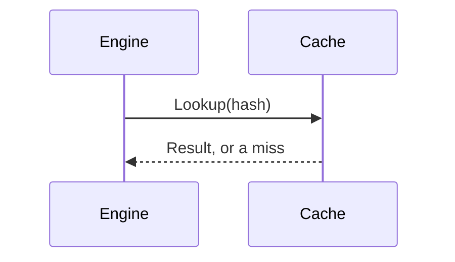

# Engine cache: technical spec

## Source

- **Epic:** loop-a3f8
- **Source:** `docs/prd/engine-cache.md`
- **Stories covered:** US-01

## Scope check

**Components:** the engine cache.
**Not in this spec:** the results screen, which the results-screen epic owns.

## Decisions

- **The cache keys on the strategy hash.** We chose the hash over the name, because a renamed
  strategy keeps its results.

## Assumptions

- One machine holds the cache. This is wrong if the cache grows past 1 GB.

## Approach

The engine reads the cache before it evaluates a strategy.

## Domain model

None.

## Interfaces

```go
func Lookup(hash string) (Result, bool)
```

## Data

None.

## Flows



## Work

1. **The cache.** Add the cache and its lookup.
   - Files: `engine/cache/**`
   - Needs: nothing
   - Proves: C1
   - Done when: a second run of one strategy reads the cache.

## Out of scope

- The results screen. It belongs to the results-screen epic.

## Contracts

**C1. Behaviour: a second run reads the cache.** Proves A1. A second run of one strategy evaluates
nothing. *An example test.*

## Observable behaviour

None, because this epic draws nothing.

## Open questions

None.
