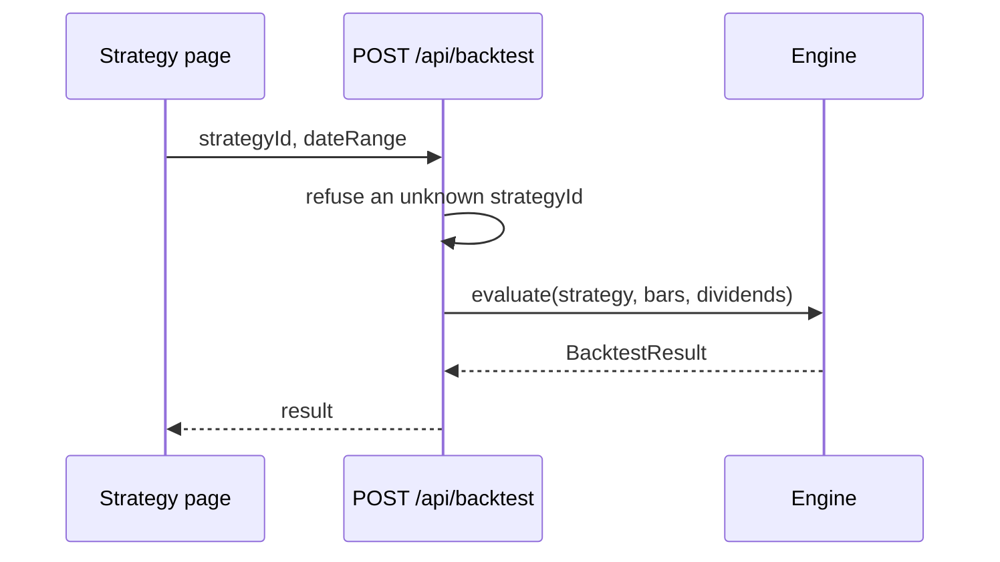

# <Title of the epic>: technical spec

> Copy this file to `docs/plans/<epic id>-<slug>-spec.md`. You write it from the epic's source: a
> PRD for a feature epic, and a set of ADRs for an architecture epic. Three readers follow: the
> doc-reviewer, then the operator, then the decomposer.
>
> **This document is the last document a person reads.** No person reads the tickets, the code or
> the merges after it. So the operator argues with your decisions here. A decision that you hide in
> this document ships with nobody reading it.
>
> Each section below has a worked example. All the examples come from one imaginary epic, a
> backtest engine, so they fit together. They match the examples in the PRD template. Delete them,
> and this block, and write your own. They show the shape and the level of detail. Do not adapt
> them.

## Source

- **Epic:** <epic id>
- **Source:** `docs/prd/<slug>.md` for a feature epic. For an architecture epic, list
  each `docs/adr/NNNN-<slug>.md` whose `**Ticket:**` line names this epic.
- **Stories covered:** <US-nn, US-nn>, or none for an architecture epic, which no story asks for.

## Scope check

Do this first. **One spec covers one epic, and at most two components.** A component is one thing
that a reader can understand on its own: one page, one service, one module, one job.

Write one component when you can. A small spec reaches review sooner, and a reviewer reads all of
it. Write a second component only when the first cannot work without it, for example the producer
of the numbers that a screen shows. Under the second component, write one line that says why it
cannot be an epic of its own. An epic that needs a third component is two epics. Say so under Open
questions, and propose the split.

Cut the work entries so that each one lands in one component and proves its own contracts. A work
entry must not need another component that is not built yet. Its tests must pass with that entry
alone. A reviewer judges a diff, and a diff that changes three areas at once is too wide to judge.

> **Good**
>
> **Components:**
>
> 1. The backtest results screen.
> 2. The backtest evaluator. Why not its own epic: the screen shows nothing until the evaluator
>    stores a result, and no other epic reads that result yet.
>
> Work entries 1 to 3 build the evaluator and prove its contracts with no screen. Entries 4 and 5
> build the screen on the evaluator's result type. Each entry changes one component.
>
> **Bad, and why**
>
> - ~~"Work entry 2: the evaluator and the results screen."~~ That entry changes two components,
>   so its diff is too wide to judge. Cut it into two entries.
> - ~~"Components: the trading system."~~ That is not a component. Nobody can understand it as one
>   thing.
> - ~~"Components: whatever US-07 needs."~~ This leaves the decision to the decomposer, which has
>   less context than you and no authority to make it.

**Components:** <one, or two. A second one carries a line that says why it cannot be its own epic>
**Not in this spec:** <the neighbours, and which spec owns each>

## Decisions

The reviewer reads this section first, and may read nothing else. Put every choice here that would
be expensive to undo: data shapes, a new dependency, an external service, a boundary between
modules, and anything that later epics inherit.

Write one line per decision. **Name the alternative that you rejected, and why.** A choice with no
alternative is not a decision. It is an assumption, and assumptions go in the next section.

> **Good**
>
> - **The engine interprets strategies. It does not compile them.** We chose one evaluator that
>   reads the parameter table. We rejected generated code per strategy, because every template is
>   declarative and none needs control flow.
> - **One evaluator runs with either clock.** A historical cursor or a daily cursor drives it. We
>   rejected separate backtest and live paths, because the PRD requires that a backtest tests
>   exactly what deploys.
>
> **Bad, and why**
>
> - ~~"Use Postgres for storage."~~ This names no alternative and gives no reason. The reviewer
>   cannot disagree with it, so nobody reviews it.
> - ~~"The engine should be fast and maintainable."~~ This is a wish, not a choice.

- **<Decision>.** We chose <X> over <Y>, because <reason>.

## Assumptions

An assumption is something that you take as true without proof. The reviewer's second job is to
find a wrong one. Every ticket below inherits an assumption, so one wrong assumption makes the whole
epic wrong.

State **what would prove it false**. That makes an assumption checkable.

> **Good**
>
> - Daily bars for the whole universe over ten years fit in one database on one machine. This is
>   wrong when the row count is more than about 20 million.
> - The data vendor returns dividends with ex-dates, not only amounts. This is wrong when the
>   response omits the ex-date.
>
> **Bad.** ~~"Performance will be acceptable."~~ Nothing could falsify it, so nobody can check it.

- <Assumption>. This is wrong if <what would falsify it>.

## Approach

Describe how you build the epic, in enough detail that the decomposer can cut tickets and invent
nothing. Prose is acceptable here. Name the modules and the boundaries between them. Do not write
the code.

> **Good**
>
> The engine is a pure evaluator. It takes a parsed strategy, a bar series and a dividend series,
> and it returns a result. It does no input or output. That makes it testable with no fixtures on
> disk, and usable by both the backtest and the daily job.
>
> An interface hides the bar cursor on purpose. It exposes only today's close and tomorrow's open.
> The engine cannot read a future bar, so the design prevents look-ahead. No implementer has to
> remember to avoid it.

## Domain model

**Every change to the domain, or the word None.** You must write this section. A missing section
reads as "I forgot".

The domain is the set of types that the business logic uses, and it uses no others. Domain objects
go into a service and come out of it. The API translates a request into domain objects, and the
repository translates domain objects into what the store holds. Neither a request shape nor a stored
record ever reaches a service.

State the invariants, not only the fields. An invariant is a rule that holds for every value of the
type, and a contract usually proves it.

Name the structure, not only the type. A value with modes is a state machine. A rule that branches
on a kind is a tagged union or a lookup table. Fields that always travel together are one typed
object. When your design keeps a chain of branches, or two flags that must agree, say why here.

**Good**

```
domain package (new)

Strategy            the fixed parameters, already checked
  invariant: every required parameter is present. Nothing can construct an invalid Strategy,
             so no service needs to check one.

BarSeries           ordered daily bars for one symbol
  invariant: ordered by date, ascending, no gaps. A gap is an error at construction.

Money               a decimal amount with a currency
  invariant: never a floating point number.
```

> **Bad, and why**
>
> - ~~"Add a result type."~~ This does not say where the type lives, or what it guarantees.
> - ~~"The service takes the request body."~~ This puts the API's shape inside the business logic.
> - ~~"Status is a string, and an archived flag is a boolean."~~ The two fields must agree, and
>   nothing in the type makes them agree. One state machine deletes the case where they disagree.

```
<the domain changes, or None>
```

## Interfaces

**Every type that crosses a boundary, written out.** A boundary is anywhere one module calls
another, anywhere a request enters, and anywhere data leaves the process.

Write these in terms of the domain types above. Write the signature, never the body. The
implementer chooses how. You choose what it must accept and return. This section stops two tickets
from inventing two shapes for one thing.

> **Good**

```ts
// the engine's only entry point
export function evaluate(strategy: Strategy, bars: BarSeries, dividends: DividendSeries): BacktestResult;

// The cursor makes look-ahead impossible. It exposes no way to reach a later index.
export interface BarCursor {
  closeToday(): number;
  openTomorrow(): number | undefined; // undefined at the last bar
}
```

> **Bad, and why**
>
> - ~~"The engine exposes an evaluate function."~~ This is prose, not a signature. Two tickets will
>   write two signatures.
> - ~~"See the types in the code."~~ The code does not exist yet. That is why the spec exists.

```
<the signatures that cross a boundary>
```

## Data

**Schemas and schema changes, or the word None.** A missing section reads as "I forgot". None reads
as "I checked".

Give the change, not a description of it. Say what happens to data that already exists, even when
the answer is "there is none". When the project has not chosen a store, write the shape as fields
and types. The first spec that needs storage chooses the store under Decisions, and names what it
rejected.

**Good**

```
backtest_run (new)
  id            unique identifier, primary
  strategyId    reference to strategy.id, required
  finalValue    decimal, 4 places, required

bars (changed)
  + dividend    decimal, 6 places, required, defaults to 0
```

> **Existing records:** none. The table `backtest_run` is empty before this epic.
>
> **Bad, and why**
>
> - ~~"Add a table for backtest runs."~~ This names no fields, no types and no keys.
> - ~~"decimal"~~ with no precision for money. Precision is a decision about what is right, not a
>   detail.

<the schema change, or None>

## Flows

**A diagram for every flow that this spec builds.** A flow is a sequence that crosses a boundary: a
request and its response, a job and its steps, a screen and what it calls.

Use Mermaid. It is text, so a reviewer sees what changed in a pull request diff. Draw one diagram
per flow. Put the failure branch on the diagram, because the failure branch is the part that people
skip.

> **Good**



> **Bad.** No diagram, because "the flow is obvious". When it is obvious, the diagram takes two
> minutes.

```mermaid
<one diagram per flow>
```

## Work

The decomposer cuts these entries into tickets. It may combine two entries or divide one, and it
may not change what the work promises. List the entries in the order of their dependencies. Say
what each one needs, and name the contracts that each one proves.

**An entry must claim every contract.** When no entry claims a contract, no test proves it, and no
person reads the code to notice.

**Each entry's contracts must be provable when that entry lands.** The implementer writes the test
first, and that test must fail before the code changes. When an entry's contracts cannot be proven
on their own, the cut is wrong. Merge the entry into the one it depends on, or move the contract.

An entry that draws a screen names its design references, when the project keeps them.

> **Good**
>
> 1. **Strategy parser.** Read a strategy file into the parameter struct. Refuse a file it cannot
>    parse, with an error that names the problem.
>    - Files: `engine/parse/**`
>    - Needs: nothing
>    - Proves: C3
>    - Done when: a file with a missing required parameter fails with an error that names it.
> 2. **Bar cursor.** Build the read-only window over a bar series.
>    - Files: `engine/cursor/**`
>    - Needs: nothing
>    - Proves: C1
>    - Done when: a property test proves that no sequence of calls reads a later bar.
>
> **Bad, and why**
>
> - ~~"Build the engine."~~ One ticket for the whole epic. Nobody can review it.
> - ~~"Write tests."~~ Tests belong to the ticket whose code they test, never to a ticket of their
>   own.

1. **<Title>.** <what changes>
   - Files: <paths or globs>
   - Needs: <an earlier entry, or nothing>
   - Proves: <the contracts, by number>
   - Done when: <an outcome that someone can observe>

## Out of scope

List what a reader would expect in this epic and will not find in it. This section stops the
decomposer from cutting tickets outside the epic. **Name the owner of each excluded part.** An
exclusion with no owner reads as an oversight, and someone does the work anyway.

> **Good**
>
> - Market data ingestion. It belongs to the market-data epic. This epic reads bars from the
>   database, and assumes that something else wrote them.
> - The results screen. It belongs to the results-screen epic.
>
> **Bad.** ~~"UI"~~ names no screen and no owner.

- <Thing>. It belongs to <an epic, a story, or never>.

## Contracts

**What this epic guarantees.** Each contract is a statement that is true or false of the finished
code. Each contract exists for a test to prove. A ticket that says "add tests" produces tests that
assert what the code happens to do. A ticket that says "prove C3" produces a test that fails when
C3 breaks.

### Rules

- **Number them.** C1, C2 and on. Tickets name contracts by number, and every test names the
  contract it proves. A contract with no test is unproven. A test that proves no contract is a
  contract that you did not write down, or it is noise.
- **Cite the criterion.** Write which PRD criterion each contract proves, as "C3 proves A2".
- **Each one must be falsifiable.** When you cannot say what observation would make it false, it is
  a hope, not a contract.
- **State the promise, never the implementation.** A contract stays true after a rewrite.
- **Include what must fail.** A refusal is a promise too, and people skip it.
- **Cover the boundaries between work entries.** Two correct units that disagree about a shape are
  the bug that unit tests miss.

### Kinds, and how each is proven

| Kind | Shape | Proven by |
| --- | --- | --- |
| **Invariant** | Always true, for all inputs | A property test over generated inputs |
| **Behaviour** | Given X, then exactly Y | A hand-computed fixture, or an example test |
| **Refusal** | Given bad X, fail in a named way | An example test that asserts the error, not only a failure |
| **Equivalence** | Two paths agree | Run both, and assert identical output |
| **Boundary** | Holds at the edges | Example tests at empty, one, and the limit |

Prefer the strongest kind the problem allows. An invariant that a test proves over a thousand
generated cases is worth more than ten examples that you chose. But a hand-computed fixture is
better than a property test when the value of the answer is the thing in doubt.

> **Good**
>
> **C1. Invariant: no look-ahead.** Proves A2. For any bar series and any cursor position, no
> sequence of engine calls returns data from an index greater than the cursor's.
> *Property test, 1000 generated series.*
>
> **C3. Refusal: a strategy with a missing parameter fails at load.** Proves A3. The error names
> the parameter. The strategy never runs with a default.
> *An example test per required parameter, which asserts that the error names it.*
>
> **Bad, and why**
>
> - ~~"C1: The engine calculates returns."~~ Against what? Nobody can turn this into a failing test.
> - ~~"C2: Add unit tests for the evaluator."~~ This is an activity, not a promise.
> - ~~"C4: Handles errors gracefully."~~ Which errors, failing how?

**C1. <Kind>: <short name>.** Proves <A-n>. <The promise, stated so that it is true or false.>
*<How a test proves it.>*

## Observable behaviour

List the flows that a person could watch, when this epic reaches a screen. Name the flow, not the
page. Write "None, because" and the reason, when the epic draws nothing. A skipped line reads as
forgotten.

> None, because this epic returns a result and draws nothing. The results-screen epic draws it.

## Open questions

List what the PRD did not settle, and what this spec could not decide alone. **Each one blocks the
sign-off.** The operator answers it, or defers it in writing, before this spec merges.

An empty section is the normal and good case. Never invent a question. A question that you can
answer by reading the sources is work that you did not finish.

> **Good**
>
> - The PRD says "ten years of history", and one symbol listed five years ago. Does it run from its
>   first day, or not at all? This blocks work entry 3.
>
> **Bad.** ~~"Is this the right approach?"~~ Nobody can answer this. Ask about one choice.

- <Question> This blocks <which work entry>.
